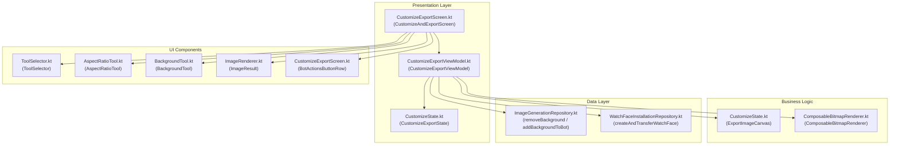
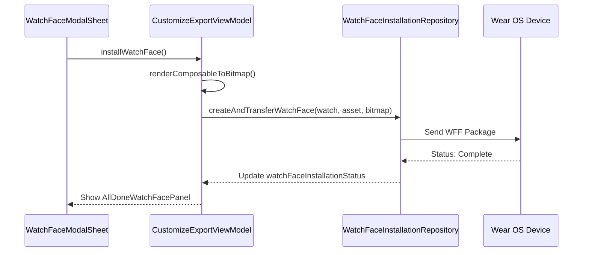

<!-- source: DeepWiki mcp.deepwiki.com · repo android/androidify · page 5.5 Customization and Export · fetched 2026-10-23 -->

# Customization and Export

Relevant source files

The following files were used as context for generating this wiki page:

- [core/testing/src/main/java/com/android/developers/testing/repository/FakeWatchFaceInstallationRepository.kt](core/testing/src/main/java/com/android/developers/testing/repository/FakeWatchFaceInstallationRepository.kt)
- [feature/results/src/main/java/com/android/developers/androidify/customize/AspectRatioTool.kt](feature/results/src/main/java/com/android/developers/androidify/customize/AspectRatioTool.kt)
- [feature/results/src/main/java/com/android/developers/androidify/customize/BackgroundTool.kt](feature/results/src/main/java/com/android/developers/androidify/customize/BackgroundTool.kt)
- [feature/results/src/main/java/com/android/developers/androidify/customize/CustomizeExportScreen.kt](feature/results/src/main/java/com/android/developers/androidify/customize/CustomizeExportScreen.kt)
- [feature/results/src/main/java/com/android/developers/androidify/customize/CustomizeExportViewModel.kt](feature/results/src/main/java/com/android/developers/androidify/customize/CustomizeExportViewModel.kt)
- [feature/results/src/main/java/com/android/developers/androidify/customize/CustomizeState.kt](feature/results/src/main/java/com/android/developers/androidify/customize/CustomizeState.kt)
- [feature/results/src/main/java/com/android/developers/androidify/customize/CustomizeTool.kt](feature/results/src/main/java/com/android/developers/androidify/customize/CustomizeTool.kt)
- [feature/results/src/main/java/com/android/developers/androidify/customize/GenericTool.kt](feature/results/src/main/java/com/android/developers/androidify/customize/GenericTool.kt)
- [feature/results/src/main/java/com/android/developers/androidify/customize/ToolSelector.kt](feature/results/src/main/java/com/android/developers/androidify/customize/ToolSelector.kt)
- [feature/results/src/main/java/com/android/developers/androidify/customize/watchface/AllDoneWatchFacePanel.kt](feature/results/src/main/java/com/android/developers/androidify/customize/watchface/AllDoneWatchFacePanel.kt)
- [feature/results/src/main/java/com/android/developers/androidify/customize/watchface/ErrorWatchFacePanel.kt](feature/results/src/main/java/com/android/developers/androidify/customize/watchface/ErrorWatchFacePanel.kt)
- [feature/results/src/main/java/com/android/developers/androidify/customize/watchface/GuidanceWatchFacePanel.kt](feature/results/src/main/java/com/android/developers/androidify/customize/watchface/GuidanceWatchFacePanel.kt)
- [feature/results/src/main/java/com/android/developers/androidify/customize/watchface/InstallAndroidifyPanel.kt](feature/results/src/main/java/com/android/developers/androidify/customize/watchface/InstallAndroidifyPanel.kt)
- [feature/results/src/main/java/com/android/developers/androidify/customize/watchface/InstallWatchFacePanel.kt](feature/results/src/main/java/com/android/developers/androidify/customize/watchface/InstallWatchFacePanel.kt)
- [feature/results/src/main/java/com/android/developers/androidify/customize/watchface/TransferringWatchFacePanel.kt](feature/results/src/main/java/com/android/developers/androidify/customize/watchface/TransferringWatchFacePanel.kt)
- [feature/results/src/main/java/com/android/developers/androidify/customize/watchface/WatchFaceModalSheet.kt](feature/results/src/main/java/com/android/developers/androidify/customize/watchface/WatchFaceModalSheet.kt)
- [feature/results/src/main/java/com/android/developers/androidify/customize/watchface/WatchFacePanelButton.kt](feature/results/src/main/java/com/android/developers/androidify/customize/watchface/WatchFacePanelButton.kt)
- [feature/results/src/main/res/drawable/outline_background_replace_24.xml](feature/results/src/main/res/drawable/outline_background_replace_24.xml)
- [feature/results/src/main/res/drawable/size_tool_icon.xml](feature/results/src/main/res/drawable/size_tool_icon.xml)
- [feature/results/src/main/res/values/strings.xml](feature/results/src/main/res/values/strings.xml)
- [watchface/src/main/java/com/android/developers/androidify/watchface/transfer/EmptyWatchFaceInstallationRepository.kt](watchface/src/main/java/com/android/developers/androidify/watchface/transfer/EmptyWatchFaceInstallationRepository.kt)
- [watchface/src/main/java/com/android/developers/androidify/watchface/transfer/WatchFaceInstallationRepository.kt](watchface/src/main/java/com/android/developers/androidify/watchface/transfer/WatchFaceInstallationRepository.kt)

This page documents the customization and export feature, which allows users to modify the generated Android bot image with different aspect ratios and backgrounds, then export it for sharing, downloading, or transferring to Wear OS devices as watch faces. This feature is implemented in the `feature/results` module.

For information about displaying the initial generation results, see [Results Feature](#5.4). For details about the AI background generation, see [Firebase AI and Generative Models](#4.1).

## Purpose and Scope

The Customization and Export feature provides:
- **Aspect ratio selection**: Six preset sizes including square, banner, wallpaper, social header, tablet wallpaper, and transparent sticker.
- **Background customization**: Static backgrounds (None, Plain, Lightspeed, I/O) and AI-generated "background vibes" (10 themed options).
- **Export capabilities**: Share via system intents, download to device storage, or transfer to Wear OS watch faces.
- **Adaptive layouts**: Optimized layouts for compact (phone), medium (tablet), and spatial (XR) form factors.

## Architecture Overview

The following diagram bridges the high-level system components with the specific code entities responsible for the customization and export flow.

**System to Code Entity Mapping**

**Sources**: [feature/results/src/main/java/com/android/developers/androidify/customize/CustomizeExportViewModel.kt:52-86](), [feature/results/src/main/java/com/android/developers/androidify/customize/CustomizeExportScreen.kt:104-145](), [feature/results/src/main/java/com/android/developers/androidify/customize/CustomizeState.kt:28-45]()

## ViewModel and State Management

### CustomizeExportViewModel

The `CustomizeExportViewModel` is an `AndroidViewModel` that uses Hilt's `AssistedFactory` pattern to receive navigation parameters for the result and original image URIs [feature/results/src/main/java/com/android/developers/androidify/customize/CustomizeExportViewModel.kt:52-69]().

**Key Dependencies**:
- `imageGenerationRepository`: AI operations like background removal [feature/results/src/main/java/com/android/developers/androidify/customize/CustomizeExportViewModel.kt:55]().
- `composableBitmapRenderer`: Renders Composables to bitmaps for export [feature/results/src/main/java/com/android/developers/androidify/customize/CustomizeExportViewModel.kt:56]().
- `watchfaceInstallationRepository`: Handles Wear OS device discovery and watch face transfers [feature/results/src/main/java/com/android/developers/androidify/customize/CustomizeExportViewModel.kt:57]().

### State Structure

The state is managed through a `StateFlow<CustomizeExportState>` that combines internal state with flows from the `WatchFaceInstallationRepository` to react to device connectivity and installation progress [feature/results/src/main/java/com/android/developers/androidify/customize/CustomizeExportViewModel.kt:72-86]().

**CustomizeExportState Key Properties**:
- `selectedTool`: Currently active tool, defaults to `CustomizeTool.Size` [feature/results/src/main/java/com/android/developers/androidify/customize/CustomizeState.kt:33]().
- `exportImageCanvas`: Holds the logic for layout and rendering parameters [feature/results/src/main/java/com/android/developers/androidify/customize/CustomizeState.kt:39]().
- `watchFaceInstallationStatus`: Tracks the multi-step process of sending a bot to a watch [feature/results/src/main/java/com/android/developers/androidify/customize/CustomizeState.kt:42]().

**Sources**: [feature/results/src/main/java/com/android/developers/androidify/customize/CustomizeExportViewModel.kt:71-86](), [feature/results/src/main/java/com/android/developers/androidify/customize/CustomizeState.kt:28-45]()

### ExportImageCanvas

The `ExportImageCanvas` data class represents the complete state of the image canvas. The `updateAspectRatioAndBackground` function [feature/results/src/main/java/com/android/developers/androidify/customize/CustomizeState.kt:92-238]() recalculates the following based on the selected `SizeOption` and `BackgroundOption`:
- `canvasSize`: The target resolution (e.g., 2000x2000 for Square) [feature/results/src/main/java/com/android/developers/androidify/customize/CustomizeState.kt:78]().
- `imageOffset` and `imageSize`: The relative position and scale of the bot on the background [feature/results/src/main/java/com/android/developers/androidify/customize/CustomizeState.kt:80-81]().
- `imageRotation`: Artistic tilt applied for specific layouts like Banner or Social Header [feature/results/src/main/java/com/android/developers/androidify/customize/CustomizeState.kt:82]().

## Customization Tools

### Tool Architecture

The customization system uses a generic tool pattern. `CustomizeTool` is an enum defining the top-level categories: `Size` and `Background` [feature/results/src/main/java/com/android/developers/androidify/customize/CustomizeTool.kt:21-24]().

**Size Tool (`SizeOption`)**:
Provides preset dimensions including `Square`, `Banner`, `Wallpaper`, `SocialHeader`, `WallpaperTablet`, and `Sticker` [feature/results/src/main/java/com/android/developers/androidify/customize/CustomizeTool.kt:31-45]().

**Background Tool (`BackgroundOption`)**:
Includes static assets like `Lightspeed` and `IO` [feature/results/src/main/java/com/android/developers/androidify/customize/CustomizeTool.kt:56-65](), as well as AI-generated options like `MusicLover` or `PoolMaven` [feature/results/src/main/java/com/android/developers/androidify/customize/CustomizeTool.kt:66-101]().

**Sources**: [feature/results/src/main/java/com/android/developers/androidify/customize/CustomizeTool.kt:21-101](), [feature/results/src/main/java/com/android/developers/androidify/customize/CustomizeState.kt:52-72]()

### AI Background and Sticker Generation

The `CustomizeExportViewModel` orchestrates background removal and AI generation:

1.  **Sticker Mode**: Triggers `triggerStickerBackgroundRemoval` [feature/results/src/main/java/com/android/developers/androidify/customize/CustomizeExportViewModel.kt:163-197](). This calls `imageGenerationRepository.removeBackground` and updates the state with the resulting transparent bitmap.
2.  **AI Backgrounds**: When an `aiBackground` option is selected, `onBackgroundOptionSelected` calls `triggerBackgroundGeneration` [feature/results/src/main/java/com/android/developers/androidify/customize/CustomizeExportViewModel.kt:258-292](). This sends the bot image and a specialized prompt to the AI repository.

**Sources**: [feature/results/src/main/java/com/android/developers/androidify/customize/CustomizeExportViewModel.kt:163-292](), [feature/results/src/main/java/com/android/developers/androidify/customize/CustomizeTool.kt:86-101]()

## Export and Watch Face Integration

### Export Flow

The ViewModel provides functions for sharing and downloading:
- `shareClicked()`: Renders the canvas to a bitmap and saves it to a temporary URI for the share intent [feature/results/src/main/java/com/android/developers/androidify/customize/CustomizeExportViewModel.kt:137-155]().
- `downloadClicked()`: Renders the canvas and saves it to external storage via the repository [feature/results/src/main/java/com/android/developers/androidify/customize/CustomizeExportViewModel.kt:294-323]().

### Watch Face Transfer

The app integrates with Wear OS to set the generated bot as a watch face. This is managed via the `WatchFaceModalSheet` [feature/results/src/main/java/com/android/developers/androidify/customize/watchface/WatchFaceModalSheet.kt:64-74]().

**Installation Logic Mapping**

**Key Components**:
- `WatchFaceModalSheet`: Displays the connected watch and available watch face styles [feature/results/src/main/java/com/android/developers/androidify/customize/watchface/WatchFaceModalSheet.kt:79-110]().
- `WatchFaceInstallationStatus`: A sealed class tracking states like `NotStarted`, `Preparing`, `Sending`, and `Complete` [feature/results/src/main/java/com/android/developers/androidify/wear/common/WatchFaceInstallationStatus.kt:1-25]().
- `installAndroidify`: If the companion app is missing, `launchPlayInstallOnWatch` opens the Play Store on the wearable [feature/results/src/main/java/com/android/developers/androidify/customize/CustomizeExportViewModel.kt:407-416]().

**Sources**: [feature/results/src/main/java/com/android/developers/androidify/customize/CustomizeExportViewModel.kt:331-416](), [feature/results/src/main/java/com/android/developers/androidify/customize/watchface/WatchFaceModalSheet.kt:64-154](), [core/testing/src/main/java/com/android/developers/testing/repository/FakeWatchFaceInstallationRepository.kt:51-67]()

## UI and Adaptive Layouts

The `CustomizeAndExportScreen` uses `calculateLayoutType` to determine the UI structure based on screen size and XR availability [feature/results/src/main/java/com/android/developers/androidify/customize/CustomizeExportScreen.kt:120]().

- **Compact (Phone)**: A vertical layout with the image preview at the top and tools at the bottom [feature/results/src/main/java/com/android/developers/androidify/customize/CustomizeExportScreen.kt:324-360]().
- **Medium (Tablet)**: A horizontal layout where the preview and tools sit side-by-side [feature/results/src/main/java/com/android/developers/androidify/customize/CustomizeExportScreen.kt:363-421]().
- **Spatial (XR)**: Uses `CustomizeExportLayoutSpatial` to place UI elements in 3D space [feature/results/src/main/java/com/android/developers/androidify/customize/xr/CustomizeExportLayoutSpatial.kt:1-131]().

**Sources**: [feature/results/src/main/java/com/android/developers/androidify/customize/CustomizeExportScreen.kt:120-145](), [feature/results/src/main/java/com/android/developers/androidify/customize/CustomizeExportScreen.kt:324-421]()

---

