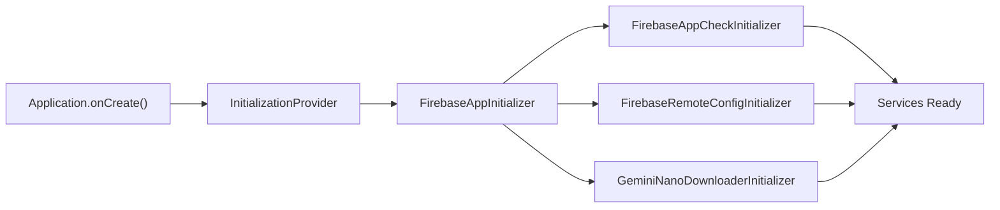
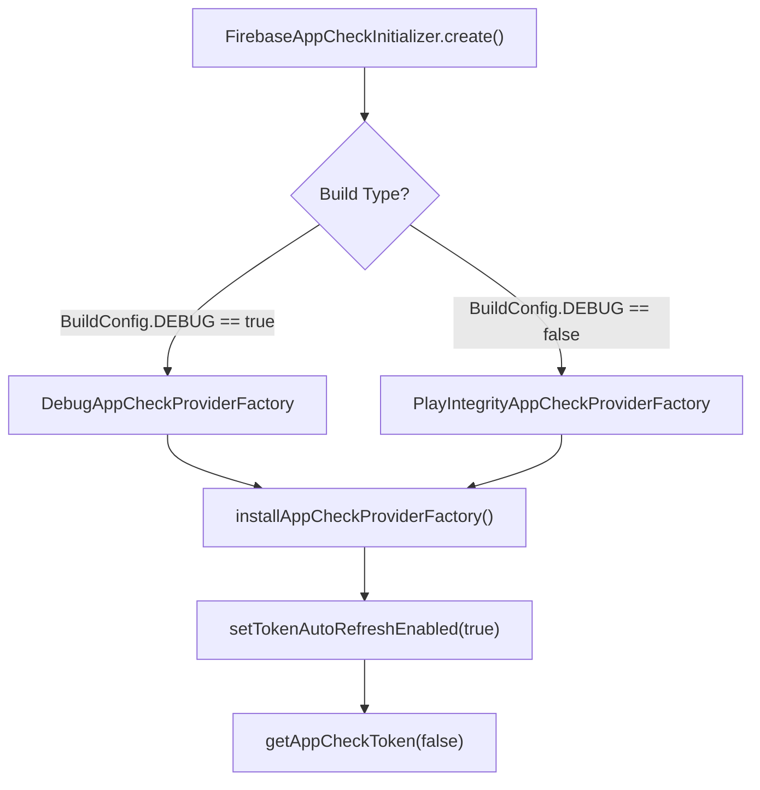
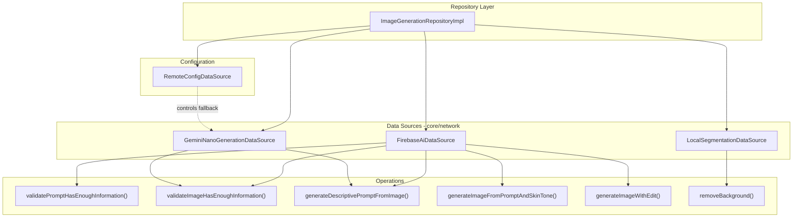
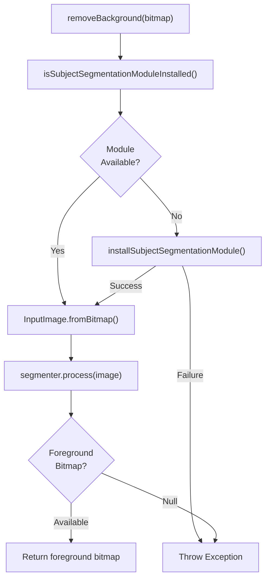
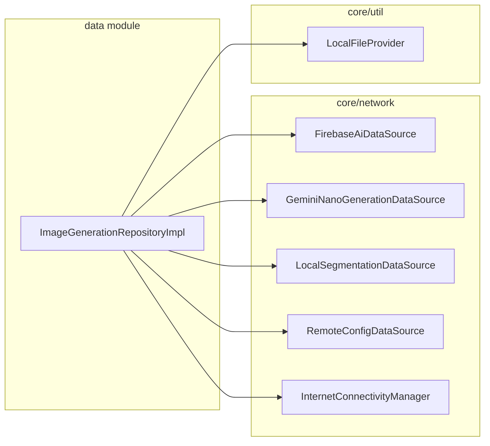

<!-- source: DeepWiki mcp.deepwiki.com · repo android/androidify · page 6.1 Network Layer · fetched 2026-10-23 -->

# Network Layer

<details>
<summary>Relevant source files</summary>

The following files were used as context for generating this wiki page:

- [app/src/main/AndroidManifest.xml](app/src/main/AndroidManifest.xml)
- [benchmark/src/main/kotlin/com/android/developers/androidify/baselineprofile/BaselineProfileGenerator.kt](benchmark/src/main/kotlin/com/android/developers/androidify/baselineprofile/BaselineProfileGenerator.kt)
- [benchmark/src/main/kotlin/com/android/developers/androidify/benchmark/PromptBenchmark.kt](benchmark/src/main/kotlin/com/android/developers/androidify/benchmark/PromptBenchmark.kt)
- [core/network/build.gradle.kts](core/network/build.gradle.kts)
- [core/network/src/main/java/com/android/developers/androidify/di/NetworkModule.kt](core/network/src/main/java/com/android/developers/androidify/di/NetworkModule.kt)
- [core/network/src/main/java/com/android/developers/androidify/di/OnDeviceModule.kt](core/network/src/main/java/com/android/developers/androidify/di/OnDeviceModule.kt)
- [core/network/src/main/java/com/android/developers/androidify/ondevice/LocalSegmentationDataSource.kt](core/network/src/main/java/com/android/developers/androidify/ondevice/LocalSegmentationDataSource.kt)
- [core/network/src/main/java/com/android/developers/androidify/startup/FirebaseAppCheckInitializer.kt](core/network/src/main/java/com/android/developers/androidify/startup/FirebaseAppCheckInitializer.kt)
- [core/testing/build.gradle.kts](core/testing/build.gradle.kts)
- [core/util/build.gradle.kts](core/util/build.gradle.kts)
- [core/util/src/main/java/com/android/developers/androidify/util/LocalFileProvider.kt](core/util/src/main/java/com/android/developers/androidify/util/LocalFileProvider.kt)
- [data/build.gradle.kts](data/build.gradle.kts)
- [data/src/main/java/com/android/developers/androidify/data/ImageGenerationRepository.kt](data/src/main/java/com/android/developers/androidify/data/ImageGenerationRepository.kt)
- [feature/results/src/main/java/com/android/developers/androidify/customize/ComposableBitmapRendererImpl.kt](feature/results/src/main/java/com/android/developers/androidify/customize/ComposableBitmapRendererImpl.kt)
- [feature/results/src/test/kotlin/com/android/developers/androidify/customize/CustomizeStateTest.kt](feature/results/src/test/kotlin/com/android/developers/androidify/customize/CustomizeStateTest.kt)

</details>


## Purpose and Scope

The Network Layer provides centralized infrastructure for external communication and service integration. This module (`core/network`) encapsulates HTTP networking, Firebase service initialization, AI/ML service integration, and connectivity management. The layer abstracts cloud-based AI services (Firebase AI, Vertex AI) and on-device ML capabilities (Gemini Nano, ML Kit) behind unified data source interfaces.

For information about the repository pattern that orchestrates these services, see [Data Layer](#6.2). For AI/ML model details and generation logic, see [AI and ML Integration](#4).

**Sources:** [core/network/build.gradle.kts:1-82](), [data/src/main/java/com/android/developers/androidify/data/ImageGenerationRepository.kt:1-167]()

---

## Module Structure

The `core/network` module is organized into several functional areas:

| Component | Purpose | Key Classes |
|-----------|---------|-------------|
| **Initialization** | Firebase service bootstrapping via App Startup | `FirebaseAppInitializer`, `FirebaseAppCheckInitializer`, `FirebaseRemoteConfigInitializer`, `GeminiNanoDownloaderInitializer` |
| **AI Data Sources** | Cloud and on-device AI service wrappers | `FirebaseAiDataSource`, `GeminiNanoDataSource`, `GeminiNanoGenerationDataSource` |
| **ML Kit Integration** | On-device ML capabilities | `LocalSegmentationDataSource`, pose detection utilities |
| **Configuration** | Remote feature flag management | `RemoteConfigDataSource` |
| **Connectivity** | Network state monitoring | `InternetConnectivityManager` |
| **HTTP Infrastructure** | Retrofit/OkHttp configuration | Network clients and interceptors |

**Sources:** [core/network/build.gradle.kts:48-75](), [data/src/main/java/com/android/developers/androidify/data/ImageGenerationRepository.kt:46-53]()

---

## Module Dependencies

The network layer sits at the foundation of the application's external communication infrastructure:

```mermaid
graph TB
    subgraph "Feature Modules"
        ["feature/camera"]
        ["feature/creation"]
        ["feature/results"]
    end
    
    subgraph "Data Layer"
        ["data module"]
        IMG_REPO["ImageGenerationRepository"]
    end
    
    subgraph "Core Network"
        NETWORK["core/network"]
        FIREBASE_DS["FirebaseAiDataSource"]
        NANO_DS["GeminiNanoDataSource"]
        SEG_DS["LocalSegmentationDataSource"]
        REMOTE_CFG["RemoteConfigDataSource"]
        CONN_MGR["InternetConnectivityManager"]
    end
    
    subgraph "External Services"
        FIREBASE["Firebase Services"]
        VERTEX["Vertex AI"]
        MLKIT["ML Kit"]
        NANO["Gemini Nano"]
    end
    
    subgraph "Infrastructure"
        UTIL["core/util"]
        HILT["Hilt DI"]
    end
    
    ["feature/camera"] --> ["data module"]
    ["feature/creation"] --> ["data module"]
    ["feature/results"] --> ["data module"]
    
    ["data module"] --> IMG_REPO
    IMG_REPO --> FIREBASE_DS
    IMG_REPO --> NANO_DS
    IMG_REPO --> SEG_DS
    IMG_REPO --> REMOTE_CFG
    IMG_REPO --> CONN_MGR
    
    FIREBASE_DS --> NETWORK
    NANO_DS --> NETWORK
    SEG_DS --> NETWORK
    REMOTE_CFG --> NETWORK
    CONN_MGR --> NETWORK
    
    NETWORK --> FIREBASE
    NETWORK --> VERTEX
    NETWORK --> MLKIT
    NETWORK --> NANO
    
    NETWORK --> UTIL
    HILT -.injects.-> NETWORK
```

**Sources:** [core/network/build.gradle.kts:48-82](), [data/build.gradle.kts:32-47]()

---

## Firebase Service Initialization

Firebase services are initialized during application startup using the AndroidX App Startup library. This approach ensures services are ready before any feature modules need them, without requiring manual initialization code in the `Application` class.

### Initialization Sequence



The manifest declares these initializers in the `InitializationProvider`:

[app/src/main/AndroidManifest.xml:58-75]()

**Sources:** [app/src/main/AndroidManifest.xml:58-75]()

### FirebaseAppCheckInitializer

`FirebaseAppCheckInitializer` configures `FirebaseAppCheck` to protect backend resources from abuse. The implementation uses different providers based on build type:

- **Debug builds**: `DebugAppCheckProviderFactory` for local development [core/network/src/main/java/com/android/developers/androidify/startup/FirebaseAppCheckInitializer.kt:41-43]()
- **Release builds**: `PlayIntegrityAppCheckProviderFactory` for production security [core/network/src/main/java/com/android/developers/androidify/startup/FirebaseAppCheckInitializer.kt:46-48]()



Key implementation details:

[core/network/src/main/java/com/android/developers/androidify/startup/FirebaseAppCheckInitializer.kt:34-62]()

The initializer depends on `FirebaseAppInitializer`, ensuring Firebase is configured before App Check:

[core/network/src/main/java/com/android/developers/androidify/startup/FirebaseAppCheckInitializer.kt:64-67]()

**Sources:** [core/network/src/main/java/com/android/developers/androidify/startup/FirebaseAppCheckInitializer.kt:1-67]()

---

## HTTP Networking Infrastructure

The network layer uses Retrofit and OkHttp for HTTP communication. Dependencies are configured in the module's build file:

| Library | Purpose | Version Source |
|---------|---------|----------------|
| `retrofit` | Type-safe HTTP client | `libs.retrofit` |
| `converter-gson` | JSON serialization (Gson) | `libs.converter.gson` |
| `retrofit-kotlin-serialization` | Kotlin serialization support | `libs.retrofit.kotlin.serialization` |
| `okhttp` | HTTP client implementation | `libs.okhttp` |
| `logging-interceptor` | HTTP request/response logging | `libs.logging.interceptor` |

[core/network/build.gradle.kts:51-57]()

Additional network-aware components:

- **Coil integration** for image loading with network support:
  - `coil-compose` - Compose integration
  - `coil-compose-http` - HTTP support
  - `coil-gif` - GIF animation support

[core/network/build.gradle.kts:58-60]()

**Sources:** [core/network/build.gradle.kts:48-60]()

---

## AI Data Source Architecture

The network layer provides data sources that abstract AI/ML service access. The `ImageGenerationRepository` orchestrates these data sources, implementing fallback logic and feature flag integration.



**Sources:** [data/src/main/java/com/android/developers/androidify/data/ImageGenerationRepository.kt:46-53]()

### Fallback Strategy

The repository implements intelligent fallback from on-device to cloud processing:

**Image Validation Fallback:**

[data/src/main/java/com/android/developers/androidify/data/ImageGenerationRepository.kt:58-69]()

The method first attempts validation using `GeminiNanoGenerationDataSource` (if enabled via `RemoteConfigDataSource`), then falls back to `FirebaseAiDataSource` if the on-device validation fails or is unavailable.

**Description Generation Fallback:**

[data/src/main/java/com/android/developers/androidify/data/ImageGenerationRepository.kt:95-114]()

Similar fallback logic applies to image description generation, with logging to track which provider is used.

**Sources:** [data/src/main/java/com/android/developers/androidify/data/ImageGenerationRepository.kt:55-114]()

---

## ML Kit Integration

ML Kit provides on-device machine learning capabilities. The network layer integrates **Subject Segmentation** for background removal via `LocalSegmentationDataSource`.

### LocalSegmentationDataSource

`LocalSegmentationDataSource` implements background removal using ML Kit's Subject Segmentation API. The implementation handles dynamic module installation via `ModuleInstallClient` since subject segmentation is not bundled by default.



**Key Implementation Details:**

**Segmenter Configuration:**
The `segmenter` is lazily initialized with `SubjectSegmenterOptions` configured to `enableForegroundBitmap()` [core/network/src/main/java/com/android/developers/androidify/ondevice/LocalSegmentationDataSource.kt:42-47]().

**Module Availability Check:**
Uses `moduleInstallClient.areModulesAvailable(segmenter)` to verify if the model is on-device [core/network/src/main/java/com/android/developers/androidify/ondevice/LocalSegmentationDataSource.kt:49-61]().

**Module Installation:**
If unavailable, `installSubjectSegmentationModule()` triggers a download via `moduleInstallClient.installModules()` [core/network/src/main/java/com/android/developers/androidify/ondevice/LocalSegmentationDataSource.kt:80-99](). A `CustomInstallStatusListener` handles progress updates [core/network/src/main/java/com/android/developers/androidify/ondevice/LocalSegmentationDataSource.kt:62-79]().

**Background Removal Execution:**
Once the module is ready, the bitmap is converted to `InputImage` and processed by `segmenter.process(image)` [core/network/src/main/java/com/android/developers/androidify/ondevice/LocalSegmentationDataSource.kt:101-128]().

**Sources:** [core/network/src/main/java/com/android/developers/androidify/ondevice/LocalSegmentationDataSource.kt:1-131]()

### ML Kit Manifest Configuration

The application manifest declares ML Kit dependencies to enable automatic module download:

[app/src/main/AndroidManifest.xml:106-108]()

**Sources:** [app/src/main/AndroidManifest.xml:106-108]()

---

## Internet Connectivity Management

The `InternetConnectivityManager` monitors network availability and enforces connectivity requirements for cloud operations. The repository checks connectivity before making network calls:

[data/src/main/java/com/android/developers/androidify/data/ImageGenerationRepository.kt:152-156]()

This method is invoked before operations that require internet access, such as `generateFromDescription` [data/src/main/java/com/android/developers/androidify/data/ImageGenerationRepository.kt:76]() and `getDescriptionFromImage` [data/src/main/java/com/android/developers/androidify/data/ImageGenerationRepository.kt:89]().

When connectivity is unavailable, a `NoInternetException` is thrown.

**Sources:** [data/src/main/java/com/android/developers/androidify/data/ImageGenerationRepository.kt:48-156]()

---

## Dependency Injection Configuration

The network layer is provided through Hilt dependency injection. The module's build configuration includes Hilt and KSP dependencies:

[core/network/build.gradle.kts:19-20]()
[core/network/build.gradle.kts:54-55]()
[core/network/build.gradle.kts:75]()

Data sources are injected as singletons into the `ImageGenerationRepositoryImpl`:

[data/src/main/java/com/android/developers/androidify/data/ImageGenerationRepository.kt:45-53]()

**Sources:** [core/network/build.gradle.kts:19-75](), [data/src/main/java/com/android/developers/androidify/data/ImageGenerationRepository.kt:45-53]()

---

## Build Configuration

The network module enables build configuration for debug/release variants:

[core/network/build.gradle.kts:28-38]()

This allows conditional behavior based on build type, such as Firebase App Check provider selection:

[core/network/src/main/java/com/android/developers/androidify/startup/FirebaseAppCheckInitializer.kt:36-49]()

**Android Testing Disabled:**
The module explicitly disables instrumented tests to optimize build times as it primarily provides infrastructure:

[core/network/build.gradle.kts:41-46]()

**Sources:** [core/network/build.gradle.kts:28-46]()

---

## Testing Support

The network layer includes test dependencies for unit testing:

| Dependency | Purpose |
|------------|---------|
| `play-services-base-testing` | Google Play Services test utilities |
| `junit` | JUnit testing framework |
| `kotlinx-coroutines-test` | Coroutine testing utilities |
| `robolectric` | Android framework mocking |

[core/network/build.gradle.kts:77-80]()

The `core/testing` module provides test doubles for network layer components, enabling feature modules to test in isolation [core/testing/build.gradle.kts:42-44]().

**Sources:** [core/network/build.gradle.kts:77-82](), [core/testing/build.gradle.kts:42-44]()

---

## Integration with Data Layer

The data layer depends on the network module to access external services:

[data/build.gradle.kts:33]()

The `ImageGenerationRepositoryImpl` demonstrates how the network layer is consumed:



All dependencies are constructor-injected, enabling clear dependency relationships:

[data/src/main/java/com/android/developers/androidify/data/ImageGenerationRepository.kt:46-53]()

**Sources:** [data/build.gradle.kts:32-34](), [data/src/main/java/com/android/developers/androidify/data/ImageGenerationRepository.kt:45-53]()

---

