<!-- source: DeepWiki mcp.deepwiki.com · repo android/androidify · page 6.2 Data Layer · fetched 2026-10-23 -->

# Data Layer

Relevant source files

The following files were used as context for generating this wiki page:

- [app/src/main/AndroidManifest.xml](app/src/main/AndroidManifest.xml)
- [app/src/main/java/com/android/developers/androidify/AndroidifyApplication.kt](app/src/main/java/com/android/developers/androidify/AndroidifyApplication.kt)
- [app/src/main/java/com/android/developers/androidify/CrashlyticsTree.kt](app/src/main/java/com/android/developers/androidify/CrashlyticsTree.kt)
- [app/src/main/java/com/android/developers/androidify/MainActivity.kt](app/src/main/java/com/android/developers/androidify/MainActivity.kt)
- [core/network/src/main/java/com/android/developers/androidify/ondevice/LocalSegmentationDataSource.kt](core/network/src/main/java/com/android/developers/androidify/ondevice/LocalSegmentationDataSource.kt)
- [core/network/src/main/java/com/android/developers/androidify/startup/FirebaseAppCheckInitializer.kt](core/network/src/main/java/com/android/developers/androidify/startup/FirebaseAppCheckInitializer.kt)
- [core/network/src/main/java/com/android/developers/androidify/startup/FirebaseRemoteConfigInitializer.kt](core/network/src/main/java/com/android/developers/androidify/startup/FirebaseRemoteConfigInitializer.kt)
- [core/testing/src/main/java/com/android/developers/testing/repository/FakeDropImageFactory.kt](core/testing/src/main/java/com/android/developers/testing/repository/FakeDropImageFactory.kt)
- [core/util/src/main/java/com/android/developers/androidify/util/LocalFileProvider.kt](core/util/src/main/java/com/android/developers/androidify/util/LocalFileProvider.kt)
- [data/src/main/java/com/android/developers/androidify/data/DataModule.kt](data/src/main/java/com/android/developers/androidify/data/DataModule.kt)
- [data/src/main/java/com/android/developers/androidify/data/DropBehaviourFactory.kt](data/src/main/java/com/android/developers/androidify/data/DropBehaviourFactory.kt)
- [data/src/main/java/com/android/developers/androidify/data/GeminiNanoGenerationDataSource.kt](data/src/main/java/com/android/developers/androidify/data/GeminiNanoGenerationDataSource.kt)
- [data/src/main/java/com/android/developers/androidify/data/ImageGenerationRepository.kt](data/src/main/java/com/android/developers/androidify/data/ImageGenerationRepository.kt)
- [data/src/main/java/com/android/developers/androidify/data/InternetConnectivityManager.kt](data/src/main/java/com/android/developers/androidify/data/InternetConnectivityManager.kt)
- [data/src/main/java/com/android/developers/androidify/data/TextGenerationRepository.kt](data/src/main/java/com/android/developers/androidify/data/TextGenerationRepository.kt)
- [feature/results/src/main/java/com/android/developers/androidify/customize/ComposableBitmapRendererImpl.kt](feature/results/src/main/java/com/android/developers/androidify/customize/ComposableBitmapRendererImpl.kt)
- [feature/results/src/test/kotlin/com/android/developers/androidify/customize/CustomizeStateTest.kt](feature/results/src/test/kotlin/com/android/developers/androidify/customize/CustomizeStateTest.kt)

## Purpose and Scope

The Data Layer serves as the central aggregation point for network and storage operations in the Androidify application. It implements the repository pattern to abstract data source complexity from feature modules, providing clean interfaces for AI operations, file management, and connectivity checks. This layer orchestrates interactions between Firebase AI services, on-device ML models, local file storage, and external storage through a unified API.

For details about specific AI/ML integrations that the data layer coordinates, see [AI and ML Integration](4). For information about the underlying network services, see [Network Layer](6.1). For file and storage utilities used by this layer, see [Utilities](6.4).

## Module Structure

The `data` module is a pure Android library module that depends on `core/network` and `core/util` to provide repository implementations for feature modules.

### Dependencies

| Dependency | Purpose |
|------------|---------|
| `core/network` | Firebase AI, ML Kit, Remote Config data sources |
| `core/util` | File provider, layout utilities, coroutine dispatchers |
| Hilt | Dependency injection for repositories |
| Timber | Logging infrastructure |

**Dependency Graph:**

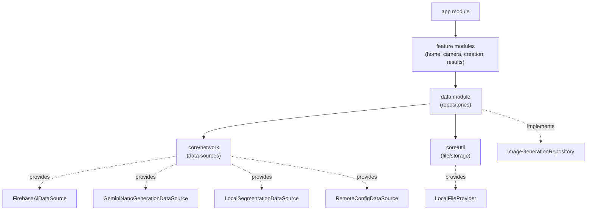

Sources: [data/src/main/java/com/android/developers/androidify/data/DataModule.kt:1-75](), [core/network/src/main/java/com/android/developers/androidify/ondevice/LocalSegmentationDataSource.kt:1-131]()

### Module Configuration

The data module is configured with Hilt to bind implementation classes to their respective interfaces, ensuring a clean separation between API and implementation.

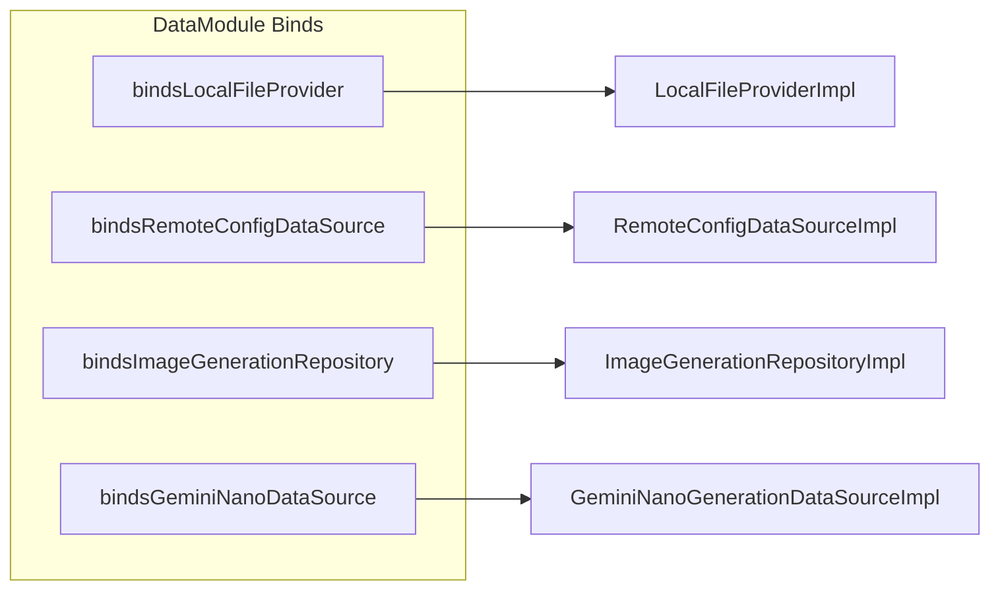

Sources: [data/src/main/java/com/android/developers/androidify/data/DataModule.kt:34-75]()

## Repository Pattern Implementation

The data layer implements the repository pattern through interface-implementation pairs, allowing feature modules to depend on abstractions while Hilt provides concrete implementations at runtime.

### Repository Interface Design

The `ImageGenerationRepository` interface defines the contract for all AI image generation and manipulation operations:

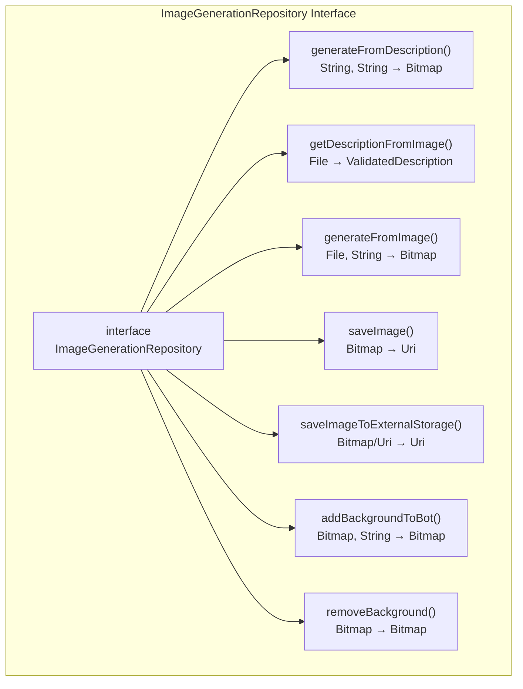

Sources: [data/src/main/java/com/android/developers/androidify/data/ImageGenerationRepository.kt:33-43]()

### Implementation Class Structure

The `ImageGenerationRepositoryImpl` is a singleton that aggregates multiple data sources:

| Component | Type | Purpose |
|-----------|------|---------|
| `LocalFileProvider` | Dependency | Handles file I/O and storage operations |
| `InternetConnectivityManager` | Dependency | Checks network availability |
| `GeminiNanoGenerationDataSource` | Dependency | On-device AI processing |
| `FirebaseAiDataSource` | Dependency | Cloud-based AI services |
| `RemoteConfigDataSource` | Dependency | Feature flags and configuration |
| `LocalSegmentationDataSource` | Dependency | On-device background removal |

Sources: [data/src/main/java/com/android/developers/androidify/data/ImageGenerationRepository.kt:45-53]()

## ImageGenerationRepository Details

### Core Operations

The repository provides three primary workflows:

**1. Text-to-Image Generation**

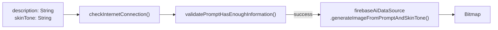

Sources: [data/src/main/java/com/android/developers/androidify/data/ImageGenerationRepository.kt:72-86]()

**2. Image-to-Image Generation**

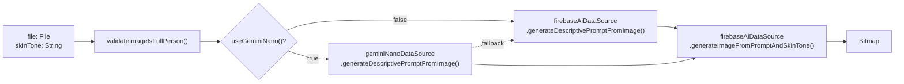

Sources: [data/src/main/java/com/android/developers/androidify/data/ImageGenerationRepository.kt:116-129](), [data/src/main/java/com/android/developers/androidify/data/ImageGenerationRepository.kt:88-114]()

**3. Background Manipulation**

The repository handles background removal using `LocalSegmentationDataSource` (ML Kit) and background addition via `FirebaseAiDataSource` (Imagen/Gemini).

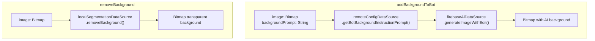

Sources: [data/src/main/java/com/android/developers/androidify/data/ImageGenerationRepository.kt:158-166](), [core/network/src/main/java/com/android/developers/androidify/ondevice/LocalSegmentationDataSource.kt:35-37]()

### Validation Logic

The repository implements a two-tier validation strategy with fallback mechanisms:

**Image Validation with Fallback**

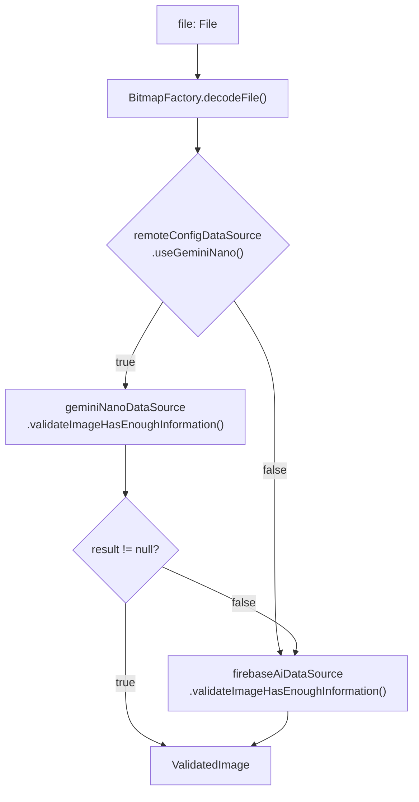

Sources: [data/src/main/java/com/android/developers/androidify/data/ImageGenerationRepository.kt:58-69]()

## File Storage Operations

The repository delegates all file operations to `LocalFileProvider` but orchestrates the workflow for different storage destinations.

### Storage Workflow Comparison

| Operation | Storage Location | URI Type | Use Case |
|-----------|-----------------|----------|----------|
| `saveImage()` | Internal cache | `content://` via FileProvider | Temporary sharing |
| `saveImageToExternalStorage(Bitmap)` | MediaStore Pictures | `content://` | Permanent save |
| `saveImageToExternalStorage(Uri)` | MediaStore Pictures | `content://` | Copy original input |

**Internal Cache Storage Flow:**

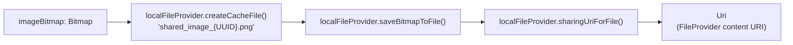

Sources: [data/src/main/java/com/android/developers/androidify/data/ImageGenerationRepository.kt:131-135](), [core/util/src/main/java/com/android/developers/androidify/util/LocalFileProvider.kt:38-60]()

### Drag and Drop Support

The data layer includes a `DropBehaviourFactory` to handle image drops from other apps. It manages temporary file creation and URI permission handling.

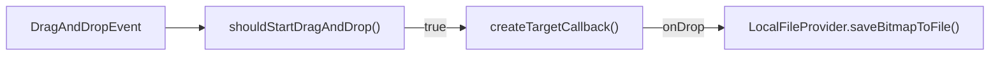

Sources: [data/src/main/java/com/android/developers/androidify/data/DropBehaviourFactory.kt:31-42](), [data/src/main/java/com/android/developers/androidify/data/DropBehaviourFactory.kt:70-98]()

## Data Flow and Orchestration

The repository orchestrates complex multi-step workflows by coordinating multiple data sources based on remote configuration.

### Description Generation Pipeline

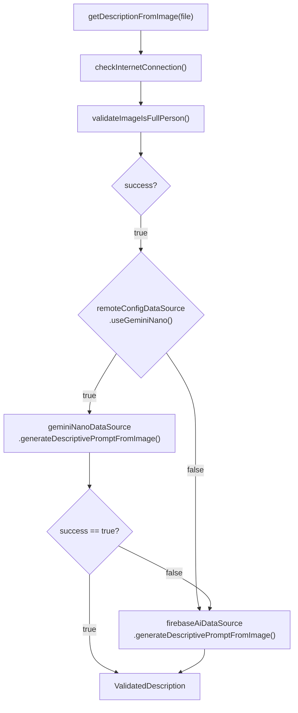

Sources: [data/src/main/java/com/android/developers/androidify/data/ImageGenerationRepository.kt:88-114]()

## Error Handling

The data layer defines custom exception types to communicate specific failure modes to feature modules.

| Exception | Thrown When | Thrown From |
|-----------|-------------|-------------|
| `NoInternetException` | No network connectivity | `checkInternetConnection()` |
| `InsufficientInformationException` | Prompt validation fails | `generateFromDescription()` |
| `ImageValidationException` | Image validation fails | `getDescriptionFromImage()` |
| `ImageDescriptionFailedGenerationException` | Description generation fails | `generateFromImage()` |

Sources: [data/src/main/java/com/android/developers/androidify/data/ImageGenerationRepository.kt:152-156](), [data/src/main/java/com/android/developers/androidify/data/ImageGenerationRepository.kt:79-81]()

## Testing Support

The data layer is designed for testability through dependency injection and interface-based design. The `core/testing` module provides test doubles for repository implementations.

### Test State Management

Test doubles track operation state for verification in unit tests, such as `CustomizeStateTest`, which verifies the interaction between UI state and data layer operations.

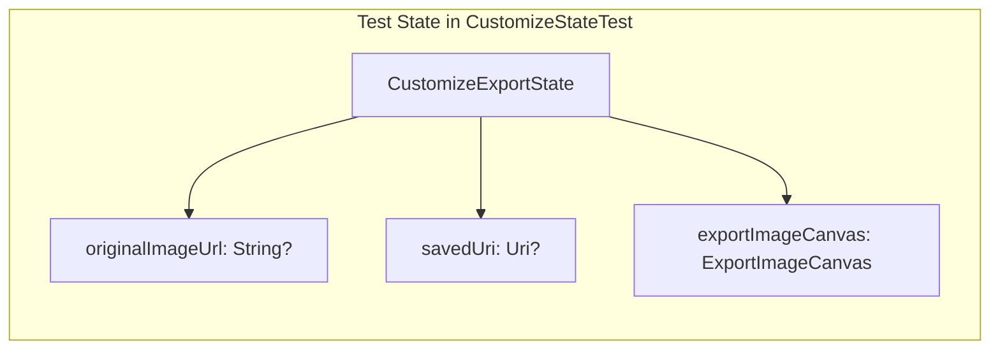

Sources: [feature/results/src/test/kotlin/com/android/developers/androidify/customize/CustomizeStateTest.kt:30-43]()

## Initialization and Lifecycle

The data layer components are initialized through Hilt dependency injection and have singleton scope to maintain state across the application lifecycle.

### Startup Dependencies

Several network layer services are initialized at app startup using AndroidX App Startup as declared in the manifest:

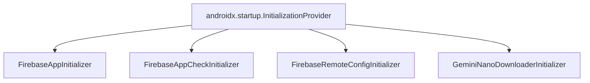

Sources: [app/src/main/AndroidManifest.xml:58-75](), [core/network/src/main/java/com/android/developers/androidify/startup/FirebaseAppCheckInitializer.kt:33-67]()

---

## Summary

The Data Layer provides a clean abstraction over complex AI, network, and storage operations through the repository pattern. The `ImageGenerationRepository` implementation orchestrates multiple data sources with intelligent fallback logic controlled by remote configuration. File operations are delegated to `LocalFileProvider` for both temporary sharing and permanent storage, while ML Kit and Gemini Nano provide high-performance on-device processing when available.

---

