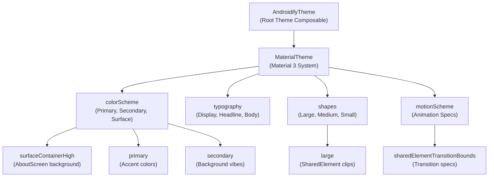
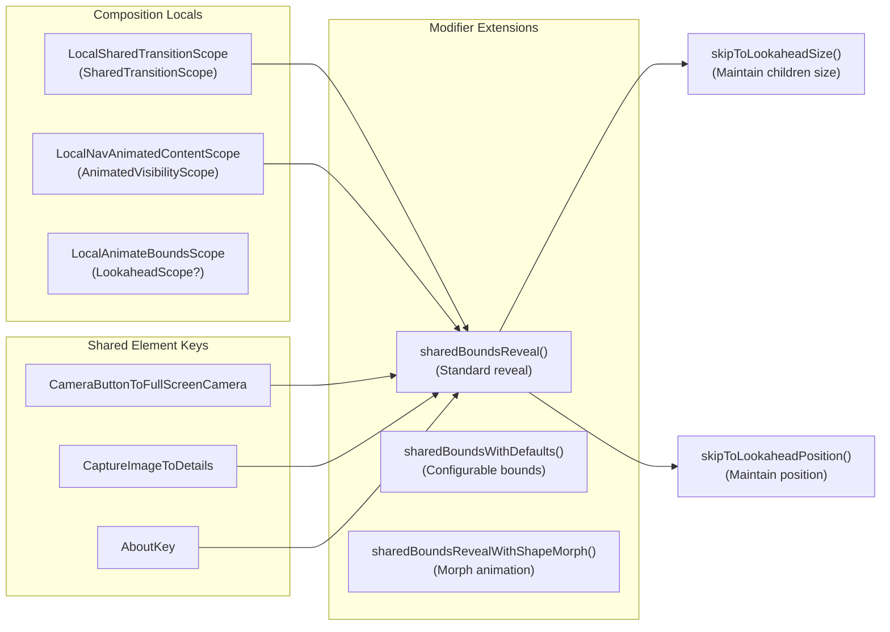

<!-- source: DeepWiki mcp.deepwiki.com · repo android/androidify · page 6.3 Theme and UI Components · fetched 2026-10-23 -->

# Theme and UI Components

<details>
<summary>Relevant source files</summary>

The following files were used as context for generating this wiki page:

- [app/src/main/java/com/android/developers/androidify/navigation/ListSaver.kt](app/src/main/java/com/android/developers/androidify/navigation/ListSaver.kt)
- [core/theme/src/main/java/com/android/developers/androidify/theme/Motion.kt](core/theme/src/main/java/com/android/developers/androidify/theme/Motion.kt)
- [core/theme/src/main/java/com/android/developers/androidify/theme/SharedElementsConfig.kt](core/theme/src/main/java/com/android/developers/androidify/theme/SharedElementsConfig.kt)
- [core/theme/src/main/java/com/android/developers/androidify/theme/components/TopAppBar.kt](core/theme/src/main/java/com/android/developers/androidify/theme/components/TopAppBar.kt)
- [core/theme/src/main/java/com/android/developers/androidify/theme/transitions/ColorSplashTransition.kt](core/theme/src/main/java/com/android/developers/androidify/theme/transitions/ColorSplashTransition.kt)
- [core/util/src/main/java/com/android/developers/androidify/util/AnimationUtils.kt](core/util/src/main/java/com/android/developers/androidify/util/AnimationUtils.kt)
- [feature/creation/src/main/java/com/android/developers/androidify/creation/LoadingScreen.kt](feature/creation/src/main/java/com/android/developers/androidify/creation/LoadingScreen.kt)
- [feature/creation/src/main/java/com/android/developers/androidify/creation/xr/LoadingScreenSpatial.kt](feature/creation/src/main/java/com/android/developers/androidify/creation/xr/LoadingScreenSpatial.kt)
- [feature/creation/src/main/res/drawable/squiggle_light.xml](feature/creation/src/main/res/drawable/squiggle_light.xml)
- [feature/results/src/main/java/com/android/developers/androidify/results/xr/FeatheredEdges.kt](feature/results/src/main/java/com/android/developers/androidify/results/xr/FeatheredEdges.kt)
- [feature/results/src/main/java/com/android/developers/androidify/results/xr/ResultsScreenSpatial.kt](feature/results/src/main/java/com/android/developers/androidify/results/xr/ResultsScreenSpatial.kt)

</details>


The `core/theme` module provides a centralized theming system and reusable UI components for the Androidify application. This module implements Material 3 design principles with custom shared element transitions, adaptive backgrounds, and a comprehensive set of composable components used across all feature modules.

For information about layout utilities and window size calculations, see [Utilities](6.4). For XR-specific UI implementations, see [XR Support](6.5).

---

## Module Overview

The `core/theme` module serves as a horizontal dependency for all feature modules, ensuring visual consistency throughout the application. It provides:

- Material 3 theming with custom color schemes and typography.
- Shared element transition infrastructure using Material 3 Expressive APIs.
- Reusable composable components (buttons, backgrounds, top app bars).
- Animation specifications and bounds transforms.
- Preview utilities for development.

**Module Dependencies:**

| Module | Depends On | Purpose |
|--------|------------|---------|
| `feature/home` | `core/theme` | UI consistency for home screens |
| `feature/camera` | `core/theme` | Shared components and transitions |
| `feature/creation` | `core/theme` | Theming and UI primitives |
| `feature/results` | `core/theme` | Background components and transitions |
| `core/theme` | `androidx.compose.material3` | Material 3 components |
| `core/theme` | `androidx.graphics.shapes` | Shape morphing for transitions |

Sources: [feature/home/build.gradle.kts:53-53](), [feature/camera/build.gradle.kts:57-57](), [feature/creation/build.gradle.kts:58-58](), [feature/results/build.gradle.kts:53-53]()

---

## Material 3 Theme System

The application uses Material 3 (Material Design 3) theming throughout all screens. The `AndroidifyTheme` composable wraps the application and provides consistent color schemes, typography, and shapes.

### Theme Structure



**Theme Consumption Example:**

The `AboutScreen` demonstrates theme usage:

```
MaterialTheme.colorScheme.surfaceContainerHigh  // Background color
MaterialTheme.typography.displayLarge            // Title typography
MaterialTheme.shapes.large                       // Clipping shape
MaterialTheme.motionScheme.sharedElementTransitionBounds // Transitions
```

Sources: [feature/home/src/main/java/com/android/developers/androidify/home/AboutScreen.kt:140-140](), [core/theme/src/main/java/com/android/developers/androidify/theme/SharedElementsConfig.kt:88-94]()

---

## Shared Element Transitions

The theme module provides a shared element transition system built on Material 3 Expressive APIs. This system enables smooth morphing animations between screens.

### Transition Architecture



### Shared Element Keys

The system defines three primary shared element keys:

| Key | Usage | Source Screen | Target Screen |
|-----|-------|---------------|---------------|
| `CameraButtonToFullScreenCamera` | Camera button expansion | `HomeScreen` | `CameraScreen` |
| `CaptureImageToDetails` | Image reveal | `CameraScreen` | `ResultsScreen` |
| `AboutKey` | About screen reveal | `HomeScreen` | `AboutScreen` |

Sources: [core/theme/src/main/java/com/android/developers/androidify/theme/SharedElementsConfig.kt:69-73]()

### Transition Implementation

**Standard Shared Bounds:**

The `sharedBoundsReveal()` modifier provides a standard reveal animation with automatic size and position locking:

```kotlin
Modifier.sharedBoundsReveal(
    sharedContentState = rememberSharedContentState(SharedElementKey.AboutKey),
    animatedVisibilityScope = navScope,
    boundsTransform = MaterialTheme.motionScheme.sharedElementTransitionBounds,
    resizeMode = SharedTransitionScope.ResizeMode.RemeasureToBounds,
    clipShape = MaterialTheme.shapes.large
)
```

This modifier:
1. Applies `sharedBounds()` with Material 3 motion specs.
2. Calls `skipToLookaheadSize()` to maintain children sizes during transition.
3. Calls `skipToLookaheadPosition()` to maintain positions.

Sources: [core/theme/src/main/java/com/android/developers/androidify/theme/SharedElementsConfig.kt:96-120](), [feature/home/src/main/java/com/android/developers/androidify/home/AboutScreen.kt:142-145]()

**Shape Morphing Transitions:**

The `sharedBoundsRevealWithShapeMorph()` modifier enables custom shape morphing using `androidx.graphics.shapes.Morph`. The `MorphOverlayClip` class implements `SharedTransitionScope.OverlayClip` to generate animated clip paths during transitions.

Sources: [core/theme/src/main/java/com/android/developers/androidify/theme/SharedElementsConfig.kt:145-164](), [core/theme/src/main/java/com/android/developers/androidify/theme/SharedElementsConfig.kt:167-211]()

### Motion Specifications

The theme provides motion specifications for shared element transitions via `MotionScheme` extensions:

```kotlin
val MotionScheme.sharedElementTransitionBounds: BoundsTransform
fun <T> MotionScheme.sharedElementTransitionSpec(): FiniteAnimationSpec<T>
```

Both resolve to `tween(600)` for 600ms transitions. The `sharedElementTransitionSpec` in `Motion.kt` uses `slowSpatialSpec()`.

Sources: [core/theme/src/main/java/com/android/developers/androidify/theme/SharedElementsConfig.kt:88-94](), [core/theme/src/main/java/com/android/developers/androidify/theme/Motion.kt:28-32]()

---

## Reusable UI Components

The `core/theme` module provides reusable composable components used throughout the application.

### TopAppBar

`AndroidifyTopAppBar` is the primary navigation component. It adapts based on window size:

- **Medium Window Size:** Uses a `Box` and `Row` layout with a surface container background and `statusBarsPadding` [core/theme/src/main/java/com/android/developers/androidify/theme/components/TopAppBar.kt:61-105]().
- **Compact Window Size:** Uses `CenterAlignedTopAppBar` [core/theme/src/main/java/com/android/developers/androidify/theme/components/TopAppBar.kt:107-126]().

It supports `backEnabled` states, custom `actions`, and `expandedCenterButtons` for tablet/spatial layouts [core/theme/src/main/java/com/android/developers/androidify/theme/components/TopAppBar.kt:52-60]().

### Color Splash Transition

The `ColorSplashTransitionScreen` provides a circular expansion animation used for screen transitions. It uses `Animatable` with a custom `DpSizeToVector` converter to animate a circle from a `startPoint` to a `targetSize` [core/theme/src/main/java/com/android/developers/androidify/theme/transitions/ColorSplashTransition.kt:55-101]().

Sources: [core/theme/src/main/java/com/android/developers/androidify/theme/components/TopAppBar.kt:51-128](), [core/theme/src/main/java/com/android/developers/androidify/theme/transitions/ColorSplashTransition.kt:55-101]()

---

## Background Components

### SquiggleBackground

An animated vector background used in creation and customization screens. In spatial mode, it is utilized via `BackgroundSubspace` which takes a drawable resource like `CreationR.drawable.squiggle_light` [feature/creation/src/main/java/com/android/developers/androidify/creation/xr/LoadingScreenSpatial.kt:56-60]().

Sources: [feature/creation/src/main/java/com/android/developers/androidify/creation/xr/LoadingScreenSpatial.kt:56-60](), [feature/creation/src/main/res/drawable/squiggle_light.xml:1-31]()

### Spatial Backgrounds

For XR, `BackgroundSubspace` provides a 3D container for background elements, supporting `aspectRatio` and `minimumHeight` [feature/results/src/main/java/com/android/developers/androidify/results/xr/ResultsScreenSpatial.kt:73-80]().

### Feathered Edges

A utility modifier `featheredEdges` applies alpha transparency to the edges of a composable using `Brush.horizontalGradient` and `Brush.verticalGradient` with `BlendMode.DstIn` [feature/results/src/main/java/com/android/developers/androidify/results/xr/FeatheredEdges.kt:47-96](). It is used in `ResultsScreenSpatial` to soften the edges of background quotes [feature/results/src/main/java/com/android/developers/androidify/results/xr/ResultsScreenSpatial.kt:70-70]().

Sources: [feature/results/src/main/java/com/android/developers/androidify/results/xr/FeatheredEdges.kt:47-112](), [feature/results/src/main/java/com/android/developers/androidify/results/xr/ResultsScreenSpatial.kt:70-70]()

---

## Adaptive Layout System

The application uses `EditScreenLayoutType` and similar enums to switch between `Compact`, `Medium`, and `Spatial` layouts.

### Loading Screen Example

`LoadingScreen` branches its UI based on the `layoutType`:

```kotlin
@Composable
fun LoadingScreen(onCancelPress: () -> Unit, layoutType: EditScreenLayoutType) {
    when (layoutType) {
        EditScreenLayoutType.Spatial -> LoadingScreenSpatial(onCancelPress = onCancelPress)
        EditScreenLayoutType.Compact, EditScreenLayoutType.Medium ->
            LoadingScreenScaffold(...) { LoadingScreenContents(it) }
    }
}
```

- **Spatial:** Uses `SpatialPanel` and `Orbiter` for 3D placement [feature/creation/src/main/java/com/android/developers/androidify/creation/xr/LoadingScreenSpatial.kt:61-87]().
- **Compact/Medium:** Uses a standard `Scaffold` with a `PrimaryButton` for cancellation [feature/creation/src/main/java/com/android/developers/androidify/creation/LoadingScreen.kt:114-138]().

Sources: [feature/creation/src/main/java/com/android/developers/androidify/creation/LoadingScreen.kt:85-105](), [feature/creation/src/main/java/com/android/developers/androidify/creation/xr/LoadingScreenSpatial.kt:52-89]()

---

## Animation Utilities

### AnimatedTextField

The `AnimatedTextField` composable creates a typing animation effect. It uses `BreakIterator` to handle logical character boundaries (ensuring emojis aren't split) and iterates through the `targetEndState` string with a 30ms delay between characters [core/util/src/main/java/com/android/developers/androidify/util/AnimationUtils.kt:31-72]().

### Loading Animations

The `LoadingScreenContents` utilizes custom vector animations like `AndroidOutlineAnimation` and `DecorativeSparkleDarkGreen` to provide visual feedback during bot generation [feature/creation/src/main/java/com/android/developers/androidify/creation/LoadingScreen.kt:141-173]().

Sources: [core/util/src/main/java/com/android/developers/androidify/util/AnimationUtils.kt:31-72](), [feature/creation/src/main/java/com/android/developers/androidify/creation/LoadingScreen.kt:141-173]()

---

