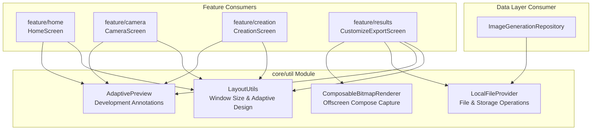
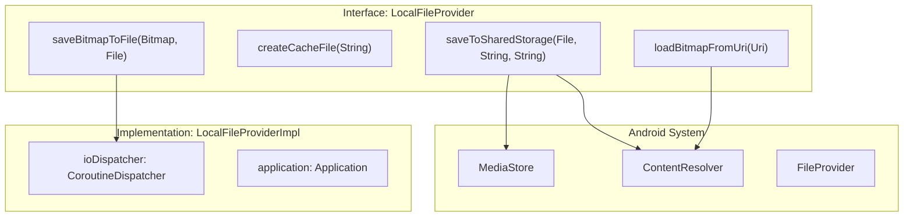

<!-- source: DeepWiki mcp.deepwiki.com · repo android/androidify · page 6.4 Utilities · fetched 2026-10-23 -->

# Utilities

Relevant source files

The following files were used as context for generating this wiki page:

- [app/src/main/AndroidManifest.xml](app/src/main/AndroidManifest.xml)
- [core/network/src/main/java/com/android/developers/androidify/ondevice/LocalSegmentationDataSource.kt](core/network/src/main/java/com/android/developers/androidify/ondevice/LocalSegmentationDataSource.kt)
- [core/network/src/main/java/com/android/developers/androidify/startup/FirebaseAppCheckInitializer.kt](core/network/src/main/java/com/android/developers/androidify/startup/FirebaseAppCheckInitializer.kt)
- [core/theme/src/main/java/com/android/developers/androidify/theme/components/Backgrounds.kt](core/theme/src/main/java/com/android/developers/androidify/theme/components/Backgrounds.kt)
- [core/util/src/main/java/com/android/developers/androidify/util/AdaptivePreview.kt](core/util/src/main/java/com/android/developers/androidify/util/AdaptivePreview.kt)
- [core/util/src/main/java/com/android/developers/androidify/util/LayoutUtils.kt](core/util/src/main/java/com/android/developers/androidify/util/LayoutUtils.kt)
- [core/util/src/main/java/com/android/developers/androidify/util/LocalFileProvider.kt](core/util/src/main/java/com/android/developers/androidify/util/LocalFileProvider.kt)
- [data/src/main/java/com/android/developers/androidify/data/ImageGenerationRepository.kt](data/src/main/java/com/android/developers/androidify/data/ImageGenerationRepository.kt)
- [feature/creation/src/main/java/com/android/developers/androidify/creation/PhotoPrompt.kt](feature/creation/src/main/java/com/android/developers/androidify/creation/PhotoPrompt.kt)
- [feature/creation/src/main/java/com/android/developers/androidify/creation/TextPrompt.kt](feature/creation/src/main/java/com/android/developers/androidify/creation/TextPrompt.kt)
- [feature/creation/src/main/java/com/android/developers/androidify/creation/TransformButton.kt](feature/creation/src/main/java/com/android/developers/androidify/creation/TransformButton.kt)
- [feature/home/src/main/java/com/android/developers/androidify/home/HomeScreenLayoutType.kt](feature/home/src/main/java/com/android/developers/androidify/home/HomeScreenLayoutType.kt)
- [feature/results/src/main/java/com/android/developers/androidify/customize/ComposableBitmapRendererImpl.kt](feature/results/src/main/java/com/android/developers/androidify/customize/ComposableBitmapRendererImpl.kt)
- [feature/results/src/main/java/com/android/developers/androidify/customize/CustomizeExportLayoutType.kt](feature/results/src/main/java/com/android/developers/androidify/customize/CustomizeExportLayoutType.kt)
- [feature/results/src/test/kotlin/com/android/developers/androidify/customize/CustomizeStateTest.kt](feature/results/src/test/kotlin/com/android/developers/androidify/customize/CustomizeStateTest.kt)

The `core/util` module provides essential cross-cutting utilities used throughout the Androidify application. This module contains primary utility systems: adaptive layout utilities for responsive UI design, file provider utilities for local and external storage operations, preview utilities for development-time device testing, and a specialized bitmap renderer for converting Composables into images.

For UI theming and components, see [Theme and UI Components](). For network-related utilities, see [Network Layer]().

---

## Overview

The utilities module serves as a foundational layer providing common functionality required by all feature modules. The module is structured around distinct concerns that are independent of business logic and can be reused across different features.

**Diagram: Utility Module Architecture and Consumers**

Sources: [core/util/src/main/java/com/android/developers/androidify/util/LayoutUtils.kt:1-129](), [core/util/src/main/java/com/android/developers/androidify/util/LocalFileProvider.kt:1-198](), [feature/results/src/main/java/com/android/developers/androidify/customize/ComposableBitmapRendererImpl.kt:59-77]()

---

## Layout Utilities

The `LayoutUtils.kt` file provides composable functions and utilities for implementing adaptive layouts that respond to different screen sizes, foldable devices, and device postures.

### Window Size Classification

The module exposes several composable functions for determining window size classes based on the WindowManager library:

| Function | Return Type | Purpose |
|----------|-------------|---------|
| `calculateWindowSizeClass()` | `WindowSizeClass` | Computes current window size class using `WindowMetricsCalculator` [core/util/src/main/java/com/android/developers/androidify/util/LayoutUtils.kt:34-38]() |
| `isWidthAtLeastMedium()` | `Boolean` | Checks if width >= `WIDTH_DP_MEDIUM_LOWER_BOUND` [core/util/src/main/java/com/android/developers/androidify/util/LayoutUtils.kt:41-44]() |
| `areBothWindowDimensionsAtLeastMedium()` | `Boolean` | Checks if both width and height meet medium breakpoints [core/util/src/main/java/com/android/developers/androidify/util/LayoutUtils.kt:47-51]() |
| `allowsFullContent()` | `Boolean` | Determines if height allows full UI content (>= `HEIGHT_DP_MEDIUM_LOWER_BOUND`) [core/util/src/main/java/com/android/developers/androidify/util/LayoutUtils.kt:58-63]() |

### Foldable Device Support

The module provides specialized utilities for detecting and responding to foldable device postures, particularly tabletop mode.

**Key Functions**:

- **`isTableTopPosture(foldFeature: FoldingFeature?): Boolean`** [core/util/src/main/java/com/android/developers/androidify/util/LayoutUtils.kt:66-70]()
  - Returns `true` if device is `HALF_OPENED` with `HORIZONTAL` orientation.
  - Uses Kotlin contracts to smart-cast `foldFeature`.

- **`supportsTabletop(): Boolean`** [core/util/src/main/java/com/android/developers/androidify/util/LayoutUtils.kt:74-81]()
  - Checks if device supports tabletop posture via `WindowSdkExtensions` version >= 6.

- **`shouldShowTabletopLayout(supportsTabletop: Boolean, isTabletop: Boolean): Boolean`** [core/util/src/main/java/com/android/developers/androidify/util/LayoutUtils.kt:100-101]()
  - Handles backward compatibility for devices with older Window SDK Extensions that can still work in tabletop mode.

### Camera Aspect Ratio Calculation

The `calculateCorrectAspectRatio()` function handles aspect ratio adjustments for camera previews on devices with non-standard aspect ratios, such as foldables [core/util/src/main/java/com/android/developers/androidify/util/LayoutUtils.kt:109-119](). It uses a tolerance of `.13f` to decide whether to stick to a default aspect ratio or use the device's actual physical ratio.

Sources: [core/util/src/main/java/com/android/developers/androidify/util/LayoutUtils.kt:1-129]()

---

## File Provider Utilities

The `LocalFileProvider` interface and its implementation `LocalFileProviderImpl` abstract all file operations and storage interactions.

### Architecture

**Diagram: File Provider Data Flow**

Sources: [core/util/src/main/java/com/android/developers/androidify/util/LocalFileProvider.kt:38-66]()

### Core Operations

- **Internal Cache**: `createCacheFile` and `getFileFromCache` manage files within `application.cacheDir` [core/util/src/main/java/com/android/developers/androidify/util/LocalFileProvider.kt:81-93]().
- **Shared Storage**: `saveToSharedStorage` and `saveUriToSharedStorage` interact with `MediaStore` to save images to the public gallery [core/util/src/main/java/com/android/developers/androidify/util/LocalFileProvider.kt:95-125](). These methods handle `IS_PENDING` flags for Scoped Storage compatibility on Android Q+ [core/util/src/main/java/com/android/developers/androidify/util/LocalFileProvider.kt:102-105]().
- **URI Generation**: `sharingUriForFile` uses `FileProvider.getUriForFile` to create safe URIs for sharing with external apps, using the authority `${applicationId}.fileprovider` [core/util/src/main/java/com/android/developers/androidify/util/LocalFileProvider.kt:179-185]().

Sources: [core/util/src/main/java/com/android/developers/androidify/util/LocalFileProvider.kt:68-198]()

---

## Composable Bitmap Renderer

The `ComposableBitmapRenderer` interface provides a mechanism to capture Jetpack Compose content and render it into a `Bitmap` object. This is essential for features like exporting the final Androidify bot with a custom background.

### Implementation Detail

Since Compose does not natively support offscreen bitmap creation, `ComposableBitmapRendererImpl` uses a `VirtualDisplay` to capture content [feature/results/src/main/java/com/android/developers/androidify/customize/ComposableBitmapRendererImpl.kt:79-97]().

1. **Virtual Display**: Creates a `VirtualDisplay` via `DisplayManager` [feature/results/src/main/java/com/android/developers/androidify/customize/ComposableBitmapRendererImpl.kt:82-90]().
2. **Presentation**: Uses a `Presentation` to host a `ComposeView` on that virtual display [feature/results/src/main/java/com/android/developers/androidify/customize/ComposableBitmapRendererImpl.kt:167-175]().
3. **Capture**: Invokes a capture routine within the Composable scope to extract the pixels into a `Bitmap`.

Sources: [feature/results/src/main/java/com/android/developers/androidify/customize/ComposableBitmapRendererImpl.kt:16-175]()

---

## Animation and UI Utilities

### Background Utilities
The `core/theme` module utilizes utilities from `core/util` to create dynamic backgrounds:
- **`SquiggleBackground`**: Uses `isWidthAtLeastMedium()` to adjust scaling [core/theme/src/main/java/com/android/developers/androidify/theme/components/Backgrounds.kt:49-56]().
- **`ResultsBackground`**: Implements a vertical marquee effect for the results screen [core/theme/src/main/java/com/android/developers/androidify/theme/components/Backgrounds.kt:114-128]().

### UI State Testing
The `CustomizeStateTest` class demonstrates the utility of the state objects used in the results feature, validating default dimensions for different `SizeOption` types (e.g., `Square`, `Wallpaper`, `Banner`) [feature/results/src/test/kotlin/com/android/developers/androidify/customize/CustomizeStateTest.kt:46-60]().

Sources: [core/theme/src/main/java/com/android/developers/androidify/theme/components/Backgrounds.kt:49-149](), [feature/results/src/test/kotlin/com/android/developers/androidify/customize/CustomizeStateTest.kt:27-164]()

---

## Adaptive Preview Utilities

The `AdaptivePreview.kt` file defines a set of annotation classes that simplify Compose preview generation for different device types.

| Annotation | Purpose |
|------------|---------|
| `@PhonePreview` | Standard phone portrait/landscape previews [core/util/src/main/java/com/android/developers/androidify/util/AdaptivePreview.kt:26-29]() |
| `@FoldablePreview` | Previews on foldable devices like Pixel Fold [core/util/src/main/java/com/android/developers/androidify/util/AdaptivePreview.kt:34-35]() |
| `@LargeScreensPreview` | Composite annotation for Foldable, Tablet, and Desktop [core/util/src/main/java/com/android/developers/androidify/util/AdaptivePreview.kt:42-45]() |
| `@AdaptivePreview` | The most comprehensive preview, combining Phone and Large Screens [core/util/src/main/java/com/android/developers/androidify/util/AdaptivePreview.kt:48]() |

Sources: [core/util/src/main/java/com/android/developers/androidify/util/AdaptivePreview.kt:1-48]()

---

