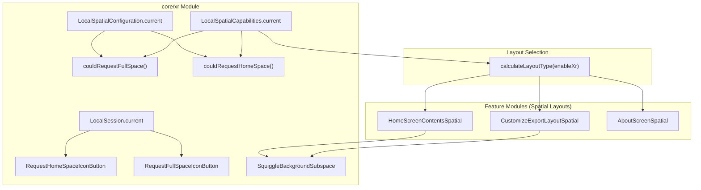
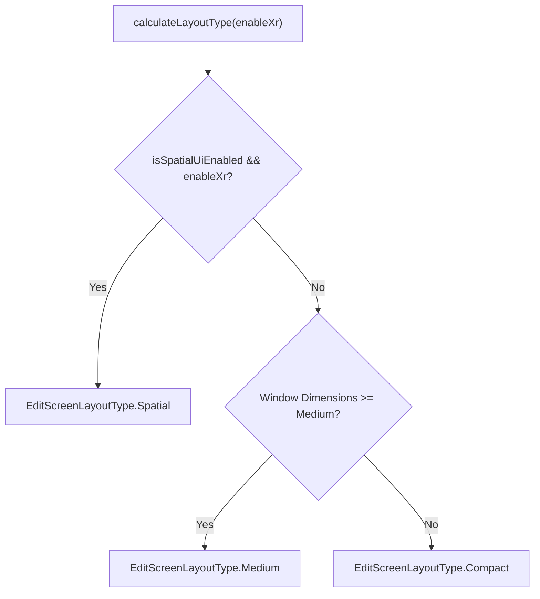

<!-- source: DeepWiki mcp.deepwiki.com · repo android/androidify · page 6.5 XR Support · fetched 2026-10-23 -->

# XR Support

<details>
<summary>Relevant source files</summary>

The following files were used as context for generating this wiki page:

- [build_presubmit_mobile.sh](build_presubmit_mobile.sh)
- [build_presubmit_wear.sh](build_presubmit_wear.sh)
- [build_release_mobile.sh](build_release_mobile.sh)
- [build_release_wear.sh](build_release_wear.sh)
- [core/xr/src/main/java/com/android/developers/androidify/xr/SharedTransitions.kt](core/xr/src/main/java/com/android/developers/androidify/xr/SharedTransitions.kt)
- [core/xr/src/main/java/com/android/developers/androidify/xr/SpatialComponents.kt](core/xr/src/main/java/com/android/developers/androidify/xr/SpatialComponents.kt)
- [core/xr/src/main/java/com/android/developers/androidify/xr/SpatialUiModes.kt](core/xr/src/main/java/com/android/developers/androidify/xr/SpatialUiModes.kt)
- [core/xr/src/main/java/com/android/developers/androidify/xr/XrPreview.kt](core/xr/src/main/java/com/android/developers/androidify/xr/XrPreview.kt)
- [feature/creation/src/main/java/com/android/developers/androidify/creation/EditScreenLayoutType.kt](feature/creation/src/main/java/com/android/developers/androidify/creation/EditScreenLayoutType.kt)
- [feature/creation/src/main/java/com/android/developers/androidify/creation/xr/EditScreenHomeSpaceModePreviews.kt](feature/creation/src/main/java/com/android/developers/androidify/creation/xr/EditScreenHomeSpaceModePreviews.kt)
- [feature/home/src/main/java/com/android/developers/androidify/home/AboutScreen.kt](feature/home/src/main/java/com/android/developers/androidify/home/AboutScreen.kt)
- [feature/home/src/main/java/com/android/developers/androidify/home/AboutViewModel.kt](feature/home/src/main/java/com/android/developers/androidify/home/AboutViewModel.kt)
- [feature/home/src/main/java/com/android/developers/androidify/home/xr/AboutScreenSpatial.kt](feature/home/src/main/java/com/android/developers/androidify/home/xr/AboutScreenSpatial.kt)
- [feature/home/src/main/java/com/android/developers/androidify/home/xr/HomeScreenHomeSpaceModePreviews.kt](feature/home/src/main/java/com/android/developers/androidify/home/xr/HomeScreenHomeSpaceModePreviews.kt)
- [feature/home/src/main/java/com/android/developers/androidify/home/xr/HomeScreenSpatial.kt](feature/home/src/main/java/com/android/developers/androidify/home/xr/HomeScreenSpatial.kt)
- [feature/results/src/main/java/com/android/developers/androidify/customize/xr/CustomizeExportScreenSpatial.kt](feature/results/src/main/java/com/android/developers/androidify/customize/xr/CustomizeExportScreenSpatial.kt)
- [feature/results/src/main/java/com/android/developers/androidify/results/ResultsLayoutType.kt](feature/results/src/main/java/com/android/developers/androidify/results/ResultsLayoutType.kt)
- [gradle/wrapper/gradle-wrapper.properties](gradle/wrapper/gradle-wrapper.properties)
- [kokoro/gcp_ubuntu_docker/continuous_wear.cfg](kokoro/gcp_ubuntu_docker/continuous_wear.cfg)

</details>


## Purpose and Scope

This document describes the XR (Extended Reality) support infrastructure in Androidify, which enables the application to adapt its user interface for spatial computing environments. The XR support system allows the application to render in either "home space" mode (windowed 2D interface) or "full space" mode (immersive 3D environment) on XR-capable devices using the `androidx.xr` libraries.

---

## XR Architecture Overview

The XR support system is implemented in the `core/xr` module and provides a consistent abstraction layer for spatial UI capabilities across all feature modules. The architecture follows a composition-based approach where each feature module determines its layout type based on XR capabilities and user preferences.



**Diagram: XR Architecture and Spatial Layout Flow**

Sources: [core/xr/src/main/java/com/android/developers/androidify/xr/SpatialUiModes.kt:32-45](), [core/xr/src/main/java/com/android/developers/androidify/xr/SpatialComponents.kt:55-69](), [feature/creation/src/main/java/com/android/developers/androidify/creation/EditScreenLayoutType.kt:29-35]()

---

## Spatial UI Modes

Androidify supports two spatial UI modes on XR-capable devices, managed through the XR Scene Core library:

### Full Space Mode

Full space mode is an immersive spatial environment where the application takes over the entire XR display space. In this mode, the app can utilize `Subspace` and `SpatialPanel` to position UI elements in 3D space.

**Check Function:**
```kotlin
@Composable
fun couldRequestFullSpace(): Boolean {
    return LocalSpatialConfiguration.current.hasXrSpatialFeature && !LocalSpatialCapabilities.current.isSpatialUiEnabled
}
```
[core/xr/src/main/java/com/android/developers/androidify/xr/SpatialUiModes.kt:37-39]()

### Home Space Mode

Home space mode renders the application as a 2D window within the XR environment. This is the default mode on XR devices.

**Check Function:**
```kotlin
@Composable
fun couldRequestHomeSpace(): Boolean {
    return LocalSpatialConfiguration.current.hasXrSpatialFeature && LocalSpatialCapabilities.current.isSpatialUiEnabled
}
```
[core/xr/src/main/java/com/android/developers/androidify/xr/SpatialUiModes.kt:43-45]()

### Mode Transition Components

The `core/xr` module provides pre-built `IconButton` components for mode transitions using `session.scene`:

| Component | Function | Implementation |
|-----------|----------|----------------|
| `RequestFullSpaceIconButton` | Transitions to full space | `session.scene.requestFullSpaceMode()` |
| `RequestHomeSpaceIconButton` | Transitions to home space | `session.scene.requestHomeSpaceMode()` |

Sources: [core/xr/src/main/java/com/android/developers/androidify/xr/SpatialUiModes.kt:49-95]()

---

## Spatial UI Layouts

When `LocalSpatialCapabilities.current.isSpatialUiEnabled` is true, the app switches to spatial layouts that utilize the 3D volume.

### Common Spatial Components

*   **`SquiggleBackgroundSubspace`**: A top-level `Subspace` containing a full-sized squiggle background that is `transformingMovable`, allowing child components to move with it [core/xr/src/main/java/com/android/developers/androidify/xr/SpatialComponents.kt:55-69]().
*   **`SpatialPanel`**: Used to wrap standard 2D Compose content within the 3D subspace [core/xr/src/main/java/com/android/developers/androidify/xr/SpatialComponents.kt:82-103]().
*   **`Orbiter`**: Used to attach UI elements (like action buttons) to the edges of spatial panels [feature/home/src/main/java/com/android/developers/androidify/home/xr/HomeScreenSpatial.kt:75-87]().

### Feature Specific Implementations

#### Home Feature Spatial Layout
The `HomeScreenContentsSpatial` uses a `SpatialPanel` for the main content and a secondary `SpatialPanel` for the `VideoPlayer`. The video player is positioned with an offset and rotation in the Z-axis [feature/home/src/main/java/com/android/developers/androidify/home/xr/HomeScreenSpatial.kt:66-106]().

#### Results/Customize Spatial Layout
`CustomizeExportLayoutSpatial` organizes the UI using `SpatialColumn`, `SpatialRow`, and `SpatialSpacer`. It places the main image result in a central panel while tool selectors are placed in `Orbiter` components attached to side panels [feature/results/src/main/java/com/android/developers/androidify/customize/xr/CustomizeExportLayoutSpatial.kt:57-130]().

---

## Technical Implementation Details

### Shared Transition Workaround
On Android XR in Full Space Mode, spatial panels inflate into different Windows. This causes standard `SharedTransitionLayout` to fail. The `DisableSharedTransition` composable provides a `shimSharedTransitionScope` that acts as a no-op to prevent crashes while maintaining the same API usage [core/xr/src/main/java/com/android/developers/androidify/xr/SharedTransitions.kt:34-49]().

### Layout Selection Logic
Each feature uses a `calculateLayoutType` function to decide between `Compact`, `Medium`, or `Spatial`.



**Diagram: Spatial Layout Selection Algorithm**

Sources: [feature/creation/src/main/java/com/android/developers/androidify/creation/EditScreenLayoutType.kt:29-35](), [feature/home/src/main/java/com/android/developers/androidify/home/AboutScreen.kt:108-127]()

### Main Panel Workaround
The `MainPanelWorkaround()` function (referenced in [feature/home/src/main/java/com/android/developers/androidify/home/xr/HomeScreenSpatial.kt:73]()) is used to ensure the primary interaction panel is correctly handled by the XR runtime during full space transitions.

---

## Summary of Key Functions

| Function | File | Description |
|----------|------|-------------|
| `SquiggleBackgroundSubspace` | `core/xr/.../SpatialComponents.kt` | Root container for spatial experiences with movable background. |
| `DisableSharedTransition` | `core/xr/.../SharedTransitions.kt` | Shims shared elements to prevent cross-window transition errors. |
| `RequestFullSpaceIconButton` | `core/xr/.../SpatialUiModes.kt` | UI trigger to enter immersive mode. |
| `HomeScreenContentsSpatial` | `feature/home/.../HomeScreenSpatial.kt` | Spatial implementation of the Home screen. |
| `CustomizeExportLayoutSpatial` | `feature/results/.../CustomizeExportScreenSpatial.kt` | Spatial implementation of the Results/Customization screen. |

Sources: [core/xr/src/main/java/com/android/developers/androidify/xr/SpatialUiModes.kt:1-95](), [core/xr/src/main/java/com/android/developers/androidify/xr/SpatialComponents.kt:1-121](), [core/xr/src/main/java/com/android/developers/androidify/xr/SharedTransitions.kt:1-49](), [feature/home/src/main/java/com/android/developers/androidify/home/xr/HomeScreenSpatial.kt:66-106]()

---

