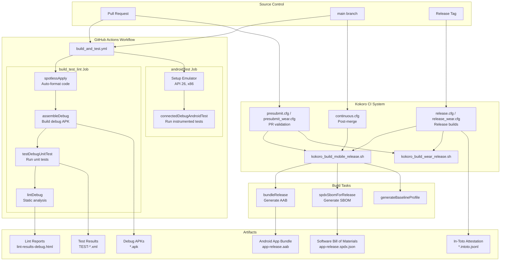
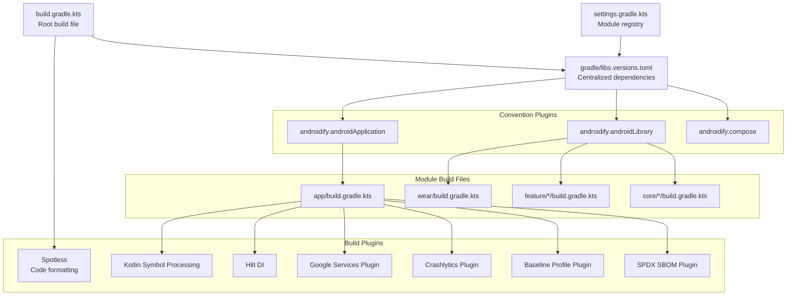

<!-- source: DeepWiki mcp.deepwiki.com · repo android/androidify · page 7 Build and CI/CD Pipeline · fetched 2026-10-23 -->

# Build and CI/CD Pipeline

<details>
<summary>Relevant source files</summary>

The following files were used as context for generating this wiki page:

- [.github/workflows/build_and_test.yml](.github/workflows/build_and_test.yml)
- [app/build.gradle.kts](app/build.gradle.kts)
- [core/theme/build.gradle.kts](core/theme/build.gradle.kts)
- [feature/camera/src/androidTest/java/com/android/developers/androidify/camera/CameraScreenTest.kt](feature/camera/src/androidTest/java/com/android/developers/androidify/camera/CameraScreenTest.kt)
- [feature/creation/src/androidTest/java/com/android/developers/androidify/creation/CreationScreenTest.kt](feature/creation/src/androidTest/java/com/android/developers/androidify/creation/CreationScreenTest.kt)
- [feature/home/src/androidTest/java/com/android/developers/androidify/home/HomeScreenTest.kt](feature/home/src/androidTest/java/com/android/developers/androidify/home/HomeScreenTest.kt)
- [gradle.properties](gradle.properties)
- [kokoro/gcp_ubuntu_docker/continuous.cfg](kokoro/gcp_ubuntu_docker/continuous.cfg)
- [kokoro/gcp_ubuntu_docker/presubmit.cfg](kokoro/gcp_ubuntu_docker/presubmit.cfg)
- [kokoro/gcp_ubuntu_docker/presubmit_wear.cfg](kokoro/gcp_ubuntu_docker/presubmit_wear.cfg)
- [kokoro/gcp_ubuntu_docker/release.cfg](kokoro/gcp_ubuntu_docker/release.cfg)
- [kokoro/gcp_ubuntu_docker/release_wear.cfg](kokoro/gcp_ubuntu_docker/release_wear.cfg)
- [settings.gradle.kts](settings.gradle.kts)
- [test-google-services.json](test-google-services.json)

</details>


## Purpose and Scope

This document provides an overview of the build system and continuous integration/deployment infrastructure for the Androidify application. It covers the dual pipeline strategy using GitHub Actions for continuous integration and Kokoro for release builds, the Gradle-based build system, artifact generation, and configuration management across mobile and Wear OS modules.

For detailed information about specific components:
- Gradle configuration, version catalogs, and convention plugins: see [Gradle Build System](#7.1)
- GitHub Actions workflows and CI processes: see [GitHub Actions CI](#7.2)
- Kokoro release pipeline and artifact generation: see [Kokoro Release Pipeline](#7.3)

---

## Dual Pipeline Strategy

The Androidify project employs a two-tier CI/CD infrastructure that separates continuous integration from release artifact generation:

1. **GitHub Actions**: Handles all pre-merge validation, including code formatting, compilation, unit tests, lint checks, and instrumented tests.
2. **Kokoro**: Google's internal CI system that manages release builds and produces signed artifacts with security attestations for both mobile and Wear OS platforms.

This separation allows the project to maintain open-source development workflows while producing production-grade release artifacts through a controlled pipeline.

**Pipeline Selection Matrix**

| Trigger Event | Pipeline | Purpose | Outputs |
|--------------|----------|---------|---------|
| Pull Request | GitHub Actions | Pre-merge validation | Debug APKs, test reports, lint reports |
| Push to `main` | GitHub Actions + Kokoro | Continuous integration + post-merge validation | Debug APKs, unsigned AABs |
| Release Tag | Kokoro | Production release | Signed AAB, SBOM, In-Toto attestations |

Sources: [.github/workflows/build_and_test.yml:1-160](), [kokoro/gcp_ubuntu_docker/presubmit.cfg:1-11](), [kokoro/gcp_ubuntu_docker/continuous.cfg:1-12](), [kokoro/gcp_ubuntu_docker/release.cfg:1-11](), [kokoro/gcp_ubuntu_docker/release_wear.cfg:1-10]()

---

## CI/CD Pipeline Architecture



Sources: [.github/workflows/build_and_test.yml:1-160](), [kokoro/gcp_ubuntu_docker/presubmit.cfg:1-11](), [kokoro/gcp_ubuntu_docker/presubmit_wear.cfg:1-10](), [kokoro/gcp_ubuntu_docker/release.cfg:1-11](), [kokoro/gcp_ubuntu_docker/release_wear.cfg:1-10]()

---

## Build System Overview

The project uses **Gradle 8.x** with Kotlin DSL for build configuration. The build system is organized into several key components:

### Build Configuration Structure



Sources: [settings.gradle.kts:1-70](), [app/build.gradle.kts:18-28]()

### Key Build Components

**Module Registry** (`settings.gradle.kts`)
- Defines the multi-module project structure including `:app`, `:feature:*`, `:core:*`, `:wear`, and `:watchface` [settings.gradle.kts:55-70]().
- Configures centralized repository management for Google, Maven Central, and JitPack [settings.gradle.kts:14-27]().
- Enforces standard SDK versions (Compile SDK 37, Target SDK 37, Min SDK 26) across all modules [settings.gradle.kts:37-47]().

**Version Catalog** (`gradle/libs.versions.toml`)
- Centralized dependency management for libraries.
- Single source of truth for version numbers, including `appVersionCode` and `appVersionName` used in the app module [app/build.gradle.kts:34-35]().

**Spotless Code Formatting**
- Applied to all subprojects to format Kotlin, Kotlin scripts, and XML files.
- Enforces Apache 2.0 license headers.
- Auto-applies and commits changes in CI via [.github/workflows/build_and_test.yml:51-58]().

Sources: [settings.gradle.kts:1-70](), [app/build.gradle.kts:1-37](), [.github/workflows/build_and_test.yml:51-58]()

---

## Build Variants and Signing Strategy

The app module defines build variants with distinct purposes:

### Build Variant Configuration

| Variant | Purpose | Minification | Signing | Use Case |
|---------|---------|--------------|---------|----------|
| `debug` | Development | No | Debug key | Local development, testing |
| `benchmark` | Performance profiling | No | Debug key | Baseline profile generation |
| `release` | Production | Yes (R8 + ProGuard) | Conditional | Release builds |

### Conditional Signing Logic

The release variant uses a conditional signing strategy defined in [app/build.gradle.kts:60-70]():

```kotlin
if (project.findProperty("CI_BUILD")?.toString()?.toBoolean() == true) {
    // CI builds produce unsigned AAB for external signing
    println("CI_BUILD property detected. Release build will be unsigned by Gradle.")
} else {
    // Local builds use debug key for easy deployment
    println("Not a CI_BUILD or CI_BUILD property not set. Signing release build with debug key.")
    signingConfig = signingConfigs.getByName("debug")
}
```

**Rationale**: 
- **CI Environment**: Produces unsigned AAB that external signing services can process.
- **Local Development**: Uses debug key so developers can test release builds in Android Studio.

Sources: [app/build.gradle.kts:38-72]()

---

## Artifact Generation

### Android App Bundle (AAB)

The primary distributable artifact is generated via the `bundleRelease` Gradle task:
- **Output**: `app/build/outputs/bundle/release/app-release.aab`.
- **Optimization**: Resource shrinking and code minification enabled via [app/build.gradle.kts:48-49]().
- **Crashlytics Mapping**: Automatically uploads mapping files when `mappingFileUploadEnabled = true` [app/build.gradle.kts:55]().

### Software Bill of Materials (SBOM)

Generated using the SPDX SBOM Plugin configured in [app/build.gradle.kts:90-99]():

```kotlin
spdxSbom {
    targets {
        create("release") {
            configurations.set(listOf("releaseRuntimeClasspath"))
        }
    }
}
```

- **Task**: `spdxSbomForRelease`.
- **Output**: `app-release.spdx.json`.
- **Purpose**: Supply chain security and license compliance.

### Artifact Collection in Kokoro

Kokoro configurations define artifact patterns for collection [kokoro/gcp_ubuntu_docker/presubmit.cfg:3-11]():
- **AAB**: `artifacts/**.aab`
- **SBOM**: `artifacts/app-release.spdx.json`
- **Attestations**: `artifacts/**.intoto.jsonl`

Sources: [app/build.gradle.kts:48-71](), [app/build.gradle.kts:90-99](), [kokoro/gcp_ubuntu_docker/presubmit.cfg:3-11]()

---

## Configuration Management

### Firebase Configuration

The build requires `google-services.json`. The CI pipeline handles this through a fallback mechanism in [.github/workflows/build_and_test.yml:39-49]():
1. Checks for `DEBUG_GOOGLE_SERVICES_JSON_BASE64` secret.
2. If present, decodes it to `app/google-services.json`.
3. If absent, copies `test-google-services.json` as a placeholder.

### Gradle Properties

The project defines standard JVM arguments and caching settings in [gradle.properties:9-11]():
- `org.gradle.caching=true`
- `org.gradle.parallel=true`
- `org.gradle.jvmargs=-Xmx6g -Xms6g`

Sources: [.github/workflows/build_and_test.yml:39-49](), [gradle.properties:9-11]()

---

## Baseline Profile Generation

The project uses Baseline Profiles to optimize app startup performance [app/build.gradle.kts:86-88]():

```kotlin
baselineProfile() {
    dexLayoutOptimization = true
}
```

The app module consumes profiles from the `:benchmark` module [app/build.gradle.kts:142]().

---

## GitHub Actions Workflow Details

### Job: build_test_lint

**Key Steps**:
1. **Setup**: JDK 21 (Temurin) and Gradle environment [.github/workflows/build_and_test.yml:27-34]().
2. **Formatting**: Runs `spotlessApply` and auto-commits changes [.github/workflows/build_and_test.yml:51-58]().
3. **Build**: Runs `./gradlew assembleDebug` [.github/workflows/build_and_test.yml:60-61]().
4. **Unit Tests**: Runs `./gradlew testDebugUnitTest` [.github/workflows/build_and_test.yml:63-64]().
5. **Lint**: Runs `./gradlew lintDebug` [.github/workflows/build_and_test.yml:66-67]().

### Job: androidTest

**Emulator Configuration** [.github/workflows/build_and_test.yml:145-152]():
- **Action**: `reactivecircus/android-emulator-runner@v2`.
- **API Level**: 26.
- **Task**: `./gradlew connectedDebugAndroidTest`.

Sources: [.github/workflows/build_and_test.yml:1-160]()

---

## Build System Dependencies

### Core Build Plugins

Applied in [app/build.gradle.kts:18-28]():
- `androidify.androidApplication`: Standard app configuration.
- `google.services`: Firebase integration.
- `crashlytics`: Error reporting.
- `baselineprofile`: Performance optimization.
- `org.spdx.sbom`: Security compliance.

### Module Dependencies

The app module aggregates all feature and core modules [app/build.gradle.kts:130-137]():
- `projects.feature.camera`
- `projects.feature.creation`
- `projects.feature.home`
- `projects.feature.results`
- `projects.core.theme`
- `projects.core.util`

Sources: [app/build.gradle.kts:18-28](), [app/build.gradle.kts:130-137]()

---

