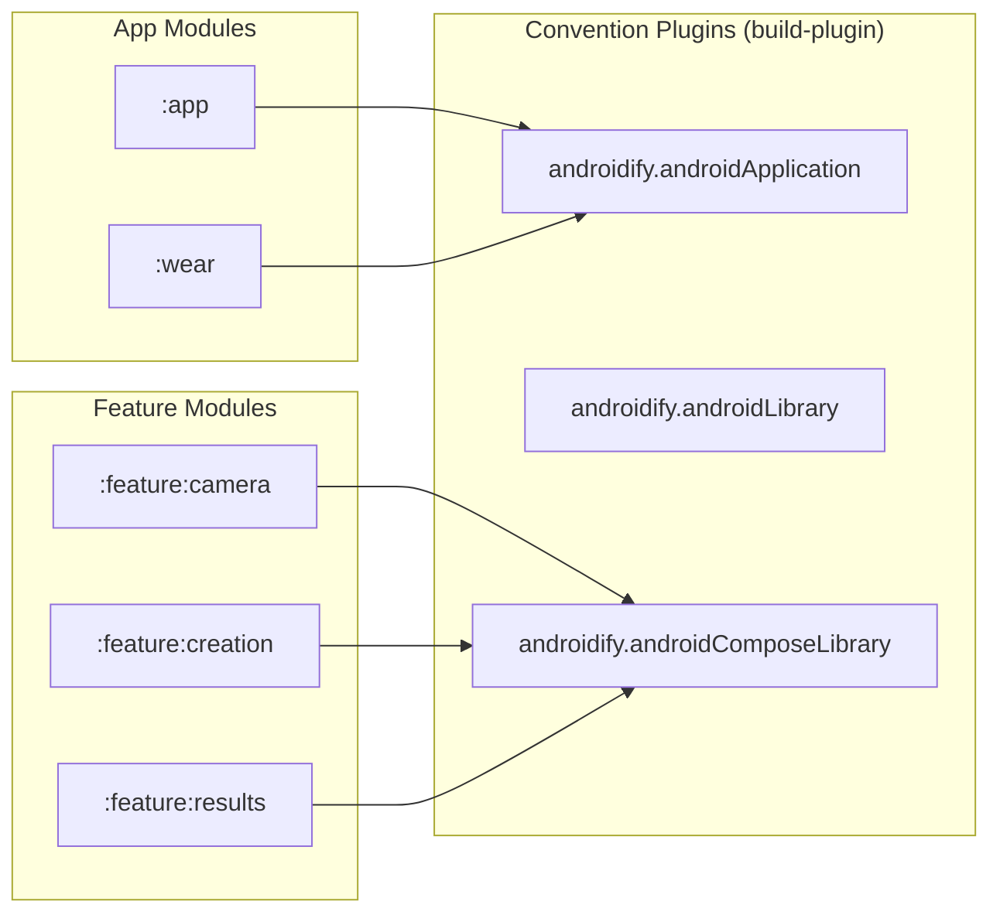

<!-- source: DeepWiki mcp.deepwiki.com · repo android/androidify · page 7.1 Gradle Build System · fetched 2026-10-23 -->

# Gradle Build System

<details>
<summary>Relevant source files</summary>

The following files were used as context for generating this wiki page:

- [.gitignore](.gitignore)
- [.run/spotlessApply.run.xml](.run/spotlessApply.run.xml)
- [app/build.gradle.kts](app/build.gradle.kts)
- [benchmark/build.gradle.kts](benchmark/build.gradle.kts)
- [benchmark/src/main/kotlin/com/android/developers/androidify/baselineprofile/BaselineProfileGenerator.kt](benchmark/src/main/kotlin/com/android/developers/androidify/baselineprofile/BaselineProfileGenerator.kt)
- [benchmark/src/main/kotlin/com/android/developers/androidify/benchmark/PromptBenchmark.kt](benchmark/src/main/kotlin/com/android/developers/androidify/benchmark/PromptBenchmark.kt)
- [build-plugin/build.gradle.kts](build-plugin/build.gradle.kts)
- [build-plugin/settings.gradle.kts](build-plugin/settings.gradle.kts)
- [build-plugin/src/main/kotlin/com/android/developers/androidify/plugin/AndroidApplicationPlugin.kt](build-plugin/src/main/kotlin/com/android/developers/androidify/plugin/AndroidApplicationPlugin.kt)
- [build-plugin/src/main/kotlin/com/android/developers/androidify/plugin/AndroidComposeLibraryPlugin.kt](build-plugin/src/main/kotlin/com/android/developers/androidify/plugin/AndroidComposeLibraryPlugin.kt)
- [build-plugin/src/main/kotlin/com/android/developers/androidify/plugin/AndroidLibraryPlugin.kt](build-plugin/src/main/kotlin/com/android/developers/androidify/plugin/AndroidLibraryPlugin.kt)
- [build-plugin/src/main/kotlin/com/android/developers/androidify/plugin/VersionCatalogHelper.kt](build-plugin/src/main/kotlin/com/android/developers/androidify/plugin/VersionCatalogHelper.kt)
- [build.gradle.kts](build.gradle.kts)
- [core/network/src/main/java/com/android/developers/androidify/di/NetworkModule.kt](core/network/src/main/java/com/android/developers/androidify/di/NetworkModule.kt)
- [core/network/src/main/java/com/android/developers/androidify/di/OnDeviceModule.kt](core/network/src/main/java/com/android/developers/androidify/di/OnDeviceModule.kt)
- [core/network/src/main/java/com/android/developers/androidify/vertexai/FirebaseAiDataSource.kt](core/network/src/main/java/com/android/developers/androidify/vertexai/FirebaseAiDataSource.kt)
- [core/theme/build.gradle.kts](core/theme/build.gradle.kts)
- [feature/camera/build.gradle.kts](feature/camera/build.gradle.kts)
- [feature/creation/build.gradle.kts](feature/creation/build.gradle.kts)
- [feature/creation/src/main/java/com/android/developers/androidify/creation/xr/EditScreenSpatial.kt](feature/creation/src/main/java/com/android/developers/androidify/creation/xr/EditScreenSpatial.kt)
- [feature/home/build.gradle.kts](feature/home/build.gradle.kts)
- [feature/results/build.gradle.kts](feature/results/build.gradle.kts)
- [gradle/libs.versions.toml](gradle/libs.versions.toml)
- [settings.gradle.kts](settings.gradle.kts)
- [wear/build.gradle.kts](wear/build.gradle.kts)
- [wear/src/main/java/com/android/developers/androidify/ui/CallToActionButton.kt](wear/src/main/java/com/android/developers/androidify/ui/CallToActionButton.kt)
- [wear/src/main/java/com/android/developers/androidify/ui/CallToActionScreen.kt](wear/src/main/java/com/android/developers/androidify/ui/CallToActionScreen.kt)
- [wear/src/main/java/com/android/developers/androidify/ui/TransmissionScreen.kt](wear/src/main/java/com/android/developers/androidify/ui/TransmissionScreen.kt)
- [wear/watchface/build.gradle.kts](wear/watchface/build.gradle.kts)

</details>


## Purpose and Scope

This document details the Gradle build system configuration for the Androidify application, including the centralized version catalog, convention plugins, code formatting with Spotless, and baseline profile generation. The build system uses Gradle 9.x with Kotlin DSL for type-safe configuration across the multi-module project, which includes phone, Wear OS, and XR targets.

For information about the CI/CD pipelines that execute Gradle builds, see [GitHub Actions CI]() and [Kokoro Release Pipeline](). For details on the module structure that this build system supports, see [Module Structure]().

---

## Version Catalog Architecture

Androidify uses a centralized version catalog defined in `gradle/libs.versions.toml` to manage all dependency versions and library declarations. This catalog contains extensive definitions organized into `[versions]`, `[libraries]`, and `[plugins]`.

### Catalog Structure

```mermaid
graph TB
    subgraph "gradle/libs.versions.toml"
        VERSIONS["[versions]<br/>Version Variables"]
        LIBRARIES["[libraries]<br/>Library Declarations"]
        PLUGINS["[plugins]<br/>Plugin Declarations"]
    end
    
    subgraph "Build Configuration Entities"
        APP_VERSION["appVersionCode=11<br/>appVersionName=1.4.0"]
        BUILD_TOOLS["agp=9.2.1<br/>kotlin=2.3.21<br/>ksp=2.3.6"]
    end
    
    subgraph "Dependency Categories"
        COMPOSE["Compose BOM<br/>composeBom=2026.05.01"]
        FIREBASE["Firebase BOM<br/>firebaseBom=34.14.0"]
        ANDROIDX["AndroidX Libraries<br/>adaptive, navigation3, camera"]
        AI_ML["AI/ML Libraries<br/>firebase-ai, mlkit-pose-detection"]
        NETWORK["Network Libraries<br/>retrofit, okhttp, coil"]
        HILT["Hilt DI<br/>hiltAndroid=2.59.2"]
        WEAR["Wear Libraries<br/>wearCompose, watchFacePush"]
    end
    
    VERSIONS --> APP_VERSION
    VERSIONS --> BUILD_TOOLS
    VERSIONS --> COMPOSE
    VERSIONS --> FIREBASE
    VERSIONS --> ANDROIDX
    VERSIONS --> AI_ML
    VERSIONS --> NETWORK
    VERSIONS --> HILT
    VERSIONS --> WEAR
    
    LIBRARIES --> COMPOSE
    LIBRARIES --> FIREBASE
    LIBRARIES --> ANDROIDX
    LIBRARIES --> AI_ML
    LIBRARIES --> NETWORK
    LIBRARIES --> HILT
    LIBRARIES --> WEAR
```



**Diagram: Version Catalog Organization**

Sources: [gradle/libs.versions.toml:1-83]()

### Key Version Variables

The `[versions]` section defines reusable version strings referenced by library declarations.

| Variable | Value | Purpose |
|----------|-------|---------|
| `appVersionCode` | `"11"` | App version code for phone releases [gradle/libs.versions.toml:3]() |
| `appVersionWearOffset`| `"60000000"` | Offset for Wear OS versioning [gradle/libs.versions.toml:5]() |
| `agp` | `"9.2.1"` | Android Gradle Plugin version [gradle/libs.versions.toml:6]() |
| `kotlin` | `"2.3.21"` | Kotlin compiler version [gradle/libs.versions.toml:43]() |
| `composeBom` | `"2026.05.01"`| Compose Bill of Materials [gradle/libs.versions.toml:24]() |
| `firebaseBom` | `"34.14.0"` | Firebase Bill of Materials [gradle/libs.versions.toml:32]() |

Sources: [gradle/libs.versions.toml:1-83]()

---

## Root Build Configuration

The root `build.gradle.kts` file applies plugins at the project level and configures Spotless formatting for all subprojects.

### Plugin Management

Plugins are declared in the root `build.gradle.kts` using `apply false`, allowing submodules to opt-in selectively.

```kotlin
plugins {
    alias(libs.plugins.android.application) apply false
    alias(libs.plugins.kotlin.android) apply false
    alias(libs.plugins.kotlin.ksp) apply false
    alias(libs.plugins.kotlin.compose) apply false
    alias(libs.plugins.serialization) apply false
    alias(libs.plugins.hilt) apply false
    alias(libs.plugins.android.library) apply false
    alias(libs.plugins.google.services) apply false
    alias(libs.plugins.crashlytics) apply false
    alias(libs.plugins.android.test) apply false
    alias(libs.plugins.baselineprofile) apply false
    alias(libs.plugins.spotless) apply false
}
```

Sources: [build.gradle.kts:2-15]()

### Spotless Code Formatting

Spotless is applied to all subprojects to enforce code style and license header compliance.

*   **Kotlin**: Uses `ktlint` version `1.5.0` with Android style enabled [build.gradle.kts:29-38]().
*   **Kotlin Gradle**: Targets `*.kts` files [build.gradle.kts:39-43]().
*   **XML**: Targets `src/**/*.xml` and inserts license headers before the first XML tag [build.gradle.kts:44-49]().

Sources: [build.gradle.kts:26-50](), [gradle/libs.versions.toml:49]()

---

## Convention Plugins

Androidify uses custom convention plugins defined in the `build-plugin` module to standardize configuration across the multi-module project.



**Diagram: Convention Plugin Usage**

*   **`androidify.androidApplication`**: Applied to `:app` [app/build.gradle.kts:19]() and `:wear` [wear/build.gradle.kts:23]().
*   **`androidify.androidComposeLibrary`**: Applied to feature modules like `:feature:camera` [feature/camera/build.gradle.kts:17](), `:feature:creation` [feature/creation/build.gradle.kts:17](), and `:feature:results` [feature/results/build.gradle.kts:17]().

Sources: [app/build.gradle.kts:18-28](), [feature/camera/build.gradle.kts:16-20](), [settings.gradle.kts:53]()

---

## Module-Specific Configurations

### App Module (`:app`)

The main application module manages build types, signing, and software bill of materials (SBOM).

*   **Build Types**: Includes `debug`, `release`, and a custom `benchmark` type [app/build.gradle.kts:38-72]().
*   **CI Signing**: The release build conditionally applies signing. If the `CI_BUILD` property is detected, it produces an unsigned AAB for the release pipeline [app/build.gradle.kts:60-64]().
*   **SBOM**: Generates a Spdx SBOM for the release runtime classpath [app/build.gradle.kts:90-99]().

Sources: [app/build.gradle.kts:30-99]()

### Wear OS Module (`:wear`)

The Wear OS module includes unique logic for generating and validating Watch Face Format (WFF) tokens.

*   **Version Offset**: Uses `appVersionWearOffset` to ensure the Wear OS app has a distinct version space from the phone app [wear/build.gradle.kts:34]().
*   **WFF Validation**: The `ProcessFilesTask` class executes a CLI tool (`DwfValidation`) to validate the watch face APK and extract a generated token into `res/values/wf_token.xml` [wear/build.gradle.kts:101-164]().

Sources: [wear/build.gradle.kts:28-37](), [wear/build.gradle.kts:101-164]()

### Baseline Profiles

The `:app` module integrates with the `:benchmark` module to generate and apply baseline profiles for startup optimization.

*   **Configuration**: The `baselineProfile()` block enables `dexLayoutOptimization` [app/build.gradle.kts:86-88]().
*   **Dependency**: The app module depends on `projects.benchmark` via the `baselineProfile` configuration [app/build.gradle.kts:142]().

Sources: [app/build.gradle.kts:86-88](), [app/build.gradle.kts:142]()

---

## Build System Integration Summary

| Feature | Implementation | Source Pointer |
| :--- | :--- | :--- |
| **Dependency Resolution** | `FAIL_ON_PROJECT_REPOS` mode | [settings.gradle.kts:15]() |
| **XR Support** | `compileOnly(libs.androidx.xr.extensions)` | [app/build.gradle.kts:140]() |
| **Unit Testing** | `isIncludeAndroidResources = true` | [app/build.gradle.kts:75]() |
| **Resource Packaging** | Bouncycastle OSGI-INF exclusions | [app/build.gradle.kts:79-83]() |
| **JitPack Repo** | Used for Wearable validator tools | [settings.gradle.kts:19-26]() |

Sources: [settings.gradle.kts:1-70](), [app/build.gradle.kts:73-84]()

---

