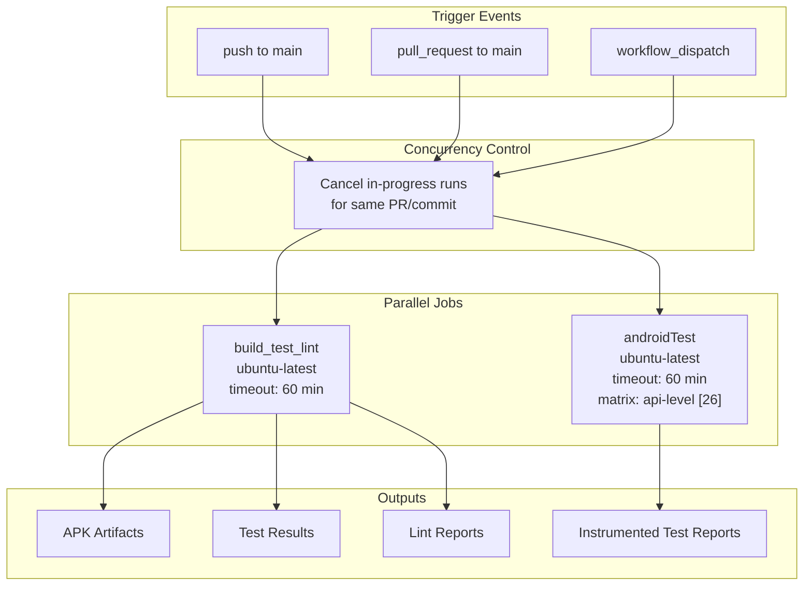
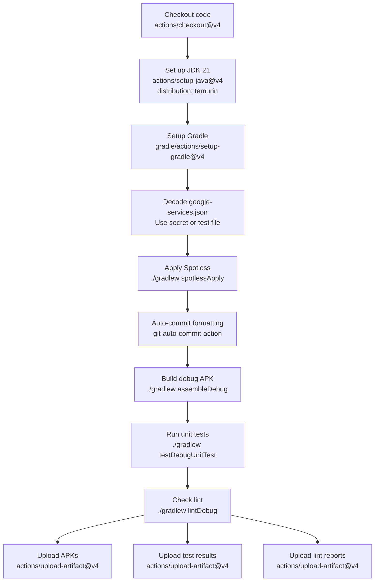
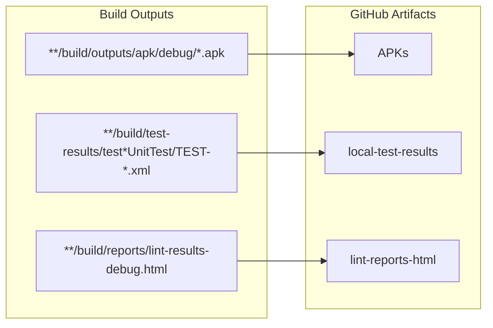
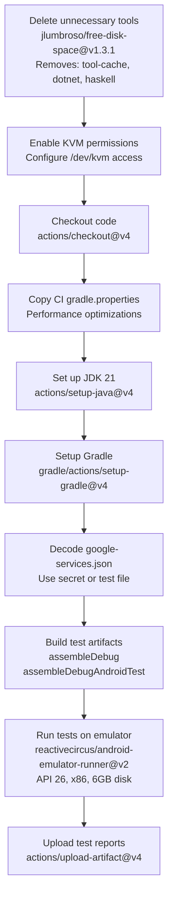
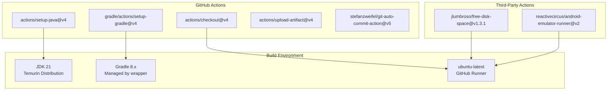

<!-- source: DeepWiki mcp.deepwiki.com · repo android/androidify · page 7.2 GitHub Actions CI · fetched 2026-10-23 -->

# GitHub Actions CI

<details>
<summary>Relevant source files</summary>

The following files were used as context for generating this wiki page:

- [.github/ci-gradle.properties](.github/ci-gradle.properties)
- [.github/workflows/build_and_test.yml](.github/workflows/build_and_test.yml)
- [feature/camera/src/androidTest/java/com/android/developers/androidify/camera/CameraScreenTest.kt](feature/camera/src/androidTest/java/com/android/developers/androidify/camera/CameraScreenTest.kt)
- [feature/creation/src/androidTest/java/com/android/developers/androidify/creation/CreationScreenTest.kt](feature/creation/src/androidTest/java/com/android/developers/androidify/creation/CreationScreenTest.kt)
- [feature/home/src/androidTest/java/com/android/developers/androidify/home/HomeScreenTest.kt](feature/home/src/androidTest/java/com/android/developers/androidify/home/HomeScreenTest.kt)
- [gradle.properties](gradle.properties)
- [test-google-services.json](test-google-services.json)

</details>


## Purpose and Scope

This document describes the GitHub Actions continuous integration pipeline for the Androidify project, defined in [.github/workflows/build_and_test.yml](). The pipeline validates all commits and pull requests by building the application, running tests, checking code formatting, and executing lint checks. For information about the release pipeline that produces signed AABs and SBOMs, see [Kokoro Release Pipeline](#7.3). For details on the Gradle build configuration itself, see [Gradle Build System](#7.1).

---

## Workflow Triggers and Concurrency

The `build_and_test.yml` workflow executes automatically on three trigger conditions:

| Trigger | Branch | Purpose |
|---------|--------|---------|
| `push` | `main` | Validates commits merged to the main branch |
| `pull_request` | `main` | Pre-merge validation of proposed changes |
| `workflow_dispatch` | Any | Manual workflow execution for debugging |

The workflow implements aggressive concurrency control to optimize CI resource usage. When multiple commits are pushed to the same pull request, the workflow cancels in-progress runs and immediately starts testing the latest commit. This behavior is configured via the `concurrency` directive [.github/workflows/build_and_test.yml:11-13]().

```yaml
concurrency:
  group: ${{ github.workflow }}-${{ github.event.pull_request.number || github.sha }}
  cancel-in-progress: true
```

**Sources:** [.github/workflows/build_and_test.yml:3-13]()

---

## Workflow Architecture



**Diagram: GitHub Actions workflow execution flow showing trigger events, concurrency control, parallel job execution, and artifact outputs**

Both jobs execute in parallel on `ubuntu-latest` runners with a 60-minute timeout. The workflow uses GitHub Actions' built-in parallelization, meaning `build_test_lint` and `androidTest` run simultaneously without waiting for each other.

**Sources:** [.github/workflows/build_and_test.yml:1-160]()

---

## Build, Test, and Lint Job

The `build_test_lint` job performs comprehensive validation of the codebase through a multi-stage pipeline. It requires `contents: write` permissions to enable Spotless auto-formatting with automatic commit capability [.github/workflows/build_and_test.yml:20-21]().



**Diagram: build_test_lint job execution steps showing the sequential pipeline from checkout through build, test, lint, and artifact upload**

### Environment Setup

The job configures the build environment with specific versions and tools:

- **JDK 21** via the Temurin distribution [.github/workflows/build_and_test.yml:27-31]()
- **Gradle** with `actions/setup-gradle@v4`, which provides caching and build insights [.github/workflows/build_and_test.yml:34]()
- **Firebase Configuration** via `google-services.json` decoding [.github/workflows/build_and_test.yml:39-49]()

### Firebase Configuration Handling

The workflow implements a fallback strategy for Firebase configuration to support both internal (with real credentials) and external (without credentials) contributors:

```bash
if [ -z "$DEBUG_GOOGLE_SERVICES_JSON_BASE64" ]; then
  echo "DEBUG_GOOGLE_SERVICES_JSON_BASE64 is empty. Copying test-google-services.json."
  cp test-google-services.json app/google-services.json
else
  echo "Decoding DEBUG_GOOGLE_SERVICES_JSON_BASE64."
  echo $DEBUG_GOOGLE_SERVICES_JSON_BASE64 | base64 --decode > app/google-services.json
fi
```

When the `DEBUG_GOOGLE_SERVICES_JSON_BASE64` secret exists, it decodes the base64-encoded Firebase configuration. Otherwise, it copies [test-google-services.json]() containing placeholder API keys [test-google-services.json:10,18](). This allows external contributors to build the app without access to internal Firebase projects.

**Sources:** [.github/workflows/build_and_test.yml:39-49](), [test-google-services.json:1-29]()

### Automated Code Formatting

The workflow enforces code formatting automatically using Spotless [.github/workflows/build_and_test.yml:51-58]():

```yaml
- name: Apply Spotless
  run: ./gradlew spotlessApply

- name: Commit Spotless changes
  uses: stefanzweifel/git-auto-commit-action@v5
  with:
    commit_message: 🤖 Apply Spotless formatting
    file_pattern: '**/*.kt **/*.kts **/*.java **/*.xml'
```

If formatting changes are needed, the workflow automatically commits them with the message "🤖 Apply Spotless formatting". This ensures all code in the repository maintains consistent style without requiring manual intervention from contributors.

**Sources:** [.github/workflows/build_and_test.yml:51-58]()

### Build and Validation Tasks

After formatting, the job executes three Gradle tasks sequentially:

| Task | Command | Purpose | Configuration Cache |
|------|---------|---------|---------------------|
| Build | `./gradlew assembleDebug` | Compiles debug APK for all modules | Disabled |
| Unit Test | `./gradlew testDebugUnitTest` | Executes JVM unit tests | Enabled |
| Lint | `./gradlew lintDebug` | Runs Android Lint static analysis | Enabled |

The `assembleDebug` task explicitly disables configuration cache (`--no-configuration-cache`) [.github/workflows/build_and_test.yml:61]() to ensure reliable builds in the CI environment. For details on the unit test implementation, see [Unit Testing](#8.2).

**Sources:** [.github/workflows/build_and_test.yml:60-67]()

### Artifact Collection

The workflow uploads three categories of artifacts, all configured with `if: ${{ !cancelled() }}` to ensure collection even when steps fail [.github/workflows/build_and_test.yml:70,77,84]():



**Diagram: Artifact upload mapping showing how build outputs are collected into named GitHub artifacts**

The glob patterns capture outputs from all modules in the multi-module architecture:
- **APKs**: Debug builds from `app` and any other application modules.
- **Test Results**: JUnit XML reports for all unit test suites.
- **Lint Reports**: HTML-formatted lint analysis for manual review.

**Sources:** [.github/workflows/build_and_test.yml:69-88]()

---

## Instrumented Testing Job

The `androidTest` job runs UI and integration tests on an Android emulator. Due to the resource requirements of Android emulation, this job includes several optimizations for disk space and performance [.github/workflows/build_and_test.yml:90-160]().



**Diagram: androidTest job execution pipeline showing disk optimization, emulator setup, test execution, and report upload**

### Disk Space Optimization

GitHub Actions runners have limited disk space. Android emulators and build outputs can consume significant storage. The job proactively frees space using `jlumbroso/free-disk-space@v1.3.1` [.github/workflows/build_and_test.yml:100-106]():

| Removal Target | Enabled | Rationale |
|----------------|---------|-----------|
| `android` | false | Keep Android SDK (required for emulator) |
| `tool-cache` | true | Remove cached tools (Docker images, etc.) |
| `dotnet` | true | Remove .NET SDK (not needed) |
| `haskell` | true | Remove Haskell toolchain (not needed) |
| `swap-storage` | true | Remove swap files |

**Sources:** [.github/workflows/build_and_test.yml:99-106]()

### KVM Acceleration Setup

Android emulators require KVM (Kernel-based Virtual Machine) for hardware acceleration. The workflow configures KVM permissions to allow the runner to access `/dev/kvm` [.github/workflows/build_and_test.yml:108-112]():

```bash
echo 'KERNEL=="kvm", GROUP="kvm", MODE="0666", OPTIONS+="static_node=kvm"' | sudo tee /etc/udev/rules.d/99-kvm4all.rules
sudo udevadm control --reload-rules
sudo udevadm trigger --name-match=kvm
```

**Sources:** [.github/workflows/build_and_test.yml:108-112]()

### CI Gradle Configuration

The `androidTest` job copies custom Gradle properties optimized for CI environments [.github/workflows/build_and_test.yml:117-118]():

```properties
org.gradle.daemon=false
org.gradle.parallel=true
org.gradle.jvmargs=-Xmx5120m
org.gradle.workers.max=2
kotlin.incremental=false
kotlin.compiler.execution.strategy=in-process
```

Key CI optimizations from [.github/ci-gradle.properties]():
- **Daemon disabled**: Prevents long-running processes in ephemeral environments [.github/ci-gradle.properties:17]().
- **5GB heap**: Allocated via `-Xmx5120m` [.github/ci-gradle.properties:19]().
- **2 workers maximum**: Limits parallelism to avoid runner resource exhaustion [.github/ci-gradle.properties:20]().
- **Incremental compilation disabled**: Ensures clean builds [.github/ci-gradle.properties:22]().

**Sources:** [.github/workflows/build_and_test.yml:117-118](), [.github/ci-gradle.properties:17-23]()

### Emulator Configuration

The workflow uses a matrix strategy to support testing on multiple API levels, currently API 26 [.github/workflows/build_and_test.yml:94-96](). The emulator is provisioned via `reactivecircus/android-emulator-runner@v2` [.github/workflows/build_and_test.yml:145-152]():

| Parameter | Value | Purpose |
|-----------|-------|---------|
| `api-level` | `26` | Targets Android 8.0 (Oreo) |
| `arch` | `x86` | Architecture for faster startup |
| `disable-animations` | `true` | Prevents flaky tests due to animation timing |
| `disk-size` | `6000M` | 6GB virtual disk for emulator |
| `heap-size` | `600M` | 600MB RAM for emulator heap |
| `script` | `./gradlew connectedDebugAndroidTest` | Test execution command |

The `connectedDebugAndroidTest` Gradle task executes instrumented tests such as `HomeScreenTest` [feature/home/src/androidTest/java/com/android/developers/androidify/home/HomeScreenTest.kt:38](), `CreationScreenTest` [feature/creation/src/androidTest/java/com/android/developers/androidify/creation/CreationScreenTest.kt:35](), and `CameraScreenTest` [feature/camera/src/androidTest/java/com/android/developers/androidify/camera/CameraScreenTest.kt:40]().

**Sources:** [.github/workflows/build_and_test.yml:144-152](), [feature/home/src/androidTest/java/com/android/developers/androidify/home/HomeScreenTest.kt:38](), [feature/creation/src/androidTest/java/com/android/developers/androidify/creation/CreationScreenTest.kt:35](), [feature/camera/src/androidTest/java/com/android/developers/androidify/camera/CameraScreenTest.kt:40]()

### Test Report Upload

Test reports are uploaded with the API level in the artifact name [.github/workflows/build_and_test.yml:155-160]():

```yaml
- name: Upload test reports
  if: ${{ !cancelled() }}
  uses: actions/upload-artifact@v4
  with:
    name: test-reports-${{ matrix.api-level }}
    path: '**/build/reports/androidTests'
```

**Sources:** [.github/workflows/build_and_test.yml:155-160]()

---

## Workflow Configuration Reference

### Environment Dependencies



**Diagram: External dependencies and their relationships in the GitHub Actions workflow**

**Sources:** [.github/workflows/build_and_test.yml:1-160]()

### Required Secrets

The workflow references one optional GitHub secret:

| Secret Name | Used By | Purpose | Fallback |
|-------------|---------|---------|----------|
| `DEBUG_GOOGLE_SERVICES_JSON_BASE64` | Both jobs | Base64-encoded Firebase configuration | [test-google-services.json]() |

External contributors without this secret can still run the workflow using the placeholder configuration in [test-google-services.json](), which provides dummy values for `project_id` and `api_key` [test-google-services.json:4,18]().

**Sources:** [.github/workflows/build_and_test.yml:40-41,131](), [test-google-services.json:1-29]()

### Artifact Retention

The workflow produces the following artifacts:

| Artifact Name | Source Job | Content | Use Case |
|---------------|------------|---------|----------|
| `APKs` | `build_test_lint` | Debug APKs from all application modules | Manual testing |
| `local-test-results` | `build_test_lint` | JUnit XML test results | Test failure investigation |
| `lint-reports-html` | `build_test_lint` | HTML lint analysis reports | Code quality review |
| `test-reports-26` | `androidTest` | Instrumented test reports for API 26 | UI test failure diagnosis |

**Sources:** [.github/workflows/build_and_test.yml:69-88,155-160]()

---

