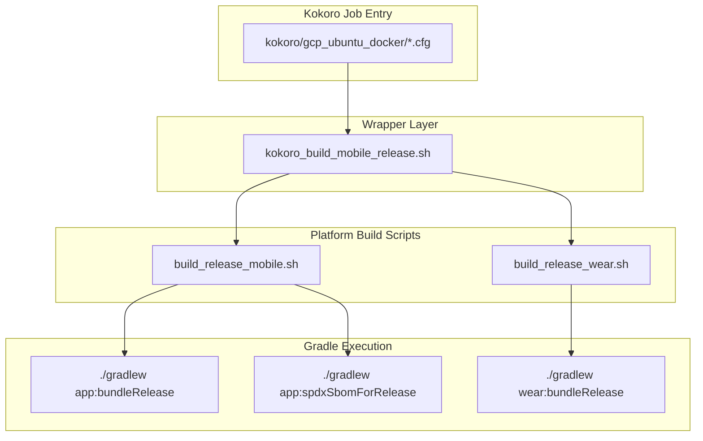
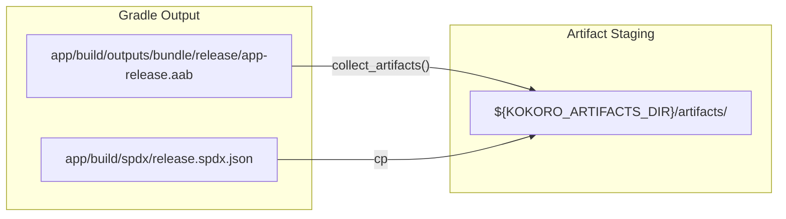

<!-- source: DeepWiki mcp.deepwiki.com · repo android/androidify · page 7.3 Kokoro Release Pipeline · fetched 2026-10-23 -->

# Kokoro Release Pipeline

Relevant source files

The following files were used as context for generating this wiki page:

- [build_presubmit_mobile.sh](build_presubmit_mobile.sh)
- [build_presubmit_wear.sh](build_presubmit_wear.sh)
- [build_release_mobile.sh](build_release_mobile.sh)
- [build_release_wear.sh](build_release_wear.sh)
- [feature/results/src/main/java/com/android/developers/androidify/customize/xr/CustomizeExportScreenSpatial.kt](feature/results/src/main/java/com/android/developers/androidify/customize/xr/CustomizeExportScreenSpatial.kt)
- [gradle/wrapper/gradle-wrapper.properties](gradle/wrapper/gradle-wrapper.properties)
- [kokoro/gcp_ubuntu_docker/continuous.cfg](kokoro/gcp_ubuntu_docker/continuous.cfg)
- [kokoro/gcp_ubuntu_docker/kokoro_build_mobile_presubmit.sh](kokoro/gcp_ubuntu_docker/kokoro_build_mobile_presubmit.sh)
- [kokoro/gcp_ubuntu_docker/kokoro_build_mobile_release.sh](kokoro/gcp_ubuntu_docker/kokoro_build_mobile_release.sh)
- [kokoro/gcp_ubuntu_docker/kokoro_build_wear_presubmit.sh](kokoro/gcp_ubuntu_docker/kokoro_build_wear_presubmit.sh)
- [kokoro/gcp_ubuntu_docker/kokoro_build_wear_release.sh](kokoro/gcp_ubuntu_docker/kokoro_build_wear_release.sh)
- [kokoro/gcp_ubuntu_docker/presubmit.cfg](kokoro/gcp_ubuntu_docker/presubmit.cfg)
- [kokoro/gcp_ubuntu_docker/presubmit_wear.cfg](kokoro/gcp_ubuntu_docker/presubmit_wear.cfg)
- [kokoro/gcp_ubuntu_docker/release.cfg](kokoro/gcp_ubuntu_docker/release.cfg)
- [kokoro/gcp_ubuntu_docker/release_wear.cfg](kokoro/gcp_ubuntu_docker/release_wear.cfg)

## Purpose and Scope

The Kokoro Release Pipeline handles Google-internal CI/CD workflows for the Androidify application, specifically managing presubmit validation, continuous post-merge builds, and release artifact generation for both mobile and Wear OS modules. While GitHub Actions handles public CI tasks like code formatting and unit testing, Kokoro manages the production of release-ready artifacts including signed Android App Bundles (AABs), Software Bills of Materials (SBOMs), and In-Toto attestations for supply chain security.

This document covers the Kokoro configuration files, the shell scripts orchestrating the build environment, artifact definitions, and the supply chain security metadata generation.

---

## Configuration Architecture

Kokoro uses distinct configuration files in the `kokoro/gcp_ubuntu_docker/` directory to target different platforms (Mobile vs. Wear OS) and lifecycle stages (Presubmit vs. Release):

| Platform | Configuration File | Build Script | Trigger |
| :--- | :--- | :--- | :--- |
| **Mobile** | `presubmit.cfg` | `kokoro_build_mobile_presubmit.sh` | Pull requests |
| **Mobile** | `continuous.cfg` | `kokoro_build_mobile_release.sh` | Post-merge to main |
| **Mobile** | `release.cfg` | `kokoro_build_mobile_release.sh` | Manual/Scheduled release |
| **Wear OS** | `presubmit_wear.cfg` | `kokoro_build_wear_presubmit.sh` | Pull requests (Wear) |
| **Wear OS** | `release_wear.cfg` | `kokoro_build_wear_release.sh` | Manual release (Wear) |

### Pipeline Execution Flow

The pipeline follows a tiered execution model where Kokoro `.cfg` files invoke high-level wrapper scripts, which then call platform-specific build scripts (`build_release_mobile.sh`, etc.) to execute Gradle tasks.

Sources: [kokoro/gcp_ubuntu_docker/presubmit.cfg:1](), [kokoro/gcp_ubuntu_docker/release_wear.cfg:1](), [kokoro/gcp_ubuntu_docker/kokoro_build_wear_release.sh:18-19]()

---

## Build Environment Setup

The build scripts (`build_release_mobile.sh`, `build_release_wear.sh`, etc.) perform a standardized environment setup to ensure reproducibility on Kokoro's GCP Ubuntu Docker workers.

### Prerequisites and Java Configuration
The scripts verify the presence of `wget`, `unzip`, and `tar` [build_release_mobile.sh:40-46](). They explicitly install and configure **OpenJDK 17** [build_release_mobile.sh:51-56]() and clear `JAVA_HOME` to ensure the system-wide Java 17 is utilized by the Gradle wrapper [build_release_mobile.sh:59]().

### Android SDK and Emulator Tools
The pipeline targets **Android SDK 37.0** and **Build Tools 37.0.0** [build_release_mobile.sh:26-27](). It installs the `google_atd` (Google Automated Test Device) system image [build_release_mobile.sh:34-35](), which is optimized for headless CI environments and software rendering.

### Prebuilt Artifact Integration
Before building, the scripts copy sensitive configuration files from the internal `androidify-prebuilts` repository into the project:
- `google-services.json` is copied to the `app/` directory [build_release_mobile.sh:79]().
- Internal `gradle.properties` are appended to the project's properties file [build_release_mobile.sh:82-83]().

Sources: [build_release_mobile.sh:26-83](), [build_presubmit_wear.sh:26-84]()

---

## Artifact Definition and Collection

Each configuration file defines a set of artifacts to be persisted. Mobile builds include SBOMs, while Wear OS builds focus on the AAB.

| Artifact Pattern | Mobile | Wear OS | Description |
| :--- | :---: | :---: | :--- |
| `artifacts/**.aab` | Yes | Yes | The unsigned Android App Bundle. |
| `artifacts/**.intoto.jsonl` | Yes | Yes | Supply chain provenance metadata. |
| `artifacts/app-release.spdx.json` | Yes | No | Software Bill of Materials (SPDX). |

### Collection Mechanism
The build scripts define a `collect_artifacts()` function to move files from the Gradle build output directories to the `${KOKORO_ARTIFACTS_DIR}/artifacts` staging area [build_release_mobile.sh:107-129]().

Sources: [kokoro/gcp_ubuntu_docker/release.cfg:4-10](), [kokoro/gcp_ubuntu_docker/release_wear.cfg:4-9](), [build_release_mobile.sh:107-136]()

---

## Supply Chain Security (SBOM & In-Toto)

The Mobile release pipeline prioritizes security and transparency through the generation of SBOMs and In-Toto attestations.

### SBOM Generation
The mobile build script executes the `app:spdxSbomForRelease` task [build_release_mobile.sh:97](). This generates an SPDX 2.3 compliant JSON file at `app/build/spdx/release.spdx.json`, which is then renamed and collected as `app-release.spdx.json` [build_release_mobile.sh:136]().

### In-Toto Attestations
Kokoro automatically generates build provenance attestations in the `.intoto.jsonl` format [kokoro/gcp_ubuntu_docker/release.cfg:6](). These files cryptographically link the resulting AAB to the specific Kokoro build execution and source commit, providing a verifiable audit trail for the production binary.

Sources: [kokoro/gcp_ubuntu_docker/release.cfg:6-7](), [build_release_mobile.sh:97-136]()

---

## Gradle Execution Summary

The pipeline triggers specific Gradle tasks with project properties set for CI optimization.

| Task | Module | Properties | Description |
| :--- | :--- | :--- | :--- |
| `clean` | All | `-Pandroid.sdk.path` | Ensures a fresh build state. |
| `bundleRelease` | `app` / `wear` | `-PCI_BUILD=true` | Generates the production AAB. |
| `spdxSbomForRelease` | `app` | `-PCI_BUILD=true` | Generates dependency SBOM. |

**Note on CI_BUILD Property:** The scripts pass `-PCI_BUILD=true` [build_release_mobile.sh:97](). This flag is used within the Gradle configuration to disable time-consuming tasks like baseline profile generation or to bypass certain signing requirements during the CI run.

Sources: [build_release_mobile.sh:93-97](), [build_presubmit_wear.sh:95-98]()

---

