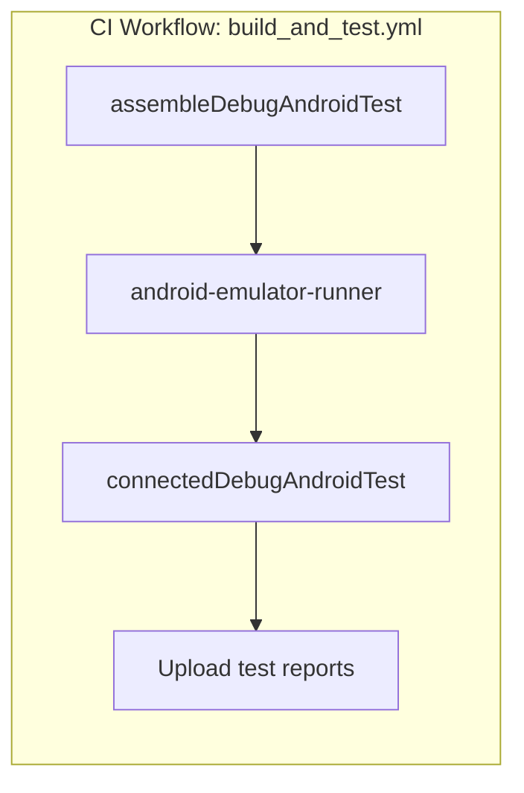
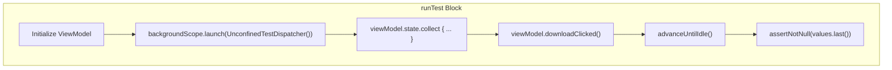

<!-- source: DeepWiki mcp.deepwiki.com · repo android/androidify · page 8 Testing · fetched 2026-10-23 -->

# Testing

Relevant source files

The following files were used as context for generating this wiki page:

- [.github/workflows/build_and_test.yml](.github/workflows/build_and_test.yml)
- [app/src/main/java/com/android/developers/androidify/navigation/UriSerializer.kt](app/src/main/java/com/android/developers/androidify/navigation/UriSerializer.kt)
- [core/testing/src/main/java/com/android/developers/testing/data/BitmapSample.kt](core/testing/src/main/java/com/android/developers/testing/data/BitmapSample.kt)
- [core/testing/src/main/java/com/android/developers/testing/data/TestFileProvider.kt](core/testing/src/main/java/com/android/developers/testing/data/TestFileProvider.kt)
- [feature/camera/src/androidTest/java/com/android/developers/androidify/camera/CameraScreenTest.kt](feature/camera/src/androidTest/java/com/android/developers/androidify/camera/CameraScreenTest.kt)
- [feature/creation/src/androidTest/java/com/android/developers/androidify/creation/CreationScreenTest.kt](feature/creation/src/androidTest/java/com/android/developers/androidify/creation/CreationScreenTest.kt)
- [feature/creation/src/test/kotlin/com/android/developers/androidify/creation/CreationViewModelTest.kt](feature/creation/src/test/kotlin/com/android/developers/androidify/creation/CreationViewModelTest.kt)
- [feature/home/src/androidTest/java/com/android/developers/androidify/home/HomeScreenTest.kt](feature/home/src/androidTest/java/com/android/developers/androidify/home/HomeScreenTest.kt)
- [feature/results/src/main/java/com/android/developers/androidify/customize/Utils.kt](feature/results/src/main/java/com/android/developers/androidify/customize/Utils.kt)
- [feature/results/src/test/kotlin/com/android/developers/androidify/customize/CustomizeViewModelTest.kt](feature/results/src/test/kotlin/com/android/developers/androidify/customize/CustomizeViewModelTest.kt)
- [feature/results/src/test/kotlin/com/android/developers/androidify/results/ResultsViewModelTest.kt](feature/results/src/test/kotlin/com/android/developers/androidify/results/ResultsViewModelTest.kt)
- [gradle.properties](gradle.properties)
- [test-google-services.json](test-google-services.json)

## Purpose and Scope

This document describes the testing infrastructure and strategies used in the Androidify application. It covers the test doubles and utilities provided by the `core/testing` module, the unit testing approach for ViewModels using Robolectric and coroutine test utilities, and the screenshot testing setup for Compose UI components.

For information about the CI/CD pipeline that executes these tests, see [Build and CI/CD Pipeline](#7). For details about the architecture being tested, see [Architecture](#3).

---

## Test Infrastructure

The `core/testing` module provides test doubles, fake implementations, and utilities that enable fast, isolated unit testing without external dependencies. This module centralizes testing infrastructure so that feature modules can write tests without duplicating test setup code.

### Test Doubles and Fakes

The testing module provides fake implementations of key data sources and repositories:

| Test Double | Purpose | Key Behavior |
|-------------|---------|--------------|
| `TestFirebaseAiDataSource` | Replaces `FirebaseAiDataSource` | Returns predefined responses for image generation and validation |
| `TestRemoteConfigDataSource` | Replaces `RemoteConfigDataSource` | Allows configuring feature flags in tests [feature/results/src/test/kotlin/com/android/developers/androidify/customize/CustomizeViewModelTest.kt:58-59]() |
| `FakeImageGenerationRepository` | Replaces `ImageGenerationRepository` | Simulates image generation without AI calls [feature/creation/src/test/kotlin/com/android/developers/androidify/creation/CreationViewModelTest.kt:54]() |
| `TestTextGenerationRepository` | Replaces text generation operations | Returns "Test prompt" for prompt generation [feature/creation/src/test/kotlin/com/android/developers/androidify/creation/CreationViewModelTest.kt:128]() |
| `FakeWatchFaceInstallationRepository` | Replaces watch face operations | Simulates watch face installation [feature/results/src/test/kotlin/com/android/developers/androidify/customize/CustomizeViewModelTest.kt:65]() |
| `FakeComposableBitmapRenderer` | Replaces `ComposableBitmapRenderer` | Returns sample bitmap without rendering [feature/results/src/test/kotlin/com/android/developers/androidify/customize/CustomizeViewModelTest.kt:64]() |
| `FakeDropImageFactory` | Replaces drop image operations | Simulates image dropping functionality [feature/creation/src/test/kotlin/com/android/developers/androidify/creation/CreationViewModelTest.kt:65]() |

### Test Utilities

**TestFileProvider**: A stub implementation of `LocalFileProvider` for testing file operations without actual I/O. The `loadBitmapFromUri` method returns a predefined `bitmapSample` for consistent test behavior [core/testing/src/main/java/com/android/developers/testing/data/TestFileProvider.kt:28-71]().

**BitmapSample**: A minimal 1x1 ARGB bitmap used throughout tests as a placeholder [core/testing/src/main/java/com/android/developers/testing/data/BitmapSample.kt:20]().

**MainDispatcherRule**: A JUnit rule that replaces the main dispatcher with a test dispatcher for coroutine testing, enabling deterministic execution of coroutine-based code [feature/creation/src/test/kotlin/com/android/developers/androidify/creation/CreationViewModelTest.kt:48-49]().

**TestInternetConnectivityManager**: Allows tests to simulate network availability states [feature/creation/src/test/kotlin/com/android/developers/androidify/creation/CreationViewModelTest.kt:53]().

### Test Infrastructure Architecture

```mermaid
graph TB
    subgraph "Feature Module Tests"
        CREATION_TEST["CreationViewModelTest"]
        CUSTOMIZE_TEST["CustomizeViewModelTest"]
        RESULTS_TEST["ResultsViewModelTest"]
        HOME_UI_TEST["HomeScreenTest"]
        CAMERA_UI_TEST["CameraScreenTest"]
    end
    
    subgraph "core/testing Module"
        TEST_FILE_PROVIDER["TestFileProvider"]
        BITMAP_SAMPLE["bitmapSample"]
        MAIN_DISPATCHER_RULE["MainDispatcherRule"]
        TEST_REMOTE_CONFIG["TestRemoteConfigDataSource"]
        FAKE_IMAGE_REPO["FakeImageGenerationRepository"]
        FAKE_WATCHFACE["FakeWatchFaceInstallationRepository"]
        FAKE_RENDERER["FakeComposableBitmapRenderer"]
        TEST_TEXT_REPO["TestTextGenerationRepository"]
        FAKE_DROP["FakeDropImageFactory"]
        TEST_INTERNET["TestInternetConnectivityManager"]
    end
    
    subgraph "Test Frameworks"
        ROBOLECTRIC["Robolectric"]
        COMPOSE_RULE["createAndroidComposeRule"]
        COROUTINES_TEST["Coroutines Test"]
        JUNIT["JUnit 4"]
    end
    
    CREATION_TEST --> FAKE_IMAGE_REPO
    CREATION_TEST --> TEST_FILE_PROVIDER
    CREATION_TEST --> TEST_TEXT_REPO
    CREATION_TEST --> FAKE_DROP
    CREATION_TEST --> TEST_INTERNET
    CREATION_TEST --> TEST_REMOTE_CONFIG
    
    CUSTOMIZE_TEST --> FAKE_IMAGE_REPO
    CUSTOMIZE_TEST --> TEST_FILE_PROVIDER
    CUSTOMIZE_TEST --> FAKE_RENDERER
    CUSTOMIZE_TEST --> FAKE_WATCHFACE
    CUSTOMIZE_TEST --> TEST_REMOTE_CONFIG
    
    CREATION_TEST --> MAIN_DISPATCHER_RULE
    CREATION_TEST --> ROBOLECTRIC
    
    HOME_UI_TEST --> COMPOSE_RULE
    CAMERA_UI_TEST --> COMPOSE_RULE
```

**Sources**: [core/testing/src/main/java/com/android/developers/testing/data/TestFileProvider.kt:1-71](), [core/testing/src/main/java/com/android/developers/testing/data/BitmapSample.kt:1-20](), [feature/creation/src/test/kotlin/com/android/developers/androidify/creation/CreationViewModelTest.kt:1-69](), [feature/results/src/test/kotlin/com/android/developers/androidify/customize/CustomizeViewModelTest.kt:1-70]()

---

## Unit Testing

The application uses unit tests to verify ViewModel logic, state management, and business rules. All ViewModel tests follow a consistent pattern using Robolectric for Android framework dependencies and coroutine test utilities for asynchronous operations.

For details, see [Unit Testing](#8.2).

### Testing Framework Setup

**Robolectric**: All ViewModel tests use `@RunWith(RobolectricTestRunner::class)` to provide Android framework stubs without requiring an emulator [feature/creation/src/test/kotlin/com/android/developers/androidify/creation/CreationViewModelTest.kt:45]().

**Coroutine Test Utilities**: Tests use `runTest`, `UnconfinedTestDispatcher`, and `advanceUntilIdle` to control coroutine execution and timing [feature/results/src/test/kotlin/com/android/developers/androidify/customize/CustomizeViewModelTest.kt:32-34]().

### Key ViewModel Tests

- **CreationViewModelTest**: Verifies image generation workflow, including `onImageSelected` [feature/creation/src/test/kotlin/com/android/developers/androidify/creation/CreationViewModelTest.kt:103]() and `onStartClicked` [feature/creation/src/test/kotlin/com/android/developers/androidify/creation/CreationViewModelTest.kt:133]().
- **CustomizeExportViewModelTest**: Verifies customization operations like `downloadClicked` [feature/results/src/test/kotlin/com/android/developers/androidify/customize/CustomizeViewModelTest.kt:124]() and `shareClicked` [feature/results/src/test/kotlin/com/android/developers/androidify/customize/CustomizeViewModelTest.kt:141]().
- **ResultsViewModelTest**: Verifies state initialization with various navigation arguments [feature/results/src/test/kotlin/com/android/developers/androidify/results/ResultsViewModelTest.kt:43-78]().

**Sources**: [feature/creation/src/test/kotlin/com/android/developers/androidify/creation/CreationViewModelTest.kt:1-165](), [feature/results/src/test/kotlin/com/android/developers/androidify/customize/CustomizeViewModelTest.kt:1-154](), [feature/results/src/test/kotlin/com/android/developers/androidify/results/ResultsViewModelTest.kt:1-78]()

---

## Instrumentation Tests

Instrumentation tests verify UI components and interactions using the `androidx.compose.ui.test` library. These tests run on emulators or physical devices.

### UI Interaction Testing

- **HomeScreenTest**: Verifies that clicking "Lets Go" invokes the expected navigation callback [feature/home/src/androidTest/java/com/android/developers/androidify/home/HomeScreenTest.kt:44-71]() and checks transcript visibility after pager swipes [feature/home/src/androidTest/java/com/android/developers/androidify/home/HomeScreenTest.kt:74-100]().
- **CameraScreenTest**: Verifies the `captureButton` enablement logic based on `detectedPose` [feature/camera/src/androidTest/java/com/android/developers/androidify/camera/CameraScreenTest.kt:49-88]().
- **CreationScreenTest**: Verifies that `EditScreen` displays the correct toolbar state based on `selectedPromptOption` [feature/creation/src/androidTest/java/com/android/developers/androidify/creation/CreationScreenTest.kt:41-96]().

### CI Configuration

Instrumentation tests are executed in the GitHub Actions workflow `build_and_test.yml` using the `reactivecircus/android-emulator-runner` at API level 26 [.github/workflows/build_and_test.yml:90-160]().

**Sources**: [feature/home/src/androidTest/java/com/android/developers/androidify/home/HomeScreenTest.kt:1-101](), [feature/camera/src/androidTest/java/com/android/developers/androidify/camera/CameraScreenTest.kt:1-180](), [.github/workflows/build_and_test.yml:90-160]()

---

## Screenshot Testing

The application uses Compose preview-based screenshot testing to verify UI appearance across different screen configurations.

For details, see [Screenshot Testing](#8.3).

### Configuration

Screenshot testing is managed via the `android.experimental.enableScreenshotTest` property in `gradle.properties` [gradle.properties:28](). It utilizes `@Preview` annotations and parameter providers to generate visual snapshots of screens like the Results screen under various conditions (e.g., adaptive layouts, small phone previews).

**Sources**: [gradle.properties:28]()

---

## Testing Patterns and Best Practices

### Coroutine Testing Pattern

Tests use `UnconfinedTestDispatcher` and `backgroundScope` to collect `StateFlow` updates during execution:

This pattern ensures that all asynchronous updates are captured and verified deterministically [feature/results/src/test/kotlin/com/android/developers/androidify/customize/CustomizeViewModelTest.kt:124-138]().

**Sources**: [feature/results/src/test/kotlin/com/android/developers/androidify/customize/CustomizeViewModelTest.kt:124-154](), [feature/creation/src/test/kotlin/com/android/developers/androidify/creation/CreationViewModelTest.kt:133-146]()

---

