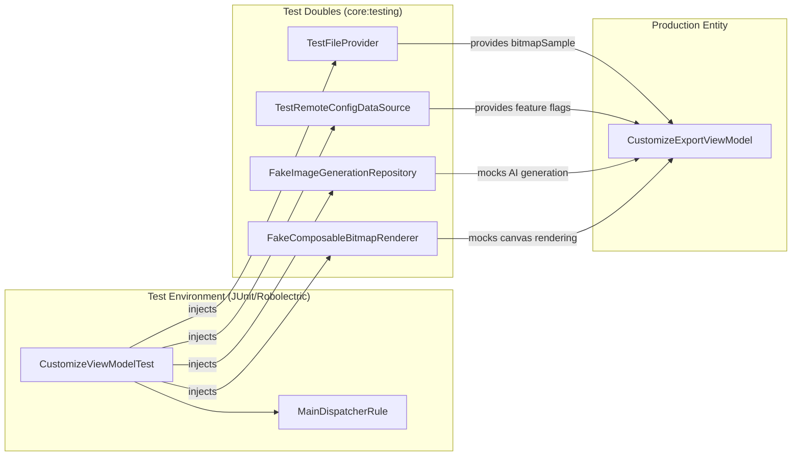

<!-- source: DeepWiki mcp.deepwiki.com · repo android/androidify · page 8.1 Test Infrastructure · fetched 2026-10-23 -->

# Test Infrastructure

<details>
<summary>Relevant source files</summary>

The following files were used as context for generating this wiki page:

- [app/src/main/java/com/android/developers/androidify/navigation/UriSerializer.kt](app/src/main/java/com/android/developers/androidify/navigation/UriSerializer.kt)
- [core/network/src/main/java/com/android/developers/androidify/RemoteConfigDataSource.kt](core/network/src/main/java/com/android/developers/androidify/RemoteConfigDataSource.kt)
- [core/network/src/main/res/xml/remote_config_defaults.xml](core/network/src/main/res/xml/remote_config_defaults.xml)
- [core/testing/src/main/AndroidManifest.xml](core/testing/src/main/AndroidManifest.xml)
- [core/testing/src/main/java/com/android/developers/testing/data/BitmapSample.kt](core/testing/src/main/java/com/android/developers/testing/data/BitmapSample.kt)
- [core/testing/src/main/java/com/android/developers/testing/data/TestFileProvider.kt](core/testing/src/main/java/com/android/developers/testing/data/TestFileProvider.kt)
- [core/testing/src/main/java/com/android/developers/testing/data/TestGeminiNanoDownloader.kt](core/testing/src/main/java/com/android/developers/testing/data/TestGeminiNanoDownloader.kt)
- [core/testing/src/main/java/com/android/developers/testing/data/TestGeminiNanoGenerationDataSource.kt](core/testing/src/main/java/com/android/developers/testing/data/TestGeminiNanoGenerationDataSource.kt)
- [core/testing/src/main/java/com/android/developers/testing/network/TestFirebaseAiDataSource.kt](core/testing/src/main/java/com/android/developers/testing/network/TestFirebaseAiDataSource.kt)
- [core/testing/src/main/java/com/android/developers/testing/network/TestLocalSegmentationDataSource.kt](core/testing/src/main/java/com/android/developers/testing/network/TestLocalSegmentationDataSource.kt)
- [core/testing/src/main/java/com/android/developers/testing/network/TestRemoteConfigDataSource.kt](core/testing/src/main/java/com/android/developers/testing/network/TestRemoteConfigDataSource.kt)
- [core/testing/src/main/java/com/android/developers/testing/repository/FakeImageGenerationRepository.kt](core/testing/src/main/java/com/android/developers/testing/repository/FakeImageGenerationRepository.kt)
- [core/testing/src/main/java/com/android/developers/testing/repository/TestTextGenerationRepository.kt](core/testing/src/main/java/com/android/developers/testing/repository/TestTextGenerationRepository.kt)
- [core/testing/src/main/java/com/android/developers/testing/util/FakeComposableBitmapRenderer.kt](core/testing/src/main/java/com/android/developers/testing/util/FakeComposableBitmapRenderer.kt)
- [core/theme/src/main/java/com/android/developers/androidify/theme/transitions/LoadingShimmerOverlay.kt](core/theme/src/main/java/com/android/developers/androidify/theme/transitions/LoadingShimmerOverlay.kt)
- [data/src/main/java/com/android/developers/androidify/startup/GeminiNanoDownloaderInitializer.kt](data/src/main/java/com/android/developers/androidify/startup/GeminiNanoDownloaderInitializer.kt)
- [data/src/test/java/com/android/developers/androidify/data/ImageGenerationRepositoryTest.kt](data/src/test/java/com/android/developers/androidify/data/ImageGenerationRepositoryTest.kt)
- [feature/creation/src/test/kotlin/com/android/developers/androidify/creation/CreationViewModelTest.kt](feature/creation/src/test/kotlin/com/android/developers/androidify/creation/CreationViewModelTest.kt)
- [feature/results/src/main/java/com/android/developers/androidify/customize/Utils.kt](feature/results/src/main/java/com/android/developers/androidify/customize/Utils.kt)
- [feature/results/src/main/java/com/android/developers/androidify/customize/di/BitmapRendererModule.kt](feature/results/src/main/java/com/android/developers/androidify/customize/di/BitmapRendererModule.kt)
- [feature/results/src/test/kotlin/com/android/developers/androidify/customize/CustomizeViewModelTest.kt](feature/results/src/test/kotlin/com/android/developers/androidify/customize/CustomizeViewModelTest.kt)
- [feature/results/src/test/kotlin/com/android/developers/androidify/results/ResultsViewModelTest.kt](feature/results/src/test/kotlin/com/android/developers/androidify/results/ResultsViewModelTest.kt)

</details>


## Purpose and Scope

The `core/testing` module provides test doubles, fake implementations, and testing utilities that enable unit testing across feature modules. This infrastructure includes fake repositories (`FakeImageGenerationRepository`), test data sources (`TestRemoteConfigDataSource`, `TestFirebaseAiDataSource`), file providers (`TestFileProvider`), and coroutine testing utilities (`MainDispatcherRule`).

For information about unit testing patterns and screenshot testing, see pages 8.2 and 8.3.

## Core Testing Module

The `core/testing` module serves as the central testing infrastructure provider, containing shared test doubles, utilities, and configurations used across all feature module tests.

### Module Configuration

| Configuration | Value |
|---------------|-------|
| Namespace | `com.android.developers.androidify.testing` |
| Module Type | Android Library |
| Key Exports | Test doubles, fake implementations, utilities |

Sources: [core/testing/src/main/AndroidManifest.xml:1-20]()

### Core Testing Module Architecture

```mermaid
graph TB
    subgraph "core:testing Module"
        FakeImageGen["FakeImageGenerationRepository"]
        TestRemoteConfig["TestRemoteConfigDataSource"]
        TestFirebaseAi["TestFirebaseAiDataSource"]
        TestFileProvider["TestFileProvider"]
        FakeComposableBitmapRenderer["FakeComposableBitmapRenderer"]
        FakeWatchFaceRepo["FakeWatchFaceInstallationRepository"]
        TestTextGenRepo["TestTextGenerationRepository"]
        FakeDropImageFactory["FakeDropImageFactory"]
        TestInternetManager["TestInternetConnectivityManager"]
        MainDispatcherRule["MainDispatcherRule"]
        BitmapSample["bitmapSample"]
    end
    
    subgraph "Feature Test Usage"
        CustomizeVMTest["CustomizeViewModelTest"]
        CreationVMTest["CreationViewModelTest"]
        ResultsVMTest["ResultsViewModelTest"]
    end
    
    subgraph "Production Interfaces"
        DataModule["ImageGenerationRepository"]
        NetworkModule["RemoteConfigDataSource"]
        UtilModule["LocalFileProvider"]
    end
    
    CustomizeVMTest --> FakeImageGen
    CustomizeVMTest --> TestRemoteConfig
    CustomizeVMTest --> TestFileProvider
    CustomizeVMTest --> FakeComposableBitmapRenderer
    CustomizeVMTest --> FakeWatchFaceRepo
    CustomizeVMTest --> MainDispatcherRule
    
    CreationVMTest --> FakeImageGen
    CreationVMTest --> TestRemoteConfig
    CreationVMTest --> TestFileProvider
    CreationVMTest --> TestTextGenRepo
    CreationVMTest --> FakeDropImageFactory
    CreationVMTest --> TestInternetManager
    CreationVMTest --> MainDispatcherRule
    
    ResultsVMTest --> TestRemoteConfig
    ResultsVMTest --> MainDispatcherRule
    
    TestFileProvider --> BitmapSample
    
    FakeImageGen -.implements.-> DataModule
    TestRemoteConfig -.implements.-> NetworkModule
    TestFileProvider -.implements.-> UtilModule
```



Sources: [feature/results/src/test/kotlin/com/android/developers/androidify/customize/CustomizeViewModelTest.kt:56-70](), [feature/creation/src/test/kotlin/com/android/developers/androidify/creation/CreationViewModelTest.kt:57-69](), [feature/results/src/test/kotlin/com/android/developers/androidify/results/ResultsViewModelTest.kt:43-50](), [core/testing/src/main/java/com/android/developers/testing/data/TestFileProvider.kt:28-71]()

## Test Doubles and Fake Implementations

The `core/testing` module provides test doubles that replace production implementations with controllable, predictable behavior suitable for testing.

### Repository Test Doubles

#### FakeImageGenerationRepository

Fake implementation of `ImageGenerationRepository` used extensively in feature tests. It provides pre-canned responses for AI generation and background removal tasks.

**Key Functions:**
- `generateFromDescription`: Returns a 1x1 bitmap [core/testing/src/main/java/com/android/developers/testing/repository/FakeImageGenerationRepository.kt:29-35]().
- `saveImage`: Returns a fixed `content://` URI [core/testing/src/main/java/com/android/developers/testing/repository/FakeImageGenerationRepository.kt:49-52]().
- `removeBackground`: Returns a 1x1 bitmap [core/testing/src/main/java/com/android/developers/testing/repository/FakeImageGenerationRepository.kt:71-73]().

**Configuration:**
- Can throw configurable exceptions via `exceptionToThrow` property [core/testing/src/main/java/com/android/developers/testing/repository/FakeImageGenerationRepository.kt:27]().

Sources: [core/testing/src/main/java/com/android/developers/testing/repository/FakeImageGenerationRepository.kt:26-74](), [feature/creation/src/test/kotlin/com/android/developers/androidify/creation/CreationViewModelTest.kt:182]()

#### FakeWatchFaceInstallationRepository

Test double for watch face installation functionality, used in `CustomizeViewModelTest`.

Sources: [feature/results/src/test/kotlin/com/android/developers/androidify/customize/CustomizeViewModelTest.kt:65]()

#### TestTextGenerationRepository

Test implementation for text generation operations, used to mock prompt generation logic in the creation flow.

Sources: [feature/creation/src/test/kotlin/com/android/developers/androidify/creation/CreationViewModelTest.kt:63]()

### Data Source Test Doubles

#### TestRemoteConfigDataSource

Configurable implementation of `RemoteConfigDataSource` for testing feature flags and AI model selection.

**Constructor Parameters:**

| Parameter | Type | Purpose |
|-----------|------|---------|
| `useGeminiNano` | `Boolean` | Sets the initial state for Gemini Nano usage |

**Configurable Properties:**
- `backgroundVibeEnabled`: Controls the result of `isBackgroundVibesFeatureEnabled()` [core/testing/src/main/java/com/android/developers/testing/network/TestRemoteConfigDataSource.kt:32-35]().

**Fixed Test Values:**
- `getFineTunedModelName()` returns `"test-fine-tuned-model"` [core/testing/src/main/java/com/android/developers/testing/network/TestRemoteConfigDataSource.kt:83-85]().
- `useImagen()` returns `true` [core/testing/src/main/java/com/android/developers/testing/network/TestRemoteConfigDataSource.kt:79-81]().

Sources: [core/testing/src/main/java/com/android/developers/testing/network/TestRemoteConfigDataSource.kt:20-102](), [feature/results/src/test/kotlin/com/android/developers/androidify/customize/CustomizeViewModelTest.kt:58-59]()

### Utility Test Doubles

#### TestFileProvider

Test implementation of `LocalFileProvider`. Most methods throw `TODO()` as they are not exercised by current unit tests, but it provides a valid bitmap for loading operations.

**Implemented Methods:**

| Method | Behavior |
|--------|----------|
| `loadBitmapFromUri(uri: Uri)` | Returns `bitmapSample` [core/testing/src/main/java/com/android/developers/testing/data/TestFileProvider.kt:68-70]() |
| `copyToInternalStorage(uri: Uri)` | Returns an empty `File("")` [core/testing/src/main/java/com/android/developers/testing/data/TestFileProvider.kt:56-58]() |

Sources: [core/testing/src/main/java/com/android/developers/testing/data/TestFileProvider.kt:28-71]()

#### FakeComposableBitmapRenderer

Test implementation for `ComposableBitmapRenderer` that returns a 1x1 bitmap instead of performing actual UI-to-Bitmap rendering.

Sources: [core/testing/src/main/java/com/android/developers/testing/util/FakeComposableBitmapRenderer.kt:24-32]()

#### TestInternetConnectivityManager

Provides controllable internet connectivity state. In `CreationViewModelTest`, it is initialized with `true` to simulate an active connection.

Sources: [feature/creation/src/test/kotlin/com/android/developers/androidify/creation/CreationViewModelTest.kt:53]()

## Testing Utilities

### MainDispatcherRule

A JUnit rule that manages coroutine dispatchers for ViewModel tests. It is used to ensure that code using `Dispatchers.Main` runs correctly in a unit test environment.

Sources: [feature/results/src/test/kotlin/com/android/developers/androidify/customize/CustomizeViewModelTest.kt:49](), [feature/creation/src/test/kotlin/com/android/developers/androidify/creation/CreationViewModelTest.kt:49]()

### BitmapSample

A minimal 1x1 ARGB_8888 bitmap used as a test fixture.

**Definition:**
```kotlin
val bitmapSample = Bitmap.createBitmap(1, 1, Bitmap.Config.ARGB_8888)
```

Sources: [core/testing/src/main/java/com/android/developers/testing/data/BitmapSample.kt:20]()

### Placeholder Bot Resources

Utility functions in `feature:results` for obtaining placeholder bot resources.

| Function | Return Type | Purpose |
|----------|-------------|---------|
| `getPlaceholderBotUri()` | `Uri` | Returns resource URI for `R.drawable.placeholderbot` [feature/results/src/main/java/com/android/developers/androidify/customize/Utils.kt:30-31]() |
| `getPlaceholderBotBitmap()` | `Bitmap` | Returns `placeholderbot` as an Android Bitmap [feature/results/src/main/java/com/android/developers/androidify/customize/Utils.kt:34-35]() |

Sources: [feature/results/src/main/java/com/android/developers/androidify/customize/Utils.kt:29-35]()

## Data Flow in Tests

The following diagram illustrates how test doubles are injected into a ViewModel during a unit test.



Sources: [feature/results/src/test/kotlin/com/android/developers/androidify/customize/CustomizeViewModelTest.kt:56-70](), [core/testing/src/main/java/com/android/developers/testing/data/TestFileProvider.kt:68-70](), [core/testing/src/main/java/com/android/developers/testing/network/TestRemoteConfigDataSource.kt:20-35]()

---

