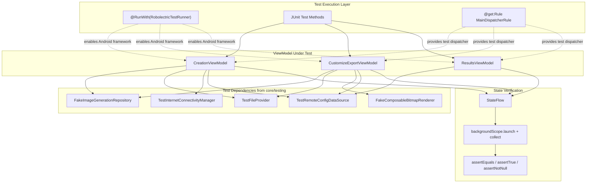
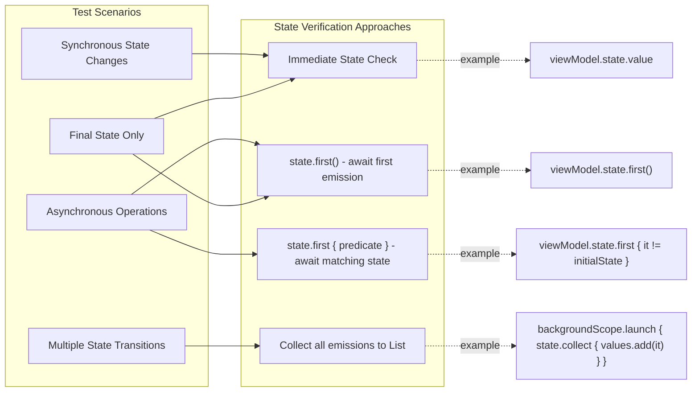

<!-- source: DeepWiki mcp.deepwiki.com · repo android/androidify · page 8.2 Unit Testing · fetched 2026-10-23 -->

# Unit Testing

<details>
<summary>Relevant source files</summary>

The following files were used as context for generating this wiki page:

- [app/src/main/java/com/android/developers/androidify/navigation/UriSerializer.kt](app/src/main/java/com/android/developers/androidify/navigation/UriSerializer.kt)
- [core/testing/src/main/java/com/android/developers/testing/data/BitmapSample.kt](core/testing/src/main/java/com/android/developers/testing/data/BitmapSample.kt)
- [core/testing/src/main/java/com/android/developers/testing/data/TestFileProvider.kt](core/testing/src/main/java/com/android/developers/testing/data/TestFileProvider.kt)
- [feature/creation/src/test/kotlin/com/android/developers/androidify/creation/CreationViewModelTest.kt](feature/creation/src/test/kotlin/com/android/developers/androidify/creation/CreationViewModelTest.kt)
- [feature/results/src/main/java/com/android/developers/androidify/customize/Utils.kt](feature/results/src/main/java/com/android/developers/androidify/customize/Utils.kt)
- [feature/results/src/test/kotlin/com/android/developers/androidify/customize/CustomizeViewModelTest.kt](feature/results/src/test/kotlin/com/android/developers/androidify/customize/CustomizeViewModelTest.kt)
- [feature/results/src/test/kotlin/com/android/developers/androidify/data/TextGenerationRepositoryImplTest.kt](feature/results/src/test/kotlin/com/android/developers/androidify/data/TextGenerationRepositoryImplTest.kt)
- [feature/results/src/test/kotlin/com/android/developers/androidify/results/ResultsViewModelTest.kt](feature/results/src/test/kotlin/com/android/developers/androidify/results/ResultsViewModelTest.kt)

</details>


## Purpose and Scope

This document describes the unit testing approach for the Androidify application, focusing on testing ViewModels and their state management logic. Unit tests verify business logic, state transitions, user interactions, and error handling without requiring a running Android device or emulator.

For test infrastructure including test doubles and fake implementations, see [Test Infrastructure](#8.1). For UI testing with screenshot verification, see [Screenshot Testing](#8.3).

**Sources:** [feature/creation/src/test/kotlin/com/android/developers/androidify/creation/CreationViewModelTest.kt:1-238](), [feature/results/src/test/kotlin/com/android/developers/androidify/customize/CustomizeViewModelTest.kt:1-238]()

---

## Test Execution Environment

Unit tests in Androidify execute using **Robolectric** to provide Android framework APIs in a JVM environment. Tests run on the local development machine without requiring device emulators, enabling fast execution in both local and CI environments.

### Core Testing Dependencies

| Dependency | Purpose |
|------------|---------|
| **Robolectric** | Android framework simulation in JVM |
| **JUnit 4** | Test runner and assertion framework |
| **Kotlin Coroutines Test** | Coroutine testing utilities (`runTest`, `UnconfinedTestDispatcher`) |
| **kotlinx.coroutines.test** | Test dispatcher and time manipulation |

### Test Configuration

All ViewModel tests are annotated with:
- `@RunWith(RobolectricTestRunner::class)` to enable Robolectric [feature/creation/src/test/kotlin/com/android/developers/androidify/creation/CreationViewModelTest.kt:45]()
- `@OptIn(ExperimentalCoroutinesApi::class)` for coroutine test APIs [feature/results/src/test/kotlin/com/android/developers/androidify/customize/CustomizeViewModelTest.kt:16]()
- `@Config(sdk = [35])` where specific SDK levels are required [feature/creation/src/test/kotlin/com/android/developers/androidify/creation/CreationViewModelTest.kt:46]()

**Sources:** [feature/creation/src/test/kotlin/com/android/developers/androidify/creation/CreationViewModelTest.kt:40-46](), [feature/results/src/test/kotlin/com/android/developers/androidify/customize/CustomizeViewModelTest.kt:46-47]()

---

## Test Structure Overview



**Diagram: Unit Test Architecture and Dependencies**

This diagram shows how unit tests instantiate ViewModels with test doubles, use `MainDispatcherRule` for coroutine dispatch, and verify state changes through collectors.

**Sources:** [feature/creation/src/test/kotlin/com/android/developers/androidify/creation/CreationViewModelTest.kt:47-69](), [feature/results/src/test/kotlin/com/android/developers/androidify/customize/CustomizeViewModelTest.kt:48-70]()

---

## ViewModel Test Classes

### CreationViewModelTest

Tests for `CreationViewModel` verify the image generation creation flow including prompt validation, image selection, bot color customization, and generation orchestration.

**Location:** [feature/creation/src/test/kotlin/com/android/developers/androidify/creation/CreationViewModelTest.kt:47-238]()

**Test Coverage:**

| Test Method | Verification Target |
|-------------|---------------------|
| `stateInitialEdit_WithImage()` | Initial state when launched with camera image [feature/creation/src/test/kotlin/com/android/developers/androidify/creation/CreationViewModelTest.kt:72-80]() |
| `stateInitialEdit_WithOutImage()` | Initial state when launched without image [feature/creation/src/test/kotlin/com/android/developers/androidify/creation/CreationViewModelTest.kt:83-100]() |
| `onImageSelected_updatesUiState()` | Image selection updates URI and prompt type [feature/creation/src/test/kotlin/com/android/developers/androidify/creation/CreationViewModelTest.kt:103-108]() |
| `onBotColorChanged_updatesUiState()` | Bot color selection state change [feature/creation/src/test/kotlin/com/android/developers/androidify/creation/CreationViewModelTest.kt:111-116]() |
| `onSelectedPromptOptionChanged_updatesUiState()` | Switching between PHOTO and TEXT modes [feature/creation/src/test/kotlin/com/android/developers/androidify/creation/CreationViewModelTest.kt:119-123]() |
| `promptGenerationClicked()` | AI prompt generation from image description [feature/creation/src/test/kotlin/com/android/developers/androidify/creation/CreationViewModelTest.kt:126-130]() |
| `onStartClicked_GenerateBotFromPhoto()` | Complete photo-to-bot generation flow [feature/creation/src/test/kotlin/com/android/developers/androidify/creation/CreationViewModelTest.kt:133-146]() |
| `onStartClicked_GenerateBotFromPhoto_NoPhotoSelected()` | Error handling when photo missing [feature/creation/src/test/kotlin/com/android/developers/androidify/creation/CreationViewModelTest.kt:149-165]() |
| `onStartClicked_GenerateBotFromPrompt_TextEmpty()` | Insufficient information error handling [feature/creation/src/test/kotlin/com/android/developers/androidify/creation/CreationViewModelTest.kt:168-193]() |
| `onStartClicked_GenerateBotFromPrompt()` | Complete text-to-bot generation flow [feature/creation/src/test/kotlin/com/android/developers/androidify/creation/CreationViewModelTest.kt:196-209]() |
| `onStartClicked_NoInternet_DisplaysError()` | Network connectivity error handling [feature/creation/src/test/kotlin/com/android/developers/androidify/creation/CreationViewModelTest.kt:212-230]() |
| `onUndoPressed()` | Image removal via undo action [feature/creation/src/test/kotlin/com/android/developers/androidify/creation/CreationViewModelTest.kt:233-237]() |

**Sources:** [feature/creation/src/test/kotlin/com/android/developers/androidify/creation/CreationViewModelTest.kt:72-238]()

---

### CustomizeViewModelTest

Tests for `CustomizeExportViewModel` verify the customization and export workflow including aspect ratio selection, background application, and export to various destinations.

**Location:** [feature/results/src/test/kotlin/com/android/developers/androidify/customize/CustomizeViewModelTest.kt:47-238]()

**Test Coverage:**

| Test Method | Verification Target |
|-------------|---------------------|
| `stateResultUri_NotNull()` | Initial state loads result bitmap [feature/results/src/test/kotlin/com/android/developers/androidify/customize/CustomizeViewModelTest.kt:73-77]() |
| `setArgumentsWithOriginalImage()` | State initialization with original image URI [feature/results/src/test/kotlin/com/android/developers/androidify/customize/CustomizeViewModelTest.kt:80-92]() |
| `setArgumentsWithPrompt()` | State initialization with prompt text instead of image [feature/results/src/test/kotlin/com/android/developers/androidify/customize/CustomizeViewModelTest.kt:95-121]() |
| `downloadClicked()` | Save to external storage functionality [feature/results/src/test/kotlin/com/android/developers/androidify/customize/CustomizeViewModelTest.kt:124-138]() |
| `shareClicked()` | Share intent URI generation [feature/results/src/test/kotlin/com/android/developers/androidify/customize/CustomizeViewModelTest.kt:141-154]() |
| `changeBackground_NotNull()` | Static background application [feature/results/src/test/kotlin/com/android/developers/androidify/customize/CustomizeViewModelTest.kt:157-200]() |
| `changeBackground_None()` | Background removal (transparent) [feature/results/src/test/kotlin/com/android/developers/androidify/customize/CustomizeViewModelTest.kt:203-213]() |
| `remoteConfigDataSource_BackgroundVibesFeatureEnabled_ContainsVibeList()` | AI background options when feature flag enabled [feature/results/src/test/kotlin/com/android/developers/androidify/customize/CustomizeViewModelTest.kt:216-237]() |

**Sources:** [feature/results/src/test/kotlin/com/android/developers/androidify/customize/CustomizeViewModelTest.kt:72-238]()

---

### ResultsViewModelTest

Tests for `ResultsViewModel` verify display state initialization with different input types (original image vs. text prompt).

**Location:** [feature/results/src/test/kotlin/com/android/developers/androidify/results/ResultsViewModelTest.kt:33-78]()

**Test Coverage:**

| Test Method | Verification Target |
|-------------|---------------------|
| `stateInitialEmpty()` | Empty state when no arguments provided [feature/results/src/test/kotlin/com/android/developers/androidify/results/ResultsViewModelTest.kt:43-50]() |
| `setArgumentsWithOriginalImage_isCorrect()` | State with result URI and original image [feature/results/src/test/kotlin/com/android/developers/androidify/results/ResultsViewModelTest.kt:53-63]() |
| `initialState_withPrompt_isCorrect()` | State with result URI and prompt text [feature/results/src/test/kotlin/com/android/developers/androidify/results/ResultsViewModelTest.kt:66-77]() |

**Sources:** [feature/results/src/test/kotlin/com/android/developers/androidify/results/ResultsViewModelTest.kt:42-78]()

---

### Repository Implementation Testing

`TextGenerationRepositoryImplTest` verifies the logic for selecting between on-device (Gemini Nano) and cloud-based (Vertex AI) prompt generation.

| Test Method | Verification Target |
|-------------|---------------------|
| `Initial prompt generation` | Generates prompt from Nano when available [feature/results/src/test/kotlin/com/android/developers/androidify/data/TextGenerationRepositoryImplTest.kt:30-48]() |
| `Nano disabled uses VertexAI` | Falls back to Firebase when Nano is disabled [feature/results/src/test/kotlin/com/android/developers/androidify/data/TextGenerationRepositoryImplTest.kt:51-70]() |
| `getNextGeneratedPrompt subsequent calls` | Iterates through available prompts correctly [feature/results/src/test/kotlin/com/android/developers/androidify/data/TextGenerationRepositoryImplTest.kt:100-123]() |
| `generatePrompts Gemini Nano empty result` | Fallback mechanism when Nano returns null [feature/results/src/test/kotlin/com/android/developers/androidify/data/TextGenerationRepositoryImplTest.kt:126-145]() |

**Sources:** [feature/results/src/test/kotlin/com/android/developers/androidify/data/TextGenerationRepositoryImplTest.kt:27-168]()

---

## Test Utilities and Rules

### MainDispatcherRule

All ViewModel tests use `MainDispatcherRule` to replace the main dispatcher with a test dispatcher, enabling deterministic coroutine execution.

```kotlin
@get:Rule
val mainDispatcherRule = MainDispatcherRule()
```

**Sources:** [feature/creation/src/test/kotlin/com/android/developers/androidify/creation/CreationViewModelTest.kt:48-49](), [feature/results/src/test/kotlin/com/android/developers/androidify/customize/CustomizeViewModelTest.kt:48-49](), [feature/results/src/test/kotlin/com/android/developers/androidify/results/ResultsViewModelTest.kt:34-35]()

---

### Test Doubles from core/testing

Tests inject fake implementations instead of real dependencies to isolate ViewModel logic:

| Test Double | Interface | Behavior |
|-------------|-----------|----------|
| `FakeImageGenerationRepository` | `ImageGenerationRepository` | Returns predefined URIs, supports exception injection [feature/creation/src/test/kotlin/com/android/developers/androidify/creation/CreationViewModelTest.kt:54]() |
| `TestFileProvider` | `LocalFileProvider` | Returns `bitmapSample` for URI loading [core/testing/src/main/java/com/android/developers/testing/data/TestFileProvider.kt:68-70]() |
| `TestRemoteConfigDataSource` | `RemoteConfigDataSource` | Configurable feature flags [feature/results/src/test/kotlin/com/android/developers/androidify/customize/CustomizeViewModelTest.kt:58-59]() |
| `FakeComposableBitmapRenderer` | `ComposableBitmapRenderer` | Returns mock bitmaps without rendering [feature/results/src/test/kotlin/com/android/developers/androidify/customize/CustomizeViewModelTest.kt:64]() |
| `TestInternetConnectivityManager` | `InternetConnectivityManager` | Configurable connectivity state [feature/creation/src/test/kotlin/com/android/developers/androidify/creation/CreationViewModelTest.kt:53]() |

**Sources:** [feature/results/src/test/kotlin/com/android/developers/androidify/customize/CustomizeViewModelTest.kt:56-70](), [feature/creation/src/test/kotlin/com/android/developers/androidify/creation/CreationViewModelTest.kt:58-69](), [core/testing/src/main/java/com/android/developers/testing/data/TestFileProvider.kt:28-71]()

---

## State Verification Strategies



**Diagram: State Verification Patterns in ViewModel Tests**

**Sources:** [feature/results/src/test/kotlin/com/android/developers/androidify/customize/CustomizeViewModelTest.kt:73-92](), [feature/creation/src/test/kotlin/com/android/developers/androidify/creation/CreationViewModelTest.kt:126-154]()

---

### Pattern 1: Immediate State Access

For synchronous state updates, access `state.value` directly:

```kotlin
@Test
fun onBotColorChanged_updatesUiState() = runTest {
    val newBotColor = BotColor("Test Color", "test-color")
    viewModel.onBotColorChanged(newBotColor)
    
    assertEquals(newBotColor, viewModel.uiState.value.botColor)
}
```

**Sources:** [feature/creation/src/test/kotlin/com/android/developers/androidify/creation/CreationViewModelTest.kt:111-116]()

---

### Pattern 2: First Emission Collection

When state updates asynchronously, use `state.first()` to await the first emission:

```kotlin
@Test
fun stateResultUri_NotNull() = runTest {
    val firstState = viewModel.state.first()
    assertNotNull(firstState.exportImageCanvas.imageBitmap)
    assertEquals(bitmapSample, firstState.exportImageCanvas.imageBitmap)
}
```

**Sources:** [feature/results/src/test/kotlin/com/android/developers/androidify/customize/CustomizeViewModelTest.kt:72-77]()

---

### Pattern 3: Predicate-Based Collection

To wait for specific state changes, use `state.first { predicate }`:

```kotlin
@Test
fun setArgumentsWithOriginalImage() = runTest {
    val initialState = viewModel.state.value
    // Wait for state to change from initial
    val newState = viewModel.state.first { it != initialState }
    assertEquals(
        CustomizeExportState(
            exportImageCanvas = ExportImageCanvas(imageBitmap = bitmapSample),
            originalImageUrl = originalFakeUri,
        ),
        newState,
    )
}
```

**Sources:** [feature/results/src/test/kotlin/com/android/developers/androidify/customize/CustomizeViewModelTest.kt:79-92]()

---

### Pattern 4: Full History Collection

For verifying state transitions, collect all emissions to a list:

```kotlin
@Test
fun shareClicked() = runTest {
    val values = mutableListOf<CustomizeExportState>()
    backgroundScope.launch(UnconfinedTestDispatcher()) {
        viewModel.state.collect {
            values.add(it)
        }
    }
    advanceUntilIdle()
    viewModel.shareClicked()
    advanceUntilIdle()
    assertNotNull(values.last().savedUri)
}
```

Use `advanceUntilIdle()` to ensure all coroutines complete before assertions.

**Sources:** [feature/results/src/test/kotlin/com/android/developers/androidify/customize/CustomizeViewModelTest.kt:140-154]()

---

## Error Handling Test Patterns

### Testing Snackbar Messages

ViewModel errors are communicated via `SnackbarHostState`. Tests collect snackbar emissions to verify error messages:

```kotlin
@Test
fun onStartClicked_NoInternet_DisplaysError() = runTest {
    val values = mutableListOf<SnackbarHostState>()
    backgroundScope.launch(UnconfinedTestDispatcher()) {
        viewModel.snackbarHostState.collect {
            values.add(it)
        }
    }
    internetConnectivityManager.internetAvailable = false
    viewModel.onStartClicked()
    advanceUntilIdle()
    assertEquals(ScreenState.EDIT, viewModel.uiState.value.screenState)
    assertEquals(
        "No internet connection, please check your connection and try again.",
        values.last().currentSnackbarData?.visuals?.message,
    )
}
```

**Sources:** [feature/creation/src/test/kotlin/com/android/developers/androidify/creation/CreationViewModelTest.kt:212-230]()

---

### Testing Repository Exceptions

Tests inject exceptions into fake repositories to verify error handling:

```kotlin
@Test
fun onStartClicked_GenerateBotFromPrompt_TextEmpty() = runTest {
    // ... collection setup ...
    imageGenerationRepository.exceptionToThrow = InsufficientInformationException()
    
    viewModel.onSelectedPromptOptionChanged(PromptType.TEXT)
    viewModel.onStartClicked()
    
    assertEquals(
        "Provide a more detailed description about your bot...",
        values.last().currentSnackbarData?.visuals?.message,
    )
}
```

**Sources:** [feature/creation/src/test/kotlin/com/android/developers/androidify/creation/CreationViewModelTest.kt:167-193]()

---

## Test Data and Mock Objects

### BitmapSample

All tests use a shared `bitmapSample` constant for bitmap comparisons:

```kotlin
val bitmapSample = Bitmap.createBitmap(1, 1, Bitmap.Config.ARGB_8888)
```

**Sources:** [core/testing/src/main/java/com/android/developers/testing/data/BitmapSample.kt:20]()

---

### Fake URIs

Tests use fake content URIs to represent images without actual files:

```kotlin
private val fakeUri = Uri.parse("content://com.example.app/images/original.jpg")
private val originalFakeUri = Uri.parse("content://test/image.jpg")
```

The `TestFileProvider` returns `bitmapSample` when loading any URI, enabling stateless testing.

**Sources:** [feature/results/src/test/kotlin/com/android/developers/androidify/customize/CustomizeViewModelTest.kt:52-54](), [core/testing/src/main/java/com/android/developers/testing/data/TestFileProvider.kt:68-70]()

---

