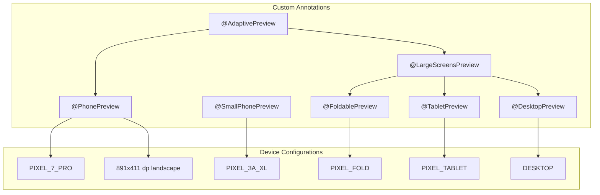

<!-- source: DeepWiki mcp.deepwiki.com · repo android/androidify · page 8.3 Screenshot Testing · fetched 2026-10-23 -->

# Screenshot Testing

Relevant source files

The following files were used as context for generating this wiki page:

- [core/xr/src/main/java/com/android/developers/androidify/xr/MainPanelWorkaround.kt](core/xr/src/main/java/com/android/developers/androidify/xr/MainPanelWorkaround.kt)
- [feature/camera/src/debug/screenshotTest/reference/com/android/developers/androidify/camera/CameraScreenScreenshotTest/CameraScreenCannotFlipScreenshot_Cannot Flip Camera_24a71026_0.png](feature/camera/src/debug/screenshotTest/reference/com/android/developers/androidify/camera/CameraScreenScreenshotTest/CameraScreenCannotFlipScreenshot_Cannot Flip Camera_24a71026_0.png)
- [feature/camera/src/debug/screenshotTest/reference/com/android/developers/androidify/camera/CameraScreenScreenshotTest/CameraScreenMediumHorizontalScreenshot_Medium Horizontal_d8421eca_0.png](feature/camera/src/debug/screenshotTest/reference/com/android/developers/androidify/camera/CameraScreenScreenshotTest/CameraScreenMediumHorizontalScreenshot_Medium Horizontal_d8421eca_0.png)
- [feature/camera/src/debug/screenshotTest/reference/com/android/developers/androidify/camera/CameraScreenScreenshotTest/CameraScreenPoseNotDetectedScreenshot_Pose Not Detected_02190099_0.png](feature/camera/src/debug/screenshotTest/reference/com/android/developers/androidify/camera/CameraScreenScreenshotTest/CameraScreenPoseNotDetectedScreenshot_Pose Not Detected_02190099_0.png)
- [feature/camera/src/debug/screenshotTest/reference/com/android/developers/androidify/camera/CameraScreenScreenshotTest/CameraScreenRearCamDisabledScreenshot_Rear Camera Button (Disabled)_c5370fe4_0.png](feature/camera/src/debug/screenshotTest/reference/com/android/developers/androidify/camera/CameraScreenScreenshotTest/CameraScreenRearCamDisabledScreenshot_Rear Camera Button (Disabled)_c5370fe4_0.png)
- [feature/camera/src/debug/screenshotTest/reference/com/android/developers/androidify/camera/CameraScreenScreenshotTest/CameraScreenRearCamEnabledScreenshot_Rear Camera Button (Enabled)_5de4fe84_0.png](feature/camera/src/debug/screenshotTest/reference/com/android/developers/androidify/camera/CameraScreenScreenshotTest/CameraScreenRearCamEnabledScreenshot_Rear Camera Button (Enabled)_5de4fe84_0.png)
- [feature/camera/src/debug/screenshotTest/reference/com/android/developers/androidify/camera/CameraScreenScreenshotTest/CameraScreenScreenshot_Default State_32838ce9_0.png](feature/camera/src/debug/screenshotTest/reference/com/android/developers/androidify/camera/CameraScreenScreenshotTest/CameraScreenScreenshot_Default State_32838ce9_0.png)
- [feature/camera/src/debug/screenshotTest/reference/com/android/developers/androidify/camera/CameraScreenScreenshotTest/CameraScreenSubcompactHorizontalScreenshot_Subcompact Horizontal_096b7a06_0.png](feature/camera/src/debug/screenshotTest/reference/com/android/developers/androidify/camera/CameraScreenScreenshotTest/CameraScreenSubcompactHorizontalScreenshot_Subcompact Horizontal_096b7a06_0.png)
- [feature/camera/src/debug/screenshotTest/reference/com/android/developers/androidify/camera/CameraScreenScreenshotTest/CameraScreenTabletopScreenshot_Tabletop Mode_046c4d4b_0.png](feature/camera/src/debug/screenshotTest/reference/com/android/developers/androidify/camera/CameraScreenScreenshotTest/CameraScreenTabletopScreenshot_Tabletop Mode_046c4d4b_0.png)
- [feature/camera/src/screenshotTest/java/com/android/developers/androidify/camera/CameraScreenScreenshotTest.kt](feature/camera/src/screenshotTest/java/com/android/developers/androidify/camera/CameraScreenScreenshotTest.kt)
- [feature/home/src/screenshotTest/java/com/android/developers/androidify/home/HomeScreenScreenshotTest.kt](feature/home/src/screenshotTest/java/com/android/developers/androidify/home/HomeScreenScreenshotTest.kt)
- [feature/results/src/debug/screenshotTest/reference/com/android/developers/androidify/results/ResultsScreenScreenshotTest/ResultsScreen_AdaptivePreview_748aa731_0.png](feature/results/src/debug/screenshotTest/reference/com/android/developers/androidify/results/ResultsScreenScreenshotTest/ResultsScreen_AdaptivePreview_748aa731_0.png)
- [feature/results/src/debug/screenshotTest/reference/com/android/developers/androidify/results/ResultsScreenScreenshotTest/ResultsScreen_AdaptivePreview_Desktop preview_995fc4f1_0.png](feature/results/src/debug/screenshotTest/reference/com/android/developers/androidify/results/ResultsScreenScreenshotTest/ResultsScreen_AdaptivePreview_Desktop preview_995fc4f1_0.png)
- [feature/results/src/debug/screenshotTest/reference/com/android/developers/androidify/results/ResultsScreenScreenshotTest/ResultsScreen_AdaptivePreview_Foldable preview_aaa67744_0.png](feature/results/src/debug/screenshotTest/reference/com/android/developers/androidify/results/ResultsScreenScreenshotTest/ResultsScreen_AdaptivePreview_Foldable preview_aaa67744_0.png)
- [feature/results/src/debug/screenshotTest/reference/com/android/developers/androidify/results/ResultsScreenScreenshotTest/ResultsScreen_AdaptivePreview_Phone preview_d57eb7c3_0.png](feature/results/src/debug/screenshotTest/reference/com/android/developers/androidify/results/ResultsScreenScreenshotTest/ResultsScreen_AdaptivePreview_Phone preview_d57eb7c3_0.png)
- [feature/results/src/debug/screenshotTest/reference/com/android/developers/androidify/results/ResultsScreenScreenshotTest/ResultsScreen_AdaptivePreview_Tablet preview_deda3981_0.png](feature/results/src/debug/screenshotTest/reference/com/android/developers/androidify/results/ResultsScreenScreenshotTest/ResultsScreen_AdaptivePreview_Tablet preview_deda3981_0.png)
- [feature/results/src/debug/screenshotTest/reference/com/android/developers/androidify/results/ResultsScreenScreenshotTest/ResultsScreen_OriginalInputPreview_748aa731_0.png](feature/results/src/debug/screenshotTest/reference/com/android/developers/androidify/results/ResultsScreenScreenshotTest/ResultsScreen_OriginalInputPreview_748aa731_0.png)
- [feature/results/src/debug/screenshotTest/reference/com/android/developers/androidify/results/ResultsScreenScreenshotTest/ResultsScreen_SmallPreview_748aa731_0.png](feature/results/src/debug/screenshotTest/reference/com/android/developers/androidify/results/ResultsScreenScreenshotTest/ResultsScreen_SmallPreview_748aa731_0.png)
- [feature/results/src/debug/screenshotTest/reference/com/android/developers/androidify/results/ResultsScreenScreenshotTest/ResultsScreen_SmallPreview_Phone small preview_d6ff5f5b_0.png](feature/results/src/debug/screenshotTest/reference/com/android/developers/androidify/results/ResultsScreenScreenshotTest/ResultsScreen_SmallPreview_Phone small preview_d6ff5f5b_0.png)

Screenshot testing in the Androidify application provides visual regression testing capabilities to ensure UI consistency across different device form factors and states. This system leverages Jetpack Compose previews and automated screenshot capture to detect unintended visual changes during development.

For information about the broader testing infrastructure and test runners, see [Test Infrastructure]().

## Architecture Overview

The screenshot testing system uses Jetpack Compose `@Preview` annotations combined with automated screenshot capture to create visual regression tests. Tests are located in dedicated `screenshotTest` source sets within feature modules and generate reference images stored in `src/debug/screenshotTest/reference/` directories.

```mermaid
graph TB
    subgraph "Screenshot Test Classes"
        ResultsTest["ResultsScreenScreenshotTest"]
        CameraTest["CameraScreenScreenshotTest"]
        HomeTest["HomeScreenScreenshotTest"]
    end
    
    subgraph "Custom Preview Annotations"
        PhonePreview["@PhonePreview"]
        SmallPhonePreview["@SmallPhonePreview"]
        AdaptivePreview["@AdaptivePreview"]
        LargeScreensPreview["@LargeScreensPreview"]
    end
    
    subgraph "Test Composables"
        ResultsScreenContents["ResultsScreenContents"]
        HomeScreenContents["HomeScreenContents"]
        StatelessCameraPreviewContent["StatelessCameraPreviewContent"]
    end
    
    subgraph "Mock Data"
        MockBitmap["createMockBitmap()"]
        MockUri["test://mockbitmap URI"]
        ResultState["ResultState"]
        MockFolding["MockFoldingFeature"]
    end
    
    subgraph "Theme Wrappers"
        AndroidifyTheme["AndroidifyTheme"]
        SharedElement["SharedElementContextPreview"]
        InspectionMode["LocalInspectionMode"]
    end
    
    ResultsTest --> PhonePreview
    ResultsTest --> AdaptivePreview
    HomeTest --> AdaptivePreview
    CameraTest --> AdaptivePreview
    
    ResultsTest --> ResultsScreenContents
    HomeTest --> HomeScreenContents
    CameraTest --> StatelessCameraPreviewContent
    
    ResultsTest --> MockBitmap
    HomeTest --> SharedElement
    CameraTest --> MockFolding
```

Sources: [feature/results/src/screenshotTest/java/com/android/developers/androidify/results/ResultsScreenScreenshotTest.kt:1-147](), [feature/home/src/screenshotTest/java/com/android/developers/androidify/home/HomeScreenScreenshotTest.kt:24-42](), [feature/camera/src/screenshotTest/java/com/android/developers/androidify/camera/CameraScreenScreenshotTest.kt:30-185]()

## Test Implementation Patterns

Screenshot tests are implemented as Kotlin classes with `@Preview` annotated composable functions. Each preview function represents a specific UI state or device configuration that should be captured and compared.

### Camera Feature Testing

The `CameraScreenScreenshotTest` class [feature/camera/src/screenshotTest/java/com/android/developers/androidify/camera/CameraScreenScreenshotTest.kt:30]() demonstrates testing hardware-dependent UI states by providing stateless preview wrappers:

| Test Function | State Variation | Purpose |
|---------------|-----------------|---------|
| `CameraScreenScreenshot` | `detectedPose = true` | Default viewfinder state with detected pose [feature/camera/src/screenshotTest/java/com/android/developers/androidify/camera/CameraScreenScreenshotTest.kt:43-68]() |
| `CameraScreenPoseNotDetectedScreenshot` | `detectedPose = false` | Tests UI guidance when no pose is detected [feature/camera/src/screenshotTest/java/com/android/developers/androidify/camera/CameraScreenScreenshotTest.kt:72-85]() |
| `CameraScreenRearCamEnabledScreenshot` | `isRearCameraEnabled = true` | Tests the Rear Camera Feature toggle UI [feature/camera/src/screenshotTest/java/com/android/developers/androidify/camera/CameraScreenScreenshotTest.kt:126-142]() |
| `CameraScreenTabletopScreenshot` | `HALF_OPENED` fold | Tests adaptive layout for tabletop mode [feature/camera/src/screenshotTest/java/com/android/developers/androidify/camera/CameraScreenScreenshotTest.kt:146-164]() |

To test tabletop mode, a `MockFoldingFeature` is implemented to simulate the `HALF_OPENED` state and `HORIZONTAL` orientation [feature/camera/src/screenshotTest/java/com/android/developers/androidify/camera/CameraScreenScreenshotTest.kt:33-39]().

### Home Screen Testing

The `HomeScreenScreenshotTest` [feature/home/src/screenshotTest/java/com/android/developers/androidify/home/HomeScreenScreenshotTest.kt:24]() utilizes the `SharedElementContextPreview` [feature/home/src/screenshotTest/java/com/android/developers/androidify/home/HomeScreenScreenshotTest.kt:31]() to ensure that components using shared element transitions can be rendered correctly in a static screenshot context.

Sources: [feature/camera/src/screenshotTest/java/com/android/developers/androidify/camera/CameraScreenScreenshotTest.kt:30-185](), [feature/home/src/screenshotTest/java/com/android/developers/androidify/home/HomeScreenScreenshotTest.kt:24-42]()

## Custom Preview Annotations

The `core/util` module defines custom preview annotations that combine multiple device configurations for comprehensive screenshot testing:

Sources: [core/util/src/main/java/com/android/developers/androidify/util/AdaptivePreview.kt:26-48]()

## Mock Data Generation

Screenshot tests require mock data to render UI components without external dependencies.

### Mock Bitmap Creation
The `ResultsScreenScreenshotTest` class uses `createMockBitmap()` [feature/results/src/screenshotTest/java/com/android/developers/androidify/results/ResultsScreenScreenshotTest.kt:128-146]() to generate a `200x200` bitmap with a `LinearGradient` [feature/results/src/screenshotTest/java/com/android/developers/androidify/results/ResultsScreenScreenshotTest.kt:137-143]().

### XR Compatibility
For spatial and XR UI testing, the `MainPanelWorkaround` composable [core/xr/src/main/java/com/android/developers/androidify/xr/MainPanelWorkaround.kt:32]() is used to manage the `mainPanelEntity` visibility during composition transitions [core/xr/src/main/java/com/android/developers/androidify/xr/MainPanelWorkaround.kt:36]().

## Inspection Mode and Reference Images

When `LocalInspectionMode.current` is true, composables can skip real data loading. Reference images are stored in the module's `src/debug/screenshotTest/reference/` directory.

Example reference files:
* `ResultsScreen_AdaptivePreview_Tablet preview_deda3981_0.png` [feature/results/src/debug/screenshotTest/reference/com/android/developers/androidify/results/ResultsScreenScreenshotTest/ResultsScreen_AdaptivePreview_Tablet preview_deda3981_0.png:1]()
* `CameraScreenMediumHorizontalScreenshot_Medium Horizontal_d8421eca_0.png` [feature/camera/src/debug/screenshotTest/reference/com/android/developers/androidify/camera/CameraScreenScreenshotTest/CameraScreenMediumHorizontalScreenshot_Medium Horizontal_d8421eca_0.png:1]()

Sources: [feature/results/src/screenshotTest/java/com/android/developers/androidify/results/ResultsScreenScreenshotTest.kt:51](), [core/xr/src/main/java/com/android/developers/androidify/xr/MainPanelWorkaround.kt:32-39]()

---

