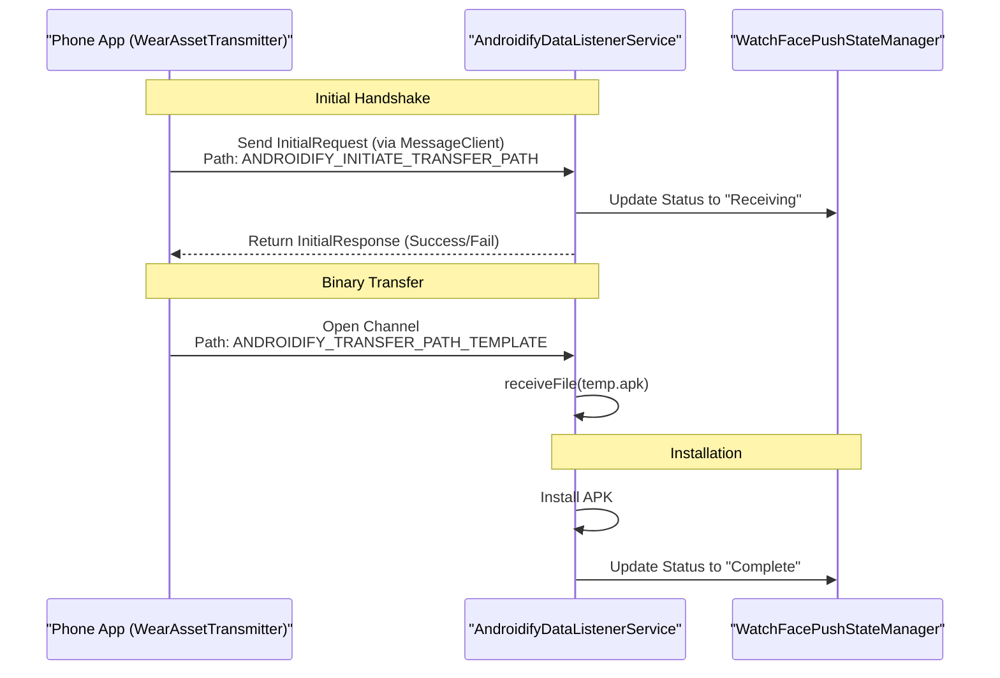
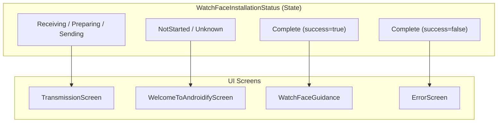

<!-- source: DeepWiki mcp.deepwiki.com · repo android/androidify · page 9.1 Wear OS Companion App · fetched 2026-10-23 -->

# Wear OS Companion App

Relevant source files

The following files were used as context for generating this wiki page:

- [app/src/main/res/values/wear.xml](app/src/main/res/values/wear.xml)
- [core/network/src/main/java/com/android/developers/androidify/vertexai/FirebaseAiDataSource.kt](core/network/src/main/java/com/android/developers/androidify/vertexai/FirebaseAiDataSource.kt)
- [feature/creation/src/main/java/com/android/developers/androidify/creation/xr/EditScreenSpatial.kt](feature/creation/src/main/java/com/android/developers/androidify/creation/xr/EditScreenSpatial.kt)
- [gradle/libs.versions.toml](gradle/libs.versions.toml)
- [watchface/src/main/java/com/android/developers/androidify/watchface/di/WatchFaceModule.kt](watchface/src/main/java/com/android/developers/androidify/watchface/di/WatchFaceModule.kt)
- [wear/common/src/main/java/com/android/developers/androidify/wear/common/WatchFaceInstallationStatus.kt](wear/common/src/main/java/com/android/developers/androidify/wear/common/WatchFaceInstallationStatus.kt)
- [wear/common/src/main/java/com/android/developers/androidify/wear/common/WearableConstants.kt](wear/common/src/main/java/com/android/developers/androidify/wear/common/WearableConstants.kt)
- [wear/src/main/AndroidManifest.xml](wear/src/main/AndroidManifest.xml)
- [wear/src/main/java/com/android/developers/androidify/LaunchOnPhoneActivity.kt](wear/src/main/java/com/android/developers/androidify/LaunchOnPhoneActivity.kt)
- [wear/src/main/java/com/android/developers/androidify/MainApplication.kt](wear/src/main/java/com/android/developers/androidify/MainApplication.kt)
- [wear/src/main/java/com/android/developers/androidify/data/WatchFacePushStateManager.kt](wear/src/main/java/com/android/developers/androidify/data/WatchFacePushStateManager.kt)
- [wear/src/main/java/com/android/developers/androidify/service/AndroidifyDataListenerService.kt](wear/src/main/java/com/android/developers/androidify/service/AndroidifyDataListenerService.kt)
- [wear/src/main/java/com/android/developers/androidify/ui/CallToActionButton.kt](wear/src/main/java/com/android/developers/androidify/ui/CallToActionButton.kt)
- [wear/src/main/java/com/android/developers/androidify/ui/CallToActionScreen.kt](wear/src/main/java/com/android/developers/androidify/ui/CallToActionScreen.kt)
- [wear/src/main/java/com/android/developers/androidify/ui/TransmissionScreen.kt](wear/src/main/java/com/android/developers/androidify/ui/TransmissionScreen.kt)
- [wear/src/main/java/com/android/developers/androidify/ui/WatchFaceOnboardingScreen.kt](wear/src/main/java/com/android/developers/androidify/ui/WatchFaceOnboardingScreen.kt)
- [wear/src/main/java/com/android/developers/androidify/updater/UpdateReceiver.kt](wear/src/main/java/com/android/developers/androidify/updater/UpdateReceiver.kt)
- [wear/src/main/java/com/android/developers/androidify/updater/UpdateWorker.kt](wear/src/main/java/com/android/developers/androidify/updater/UpdateWorker.kt)
- [wear/src/main/java/com/android/developers/androidify/watchfacepush/WatchFaceOnboardingRepository.kt](wear/src/main/java/com/android/developers/androidify/watchfacepush/WatchFaceOnboardingRepository.kt)

The Wear OS companion app is a dedicated module designed to facilitate the receipt, installation, and onboarding of custom-generated watch faces from the Androidify phone application. It leverages the **Google Play Services Wearable Data Layer** for secure, high-bandwidth communication and provides a specialized UI for managing watch face activation.

## Communication and Data Flow

Communication between the phone and watch is orchestrated via the `Wearable Data Layer API`. The process uses both the `MessageClient` for signaling and the `ChannelClient` for large binary transfers (APKs).

### Data Transfer Sequence
1.  **Initiation**: The phone app sends an `InitialRequest` via `MessageClient` to the watch on the path `ANDROIDIFY_INITIATE_TRANSFER_PATH` [wear/common/src/main/java/com/android/developers/androidify/wear/common/WearableConstants.kt:19-19]().
2.  **Handshake**: `AndroidifyDataListenerService` receives the request and validates if a transfer is already in progress [wear/src/main/java/com/android/developers/androidify/service/AndroidifyDataListenerService.kt:86-92]().
3.  **Payload**: Once accepted, a `Channel` is opened. The watch receives the watch face APK as a file via `channelClient.receiveFile` [wear/src/main/java/com/android/developers/androidify/service/AndroidifyDataListenerService.kt:147-147]().
4.  **Installation**: Upon successful transfer, the service initiates the installation of the received APK [wear/src/main/java/com/android/developers/androidify/service/AndroidifyDataListenerService.kt:152-160]().

### Code Entity Space: Transfer Orchestration
This diagram maps the communication paths to specific constants and classes defined in the codebase.

**Sources:** [wear/src/main/java/com/android/developers/androidify/service/AndroidifyDataListenerService.kt:86-160](), [wear/common/src/main/java/com/android/developers/androidify/wear/common/WearableConstants.kt:18-31]()

## Key Components

### AndroidifyDataListenerService
A `WearableListenerService` that acts as the background entry point for all incoming data from the phone. It handles the lifecycle of the APK transfer and manages timeouts via `TRANSFER_TIMEOUT_MS` [wear/src/main/java/com/android/developers/androidify/service/AndroidifyDataListenerService.kt:67-78]().

### WatchFacePushStateManager
Manages the persistent state of the watch face installation process. It provides a `Flow<WatchFaceInstallationStatus>` that the UI observes to transition between different screens (e.g., from `TransmissionScreen` to `WatchFaceGuidance`) [wear/src/main/java/com/android/developers/androidify/data/WatchFacePushStateManager.kt]().

### WatchFaceOnboardingRepository
Handles the persistence of onboarding completion flags and specific device capabilities required for watch face activation [wear/src/main/java/com/android/developers/androidify/watchfacepush/WatchFaceOnboardingRepository.kt]().

## User Interface and Onboarding

The Wear OS app is built using **Jetpack Compose for Wear OS**, utilizing `TransformingLazyColumn` for optimized list rendering on round displays.

### Onboarding Flow
The `WatchFaceOnboardingScreen` acts as the primary UI controller, observing the installation state to determine which screen to display [wear/src/main/java/com/android/developers/androidify/ui/WatchFaceOnboardingScreen.kt:42-93]().

| Screen | Purpose |
| :--- | :--- |
| `TransmissionScreen` | Displays a `FourColorProgressIndicator` while the APK is being received [wear/src/main/java/com/android/developers/androidify/ui/TransmissionScreen.kt:58-96](). |
| `WatchFaceGuidance` | Guides the user through activation based on the `WatchFaceActivationStrategy` [wear/src/main/java/com/android/developers/androidify/ui/WatchFaceOnboardingScreen.kt:96-144](). |
| `CallToActionScreen` | A reusable template for "Welcome" and "Action" screens with a `CallToActionButton` [wear/src/main/java/com/android/developers/androidify/ui/CallToActionScreen.kt:38-78](). |

### Activation Strategies
Depending on the Wear OS version and device capabilities, the app dynamically chooses how to help the user set the new watch face:
*   **GO_TO_WATCH_SETTINGS**: Directs user to system settings.
*   **LONG_PRESS_TO_SET**: Instructs user to long-press the current watch face.
*   **FOLLOW_PROMPT_ON_WATCH**: Requests the `SET_PUSHED_WATCH_FACE_AS_ACTIVE` permission to automate activation [wear/src/main/java/com/android/developers/androidify/ui/WatchFaceOnboardingScreen.kt:135-143]().

### Code Entity Space: UI State Mapping
This diagram shows how the `WatchFaceInstallationStatus` enum drives the `WatchFaceOnboardingScreen` UI.

**Sources:** [wear/src/main/java/com/android/developers/androidify/ui/WatchFaceOnboardingScreen.kt:50-91](), [wear/common/src/main/java/com/android/developers/androidify/wear/common/WatchFaceInstallationStatus.kt]()

## Remote Interaction
The app includes a `LaunchOnPhoneActivity` which uses `RemoteActivityHelper` to open the Androidify app on the connected mobile device. It checks for the `androidify_phone` capability to determine if the app is already installed or if it should open the Play Store [wear/src/main/java/com/android/developers/androidify/LaunchOnPhoneActivity.kt:40-70]().

**Sources:** [wear/src/main/java/com/android/developers/androidify/LaunchOnPhoneActivity.kt:72-94](), [app/src/main/res/values/wear.xml:18-20]()

---

