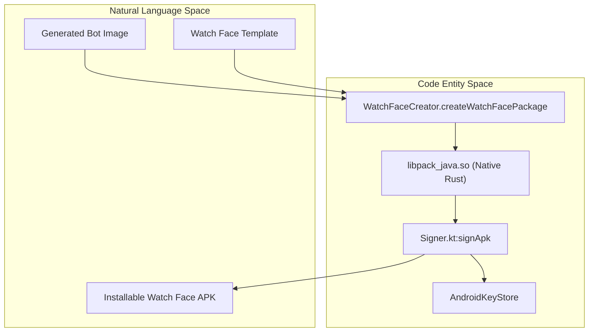
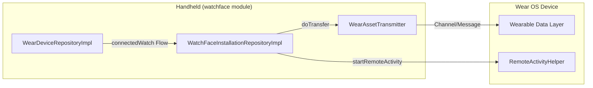

<!-- source: DeepWiki mcp.deepwiki.com · repo android/androidify · page 9.2 Watch Face Generation and Transfer · fetched 2026-10-23 -->

# Watch Face Generation and Transfer

Relevant source files

The following files were used as context for generating this wiki page:

- [core/testing/src/main/java/com/android/developers/testing/repository/FakeWatchFaceInstallationRepository.kt](core/testing/src/main/java/com/android/developers/testing/repository/FakeWatchFaceInstallationRepository.kt)
- [feature/results/src/main/java/com/android/developers/androidify/customize/watchface/AllDoneWatchFacePanel.kt](feature/results/src/main/java/com/android/developers/androidify/customize/watchface/AllDoneWatchFacePanel.kt)
- [feature/results/src/main/java/com/android/developers/androidify/customize/watchface/ErrorWatchFacePanel.kt](feature/results/src/main/java/com/android/developers/androidify/customize/watchface/ErrorWatchFacePanel.kt)
- [feature/results/src/main/java/com/android/developers/androidify/customize/watchface/GuidanceWatchFacePanel.kt](feature/results/src/main/java/com/android/developers/androidify/customize/watchface/GuidanceWatchFacePanel.kt)
- [feature/results/src/main/java/com/android/developers/androidify/customize/watchface/InstallAndroidifyPanel.kt](feature/results/src/main/java/com/android/developers/androidify/customize/watchface/InstallAndroidifyPanel.kt)
- [feature/results/src/main/java/com/android/developers/androidify/customize/watchface/InstallWatchFacePanel.kt](feature/results/src/main/java/com/android/developers/androidify/customize/watchface/InstallWatchFacePanel.kt)
- [feature/results/src/main/java/com/android/developers/androidify/customize/watchface/TransferringWatchFacePanel.kt](feature/results/src/main/java/com/android/developers/androidify/customize/watchface/TransferringWatchFacePanel.kt)
- [feature/results/src/main/java/com/android/developers/androidify/customize/watchface/WatchFaceModalSheet.kt](feature/results/src/main/java/com/android/developers/androidify/customize/watchface/WatchFaceModalSheet.kt)
- [feature/results/src/main/java/com/android/developers/androidify/customize/watchface/WatchFacePanelButton.kt](feature/results/src/main/java/com/android/developers/androidify/customize/watchface/WatchFacePanelButton.kt)
- [feature/results/src/main/res/values/strings.xml](feature/results/src/main/res/values/strings.xml)
- [watchface/README.md](watchface/README.md)
- [watchface/build.gradle.kts](watchface/build.gradle.kts)
- [watchface/pack-java/.cargo-example/config.toml](watchface/pack-java/.cargo-example/config.toml)
- [watchface/pack-java/Cargo.lock](watchface/pack-java/Cargo.lock)
- [watchface/pack-java/src/lib.rs](watchface/pack-java/src/lib.rs)
- [watchface/proguard-rules.pro](watchface/proguard-rules.pro)
- [watchface/provide-libraries-to-androidify-project.sh](watchface/provide-libraries-to-androidify-project.sh)
- [watchface/src/main/java/com/android/developers/androidify/watchface/creator/PackPackage.kt](watchface/src/main/java/com/android/developers/androidify/watchface/creator/PackPackage.kt)
- [watchface/src/main/java/com/android/developers/androidify/watchface/creator/Signer.kt](watchface/src/main/java/com/android/developers/androidify/watchface/creator/Signer.kt)
- [watchface/src/main/java/com/android/developers/androidify/watchface/creator/WatchFaceCreator.kt](watchface/src/main/java/com/android/developers/androidify/watchface/creator/WatchFaceCreator.kt)
- [watchface/src/main/java/com/android/developers/androidify/watchface/transfer/EmptyWatchFaceInstallationRepository.kt](watchface/src/main/java/com/android/developers/androidify/watchface/transfer/EmptyWatchFaceInstallationRepository.kt)
- [watchface/src/main/java/com/android/developers/androidify/watchface/transfer/WatchFaceInstallationRepository.kt](watchface/src/main/java/com/android/developers/androidify/watchface/transfer/WatchFaceInstallationRepository.kt)
- [watchface/src/main/java/com/android/developers/androidify/watchface/transfer/WearAssetTransmitter.kt](watchface/src/main/java/com/android/developers/androidify/watchface/transfer/WearAssetTransmitter.kt)
- [watchface/src/main/java/com/android/developers/androidify/watchface/transfer/WearDeviceRepository.kt](watchface/src/main/java/com/android/developers/androidify/watchface/transfer/WearDeviceRepository.kt)
- [watchface/src/main/java/com/android/developers/androidify/watchface/transfer/WearableApiAvailability.kt](watchface/src/main/java/com/android/developers/androidify/watchface/transfer/WearableApiAvailability.kt)
- [watchface/src/main/jniLibs/arm64-v8a/libpack_java.so](watchface/src/main/jniLibs/arm64-v8a/libpack_java.so)
- [watchface/src/main/jniLibs/armeabi-v7a/libpack_java.so](watchface/src/main/jniLibs/armeabi-v7a/libpack_java.so)
- [watchface/src/main/jniLibs/x86/libpack_java.so](watchface/src/main/jniLibs/x86/libpack_java.so)
- [watchface/src/main/jniLibs/x86_64/libpack_java.so](watchface/src/main/jniLibs/x86_64/libpack_java.so)

The `watchface` module is responsible for dynamically generating Wear OS Watch Face Format (WFF) packages and transferring them to connected Wear OS devices. It integrates native packaging libraries, cryptographic signing, and the Wearable Data Layer API to provide a seamless "Send to Watch" experience for generated Androidify bots.

## Module Overview

The module handles three primary responsibilities:
1.  **Generation**: Modifying WFF templates to include the user's custom bot image.
2.  **Packaging**: Compiling and signing a valid Android APK containing the watch face.
3.  **Discovery & Transfer**: Identifying connected Wear OS devices and transmitting the generated assets.

### Key Components

| Component | Responsibility |
| :--- | :--- |
| `WatchFaceCreator` | Orchestrates the assembly of WFF assets and bot bitmaps into a package. |
| `Pack` (Native) | A Rust-based native library used to package WFF resources into the final format. |
| `Signer` | Handles APK signing using the Android KeyStore for on-device generation. |
| `WearDeviceRepository` | Manages Wear OS device discovery and capability checking. |
| `WearAssetTransmitter` | Manages the low-level transmission of the watch face via Wearable Data Layer. |

**Sources:**
- [watchface/README.md:1-23]()
- [watchface/src/main/java/com/android/developers/androidify/watchface/transfer/WatchFaceInstallationRepository.kt:82-87]()

## Watch Face Generation Logic

Watch faces are generated by taking a base Watch Face Format template and injecting the generated bot image. The templates are stored in the `assets` directory of the module [watchface/README.md:7-9]().

### Watch Face Packaging Flow
The `WatchFaceCreator` uses the `Pack` native library to bundle the `AndroidManifest.xml`, `watchface.xml`, and the dynamic `bot.png` resource [watchface/README.md:11-13]().

#### Code Entity Mapping: Generation

**Sources:**
- [watchface/src/main/java/com/android/developers/androidify/watchface/creator/WatchFaceCreator.kt:107-109]()
- [watchface/src/main/java/com/android/developers/androidify/watchface/creator/Signer.kt:58-62]()
- [watchface/README.md:20-23]()

### Native Packaging (Pack)
The packaging process relies on a native library built from Rust. Pre-built binaries are provided in `jniLibs` for `arm64-v8a`, `armeabi-v7a`, `x86`, and `x86_64` [watchface/README.md:22-23](). 

If rebuilding is required, the `provide-libraries-to-androidify-project.sh` script compiles the Rust source using the Android NDK, targeting API level 26 or above [watchface/pack-java/.cargo-example/config.toml:7-20]().

## Device Discovery and Communication

The `WearDeviceRepository` provides a reactive stream of connected devices using the `CapabilityClient` and `NodeClient`.

### Device Selection Strategy
The repository prioritizes devices that already have the Androidify Wear app installed, identified by the `ANDROIDIFY_INSTALLED_WEAR` capability [watchface/src/main/java/com/android/developers/androidify/watchface/transfer/WearDeviceRepository.kt:22-24]().

- If a device with the capability is found, it is marked as `hasAndroidify = true` [watchface/src/main/java/com/android/developers/androidify/watchface/transfer/WearDeviceRepository.kt:92-97]().
- If no device has the app, it falls back to the first reachable node with `hasAndroidify = false` [watchface/src/main/java/com/android/developers/androidify/watchface/transfer/WearDeviceRepository.kt:98-103]().

### Availability Checks
Before attempting discovery, the system verifies if the Wearable API is available on the handheld device using `WearableApiAvailability` [watchface/src/main/java/com/android/developers/androidify/watchface/transfer/WearableApiAvailability.kt:28-41]().

**Sources:**
- [watchface/src/main/java/com/android/developers/androidify/watchface/transfer/WearDeviceRepository.kt:47-82]()
- [watchface/src/main/java/com/android/developers/androidify/watchface/transfer/WearableApiAvailability.kt:27-41]()

## Transfer and Installation Flow

The transfer process is managed by `WatchFaceInstallationRepositoryImpl`, which coordinates between generation and transmission.

### Transfer Sequence
1.  **Discovery**: `WearDeviceRepository` identifies a target node.
2.  **Preparation**: The UI calls `prepareForTransfer()`, updating status to `Preparing` [watchface/src/main/java/com/android/developers/androidify/watchface/transfer/WatchFaceInstallationRepository.kt:140-142]().
3.  **Generation**: `WatchFaceCreator` builds the APK on a background IO thread [watchface/src/main/java/com/android/developers/androidify/watchface/transfer/WatchFaceInstallationRepository.kt:105-108]().
4.  **Transmission**: `WearAssetTransmitter` sends the binary data to the watch [watchface/src/main/java/com/android/developers/androidify/watchface/transfer/WatchFaceInstallationRepository.kt:110-111]().
5.  **Remote Installation**: If the companion app is missing, `installAndroidify` triggers a Play Store intent on the watch via `RemoteActivityHelper` [watchface/src/main/java/com/android/developers/androidify/watchface/transfer/WatchFaceInstallationRepository.kt:144-156]().

#### Code Entity Mapping: Transfer

### Installation Statuses
The UI observes `WatchFaceInstallationStatus` to update the `WatchFaceModalSheet` [feature/results/src/main/java/com/android/developers/androidify/customize/watchface/WatchFaceModalSheet.kt:112-132](). Key states include:
- `NotStarted`: Initial state.
- `Preparing`: Scanning assets and checking device readiness.
- `Sending`: Transferring the generated APK.
- `Complete`: Successful transfer, providing an `activationStrategy` (e.g., `LONG_PRESS_TO_SET`) [feature/results/src/main/java/com/android/developers/androidify/customize/watchface/WatchFaceModalSheet.kt:133-154]().

**Sources:**
- [watchface/src/main/java/com/android/developers/androidify/watchface/transfer/WatchFaceInstallationRepository.kt:90-112]()
- [feature/results/src/main/java/com/android/developers/androidify/customize/watchface/WatchFaceModalSheet.kt:110-154]()
- [watchface/src/main/java/com/android/developers/androidify/watchface/transfer/EmptyWatchFaceInstallationRepository.kt:27-34]()

## Security and Signing
Generated APKs must be signed to be installable on Wear OS. The `Signer.kt` utility uses `ApkSigner` from the `com.android.apksig` library [watchface/src/main/java/com/android/developers/androidify/watchface/creator/Signer.kt:20-25]().

- **Key Storage**: Keys are stored in the `AndroidKeyStore` under an alias specific to the build type [watchface/src/main/java/com/android/developers/androidify/watchface/creator/Signer.kt:42-46]().
- **Certificate**: If no certificate exists, a self-signed X.509 certificate is created with a 25-year validity [watchface/src/main/java/com/android/developers/androidify/watchface/creator/Signer.kt:116-134]().
- **Signing Schemes**: The implementation enables both V2 and V3 signing schemes [watchface/src/main/java/com/android/developers/androidify/watchface/creator/Signer.kt:182-183]().

**Sources:**
- [watchface/src/main/java/com/android/developers/androidify/watchface/creator/Signer.kt:74-99]()
- [watchface/src/main/java/com/android/developers/androidify/watchface/creator/Signer.kt:189-201]()

---

