# Page: Overview

# Overview

<details>
<summary>Relevant source files</summary>

The following files were used as context for generating this wiki page:

- [AGENTS.md](AGENTS.md)
- [README.md](README.md)
- [app/.gitignore](app/.gitignore)
- [app/build.gradle.kts](app/build.gradle.kts)
- [core/theme/build.gradle.kts](core/theme/build.gradle.kts)
- [settings.gradle.kts](settings.gradle.kts)
- [setup/remote_config_defaults.json](setup/remote_config_defaults.json)

</details>


## What is Androidify?

Androidify is an open-source Android application that creates customized AI-generated Android bots using Google's Gemini API. Users can either capture a photo of themselves or provide a text description, and the app generates a personalized Android mascot with customizable backgrounds and export options.

The application demonstrates production-ready integration of AI services on Android, including on-device and cloud-based generative models, custom camera implementation using CameraX, and adaptive UI design across different form factors using Jetpack Compose and Navigation 3.

Sources: [README.md:1-17](), [README.md:19-24]()

## Key User Flow

Androidify provides a streamlined workflow from input to export:

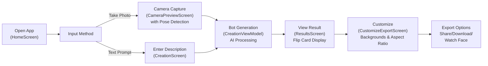

### Flow Details

1.  **Home (`HomeScreen`)**: Entry point with promotional content and navigation to creation flow.
2.  **Input Selection (`CreationScreen`)**: User chooses between camera capture or text prompt.
3.  **Camera (`CameraPreviewScreen`)**: Optional photo capture with ML Kit pose detection overlay.
4.  **Creation (`CreationViewModel`)**: AI-powered bot generation via `ImageGenerationRepository`.
5.  **Results (`ResultsScreen`)**: Flippable card showing generated bot (front) and original input (back).
6.  **Customize (`CustomizeExportScreen`)**: Aspect ratio selection and background tools (static or AI-generated).
7.  **Export**: Share via system intent, download to MediaStore, or transfer to Wear OS watch face.

Sources: [README.md:19-24](), [AGENTS.md:21-27](), [app/build.gradle.kts:130-133]()

## Technology Stack

Androidify uses modern Android libraries and AI services:

| Technology | Purpose | Key Classes/Files |
| :--- | :--- | :--- |
| **Jetpack Compose** | Declarative UI with adaptive layouts | `AndroidifyTheme`, `NavDisplay` |
| **Navigation 3** | Type-safe navigation with backstack management | `MainNavigation`, `NavigationRoute` |
| **CameraX** | Camera implementation with custom controls | `feature:camera` |
| **Gemini API** | Text and image generation models | Gemini 2.5 Flash, Imagen 4.0 Ultra |
| **Firebase Services** | Cloud services and configuration | `FirebaseAiDataSource`, Remote Config, App Check |
| **ML Kit** | On-device ML for pose detection and segmentation | `PoseDetector`, `SubjectSegmenter` |
| **Hilt** | Dependency injection | `@HiltViewModel`, `@AssistedFactory` |
| **XR Compose** | Spatial UI for XR devices | `core:xr` |

Sources: [README.md:19-24](), [app/build.gradle.kts:102-125](), [AGENTS.md:7-16]()

## Application Architecture

Androidify follows a multi-module architecture with clear dependency boundaries and separation of concerns.

### High-Level Module Structure

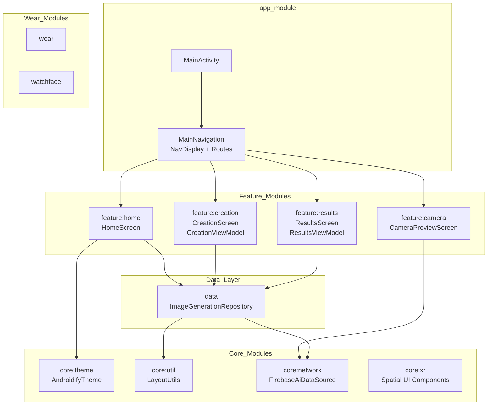

Sources: [settings.gradle.kts:55-70](), [app/build.gradle.kts:130-137](), [AGENTS.md:19-27]()

## AI Integration

Androidify demonstrates a hybrid AI architecture combining on-device and cloud-based models.

### AI Service Architecture

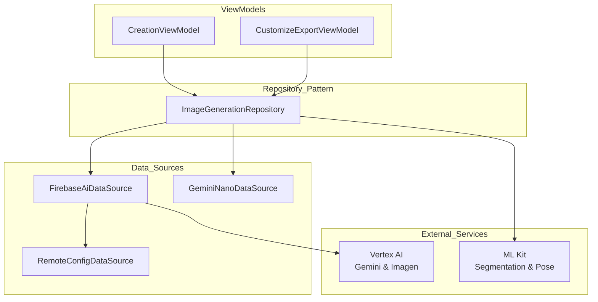

### Remote Configuration

Firebase Remote Config controls AI model selection and feature flags at runtime:

| Parameter | Type | Purpose | Default |
| :--- | :--- | :--- | :--- |
| `use_imagen` | Boolean | Switch between Imagen and fine-tuned model | `true` |
| `use_gemini_nano` | Boolean | Enable on-device Gemini Nano fallback | `false` |
| `background_vibes_feature_enabled` | Boolean | Enable AI background generation | `false` |
| `xr_feature_enabled` | Boolean | Enable spatial UI mode | `false` |
| `watchface_feature_enabled` | Boolean | Enable watch face export | `false` |

Sources: [setup/remote_config_defaults.json:3-45](), [README.md:33-39]()

## Development Status

Androidify is currently under development. While it uses standard Imagen models by default, a fine-tuned model specifically trained for the Android bot mascot is planned for future release. The app serves as a Tier 1 example of large screen optimization, ensuring compatibility across phones, tablets, foldables, and XR devices.

Sources: [README.md:12-15](), [AGENTS.md:73]()

---

# Page: Getting Started

# Getting Started

<details>
<summary>Relevant source files</summary>

The following files were used as context for generating this wiki page:

- [README.md](README.md)
- [app/.gitignore](app/.gitignore)
- [app/build.gradle.kts](app/build.gradle.kts)
- [core/network/src/main/java/com/android/developers/androidify/RemoteConfigDataSource.kt](core/network/src/main/java/com/android/developers/androidify/RemoteConfigDataSource.kt)
- [core/network/src/main/res/xml/remote_config_defaults.xml](core/network/src/main/res/xml/remote_config_defaults.xml)
- [core/testing/src/main/java/com/android/developers/testing/network/TestFirebaseAiDataSource.kt](core/testing/src/main/java/com/android/developers/testing/network/TestFirebaseAiDataSource.kt)
- [core/testing/src/main/java/com/android/developers/testing/network/TestRemoteConfigDataSource.kt](core/testing/src/main/java/com/android/developers/testing/network/TestRemoteConfigDataSource.kt)
- [core/testing/src/main/java/com/android/developers/testing/repository/FakeImageGenerationRepository.kt](core/testing/src/main/java/com/android/developers/testing/repository/FakeImageGenerationRepository.kt)
- [core/theme/build.gradle.kts](core/theme/build.gradle.kts)
- [core/theme/src/main/java/com/android/developers/androidify/theme/transitions/LoadingShimmerOverlay.kt](core/theme/src/main/java/com/android/developers/androidify/theme/transitions/LoadingShimmerOverlay.kt)
- [settings.gradle.kts](settings.gradle.kts)
- [setup/remote_config_defaults.json](setup/remote_config_defaults.json)

</details>


This document guides developers through the initial setup process for the Androidify application, including Firebase project configuration, Remote Config parameter setup, and building the application locally. For information about the overall architecture and how components fit together, see **Architecture**. For details about specific AI/ML integration requirements, see **AI and ML Integration**.

---

## Prerequisites

Before beginning setup, ensure you have the following tools and accounts:

| Requirement | Version/Details | Purpose |
|-------------|-----------------|---------|
| **JDK** | 21 (Temurin distribution recommended) | Required for building the application |
| **Android Studio** | Latest stable version | IDE for development |
| **Gradle** | 8.x (via wrapper) | Build system |
| **Firebase Account** | With billing enabled | Required for Vertex AI access |
| **Git** | Any recent version | Source control |

**Note**: The application requires a Firebase account with billing enabled because it uses Vertex AI API for cloud-based AI model access [README.md:31-32]().

**Sources:** [README.md:26-31]()

---

## Repository Setup

Clone the repository from GitHub:

```bash
git clone https://github.com/android/androidify.git
cd androidify
```

The repository uses a multi-module Gradle project structure. The `settings.gradle.kts` file defines the module hierarchy, including `:app`, `:feature` modules, and `:core` modules [settings.gradle.kts:55-70]().

**Sources:** [README.md:28](), [settings.gradle.kts:55-70]()

---

## Firebase Project Configuration

### Creating the Firebase Project

1. Navigate to the [Firebase Console](https://console.firebase.google.com/).
2. Click "Add project" and follow the creation wizard.
3. Once created, add an Android app with package name `com.android.developers.androidify` [app/build.gradle.kts:31-33]().
4. Enable the **Vertex AI API** in the [Google Cloud Console](https://console.cloud.google.com/apis/library/aiplatform.googleapis.com) [README.md:31]().
5. Enable **App Check** in the Firebase Console to prevent API abuse [README.md:32]().

### Generating google-services.json

Download the `google-services.json` file from the Firebase Console and place it in the `app/` directory [README.md:31]().

```
androidify/
├── app/
│   ├── google-services.json    <- Place here
│   ├── build.gradle.kts
│   └── src/
```

**Important**: The `google-services.json` file is git-ignored for security reasons [app/.gitignore:2]().

### Code Entity Association: Firebase Integration

The following diagram shows how the Firebase configuration interacts with the core networking and AI components.

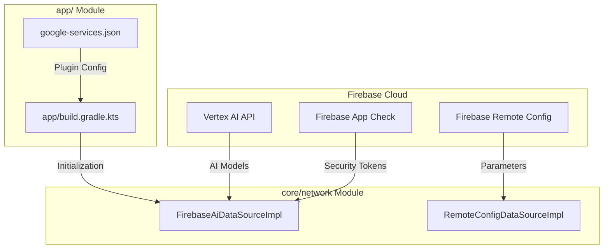

**Sources:** [app/build.gradle.kts:23-24](), [README.md:29-32](), [core/network/src/main/java/com/android/developers/androidify/RemoteConfigDataSource.kt:56-58]()

---

## Remote Config Setup

Firebase Remote Config controls critical runtime behavior including AI model selection and feature flags. The application uses the `RemoteConfigDataSource` interface to access these parameters [core/network/src/main/java/com/android/developers/androidify/RemoteConfigDataSource.kt:23-53]().

### Configuration Parameters

The most important parameters defined in `remote_config_defaults.xml` include:

| Parameter | Type | Default | Description |
|-----------|------|---------|-------------|
| `use_imagen` | Boolean | `false` | Switches between standard Imagen and fine-tuned models [core/network/src/main/res/xml/remote_config_defaults.xml:49]() |
| `use_gemini_nano` | Boolean | `false` | Enables on-device Gemini Nano processing [core/network/src/main/res/xml/remote_config_defaults.xml:89]() |
| `background_vibes_feature_enabled` | Boolean | `false` | Gates the AI-generated backgrounds feature [core/network/src/main/res/xml/remote_config_defaults.xml:24]() |
| `watchface_feature_enabled` | Boolean | `false` | Enables Wear OS watch face export [core/network/src/main/res/xml/remote_config_defaults.xml:20]() |
| `xr_feature_enabled` | Boolean | `false` | Enables XR spatial UI modes [core/network/src/main/res/xml/remote_config_defaults.xml:28]() |

### Uploading Configuration to Firebase

The project provides a template for Remote Config in `setup/remote_config_defaults.json`.

1. Navigate to Firebase Console → Remote Config.
2. Click "Upload template" and select `setup/remote_config_defaults.json` [README.md:38]().
3. **Crucial**: Update `use_imagen` to `true` in the console to use the public Imagen model [README.md:33]().
4. Click "Publish".

### Data Flow: Remote Config to UI

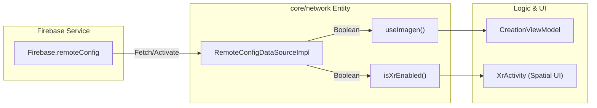

**Sources:** [core/network/src/main/java/com/android/developers/androidify/RemoteConfigDataSource.kt:119-140](), [setup/remote_config_defaults.json:28-33]()

---

## Building the Application

### Build Variants

The `app/build.gradle.kts` file defines three primary build types:
- `debug`: Standard development build with `-debug` suffix [app/build.gradle.kts:39-41]().
- `release`: Minified and resource-shrunk build. For local builds, it signs with the debug key unless `CI_BUILD` is set [app/build.gradle.kts:47-71]().
- `benchmark`: Used for performance profiling and baseline profile generation [app/build.gradle.kts:42-46]().

### Custom Font Configuration

You can customize the font by adding a property to your `~/.gradle/gradle.properties` file:
```properties
fontName="Roboto Flex"
```
The `core/theme` module reads this property and injects it into the `BuildConfig` [core/theme/build.gradle.kts:19-33]().

### Standard Build Commands

```bash
# Clean and build debug APK
./gradlew clean assembleDebug

# Apply Spotless code formatting
./gradlew spotlessApply
```

**Sources:** [app/build.gradle.kts:38-72](), [core/theme/build.gradle.kts:19-33](), [README.md:40-45]()

---

## Verification and Testing

### Unit Testing

The project uses test doubles in the `core/testing` module to verify logic without real network calls:
- `TestRemoteConfigDataSource`: Allows overriding feature flags for tests [core/testing/src/main/java/com/android/developers/testing/network/TestRemoteConfigDataSource.kt:20]().
- `FakeImageGenerationRepository`: Simulates AI image generation and background removal [core/testing/src/main/java/com/android/developers/testing/repository/FakeImageGenerationRepository.kt:26]().
- `TestFirebaseAiDataSource`: Mocks Vertex AI responses [core/testing/src/main/java/com/android/developers/testing/network/TestFirebaseAiDataSource.kt:25]().

Run tests using:
```bash
./gradlew test
```

**Sources:** [core/testing/src/main/java/com/android/developers/testing/network/TestRemoteConfigDataSource.kt:20-102](), [core/testing/src/main/java/com/android/developers/testing/repository/FakeImageGenerationRepository.kt:26-74]()

---

# Page: Architecture

# Architecture

<details>
<summary>Relevant source files</summary>

The following files were used as context for generating this wiki page:

- [.run/spotlessApply.run.xml](.run/spotlessApply.run.xml)
- [app/build.gradle.kts](app/build.gradle.kts)
- [app/src/main/java/com/android/developers/androidify/MainActivity.kt](app/src/main/java/com/android/developers/androidify/MainActivity.kt)
- [build.gradle.kts](build.gradle.kts)
- [core/testing/src/main/java/com/android/developers/testing/repository/FakeDropImageFactory.kt](core/testing/src/main/java/com/android/developers/testing/repository/FakeDropImageFactory.kt)
- [core/theme/build.gradle.kts](core/theme/build.gradle.kts)
- [data/src/main/java/com/android/developers/androidify/data/DataModule.kt](data/src/main/java/com/android/developers/androidify/data/DataModule.kt)
- [data/src/main/java/com/android/developers/androidify/data/DropBehaviourFactory.kt](data/src/main/java/com/android/developers/androidify/data/DropBehaviourFactory.kt)
- [feature/camera/build.gradle.kts](feature/camera/build.gradle.kts)
- [feature/creation/build.gradle.kts](feature/creation/build.gradle.kts)
- [feature/home/build.gradle.kts](feature/home/build.gradle.kts)
- [feature/results/build.gradle.kts](feature/results/build.gradle.kts)
- [settings.gradle.kts](settings.gradle.kts)

</details>


## Purpose and Scope

This document provides a high-level overview of the Androidify application's architectural patterns and system design. The project follows a modern, multi-module Android architecture utilizing the **MVVM (Model-View-ViewModel)** pattern, **Jetpack Compose** for UI, and **Hilt** for dependency injection. 

This is a parent page. For detailed technical specifications, please refer to the following child pages:
*   [Module Structure](#3.1) — Details on feature, core, data, and wear modules.
*   [UI Framework and Adaptive Design](#3.2) — Jetpack Compose, XR spatial UI, and adaptive layouts.
*   [Dependency Injection](#3.3) — Hilt setup and Assisted Injection patterns.
*   [Navigation System](#3.4) — Type-safe navigation and screen transitions.

## High-Level Architecture Pattern

Androidify is built with a clear separation of concerns, organized into layers that facilitate AI integration (Gemini/Vertex AI) and cross-platform support (Mobile, XR, and Wear OS).

### System Component Diagram

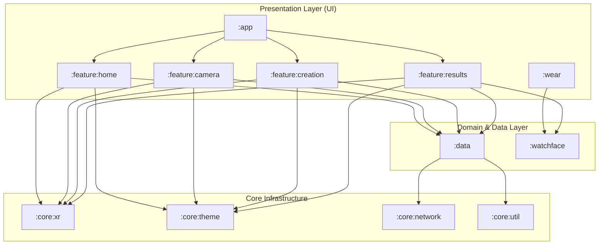

**Sources:** [settings.gradle.kts:55-70](), [app/build.gradle.kts:130-137]()

## Multi-Module Structure

The project uses a modularized approach to improve build times and enforce boundaries between features.

*   **Feature Modules**: Contain UI logic and ViewModels for specific user journeys (e.g., `:feature:camera` for capture, `:feature:creation` for AI prompting).
*   **Core Modules**: Provide low-level, reusable functionality like `:core:theme` (Material 3 styling) and `:core:xr` (Spatial computing support).
*   **Data Module**: The `:data` module acts as the single source of truth, managing repositories that abstract AI data sources and local file handling.
*   **Wear & Watchface**: Specialized modules for Wear OS support and the Watch Face Format (WFF) generation.

For details, see [Module Structure](#3.1).

**Sources:** [settings.gradle.kts:55-70](), [data/src/main/java/com/android/developers/androidify/data/DataModule.kt:65-75]()

## UI and Adaptive Design

The application is built entirely with **Jetpack Compose**. It is designed to be adaptive, supporting standard mobile phones, foldables (tabletop mode), and XR headsets (spatial panels).

*   **Spatial UI**: Integration with `androidx.xr.compose` allows the app to transition between Home Space and Full Space modes.
*   **Adaptive Layouts**: Uses `androidx.adaptive` to handle different window size classes.

For details, see [UI Framework and Adaptive Design](#3.2).

**Sources:** [feature/creation/build.gradle.kts:49-55](), [MainActivity.kt:49-65]()

## Dependency Injection (Hilt)

Hilt is used throughout the project to manage the lifecycle of dependencies. The `:data` module defines bindings for key repositories and AI data sources.

| Interface | Implementation | Scope |
|-----------|----------------|-------|
| `ImageGenerationRepository` | `ImageGenerationRepositoryImpl` | `Singleton` |
| `FirebaseAiDataSource` | `FirebaseAiDataSourceImpl` | `Singleton` |
| `LocalFileProvider` | `LocalFileProviderImpl` | `Singleton` |

For details, see [Dependency Injection](#3.3).

**Sources:** [data/src/main/java/com/android/developers/androidify/data/DataModule.kt:44-75](), [app/build.gradle.kts:22]()

## Navigation and State Management

The app uses a type-safe navigation system built on top of Compose Navigation. The `MainActivity` acts as the entry point, hosting the `MainNavigation` component.

*   **NavigationRoute**: A sealed interface defining all destinations.
*   **NavDisplay**: A custom component handling screen transitions and spatial awareness.

For details, see [Navigation System](#3.4).

**Sources:** [app/src/main/java/com/android/developers/androidify/MainActivity.kt:31](), [app/src/main/java/com/android/developers/androidify/MainActivity.kt:62]()

## Build and CI/CD

The build system is managed via Gradle with Kotlin DSL and Version Catalogs.
*   **Spotless**: Enforces code style and license headers across all modules.
*   **Baseline Profiles**: Used to optimize startup performance and frame rates.
*   **SPDX SBOM**: Generates Software Bill of Materials for release builds.

**Sources:** [build.gradle.kts:26-49](), [app/build.gradle.kts:86-99]()

---

# Page: Module Structure

# Module Structure

<details>
<summary>Relevant source files</summary>

The following files were used as context for generating this wiki page:

- [.gitignore](.gitignore)
- [.run/spotlessApply.run.xml](.run/spotlessApply.run.xml)
- [app/build.gradle.kts](app/build.gradle.kts)
- [benchmark/build.gradle.kts](benchmark/build.gradle.kts)
- [build-plugin/build.gradle.kts](build-plugin/build.gradle.kts)
- [build-plugin/settings.gradle.kts](build-plugin/settings.gradle.kts)
- [build-plugin/src/main/kotlin/com/android/developers/androidify/plugin/AndroidApplicationPlugin.kt](build-plugin/src/main/kotlin/com/android/developers/androidify/plugin/AndroidApplicationPlugin.kt)
- [build-plugin/src/main/kotlin/com/android/developers/androidify/plugin/AndroidComposeLibraryPlugin.kt](build-plugin/src/main/kotlin/com/android/developers/androidify/plugin/AndroidComposeLibraryPlugin.kt)
- [build-plugin/src/main/kotlin/com/android/developers/androidify/plugin/AndroidLibraryPlugin.kt](build-plugin/src/main/kotlin/com/android/developers/androidify/plugin/AndroidLibraryPlugin.kt)
- [build-plugin/src/main/kotlin/com/android/developers/androidify/plugin/VersionCatalogHelper.kt](build-plugin/src/main/kotlin/com/android/developers/androidify/plugin/VersionCatalogHelper.kt)
- [build.gradle.kts](build.gradle.kts)
- [core/network/build.gradle.kts](core/network/build.gradle.kts)
- [core/testing/build.gradle.kts](core/testing/build.gradle.kts)
- [core/theme/build.gradle.kts](core/theme/build.gradle.kts)
- [core/util/build.gradle.kts](core/util/build.gradle.kts)
- [data/build.gradle.kts](data/build.gradle.kts)
- [feature/camera/build.gradle.kts](feature/camera/build.gradle.kts)
- [feature/creation/build.gradle.kts](feature/creation/build.gradle.kts)
- [feature/home/build.gradle.kts](feature/home/build.gradle.kts)
- [feature/results/build.gradle.kts](feature/results/build.gradle.kts)
- [settings.gradle.kts](settings.gradle.kts)
- [wear/build.gradle.kts](wear/build.gradle.kts)
- [wear/watchface/build.gradle.kts](wear/watchface/build.gradle.kts)

</details>


This document details the multi-module architecture of the Androidify application, covering the organization of modules, their dependencies, and build configurations. The modular design separates concerns between feature implementations, core infrastructure, and data management components.

For information about the UI framework and responsive design patterns, see [UI Framework and Adaptive Design](#2.2). For details about the data layer implementation and dependency injection setup, see [Data Layer and Dependency Injection](#2.3).

## Module Overview

The Androidify application follows a clean, multi-module architecture organized into logical layers. The structure promotes code reuse, parallel development, and clear separation of concerns.

**Module Dependency Graph**

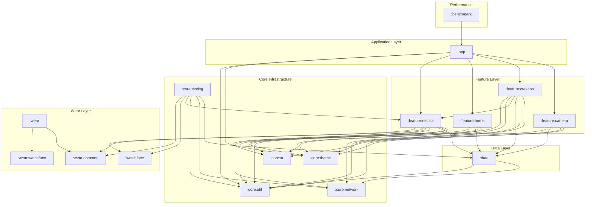

Sources: [app/build.gradle.kts:130-137](), [feature/camera/build.gradle.kts:57-60](), [feature/creation/build.gradle.kts:61-65](), [feature/home/build.gradle.kts:53-55](), [feature/results/build.gradle.kts:51-58](), [data/build.gradle.kts:33-34](), [core/testing/build.gradle.kts:42-47](), [wear/build.gradle.kts:64-65]()

## Module Dependency Matrix

The following table shows the dependency relationships between modules:

| Module | Dependencies | Purpose |
|--------|-------------|---------|
| `:app` | `:feature:*`, `:core:theme`, `:core:util` | Main application entry, navigation, DI root [app/build.gradle.kts:130-137]() |
| `:feature:camera` | `:core:theme`, `:core:util`, `:data`, `:core:xr` | Camera interface, CameraX integration, pose detection [feature/camera/build.gradle.kts:57-60]() |
| `:feature:creation` | `:core:theme`, `:core:util`, `:data`, `:feature:results`, `:core:network`, `:core:xr` | Bot generation workflow, Gemini/Imagen orchestration [feature/creation/build.gradle.kts:61-65]() |
| `:feature:home` | `:core:theme`, `:core:util`, `:data`, `:core:xr` | Home screen, entry point animations [feature/home/build.gradle.kts:53-55]() |
| `:feature:results` | `:core:theme`, `:core:util`, `:data`, `:core:network`, `:core:xr`, `:wear:common`, `:watchface` | Results display, customization, export to Wear [feature/results/build.gradle.kts:51-58]() |
| `:data` | `:core:network`, `:core:util` | Repository implementations, data models [data/build.gradle.kts:33-34]() |
| `:core:network` | `:core:util` | Firebase AI (Gemini), ML Kit, Retrofit [core/network/build.gradle.kts:48-70]() |
| `:core:theme` | `:core:util` | Material 3 design system, shared elements [core/theme/build.gradle.kts:47]() |
| `:core:util` | None | Layout utilities, file providers, shared extensions [core/util/build.gradle.kts:32-42]() |
| `:core:xr` | None | Spatial UI support and XR-specific layouts [settings.gradle.kts:65]() |
| `:core:testing` | `:data`, `:core:network`, `:core:util`, `:feature:results`, `:watchface`, `:wear:common` | Test doubles (Fakes) and testing utilities [core/testing/build.gradle.kts:42-47]() |
| `:wear` | `:wear:common`, `:wear:watchface` | Wear OS companion application [wear/build.gradle.kts:59-65]() |
| `:wear:watchface` | None | Native Watch Face Format (WFF) implementation [wear/watchface/build.gradle.kts:22]() |
| `:wear:common` | None | Shared logic between mobile and Wear OS [settings.gradle.kts:70]() |

## Build Configuration

### Plugin Usage by Module

The application uses convention plugins (defined in `:build-plugin`) to maintain consistency across the project.

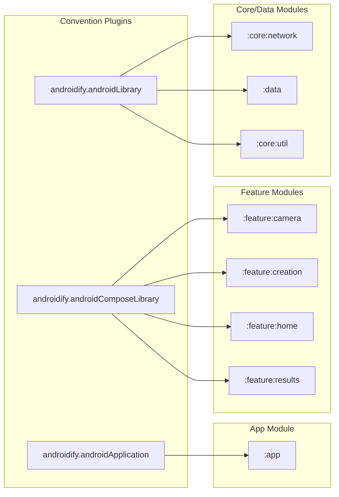

Sources: [app/build.gradle.kts:19](), [feature/camera/build.gradle.kts:17](), [core/network/build.gradle.kts:17](), [data/build.gradle.kts:17]()

### Version Catalog Integration

All modules use the version catalog system defined in `gradle/libs.versions.toml`. The project utilizes `TYPESAFE_PROJECT_ACCESSORS` to refer to modules as properties rather than strings.

| Configuration | Source |
|---------------|--------|
| Compile/Target SDK | `release(37)` [settings.gradle.kts:38-43]() |
| Min SDK | `release(26)` (Mobile) [settings.gradle.kts:45](), `36` (Wear) [wear/build.gradle.kts:31]() |
| App Versioning | `libs.versions.appVersionCode` [app/build.gradle.kts:34]() |

## Feature Module Architecture

All feature modules (`:feature:*`) depend on `androidify.androidComposeLibrary` and follow a consistent structure.

### Specialized Dependencies

Each feature module includes specialized dependencies based on its role in the user journey:

- **`:feature:camera`**: Integrates `androidx.camera.core`, `androidx.camera.camera2`, and `mlkit.pose.detection` for real-time user guidance [feature/camera/build.gradle.kts:38-49]().
- **`:feature:creation`**: Uses `androidx.adaptive` for multi-pane layouts and `androidx.media3.exoplayer` for bot preview videos [feature/creation/build.gradle.kts:49-53]().
- **`:feature:home`**: Includes `androidx.media3.exoplayer` for the background dancing bot animation [feature/home/build.gradle.kts:40-41]().
- **`:feature:results`**: Depends on `mlkit.segmentation` for background removal and includes `:watchface` and `:wear:common` for export functionality [feature/results/build.gradle.kts:40-58]().

## Core Module Organization

### `:core:network` - Service Integration
Centralizes all external communication:
- **Firebase AI**: `libs.firebase.ai` for Gemini 2.5 Flash and Imagen integration [core/network/build.gradle.kts:63]().
- **ML Kit**: `libs.mlkit.segmentation` for on-device image processing [core/network/build.gradle.kts:71]().
- **App Check**: `libs.firebase.app.check` for security [core/network/build.gradle.kts:68]().

### `:core:xr` - Spatial Computing
Enables XR experiences by providing:
- Integration with `androidx.xr.compose` [feature/creation/build.gradle.kts:55]().
- Spatial UI mode management for full-space vs home-space transitions.

### `:core:testing` - Test Infrastructure
A dedicated module for testing utilities used across the project:
- **API**: Exposes `kotlinx.coroutines.test` and `hilt.android.testing` [core/testing/build.gradle.kts:34-41]().
- **Fakes**: Provides `TestFirebaseAiDataSource` and `FakeImageGenerationRepository` to avoid real network calls during tests.

## Wear OS and Watch Face Modules

The project contains a distinct Wear OS stack to support companion features and custom watch faces.

### Wear Architecture

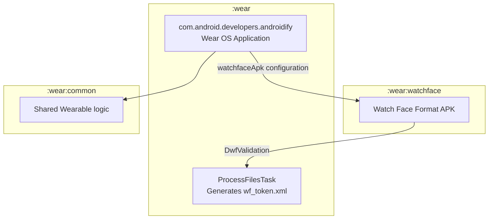

- **`:wear`**: The main Wear OS application. It includes a custom `ProcessFilesTask` that runs the `DwfValidation` CLI tool on the watch face APK to generate a unique `default_wf_token` resource [wear/build.gradle.kts:93-164]().
- **`:wear:watchface`**: A native Android application module that produces a Watch Face Format (WFF) APK. It uses `minSdk 36` and is bundled into the Wear app assets [wear/watchface/build.gradle.kts:21-30]().
- **`:wear:common`**: Contains shared code for data transfer and wearable-specific constants [wear/build.gradle.kts:65]().

Sources: [wear/build.gradle.kts:28-62](), [wear/watchface/build.gradle.kts:21-30](), [settings.gradle.kts:67-70]()

## Build Optimizations and CI/CD

### Packaging and Conflicts
To avoid packaging conflicts when using libraries like `bouncycastle`, several modules explicitly exclude OSGI manifests [app/build.gradle.kts:79-83](), [feature/creation/build.gradle.kts:29-34]().

### Release Signing
The `:app` module handles release signing conditionally. For local builds, it signs with the debug key for easy deployment. For CI builds (detected via `CI_BUILD` property), it produces an unsigned AAB to be signed by the release pipeline [app/build.gradle.kts:57-71]().

### SBOM and Licenses
The project generates Software Bill of Materials (SBOM) for release builds using the `spdxSbom` plugin [app/build.gradle.kts:90-99]() and includes OSS license tracking via `com.google.android.gms.oss-licenses-plugin` [app/build.gradle.kts:26]().

Sources: [app/build.gradle.kts:18-28](), [app/build.gradle.kts:57-71](), [app/build.gradle.kts:90-99]()

---

# Page: UI Framework and Adaptive Design

# UI Framework and Adaptive Design

<details>
<summary>Relevant source files</summary>

The following files were used as context for generating this wiki page:

- [app/src/main/java/com/android/developers/androidify/navigation/ListSaver.kt](app/src/main/java/com/android/developers/androidify/navigation/ListSaver.kt)
- [core/theme/src/main/java/com/android/developers/androidify/theme/Motion.kt](core/theme/src/main/java/com/android/developers/androidify/theme/Motion.kt)
- [core/theme/src/main/java/com/android/developers/androidify/theme/SharedElementsConfig.kt](core/theme/src/main/java/com/android/developers/androidify/theme/SharedElementsConfig.kt)
- [core/theme/src/main/java/com/android/developers/androidify/theme/components/Backgrounds.kt](core/theme/src/main/java/com/android/developers/androidify/theme/components/Backgrounds.kt)
- [core/theme/src/main/java/com/android/developers/androidify/theme/transitions/ColorSplashTransition.kt](core/theme/src/main/java/com/android/developers/androidify/theme/transitions/ColorSplashTransition.kt)
- [core/util/src/main/java/com/android/developers/androidify/util/AdaptivePreview.kt](core/util/src/main/java/com/android/developers/androidify/util/AdaptivePreview.kt)
- [core/util/src/main/java/com/android/developers/androidify/util/AnimationUtils.kt](core/util/src/main/java/com/android/developers/androidify/util/AnimationUtils.kt)
- [core/util/src/main/java/com/android/developers/androidify/util/LayoutUtils.kt](core/util/src/main/java/com/android/developers/androidify/util/LayoutUtils.kt)
- [core/xr/src/main/java/com/android/developers/androidify/xr/SpatialUiModes.kt](core/xr/src/main/java/com/android/developers/androidify/xr/SpatialUiModes.kt)
- [core/xr/src/main/java/com/android/developers/androidify/xr/XrPreview.kt](core/xr/src/main/java/com/android/developers/androidify/xr/XrPreview.kt)
- [feature/creation/src/main/java/com/android/developers/androidify/creation/EditScreenLayoutType.kt](feature/creation/src/main/java/com/android/developers/androidify/creation/EditScreenLayoutType.kt)
- [feature/creation/src/main/java/com/android/developers/androidify/creation/PhotoPrompt.kt](feature/creation/src/main/java/com/android/developers/androidify/creation/PhotoPrompt.kt)
- [feature/creation/src/main/java/com/android/developers/androidify/creation/TextPrompt.kt](feature/creation/src/main/java/com/android/developers/androidify/creation/TextPrompt.kt)
- [feature/creation/src/main/java/com/android/developers/androidify/creation/TransformButton.kt](feature/creation/src/main/java/com/android/developers/androidify/creation/TransformButton.kt)
- [feature/creation/src/main/java/com/android/developers/androidify/creation/xr/EditScreenHomeSpaceModePreviews.kt](feature/creation/src/main/java/com/android/developers/androidify/creation/xr/EditScreenHomeSpaceModePreviews.kt)
- [feature/home/src/main/java/com/android/developers/androidify/home/HomeScreenLayoutType.kt](feature/home/src/main/java/com/android/developers/androidify/home/HomeScreenLayoutType.kt)
- [feature/home/src/main/java/com/android/developers/androidify/home/xr/HomeScreenHomeSpaceModePreviews.kt](feature/home/src/main/java/com/android/developers/androidify/home/xr/HomeScreenHomeSpaceModePreviews.kt)
- [feature/results/src/main/java/com/android/developers/androidify/customize/CustomizeExportLayoutType.kt](feature/results/src/main/java/com/android/developers/androidify/customize/CustomizeExportLayoutType.kt)
- [feature/results/src/main/java/com/android/developers/androidify/results/ResultsLayoutType.kt](feature/results/src/main/java/com/android/developers/androidify/results/ResultsLayoutType.kt)

</details>


## Purpose and Scope

This document describes the UI framework and adaptive design strategy used throughout the Androidify application. It covers the Jetpack Compose-based architecture, layout adaptation patterns for different screen sizes and form factors, XR spatial UI support, and shared element transition system.

For information about specific feature module implementations, see [Feature Modules](#5). For theming and reusable UI components, see [Theme and UI Components](#6.3). For XR-specific implementation details, see [XR Support](#6.5).

---

## UI Framework Stack

Androidify is built entirely with **Jetpack Compose** and uses **Material 3** (Material Design 3) for its design system. The application does not use any View-based UI components.

### Core UI Technologies

| Technology | Version | Usage |
|------------|---------|-------|
| Jetpack Compose | BOM-managed | All UI rendering |
| Material 3 | Expressive API | Design system, animations, shapes |
| Material Motion | Expressive API | Shared element transitions |
| AndroidX XR Compose | Latest | Spatial UI for XR devices |
| Compose Window | Latest | Window size class calculations |

**Key Dependencies:**

Each feature module declares Compose dependencies via the `androidify.androidComposeLibrary` convention plugin:

- [feature/home/build.gradle.kts:33-34]()
- [feature/camera/build.gradle.kts:33-34]()
- [feature/creation/build.gradle.kts:38-39]()
- [feature/results/build.gradle.kts:33-34]()

Sources: [feature/home/build.gradle.kts:16-70](), [feature/camera/build.gradle.kts:16-74](), [feature/creation/build.gradle.kts:16-80](), [feature/results/build.gradle.kts:16-71]()

---

## Adaptive Layout Architecture

Androidify implements a **per-feature adaptive layout system** where each feature module defines its own layout types and calculates the appropriate layout based on runtime conditions. This approach provides flexibility while maintaining consistency.

### Layout Type Hierarchy

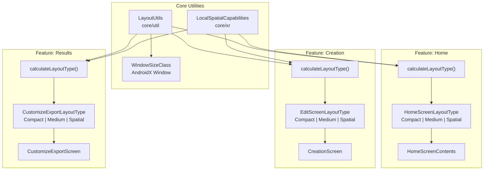

**Layout Type Definitions by Feature:**

Each feature module defines a sealed enum of layout types:

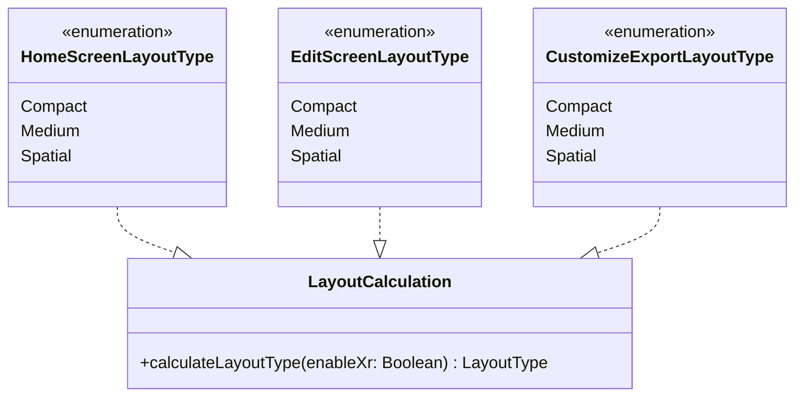

Sources: [feature/home/src/main/java/com/android/developers/androidify/home/HomeScreenLayoutType.kt:22-26](), [feature/creation/src/main/java/com/android/developers/androidify/creation/EditScreenLayoutType.kt:22-26](), [feature/results/src/main/java/com/android/developers/androidify/customize/CustomizeExportLayoutType.kt:22-26]()

---

## Layout Calculation Pattern

Each feature implements a `calculateLayoutType()` function that determines the appropriate layout variant based on spatial UI capabilities and window size:

### Decision Tree

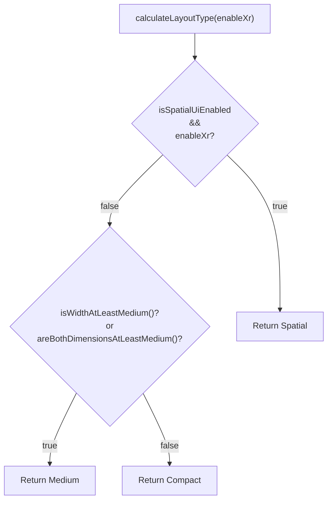

### Implementation Examples

**Home Feature:**
[feature/home/src/main/java/com/android/developers/androidify/home/HomeScreenLayoutType.kt:28-35]()
```kotlin
@Composable
fun calculateLayoutType(enableXr: Boolean = false): HomeScreenLayoutType {
    return when {
        LocalSpatialCapabilities.current.isSpatialUiEnabled && enableXr -> HomeScreenLayoutType.Spatial
        isWidthAtLeastMedium() -> HomeScreenLayoutType.Medium
        else -> HomeScreenLayoutType.Compact
    }
}
```

**Creation Feature:**
[feature/creation/src/main/java/com/android/developers/androidify/creation/EditScreenLayoutType.kt:28-35]()
```kotlin
@Composable
fun calculateLayoutType(enableXr: Boolean = false): EditScreenLayoutType {
    return when {
        LocalSpatialCapabilities.current.isSpatialUiEnabled && enableXr -> EditScreenLayoutType.Spatial
        areBothWindowDimensionsAtLeastMedium() -> EditScreenLayoutType.Medium
        else -> EditScreenLayoutType.Compact
    }
}
```

Note that Creation uses `areBothWindowDimensionsAtLeastMedium()` while Home uses only `isWidthAtLeastMedium()`, allowing per-feature control over when to switch to expanded layouts.

Sources: [feature/home/src/main/java/com/android/developers/androidify/home/HomeScreenLayoutType.kt:28-35](), [feature/creation/src/main/java/com/android/developers/androidify/creation/EditScreenLayoutType.kt:28-35](), [feature/results/src/main/java/com/android/developers/androidify/customize/CustomizeExportLayoutType.kt:28-35]()

---

## Window Size Class Utilities

The `core/util` module provides utilities for calculating window size classes and determining device capabilities.

### Core Functions

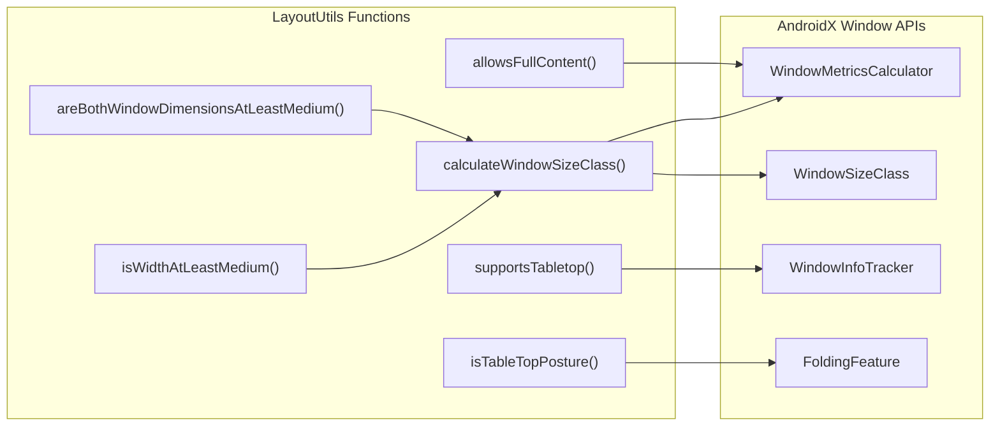

### Window Size Breakpoints

| Breakpoint | Value | Usage |
|------------|-------|-------|
| `WIDTH_DP_MEDIUM_LOWER_BOUND` | 600dp | Minimum width for medium layout |
| `HEIGHT_DP_MEDIUM_LOWER_BOUND` | 480dp | Minimum height for medium layout |

**calculateWindowSizeClass():**
[core/util/src/main/java/com/android/developers/androidify/util/LayoutUtils.kt:33-38]()

Returns the current `WindowSizeClass` based on display metrics using `WindowMetricsCalculator` and `BREAKPOINTS_V1` classification.

**isWidthAtLeastMedium():**
[core/util/src/main/java/com/android/developers/androidify/util/LayoutUtils.kt:40-44]()

Returns `true` if the window width is at least 600dp. Used by Home and Results features.

**areBothWindowDimensionsAtLeastMedium():**
[core/util/src/main/java/com/android/developers/androidify/util/LayoutUtils.kt:46-51]()

Returns `true` if both width ≥ 600dp and height ≥ 480dp. Used by Creation feature to ensure adequate space for both image preview and controls.

**allowsFullContent():**
[core/util/src/main/java/com/android/developers/androidify/util/LayoutUtils.kt:57-63]()

Returns `false` if height < 480dp. Used to conditionally hide UI elements on very small screens to prevent overcrowding.

Sources: [core/util/src/main/java/com/android/developers/androidify/util/LayoutUtils.kt:33-63]()

### Foldable Device Support

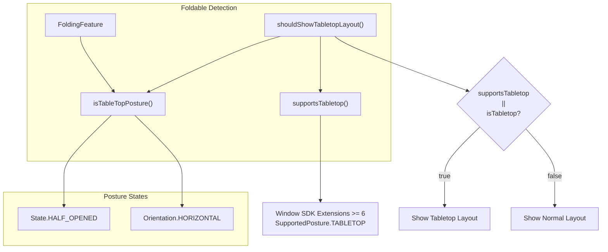

**isTableTopPosture():**
[core/util/src/main/java/com/android/developers/androidify/util/LayoutUtils.kt:65-70]()

Detects if the device is in tabletop mode (half-opened horizontally). Uses Kotlin contracts to ensure non-null `FoldingFeature` when returning `true`.

**supportsTabletop():**
[core/util/src/main/java/com/android/developers/androidify/util/LayoutUtils.kt:72-81]()

Queries `WindowInfoTracker.supportedPostures` (requires Window SDK Extensions 6+) to determine if the device can enter tabletop mode.

**shouldShowTabletopLayout():**
[core/util/src/main/java/com/android/developers/androidify/util/LayoutUtils.kt:100-101]()

Wrapper function that handles older devices: returns `true` if either the device reports tabletop support OR is currently in tabletop posture, allowing older foldables without Extension 6 support to still use the tabletop layout.

Sources: [core/util/src/main/java/com/android/developers/androidify/util/LayoutUtils.kt:65-102]()

---

## XR Spatial UI Support

The `core/xr` module provides utilities for detecting and managing XR spatial UI modes on compatible devices.

### Spatial Capability Detection

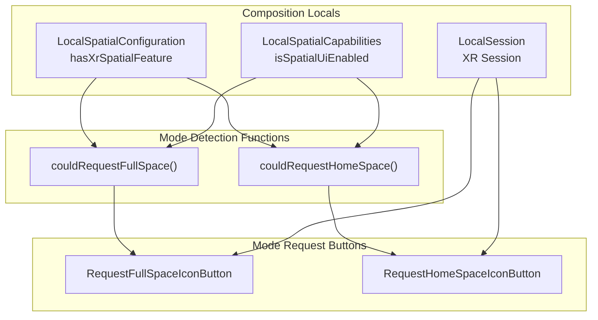

### Spatial Modes

The application supports two XR spatial modes:

| Mode | Description | Icon |
|------|-------------|------|
| **Home Space** | App rendered in a window within the XR environment | collapse_content_24px |
| **Full Space** | App takes over the entire spatial environment | expand_content_24px |

**couldRequestFullSpace():**
[core/xr/src/main/java/com/android/developers/androidify/xr/SpatialUiModes.kt:37-39]()

Returns `true` if the device has XR spatial feature but is not yet rendering spatial UI. Indicates the user can request full space mode.

**couldRequestHomeSpace():**
[core/xr/src/main/java/com/android/developers/androidify/xr/SpatialUiModes.kt:43-45]()

Returns `true` if the device has XR spatial feature and is currently rendering spatial UI. Indicates the user can return to home space mode.

**RequestFullSpaceIconButton:**
[core/xr/src/main/java/com/android/developers/androidify/xr/SpatialUiModes.kt:74-95]()

Composable button that triggers `session.scene.requestFullSpaceMode()`. Shown in app bars when `couldRequestFullSpace()` is true.

**RequestHomeSpaceIconButton:**
[core/xr/src/main/java/com/android/developers/androidify/xr/SpatialUiModes.kt:49-70]()

Composable button that triggers `session.scene.requestHomeSpaceMode()`.

Sources: [core/xr/src/main/java/com/android/developers/androidify/xr/SpatialUiModes.kt:32-95]()

---

## Shared Element Transitions

Androidify uses Material 3's shared element transition APIs to create smooth animations between screens.

### Shared Element Architecture

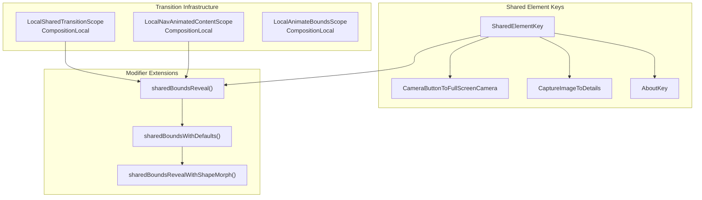

### SharedElementKey Definitions

[core/theme/src/main/java/com/android/developers/androidify/theme/SharedElementsConfig.kt:69-73]()

```kotlin
sealed interface SharedElementKey {
    object CameraButtonToFullScreenCamera : SharedElementKey
    object CaptureImageToDetails : SharedElementKey
    object AboutKey : SharedElementKey
}
```

### Modifier Extensions

**sharedBoundsReveal():**
[core/theme/src/main/java/com/android/developers/androidify/theme/SharedElementsConfig.kt:97-120]()

Primary modifier for shared element transitions. Applies shared bounds animation with automatic skip-to-lookahead behavior for stable layout during transitions.

**sharedBoundsRevealWithShapeMorph():**
[core/theme/src/main/java/com/android/developers/androidify/theme/SharedElementsConfig.kt:167-211]()

Advanced modifier that morphs between two `RoundedPolygon` shapes during transition using the `androidx.graphics.shapes.Morph` API.

Example: Camera button circle morphing to full-screen rectangle.

Sources: [core/theme/src/main/java/com/android/developers/androidify/theme/SharedElementsConfig.kt:69-211]()

---

## Background Components

The `core/theme` module provides adaptive background components that adjust based on screen size.

### SquiggleBackground

[core/theme/src/main/java/com/android/developers/androidify/theme/components/Backgrounds.kt:49-79]()

Animated squiggle pattern background used in Home and About screens.

Adaptive behavior:
- Vertical padding (64dp) on compact screens, none on medium (line 56)
- Scale factor 1.3x on medium screens (lines 69-70)
- Fills full height with `ContentScale.FillHeight` (line 76)

### ResultsBackground

[core/theme/src/main/java/com/android/developers/androidify/theme/components/Backgrounds.kt:113-149]()

Animated marquee background used in Results screens.

Adaptive behavior:
- Rounded box height: 175dp (compact) vs 300dp (medium) (line 137)
- Infinite vertical marquee animation (lines 123-127)

Sources: [core/theme/src/main/java/com/android/developers/androidify/theme/components/Backgrounds.kt:48-149]()

---

## Preview Infrastructure

The `core/util` module provides custom preview annotations for testing layouts across form factors.

### Available Annotations

[core/util/src/main/java/com/android/developers/androidify/util/AdaptivePreview.kt:26-48]()

- `@PhonePreview`: Standard phone testing
- `@TabletPreview`: Large screen testing
- `@LargeScreensPreview`: Foldable + Tablet + Desktop

### XR Previews

[core/xr/src/main/java/com/android/developers/androidify/xr/XrPreview.kt:22-26]()

- `@XrHomeSpaceMediumPreview`: Renders on a simulated Pixel Tablet in Home Space Mode.
- `@XrHomeSpaceCompactPreview`: Renders on a simulated Pixel 7 Pro in Home Space Mode.

Example implementation for Creation feature: [feature/creation/src/main/java/com/android/developers/androidify/creation/xr/EditScreenHomeSpaceModePreviews.kt:29-75]()

Sources: [core/util/src/main/java/com/android/developers/androidify/util/AdaptivePreview.kt:26-48](), [core/xr/src/main/java/com/android/developers/androidify/xr/XrPreview.kt:22-26]()

---

## Summary

The Androidify UI framework provides:

1. **Jetpack Compose Foundation:** Pure Compose UI with no View system dependencies.
2. **Adaptive Layouts:** Three-tier system (Compact/Medium/Spatial) with per-feature customization.
3. **Window Size Class Integration:** AndroidX Window library for breakpoint calculations.
4. **XR Support:** Full spatial UI capability with home/full space modes via `LocalSpatialCapabilities`.
5. **Shared Element Transitions:** Material 3 animation APIs with shape morphing.
6. **Background Components:** Adaptive components like `SquiggleBackground` and `ResultsBackground`.
7. **Preview Infrastructure:** Comprehensive annotation system for testing all form factors, including XR.

---

# Page: Dependency Injection

# Dependency Injection

<details>
<summary>Relevant source files</summary>

The following files were used as context for generating this wiki page:

- [app/src/main/java/com/android/developers/androidify/AndroidifyApplication.kt](app/src/main/java/com/android/developers/androidify/AndroidifyApplication.kt)
- [app/src/main/java/com/android/developers/androidify/CrashlyticsTree.kt](app/src/main/java/com/android/developers/androidify/CrashlyticsTree.kt)
- [app/src/main/java/com/android/developers/androidify/MainActivity.kt](app/src/main/java/com/android/developers/androidify/MainActivity.kt)
- [core/network/build.gradle.kts](core/network/build.gradle.kts)
- [core/network/src/main/java/com/android/developers/androidify/startup/FirebaseRemoteConfigInitializer.kt](core/network/src/main/java/com/android/developers/androidify/startup/FirebaseRemoteConfigInitializer.kt)
- [core/testing/build.gradle.kts](core/testing/build.gradle.kts)
- [core/testing/src/main/java/com/android/developers/testing/repository/FakeDropImageFactory.kt](core/testing/src/main/java/com/android/developers/testing/repository/FakeDropImageFactory.kt)
- [core/util/build.gradle.kts](core/util/build.gradle.kts)
- [data/build.gradle.kts](data/build.gradle.kts)
- [data/src/main/java/com/android/developers/androidify/data/DataModule.kt](data/src/main/java/com/android/developers/androidify/data/DataModule.kt)
- [data/src/main/java/com/android/developers/androidify/data/DropBehaviourFactory.kt](data/src/main/java/com/android/developers/androidify/data/DropBehaviourFactory.kt)
- [data/src/main/java/com/android/developers/androidify/data/GeminiNanoGenerationDataSource.kt](data/src/main/java/com/android/developers/androidify/data/GeminiNanoGenerationDataSource.kt)
- [data/src/main/java/com/android/developers/androidify/data/InternetConnectivityManager.kt](data/src/main/java/com/android/developers/androidify/data/InternetConnectivityManager.kt)
- [data/src/main/java/com/android/developers/androidify/data/TextGenerationRepository.kt](data/src/main/java/com/android/developers/androidify/data/TextGenerationRepository.kt)

</details>


## Purpose and Scope

This document describes the dependency injection infrastructure in the Androidify application using Hilt. It covers module-level configuration, the AssistedInject pattern for ViewModels with navigation parameters, and how dependencies are wired across feature modules. For information about the overall module structure, see [Module Structure](#3.1). For navigation integration details, see [Navigation System](#3.4).

---

## Hilt Configuration

The application uses Hilt as its dependency injection framework across all modules. Each module that requires dependency injection includes the Hilt plugin and dependencies in its build configuration.

### Module-Level Setup

[core/network/build.gradle.kts:19-21](), [data/build.gradle.kts:18-20](), [core/util/build.gradle.kts:18-20](), [core/testing/build.gradle.kts:18-20]()

```kotlin
plugins {
    alias(libs.plugins.hilt)
    alias(libs.plugins.kotlin.ksp)
}

dependencies {
    implementation(libs.hilt.android)
    implementation(libs.androidx.hilt.navigation.compose)
    ksp(libs.hilt.compiler)
}
```

The following modules have Hilt configured:
- `app` - Application module (composition root)
- `data` - Repository implementations and domain logic
- `core/network` - Network services, Firebase clients, and App Startup initializers
- `core/util` - Utility providers like `LocalFileProvider`
- `core/testing` - Test doubles and Hilt testing utilities

**Sources:** [core/network/build.gradle.kts:20-21](), [data/build.gradle.kts:19-20](), [core/util/build.gradle.kts:19-20](), [core/testing/build.gradle.kts:19-20]()

---

## AssistedInject Pattern for ViewModels

ViewModels in Androidify follow a specific pattern because they require navigation parameters that cannot be injected by Hilt directly. The solution uses Dagger's `@AssistedInject` annotation combined with an `@AssistedFactory` interface.

### Pattern Structure

```mermaid
graph TB
    subgraph "ViewModel Definition"
        [VM] -- "@HiltViewModel<br/>CreationViewModel" --> [AI]
        [AI] -- "@AssistedInject<br/>constructor" --> [PARAMS]
        [PARAMS] -- "@Assisted parameters<br/>originalImageUrl" --> [DEPS]
        [DEPS] -- "Injected dependencies<br/>repositories, providers" --> [VM]
    end
    
    subgraph "Factory Definition"
        [VM] --> [AF]
        [AF] -- "@AssistedFactory<br/>Factory interface" --> [CREATE]
        [CREATE] -- "create() method<br/>with @Assisted params" --> [VM]
    end
    
    subgraph "Navigation Layer"
        [NAV] -- "MainNavigation.kt" --> [HILT]
        [HILT] -- "hiltViewModel()<br/>with creationCallback" --> [INVOKE]
        [INVOKE] -- "factory.create()<br/>pass navigation params" --> [CREATE]
    end
```

### CreationViewModel Example

The `CreationViewModel` demonstrates the complete pattern by requiring an `originalImageUrl` from the navigation stack while also needing singleton-scoped repositories.

[feature/creation/src/main/java/com/android/developers/androidify/creation/CreationViewModel.kt:48-64]() (Referenced context)

Key elements:
- `@HiltViewModel` annotation with `assistedFactory` parameter.
- `@AssistedInject` on the constructor.
- `@Assisted` parameters for navigation data (e.g., `originalImageUrl`).
- Regular injected dependencies (repositories, providers, context).
- Nested `@AssistedFactory` interface with a matching `create()` signature.

**Sources:** [data/src/main/java/com/android/developers/androidify/data/DataModule.kt:36-75](), [data/src/main/java/com/android/developers/androidify/data/DropBehaviourFactory.kt:41-42]()

---

## Data Layer Module Configuration

The `data` module centralizes the binding of interfaces to their implementations using Hilt's `@Binds` and `@Provides` mechanisms. This allows feature modules to depend on abstractions like `ImageGenerationRepository` without knowing the underlying implementation details (e.g., whether it uses Vertex AI or Gemini Nano).

[data/src/main/java/com/android/developers/androidify/data/DataModule.kt:36-75]()

| Interface | Implementation | Scope |
|-----------|----------------|-------|
| `LocalFileProvider` | `LocalFileProviderImpl` | `@Singleton` |
| `RemoteConfigDataSource` | `RemoteConfigDataSourceImpl` | `@Singleton` |
| `GeminiNanoGenerationDataSource` | `GeminiNanoGenerationDataSourceImpl` | `@Singleton` |
| `FirebaseAiDataSource` | `FirebaseAiDataSourceImpl` | `@Singleton` |
| `ImageGenerationRepository` | `ImageGenerationRepositoryImpl` | `@Singleton` |
| `DropBehaviourFactory` | `DropBehaviourFactoryImpl` | `@Singleton` |

Additionally, a named `CoroutineDispatcher` for I/O operations is provided:
[data/src/main/java/com/android/developers/androidify/data/DataModule.kt:39-42]()

**Sources:** [data/src/main/java/com/android/developers/androidify/data/DataModule.kt:34-75]()

---

## Dependency Graph and Data Flow

The following diagram bridges the "Natural Language Space" of user actions to the "Code Entity Space" of DI-managed objects.

```mermaid
graph LR
    subgraph "External Services & Resources"
        [REMOTE_CONFIG] -- "FirebaseRemoteConfig" --> [FirebaseRemoteConfigInitializer]
        [MLKIT] -- "Gemini Nano" --> [GeminiNanoGenerationDataSourceImpl]
    end

    subgraph "Core & Network (DI Provided)"
        [FirebaseRemoteConfigInitializer] -- "startup" --> [RemoteConfigDataSourceImpl]
        [LocalFileProviderImpl] -- "@Binds" --> [LocalFileProvider]
        [DropBehaviourFactoryImpl] -- "@Binds" --> [DropBehaviourFactory]
    end

    subgraph "Data Repositories (DI Provided)"
        [RemoteConfigDataSourceImpl] --> [TextGenerationRepositoryImpl]
        [GeminiNanoGenerationDataSourceImpl] --> [TextGenerationRepositoryImpl]
        [FirebaseAiDataSourceImpl] --> [TextGenerationRepositoryImpl]
        [TextGenerationRepositoryImpl] -- "@Binds" --> [TextGenerationRepository]
    end

    subgraph "Feature ViewModels (Assisted Consumers)"
        [TextGenerationRepository] --> [CreationViewModel]
        [LocalFileProvider] --> [CreationViewModel]
        [DropBehaviourFactory] --> [CreationViewModel]
    end

    [MainActivity] -- "@AndroidEntryPoint" --> [AndroidifyApplication]
    [AndroidifyApplication] -- "Lazy Inject" --> [ImageLoader]
```

### Application Initialization
The `AndroidifyApplication` class is annotated with `@HiltAndroidApp`, triggering Hilt's code generation. It also uses lazy injection for the Coil `ImageLoader` to optimize startup time.

[app/src/main/java/com/android/developers/androidify/AndroidifyApplication.kt:31-35]()

**Sources:** [app/src/main/java/com/android/developers/androidify/AndroidifyApplication.kt:31-35](), [data/src/main/java/com/android/developers/androidify/data/TextGenerationRepository.kt:28-32]()

---

## Testing Infrastructure

The `core/testing` module provides fakes and test doubles that can be used to override Hilt bindings during unit and instrumentation tests.

### Fake Implementations
For example, `FakeDropImageFactory` provides a no-op implementation of `DropBehaviourFactory` to avoid complex drag-and-drop logic during UI tests.

[core/testing/src/main/java/com/android/developers/testing/repository/FakeDropImageFactory.kt:24-37]()

### Test Module Setup
Tests in feature modules include `hilt-android-testing` and `hilt-compiler` to support `@HiltAndroidTest` and custom test runners.

[data/build.gradle.kts:52-54](), [core/testing/build.gradle.kts:41-48]()

**Sources:** [core/testing/src/main/java/com/android/developers/testing/repository/FakeDropImageFactory.kt:24-37](), [data/build.gradle.kts:52-54]()

---

# Page: Navigation System

# Navigation System

<details>
<summary>Relevant source files</summary>

The following files were used as context for generating this wiki page:

- [app/src/main/java/com/android/developers/androidify/navigation/MainNavigation.kt](app/src/main/java/com/android/developers/androidify/navigation/MainNavigation.kt)
- [app/src/main/java/com/android/developers/androidify/navigation/NavigationRoutes.kt](app/src/main/java/com/android/developers/androidify/navigation/NavigationRoutes.kt)
- [app/src/main/java/com/android/developers/androidify/navigation/UriSerializer.kt](app/src/main/java/com/android/developers/androidify/navigation/UriSerializer.kt)
- [core/testing/src/main/java/com/android/developers/testing/data/BitmapSample.kt](core/testing/src/main/java/com/android/developers/testing/data/BitmapSample.kt)
- [core/testing/src/main/java/com/android/developers/testing/data/TestFileProvider.kt](core/testing/src/main/java/com/android/developers/testing/data/TestFileProvider.kt)
- [feature/creation/src/main/java/com/android/developers/androidify/creation/CreationScreen.kt](feature/creation/src/main/java/com/android/developers/androidify/creation/CreationScreen.kt)
- [feature/creation/src/main/java/com/android/developers/androidify/creation/CreationViewModel.kt](feature/creation/src/main/java/com/android/developers/androidify/creation/CreationViewModel.kt)
- [feature/creation/src/test/kotlin/com/android/developers/androidify/creation/CreationViewModelTest.kt](feature/creation/src/test/kotlin/com/android/developers/androidify/creation/CreationViewModelTest.kt)
- [feature/results/src/androidTest/java/com/android/developers/androidify/results/ResultsScreenTest.kt](feature/results/src/androidTest/java/com/android/developers/androidify/results/ResultsScreenTest.kt)
- [feature/results/src/main/java/com/android/developers/androidify/customize/ImageRenderer.kt](feature/results/src/main/java/com/android/developers/androidify/customize/ImageRenderer.kt)
- [feature/results/src/main/java/com/android/developers/androidify/customize/Utils.kt](feature/results/src/main/java/com/android/developers/androidify/customize/Utils.kt)
- [feature/results/src/main/java/com/android/developers/androidify/results/BotResultCard.kt](feature/results/src/main/java/com/android/developers/androidify/results/BotResultCard.kt)
- [feature/results/src/main/java/com/android/developers/androidify/results/ResultsScreen.kt](feature/results/src/main/java/com/android/developers/androidify/results/ResultsScreen.kt)
- [feature/results/src/main/java/com/android/developers/androidify/results/ResultsViewModel.kt](feature/results/src/main/java/com/android/developers/androidify/results/ResultsViewModel.kt)
- [feature/results/src/screenshotTest/java/com/android/developers/androidify/results/ResultsScreenScreenshotTest.kt](feature/results/src/screenshotTest/java/com/android/developers/androidify/results/ResultsScreenScreenshotTest.kt)
- [feature/results/src/test/kotlin/com/android/developers/androidify/customize/CustomizeViewModelTest.kt](feature/results/src/test/kotlin/com/android/developers/androidify/customize/CustomizeViewModelTest.kt)
- [feature/results/src/test/kotlin/com/android/developers/androidify/results/ResultsViewModelTest.kt](feature/results/src/test/kotlin/com/android/developers/androidify/results/ResultsViewModelTest.kt)

</details>


## Purpose and Scope

The Navigation System in Androidify provides type-safe, composable navigation between feature screens using the experimental `androidx.navigation3` library. It manages screen transitions, back stack state, ViewModel parameter passing, and shared element animations. This system replaces traditional fragment-based navigation with a purely Compose-based approach using the `NavDisplay` component and sealed route interfaces.

For information about individual feature screens and their UI implementations, see [Feature Modules](#5). For shared element transition animations specifically, see [Theme and UI Components](#6.3).

---

## Navigation Architecture

The navigation system is built around three core components: a sealed interface hierarchy for type-safe routes, a manually-managed back stack using `SnapshotStateList`, and the `NavDisplay` composable that renders the current screen with animated transitions.

### System Mapping: Code Entities to Navigation Roles

The following diagram bridges the conceptual navigation flow to the specific code entities implementing them.

"Navigation Architecture Mapping"
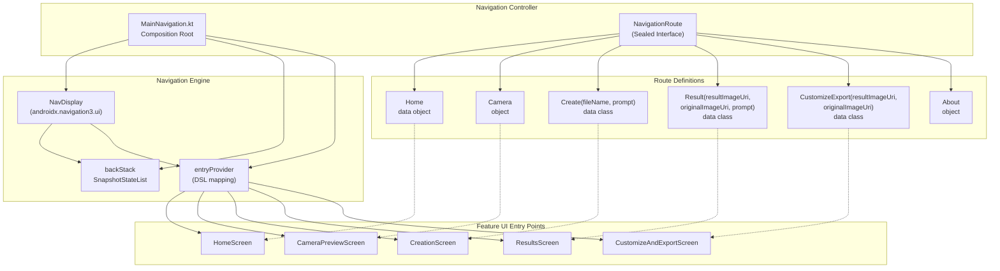

**Sources:** [app/src/main/java/com/android/developers/androidify/navigation/MainNavigation.kt:54-85](), [app/src/main/java/com/android/developers/androidify/navigation/NavigationRoutes.kt:24-65]()

---

## NavigationRoute Sealed Interface

All navigation destinations are defined as a `NavigationRoute` sealed interface hierarchy [app/src/main/java/com/android/developers/androidify/navigation/NavigationRoutes.kt:24](), enabling compile-time type safety and exhaustive when-expression handling. Each route carries parameters serialized as part of the route definition.

### Route Definitions

| Route Class | Type | Parameters | Purpose |
|------------|------|------------|---------|
| `Home` | `data object` | None | Landing screen entry point [app/src/main/java/com/android/developers/androidify/navigation/NavigationRoutes.kt:27]() |
| `Camera` | `object` | None | Camera capture screen [app/src/main/java/com/android/developers/androidify/navigation/NavigationRoutes.kt:36]() |
| `Create` | `data class` | `fileName: Uri?`, `prompt: String?` | Image generation editor [app/src/main/java/com/android/developers/androidify/navigation/NavigationRoutes.kt:30-33]() |
| `Result` | `data class` | `resultImageUri: Uri`, `originalImageUri: Uri?`, `prompt: String?` | Display generated result [app/src/main/java/com/android/developers/androidify/navigation/NavigationRoutes.kt:49-53]() |
| `CustomizeExport` | `data class` | `resultImageUri: Uri`, `originalImageUri: Uri?` | Customize and share screen [app/src/main/java/com/android/developers/androidify/navigation/NavigationRoutes.kt:62-65]() |
| `About` | `object` | None | About/settings screen [app/src/main/java/com/android/developers/androidify/navigation/NavigationRoutes.kt:39]() |

**Sources:** [app/src/main/java/com/android/developers/androidify/navigation/NavigationRoutes.kt:24-65]()

### URI Serialization

Routes containing `Uri` parameters use a custom `UriSerializer` [app/src/main/java/com/android/developers/androidify/navigation/UriSerializer.kt]() to convert URIs to/from strings for serialization. This enables routes to be saved and restored across process death [app/src/main/java/com/android/developers/androidify/navigation/NavigationRoutes.kt:16-33]().

---

## NavDisplay Component

The `NavDisplay` composable from `androidx.navigation3.ui` serves as the navigation host [app/src/main/java/com/android/developers/androidify/navigation/MainNavigation.kt:64](). It takes a back stack, renders the current destination, and manages enter/exit transitions.

### Configuration

`NavDisplay` is configured with:
*   **`backStack`**: A `SnapshotStateList` containing the navigation history [app/src/main/java/com/android/developers/androidify/navigation/MainNavigation.kt:65]().
*   **`entryDecorators`**: Wrappers for state and ViewModel management [app/src/main/java/com/android/developers/androidify/navigation/MainNavigation.kt:67-70]().
*   **`transitionSpec`**: Defines animations for forward navigation using `MaterialTheme.motionScheme` [app/src/main/java/com/android/developers/androidify/navigation/MainNavigation.kt:71-76]().
*   **`popTransitionSpec`**: Defines animations for backward navigation, typically a `scaleOut` effect [app/src/main/java/com/android/developers/androidify/navigation/MainNavigation.kt:77-84]().

**Sources:** [app/src/main/java/com/android/developers/androidify/navigation/MainNavigation.kt:64-84]()

---

## Back Stack Management

The navigation back stack is implemented as a `SnapshotStateList<NavigationRoute>`, providing observable state changes that trigger recomposition [app/src/main/java/com/android/developers/androidify/navigation/MainNavigation.kt:56]().

### Common Patterns

| Pattern | Implementation | Call Site Example |
|---------|---------------|-------------------|
| **Push destination** | `backStack.add(route)` | [app/src/main/java/com/android/developers/androidify/navigation/MainNavigation.kt:93]() |
| **Replace current** | `backStack.removeAll { ... }` then `add` | [app/src/main/java/com/android/developers/androidify/navigation/MainNavigation.kt:100-102]() |
| **Pop back** | `backStack.removeLastOrNull()` | [app/src/main/java/com/android/developers/androidify/navigation/MainNavigation.kt:66]() |
| **Navigate to Result** | `backStack.add(Result(...))` | [app/src/main/java/com/android/developers/androidify/navigation/MainNavigation.kt:127-133]() |

**Sources:** [app/src/main/java/com/android/developers/androidify/navigation/MainNavigation.kt:56-165]()

---

## Entry Provider and ViewModel Injection

The `entryProvider` DSL maps each `NavigationRoute` to its screen. ViewModels requiring navigation parameters use Hilt's `@AssistedInject` pattern [app/src/main/java/com/android/developers/androidify/creation/CreationViewModel.kt:50]().

### ViewModel Parameter Flow

"Assisted Injection Data Flow"
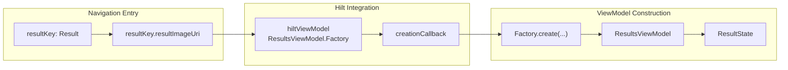

**Sources:** [app/src/main/java/com/android/developers/androidify/navigation/MainNavigation.kt:138-147](), [feature/results/src/main/java/com/android/developers/androidify/results/ResultsViewModel.kt:31-46]()

### Entry Definition Example: Result Screen
The `entry<Result>` block extracts parameters from the `Result` route and provides them to the `ResultsViewModel.Factory` [app/src/main/java/com/android/developers/androidify/navigation/MainNavigation.kt:138-147]().

```kotlin
entry<Result> { resultKey ->
    val resultsViewModel = hiltViewModel<ResultsViewModel, ResultsViewModel.Factory>(
        creationCallback = { factory ->
            factory.create(
                resultImageUrl = resultKey.resultImageUri,
                originalImageUrl = resultKey.originalImageUri,
                promptText = resultKey.prompt,
            )
        },
    )
    ResultsScreen(..., viewModel = resultsViewModel)
}
```

**Sources:** [app/src/main/java/com/android/developers/androidify/navigation/MainNavigation.kt:138-164]()

---

## Feature Screen Interactions

Screens interact with the navigation system via callback lambdas defined in their composable signatures.

*   **`CreationScreen`**: Notifies the system when a bot is created via `onImageCreated` [feature/creation/src/main/java/com/android/developers/androidify/creation/CreationScreen.kt:45](). This triggers a transition to the `Result` route [app/src/main/java/com/android/developers/androidify/navigation/MainNavigation.kt:125-134]().
*   **`ResultsScreen`**: Uses `onNextPress` to move to the `CustomizeExport` route [feature/results/src/main/java/com/android/developers/androidify/results/ResultsScreen.kt:71]().
*   **`HomeScreen`**: Initiates the creation flow via `onClickLetsGo`, which triggers a splash transition before adding the `Create` route [app/src/main/java/com/android/developers/androidify/navigation/MainNavigation.kt:88-91]().

**Sources:** [feature/creation/src/main/java/com/android/developers/androidify/creation/CreationScreen.kt:40-46](), [feature/results/src/main/java/com/android/developers/androidify/results/ResultsScreen.kt:68-73](), [app/src/main/java/com/android/developers/androidify/navigation/MainNavigation.kt:86-96]()

---

## Testing Navigation Logic

Navigation logic and state management are verified through unit tests on the ViewModels.

*   **`CreationViewModelTest`**: Verifies that calling `onImageSelected` correctly updates the `CreationState` with the provided `Uri` [feature/creation/src/test/kotlin/com/android/developers/androidify/creation/CreationViewModelTest.kt:103-108]().
*   **`ResultsViewModelTest`**: Ensures that parameters passed through the route (like `resultImageUrl` and `promptText`) are correctly reflected in the `ResultState` [feature/results/src/test/kotlin/com/android/developers/androidify/results/ResultsViewModelTest.kt:53-77]().
*   **`CustomizeViewModelTest`**: Validates that the `CustomizeExportViewModel` correctly initializes its `CustomizeExportState` using the `Uri` arguments provided during assisted injection [feature/results/src/test/kotlin/com/android/developers/androidify/customize/CustomizeViewModelTest.kt:72-92]().

**Sources:** [feature/creation/src/test/kotlin/com/android/developers/androidify/creation/CreationViewModelTest.kt:103-108](), [feature/results/src/test/kotlin/com/android/developers/androidify/results/ResultsViewModelTest.kt:53-77](), [feature/results/src/test/kotlin/com/android/developers/androidify/customize/CustomizeViewModelTest.kt:72-92]()

---

# Page: AI and ML Integration

# AI and ML Integration

<details>
<summary>Relevant source files</summary>

The following files were used as context for generating this wiki page:

- [app/src/main/AndroidManifest.xml](app/src/main/AndroidManifest.xml)
- [core/network/src/main/java/com/android/developers/androidify/ondevice/LocalSegmentationDataSource.kt](core/network/src/main/java/com/android/developers/androidify/ondevice/LocalSegmentationDataSource.kt)
- [core/network/src/main/java/com/android/developers/androidify/startup/FirebaseAppCheckInitializer.kt](core/network/src/main/java/com/android/developers/androidify/startup/FirebaseAppCheckInitializer.kt)
- [core/network/src/main/java/com/android/developers/androidify/vertexai/FirebaseAiDataSource.kt](core/network/src/main/java/com/android/developers/androidify/vertexai/FirebaseAiDataSource.kt)
- [core/util/src/main/java/com/android/developers/androidify/util/LocalFileProvider.kt](core/util/src/main/java/com/android/developers/androidify/util/LocalFileProvider.kt)
- [data/src/main/java/com/android/developers/androidify/data/ImageGenerationRepository.kt](data/src/main/java/com/android/developers/androidify/data/ImageGenerationRepository.kt)
- [feature/creation/src/main/java/com/android/developers/androidify/creation/xr/EditScreenSpatial.kt](feature/creation/src/main/java/com/android/developers/androidify/creation/xr/EditScreenSpatial.kt)
- [feature/results/src/main/java/com/android/developers/androidify/customize/ComposableBitmapRendererImpl.kt](feature/results/src/main/java/com/android/developers/androidify/customize/ComposableBitmapRendererImpl.kt)
- [feature/results/src/test/kotlin/com/android/developers/androidify/customize/CustomizeStateTest.kt](feature/results/src/test/kotlin/com/android/developers/androidify/customize/CustomizeStateTest.kt)
- [gradle/libs.versions.toml](gradle/libs.versions.toml)
- [wear/src/main/java/com/android/developers/androidify/ui/CallToActionButton.kt](wear/src/main/java/com/android/developers/androidify/ui/CallToActionButton.kt)
- [wear/src/main/java/com/android/developers/androidify/ui/CallToActionScreen.kt](wear/src/main/java/com/android/developers/androidify/ui/CallToActionScreen.kt)
- [wear/src/main/java/com/android/developers/androidify/ui/TransmissionScreen.kt](wear/src/main/java/com/android/developers/androidify/ui/TransmissionScreen.kt)

</details>


## Purpose and Scope

This document provides an overview of the AI and ML architecture in Androidify, covering the integration patterns, component relationships, and orchestration logic for AI-powered features. The system uses a multi-provider strategy that balances on-device processing (Gemini Nano, ML Kit) with cloud-based services (Firebase AI with Vertex AI and Google AI backends) to deliver image generation, validation, and editing capabilities.

For detailed information about specific subsystems:
- Firebase AI models and prompts: [Firebase AI and Generative Models](#4.1)
- Repository orchestration patterns: [Image Generation Repository](#4.2)
- ML Kit pose detection and segmentation: [ML Kit Integration](#4.3)
- Remote configuration and feature flags: [Remote Configuration](#4.4)

## Architecture Overview

The AI/ML system follows a layered architecture with clear separation of concerns:

```mermaid
graph TB
    subgraph "Repository Layer"
        ["ImageGenerationRepositoryImpl"]
    end
    
    subgraph "Data Source Layer"
        ["FirebaseAiDataSourceImpl"]
        ["GeminiNanoGenerationDataSource"]
        ["LocalSegmentationDataSourceImpl"]
    end
    
    subgraph "AI Model Services"
        ["Gemini 2.5 Flash"]
        ["Gemini 2.0 Flash"]
        ["Imagen 4.0 Ultra"]
        ["Fine-tuned Androidify Model"]
        ["Gemini Nano"]
        ["ML Kit Subject Segmentation"]
    end
    
    subgraph "Configuration"
        ["RemoteConfigDataSourceImpl"]
    end
    
    ["ImageGenerationRepositoryImpl"] --> ["FirebaseAiDataSourceImpl"]
    ["ImageGenerationRepositoryImpl"] --> ["GeminiNanoGenerationDataSource"]
    ["ImageGenerationRepositoryImpl"] --> ["LocalSegmentationDataSourceImpl"]
    
    ["FirebaseAiDataSourceImpl"] --> ["Gemini 2.5 Flash"]
    ["FirebaseAiDataSourceImpl"] --> ["Gemini 2.0 Flash"]
    ["FirebaseAiDataSourceImpl"] --> ["Imagen 4.0 Ultra"]
    ["FirebaseAiDataSourceImpl"] --> ["Fine-tuned Androidify Model"]
    ["FirebaseAiDataSourceImpl"] --> ["RemoteConfigDataSourceImpl"]
    
    ["GeminiNanoGenerationDataSource"] --> ["Gemini Nano"]
    ["GeminiNanoGenerationDataSource"] -.fallback.-> ["FirebaseAiDataSourceImpl"]
    
    ["LocalSegmentationDataSourceImpl"] --> ["ML Kit Subject Segmentation"]
    
    ["RemoteConfigDataSourceImpl"] -.controls.-> ["FirebaseAiDataSourceImpl"]
    ["RemoteConfigDataSourceImpl"] -.controls.-> ["GeminiNanoGenerationDataSource"]
```

**Sources:** [data/src/main/java/com/android/developers/androidify/data/ImageGenerationRepository.kt:46-53](), [core/network/src/main/java/com/android/developers/androidify/vertexai/FirebaseAiDataSource.kt:56-58](), [core/network/src/main/java/com/android/developers/androidify/ondevice/LocalSegmentationDataSource.kt:39-41]()

The architecture implements three key patterns:

| Pattern | Implementation | Purpose |
|---------|---------------|---------|
| **Facade** | `ImageGenerationRepository` | Single interface for all AI operations |
| **Strategy** | Runtime model selection via `RemoteConfigDataSource` | A/B testing and gradual rollout |
| **Fallback Chain** | Gemini Nano → Firebase AI | Resilience and availability |

## Core Components

### ImageGenerationRepository

The repository serves as the central orchestration point for all AI/ML operations. It coordinates between multiple data sources and implements validation, generation, and storage workflows.

**Interface:**

```mermaid
graph LR
    subgraph "ImageGenerationRepository Interface"
        ["generateFromDescription()"]
        ["generateFromImage()"]
        ["getDescriptionFromImage()"]
        ["addBackgroundToBot()"]
        ["removeBackground()"]
        ["saveImage()"]
        ["saveImageToExternalStorage()"]
    end
```

The repository implementation at [data/src/main/java/com/android/developers/androidify/data/ImageGenerationRepository.kt:46-167]() coordinates operations across data sources based on feature flags.

**Sources:** [data/src/main/java/com/android/developers/androidify/data/ImageGenerationRepository.kt:33-43]()

### Data Source Hierarchy

```mermaid
graph TB
    subgraph "FirebaseAiDataSource"
        F1["validatePromptHasEnoughInformation()"]
        F2["validateImageHasEnoughInformation()"]
        F3["generateDescriptivePromptFromImage()"]
        F4["generateImageFromPromptAndSkinTone()"]
        F5["generatePrompt()"]
        F6["generateImageWithEdit()"]
    end
    
    subgraph "GeminiNanoGenerationDataSource"
        N1["validateImageHasEnoughInformation()"]
        N2["generateDescriptivePromptFromImage()"]
    end
    
    subgraph "LocalSegmentationDataSource"
        L1["removeBackground()"]
    end
    
    N1 -.fallback if null.-> F2
    N2 -.fallback if not success.-> F3
```

**Sources:** [core/network/src/main/java/com/android/developers/androidify/vertexai/FirebaseAiDataSource.kt:45-52](), [data/src/main/java/com/android/developers/androidify/data/ImageGenerationRepository.kt:55-69]()

### Firebase AI Integration

`FirebaseAiDataSource` provides the cloud-based AI capabilities through Firebase Vertex AI integration. It utilizes `GenerativeModel` instances configured for specific tasks.

**Model Configuration:**

| Operation | Model | Backend | Configuration |
|-----------|-------|---------|---------------|
| Text validation | Gemini 2.5 Flash | Vertex AI | `responseMimeType = "application/json"`, `responseSchema` |
| Image generation | Fine-tuned or Imagen | Google AI / Vertex AI | `ResponseModality.IMAGE` |
| Image editing | Gemini 2.0 Flash | Google AI | Multi-modal (Bitmap + Prompt) |

The implementation at [core/network/src/main/java/com/android/developers/androidify/vertexai/FirebaseAiDataSource.kt:56-96]() creates models dynamically based on remote configuration.

**Model Creation Pattern:**

```mermaid
graph LR
    ["createGenerativeTextModel()"] --> ["Firebase.ai(backend)"]
    ["Firebase.ai(backend)"] --> ["generationConfig"]
    ["generationConfig"] --> ["responseSchema: Schema"]
    ["generationConfig"] --> ["temperature: Float?"]
    ["generationConfig"] --> ["responseMimeType: application/json"]
    ["createGenerativeTextModel()"] --> ["safetySettings"]
```

**Sources:** [core/network/src/main/java/com/android/developers/androidify/vertexai/FirebaseAiDataSource.kt:63-78](), [core/network/src/main/java/com/android/developers/androidify/vertexai/FirebaseAiDataSource.kt:80-96]()

### On-Device Processing

**Gemini Nano:**
The on-device model provides fast validation and description generation without network calls. Located in the `GeminiNanoGenerationDataSource`, it attempts processing locally before falling back to cloud services if unavailable or unsuccessful [data/src/main/java/com/android/developers/androidify/data/ImageGenerationRepository.kt:95-111]().

**ML Kit Subject Segmentation:**
Provides background removal capabilities for creating transparent sticker exports. The implementation at [core/network/src/main/java/com/android/developers/androidify/ondevice/LocalSegmentationDataSource.kt:39-129]() handles dynamic module installation using `ModuleInstallClient` [core/network/src/main/java/com/android/developers/androidify/ondevice/LocalSegmentationDataSource.kt:88-93]().

The manifest declares the ML Kit dependency at [app/src/main/AndroidManifest.xml:106-108]():
```xml
<meta-data
    android:name="com.google.mlkit.vision.DEPENDENCIES"
    android:value="subject_segmentation" />
```

**Sources:** [core/network/src/main/java/com/android/developers/androidify/ondevice/LocalSegmentationDataSource.kt:49-129](), [app/src/main/AndroidManifest.xml:106-108]()

### Remote Configuration Integration

`RemoteConfigDataSource` controls AI behavior through Firebase Remote Config, enabling runtime feature toggles and model selection without app updates.

**Key Configuration Parameters:**

| Parameter | Type | Purpose |
|-----------|------|---------|
| `use_imagen` | Boolean | Switch between Imagen and fine-tuned model |
| `use_gemini_nano` | Boolean | Enable on-device processing |
| `background_vibes_enabled` | Boolean | Enable AI background generation |
| `text_model_name` | String | Gemini model for text processing |
| `image_model_name` | String | Imagen model version |

The `FirebaseAiDataSourceImpl` injects this data source to determine which models to initialize [core/network/src/main/java/com/android/developers/androidify/vertexai/FirebaseAiDataSource.kt:56-58]().

**Sources:** [core/network/src/main/java/com/android/developers/androidify/vertexai/FirebaseAiDataSource.kt:64-82](), [data/src/main/java/com/android/developers/androidify/data/ImageGenerationRepository.kt:60-61]()

## AI Model Selection Strategy

The system implements dynamic model selection based on remote configuration flags:

```mermaid
graph TB
    START["AI Operation Request"] --> TYPE{Operation Type}
    
    TYPE -->|Validation| VAL_CHECK{use_gemini_nano?}
    VAL_CHECK -->|true| NANO_VAL["Gemini Nano"]
    VAL_CHECK -->|false| FIREBASE_VAL["Firebase AI"]
    NANO_VAL -->|null result| FIREBASE_VAL
    
    TYPE -->|Description| DESC_CHECK{use_gemini_nano?}
    DESC_CHECK -->|true| NANO_DESC["Gemini Nano"]
    DESC_CHECK -->|false| FIREBASE_DESC["Firebase AI"]
    NANO_DESC -->|not success| FIREBASE_DESC
    
    TYPE -->|Generation| GEN_CHECK{use_imagen?}
    GEN_CHECK -->|true| IMAGEN_GEN["Imagen 4.0 Ultra"]
    GEN_CHECK -->|false| FINE_TUNED["Fine-tuned Model"]
    
    TYPE -->|Background Removal| SEG["ML Kit Segmentation"]
```

**Implementation at Repository Layer:**

The selection logic is implemented in [data/src/main/java/com/android/developers/androidify/data/ImageGenerationRepository.kt:58-69]() for validation and [data/src/main/java/com/android/developers/androidify/data/ImageGenerationRepository.kt:95-114]() for description generation.

**Sources:** [data/src/main/java/com/android/developers/androidify/data/ImageGenerationRepository.kt:58-114]()

## Processing Pipelines

### Text-to-Image Pipeline

1. **Validation**: `validatePromptHasEnoughInformation` is called to ensure the prompt is descriptive enough [data/src/main/java/com/android/developers/androidify/data/ImageGenerationRepository.kt:78]().
2. **Generation**: `generateImageFromPromptAndSkinTone` sends the validated prompt to the configured cloud model [data/src/main/java/com/android/developers/androidify/data/ImageGenerationRepository.kt:82-85]().

**Sources:** [data/src/main/java/com/android/developers/androidify/data/ImageGenerationRepository.kt:71-86]()

### Background Removal and Editing

1. **Removal**: Uses `LocalSegmentationDataSource.removeBackground` which leverages ML Kit `SubjectSegmenter` [core/network/src/main/java/com/android/developers/androidify/ondevice/LocalSegmentationDataSource.kt:42-47]().
2. **Editing**: Uses `FirebaseAiDataSource.generateImageWithEdit` to combine an existing bot image with a new background prompt [data/src/main/java/com/android/developers/androidify/data/ImageGenerationRepository.kt:158-162]().

**Sources:** [data/src/main/java/com/android/developers/androidify/data/ImageGenerationRepository.kt:158-166](), [core/network/src/main/java/com/android/developers/androidify/ondevice/LocalSegmentationDataSource.kt:101-128]()

## Error Handling and Fallbacks

The system implements multiple layers of error handling:

| Exception | Cause |
|-----------|-------|
| `InsufficientInformationException` | Prompt validation failed [data/src/main/java/com/android/developers/androidify/data/ImageGenerationRepository.kt:77-80]() |
| `ImageValidationException` | Image doesn't meet criteria [data/src/main/java/com/android/developers/androidify/data/ImageGenerationRepository.kt:92]() |
| `NoInternetException` | Connectivity check failed [data/src/main/java/com/android/developers/androidify/data/ImageGenerationRepository.kt:153-155]() |
| `ImageSegmentationException` | ML Kit module install or processing failure [core/network/src/main/java/com/android/developers/androidify/ondevice/LocalSegmentationDataSource.kt:131]() |

**Sources:** [data/src/main/java/com/android/developers/androidify/data/ImageGenerationRepository.kt:55-156](), [core/network/src/main/java/com/android/developers/androidify/ondevice/LocalSegmentationDataSource.kt:62-79]()

---

# Page: Firebase AI and Generative Models

# Firebase AI and Generative Models

<details>
<summary>Relevant source files</summary>

The following files were used as context for generating this wiki page:

- [app/src/main/AndroidManifest.xml](app/src/main/AndroidManifest.xml)
- [core/network/src/main/java/com/android/developers/androidify/ondevice/LocalSegmentationDataSource.kt](core/network/src/main/java/com/android/developers/androidify/ondevice/LocalSegmentationDataSource.kt)
- [core/network/src/main/java/com/android/developers/androidify/startup/FirebaseAppCheckInitializer.kt](core/network/src/main/java/com/android/developers/androidify/startup/FirebaseAppCheckInitializer.kt)
- [core/network/src/main/java/com/android/developers/androidify/vertexai/FirebaseAiDataSource.kt](core/network/src/main/java/com/android/developers/androidify/vertexai/FirebaseAiDataSource.kt)
- [core/util/src/main/java/com/android/developers/androidify/util/LocalFileProvider.kt](core/util/src/main/java/com/android/developers/androidify/util/LocalFileProvider.kt)
- [data/src/main/java/com/android/developers/androidify/data/ImageGenerationRepository.kt](data/src/main/java/com/android/developers/androidify/data/ImageGenerationRepository.kt)
- [feature/creation/src/main/java/com/android/developers/androidify/creation/xr/EditScreenSpatial.kt](feature/creation/src/main/java/com/android/developers/androidify/creation/xr/EditScreenSpatial.kt)
- [feature/results/src/main/java/com/android/developers/androidify/customize/ComposableBitmapRendererImpl.kt](feature/results/src/main/java/com/android/developers/androidify/customize/ComposableBitmapRendererImpl.kt)
- [feature/results/src/test/kotlin/com/android/developers/androidify/customize/CustomizeStateTest.kt](feature/results/src/test/kotlin/com/android/developers/androidify/customize/CustomizeStateTest.kt)
- [gradle/libs.versions.toml](gradle/libs.versions.toml)
- [wear/src/main/java/com/android/developers/androidify/ui/CallToActionButton.kt](wear/src/main/java/com/android/developers/androidify/ui/CallToActionButton.kt)
- [wear/src/main/java/com/android/developers/androidify/ui/CallToActionScreen.kt](wear/src/main/java/com/android/developers/androidify/ui/CallToActionScreen.kt)
- [wear/src/main/java/com/android/developers/androidify/ui/TransmissionScreen.kt](wear/src/main/java/com/android/developers/androidify/ui/TransmissionScreen.kt)

</details>


## Purpose and Scope

This document details the `FirebaseAiDataSource` implementation, which serves as the primary interface to cloud-based generative AI models in the Androidify application. The system integrates multiple Google AI models including Gemini 2.5 Flash for text processing, Imagen 4.0 Ultra for image generation, and Gemini 2.0 Flash for image editing. This data source handles prompt validation, image validation, description generation, and AI-powered image generation/editing operations.

For information about the on-device AI alternative, see [ML Kit Integration](4.3). For the repository pattern that orchestrates between Firebase AI and other data sources, see [Image Generation Repository](4.2). For remote configuration that controls model selection and behavior, see [Remote Configuration](4.4).

---

## System Architecture

The `FirebaseAiDataSource` acts as the cloud AI provider within Androidify's multi-tiered AI architecture. It communicates with different Google AI backends (Vertex AI and Google AI Studio) based on the operation type and remote configuration settings.

### Component Interaction Diagram

```mermaid
graph TB
    subgraph "Data Layer"
        IGR["ImageGenerationRepositoryImpl"]
    end
    
    subgraph "Firebase AI Data Source"
        FADS["FirebaseAiDataSourceImpl"]
        RCD["RemoteConfigDataSource"]
    end
    
    subgraph "Model Creation"
        CTM["createGenerativeTextModel()"]
        CIM["createGenerativeImageModel()"]
        CFM["createFineTunedModel()"]
    end
    
    subgraph "Firebase AI SDK"
        FAI["Firebase.ai"]
        GEN_MODEL["GenerativeModel"]
        IMG_MODEL["ImagenModel"]
    end
    
    subgraph "Backend Services"
        VERTEX["Vertex AI Backend<br/>GenerativeBackend.vertexAI()"]
        GOOGLE_AI["Google AI Backend<br/>GenerativeBackend.googleAI()"]
    end
    
    subgraph "AI Models"
        GEMINI_TEXT["Gemini 2.5 Flash<br/>Text Processing"]
        IMAGEN["Imagen 4.0 Ultra<br/>Image Generation"]
        GEMINI_IMG["Gemini 2.0 Flash<br/>Image Editing"]
        FINE_TUNED["Androidify Model<br/>Fine-tuned Generation"]
    end
    
    IGR -->|"calls validation, generation"| FADS
    FADS -->|"reads config"| RCD
    
    FADS -->|"text operations"| CTM
    FADS -->|"imagen generation"| CIM
    FADS -->|"fine-tuned generation"| CFM
    FADS -->|"background editing"| FAI
    
    CTM --> GEN_MODEL
    CIM --> IMG_MODEL
    CFM --> GEN_MODEL
    
    GEN_MODEL -->|"backend: vertexAI()"| VERTEX
    IMG_MODEL -->|"backend: vertexAI()"| VERTEX
    
    FAI -->|"backend: googleAI()"| GOOGLE_AI
    
    VERTEX --> GEMINI_TEXT
    VERTEX --> IMAGEN
    GOOGLE_AI --> GEMINI_IMG
    GOOGLE_AI --> FINE_TUNED
```

**Sources:** [core/network/src/main/java/com/android/developers/androidify/vertexai/FirebaseAiDataSource.kt:56-291](), [data/src/main/java/com/android/developers/androidify/data/ImageGenerationRepository.kt:46-53]()

---

## Interface Operations

The `FirebaseAiDataSource` interface defines core operations that cover the entire AI workflow from validation to generation.

### Operations Table

| Operation | Input | Output | Model Used | Purpose |
|-----------|-------|--------|------------|---------|
| `validatePromptHasEnoughInformation()` | Text prompt | `ValidatedDescription` | Gemini 2.5 Flash | Validates user text input has sufficient detail |
| `validateImageHasEnoughInformation()` | `Bitmap` | `ValidatedImage` | Gemini 2.5 Flash | Validates uploaded image meets criteria |
| `generateDescriptivePromptFromImage()` | `Bitmap` | `ValidatedDescription` | Gemini 2.5 Flash | Extracts detailed description from photo |
| `generateImageFromPromptAndSkinTone()` | Text + skin tone | `Bitmap` | Imagen 4.0 Ultra or Androidify | Generates bot image from description |
| `generatePrompt()` | Base prompt | `GeneratedPrompt` | Gemini 2.5 Flash | Generates multiple prompt variations |
| `generateImageWithEdit()` | `Bitmap` + background prompt | `Bitmap` | Gemini 2.0 Flash | Adds AI background to bot image |

**Sources:** [core/network/src/main/java/com/android/developers/androidify/vertexai/FirebaseAiDataSource.kt:45-52]()

---

## Model Configuration and Creation

The implementation creates different model instances based on the operation type. Each model is configured with specific parameters for safety, output format, and behavior.

### Model Creation Flow

```mermaid
graph LR
    subgraph "Text Operations"
        VALIDATE_PROMPT["validatePromptHasEnoughInformation()"]
        VALIDATE_IMAGE["validateImageHasEnoughInformation()"]
        GEN_DESC["generateDescriptivePromptFromImage()"]
        GEN_PROMPT["generatePrompt()"]
    end
    
    subgraph "Image Operations"
        GEN_IMAGE["generateImageFromPromptAndSkinTone()"]
        EDIT_IMAGE["generateImageWithEdit()"]
    end
    
    subgraph "Model Factory Methods"
        CTM["createGenerativeTextModel()"]
        CIM["createGenerativeImageModel()"]
        CFM["createFineTunedModel()"]
    end
    
    subgraph "Configuration Source"
        RC["RemoteConfigDataSource"]
    end
    
    subgraph "Model Config"
        TEXT_CONFIG["• textModelName()<br/>• JSON schema<br/>• temperature<br/>• safety settings"]
        IMAGE_CONFIG["• imageModelName()<br/>• safety filter level<br/>• person filter level"]
        FINE_CONFIG["• getFineTunedModelName()<br/>• safety settings"]
        EDIT_CONFIG["• getImageGenerationEditsModelName()<br/>• response modalities"]
    end
    
    VALIDATE_PROMPT --> CTM
    VALIDATE_IMAGE --> CTM
    GEN_DESC --> CTM
    GEN_PROMPT --> CTM
    
    GEN_IMAGE -->|"if use_imagen"| CIM
    GEN_IMAGE -->|"if !use_imagen"| CFM
    EDIT_IMAGE -->|"direct creation"| EDIT_CONFIG
    
    CTM --> TEXT_CONFIG
    CIM --> IMAGE_CONFIG
    CFM --> FINE_CONFIG
    
    TEXT_CONFIG --> RC
    IMAGE_CONFIG --> RC
    FINE_CONFIG --> RC
    EDIT_CONFIG --> RC
```

**Sources:** [core/network/src/main/java/com/android/developers/androidify/vertexai/FirebaseAiDataSource.kt:59-78](), [core/network/src/main/java/com/android/developers/androidify/vertexai/FirebaseAiDataSource.kt:80-96](), [core/network/src/main/java/com/android/developers/androidify/vertexai/FirebaseAiDataSource.kt:149-160](), [core/network/src/main/java/com/android/developers/androidify/vertexai/FirebaseAiDataSource.kt:254-262]()

---

## Gemini 2.5 Flash: Text Processing Model

Gemini 2.5 Flash serves as the primary text processing model for all validation and description generation tasks. It uses structured JSON output with schemas to ensure predictable responses.

### Text Model Configuration

The `createGenerativeTextModel()` method configures Gemini 2.5 Flash with the following parameters:

- **Model Name:** Retrieved via `remoteConfigDataSource.textModelName()`
- **Backend:** `GenerativeBackend.vertexAI()` - routes to Vertex AI
- **Response Format:** `application/json` with explicit `responseSchema`
- **Temperature:** Configurable per operation (default: null, 0.75 for prompt generation)
- **Safety Settings:** Five harm categories blocked at `LOW_AND_ABOVE` threshold

```mermaid
graph TB
    subgraph "createGenerativeTextModel"
        INPUT["Parameters:<br/>• jsonSchema: Schema<br/>• temperature: Float?"]
    end
    
    subgraph "Configuration"
        MODEL_NAME["remoteConfigDataSource<br/>.textModelName()"]
        BACKEND["GenerativeBackend<br/>.vertexAI()"]
        GEN_CONFIG["generationConfig:<br/>• responseMimeType = 'application/json'<br/>• responseSchema = jsonSchema<br/>• temperature = temperature"]
        SAFETY["safetySettings:<br/>• HARASSMENT: LOW_AND_ABOVE<br/>• HATE_SPEECH: LOW_AND_ABOVE<br/>• SEXUALLY_EXPLICIT: LOW_AND_ABOVE<br/>• DANGEROUS_CONTENT: LOW_AND_ABOVE<br/>• CIVIC_INTEGRITY: LOW_AND_ABOVE"]
    end
    
    subgraph "Output"
        GEN_MODEL["GenerativeModel<br/>instance"]
    end
    
    INPUT --> MODEL_NAME
    INPUT --> BACKEND
    INPUT --> GEN_CONFIG
    INPUT --> SAFETY
    
    MODEL_NAME --> GEN_MODEL
    BACKEND --> GEN_MODEL
    GEN_CONFIG --> GEN_MODEL
    SAFETY --> GEN_MODEL
```

**Sources:** [core/network/src/main/java/com/android/developers/androidify/vertexai/FirebaseAiDataSource.kt:59-78]()

### JSON Schema Patterns

Each text operation defines a specific JSON schema to structure the response:

#### Prompt Validation Schema
```kotlin
val jsonSchema = Schema.obj(
    mapOf("success" to Schema.boolean(), "user_description" to Schema.string()),
    optionalProperties = listOf("user_description"),
)
```

#### Image Validation Schema
```kotlin
val jsonSchema = Schema.obj(
    properties = mapOf(
        "success" to Schema.boolean(),
        "error" to Schema.enumeration(
            values = ImageValidationError.entries.map { it.description },
            description = "Error message",
            nullable = true,
        ),
    ),
    optionalProperties = listOf("error"),
)
```

**Sources:** [core/network/src/main/java/com/android/developers/androidify/vertexai/FirebaseAiDataSource.kt:99-102](), [core/network/src/main/java/com/android/developers/androidify/vertexai/FirebaseAiDataSource.kt:112-122]()

---

## Imagen 4.0 Ultra: High-Quality Image Generation

Imagen 4.0 Ultra is the primary image generation model when the `use_imagen` remote config flag is enabled. It provides photorealistic, high-quality bot generation.

### Imagen Model Configuration

The `createGenerativeImageModel()` method configures Imagen with safety filters:

```mermaid
graph TB
    subgraph "Configuration"
        MODEL_NAME["remoteConfigDataSource<br/>.imageModelName()"]
        BACKEND["GenerativeBackend<br/>.vertexAI()"]
        SAFETY_CONFIG["SafetySetting list"]
    end
    
    subgraph "Safety Settings"
        HARM_CAT["HarmCategory list"]
        THRESHOLD["HarmBlockThreshold:<br/>LOW_AND_ABOVE"]
    end
    
    subgraph "Output"
        IMAGEN_MODEL["GenerativeModel<br/>instance"]
    end
    
    MODEL_NAME --> IMAGEN_MODEL
    BACKEND --> IMAGEN_MODEL
    SAFETY_CONFIG --> IMAGEN_MODEL
    
    HARM_CAT --> SAFETY_CONFIG
    THRESHOLD --> SAFETY_CONFIG
```

**Sources:** [core/network/src/main/java/com/android/developers/androidify/vertexai/FirebaseAiDataSource.kt:80-96]()

---

## Gemini 2.0 Flash: Image Editing Model

Gemini 2.0 Flash with image generation capabilities powers the "Background Vibes" feature, which adds AI-generated backgrounds to bot images.

### Image Editing Configuration

The `generateImageWithEdit()` method creates a model instance with multimodal output:

```mermaid
graph TB
    subgraph "Model Configuration"
        BACKEND["GenerativeBackend<br/>.googleAI()"]
        MODEL_NAME["getImageGenerationEditsModelName()"]
        GEN_CONFIG["generationConfig:<br/>responseModalities =<br/>[IMAGE]"]
    end
    
    subgraph "Input Preparation"
        BOT_IMAGE["Bot Bitmap<br/>(foreground subject)"]
        BG_PROMPT["Background prompt<br/>+ instruction template"]
    end
    
    subgraph "Content Creation"
        CONTENT["content block:<br/>• text(backgroundPrompt)<br/>• image(bitmap)"]
    end
    
    subgraph "Response Processing"
        MODEL_CALL["model.generateContent(content)"]
        EXTRACT["Extract image from<br/>response.candidates<br/>.content.parts"]
    end
    
    BACKEND --> MODEL_CALL
    MODEL_NAME --> MODEL_CALL
    GEN_CONFIG --> MODEL_CALL
    
    BOT_IMAGE --> CONTENT
    BG_PROMPT --> CONTENT
    
    CONTENT --> MODEL_CALL
    MODEL_CALL --> EXTRACT
```

**Sources:** [core/network/src/main/java/com/android/developers/androidify/vertexai/FirebaseAiDataSource.kt:250-271]()

---

## Safety and Content Filtering

All models in `FirebaseAiDataSource` are configured with comprehensive safety settings to ensure appropriate content generation.

### Safety Configuration Hierarchy

```mermaid
graph TB
    subgraph "Text Models (Gemini)"
        TEXT_SAFETY["SafetySetting list:<br/>5 harm categories"]
        HARM_CATS["• HARASSMENT<br/>• HATE_SPEECH<br/>• SEXUALLY_EXPLICIT<br/>• DANGEROUS_CONTENT<br/>• CIVIC_INTEGRITY"]
        THRESHOLD["HarmBlockThreshold:<br/>LOW_AND_ABOVE"]
    end
    
    subgraph "Image Models (Imagen)"
        IMAGE_SAFETY["SafetySetting list"]
        SAFETY_FILTER["HarmBlockThreshold:<br/>LOW_AND_ABOVE"]
    end
    
    TEXT_SAFETY --> HARM_CATS
    TEXT_SAFETY --> THRESHOLD
    
    IMAGE_SAFETY --> SAFETY_FILTER
```

**Sources:** [core/network/src/main/java/com/android/developers/androidify/vertexai/FirebaseAiDataSource.kt:70-76](), [core/network/src/main/java/com/android/developers/androidify/vertexai/FirebaseAiDataSource.kt:88-94]()

---

## Error Handling

The `FirebaseAiDataSource` implementation includes explicit error handling for model response extraction.

### Error Cases

| Operation | Error Condition | Error Type |
|-----------|----------------|------------|
| `generateImageFromPromptAndSkinTone()` (fine-tuned) | Cannot extract image from response | `IllegalStateException` |
| `generateImageWithEdit()` | Cannot extract image from response | `IllegalStateException` |

**Fine-Tuned Model Error:**
```kotlin
return response.candidates.firstOrNull()?.content?.parts?.firstOrNull()?.asImageOrNull()
    ?: throw IllegalStateException("Could not extract image from fine-tuned model response")
```

**Image Editing Error:**
```kotlin
val image = response.candidates.firstOrNull()
    ?.content?.parts?.firstNotNullOfOrNull { it.asImageOrNull() }
return image ?: throw IllegalStateException("Could not extract image from model response")
```

**Sources:** [core/network/src/main/java/com/android/developers/androidify/vertexai/FirebaseAiDataSource.kt:179-180](), [core/network/src/main/java/com/android/developers/androidify/vertexai/FirebaseAiDataSource.kt:268-270]()

---

## Dependency Injection

The `FirebaseAiDataSourceImpl` is configured as a singleton and injected via Hilt.

### Injection Configuration

```kotlin
@Singleton
class FirebaseAiDataSourceImpl @Inject constructor(
    private val remoteConfigDataSource: RemoteConfigDataSource,
) : FirebaseAiDataSource
```

**Sources:** [core/network/src/main/java/com/android/developers/androidify/vertexai/FirebaseAiDataSource.kt:56-58]()

---

# Page: Image Generation Repository

# Image Generation Repository

<details>
<summary>Relevant source files</summary>

The following files were used as context for generating this wiki page:

- [app/src/main/AndroidManifest.xml](app/src/main/AndroidManifest.xml)
- [app/src/main/java/com/android/developers/androidify/AndroidifyApplication.kt](app/src/main/java/com/android/developers/androidify/AndroidifyApplication.kt)
- [app/src/main/java/com/android/developers/androidify/CrashlyticsTree.kt](app/src/main/java/com/android/developers/androidify/CrashlyticsTree.kt)
- [core/network/src/main/java/com/android/developers/androidify/ondevice/LocalSegmentationDataSource.kt](core/network/src/main/java/com/android/developers/androidify/ondevice/LocalSegmentationDataSource.kt)
- [core/network/src/main/java/com/android/developers/androidify/startup/FirebaseAppCheckInitializer.kt](core/network/src/main/java/com/android/developers/androidify/startup/FirebaseAppCheckInitializer.kt)
- [core/network/src/main/java/com/android/developers/androidify/startup/FirebaseRemoteConfigInitializer.kt](core/network/src/main/java/com/android/developers/androidify/startup/FirebaseRemoteConfigInitializer.kt)
- [core/testing/src/main/java/com/android/developers/testing/data/TestGeminiNanoDownloader.kt](core/testing/src/main/java/com/android/developers/testing/data/TestGeminiNanoDownloader.kt)
- [core/testing/src/main/java/com/android/developers/testing/data/TestGeminiNanoGenerationDataSource.kt](core/testing/src/main/java/com/android/developers/testing/data/TestGeminiNanoGenerationDataSource.kt)
- [core/testing/src/main/java/com/android/developers/testing/network/TestLocalSegmentationDataSource.kt](core/testing/src/main/java/com/android/developers/testing/network/TestLocalSegmentationDataSource.kt)
- [core/util/src/main/java/com/android/developers/androidify/util/LocalFileProvider.kt](core/util/src/main/java/com/android/developers/androidify/util/LocalFileProvider.kt)
- [data/src/main/java/com/android/developers/androidify/data/GeminiNanoGenerationDataSource.kt](data/src/main/java/com/android/developers/androidify/data/GeminiNanoGenerationDataSource.kt)
- [data/src/main/java/com/android/developers/androidify/data/ImageGenerationRepository.kt](data/src/main/java/com/android/developers/androidify/data/ImageGenerationRepository.kt)
- [data/src/main/java/com/android/developers/androidify/data/InternetConnectivityManager.kt](data/src/main/java/com/android/developers/androidify/data/InternetConnectivityManager.kt)
- [data/src/main/java/com/android/developers/androidify/data/TextGenerationRepository.kt](data/src/main/java/com/android/developers/androidify/data/TextGenerationRepository.kt)
- [data/src/main/java/com/android/developers/androidify/startup/GeminiNanoDownloaderInitializer.kt](data/src/main/java/com/android/developers/androidify/startup/GeminiNanoDownloaderInitializer.kt)
- [data/src/test/java/com/android/developers/androidify/data/ImageGenerationRepositoryTest.kt](data/src/test/java/com/android/developers/androidify/data/ImageGenerationRepositoryTest.kt)
- [feature/results/src/main/java/com/android/developers/androidify/customize/ComposableBitmapRendererImpl.kt](feature/results/src/main/java/com/android/developers/androidify/customize/ComposableBitmapRendererImpl.kt)
- [feature/results/src/test/kotlin/com/android/developers/androidify/customize/CustomizeStateTest.kt](feature/results/src/test/kotlin/com/android/developers/androidify/customize/CustomizeStateTest.kt)

</details>


The `ImageGenerationRepository` serves as the central facade for all AI/ML operations in Androidify. It orchestrates validation, generation, and image editing tasks by coordinating between on-device models (Gemini Nano, ML Kit) and cloud-based AI services (Firebase AI). This repository implements the Repository pattern to abstract data sources and provide a clean API to feature modules.

For information about the underlying AI data sources, see [Firebase AI and Generative Models](4.1). For ML Kit operations, see [ML Kit Integration](4.3).

---

## Repository Interface

The `ImageGenerationRepository` interface defines primary operations grouped into three categories: generation, storage, and editing.

### Generation Operations

| Method | Purpose | Returns |
|--------|---------|---------|
| `generateFromDescription(description, skinTone)` | Generate bot image from text prompt | `Bitmap` |
| `getDescriptionFromImage(file)` | Extract validated description from image | `ValidatedDescription` |
| `generateFromImage(file, skinTone)` | Generate bot from source image | `Bitmap` |

### Storage Operations

| Method | Purpose | Returns |
|--------|---------|---------|
| `saveImage(imageBitmap)` | Save to cache for sharing | `Uri` (FileProvider) |
| `saveImageToExternalStorage(imageBitmap)` | Save to MediaStore | `Uri` |
| `saveImageToExternalStorage(imageUri)` | Copy URI to MediaStore | `Uri` |

### Editing Operations

| Method | Purpose | Returns |
|--------|---------|---------|
| `addBackgroundToBot(image, backgroundPrompt)` | Generate AI background | `Bitmap` |
| `removeBackground(image)` | Extract foreground subject | `Bitmap` |

**Sources:** [data/src/main/java/com/android/developers/androidify/data/ImageGenerationRepository.kt:33-43]()

---

## Implementation Architecture

The `ImageGenerationRepositoryImpl` class is a `@Singleton` that coordinates five data sources to provide unified AI operations. It implements intelligent fallback strategies to balance on-device performance with cloud quality.

```mermaid
graph TB
    subgraph "ImageGenerationRepositoryImpl"
        REPO["ImageGenerationRepositoryImpl<br/>@Singleton"]
    end
    
    subgraph "Data Sources"
        FIREBASE["FirebaseAiDataSource<br/>Cloud AI Operations"]
        NANO["GeminiNanoGenerationDataSource<br/>On-device AI"]
        SEGMENT["LocalSegmentationDataSource<br/>ML Kit Background Removal"]
    end
    
    subgraph "Supporting Services"
        FILE["LocalFileProvider<br/>File & Storage Operations"]
        NET["InternetConnectivityManager<br/>Connectivity Checks"]
        CONFIG["RemoteConfigDataSource<br/>Feature Flags"]
    end
    
    subgraph "Feature Modules"
        CREATION["CreationViewModel<br/>Image Generation"]
        CUSTOMIZE["CustomizeExportViewModel<br/>Background Editing"]
    end
    
    REPO --> FIREBASE
    REPO --> NANO
    REPO --> SEGMENT
    REPO --> FILE
    REPO --> NET
    REPO --> CONFIG
    
    CREATION --> REPO
    CUSTOMIZE --> REPO
    
    CONFIG -.controls.-> USE_NANO{"use_gemini_nano<br/>flag"}
    USE_NANO -->|true| NANO
    USE_NANO -->|false| FIREBASE
    
    NANO -.fallback on error.-> FIREBASE
```

**Diagram: Repository Dependencies and Feature Module Integration**

The repository injects all dependencies via constructor injection and exposes them as private fields:

- `localFileProvider` - Handles file I/O and MediaStore operations [data/src/main/java/com/android/developers/androidify/data/ImageGenerationRepository.kt:47]()
- `internetConnectivityManager` - Validates network availability before cloud calls [data/src/main/java/com/android/developers/androidify/data/ImageGenerationRepository.kt:48]()
- `geminiNanoDataSource` - Provides on-device AI capabilities when enabled [data/src/main/java/com/android/developers/androidify/data/ImageGenerationRepository.kt:49]()
- `firebaseAiDataSource` - Primary cloud AI service for generation and editing [data/src/main/java/com/android/developers/androidify/data/ImageGenerationRepository.kt:50]()
- `remoteConfigDataSource` - Controls feature flags (`use_gemini_nano`) [data/src/main/java/com/android/developers/androidify/data/ImageGenerationRepository.kt:51]()
- `localSegmentationDataSource` - On-device background removal via ML Kit [data/src/main/java/com/android/developers/androidify/data/ImageGenerationRepository.kt:52]()

**Sources:** [data/src/main/java/com/android/developers/androidify/data/ImageGenerationRepository.kt:45-53]()

---

## Validation Strategy with Fallback

The repository implements a two-tier validation strategy with automatic fallback from on-device to cloud processing.

### Prompt Validation Flow

```mermaid
graph LR
    START["generateFromDescription()<br/>called"]
    CHECK_INTERNET["checkInternetConnection()"]
    CHECK_BLANK["description.isBlank()"]
    VALIDATE["validatePromptHasEnoughInformation()"]
    CHECK_VALID["validatedPrompt.success?"]
    GENERATE["firebaseAiDataSource.<br/>generateImageFromPromptAndSkinTone()"]
    ERROR["throw<br/>InsufficientInformationException"]
    RETURN["return Bitmap"]
    
    START --> CHECK_INTERNET
    CHECK_INTERNET -->|no internet| ERROR
    CHECK_INTERNET -->|connected| CHECK_BLANK
    CHECK_BLANK -->|true| ERROR
    CHECK_BLANK -->|false| VALIDATE
    VALIDATE --> CHECK_VALID
    CHECK_VALID -->|false| ERROR
    CHECK_VALID -->|true| GENERATE
    GENERATE --> RETURN
```

**Diagram: Text Prompt Validation and Generation Flow**

The `validatePromptHasEnoughInformation()` method delegates directly to Firebase AI for text validation. This ensures prompts contain sufficient detail about appearance, clothing, and accessories.

**Sources:** [data/src/main/java/com/android/developers/androidify/data/ImageGenerationRepository.kt:55-56](), [data/src/main/java/com/android/developers/androidify/data/ImageGenerationRepository.kt:72-86]()

### Image Validation Flow with Fallback

```mermaid
graph TB
    START["validateImageIsFullPerson()<br/>called"]
    DECODE["BitmapFactory.decodeFile()"]
    CHECK_FLAG["remoteConfigDataSource.<br/>useGeminiNano()"]
    NANO_VALIDATE["geminiNanoDataSource.<br/>validateImageHasEnoughInformation()"]
    CHECK_NANO_RESULT["validateImageResult<br/>!= null?"]
    FIREBASE_VALIDATE["firebaseAiDataSource.<br/>validateImageHasEnoughInformation()"]
    RETURN_NANO["return<br/>validateImageResult"]
    RETURN_FIREBASE["return<br/>firebase result"]
    
    START --> DECODE
    DECODE --> CHECK_FLAG
    CHECK_FLAG -->|true| NANO_VALIDATE
    CHECK_FLAG -->|false| FIREBASE_VALIDATE
    NANO_VALIDATE --> CHECK_NANO_RESULT
    CHECK_NANO_RESULT -->|true| RETURN_NANO
    CHECK_NANO_RESULT -->|false| FIREBASE_VALIDATE
    FIREBASE_VALIDATE --> RETURN_FIREBASE
```

**Diagram: Image Validation with Nano-to-Firebase Fallback**

The validation strategy checks the `use_gemini_nano` remote config flag. When enabled, it first attempts on-device validation via Gemini Nano. If Nano returns `null` (indicating the model isn't downloaded or an error occurred), it automatically falls back to Firebase AI. This ensures maximum reliability while preferring on-device performance when available.

**Sources:** [data/src/main/java/com/android/developers/androidify/data/ImageGenerationRepository.kt:58-69](), [data/src/main/java/com/android/developers/androidify/data/GeminiNanoGenerationDataSource.kt:61-81]()

---

## Image Generation Flows

### Generation from Description

The `generateFromDescription()` method implements a validation-then-generate pattern:

1. **Connectivity Check** - Throws `NoInternetException` if offline [data/src/main/java/com/android/developers/androidify/data/ImageGenerationRepository.kt:153-155]()
2. **Empty Check** - Throws `InsufficientInformationException` if blank [data/src/main/java/com/android/developers/androidify/data/ImageGenerationRepository.kt:77]()
3. **AI Validation** - Calls `validatePromptHasEnoughInformation()` via Firebase [data/src/main/java/com/android/developers/androidify/data/ImageGenerationRepository.kt:78]()
4. **Generation** - Calls `firebaseAiDataSource.generateImageFromPromptAndSkinTone()` with validated prompt and skin tone [data/src/main/java/com/android/developers/androidify/data/ImageGenerationRepository.kt:82-85]()

**Sources:** [data/src/main/java/com/android/developers/androidify/data/ImageGenerationRepository.kt:72-86]()

### Generation from Image

```mermaid
graph TB
    START["generateFromImage()<br/>file, skinTone"]
    GET_DESC["getDescriptionFromImage()"]
    VALIDATE_IMG["validateImageIsFullPerson()"]
    CHECK_VALID["validatedImage.success"]
    THROW_ERROR["throw<br/>ImageValidationException"]
    CHECK_NANO["useGeminiNano()"]
    NANO_DESC["geminiNanoDataSource.<br/>generateDescriptivePromptFromImage()"]
    CHECK_NANO_SUCCESS["imageDescription?.success"]
    FIREBASE_DESC["firebaseAiDataSource.<br/>generateDescriptivePromptFromImage()"]
    CHECK_DESC["imageDescription.success<br/>&& userDescription != null"]
    THROW_DESC_ERROR["throw<br/>ImageDescriptionFailedGenerationException"]
    GENERATE["firebaseAiDataSource.<br/>generateImageFromPromptAndSkinTone()"]
    RETURN["return Bitmap"]
    
    START --> GET_DESC
    GET_DESC --> VALIDATE_IMG
    VALIDATE_IMG --> CHECK_VALID
    CHECK_VALID -->|false| THROW_ERROR
    CHECK_VALID -->|true| CHECK_NANO
    CHECK_NANO -->|true| NANO_DESC
    CHECK_NANO -->|false| FIREBASE_DESC
    NANO_DESC --> CHECK_NANO_SUCCESS
    CHECK_NANO_SUCCESS -->|false| FIREBASE_DESC
    CHECK_NANO_SUCCESS -->|true| CHECK_DESC
    FIREBASE_DESC --> CHECK_DESC
    CHECK_DESC -->|false| THROW_DESC_ERROR
    CHECK_DESC -->|true| GENERATE
    GENERATE --> RETURN
```

**Diagram: Image-to-Bot Generation Pipeline**

The `generateFromImage()` method orchestrates a multi-step pipeline:

1. **Validation** - Calls `getDescriptionFromImage()` which validates the image shows a full person [data/src/main/java/com/android/developers/androidify/data/ImageGenerationRepository.kt:90-93]()
2. **Description Generation** - Attempts Gemini Nano first (if enabled), falls back to Firebase AI if Nano fails or is unavailable [data/src/main/java/com/android/developers/androidify/data/ImageGenerationRepository.kt:95-111]()
3. **Bot Generation** - Passes the extracted description to the same generation API as text prompts [data/src/main/java/com/android/developers/androidify/data/ImageGenerationRepository.kt:125-128]()

**Sources:** [data/src/main/java/com/android/developers/androidify/data/ImageGenerationRepository.kt:88-129]()

---

## Storage Operations

The repository provides three storage methods that delegate to `LocalFileProvider`:

### Cache Storage for Sharing

```kotlin
override suspend fun saveImage(imageBitmap: Bitmap): Uri {
    val cacheFile = localFileProvider.createCacheFile("shared_image_${UUID.randomUUID()}.png")
    localFileProvider.saveBitmapToFile(imageBitmap, cacheFile)
    return localFileProvider.sharingUriForFile(cacheFile)
}
```

Creates a cache file with UUID naming, saves the bitmap, and returns a FileProvider URI for sharing via intents.

**Sources:** [data/src/main/java/com/android/developers/androidify/data/ImageGenerationRepository.kt:131-135]()

### External Storage for Downloads

The repository supports saving Bitmaps or existing URIs to the device's shared storage (Pictures folder).

- `saveImageToExternalStorage(imageBitmap: Bitmap)`: Saves a new bitmap to external storage [data/src/main/java/com/android/developers/androidify/data/ImageGenerationRepository.kt:137-142]()
- `saveImageToExternalStorage(imageUri: Uri)`: Copies a file from a URI to external storage [data/src/main/java/com/android/developers/androidify/data/ImageGenerationRepository.kt:144-150]()

---

## Background Editing Operations

### AI Background Generation

The `addBackgroundToBot()` method implements the AI background editing feature:

```mermaid
graph LR
    START["addBackgroundToBot()<br/>image, backgroundPrompt"]
    GET_PROMPT["remoteConfigDataSource.<br/>getBotBackgroundInstructionPrompt()"]
    CONCAT["Concatenate with<br/>backgroundPrompt"]
    EDIT["firebaseAiDataSource.<br/>generateImageWithEdit()"]
    RETURN["return Bitmap"]
    
    START --> GET_PROMPT
    GET_PROMPT --> CONCAT
    CONCAT --> EDIT
    EDIT --> RETURN
```

**Diagram: AI Background Addition Flow**

The method constructs a complete instruction by fetching the base instruction template from remote config and appending the user's background prompt. It then calls `generateImageWithEdit()` using Firebase AI.

**Sources:** [data/src/main/java/com/android/developers/androidify/data/ImageGenerationRepository.kt:158-162]()

### Background Removal

The `removeBackground()` method delegates directly to `LocalSegmentationDataSource`:

```kotlin
override suspend fun removeBackground(image: Bitmap): Bitmap {
    return localSegmentationDataSource.removeBackground(image)
}
```

This uses ML Kit's Subject Segmentation to extract the foreground subject with a transparent background. The `LocalSegmentationDataSource` handles checking if the ML Kit module is installed and triggers a download if necessary.

**Sources:** [data/src/main/java/com/android/developers/androidify/data/ImageGenerationRepository.kt:164-166](), [core/network/src/main/java/com/android/developers/androidify/ondevice/LocalSegmentationDataSource.kt:101-128]()

---

## Error Handling

The repository defines and throws specific exceptions to communicate failure states to the UI layer:

| Exception | Trigger Condition |
|-----------|-------------------|
| `NoInternetException` | No active internet connection available [data/src/main/java/com/android/developers/androidify/data/ImageGenerationRepository.kt:154]() |
| `InsufficientInformationException` | Prompt is blank or validation fails [data/src/main/java/com/android/developers/androidify/data/ImageGenerationRepository.kt:77-80]() |
| `ImageValidationException` | Source image is not a full person [data/src/main/java/com/android/developers/androidify/data/ImageGenerationRepository.kt:92]() |
| `ImageDescriptionFailedGenerationException` | Failed to generate a text description from an image [data/src/main/java/com/android/developers/androidify/data/ImageGenerationRepository.kt:123]() |

**Sources:** [data/src/main/java/com/android/developers/androidify/data/ImageGenerationRepository.kt:71-156]()

---

## Text Generation Logic

In addition to image generation, the repository layer handles text prompt generation for the bot creator via `TextGenerationRepositoryImpl`. It uses a similar fallback logic, preferring Gemini Nano for generating bot prompts before falling back to Firebase AI.

**Sources:** [data/src/main/java/com/android/developers/androidify/data/TextGenerationRepository.kt:57-77]()

---

# Page: ML Kit Integration

# ML Kit Integration

<details>
<summary>Relevant source files</summary>

The following files were used as context for generating this wiki page:

- [app/src/main/AndroidManifest.xml](app/src/main/AndroidManifest.xml)
- [core/network/src/main/java/com/android/developers/androidify/ondevice/LocalSegmentationDataSource.kt](core/network/src/main/java/com/android/developers/androidify/ondevice/LocalSegmentationDataSource.kt)
- [core/network/src/main/java/com/android/developers/androidify/startup/FirebaseAppCheckInitializer.kt](core/network/src/main/java/com/android/developers/androidify/startup/FirebaseAppCheckInitializer.kt)
- [core/util/src/main/java/com/android/developers/androidify/util/LocalFileProvider.kt](core/util/src/main/java/com/android/developers/androidify/util/LocalFileProvider.kt)
- [data/src/main/java/com/android/developers/androidify/data/ImageGenerationRepository.kt](data/src/main/java/com/android/developers/androidify/data/ImageGenerationRepository.kt)
- [feature/camera/src/main/java/com/android/developers/androidify/camera/CameraLayout.kt](feature/camera/src/main/java/com/android/developers/androidify/camera/CameraLayout.kt)
- [feature/camera/src/main/java/com/android/developers/androidify/camera/CameraScreen.kt](feature/camera/src/main/java/com/android/developers/androidify/camera/CameraScreen.kt)
- [feature/camera/src/main/java/com/android/developers/androidify/camera/CameraViewModel.kt](feature/camera/src/main/java/com/android/developers/androidify/camera/CameraViewModel.kt)
- [feature/camera/src/main/java/com/android/developers/androidify/camera/CameraViewfinder.kt](feature/camera/src/main/java/com/android/developers/androidify/camera/CameraViewfinder.kt)
- [feature/camera/src/main/java/com/android/developers/androidify/camera/CameraZoomToolbar.kt](feature/camera/src/main/java/com/android/developers/androidify/camera/CameraZoomToolbar.kt)
- [feature/camera/src/main/java/com/android/developers/androidify/camera/xr/CameraLayoutSpatial.kt](feature/camera/src/main/java/com/android/developers/androidify/camera/xr/CameraLayoutSpatial.kt)
- [feature/results/src/main/java/com/android/developers/androidify/customize/ComposableBitmapRendererImpl.kt](feature/results/src/main/java/com/android/developers/androidify/customize/ComposableBitmapRendererImpl.kt)
- [feature/results/src/test/kotlin/com/android/developers/androidify/customize/CustomizeStateTest.kt](feature/results/src/test/kotlin/com/android/developers/androidify/customize/CustomizeStateTest.kt)

</details>


## Purpose and Scope

This document describes the integration of Google ML Kit within the Androidify application. ML Kit provides two distinct on-device machine learning capabilities:

1. **Pose Detection**: Real-time analysis of camera frames to detect whether a full person is visible, used to guide users during image capture in the `feature:camera` module.
2. **Subject Segmentation**: Removal of image backgrounds to create transparent "sticker" exports, encapsulated in the `core:network` module.

For information about cloud-based AI operations (image generation, validation, and background editing), see [Firebase AI and Generative Models](). For the overall orchestration of AI operations, see [Image Generation Repository]().

**Sources**: [data/src/main/java/com/android/developers/androidify/data/ImageGenerationRepository.kt:33-43](), [feature/camera/src/main/java/com/android/developers/androidify/camera/CameraViewModel.kt:1-81](), [core/network/src/main/java/com/android/developers/androidify/ondevice/LocalSegmentationDataSource.kt:1-37]()

---

## ML Kit Integration Architecture

The following diagram shows how ML Kit integrations fit within the Androidify application architecture:

```mermaid
graph TB
    subgraph "Feature Modules"
        CAMERA_VM["CameraViewModel<br/>(feature/camera)"]
        RESULTS_VM["CustomizeExportViewModel<br/>(feature/results)"]
    end
    
    subgraph "ML Kit Services"
        POSE_DETECTOR["PoseDetector<br/>ML Kit Pose Detection"]
        SEGMENTER["SubjectSegmenter<br/>ML Kit Subject Segmentation"]
    end
    
    subgraph "Data Layer"
        IMG_REPO["ImageGenerationRepositoryImpl<br/>(data module)"]
        LOCAL_SEG["LocalSegmentationDataSourceImpl<br/>(core/network)"]
    end
    
    subgraph "Google Play Services"
        MODULE_INSTALL["ModuleInstallClient<br/>Dynamic Module Installation"]
    end
    
    subgraph "AndroidManifest"
        MANIFEST_META["meta-data<br/>com.google.mlkit.vision.DEPENDENCIES<br/>value='subject_segmentation'"]
    end
    
    CAMERA_VM -->|"runPoseDetection()"| POSE_DETECTOR
    CAMERA_VM -->|"CameraUiState.detectedPose"| UI_GUIDE["Camera Guide Overlay"]
    
    RESULTS_VM -->|"removeBackground()"| IMG_REPO
    IMG_REPO -->|"removeBackground()"| LOCAL_SEG
    LOCAL_SEG -->|"isSubjectSegmentationModuleInstalled()"| MODULE_INSTALL
    LOCAL_SEG -->|"installSubjectSegmentationModule()"| MODULE_INSTALL
    LOCAL_SEG -->|"segmenter.process(image)"| SEGMENTER
    
    MANIFEST_META -.declares.-> SEGMENTER
    MODULE_INSTALL -.downloads.-> SEGMENTER
    
    POSE_DETECTOR -.stream mode.-> CAMERA_VM
    SEGMENTER -.foreground bitmap.-> LOCAL_SEG
```

**ML Kit Integration Points**

| ML Kit Feature | Module | Primary Use Case | Installation Method |
|---------------|---------|------------------|---------------------|
| Pose Detection | `feature/camera` | Real-time camera guidance overlay | Bundled with app |
| Subject Segmentation | `core/network` | Background removal for sticker export | Dynamic module installation |

**Sources**: [feature/camera/src/main/java/com/android/developers/androidify/camera/CameraViewModel.kt:75-81](), [core/network/src/main/java/com/android/developers/androidify/ondevice/LocalSegmentationDataSource.kt:39-47](), [data/src/main/java/com/android/developers/androidify/data/ImageGenerationRepository.kt:45-53](), [app/src/main/AndroidManifest.xml:106-109]()

---

## Pose Detection for Camera Guidance

### Implementation

ML Kit Pose Detection analyzes camera frames in real-time to determine whether a full person is visible. This enables the camera screen to display visual guidance and only enable the capture button when appropriate criteria are met.

The `CameraViewModel` initializes the `PoseDetector` in `STREAM_MODE`, optimized for continuous video analysis [feature/camera/src/main/java/com/android/developers/androidify/camera/CameraViewModel.kt:322-326]().

```mermaid
graph LR
    CAMERA_VM["CameraViewModel"]
    POSE_DETECTOR_BUILDER["PoseDetectorOptions.Builder()"]
    POSE_DETECTOR["PoseDetector<br/>(STREAM_MODE)"]
    IMAGE_ANALYSIS["cameraImageAnalysisUseCase"]
    
    CAMERA_VM -->|"bindToCamera()"| LAUNCH["launch { runPoseDetection() }"]
    LAUNCH -->|"creates"| POSE_DETECTOR_BUILDER
    POSE_DETECTOR_BUILDER -->|"setDetectorMode(STREAM_MODE)"| POSE_DETECTOR
    POSE_DETECTOR -->|"analyzes frames from"| IMAGE_ANALYSIS
    POSE_DETECTOR -->|"updates detectedPose state"| UI_STATE["CameraUiState.detectedPose"]
```

### Detection Criteria

The `detectPersonInFrame` method determines validity by checking three key landmarks with a confidence threshold of `0.7` [feature/camera/src/main/java/com/android/developers/androidify/camera/CameraViewModel.kt:302-318]():

| Landmark | Type | Confidence Threshold | Purpose |
|----------|------|---------------------|---------|
| Nose | `PoseLandmark.NOSE` | > 0.7 | Head presence |
| Left Shoulder | `PoseLandmark.LEFT_SHOULDER` | > 0.7 | Upper body (left) |
| Right Shoulder | `PoseLandmark.RIGHT_SHOULDER` | > 0.7 | Upper body (right) |

**Sources**: [feature/camera/src/main/java/com/android/developers/androidify/camera/CameraViewModel.kt:302-326]()

### Integration with Camera UI

The `detectedPose` boolean in `CameraUiState` controls UI elements in `CameraScreen`:

- **Capture Button**: Enabled only when `uiState.detectedPose` is true [feature/camera/src/main/java/com/android/developers/androidify/camera/CameraScreen.kt:228-232]().
- **Guide Text**: Displays instructional text when a person is not detected [feature/camera/src/main/java/com/android/developers/androidify/camera/CameraScreen.kt:253-260]().

**Sources**: [feature/camera/src/main/java/com/android/developers/androidify/camera/CameraScreen.kt:107-163](), [feature/camera/src/main/java/com/android/developers/androidify/camera/CameraViewModel.kt:332-334]()

---

## Subject Segmentation for Background Removal

### LocalSegmentationDataSource

The `LocalSegmentationDataSourceImpl` encapsulates the ML Kit `SubjectSegmenter`. It is configured with `enableForegroundBitmap()` to produce a bitmap with a transparent background [core/network/src/main/java/com/android/developers/androidify/ondevice/LocalSegmentationDataSource.kt:42-47]().

```mermaid
classDiagram
    class LocalSegmentationDataSource {
        <<interface>>
        +removeBackground(bitmap: Bitmap) Bitmap
    }
    
    class LocalSegmentationDataSourceImpl {
        -moduleInstallClient: ModuleInstallClient
        -segmenter: SubjectSegmenter
        -isSubjectSegmentationModuleInstalled() Boolean
        -installSubjectSegmentationModule() Boolean
        +removeBackground(bitmap: Bitmap) Bitmap
    }
    
    LocalSegmentationDataSource <|.. LocalSegmentationDataSourceImpl
    LocalSegmentationDataSourceImpl --> ModuleInstallClient
```

**Sources**: [core/network/src/main/java/com/android/developers/androidify/ondevice/LocalSegmentationDataSource.kt:35-47]()

### Dynamic Module Installation Flow

Subject Segmentation requires a dynamic module download via Google Play Services `ModuleInstallClient`.

1. **Check Availability**: `isSubjectSegmentationModuleInstalled()` calls `moduleInstallClient.areModulesAvailable()` [core/network/src/main/java/com/android/developers/androidify/ondevice/LocalSegmentationDataSource.kt:49-61]().
2. **Install if Missing**: `installSubjectSegmentationModule()` uses `ModuleInstallRequest` and a `CustomInstallStatusListener` to track download progress [core/network/src/main/java/com/android/developers/androidify/ondevice/LocalSegmentationDataSource.kt:80-99]().
3. **Execution**: Once installed, `segmenter.process(image)` is called, returning the `foregroundBitmap` [core/network/src/main/java/com/android/developers/androidify/ondevice/LocalSegmentationDataSource.kt:115-127]().

**Sources**: [core/network/src/main/java/com/android/developers/androidify/ondevice/LocalSegmentationDataSource.kt:49-128]()

---

## Repository Integration

The `ImageGenerationRepositoryImpl` acts as a facade, delegating background removal to the local segmentation data source:

```kotlin
override suspend fun removeBackground(image: Bitmap): Bitmap {
    return localSegmentationDataSource.removeBackground(image)
}
```

This is used during the customization flow, specifically when users select `SizeOption.Sticker` or `BackgroundOption.None`, requiring the bot to be isolated from the generated background [data/src/main/java/com/android/developers/androidify/data/ImageGenerationRepository.kt:164-166](), [feature/results/src/test/kotlin/com/android/developers/androidify/customize/CustomizeStateTest.kt:94-111]().

**Sources**: [data/src/main/java/com/android/developers/androidify/data/ImageGenerationRepository.kt:52-53](), [data/src/main/java/com/android/developers/androidify/data/ImageGenerationRepository.kt:164-166]()

---

## Performance and Error Handling

### Frame Analysis Strategy
The camera uses `ImageAnalysis.STRATEGY_KEEP_ONLY_LATEST` to ensure the UI remains responsive even if pose detection processing takes longer than the frame rate [feature/camera/src/main/java/com/android/developers/androidify/camera/CameraViewModel.kt:107-109]().

### Exception Handling
The segmentation flow handles several error states:
- **Module Download Failure**: Throws `ImageSegmentationException` if `STATE_FAILED` or `STATE_CANCELED` is received [core/network/src/main/java/com/android/developers/androidify/ondevice/LocalSegmentationDataSource.kt:72-74]().
- **Subject Not Found**: Throws `ImageSegmentationException` if the result contains no foreground bitmap [core/network/src/main/java/com/android/developers/androidify/ondevice/LocalSegmentationDataSource.kt:120]().

**Sources**: [core/network/src/main/java/com/android/developers/androidify/ondevice/LocalSegmentationDataSource.kt:62-79](), [core/network/src/main/java/com/android/developers/androidify/ondevice/LocalSegmentationDataSource.kt:114-128]()

---

# Page: Remote Configuration

# Remote Configuration

<details>
<summary>Relevant source files</summary>

The following files were used as context for generating this wiki page:

- [app/src/main/java/com/android/developers/androidify/AndroidifyApplication.kt](app/src/main/java/com/android/developers/androidify/AndroidifyApplication.kt)
- [app/src/main/java/com/android/developers/androidify/CrashlyticsTree.kt](app/src/main/java/com/android/developers/androidify/CrashlyticsTree.kt)
- [core/network/src/main/java/com/android/developers/androidify/RemoteConfigDataSource.kt](core/network/src/main/java/com/android/developers/androidify/RemoteConfigDataSource.kt)
- [core/network/src/main/java/com/android/developers/androidify/startup/FirebaseRemoteConfigInitializer.kt](core/network/src/main/java/com/android/developers/androidify/startup/FirebaseRemoteConfigInitializer.kt)
- [core/network/src/main/res/xml/remote_config_defaults.xml](core/network/src/main/res/xml/remote_config_defaults.xml)
- [core/testing/src/main/java/com/android/developers/testing/network/TestFirebaseAiDataSource.kt](core/testing/src/main/java/com/android/developers/testing/network/TestFirebaseAiDataSource.kt)
- [core/testing/src/main/java/com/android/developers/testing/network/TestRemoteConfigDataSource.kt](core/testing/src/main/java/com/android/developers/testing/network/TestRemoteConfigDataSource.kt)
- [core/testing/src/main/java/com/android/developers/testing/repository/FakeImageGenerationRepository.kt](core/testing/src/main/java/com/android/developers/testing/repository/FakeImageGenerationRepository.kt)
- [core/theme/src/main/java/com/android/developers/androidify/theme/transitions/LoadingShimmerOverlay.kt](core/theme/src/main/java/com/android/developers/androidify/theme/transitions/LoadingShimmerOverlay.kt)
- [data/src/main/java/com/android/developers/androidify/data/GeminiNanoGenerationDataSource.kt](data/src/main/java/com/android/developers/androidify/data/GeminiNanoGenerationDataSource.kt)
- [data/src/main/java/com/android/developers/androidify/data/InternetConnectivityManager.kt](data/src/main/java/com/android/developers/androidify/data/InternetConnectivityManager.kt)
- [data/src/main/java/com/android/developers/androidify/data/TextGenerationRepository.kt](data/src/main/java/com/android/developers/androidify/data/TextGenerationRepository.kt)

</details>


## Purpose and Scope

This document explains the Firebase Remote Config integration in Androidify, which provides runtime control over application behavior without requiring code changes or app updates. Remote Config manages feature flags, AI model selection, and prompt engineering templates that drive the AI/ML pipeline.

For information about how AI models are initialized and invoked, see [Firebase AI and Generative Models](). For details on the repository layer that consumes these configurations, see [Image Generation Repository]().

---

## Overview

Firebase Remote Config serves as the central configuration management system for Androidify, enabling dynamic control over:

- **Feature Flags**: Toggle major features on/off (XR mode, watch face export, AI backgrounds).
- **AI Model Selection**: Choose between Imagen and fine-tuned models for generation.
- **On-Device vs Cloud**: Control whether to use Gemini Nano or cloud-based AI.
- **Prompt Templates**: Store and update complex multi-paragraph prompt engineering instructions.
- **Model Identifiers**: Specify exact model versions for text and image generation.
- **Content Links**: Manage URLs for promotional videos and animations.

The configuration system provides default values embedded in the application via `remote_config_defaults.xml` [core/network/src/main/res/xml/remote_config_defaults.xml:17-266]() and allows remote updates through the Firebase console.

**Sources:** [core/network/src/main/res/xml/remote_config_defaults.xml:1-266](), [core/network/src/main/java/com/android/developers/androidify/RemoteConfigDataSource.kt:1-141]()

---

## Architecture and Integration

### Configuration Flow

```mermaid
graph TB
    subgraph "Firebase Console"
        CONSOLE["Firebase Remote Config Console"]
        TEMPLATE["remote_config_defaults.json<br/>Setup Template"]
    end
    
    subgraph "Application Initialization"
        RC_INIT["FirebaseRemoteConfig<br/>Initialization"]
        RC_DEFAULTS["remote_config_defaults.xml<br/>Embedded Defaults"]
        RC_FETCH["Fetch & Activate<br/>Remote Values"]
    end
    
    subgraph "Data Source Layer"
        RC_DS["RemoteConfigDataSource<br/>Interface"]
        RC_DS_IMPL["RemoteConfigDataSourceImpl<br/>Implementation"]
        TEST_DS["TestRemoteConfigDataSource<br/>Test Double"]
    end
    
    subgraph "Consumers"
        FIREBASE_AI["FirebaseAiDataSource<br/>Model Selection & Prompts"]
        NANO_DS["GeminiNanoGenerationDataSourceImpl<br/>On-device Logic"]
        TEXT_REPO["TextGenerationRepositoryImpl<br/>Routing Logic"]
    end
    
    CONSOLE -->|"Publish Changes"| RC_FETCH
    TEMPLATE -->|"Initial Import"| CONSOLE
    
    RC_INIT --> RC_DEFAULTS
    RC_INIT --> RC_FETCH
    RC_FETCH --> RC_DS_IMPL
    RC_DEFAULTS -->|"Fallback Values"| RC_DS_IMPL
    
    RC_DS_IMPL -.implements.-> RC_DS
    TEST_DS -.implements.-> RC_DS
    
    RC_DS --> FIREBASE_AI
    RC_DS --> NANO_DS
    RC_DS --> TEXT_REPO
```

The `RemoteConfigDataSourceImpl` [core/network/src/main/java/com/android/developers/androidify/RemoteConfigDataSource.kt:56-141]() wraps Firebase's `remoteConfig` singleton and exposes configuration values through a clean interface. The initialization is handled by `FirebaseRemoteConfigInitializer` [core/network/src/main/java/com/android/developers/androidify/startup/FirebaseRemoteConfigInitializer.kt:32-53]() using the App Startup Library.

**Sources:** [core/network/src/main/java/com/android/developers/androidify/RemoteConfigDataSource.kt:56-141](), [core/network/src/main/java/com/android/developers/androidify/startup/FirebaseRemoteConfigInitializer.kt:32-53]()

---

## RemoteConfigDataSource Interface

### Core Interface Definition

The `RemoteConfigDataSource` interface defines all configuration access methods:

```mermaid
classDiagram
    class RemoteConfigDataSource {
        <<interface>>
        +isAppInactive() Boolean
        +textModelName() String
        +imageModelName() String
        +isBackgroundVibesFeatureEnabled() Boolean
        +promptTextVerify() String
        +promptImageValidation() String
        +promptImageValidationNano() String
        +promptImageDescription() String
        +promptImageDescriptionNano() String
        +useGeminiNano() Boolean
        +enabledGeminiNanoModelVersions() String
        +generateBotPrompt() String
        +promptImageGenerationWithSkinTone() String
        +getPromoVideoLink() String
        +getDancingDroidLink() String
        +useImagen() Boolean
        +getFineTunedModelName() String
        +getImageGenerationEditsModelName() String
        +getBotBackgroundInstructionPrompt() String
        +watchfaceFeatureEnabled() Boolean
        +isXrEnabled() Boolean
    }
    
    class RemoteConfigDataSourceImpl {
        -remoteConfig: FirebaseRemoteConfig
        +isAppInactive() Boolean
        +textModelName() String
        +imageModelName() String
        ...all interface methods
    }
    
    class TestRemoteConfigDataSource {
        -useGeminiNano: Boolean
        +backgroundVibeEnabled: Boolean
        ...test implementations
    }
    
    RemoteConfigDataSource <|.. RemoteConfigDataSourceImpl
    RemoteConfigDataSource <|.. TestRemoteConfigDataSource
```

The implementation is a singleton injected via Hilt. Each method performs a simple read from Firebase's `remoteConfig` instance, converting the remote value to the appropriate type (Boolean, String).

**Sources:** [core/network/src/main/java/com/android/developers/androidify/RemoteConfigDataSource.kt:23-53](), [core/network/src/main/java/com/android/developers/androidify/RemoteConfigDataSource.kt:56-141]()

---

## Feature Flags

### Feature Flag Configuration Table

| Flag Key | Type | Default | Purpose | Impact |
|----------|------|---------|---------|--------|
| `watchface_feature_enabled` | Boolean | `false` | Enable watch face export | Controls visibility of watch face export in UI [core/network/src/main/java/com/android/developers/androidify/RemoteConfigDataSource.kt:134-136]() |
| `background_vibes_feature_enabled` | Boolean | `false` | Enable AI background generation | Controls background tool availability [core/network/src/main/java/com/android/developers/androidify/RemoteConfigDataSource.kt:71-73]() |
| `xr_feature_enabled` | Boolean | `false` | Enable spatial UI mode | Activates XR spatial layouts [core/network/src/main/java/com/android/developers/androidify/RemoteConfigDataSource.kt:138-140]() |
| `use_imagen` | Boolean | `false` | Select image generation model | Routes to Imagen vs fine-tuned model [core/network/src/main/java/com/android/developers/androidify/RemoteConfigDataSource.kt:119-121]() |
| `use_gemini_nano` | Boolean | `false` | Enable on-device AI | Determines if `GeminiNanoGenerationDataSource` is used [data/src/main/java/com/android/developers/androidify/data/TextGenerationRepository.kt:62-67]() |

### Feature Flag Control Flow

```mermaid
graph TB
    subgraph "Feature Flags"
        BG_VIBES["background_vibes_feature_enabled<br/>Boolean"]
        USE_IMAGEN["use_imagen<br/>Boolean"]
        USE_NANO["use_gemini_nano<br/>Boolean"]
        WATCHFACE["watchface_feature_enabled<br/>Boolean"]
        XR_FLAG["xr_feature_enabled<br/>Boolean"]
    end
    
    subgraph "Runtime Decisions"
        SHOW_AI_BG["Show AI Background Options"]
        USE_IMAGEN_MODEL["Use ImagenModel<br/>imagen-4.0-ultra"]
        USE_FINETUNE["Use Fine-tuned Model<br/>androidify"]
        USE_NANO_DS["Use GeminiNanoGenerationDataSourceImpl"]
        USE_CLOUD["Use FirebaseAiDataSource"]
        SHOW_WATCHFACE["Show Watch Face Export"]
        XR_LAYOUTS["Enable Spatial Layouts"]
    end
    
    BG_VIBES -->|true| SHOW_AI_BG
    USE_IMAGEN -->|true| USE_IMAGEN_MODEL
    USE_IMAGEN -->|false| USE_FINETUNE
    USE_NANO -->|true| USE_NANO_DS
    USE_NANO -->|false| USE_CLOUD
    WATCHFACE -->|true| SHOW_WATCHFACE
    XR_FLAG -->|true| XR_LAYOUTS
```

**Sources:** [core/network/src/main/res/xml/remote_config_defaults.xml:18-50](), [core/network/src/main/java/com/android/developers/androidify/RemoteConfigDataSource.kt:59-140]()

---

## AI Model Configuration

### Model Selection Parameters

Remote Config controls which AI models are used throughout the application:

| Configuration Key | Type | Default Value | Consumed By |
|-------------------|------|---------------|-------------|
| `text_model_name` | String | `gemini-2.5-flash` | `FirebaseAiDataSource` |
| `image_model_name` | String | `imagen-4.0-ultra-generate-preview-06-06` | `FirebaseAiDataSource` |
| `fine_tuned_model_name` | String | `androidify` | `FirebaseAiDataSource` |
| `image_generation_model_edits` | String | `gemini-2.0-flash-preview-image-generation` | `FirebaseAiDataSource` |
| `enabled_gemini_nano_model_versions` | String | `nano-v3` | `GeminiNanoGenerationDataSourceImpl` |

### Model Selection Logic

In `TextGenerationRepositoryImpl`, the `useGeminiNano()` flag is checked first. If enabled, it attempts to use `geminiNanoDataSource`. If that fails or returns null, it falls back to `firebaseAiDataSource` [data/src/main/java/com/android/developers/androidify/data/TextGenerationRepository.kt:62-76]().

**Sources:** [data/src/main/java/com/android/developers/androidify/data/TextGenerationRepository.kt:57-77](), [core/network/src/main/java/com/android/developers/androidify/RemoteConfigDataSource.kt:63-128]()

---

## Prompt Engineering Templates

Remote Config stores extensive prompt engineering templates that guide AI model behavior.

### Prompt Template Categories

| Configuration Key | Purpose |
|-------------------|---------|
| `prompt_image_validation` | Validate uploaded images meet safety/quality criteria [core/network/src/main/res/xml/remote_config_defaults.xml:52-64](). |
| `prompt_image_validation_nano` | Optimized image validation for Gemini Nano [core/network/src/main/res/xml/remote_config_defaults.xml:66-86](). |
| `prompt_image_description` | Detailed extraction of visual details from photos [core/network/src/main/res/xml/remote_config_defaults.xml:100-122](). |
| `bot_background_instruction_prompt` | Instructions for AI background generation [core/network/src/main/res/xml/remote_config_defaults.xml:31-45](). |

The `GeminiNanoGenerationDataSourceImpl` specifically uses `promptImageValidationNano()` [data/src/main/java/com/android/developers/androidify/data/GeminiNanoGenerationDataSource.kt:67]() and `promptImageDescriptionNano()` [data/src/main/java/com/android/developers/androidify/data/GeminiNanoGenerationDataSource.kt:89]() to interact with the on-device model.

**Sources:** [core/network/src/main/res/xml/remote_config_defaults.xml:31-122](), [data/src/main/java/com/android/developers/androidify/data/GeminiNanoGenerationDataSource.kt:61-99]()

---

## Testing Support

### Test Double Implementation

The `TestRemoteConfigDataSource` [core/testing/src/main/java/com/android/developers/testing/network/TestRemoteConfigDataSource.kt:20-102]() provides a test implementation with controllable behavior for unit tests:

```kotlin
class TestRemoteConfigDataSource(private val useGeminiNano: Boolean) : RemoteConfigDataSource {
    var backgroundVibeEnabled: Boolean = true
    override fun isBackgroundVibesFeatureEnabled(): Boolean = backgroundVibeEnabled
    override fun useGeminiNano(): Boolean = useGeminiNano
    override fun useImagen(): Boolean = true
    // ... other methods returning test strings or throwing TODO()
}
```

This allows tests like those in `TextGenerationRepositoryImpl` to simulate different environment configurations without a live Firebase connection.

**Sources:** [core/testing/src/main/java/com/android/developers/testing/network/TestRemoteConfigDataSource.kt:20-102]()

---

# Page: Feature Modules

# Feature Modules

<details>
<summary>Relevant source files</summary>

The following files were used as context for generating this wiki page:

- [.run/spotlessApply.run.xml](.run/spotlessApply.run.xml)
- [app/src/main/java/com/android/developers/androidify/navigation/NavigationRoutes.kt](app/src/main/java/com/android/developers/androidify/navigation/NavigationRoutes.kt)
- [build.gradle.kts](build.gradle.kts)
- [feature/camera/build.gradle.kts](feature/camera/build.gradle.kts)
- [feature/creation/build.gradle.kts](feature/creation/build.gradle.kts)
- [feature/creation/src/main/java/com/android/developers/androidify/creation/CreationScreen.kt](feature/creation/src/main/java/com/android/developers/androidify/creation/CreationScreen.kt)
- [feature/creation/src/main/java/com/android/developers/androidify/creation/CreationViewModel.kt](feature/creation/src/main/java/com/android/developers/androidify/creation/CreationViewModel.kt)
- [feature/home/build.gradle.kts](feature/home/build.gradle.kts)
- [feature/results/build.gradle.kts](feature/results/build.gradle.kts)
- [feature/results/src/androidTest/java/com/android/developers/androidify/results/ResultsScreenTest.kt](feature/results/src/androidTest/java/com/android/developers/androidify/results/ResultsScreenTest.kt)
- [feature/results/src/main/java/com/android/developers/androidify/results/BotResultCard.kt](feature/results/src/main/java/com/android/developers/androidify/results/BotResultCard.kt)
- [feature/results/src/main/java/com/android/developers/androidify/results/ResultsViewModel.kt](feature/results/src/main/java/com/android/developers/androidify/results/ResultsViewModel.kt)

</details>


This document provides an overview of the feature module architecture in Androidify. The application uses a multi-module structure with four primary feature modules that form a linear user journey from app launch to bot export. Each feature module is independently compiled and manages its own UI, ViewModels, and navigation interactions.

## Module Structure

Androidify contains five feature modules, four of which represent primary screens in the user journey, and one supporting module for About information.

### Feature Module Diagram

```mermaid
graph TB
    App["app module<br/>MainNavigation, MainActivity"]
    
    subgraph Features["Feature Modules"]
        Home["feature/home<br/>HomeScreen, AboutScreen"]
        Camera["feature/camera<br/>CameraPreviewScreen"]
        Creation["feature/creation<br/>CreationScreen, CreationViewModel"]
        Results["feature/results<br/>ResultsScreen, ResultsViewModel<br/>CustomizeExportScreen, CustomizeExportViewModel"]
    end
    
    subgraph Core["Core Modules"]
        Theme["core/theme<br/>UI Components, Theming"]
        Util["core/util<br/>Layout Utils, File Provider"]
        Xr["core/xr<br/>Spatial UI Support"]
        Network["core/network<br/>Firebase AI, ML Kit"]
    end
    
    Data["data<br/>Repository Implementations"]
    
    App --> Home
    App --> Camera
    App --> Creation
    App --> Results
    
    Home --> Theme
    Home --> Util
    Home --> Xr
    Home --> Data
    
    Camera --> Theme
    Camera --> Util
    Camera --> Xr
    Camera --> Data
    Camera --> Network
    
    Creation --> Theme
    Creation --> Util
    Creation --> Xr
    Creation --> Data
    Creation --> Results
    Creation --> Network
    
    Results --> Theme
    Results --> Util
    Results --> Xr
    Results --> Data
    Results --> Network
    
    Data --> Network
    Data --> Util
```

**Sources:** [feature/home/build.gradle.kts:48-55](), [feature/camera/build.gradle.kts:57-60](), [feature/creation/build.gradle.kts:61-65](), [feature/results/build.gradle.kts:51-58]()

### Feature Module Responsibilities

| Module | Primary Screen | ViewModel | Key Responsibilities |
|--------|---------------|-----------|---------------------|
| `feature/home` | `HomeScreen` | None | App landing page, video playback, dancing bot animation |
| `feature/camera` | `CameraPreviewScreen` | `CameraViewModel` | Image capture with CameraX, ML Kit pose detection overlay |
| `feature/creation` | `CreationScreen` | `CreationViewModel` | Prompt/image input, bot color selection, AI generation orchestration |
| `feature/results` | `ResultsScreen`, `CustomizeExportScreen` | `ResultsViewModel`, `CustomizeExportViewModel` | Display generated bot (flippable card), background customization, export |

**Sources:** [feature/creation/src/main/java/com/android/developers/androidify/creation/CreationScreen.kt:40-46](), [feature/results/src/main/java/com/android/developers/androidify/results/ResultsScreen.kt:59-65](), [feature/results/src/main/java/com/android/developers/androidify/results/ResultsViewModel.kt:31-37]()

## User Journey Through Features

The feature modules form a linear workflow from initial app launch to final bot export. The navigation component manages screen transitions using a backstack-based navigation system.

### Navigation Flow Diagram

```mermaid
graph LR
    Home["Home<br/>NavigationRoute"]
    Camera["Camera<br/>NavigationRoute"]
    Create["Create(fileName: Uri?)<br/>NavigationRoute"]
    Result["Result(resultImageUri, originalImageUri?, prompt?)<br/>NavigationRoute"]
    CustomizeExport["CustomizeExport(resultImageUri, originalImageUri?)<br/>NavigationRoute"]
    About["About<br/>NavigationRoute"]
    
    Home -->|"onClickLetsGo"| Create
    Home -->|"onAboutClicked"| About
    Home -.->|"optional"| Camera
    
    Camera -->|"onImageCaptured(uri)"| Create
    
    Create -->|"onCameraPressed"| Camera
    Create -->|"onImageCreated"| Result
    Create -->|"onAboutPressed"| About
    
    Result -->|"onNextPress"| CustomizeExport
    Result -->|"onAboutPress"| About
    
    CustomizeExport -->|"onInfoPress"| About
```

**Sources:** [app/src/main/java/com/android/developers/androidify/navigation/NavigationRoutes.kt:24-65](), [feature/creation/src/main/java/com/android/developers/androidify/creation/CreationScreen.kt:42-45]()

### Navigation Parameters

Feature modules communicate by passing data through navigation route parameters defined as `@Serializable` data classes:

| Route | Parameters | Purpose |
|-------|-----------|---------|
| `Home` | None | Entry point, no parameters needed |
| `Camera` | None | Standalone camera screen |
| `Create` | `fileName: Uri?`, `prompt: String?` | Optional image URI from camera or gallery |
| `Result` | `resultImageUri: Uri`, `originalImageUri: Uri?`, `prompt: String?` | Display generated bot and original input |
| `CustomizeExport` | `resultImageUri: Uri`, `originalImageUri: Uri?` | Customize and export final result |

**Sources:** [app/src/main/java/com/android/developers/androidify/navigation/NavigationRoutes.kt:26-65]()

## Feature Module Details

### Home Feature (`feature/home`)

The home feature provides the app entry point with an animated Android bot and video background. It offers two primary actions:
- Navigate to bot creation (`Create` route)
- View About information (`About` route)

**See Also:** [Home Feature](#5.1) — Document HomeScreen, adaptive layouts (compact/medium/spatial), video playback, dancing bot animation, and XR mode transitions.

### Camera Feature (`feature/camera`)

The camera feature uses CameraX to capture full-body photos with real-time ML Kit pose detection guidance. 

**Navigation Output:** Captured image URI passed to `Create` route.

**See Also:** [Camera Feature](#5.2) — Explain camera implementation using CameraX, ML Kit pose detection overlay, tabletop mode support, and image capture flow.

### Creation Feature (`feature/creation`)

The creation feature orchestrates the AI generation process. Users can provide input via photo or text prompt, select bot color, and trigger generation. The `CreationViewModel` manages screen states (`ScreenState.EDIT` and `ScreenState.LOADING`) and coordinates with `ImageGenerationRepository` for AI operations.

**Key Components:**
- `CreationScreen`: Main UI with `EditScreen` and `LoadingScreen` states [feature/creation/src/main/java/com/android/developers/androidify/creation/CreationScreen.kt:76-104]().
- `CreationViewModel`: State management, AI generation coordination [feature/creation/src/main/java/com/android/developers/androidify/creation/CreationViewModel.kt:50-60]().

**Navigation Outputs:**
- Generated bot image URI, original image URI, and prompt text passed to `Result` route [feature/creation/src/main/java/com/android/developers/androidify/creation/CreationScreen.kt:61-74]().

**See Also:** [Creation Feature](#5.3) — Detail CreationScreen and CreationViewModel, prompt/image validation, bot color selection, generation process, and error handling.

### Results Feature (`feature/results`)

The results feature displays the generated bot with a flippable card interface showing the result on the front and the original input (image or prompt) on the back.

**Key Components:**
- `ResultsScreen`: Display generated bot with flip animation.
- `ResultsViewModel`: State management for result display [feature/results/src/main/java/com/android/developers/androidify/results/ResultsViewModel.kt:32-37]().
- `BotResultCard`: Flippable card component with `FrontCardImage`, `BackCard`, and `BackCardPrompt` faces [feature/results/src/main/java/com/android/developers/androidify/results/BotResultCard.kt:51-131]().

**See Also:** [Results Feature](#5.4) — Explain ResultsScreen for displaying generated images with flippable cards showing front (result) and back (original/prompt).

### Customization and Export (`feature/results`)

The customization and export functionality is implemented within the results module. Users can select aspect ratios, add static or AI-generated backgrounds, and export to share, download, or watch face.

**See Also:** [Customization and Export](#5.5) — Document CustomizeExportViewModel and CustomizeExportScreen, aspect ratio tools, background tools (static and AI-generated), export to share/download/watch face.

## Inter-Feature Communication

Feature modules communicate through navigation routes and URI-based data passing.

### Creation to Results Flow

```mermaid
sequenceDiagram
    participant Creation as "CreationScreen"
    participant VM as "CreationViewModel"
    participant Repo as "ImageGenerationRepository"
    participant Results as "ResultsScreen"
    
    Creation->>VM: onStartClicked()
    VM->>VM: set screenState = LOADING
    VM->>Repo: generateFromImage() or generateFromDescription()
    Repo-->>VM: generated Bitmap
    VM->>Repo: saveImage(bitmap)
    Repo-->>VM: resultBitmapUri
    VM->>VM: update uiState.resultBitmapUri
    Creation->>Creation: LaunchedEffect detects resultBitmapUri
    Creation->>Results: onImageCreated(resultUri, prompt, originalUri)
```

**Sources:** [feature/creation/src/main/java/com/android/developers/androidify/creation/CreationScreen.kt:61-74](), [feature/creation/src/main/java/com/android/developers/androidify/creation/CreationViewModel.kt:134-177]()

## Feature Module Dependencies

Feature modules depend on shared core modules for cross-cutting concerns.

| Core Module | Provided Functionality |
|-------------|----------------------|
| `core/theme` | Material 3 theming, shared UI components [feature/creation/build.gradle.kts:61]() |
| `core/util` | `LocalFileProvider` for storage, `LayoutUtils` [feature/creation/build.gradle.kts:62]() |
| `core/xr` | Spatial UI support and XR mode detection [feature/creation/build.gradle.kts:63]() |
| `data` | Repository implementations like `ImageGenerationRepository` [feature/creation/build.gradle.kts:64]() |

## ViewModel Factory Pattern

Feature ViewModels use Hilt's `AssistedFactory` pattern to inject navigation parameters alongside dependencies:

```kotlin
@HiltViewModel(assistedFactory = CreationViewModel.Factory::class)
class CreationViewModel @AssistedInject constructor(
    @Assisted("originalImageUrl") originalImageUrl: Uri?,
    val imageGenerationRepository: ImageGenerationRepository,
    // ...
) : ViewModel() {

    @AssistedFactory
    interface Factory {
        fun create(@Assisted("originalImageUrl") originalImageUrl: Uri?): CreationViewModel
    }
}
```

**Sources:** [feature/creation/src/main/java/com/android/developers/androidify/creation/CreationViewModel.kt:49-65](), [feature/results/src/main/java/com/android/developers/androidify/results/ResultsViewModel.kt:31-46]()

---

# Page: Home Feature

# Home Feature

<details>
<summary>Relevant source files</summary>

The following files were used as context for generating this wiki page:

- [core/xr/src/main/java/com/android/developers/androidify/xr/SpatialComponents.kt](core/xr/src/main/java/com/android/developers/androidify/xr/SpatialComponents.kt)
- [core/xr/src/main/res/values/strings.xml](core/xr/src/main/res/values/strings.xml)
- [data/src/main/java/com/android/developers/androidify/data/ConfigProvider.kt](data/src/main/java/com/android/developers/androidify/data/ConfigProvider.kt)
- [feature/home/src/main/java/com/android/developers/androidify/home/AboutScreen.kt](feature/home/src/main/java/com/android/developers/androidify/home/AboutScreen.kt)
- [feature/home/src/main/java/com/android/developers/androidify/home/AboutViewModel.kt](feature/home/src/main/java/com/android/developers/androidify/home/AboutViewModel.kt)
- [feature/home/src/main/java/com/android/developers/androidify/home/HomeScreen.kt](feature/home/src/main/java/com/android/developers/androidify/home/HomeScreen.kt)
- [feature/home/src/main/java/com/android/developers/androidify/home/HomeScreenCompact.kt](feature/home/src/main/java/com/android/developers/androidify/home/HomeScreenCompact.kt)
- [feature/home/src/main/java/com/android/developers/androidify/home/HomeScreenComponents.kt](feature/home/src/main/java/com/android/developers/androidify/home/HomeScreenComponents.kt)
- [feature/home/src/main/java/com/android/developers/androidify/home/HomeScreenMedium.kt](feature/home/src/main/java/com/android/developers/androidify/home/HomeScreenMedium.kt)
- [feature/home/src/main/java/com/android/developers/androidify/home/HomeScreenVideoPlayer.kt](feature/home/src/main/java/com/android/developers/androidify/home/HomeScreenVideoPlayer.kt)
- [feature/home/src/main/java/com/android/developers/androidify/home/HomeViewModel.kt](feature/home/src/main/java/com/android/developers/androidify/home/HomeViewModel.kt)
- [feature/home/src/main/java/com/android/developers/androidify/home/xr/AboutScreenSpatial.kt](feature/home/src/main/java/com/android/developers/androidify/home/xr/AboutScreenSpatial.kt)
- [feature/home/src/main/java/com/android/developers/androidify/home/xr/HomeScreenSpatial.kt](feature/home/src/main/java/com/android/developers/androidify/home/xr/HomeScreenSpatial.kt)
- [feature/home/src/main/res/values/strings.xml](feature/home/src/main/res/values/strings.xml)

</details>


## Purpose and Scope

The Home Feature module provides the landing screen and entry point for the Androidify application. This module displays an animated welcome interface that adapts to different screen sizes and form factors, including spatial UI for XR devices. It presents users with the primary entry point to start the bot creation journey.

The module manages the display of promotional video content, a dancing bot animation powered by remote assets, and an "About" section explaining the AI process. It also handles application state checks (active vs. inactive) and provides transitions between standard and XR spatial modes.

**Sources:** [feature/home/src/main/java/com/android/developers/androidify/home/HomeScreen.kt:38-59](), [feature/home/src/main/res/values/strings.xml:18-40]()

---

## Module Architecture

The Home Feature follows the MVVM pattern with adaptive layout selection based on device capabilities and screen dimensions provided by the `HomeViewModel`.

### Component Structure

```mermaid
graph TB
    subgraph "UI Layer"
        HomeScreen["HomeScreen.kt"]
        HomeScreenContents["HomeScreenContents"]
        HomeScreenCompact["HomeScreenCompactPager"]
        HomeScreenMedium["HomeScreenMediumContents"]
        HomeScreenSpatial["HomeScreenContentsSpatial"]
    end

    subgraph "Logic Layer"
        HomeViewModel["HomeViewModel.kt"]
        HomeState["HomeState (data class)"]
    end

    subgraph "Data Layer"
        ConfigProvider["ConfigProvider.kt"]
    end

    HomeScreen --> HomeViewModel
    HomeViewModel --> HomeState
    HomeViewModel --> ConfigProvider
    HomeScreen --> HomeScreenContents
    HomeScreenContents --> HomeScreenCompact
    HomeScreenContents --> HomeScreenMedium
    HomeScreenContents --> HomeScreenSpatial
```

**Sources:** [feature/home/src/main/java/com/android/developers/androidify/home/HomeScreen.kt:38-102](), [feature/home/src/main/java/com/android/developers/androidify/home/HomeViewModel.kt:25-43](), [data/src/main/java/com/android/developers/androidify/data/ConfigProvider.kt:22-40]()

---

## Layout Type Selection

The Home Feature implements three distinct layout types that adapt to device characteristics and user context. The layout is determined by the `calculateLayoutType` function, which considers screen width and XR capabilities.

### Layout Type Enum
The `HomeScreenLayoutType` defines three layout modes:
- **Compact**: Single-column vertical layout with a pager for phones [feature/home/src/main/java/com/android/developers/androidify/home/HomeScreen.kt:71-80]().
- **Medium**: Two-column horizontal layout for tablets and foldables [feature/home/src/main/java/com/android/developers/androidify/home/HomeScreen.kt:82-92]().
- **Spatial**: Full-space XR layout for spatial computing devices [feature/home/src/main/java/com/android/developers/androidify/home/HomeScreen.kt:94-101]().

### Layout Selection Flow

```mermaid
graph TD
    Start["HomeScreen"]
    State["HomeViewModel.state"]
    ActiveCheck{"isAppActive?"}
    XRCheck{"isXrEnabled?"}
    LayoutCalc["calculateLayoutType"]
    
    ShowInactive["AppInactiveScreen"]
    SpatialPath["HomeScreenLayoutType.Spatial"]
    MediumPath["HomeScreenLayoutType.Medium"]
    CompactPath["HomeScreenLayoutType.Compact"]

    Start --> State
    State --> ActiveCheck
    ActiveCheck -- "No" --> ShowInactive
    ActiveCheck -- "Yes" --> XRCheck
    XRCheck -- "Yes" --> SpatialPath
    XRCheck -- "No" --> LayoutCalc
    LayoutCalc -- "Width >= Medium" --> MediumPath
    LayoutCalc -- "Width < Medium" --> CompactPath
```

**Sources:** [feature/home/src/main/java/com/android/developers/androidify/home/HomeScreen.kt:43-58](), [feature/home/src/main/java/com/android/developers/androidify/home/HomeViewModel.kt:38-43]()

---

## Compact Layout Implementation

The compact layout utilizes a `HorizontalPager` to manage the primary content and the instructional video.

### Page Structure
| Page Index | Content | Component |
|------------|---------|-----------|
| 0 | Bot Headline | `MainHomeContent` [feature/home/src/main/java/com/android/developers/androidify/home/HomeScreenCompact.kt:85-91]() |
| 1 | Video Card | `VideoPlayerRotatedCard` [feature/home/src/main/java/com/android/developers/androidify/home/HomeScreenCompact.kt:94-99]() |

### Implementation Details
- **Pager State**: Uses `rememberPagerState(pageCount = { 2 })` [feature/home/src/main/java/com/android/developers/androidify/home/HomeScreenCompact.kt:66]().
- **Indicators**: Custom row of boxes that animate color and width based on `pagerState.currentPage` [feature/home/src/main/java/com/android/developers/androidify/home/HomeScreenCompact.kt:110-129]().
- **CTA Button**: `HomePageButton` positioned at the bottom, capturing its layout coordinates via `onLayoutRectChanged` to support shared element transitions [feature/home/src/main/java/com/android/developers/androidify/home/HomeScreenCompact.kt:135-148]().

**Sources:** [feature/home/src/main/java/com/android/developers/androidify/home/HomeScreenCompact.kt:59-150]()

---

## Medium Layout Implementation

The medium layout presents content side-by-side, optimized for large screens.

### Layout Composition
- **Video Section**: Occupies a weight of `0.8f` on the left, displaying the `VideoPlayerRotatedCard` [feature/home/src/main/java/com/android/developers/androidify/home/HomeScreenMedium.kt:69-78]().
- **Main Content**: Occupies a weight of `1.2f` on the right, containing the `MainHomeContent` and the `HomePageButton` [feature/home/src/main/java/com/android/developers/androidify/home/HomeScreenMedium.kt:79-99]().
- **Top Bar**: Uses `AndroidifyTopAppBar` with `isMediumWindowSize = true` to trigger specific large-screen styling [feature/home/src/main/java/com/android/developers/androidify/home/HomeScreenMedium.kt:54-62]().

**Sources:** [feature/home/src/main/java/com/android/developers/androidify/home/HomeScreenMedium.kt:43-101]()

---

## Spatial Layout (XR Mode)

`HomeScreenContentsSpatial` implements the UI for XR devices using the `androidx.xr` compose libraries.

### Spatial Components
- **SquiggleBackgroundSubspace**: A top-level subspace with a grabbable/movable background [core/xr/src/main/java/com/android/developers/androidify/xr/SpatialComponents.kt:55-69]().
- **SpatialPanel**: The main UI content is placed within a `SpatialPanel` [feature/home/src/main/java/com/android/developers/androidify/home/xr/HomeScreenSpatial.kt:88-90]().
- **Secondary Video Panel**: The instructional video is placed in a separate `SpatialPanel` with a rotation and offset, set to `transformingMovable` [feature/home/src/main/java/com/android/developers/androidify/home/xr/HomeScreenSpatial.kt:91-103]().
- **Orbiter**: A `RequestHomeSpaceIconButton` is anchored to the `TopEnd` of the panel to allow users to exit the immersive mode [feature/home/src/main/java/com/android/developers/androidify/home/xr/HomeScreenSpatial.kt:75-87]().

**Sources:** [feature/home/src/main/java/com/android/developers/androidify/home/xr/HomeScreenSpatial.kt:66-106](), [core/xr/src/main/java/com/android/developers/androidify/xr/SpatialComponents.kt:82-104]()

---

## Core Components

### MainHomeContent
This component aggregates the visual identity of the home screen:
- **DancingBotHeadlineText**: Uses `InlineTextContent` to place the `DancingBot` (loaded via `AsyncImage`) directly within the headline text flow [feature/home/src/main/java/com/android/developers/androidify/home/HomeScreenComponents.kt:180-216]().
- **Decorative Squiggles**: Includes `DecorativeSquiggleLimeGreen` and `DecorativeSquiggleLightGreen`, which use `rememberInfiniteTransition` to rotate continuously [feature/home/src/main/java/com/android/developers/androidify/home/HomeScreenComponents.kt:83-133]().

### Video Playback
Instructional video content is rendered via `VideoPlayer` and `VideoPlayerRotatedCard`. These components use links provided by the `HomeViewModel` which are sourced from `ConfigProvider` [feature/home/src/main/java/com/android/developers/androidify/home/HomeViewModel.kt:31]().

**Sources:** [feature/home/src/main/java/com/android/developers/androidify/home/HomeScreenComponents.kt:66-80](), [feature/home/src/main/java/com/android/developers/androidify/home/HomeScreenVideoPlayer.kt:1-100]()

---

## About Screen

The `AboutScreen` provides technical and legal information about the Androidify creation process.

### Features
- **Adaptive Layouts**: Similar to the Home Screen, it offers `AboutScreenCompact`, `AboutScreenMedium`, and `AboutScreenSpatial` [feature/home/src/main/java/com/android/developers/androidify/home/AboutScreen.kt:108-127]().
- **Shared Element Transitions**: Uses `sharedBoundsReveal` with `SharedElementKey.AboutKey` to transition smoothly from the Home Screen [feature/home/src/main/java/com/android/developers/androidify/home/AboutScreen.kt:131-149]().
- **Content**: Details the 3-step AI process (Photo selection, AI creation, Safety check) using localized strings [feature/home/src/main/java/com/android/developers/androidify/home/AboutScreen.kt:162-185]().
- **Spatial Implementation**: Uses `Orbiter` to anchor the `BackButton` and `FooterButtons` (Terms, Privacy, Licenses) outside the main content panel [feature/home/src/main/java/com/android/developers/androidify/home/xr/AboutScreenSpatial.kt:34-57]().

**Sources:** [feature/home/src/main/java/com/android/developers/androidify/home/AboutScreen.kt:74-128](), [feature/home/src/main/java/com/android/developers/androidify/home/xr/AboutScreenSpatial.kt:34-57]()

---

## State Management

### HomeViewModel
The `HomeViewModel` acts as the bridge to `ConfigProvider` (Firebase Remote Config).

```kotlin
@HiltViewModel
class HomeViewModel @Inject constructor(configProvider: ConfigProvider) : ViewModel() {
    private val _state = MutableStateFlow(
        HomeState(
            isAppActive = !configProvider.isAppInactive(),
            dancingDroidLink = configProvider.getDancingDroidLink(),
            videoLink = configProvider.getPromoVideoLink(),
            isXrEnabled = configProvider.isXrEnabled(),
        ),
    )
    val state = _state.asStateFlow()
}
```

**Sources:** [feature/home/src/main/java/com/android/developers/androidify/home/HomeViewModel.kt:25-36](), [data/src/main/java/com/android/developers/androidify/data/ConfigProvider.kt:25-39]()

---

# Page: Camera Feature

# Camera Feature

<details>
<summary>Relevant source files</summary>

The following files were used as context for generating this wiki page:

- [feature/camera/src/main/java/com/android/developers/androidify/camera/CameraControls.kt](feature/camera/src/main/java/com/android/developers/androidify/camera/CameraControls.kt)
- [feature/camera/src/main/java/com/android/developers/androidify/camera/CameraGuide.kt](feature/camera/src/main/java/com/android/developers/androidify/camera/CameraGuide.kt)
- [feature/camera/src/main/java/com/android/developers/androidify/camera/CameraLayout.kt](feature/camera/src/main/java/com/android/developers/androidify/camera/CameraLayout.kt)
- [feature/camera/src/main/java/com/android/developers/androidify/camera/CameraScreen.kt](feature/camera/src/main/java/com/android/developers/androidify/camera/CameraScreen.kt)
- [feature/camera/src/main/java/com/android/developers/androidify/camera/CameraViewModel.kt](feature/camera/src/main/java/com/android/developers/androidify/camera/CameraViewModel.kt)
- [feature/camera/src/main/java/com/android/developers/androidify/camera/CameraViewfinder.kt](feature/camera/src/main/java/com/android/developers/androidify/camera/CameraViewfinder.kt)
- [feature/camera/src/main/java/com/android/developers/androidify/camera/CameraZoomToolbar.kt](feature/camera/src/main/java/com/android/developers/androidify/camera/CameraZoomToolbar.kt)
- [feature/camera/src/main/java/com/android/developers/androidify/camera/RearCameraButton.kt](feature/camera/src/main/java/com/android/developers/androidify/camera/RearCameraButton.kt)
- [feature/camera/src/main/java/com/android/developers/androidify/camera/ZoomState.kt](feature/camera/src/main/java/com/android/developers/androidify/camera/ZoomState.kt)
- [feature/camera/src/main/java/com/android/developers/androidify/camera/xr/CameraLayoutSpatial.kt](feature/camera/src/main/java/com/android/developers/androidify/camera/xr/CameraLayoutSpatial.kt)

</details>


The Camera Feature provides an adaptive camera interface for capturing photos with integrated pose detection capabilities. This feature supports multiple device form factors including phones, tablets, and foldable devices, with specialized layouts for tabletop mode and various screen orientations. The camera includes zoom controls, tap-to-focus, camera switching, and ML Kit-powered pose detection to guide users in taking optimal photos for bot generation.

For information about the bot creation workflow that uses captured images, see [Creation Feature](#5.3).

## Architecture Overview

The Camera Feature follows an MVVM architecture with adaptive UI layouts and integrated ML Kit pose detection:

```mermaid
graph TB
    subgraph "Presentation Layer"
        CameraLayout["CameraLayout"]
        CameraViewfinder["CameraViewfinder"]
        CameraGuide["CameraGuide"]
        ZoomControls["ZoomToolbar"]
        RearCameraButton["RearCameraButton"]
        CameraControls["CameraControls"]
    end
    
    subgraph "State Management"
        CameraViewModel["CameraViewModel"]
        ZoomState["ZoomState"]
        CameraUiState["CameraUiState"]
        AutofocusUiState["AutofocusUiState"]
    end
    
    subgraph "Camera Infrastructure"
        CameraXViewfinder["CameraXViewfinder"]
        Preview["Preview"]
        ImageCapture["ImageCapture"]
        ImageAnalysis["ImageAnalysis"]
        UseCaseGroup["UseCaseGroup"]
    end
    
    subgraph "ML Kit Integration"
        PoseDetection["PoseDetection"]
        PoseDetector["PoseDetector"]
        InputImage["InputImage"]
    end
    
    subgraph "Device Integration"
        RearCameraUseCase["RearCameraUseCase"]
        WindowInfoTracker["WindowInfoTracker"]
        FoldingFeature["FoldingFeature"]
    end
    
    CameraLayout --> CameraViewfinder
    CameraLayout --> CameraGuide
    CameraLayout --> CameraControls
    CameraLayout --> RearCameraButton
    
    CameraControls --> ZoomControls
    
    CameraViewfinder --> CameraViewModel
    CameraGuide --> CameraUiState
    ZoomControls --> ZoomState
    RearCameraButton --> CameraViewModel
    
    CameraViewModel --> CameraUiState
    CameraViewModel --> AutofocusUiState
    CameraViewModel --> ZoomState
    
    CameraViewModel --> Preview
    CameraViewModel --> ImageCapture
    CameraViewModel --> ImageAnalysis
    Preview --> UseCaseGroup
    ImageCapture --> UseCaseGroup
    ImageAnalysis --> UseCaseGroup
    
    CameraViewModel --> PoseDetection
    PoseDetection --> PoseDetector
    ImageAnalysis --> InputImage
    InputImage --> PoseDetector
    
    CameraViewModel --> RearCameraUseCase
    CameraViewModel --> WindowInfoTracker
    WindowInfoTracker --> FoldingFeature
```

Sources: [feature/camera/src/main/java/com/android/developers/androidify/camera/CameraLayout.kt:64-165](), [feature/camera/src/main/java/com/android/developers/androidify/camera/CameraViewModel.kt:74-115](), [feature/camera/src/main/java/com/android/developers/androidify/camera/CameraControls.kt:31-66]()

## Adaptive Layout System

The Camera Feature implements a sophisticated adaptive layout system that responds to different device configurations and form factors using `BoxWithConstraints` [feature/camera/src/main/java/com/android/developers/androidify/camera/CameraLayout.kt:98-102]().

### Layout Decision Tree

```mermaid
flowchart TD
    Start["CameraLayout Entry Point"] --> XR["xrEnabled & isSpatialUiEnabled?"]
    XR -->|Yes| Spatial["CameraLayoutSpatial"]
    XR -->|No| Medium["isWidthAtLeastMedium()?"]
    
    Medium -->|Yes| TabletopCheck["shouldShowTabletopLayout()?"]
    Medium -->|No| CompactHorizontal["maxWidth > maxHeight?"]
    
    TabletopCheck -->|Yes| TableTopSupported["TableTopSupportedCameraLayout"]
    TabletopCheck -->|No| MediumHorizontal["MediumHorizontalCameraLayout"]
    
    CompactHorizontal -->|Yes| AllowsFullContent["allowsFullContent()?"]
    CompactHorizontal -->|No| Vertical["VerticalCameraLayout"]
    
    AllowsFullContent -->|Yes| CompactHorizontalLayout["CompactHorizontalCameraLayout"]
    AllowsFullContent -->|No| SubCompactHorizontal["SubCompactHorizontalCameraLayout"]
```

Sources: [feature/camera/src/main/java/com/android/developers/androidify/camera/CameraLayout.kt:103-165]()

### Layout Implementations

| Layout Type | Screen Configuration | Control Arrangement | Features |
|-------------|---------------------|-------------------|----------|
| `VerticalCameraLayout` | Portrait, all sizes | Horizontal controls at bottom | Full feature set with rear camera button |
| `CompactHorizontalCameraLayout` | Small landscape, full content | Vertical controls on left | Zoom controls included |
| `SubCompactHorizontalCameraLayout` | Small landscape, limited content | Vertical controls on left | No zoom controls |
| `MediumHorizontalCameraLayout` | Medium landscape | Controls adapt to camera position | Context-aware zoom placement |
| `TableTopSupportedCameraLayout` | Foldable devices | Adaptive for tabletop posture | Uses `isTabletop` state |
| `CameraLayoutSpatial` | XR Spatial Mode | Orbiter-based controls | Uses `SpatialPanel` and `Orbiter` |

Sources: [feature/camera/src/main/java/com/android/developers/androidify/camera/CameraLayout.kt:103-165](), [feature/camera/src/main/java/com/android/developers/androidify/camera/xr/CameraLayoutSpatial.kt:41-96]()

## Camera Controls and Interactions

### Control Components

The camera interface provides several interactive controls that adapt to different layouts:

```mermaid
graph LR
    subgraph "Camera Controls"
        CaptureButton["CameraCaptureButton<br/>Main photo action"]
        FlipButton["CameraDirectionButton<br/>Front/back toggle"]
        ZoomButton["ZoomToolbar<br/>ButtonGroup controls"]
        RearButton["RearCameraButton<br/>Secondary display"]
        FocusGesture["Tap-to-Focus<br/>Touch interaction"]
        ZoomGesture["Zoom Gesture<br/>Pinch-to-zoom"]
    end
    
    subgraph "State Updates"
        CaptureImage["captureImage()"]
        FlipCamera["flipCameraDirection()"]
        SetZoom["setZoomLevel()"]
        ToggleRear["toggleRearDisplayFeature()"]
        TapFocus["tapToFocus()"]
        ScaleZoom["onScaleZoom()"]
    end
    
    CaptureButton --> CaptureImage
    FlipButton --> FlipCamera
    ZoomButton --> SetZoom
    RearButton --> ToggleRear
    FocusGesture --> TapFocus
    ZoomGesture --> ScaleZoom
```

Sources: [feature/camera/src/main/java/com/android/developers/androidify/camera/CameraViewModel.kt:178-202](), [feature/camera/src/main/java/com/android/developers/androidify/camera/CameraViewfinder.kt:49-77](), [feature/camera/src/main/java/com/android/developers/androidify/camera/CameraControls.kt:31-66]()

### Zoom State Management

The `ZoomState` class provides smooth zoom control with animation support, utilizing a `MutatorMutex` to prevent concurrent zoom operations [feature/camera/src/main/java/com/android/developers/androidify/camera/ZoomState.kt:32-38]().

```mermaid
stateDiagram-v2
    [*] --> Initial: "initialZoomLevel"
    
    Initial --> Animating: "animatedZoom()"
    Initial --> Absolute: "absoluteZoom()"
    Initial --> Scaling: "scaleZoom()"
    
    Animating --> Complete: "Animation finished"
    Absolute --> Complete: "Immediate update"
    Scaling --> Complete: "Factor applied"
    
    Complete --> [*]
    
    note right of Animating
        Uses Animatable with
        tween(500ms) default
    end note
    
    note right of Scaling
        Multiplies current zoom
        by scaling factor
    end note
```

Sources: [feature/camera/src/main/java/com/android/developers/androidify/camera/ZoomState.kt:25-71]()

## Pose Detection Integration

The Camera Feature integrates ML Kit pose detection to provide visual feedback for optimal photo capture:

### Pose Detection Pipeline

The `CameraViewModel` runs a pose detection loop in a parallel coroutine [feature/camera/src/main/java/com/android/developers/androidify/camera/CameraViewModel.kt:126](). It processes frames from `ImageAnalysis` [feature/camera/src/main/java/com/android/developers/androidify/camera/CameraViewModel.kt:298-333]().

```mermaid
sequenceDiagram
    participant CVM as CameraViewModel
    participant IA as ImageAnalysis
    participant PD as PoseDetector
    participant UI as CameraGuide
    
    CVM->>+IA: "cameraImageAnalysisUseCase.analyze()"
    IA->>+PD: "process(InputImage)"
    PD->>+PD: "detectPersonInFrame()"
    
    Note over PD: Check for NOSE, LEFT_SHOULDER,<br/>RIGHT_SHOULDER with >0.7 confidence
    
    PD-->>-IA: "Boolean result"
    IA-->>-CVM: "detectedPose update"
    CVM->>UI: "uiState.copy(detectedPose = result)"
    
    alt Pose Detected
        UI->>UI: "Show solid border with decorative squiggles"
    else No Pose
        UI->>UI: "Show dashed border guide"
    end
```

Sources: [feature/camera/src/main/java/com/android/developers/androidify/camera/CameraViewModel.kt:298-333](), [feature/camera/src/main/java/com/android/developers/androidify/camera/CameraGuide.kt:53-98]()

### Visual Guide States

The `CameraGuide` component provides two distinct visual states based on the `detectedPose` boolean:

| State | Visual Appearance | Trigger Condition |
|-------|------------------|-------------------|
| No Pose Detected | Dashed rounded rectangle border | `detectedPose = false` |
| Pose Detected | Solid border with animated decorative squiggles | `detectedPose = true` |

The pose detection specifically looks for three key landmarks: `NOSE`, `LEFT_SHOULDER`, and `RIGHT_SHOULDER` with confidence levels above 0.7 [feature/camera/src/main/java/com/android/developers/androidify/camera/CameraViewModel.kt:311-314]().

Sources: [feature/camera/src/main/java/com/android/developers/androidify/camera/CameraGuide.kt:53-98](), [feature/camera/src/main/java/com/android/developers/androidify/camera/CameraViewModel.kt:311-314]()

## State Management

### CameraUiState Structure

The `CameraUiState` data class centralizes all camera-related state, including zoom levels and autofocus status:

```mermaid
classDiagram
    class CameraUiState {
        +SurfaceRequest? surfaceRequest
        +Int cameraSessionId
        +Uri? imageUri
        +Boolean detectedPose
        +Float zoomMaxRatio
        +Float zoomMinRatio
        +Float zoomLevel
        +Boolean canFlipCamera
        +Boolean isRearCameraActive
        +AutofocusUiState autofocusUiState
        +List~Float~ zoomOptions
    }
    
    class AutofocusUiState {
        <<sealed interface>>
    }
    
    class Unspecified {
        <<data object>>
    }
    
    class Specified {
        +Offset surfaceCoordinates
        +Status status
    }
    
    class Status {
        <<enumeration>>
        RUNNING
        SUCCESS
        FAILURE
        CANCELLED
    }
    
    CameraUiState --> AutofocusUiState
    AutofocusUiState <|-- Unspecified
    AutofocusUiState <|-- Specified
    Specified --> Status
```

Sources: [feature/camera/src/main/java/com/android/developers/androidify/camera/CameraViewModel.kt:343-382]()

### Camera Initialization Flow

The camera initialization uses `ProcessCameraProvider` and binds the `UseCaseGroup` containing preview, capture, and analysis [feature/camera/src/main/java/com/android/developers/androidify/camera/CameraViewModel.kt:111-115]().

```mermaid
sequenceDiagram
    participant VM as CameraViewModel
    participant PCP as ProcessCameraProvider
    participant UC as UseCaseGroup
    participant PD as PoseDetector
    
    VM->>+VM: "bindToCamera()"
    VM->>+PD: "Launch pose detection coroutine"
    VM->>+PCP: "ProcessCameraProvider.awaitInstance()"
    PCP-->>-VM: "Provider instance"
    
    VM->>VM: "Check available cameras"
    VM->>VM: "Update canFlipCamera state"
    VM->>VM: "Initialize MediaActionSound"
    
    loop For each camera type change
        VM->>+UC: "Bind UseCaseGroup"
        UC->>VM: "Camera instance"
        VM->>VM: "Update cameraControl & cameraInfo"
        VM->>VM: "Listen to zoom state changes"
    end
    
    Note over VM: Pose detection runs continuously<br/>in parallel coroutine
```

Sources: [feature/camera/src/main/java/com/android/developers/androidify/camera/CameraViewModel.kt:122-176]()

---

# Page: Creation Feature

# Creation Feature

<details>
<summary>Relevant source files</summary>

The following files were used as context for generating this wiki page:

- [app/src/main/java/com/android/developers/androidify/navigation/NavigationRoutes.kt](app/src/main/java/com/android/developers/androidify/navigation/NavigationRoutes.kt)
- [core/theme/src/main/java/com/android/developers/androidify/theme/components/HorizontalToolbar.kt](core/theme/src/main/java/com/android/developers/androidify/theme/components/HorizontalToolbar.kt)
- [core/theme/src/main/java/com/android/developers/androidify/theme/components/TopAppBar.kt](core/theme/src/main/java/com/android/developers/androidify/theme/components/TopAppBar.kt)
- [feature/creation/src/main/java/com/android/developers/androidify/creation/AndroidBotColorPicker.kt](feature/creation/src/main/java/com/android/developers/androidify/creation/AndroidBotColorPicker.kt)
- [feature/creation/src/main/java/com/android/developers/androidify/creation/CreationScreen.kt](feature/creation/src/main/java/com/android/developers/androidify/creation/CreationScreen.kt)
- [feature/creation/src/main/java/com/android/developers/androidify/creation/CreationViewModel.kt](feature/creation/src/main/java/com/android/developers/androidify/creation/CreationViewModel.kt)
- [feature/creation/src/main/java/com/android/developers/androidify/creation/EditScreen.kt](feature/creation/src/main/java/com/android/developers/androidify/creation/EditScreen.kt)
- [feature/creation/src/main/java/com/android/developers/androidify/creation/EditScreenCompact.kt](feature/creation/src/main/java/com/android/developers/androidify/creation/EditScreenCompact.kt)
- [feature/creation/src/main/java/com/android/developers/androidify/creation/EditScreenMedium.kt](feature/creation/src/main/java/com/android/developers/androidify/creation/EditScreenMedium.kt)
- [feature/creation/src/main/java/com/android/developers/androidify/creation/LoadingScreen.kt](feature/creation/src/main/java/com/android/developers/androidify/creation/LoadingScreen.kt)
- [feature/creation/src/main/java/com/android/developers/androidify/creation/PromptTypePager.kt](feature/creation/src/main/java/com/android/developers/androidify/creation/PromptTypePager.kt)
- [feature/creation/src/main/java/com/android/developers/androidify/creation/xr/LoadingScreenSpatial.kt](feature/creation/src/main/java/com/android/developers/androidify/creation/xr/LoadingScreenSpatial.kt)
- [feature/creation/src/main/res/drawable/squiggle_light.xml](feature/creation/src/main/res/drawable/squiggle_light.xml)
- [feature/results/src/androidTest/java/com/android/developers/androidify/results/ResultsScreenTest.kt](feature/results/src/androidTest/java/com/android/developers/androidify/results/ResultsScreenTest.kt)
- [feature/results/src/main/java/com/android/developers/androidify/results/BotResultCard.kt](feature/results/src/main/java/com/android/developers/androidify/results/BotResultCard.kt)
- [feature/results/src/main/java/com/android/developers/androidify/results/ResultOption.kt](feature/results/src/main/java/com/android/developers/androidify/results/ResultOption.kt)
- [feature/results/src/main/java/com/android/developers/androidify/results/ResultsViewModel.kt](feature/results/src/main/java/com/android/developers/androidify/results/ResultsViewModel.kt)
- [feature/results/src/main/java/com/android/developers/androidify/results/xr/FeatheredEdges.kt](feature/results/src/main/java/com/android/developers/androidify/results/xr/FeatheredEdges.kt)
- [feature/results/src/main/java/com/android/developers/androidify/results/xr/ResultsScreenSpatial.kt](feature/results/src/main/java/com/android/developers/androidify/results/xr/ResultsScreenSpatial.kt)

</details>


## Purpose and Scope

The Creation Feature enables users to generate personalized Android bot characters through AI-powered image generation. Users can create bots either by uploading a photo or by providing a text description, with additional customization options for bot colors and AI-assisted prompt generation.

## Creation Workflow Overview

The creation feature implements a multi-stage workflow with adaptive UI that responds to different device form factors, including mobile, tablet, and XR environments.

### Creation Logic Flow
The generation process is orchestrated by `CreationViewModel`, which handles input validation, repository calls, and error mapping.

```mermaid
flowchart TD
    Start["User enters CreationScreen"] --> InputMethod{"Input Method Selection"}
    
    InputMethod --> PhotoMode["PromptType.PHOTO"]
    InputMethod --> TextMode["PromptType.TEXT"]
    
    PhotoMode --> PhotoPreview["PhotoPrompt (Image Preview)"]
    TextMode --> TextInput["TextPrompt (Description Input)"]
    
    TextInput --> AIAssist["onPromptGenerationClicked()"]
    
    PhotoPreview --> ColorSelection["Bot Color Selection"]
    TextInput --> ColorSelection
    
    ColorSelection --> StartGeneration["onStartClicked()"]
    StartGeneration --> LoadingState["ScreenState.LOADING"]
    
    LoadingState --> GenSuccess["ImageGenerationRepository Success"]
    GenSuccess --> ResultsDisplay["onImageCreated Callback"]
    
    LoadingState --> CancelGeneration["cancelInProgressTask()"]
    CancelGeneration --> EDIT["ScreenState.EDIT"]
```

**Sources:** [feature/creation/src/main/java/com/android/developers/androidify/creation/CreationScreen.kt:76-104](), [feature/creation/src/main/java/com/android/developers/androidify/creation/CreationViewModel.kt:134-177]()

## Key Components and Architecture

### Core Entities
The feature is built using the MVVM pattern, leveraging Hilt for dependency injection and Assisted Injection for navigation parameters.

```mermaid
graph TB
    subgraph "UI Layer (Compose)"
        CreationScreen["CreationScreen.kt"]
        EditScreen["EditScreen.kt"] 
        LoadingScreen["LoadingScreen.kt"]
        MainCreationPane["PromptTypePager.kt"]
        EditScreenSpatial["xr/EditScreenSpatial.kt"]
    end
    
    subgraph "State Management"
        CreationViewModel["CreationViewModel.kt"]
        CreationState["CreationState.kt"]
        ScreenState["ScreenState enum"]
        PromptType["PromptType enum"]
    end
    
    subgraph "Data Layer"
        ImageGenRepo["ImageGenerationRepository"]
        TextGenRepo["TextGenerationRepository"]
        FileProv["LocalFileProvider"]
        ConnMan["InternetConnectivityManager"]
    end
    
    CreationScreen --> CreationViewModel
    CreationViewModel --> CreationState
    CreationScreen --> EditScreen
    EditScreen --> MainCreationPane
    CreationViewModel --> ImageGenRepo
    CreationViewModel --> TextGenRepo
```

**Sources:** [feature/creation/src/main/java/com/android/developers/androidify/creation/CreationViewModel.kt:50-60](), [feature/creation/src/main/java/com/android/developers/androidify/creation/CreationScreen.kt:40-47]()

### State Management
`CreationViewModel` manages `CreationState`, which holds the current configuration for the AI generation request.

| State Property | Type | Purpose |
|---|---|---|
| `selectedPromptOption` | `PromptType` | Toggles between `PHOTO` and `TEXT` input modes [feature/creation/src/main/java/com/android/developers/androidify/creation/CreationViewModel.kt:100-104]() |
| `botColor` | `BotColor` | Selected color for the bot generation [feature/creation/src/main/java/com/android/developers/androidify/creation/CreationViewModel.kt:94-98]() |
| `imageUri` | `Uri?` | Source image URI for photo-to-bot transformation [feature/creation/src/main/java/com/android/developers/androidify/creation/CreationViewModel.kt:85-92]() |
| `descriptionText` | `TextFieldState` | The manual text input for bot description [feature/creation/src/main/java/com/android/developers/androidify/creation/CreationViewModel.kt:159-162]() |
| `screenState` | `ScreenState` | Controls visibility of `EDIT` vs `LOADING` screens [feature/creation/src/main/java/com/android/developers/androidify/creation/CreationScreen.kt:76-104]() |

## AI Generation Process

### Image Generation Pipeline
The `onStartClicked` function triggers the generation. It performs a connectivity check before calling the repository.

1.  **Connectivity Check**: Uses `InternetConnectivityManager.isInternetAvailable()` [feature/creation/src/main/java/com/android/developers/androidify/creation/CreationViewModel.kt:137]().
2.  **Repository Call**: 
    *   For `PHOTO`: Calls `imageGenerationRepository.generateFromImage` with the internal file copy [feature/creation/src/main/java/com/android/developers/androidify/creation/CreationViewModel.kt:152-156]().
    *   For `TEXT`: Calls `imageGenerationRepository.generateFromDescription` [feature/creation/src/main/java/com/android/developers/androidify/creation/CreationViewModel.kt:159-162]().
3.  **Result Persistence**: The resulting bitmap is saved via `imageGenerationRepository.saveImage(bitmap)` and the URI is updated in state [feature/creation/src/main/java/com/android/developers/androidify/creation/CreationViewModel.kt:164-169]().

### Error Handling
The ViewModel maps specific repository exceptions to user-facing snackbar messages via `handleImageGenerationError` [feature/creation/src/main/java/com/android/developers/androidify/creation/CreationViewModel.kt:171]().

| Exception | Handling Logic |
|---|---|
| `ImageValidationException` | Maps specific errors (e.g., `NOT_PERSON`) to string resources [feature/creation/src/main/java/com/android/developers/androidify/creation/CreationViewModel.kt:185-195]() |
| `InsufficientInformationException` | Prompts user to add more detail [feature/creation/src/main/java/com/android/developers/androidify/creation/CreationViewModel.kt:196-198]() |
| `NoInternetException` | Displays connectivity error [feature/creation/src/main/java/com/android/developers/androidify/creation/CreationViewModel.kt:174]() |

## Adaptive UI and XR Support

### Layout Selection
`CreationScreen` calculates the layout type based on `uiState.xrEnabled` [feature/creation/src/main/java/com/android/developers/androidify/creation/CreationScreen.kt:48](). The UI then branches into `Compact`, `Medium`, or `Spatial` layouts [feature/creation/src/main/java/com/android/developers/androidify/creation/EditScreen.kt:78-125]().

### Spatial (XR) Implementation
In XR mode, the feature utilizes `SpatialPanel` and `Orbiter` to place UI elements in 3D space.

*   **LoadingScreenSpatial**: Uses a `BackgroundSubspace` with a squiggle drawable and places the loading scaffold in a `SpatialPanel` offset by 10dp on the Z-axis [feature/creation/src/main/java/com/android/developers/androidify/creation/xr/LoadingScreenSpatial.kt:56-79]().
*   **EditScreenSpatial**: Separates the creation pane and the color picker into distinct spatial panels, allowing for a more immersive editing experience [feature/creation/src/main/java/com/android/developers/androidify/creation/xr/EditScreenSpatial.kt:59-110]().

**Sources:** [feature/creation/src/main/java/com/android/developers/androidify/creation/xr/LoadingScreenSpatial.kt:51-89](), [feature/creation/src/main/java/com/android/developers/androidify/creation/EditScreen.kt:109-124]()

## Input Modalities

### Prompt Type Pager
The `MainCreationPane` uses a `HorizontalPager` to switch between `PhotoPrompt` and `TextPrompt` [feature/creation/src/main/java/com/android/developers/androidify/creation/PromptTypePager.kt:69-104]().

*   **Photo Input**: Supports system `PickVisualMedia` contract [feature/creation/src/main/java/com/android/developers/androidify/creation/CreationScreen.kt:54-58]() and Drag and Drop via `dropBehaviourFactory` [feature/creation/src/main/java/com/android/developers/androidify/creation/EditScreen.kt:64]().
*   **Text Input**: Features a `HelpMeWriteButton` that triggers `onPromptGenerationClicked` to fetch suggestions from `TextGenerationRepository` [feature/creation/src/main/java/com/android/developers/androidify/creation/CreationViewModel.kt:106-132]().

### Bot Color Picker
Users can select a base color for their bot using `AndroidBotColorPicker`. This selection is passed to the AI as a "verbose description" to influence the generation [feature/creation/src/main/java/com/android/developers/androidify/creation/CreationViewModel.kt:154-155]().

**Sources:** [feature/creation/src/main/java/com/android/developers/androidify/creation/AndroidBotColorPicker.kt:33-40](), [feature/creation/src/main/java/com/android/developers/androidify/creation/CreationViewModel.kt:94-98]()

---

# Page: Results Feature

# Results Feature

<details>
<summary>Relevant source files</summary>

The following files were used as context for generating this wiki page:

- [app/src/main/java/com/android/developers/androidify/navigation/MainNavigation.kt](app/src/main/java/com/android/developers/androidify/navigation/MainNavigation.kt)
- [app/src/main/java/com/android/developers/androidify/navigation/NavigationRoutes.kt](app/src/main/java/com/android/developers/androidify/navigation/NavigationRoutes.kt)
- [feature/creation/src/main/java/com/android/developers/androidify/creation/CreationScreen.kt](feature/creation/src/main/java/com/android/developers/androidify/creation/CreationScreen.kt)
- [feature/creation/src/main/java/com/android/developers/androidify/creation/CreationViewModel.kt](feature/creation/src/main/java/com/android/developers/androidify/creation/CreationViewModel.kt)
- [feature/results/src/androidTest/java/com/android/developers/androidify/results/ResultsScreenTest.kt](feature/results/src/androidTest/java/com/android/developers/androidify/results/ResultsScreenTest.kt)
- [feature/results/src/main/java/com/android/developers/androidify/customize/ImageRenderer.kt](feature/results/src/main/java/com/android/developers/androidify/customize/ImageRenderer.kt)
- [feature/results/src/main/java/com/android/developers/androidify/results/BackgroundQuotes.kt](feature/results/src/main/java/com/android/developers/androidify/results/BackgroundQuotes.kt)
- [feature/results/src/main/java/com/android/developers/androidify/results/BotActionsButtonRow.kt](feature/results/src/main/java/com/android/developers/androidify/results/BotActionsButtonRow.kt)
- [feature/results/src/main/java/com/android/developers/androidify/results/BotResultCard.kt](feature/results/src/main/java/com/android/developers/androidify/results/BotResultCard.kt)
- [feature/results/src/main/java/com/android/developers/androidify/results/ResultsScreen.kt](feature/results/src/main/java/com/android/developers/androidify/results/ResultsScreen.kt)
- [feature/results/src/main/java/com/android/developers/androidify/results/ResultsViewModel.kt](feature/results/src/main/java/com/android/developers/androidify/results/ResultsViewModel.kt)
- [feature/results/src/main/java/com/android/developers/androidify/results/xr/FlippablePanel.kt](feature/results/src/main/java/com/android/developers/androidify/results/xr/FlippablePanel.kt)
- [feature/results/src/main/res/drawable/background_results.xml](feature/results/src/main/res/drawable/background_results.xml)
- [feature/results/src/screenshotTest/java/com/android/developers/androidify/results/ResultsScreenScreenshotTest.kt](feature/results/src/screenshotTest/java/com/android/developers/androidify/results/ResultsScreenScreenshotTest.kt)

</details>


## Purpose and Scope

The Results Feature displays AI-generated Android bot images using an interactive flippable card interface. After image generation completes in the Creation Feature (page 5.3), users are navigated to `ResultsScreen` which presents the generated result on the front of a card and the original input (image or prompt) on the back. Users can flip between views and proceed to customization and export (page 5.5).

The Results Feature is implemented in the `:feature:results` module and provides adaptive layouts for different screen sizes and XR spatial mode.

## Module Structure

The Results Feature is located in the `:feature:results` module with package `com.android.developers.androidify.results`.

**Key Components:**

| File | Purpose |
|------|---------|
| `ResultsScreen.kt` | Main screen composable and layout variants [feature/results/src/main/java/com/android/developers/androidify/results/ResultsScreen.kt:68-102]() |
| `ResultsViewModel.kt` | State holder for result URIs and prompt text [feature/results/src/main/java/com/android/developers/androidify/results/ResultsViewModel.kt:31-60]() |
| `BotResultCard.kt` | Flippable card component for displaying results [feature/results/src/main/java/com/android/developers/androidify/results/BotResultCard.kt:51-69]() |
| `BackgroundQuotes.kt` | Animated background decoration with scrolling text [feature/results/src/main/java/com/android/developers/androidify/results/BackgroundQuotes.kt:42-87]() |
| `BotActionsButtonRow.kt` | Action buttons for proceeding to customization [feature/results/src/main/java/com/android/developers/androidify/results/BotActionsButtonRow.kt:31-57]() |
| `ImageRenderer.kt` | Utilities for rendering images with backgrounds and rotations [feature/results/src/main/java/com/android/developers/androidify/customize/ImageRenderer.kt:51-104]() |

Sources: [feature/results/src/main/java/com/android/developers/androidify/results/ResultsScreen.kt:1-102](), [feature/results/src/main/java/com/android/developers/androidify/results/ResultsViewModel.kt:1-67](), [feature/results/src/main/java/com/android/developers/androidify/results/BotResultCard.kt:1-133]()

## ResultsScreen Component

`ResultsScreen` is the entry point composable that receives navigation parameters and displays the generated result.

### Parameters

The screen accepts the following navigation callbacks and a ViewModel:

```kotlin
@Composable
fun ResultsScreen(
    onBackPress: () -> Unit,
    onAboutPress: () -> Unit,
    onNextPress: (resultImageUri: Uri, originalImageUri: Uri?) -> Unit,
    viewModel: ResultsViewModel,
)
```

- `onBackPress`: Navigate back to Creation screen.
- `onAboutPress`: Open About screen.
- `onNextPress`: Proceed to `CustomizeExport` screen with result and original image URIs [app/src/main/java/com/android/developers/androidify/navigation/MainNavigation.kt:149-156]().
- `viewModel`: Injected via Hilt with assisted factory pattern.

Sources: [feature/results/src/main/java/com/android/developers/androidify/results/ResultsScreen.kt:68-102]()

### State Management

`ResultsScreen` collects state from the ViewModel and manages local UI state:

```kotlin
val state by viewModel.state.collectAsStateWithLifecycle()
val snackbarHostState by viewModel.snackbarHostState.collectAsStateWithLifecycle()
val layoutType = getLayoutType(enableXr = state.xrEnabled)

var selectedResultOption by remember {
    mutableStateOf(ResultOption.ResultImage)
}
```

The `selectedResultOption` tracks which side of the flippable card is visible (`ResultImage` or `OriginalInput`).

Sources: [feature/results/src/main/java/com/android/developers/androidify/results/ResultsScreen.kt:74-89]()

## ResultsViewModel

`ResultsViewModel` is a state holder that receives navigation arguments via Hilt assisted injection.

### Factory Pattern

The ViewModel uses `@AssistedInject` to receive parameters provided during navigation:

```kotlin
@HiltViewModel(assistedFactory = ResultsViewModel.Factory::class)
class ResultsViewModel @AssistedInject constructor(
    @Assisted("resultImageUrl") val resultImageUrl: Uri?,
    @Assisted("originalImageUrl") val originalImageUrl: Uri?,
    @Assisted("promptText") val promptText: String?,
    configProvider: ConfigProvider,
) : ViewModel()
```

The ViewModel is created in `MainNavigation.kt` using Hilt's `hiltViewModel` function with a `creationCallback`:

```kotlin
entry<Result> { resultKey ->
    val resultsViewModel = hiltViewModel<ResultsViewModel, ResultsViewModel.Factory>(
        creationCallback = { factory ->
            factory.create(
                resultImageUrl = resultKey.resultImageUri,
                originalImageUrl = resultKey.originalImageUri,
                promptText = resultKey.prompt,
            )
        },
    )
    ResultsScreen(...)
}
```

Sources: [feature/results/src/main/java/com/android/developers/androidify/results/ResultsViewModel.kt:31-60](), [app/src/main/java/com/android/developers/androidify/navigation/MainNavigation.kt:138-164]()

### ResultState Data Class

The ViewModel maintains a `ResultState` object exposed as a `StateFlow`:

```kotlin
data class ResultState(
    val resultImageUri: Uri? = null,
    val originalImageUrl: Uri? = null,
    val promptText: String? = null,
    val xrEnabled: Boolean = false,
)
```

Sources: [feature/results/src/main/java/com/android/developers/androidify/results/ResultsViewModel.kt:62-67]()

## Flippable Card Component

The core UI element is a flippable card that displays the result on the front and the original input on the back.

### BotResultCard

`BotResultCard` wraps the generic `FlippableCard` with bot-specific styling, including a slight rotation and specific aspect ratio:

```mermaid
graph TB
    BotResultCard["BotResultCard"]
    FlippableCard["FlippableCard<br/>Generic flip animation"]
    FrontCardImage["FrontCardImage<br/>AsyncImage of result"]
    BackCardChoice{"Input Type?"}
    BackCard["BackCard<br/>Original image"]
    BackCardPrompt["BackCardPrompt<br/>Text prompt display"]
    
    BotResultCard -->|"rotate(-5f)"| FlippableCard
    FlippableCard -->|"front"| FrontCardImage
    FlippableCard -->|"back"| BackCardChoice
    BackCardChoice -->|"Image"| BackCard
    BackCardChoice -->|"Text"| BackCardPrompt
    
    FrontCardImage -->|"Coil loads"| resultImageUri["resultImageUri: Uri"]
```

The card characteristics:
- **Aspect ratio**: 3:4 (defined as `BOT_ASPECT_RATIO`) [feature/results/src/main/java/com/android/developers/androidify/results/BotResultCard.kt:133]().
- **Rotation**: -5 degrees [feature/results/src/main/java/com/android/developers/androidify/results/BotResultCard.kt:60]().
- **Shadow**: 8dp elevation [feature/results/src/main/java/com/android/developers/androidify/results/BotResultCard.kt:80]().

Sources: [feature/results/src/main/java/com/android/developers/androidify/results/BotResultCard.kt:51-69](), [feature/results/src/main/java/com/android/developers/androidify/results/BotResultCard.kt:133]()

### Back Side Content

The back of the card changes based on the user's initial input method in `CreationScreen`:

*   **BackCard**: Displays the original photo if `originalImageUrl` is present [feature/results/src/main/java/com/android/developers/androidify/results/BotResultCard.kt:86-97]().
*   **BackCardPrompt**: Displays the text prompt with a `pen_spark` icon if no original image exists [feature/results/src/main/java/com/android/developers/androidify/results/BotResultCard.kt:100-131]().

Sources: [feature/results/src/main/java/com/android/developers/androidify/results/BotResultCard.kt:86-131]()

## Adaptive Layouts

`ResultsScreen` provides three layout variants based on screen size and XR mode, determined by `getLayoutType` [feature/results/src/main/java/com/android/developers/androidify/results/ResultsScreen.kt:76]().

### Layout Variants

| Type | Description |
|------|-------------|
| `Verbose` | Used for wide screens (tablets/desktops). Centers the card and toolbar vertically [feature/results/src/main/java/com/android/developers/androidify/results/ResultsScreen.kt:280-307](). |
| `Constrained` | Used for narrow screens (phones). Toolbar and buttons are placed in the bottom corners to maximize card visibility [feature/results/src/main/java/com/android/developers/androidify/results/ResultsScreen.kt:310-331](). |
| `Spatial` | Optimized for XR full space mode, using `ResultsScreenSpatial` and `FlippablePanel` [feature/results/src/main/java/com/android/developers/androidify/results/ResultsScreen.kt:244-252](). |

Sources: [feature/results/src/main/java/com/android/developers/androidify/results/ResultsScreen.kt:76](), [feature/results/src/main/java/com/android/developers/androidify/results/ResultsScreen.kt:280-331]()

## Background Animations

The `BackgroundQuotes` component provides a dynamic background using the `basicMarquee` modifier.

- **AlwaysMarquee**: A utility that ensures text scrolls even if it fits the screen by forcing a larger width [feature/results/src/main/java/com/android/developers/androidify/results/BackgroundQuotes.kt:122-135]().
- **Randomization**: Quotes are randomly selected from `R.array.list_compliments` unless in inspection mode [feature/results/src/main/java/com/android/developers/androidify/results/BackgroundQuotes.kt:90-114]().

Sources: [feature/results/src/main/java/com/android/developers/androidify/results/BackgroundQuotes.kt:42-135]()

## Navigation and Data Flow

The feature bridges the generation process and the final customization step.

```mermaid
graph LR
    subgraph "Navigation Logic (MainNavigation.kt)"
        CreateEntry["entry&lt;Create&gt;"]
        ResultEntry["entry&lt;Result&gt;"]
        CustomizeEntry["entry&lt;CustomizeExport&gt;"]
    end
    
    subgraph "Results Entities"
        RV["ResultsViewModel"]
        RS["ResultsScreen"]
        RO["Result (NavigationRoute)"]
    end

    CreateEntry -- "onImageCreated" --> RO
    RO -- "passed to" --> ResultEntry
    ResultEntry -- "hiltViewModel Factory" --> RV
    ResultEntry -- "renders" --> RS
    RS -- "onNextPress" --> CustomizeEntry
```

Sources: [app/src/main/java/com/android/developers/androidify/navigation/MainNavigation.kt:125-165](), [app/src/main/java/com/android/developers/androidify/navigation/NavigationRoutes.kt:49-53]()

---

# Page: Customization and Export

# Customization and Export

<details>
<summary>Relevant source files</summary>

The following files were used as context for generating this wiki page:

- [core/testing/src/main/java/com/android/developers/testing/repository/FakeWatchFaceInstallationRepository.kt](core/testing/src/main/java/com/android/developers/testing/repository/FakeWatchFaceInstallationRepository.kt)
- [feature/results/src/main/java/com/android/developers/androidify/customize/AspectRatioTool.kt](feature/results/src/main/java/com/android/developers/androidify/customize/AspectRatioTool.kt)
- [feature/results/src/main/java/com/android/developers/androidify/customize/BackgroundTool.kt](feature/results/src/main/java/com/android/developers/androidify/customize/BackgroundTool.kt)
- [feature/results/src/main/java/com/android/developers/androidify/customize/CustomizeExportScreen.kt](feature/results/src/main/java/com/android/developers/androidify/customize/CustomizeExportScreen.kt)
- [feature/results/src/main/java/com/android/developers/androidify/customize/CustomizeExportViewModel.kt](feature/results/src/main/java/com/android/developers/androidify/customize/CustomizeExportViewModel.kt)
- [feature/results/src/main/java/com/android/developers/androidify/customize/CustomizeState.kt](feature/results/src/main/java/com/android/developers/androidify/customize/CustomizeState.kt)
- [feature/results/src/main/java/com/android/developers/androidify/customize/CustomizeTool.kt](feature/results/src/main/java/com/android/developers/androidify/customize/CustomizeTool.kt)
- [feature/results/src/main/java/com/android/developers/androidify/customize/GenericTool.kt](feature/results/src/main/java/com/android/developers/androidify/customize/GenericTool.kt)
- [feature/results/src/main/java/com/android/developers/androidify/customize/ToolSelector.kt](feature/results/src/main/java/com/android/developers/androidify/customize/ToolSelector.kt)
- [feature/results/src/main/java/com/android/developers/androidify/customize/watchface/AllDoneWatchFacePanel.kt](feature/results/src/main/java/com/android/developers/androidify/customize/watchface/AllDoneWatchFacePanel.kt)
- [feature/results/src/main/java/com/android/developers/androidify/customize/watchface/ErrorWatchFacePanel.kt](feature/results/src/main/java/com/android/developers/androidify/customize/watchface/ErrorWatchFacePanel.kt)
- [feature/results/src/main/java/com/android/developers/androidify/customize/watchface/GuidanceWatchFacePanel.kt](feature/results/src/main/java/com/android/developers/androidify/customize/watchface/GuidanceWatchFacePanel.kt)
- [feature/results/src/main/java/com/android/developers/androidify/customize/watchface/InstallAndroidifyPanel.kt](feature/results/src/main/java/com/android/developers/androidify/customize/watchface/InstallAndroidifyPanel.kt)
- [feature/results/src/main/java/com/android/developers/androidify/customize/watchface/InstallWatchFacePanel.kt](feature/results/src/main/java/com/android/developers/androidify/customize/watchface/InstallWatchFacePanel.kt)
- [feature/results/src/main/java/com/android/developers/androidify/customize/watchface/TransferringWatchFacePanel.kt](feature/results/src/main/java/com/android/developers/androidify/customize/watchface/TransferringWatchFacePanel.kt)
- [feature/results/src/main/java/com/android/developers/androidify/customize/watchface/WatchFaceModalSheet.kt](feature/results/src/main/java/com/android/developers/androidify/customize/watchface/WatchFaceModalSheet.kt)
- [feature/results/src/main/java/com/android/developers/androidify/customize/watchface/WatchFacePanelButton.kt](feature/results/src/main/java/com/android/developers/androidify/customize/watchface/WatchFacePanelButton.kt)
- [feature/results/src/main/res/drawable/outline_background_replace_24.xml](feature/results/src/main/res/drawable/outline_background_replace_24.xml)
- [feature/results/src/main/res/drawable/size_tool_icon.xml](feature/results/src/main/res/drawable/size_tool_icon.xml)
- [feature/results/src/main/res/values/strings.xml](feature/results/src/main/res/values/strings.xml)
- [watchface/src/main/java/com/android/developers/androidify/watchface/transfer/EmptyWatchFaceInstallationRepository.kt](watchface/src/main/java/com/android/developers/androidify/watchface/transfer/EmptyWatchFaceInstallationRepository.kt)
- [watchface/src/main/java/com/android/developers/androidify/watchface/transfer/WatchFaceInstallationRepository.kt](watchface/src/main/java/com/android/developers/androidify/watchface/transfer/WatchFaceInstallationRepository.kt)

</details>


This page documents the customization and export feature, which allows users to modify the generated Android bot image with different aspect ratios and backgrounds, then export it for sharing, downloading, or transferring to Wear OS devices as watch faces. This feature is implemented in the `feature/results` module.

For information about displaying the initial generation results, see [Results Feature](#5.4). For details about the AI background generation, see [Firebase AI and Generative Models](#4.1).

## Purpose and Scope

The Customization and Export feature provides:
- **Aspect ratio selection**: Six preset sizes including square, banner, wallpaper, social header, tablet wallpaper, and transparent sticker.
- **Background customization**: Static backgrounds (None, Plain, Lightspeed, I/O) and AI-generated "background vibes" (10 themed options).
- **Export capabilities**: Share via system intents, download to device storage, or transfer to Wear OS watch faces.
- **Adaptive layouts**: Optimized layouts for compact (phone), medium (tablet), and spatial (XR) form factors.

## Architecture Overview

The following diagram bridges the high-level system components with the specific code entities responsible for the customization and export flow.

**System to Code Entity Mapping**
```mermaid
graph TB
    subgraph "Presentation Layer"
        Screen["CustomizeExportScreen.kt<br/>(CustomizeAndExportScreen)"]
        VM["CustomizeExportViewModel.kt<br/>(CustomizeExportViewModel)"]
        State["CustomizeState.kt<br/>(CustomizeExportState)"]
    end
    
    subgraph "UI Components"
        ToolSelector["ToolSelector.kt<br/>(ToolSelector)"]
        AspectTool["AspectRatioTool.kt<br/>(AspectRatioTool)"]
        BackgroundTool["BackgroundTool.kt<br/>(BackgroundTool)"]
        ImageResult["ImageRenderer.kt<br/>(ImageResult)"]
        ActionButtons["CustomizeExportScreen.kt<br/>(BotActionsButtonRow)"]
    end
    
    subgraph "Business Logic"
        Canvas["CustomizeState.kt<br/>(ExportImageCanvas)"]
        Renderer["ComposableBitmapRenderer.kt<br/>(ComposableBitmapRenderer)"]
    end
    
    subgraph "Data Layer"
        ImgRepo["ImageGenerationRepository.kt<br/>(removeBackground / addBackgroundToBot)"]
        WatchRepo["WatchFaceInstallationRepository.kt<br/>(createAndTransferWatchFace)"]
    end
    
    Screen --> VM
    VM --> State
    Screen --> ToolSelector
    Screen --> AspectTool
    Screen --> BackgroundTool
    Screen --> ImageResult
    Screen --> ActionButtons
    
    VM --> Canvas
    VM --> Renderer
    VM --> ImgRepo
    VM --> WatchRepo
```
**Sources**: [feature/results/src/main/java/com/android/developers/androidify/customize/CustomizeExportViewModel.kt:52-86](), [feature/results/src/main/java/com/android/developers/androidify/customize/CustomizeExportScreen.kt:104-145](), [feature/results/src/main/java/com/android/developers/androidify/customize/CustomizeState.kt:28-45]()

## ViewModel and State Management

### CustomizeExportViewModel

The `CustomizeExportViewModel` is an `AndroidViewModel` that uses Hilt's `AssistedFactory` pattern to receive navigation parameters for the result and original image URIs [feature/results/src/main/java/com/android/developers/androidify/customize/CustomizeExportViewModel.kt:52-69]().

**Key Dependencies**:
- `imageGenerationRepository`: AI operations like background removal [feature/results/src/main/java/com/android/developers/androidify/customize/CustomizeExportViewModel.kt:55]().
- `composableBitmapRenderer`: Renders Composables to bitmaps for export [feature/results/src/main/java/com/android/developers/androidify/customize/CustomizeExportViewModel.kt:56]().
- `watchfaceInstallationRepository`: Handles Wear OS device discovery and watch face transfers [feature/results/src/main/java/com/android/developers/androidify/customize/CustomizeExportViewModel.kt:57]().

### State Structure

The state is managed through a `StateFlow<CustomizeExportState>` that combines internal state with flows from the `WatchFaceInstallationRepository` to react to device connectivity and installation progress [feature/results/src/main/java/com/android/developers/androidify/customize/CustomizeExportViewModel.kt:72-86]().

**CustomizeExportState Key Properties**:
- `selectedTool`: Currently active tool, defaults to `CustomizeTool.Size` [feature/results/src/main/java/com/android/developers/androidify/customize/CustomizeState.kt:33]().
- `exportImageCanvas`: Holds the logic for layout and rendering parameters [feature/results/src/main/java/com/android/developers/androidify/customize/CustomizeState.kt:39]().
- `watchFaceInstallationStatus`: Tracks the multi-step process of sending a bot to a watch [feature/results/src/main/java/com/android/developers/androidify/customize/CustomizeState.kt:42]().

**Sources**: [feature/results/src/main/java/com/android/developers/androidify/customize/CustomizeExportViewModel.kt:71-86](), [feature/results/src/main/java/com/android/developers/androidify/customize/CustomizeState.kt:28-45]()

### ExportImageCanvas

The `ExportImageCanvas` data class represents the complete state of the image canvas. The `updateAspectRatioAndBackground` function [feature/results/src/main/java/com/android/developers/androidify/customize/CustomizeState.kt:92-238]() recalculates the following based on the selected `SizeOption` and `BackgroundOption`:
- `canvasSize`: The target resolution (e.g., 2000x2000 for Square) [feature/results/src/main/java/com/android/developers/androidify/customize/CustomizeState.kt:78]().
- `imageOffset` and `imageSize`: The relative position and scale of the bot on the background [feature/results/src/main/java/com/android/developers/androidify/customize/CustomizeState.kt:80-81]().
- `imageRotation`: Artistic tilt applied for specific layouts like Banner or Social Header [feature/results/src/main/java/com/android/developers/androidify/customize/CustomizeState.kt:82]().

## Customization Tools

### Tool Architecture

The customization system uses a generic tool pattern. `CustomizeTool` is an enum defining the top-level categories: `Size` and `Background` [feature/results/src/main/java/com/android/developers/androidify/customize/CustomizeTool.kt:21-24]().

**Size Tool (`SizeOption`)**:
Provides preset dimensions including `Square`, `Banner`, `Wallpaper`, `SocialHeader`, `WallpaperTablet`, and `Sticker` [feature/results/src/main/java/com/android/developers/androidify/customize/CustomizeTool.kt:31-45]().

**Background Tool (`BackgroundOption`)**:
Includes static assets like `Lightspeed` and `IO` [feature/results/src/main/java/com/android/developers/androidify/customize/CustomizeTool.kt:56-65](), as well as AI-generated options like `MusicLover` or `PoolMaven` [feature/results/src/main/java/com/android/developers/androidify/customize/CustomizeTool.kt:66-101]().

**Sources**: [feature/results/src/main/java/com/android/developers/androidify/customize/CustomizeTool.kt:21-101](), [feature/results/src/main/java/com/android/developers/androidify/customize/CustomizeState.kt:52-72]()

### AI Background and Sticker Generation

The `CustomizeExportViewModel` orchestrates background removal and AI generation:

1.  **Sticker Mode**: Triggers `triggerStickerBackgroundRemoval` [feature/results/src/main/java/com/android/developers/androidify/customize/CustomizeExportViewModel.kt:163-197](). This calls `imageGenerationRepository.removeBackground` and updates the state with the resulting transparent bitmap.
2.  **AI Backgrounds**: When an `aiBackground` option is selected, `onBackgroundOptionSelected` calls `triggerBackgroundGeneration` [feature/results/src/main/java/com/android/developers/androidify/customize/CustomizeExportViewModel.kt:258-292](). This sends the bot image and a specialized prompt to the AI repository.

**Sources**: [feature/results/src/main/java/com/android/developers/androidify/customize/CustomizeExportViewModel.kt:163-292](), [feature/results/src/main/java/com/android/developers/androidify/customize/CustomizeTool.kt:86-101]()

## Export and Watch Face Integration

### Export Flow

The ViewModel provides functions for sharing and downloading:
- `shareClicked()`: Renders the canvas to a bitmap and saves it to a temporary URI for the share intent [feature/results/src/main/java/com/android/developers/androidify/customize/CustomizeExportViewModel.kt:137-155]().
- `downloadClicked()`: Renders the canvas and saves it to external storage via the repository [feature/results/src/main/java/com/android/developers/androidify/customize/CustomizeExportViewModel.kt:294-323]().

### Watch Face Transfer

The app integrates with Wear OS to set the generated bot as a watch face. This is managed via the `WatchFaceModalSheet` [feature/results/src/main/java/com/android/developers/androidify/customize/watchface/WatchFaceModalSheet.kt:64-74]().

**Installation Logic Mapping**
```mermaid
sequenceDiagram
    participant UI as WatchFaceModalSheet
    participant VM as CustomizeExportViewModel
    participant Repo as WatchFaceInstallationRepository
    participant Wear as Wear OS Device

    UI->>VM: installWatchFace()
    VM->>VM: renderComposableToBitmap()
    VM->>Repo: createAndTransferWatchFace(watch, asset, bitmap)
    Repo->>Wear: Send WFF Package
    Wear-->>Repo: Status: Complete
    Repo-->>VM: Update watchFaceInstallationStatus
    VM-->>UI: Show AllDoneWatchFacePanel
```

**Key Components**:
- `WatchFaceModalSheet`: Displays the connected watch and available watch face styles [feature/results/src/main/java/com/android/developers/androidify/customize/watchface/WatchFaceModalSheet.kt:79-110]().
- `WatchFaceInstallationStatus`: A sealed class tracking states like `NotStarted`, `Preparing`, `Sending`, and `Complete` [feature/results/src/main/java/com/android/developers/androidify/wear/common/WatchFaceInstallationStatus.kt:1-25]().
- `installAndroidify`: If the companion app is missing, `launchPlayInstallOnWatch` opens the Play Store on the wearable [feature/results/src/main/java/com/android/developers/androidify/customize/CustomizeExportViewModel.kt:407-416]().

**Sources**: [feature/results/src/main/java/com/android/developers/androidify/customize/CustomizeExportViewModel.kt:331-416](), [feature/results/src/main/java/com/android/developers/androidify/customize/watchface/WatchFaceModalSheet.kt:64-154](), [core/testing/src/main/java/com/android/developers/testing/repository/FakeWatchFaceInstallationRepository.kt:51-67]()

## UI and Adaptive Layouts

The `CustomizeAndExportScreen` uses `calculateLayoutType` to determine the UI structure based on screen size and XR availability [feature/results/src/main/java/com/android/developers/androidify/customize/CustomizeExportScreen.kt:120]().

- **Compact (Phone)**: A vertical layout with the image preview at the top and tools at the bottom [feature/results/src/main/java/com/android/developers/androidify/customize/CustomizeExportScreen.kt:324-360]().
- **Medium (Tablet)**: A horizontal layout where the preview and tools sit side-by-side [feature/results/src/main/java/com/android/developers/androidify/customize/CustomizeExportScreen.kt:363-421]().
- **Spatial (XR)**: Uses `CustomizeExportLayoutSpatial` to place UI elements in 3D space [feature/results/src/main/java/com/android/developers/androidify/customize/xr/CustomizeExportLayoutSpatial.kt:1-131]().

**Sources**: [feature/results/src/main/java/com/android/developers/androidify/customize/CustomizeExportScreen.kt:120-145](), [feature/results/src/main/java/com/android/developers/androidify/customize/CustomizeExportScreen.kt:324-421]()

---

# Page: Core Systems

# Core Systems

<details>
<summary>Relevant source files</summary>

The following files were used as context for generating this wiki page:

- [app/build.gradle.kts](app/build.gradle.kts)
- [core/network/build.gradle.kts](core/network/build.gradle.kts)
- [core/testing/build.gradle.kts](core/testing/build.gradle.kts)
- [core/theme/build.gradle.kts](core/theme/build.gradle.kts)
- [core/util/build.gradle.kts](core/util/build.gradle.kts)
- [data/build.gradle.kts](data/build.gradle.kts)
- [settings.gradle.kts](settings.gradle.kts)

</details>


## Purpose and Scope

This document provides an overview of the shared core modules in the Androidify application. These modules encapsulate cross-cutting functionality that is used across multiple feature modules, implementing the horizontal layers of the application architecture.

The core systems include:
- **Network Layer** (`core/network`) - External service integration and AI data sources.
- **Data Layer** (`data`) - Repository implementations and business logic aggregation.
- **Theme and UI Components** (`core/theme`) - Design system, Material 3 theming, and reusable UI.
- **Utilities** (`core/util`) - Layout helpers, file providers, and animation utilities.
- **XR Support** (`core/xr`) - Spatial computing functionality for XR-enabled devices.
- **Testing Infrastructure** (`core/testing`) - Test doubles and utilities for unit and instrumented tests.

For detailed information about specific core modules, see:
- Network Layer details: [Network Layer](#6.1)
- Data Layer details: [Data Layer](#6.2)
- Theme and UI Components: [Theme and UI Components](#6.3)
- Utilities: [Utilities](#6.4)
- XR Support: [XR Support](#6.5)

For AI/ML integration details that span the network and data layers, see [AI and ML Integration](#4).

---

## Core Module Architecture

The core modules form the foundation of the application, providing shared functionality to all feature modules. The diagram below illustrates the dependency relationships between core modules and how feature modules consume them.

```mermaid
graph TB
    subgraph "Feature Modules"
        [feature/home]
        [feature/camera]
        [feature/creation]
        [feature/results]
    end
    
    subgraph "Core Modules"
        [core/theme]
        [core/util]
        [core/xr]
        [core/network]
        [core/testing]
    end
    
    subgraph "Data Layer"
        [data]
    end
    
    [feature/home] --> [core/theme]
    [feature/home] --> [core/util]
    [feature/home] --> [core/xr]
    [feature/home] --> [data]
    
    [feature/camera] --> [core/theme]
    [feature/camera] --> [core/util]
    [feature/camera] --> [core/xr]
    [feature/camera] --> [core/network]
    [feature/camera] --> [data]
    
    [feature/creation] --> [core/theme]
    [feature/creation] --> [core/util]
    [feature/creation] --> [core/xr]
    [feature/creation] --> [data]
    [feature/creation] --> [core/network]
    
    [feature/results] --> [core/theme]
    [feature/results] --> [core/util]
    [feature/results] --> [core/xr]
    [feature/results] --> [data]
    [feature/results] --> [core/network]
    
    [data] --> [core/network]
    [data] --> [core/util]
    
    [core/testing] --> [data]
    [core/testing] --> [core/network]
    [core/testing] --> [core/util]
```

**Diagram: Core Module Dependencies**

The dependency flow follows these rules:
1. Feature modules depend on one or more core modules [app/build.gradle.kts:130-137]().
2. The `data` module aggregates functionality from `core/network` and `core/util` [data/build.gradle.kts:33-34]().
3. `core/testing` provides test infrastructure for the data and network layers [core/testing/build.gradle.kts:42-44]().
4. Core modules do not depend on feature modules, ensuring a clean hierarchy [settings.gradle.kts:55-70]().

**Sources:** [app/build.gradle.kts:130-137](), [data/build.gradle.kts:33-34](), [core/testing/build.gradle.kts:42-44](), [settings.gradle.kts:55-70]()

---

## Module Responsibilities

The following table summarizes the responsibilities of each core module based on their build configurations and dependencies:

| Module | Namespace | Primary Responsibilities | Key Dependencies |
|--------|-----------|-------------------------|------------------|
| `core/network` | `com.android.developers.androidify.network` | Firebase AI integration, ML Kit services, Retrofit/OkHttp setup, App Check initialization | `firebase-ai`, `mlkit-segmentation`, `retrofit`, `okhttp` |
| `data` | `com.android.developers.androidify.data` | Repository pattern implementations, business logic aggregation, domain model definitions | `core/network`, `core/util`, `genai-prompt` |
| `core/theme` | `com.android.developers.androidify.theme` | Material 3 theming, shared element transitions, reusable Composables, background assets | `androidx-adaptive`, `navigation3-ui`, `material3` |
| `core/util` | `com.android.developers.androidify.util` | Layout utilities for adaptive design, file provider for local storage, animation helpers | `androidx-window`, `androidx-animation` |
| `core/xr` | `com.android.developers.androidify.xr` | Spatial UI modes, XR-specific layouts, adaptive 3D experiences | `androidx-xr-extensions` (compileOnly) |
| `core/testing` | `com.android.developers.androidify.testing` | Test doubles for repositories, fake data sources, test runners | `hilt-android-testing`, `kotlinx-coroutines-test` |

**Sources:** [core/network/build.gradle.kts:24,63,68,71](), [data/build.gradle.kts:23,33,47](), [core/theme/build.gradle.kts:22,51,54](), [core/util/build.gradle.kts:23,39-41](), [app/build.gradle.kts:140](), [core/testing/build.gradle.kts:23,34,41]()

---

## Core Module Dependency Chain

The following diagram illustrates the internal dependency chain within core modules and the data layer, showing how functionality flows from low-level infrastructure to high-level business logic.

```mermaid
graph LR
    subgraph "Infrastructure Layer"
        [OkHttp]
        [Retrofit]
        [FirebaseBOM]
        [MLKit]
        [ComposeBOM]
        [Hilt]
    end
    
    subgraph "core/network"
        [FirebaseAppCheckInitializer]
        [FirebaseAiDataSource]
        [GeminiNanoDataSource]
        [LocalSegmentationDataSource]
        [RemoteConfigDataSource]
    end
    
    subgraph "core/util"
        [LayoutUtils]
        [LocalFileProvider]
    end
    
    subgraph "data"
        [ImageGenerationRepository]
    end
    
    [FirebaseBOM] --> [FirebaseAppCheckInitializer]
    [FirebaseBOM] --> [FirebaseAiDataSource]
    [FirebaseBOM] --> [RemoteConfigDataSource]
    
    [MLKit] --> [LocalSegmentationDataSource]
    [MLKit] --> [GeminiNanoDataSource]
    
    [Retrofit] --> [FirebaseAiDataSource]
    [OkHttp] --> [FirebaseAiDataSource]
    
    [ComposeBOM] --> [LayoutUtils]
    
    [Hilt] --> [FirebaseAiDataSource]
    [Hilt] --> [GeminiNanoDataSource]
    [Hilt] --> [LocalSegmentationDataSource]
    [Hilt] --> [RemoteConfigDataSource]
    [Hilt] --> [ImageGenerationRepository]
    
    [FirebaseAiDataSource] --> [ImageGenerationRepository]
    [GeminiNanoDataSource] --> [ImageGenerationRepository]
    [LocalSegmentationDataSource] --> [ImageGenerationRepository]
    [RemoteConfigDataSource] --> [ImageGenerationRepository]
    [LocalFileProvider] --> [ImageGenerationRepository]
```

**Diagram: Core Module Internal Dependencies**

This chain demonstrates the layering principle:
1. **Infrastructure Layer**: Third-party libraries and platform SDKs defined in `libs.versions.toml`.
2. **Data Source Layer** (`core/network`): Direct integrations with external services like Firebase and ML Kit [core/network/build.gradle.kts:61-74]().
3. **Utility Layer** (`core/util`): Helper functions for UI and storage [core/util/build.gradle.kts:33-42]().
4. **Repository Layer** (`data`): Business logic that orchestrates data sources [data/build.gradle.kts:33-34]().

**Sources:** [core/network/build.gradle.kts:48-76](), [data/build.gradle.kts:32-47](), [core/util/build.gradle.kts:32-42]()

---

## Build Configuration

Each core module uses Gradle Kotlin DSL with the version catalog for dependency management. The table below shows key build configuration details:

| Module | Plugin Configuration | Special Build Features |
|--------|---------------------|------------------------|
| `core/network` | `androidify.androidLibrary`, `serialization`, `ksp`, `hilt` | `buildConfig` enabled with debug/release flags [core/network/build.gradle.kts:28-38]() |
| `data` | `androidify.androidLibrary`, `ksp`, `hilt` | Standard library configuration [data/build.gradle.kts:16-20]() |
| `core/theme` | `androidify.androidComposeLibrary` | `fontName` `buildConfig` field for dynamic font selection [core/theme/build.gradle.kts:23-33]() |
| `core/util` | `androidify.androidComposeLibrary`, `ksp`, `hilt` | Compose support for UI utilities [core/util/build.gradle.kts:16-20]() |
| `core/testing` | `androidify.androidComposeLibrary`, `ksp`, `hilt` | `api` exposure of `kotlinx-coroutines-test` [core/testing/build.gradle.kts:34]() |

**Sources:** [core/network/build.gradle.kts:16-46](), [data/build.gradle.kts:16-30](), [core/theme/build.gradle.kts:16-40](), [core/util/build.gradle.kts:16-30](), [core/testing/build.gradle.kts:16-31]()

---

## Convention Plugins

The core modules use custom Gradle convention plugins (prefixed with `androidify.*`) that encapsulate common build configuration:

- **`androidify.androidLibrary`**: Base Android library configuration [core/network/build.gradle.kts:17]().
- **`androidify.androidComposeLibrary`**: Android library with Jetpack Compose enabled [core/theme/build.gradle.kts:17]().

These plugins ensure consistent SDK versions (Compile SDK 37, Min SDK 26) and compiler options across the multi-module project [settings.gradle.kts:37-47]().

**Sources:** [core/network/build.gradle.kts:17](), [core/theme/build.gradle.kts:17](), [settings.gradle.kts:37-47]()

---

## Dependency Injection Strategy

All core modules that provide injectable components use Hilt for dependency injection. The pattern follows these principles:

```mermaid
graph TB
    subgraph "Hilt Module Definitions"
        [NetworkModule]
        [DataModule]
    end
    
    subgraph "Provided Dependencies"
        [FirebaseAiDataSource]
        [GeminiNanoDataSource]
        [LocalSegmentationDataSource]
        [RemoteConfigDataSource]
        [ImageGenerationRepository]
    end
    
    subgraph "Consumers"
        [ViewModels]
        [UseCases]
    end
    
    [NetworkModule] -.provides.-> [FirebaseAiDataSource]
    [NetworkModule] -.provides.-> [GeminiNanoDataSource]
    [NetworkModule] -.provides.-> [LocalSegmentationDataSource]
    [NetworkModule] -.provides.-> [RemoteConfigDataSource]
    
    [DataModule] -.provides.-> [ImageGenerationRepository]
    
    [FirebaseAiDataSource] --> [ImageGenerationRepository]
    [GeminiNanoDataSource] --> [ImageGenerationRepository]
    [LocalSegmentationDataSource] --> [ImageGenerationRepository]
    [RemoteConfigDataSource] --> [ImageGenerationRepository]
    
    [ImageGenerationRepository] --> [ViewModels]
    [ImageGenerationRepository] --> [UseCases]
```

**Diagram: Hilt Dependency Injection Architecture**

Key aspects:
1. All data sources and repositories are singleton-scoped.
2. Modules are installed in `SingletonComponent` for app-wide availability.
3. Feature modules receive dependencies through constructor injection [app/build.gradle.kts:110,114]().
4. Testing modules provide alternative implementations via test modules [core/testing/build.gradle.kts:41]().

**Sources:** [core/network/build.gradle.kts:20,54,75](), [data/build.gradle.kts:19,42,48](), [core/testing/build.gradle.kts:19,39,48]()

---

## Testing Infrastructure Integration

The `core/testing` module provides test doubles for the data and network layers, enabling isolated unit testing of feature modules. The architecture supports testing at multiple levels:

```mermaid
graph TB
    subgraph "Production Code"
        [ImageGenerationRepository]
        [FirebaseAiDataSource]
        [RemoteConfigDataSource]
    end
    
    subgraph "core/testing Module"
        [FakeImageGenerationRepository]
        [TestFirebaseAiDataSource]
        [TestRemoteConfigDataSource]
        [AndroidifyTestRunner]
        [TestFileProvider]
    end
    
    subgraph "Test Implementations"
        [UnitTests]
        [InstrumentedTests]
    end
    
    [ImageGenerationRepository] -.implements.-> [FakeImageGenerationRepository]
    [FirebaseAiDataSource] -.implements.-> [TestFirebaseAiDataSource]
    [RemoteConfigDataSource] -.implements.-> [TestRemoteConfigDataSource]
    
    [FakeImageGenerationRepository] --> [UnitTests]
    [TestFirebaseAiDataSource] --> [UnitTests]
    [TestRemoteConfigDataSource] --> [UnitTests]
    [AndroidifyTestRunner] --> [InstrumentedTests]
    [TestFileProvider] --> [UnitTests]
```

**Diagram: Testing Infrastructure Architecture**

The testing module provides:
1. **Fake implementations** that follow production interfaces but use in-memory state.
2. **Test data sources** with controllable behavior for deterministic testing.
3. **Test utilities** like `AndroidifyTestRunner` for Hilt integration [core/network/build.gradle.kts:26]().
4. **API exposure** of testing libraries like `kotlinx-coroutines-test` [core/testing/build.gradle.kts:34]().

**Sources:** [core/testing/build.gradle.kts:33-48](), [core/network/build.gradle.kts:26]()

---

## Inter-module Communication

Feature modules communicate with core modules through well-defined interfaces. Direct dependencies between feature modules are minimized to prevent circular dependencies.

The communication pattern follows these rules:
1. **Feature → Data**: Feature modules inject `ImageGenerationRepository` for business logic [data/build.gradle.kts:42]().
2. **Feature → Network**: Direct injection of data sources when needed (e.g., camera uses ML Kit services) [core/network/build.gradle.kts:71-72]().
3. **Feature → Theme**: Direct usage of Composable functions and theme values [core/theme/build.gradle.kts:44-47]().
4. **Feature → Util**: Direct usage of utility functions and extension methods [core/util/build.gradle.kts:33-37]().
5. **Data → Network**: Repository implementations delegate to data sources [data/build.gradle.kts:33]().

**Sources:** [data/build.gradle.kts:32-35](), [core/testing/build.gradle.kts:42-47](), [app/build.gradle.kts:130-137]()

---

## Module Initialization

Some core modules require initialization at app startup. The application uses AndroidX App Startup for automatic initialization:

| Module | Initializer Class | Purpose | When Initialized |
|--------|------------------|---------|------------------|
| `core/network` | `FirebaseAppCheckInitializer` | Sets up Firebase App Check for API security | App startup (automatic) |
| `core/theme` | None | Theme is applied in Composable hierarchy | On composition |
| `core/util` | None | Utilities are stateless functions | On first use |

The `androidx.app.startup` library is a dependency in both `core/network` and `data` modules to facilitate this [core/network/build.gradle.kts:49](), [data/build.gradle.kts:36]().

**Sources:** [core/network/build.gradle.kts:49](), [data/build.gradle.kts:36]()

---

# Page: Network Layer

# Network Layer

<details>
<summary>Relevant source files</summary>

The following files were used as context for generating this wiki page:

- [app/src/main/AndroidManifest.xml](app/src/main/AndroidManifest.xml)
- [benchmark/src/main/kotlin/com/android/developers/androidify/baselineprofile/BaselineProfileGenerator.kt](benchmark/src/main/kotlin/com/android/developers/androidify/baselineprofile/BaselineProfileGenerator.kt)
- [benchmark/src/main/kotlin/com/android/developers/androidify/benchmark/PromptBenchmark.kt](benchmark/src/main/kotlin/com/android/developers/androidify/benchmark/PromptBenchmark.kt)
- [core/network/build.gradle.kts](core/network/build.gradle.kts)
- [core/network/src/main/java/com/android/developers/androidify/di/NetworkModule.kt](core/network/src/main/java/com/android/developers/androidify/di/NetworkModule.kt)
- [core/network/src/main/java/com/android/developers/androidify/di/OnDeviceModule.kt](core/network/src/main/java/com/android/developers/androidify/di/OnDeviceModule.kt)
- [core/network/src/main/java/com/android/developers/androidify/ondevice/LocalSegmentationDataSource.kt](core/network/src/main/java/com/android/developers/androidify/ondevice/LocalSegmentationDataSource.kt)
- [core/network/src/main/java/com/android/developers/androidify/startup/FirebaseAppCheckInitializer.kt](core/network/src/main/java/com/android/developers/androidify/startup/FirebaseAppCheckInitializer.kt)
- [core/testing/build.gradle.kts](core/testing/build.gradle.kts)
- [core/util/build.gradle.kts](core/util/build.gradle.kts)
- [core/util/src/main/java/com/android/developers/androidify/util/LocalFileProvider.kt](core/util/src/main/java/com/android/developers/androidify/util/LocalFileProvider.kt)
- [data/build.gradle.kts](data/build.gradle.kts)
- [data/src/main/java/com/android/developers/androidify/data/ImageGenerationRepository.kt](data/src/main/java/com/android/developers/androidify/data/ImageGenerationRepository.kt)
- [feature/results/src/main/java/com/android/developers/androidify/customize/ComposableBitmapRendererImpl.kt](feature/results/src/main/java/com/android/developers/androidify/customize/ComposableBitmapRendererImpl.kt)
- [feature/results/src/test/kotlin/com/android/developers/androidify/customize/CustomizeStateTest.kt](feature/results/src/test/kotlin/com/android/developers/androidify/customize/CustomizeStateTest.kt)

</details>


## Purpose and Scope

The Network Layer provides centralized infrastructure for external communication and service integration. This module (`core/network`) encapsulates HTTP networking, Firebase service initialization, AI/ML service integration, and connectivity management. The layer abstracts cloud-based AI services (Firebase AI, Vertex AI) and on-device ML capabilities (Gemini Nano, ML Kit) behind unified data source interfaces.

For information about the repository pattern that orchestrates these services, see [Data Layer](#6.2). For AI/ML model details and generation logic, see [AI and ML Integration](#4).

**Sources:** [core/network/build.gradle.kts:1-82](), [data/src/main/java/com/android/developers/androidify/data/ImageGenerationRepository.kt:1-167]()

---

## Module Structure

The `core/network` module is organized into several functional areas:

| Component | Purpose | Key Classes |
|-----------|---------|-------------|
| **Initialization** | Firebase service bootstrapping via App Startup | `FirebaseAppInitializer`, `FirebaseAppCheckInitializer`, `FirebaseRemoteConfigInitializer`, `GeminiNanoDownloaderInitializer` |
| **AI Data Sources** | Cloud and on-device AI service wrappers | `FirebaseAiDataSource`, `GeminiNanoDataSource`, `GeminiNanoGenerationDataSource` |
| **ML Kit Integration** | On-device ML capabilities | `LocalSegmentationDataSource`, pose detection utilities |
| **Configuration** | Remote feature flag management | `RemoteConfigDataSource` |
| **Connectivity** | Network state monitoring | `InternetConnectivityManager` |
| **HTTP Infrastructure** | Retrofit/OkHttp configuration | Network clients and interceptors |

**Sources:** [core/network/build.gradle.kts:48-75](), [data/src/main/java/com/android/developers/androidify/data/ImageGenerationRepository.kt:46-53]()

---

## Module Dependencies

The network layer sits at the foundation of the application's external communication infrastructure:

```mermaid
graph TB
    subgraph "Feature Modules"
        ["feature/camera"]
        ["feature/creation"]
        ["feature/results"]
    end
    
    subgraph "Data Layer"
        ["data module"]
        IMG_REPO["ImageGenerationRepository"]
    end
    
    subgraph "Core Network"
        NETWORK["core/network"]
        FIREBASE_DS["FirebaseAiDataSource"]
        NANO_DS["GeminiNanoDataSource"]
        SEG_DS["LocalSegmentationDataSource"]
        REMOTE_CFG["RemoteConfigDataSource"]
        CONN_MGR["InternetConnectivityManager"]
    end
    
    subgraph "External Services"
        FIREBASE["Firebase Services"]
        VERTEX["Vertex AI"]
        MLKIT["ML Kit"]
        NANO["Gemini Nano"]
    end
    
    subgraph "Infrastructure"
        UTIL["core/util"]
        HILT["Hilt DI"]
    end
    
    ["feature/camera"] --> ["data module"]
    ["feature/creation"] --> ["data module"]
    ["feature/results"] --> ["data module"]
    
    ["data module"] --> IMG_REPO
    IMG_REPO --> FIREBASE_DS
    IMG_REPO --> NANO_DS
    IMG_REPO --> SEG_DS
    IMG_REPO --> REMOTE_CFG
    IMG_REPO --> CONN_MGR
    
    FIREBASE_DS --> NETWORK
    NANO_DS --> NETWORK
    SEG_DS --> NETWORK
    REMOTE_CFG --> NETWORK
    CONN_MGR --> NETWORK
    
    NETWORK --> FIREBASE
    NETWORK --> VERTEX
    NETWORK --> MLKIT
    NETWORK --> NANO
    
    NETWORK --> UTIL
    HILT -.injects.-> NETWORK
```

**Sources:** [core/network/build.gradle.kts:48-82](), [data/build.gradle.kts:32-47]()

---

## Firebase Service Initialization

Firebase services are initialized during application startup using the AndroidX App Startup library. This approach ensures services are ready before any feature modules need them, without requiring manual initialization code in the `Application` class.

### Initialization Sequence

```mermaid
graph LR
    APP_START["Application.onCreate()"]
    STARTUP["InitializationProvider"]
    FIREBASE_APP["FirebaseAppInitializer"]
    APP_CHECK["FirebaseAppCheckInitializer"]
    REMOTE_CONFIG["FirebaseRemoteConfigInitializer"]
    NANO_DL["GeminiNanoDownloaderInitializer"]
    READY["Services Ready"]
    
    APP_START --> STARTUP
    STARTUP --> FIREBASE_APP
    FIREBASE_APP --> APP_CHECK
    FIREBASE_APP --> REMOTE_CONFIG
    FIREBASE_APP --> NANO_DL
    APP_CHECK --> READY
    REMOTE_CONFIG --> READY
    NANO_DL --> READY
```

The manifest declares these initializers in the `InitializationProvider`:

[app/src/main/AndroidManifest.xml:58-75]()

**Sources:** [app/src/main/AndroidManifest.xml:58-75]()

### FirebaseAppCheckInitializer

`FirebaseAppCheckInitializer` configures `FirebaseAppCheck` to protect backend resources from abuse. The implementation uses different providers based on build type:

- **Debug builds**: `DebugAppCheckProviderFactory` for local development [core/network/src/main/java/com/android/developers/androidify/startup/FirebaseAppCheckInitializer.kt:41-43]()
- **Release builds**: `PlayIntegrityAppCheckProviderFactory` for production security [core/network/src/main/java/com/android/developers/androidify/startup/FirebaseAppCheckInitializer.kt:46-48]()

```mermaid
graph TD
    INIT["FirebaseAppCheckInitializer.create()"]
    CHECK_BUILD{Build Type?}
    DEBUG_PROVIDER["DebugAppCheckProviderFactory"]
    RELEASE_PROVIDER["PlayIntegrityAppCheckProviderFactory"]
    INSTALL["installAppCheckProviderFactory()"]
    AUTO_REFRESH["setTokenAutoRefreshEnabled(true)"]
    GET_TOKEN["getAppCheckToken(false)"]
    
    INIT --> CHECK_BUILD
    CHECK_BUILD -->|"BuildConfig.DEBUG == true"| DEBUG_PROVIDER
    CHECK_BUILD -->|"BuildConfig.DEBUG == false"| RELEASE_PROVIDER
    DEBUG_PROVIDER --> INSTALL
    RELEASE_PROVIDER --> INSTALL
    INSTALL --> AUTO_REFRESH
    AUTO_REFRESH --> GET_TOKEN
```

Key implementation details:

[core/network/src/main/java/com/android/developers/androidify/startup/FirebaseAppCheckInitializer.kt:34-62]()

The initializer depends on `FirebaseAppInitializer`, ensuring Firebase is configured before App Check:

[core/network/src/main/java/com/android/developers/androidify/startup/FirebaseAppCheckInitializer.kt:64-67]()

**Sources:** [core/network/src/main/java/com/android/developers/androidify/startup/FirebaseAppCheckInitializer.kt:1-67]()

---

## HTTP Networking Infrastructure

The network layer uses Retrofit and OkHttp for HTTP communication. Dependencies are configured in the module's build file:

| Library | Purpose | Version Source |
|---------|---------|----------------|
| `retrofit` | Type-safe HTTP client | `libs.retrofit` |
| `converter-gson` | JSON serialization (Gson) | `libs.converter.gson` |
| `retrofit-kotlin-serialization` | Kotlin serialization support | `libs.retrofit.kotlin.serialization` |
| `okhttp` | HTTP client implementation | `libs.okhttp` |
| `logging-interceptor` | HTTP request/response logging | `libs.logging.interceptor` |

[core/network/build.gradle.kts:51-57]()

Additional network-aware components:

- **Coil integration** for image loading with network support:
  - `coil-compose` - Compose integration
  - `coil-compose-http` - HTTP support
  - `coil-gif` - GIF animation support

[core/network/build.gradle.kts:58-60]()

**Sources:** [core/network/build.gradle.kts:48-60]()

---

## AI Data Source Architecture

The network layer provides data sources that abstract AI/ML service access. The `ImageGenerationRepository` orchestrates these data sources, implementing fallback logic and feature flag integration.

```mermaid
graph TB
    subgraph "Repository Layer"
        REPO["ImageGenerationRepositoryImpl"]
    end
    
    subgraph "Data Sources - core/network"
        FIREBASE_DS["FirebaseAiDataSource"]
        NANO_DS["GeminiNanoGenerationDataSource"]
        SEG_DS["LocalSegmentationDataSource"]
    end
    
    subgraph "Configuration"
        REMOTE_CFG["RemoteConfigDataSource"]
    end
    
    subgraph "Operations"
        VALIDATE_PROMPT["validatePromptHasEnoughInformation()"]
        VALIDATE_IMAGE["validateImageHasEnoughInformation()"]
        GENERATE_DESC["generateDescriptivePromptFromImage()"]
        GENERATE_IMG["generateImageFromPromptAndSkinTone()"]
        EDIT_IMG["generateImageWithEdit()"]
        REMOVE_BG["removeBackground()"]
    end
    
    REPO --> FIREBASE_DS
    REPO --> NANO_DS
    REPO --> SEG_DS
    REPO --> REMOTE_CFG
    
    FIREBASE_DS --> VALIDATE_PROMPT
    FIREBASE_DS --> VALIDATE_IMAGE
    FIREBASE_DS --> GENERATE_DESC
    FIREBASE_DS --> GENERATE_IMG
    FIREBASE_DS --> EDIT_IMG
    
    NANO_DS --> VALIDATE_IMAGE
    NANO_DS --> GENERATE_DESC
    
    SEG_DS --> REMOVE_BG
    
    REMOTE_CFG -.controls fallback.-> NANO_DS
```

**Sources:** [data/src/main/java/com/android/developers/androidify/data/ImageGenerationRepository.kt:46-53]()

### Fallback Strategy

The repository implements intelligent fallback from on-device to cloud processing:

**Image Validation Fallback:**

[data/src/main/java/com/android/developers/androidify/data/ImageGenerationRepository.kt:58-69]()

The method first attempts validation using `GeminiNanoGenerationDataSource` (if enabled via `RemoteConfigDataSource`), then falls back to `FirebaseAiDataSource` if the on-device validation fails or is unavailable.

**Description Generation Fallback:**

[data/src/main/java/com/android/developers/androidify/data/ImageGenerationRepository.kt:95-114]()

Similar fallback logic applies to image description generation, with logging to track which provider is used.

**Sources:** [data/src/main/java/com/android/developers/androidify/data/ImageGenerationRepository.kt:55-114]()

---

## ML Kit Integration

ML Kit provides on-device machine learning capabilities. The network layer integrates **Subject Segmentation** for background removal via `LocalSegmentationDataSource`.

### LocalSegmentationDataSource

`LocalSegmentationDataSource` implements background removal using ML Kit's Subject Segmentation API. The implementation handles dynamic module installation via `ModuleInstallClient` since subject segmentation is not bundled by default.

```mermaid
graph TD
    START["removeBackground(bitmap)"]
    CHECK["isSubjectSegmentationModuleInstalled()"]
    AVAILABLE{Module<br/>Available?}
    DOWNLOAD["installSubjectSegmentationModule()"]
    CREATE_INPUT["InputImage.fromBitmap()"]
    PROCESS["segmenter.process(image)"]
    SUCCESS{Foreground<br/>Bitmap?}
    RETURN["Return foreground bitmap"]
    ERROR["Throw Exception"]
    
    START --> CHECK
    CHECK --> AVAILABLE
    AVAILABLE -->|No| DOWNLOAD
    AVAILABLE -->|Yes| CREATE_INPUT
    DOWNLOAD -->|Success| CREATE_INPUT
    DOWNLOAD -->|Failure| ERROR
    CREATE_INPUT --> PROCESS
    PROCESS --> SUCCESS
    SUCCESS -->|Available| RETURN
    SUCCESS -->|Null| ERROR
```

**Key Implementation Details:**

**Segmenter Configuration:**
The `segmenter` is lazily initialized with `SubjectSegmenterOptions` configured to `enableForegroundBitmap()` [core/network/src/main/java/com/android/developers/androidify/ondevice/LocalSegmentationDataSource.kt:42-47]().

**Module Availability Check:**
Uses `moduleInstallClient.areModulesAvailable(segmenter)` to verify if the model is on-device [core/network/src/main/java/com/android/developers/androidify/ondevice/LocalSegmentationDataSource.kt:49-61]().

**Module Installation:**
If unavailable, `installSubjectSegmentationModule()` triggers a download via `moduleInstallClient.installModules()` [core/network/src/main/java/com/android/developers/androidify/ondevice/LocalSegmentationDataSource.kt:80-99](). A `CustomInstallStatusListener` handles progress updates [core/network/src/main/java/com/android/developers/androidify/ondevice/LocalSegmentationDataSource.kt:62-79]().

**Background Removal Execution:**
Once the module is ready, the bitmap is converted to `InputImage` and processed by `segmenter.process(image)` [core/network/src/main/java/com/android/developers/androidify/ondevice/LocalSegmentationDataSource.kt:101-128]().

**Sources:** [core/network/src/main/java/com/android/developers/androidify/ondevice/LocalSegmentationDataSource.kt:1-131]()

### ML Kit Manifest Configuration

The application manifest declares ML Kit dependencies to enable automatic module download:

[app/src/main/AndroidManifest.xml:106-108]()

**Sources:** [app/src/main/AndroidManifest.xml:106-108]()

---

## Internet Connectivity Management

The `InternetConnectivityManager` monitors network availability and enforces connectivity requirements for cloud operations. The repository checks connectivity before making network calls:

[data/src/main/java/com/android/developers/androidify/data/ImageGenerationRepository.kt:152-156]()

This method is invoked before operations that require internet access, such as `generateFromDescription` [data/src/main/java/com/android/developers/androidify/data/ImageGenerationRepository.kt:76]() and `getDescriptionFromImage` [data/src/main/java/com/android/developers/androidify/data/ImageGenerationRepository.kt:89]().

When connectivity is unavailable, a `NoInternetException` is thrown.

**Sources:** [data/src/main/java/com/android/developers/androidify/data/ImageGenerationRepository.kt:48-156]()

---

## Dependency Injection Configuration

The network layer is provided through Hilt dependency injection. The module's build configuration includes Hilt and KSP dependencies:

[core/network/build.gradle.kts:19-20]()
[core/network/build.gradle.kts:54-55]()
[core/network/build.gradle.kts:75]()

Data sources are injected as singletons into the `ImageGenerationRepositoryImpl`:

[data/src/main/java/com/android/developers/androidify/data/ImageGenerationRepository.kt:45-53]()

**Sources:** [core/network/build.gradle.kts:19-75](), [data/src/main/java/com/android/developers/androidify/data/ImageGenerationRepository.kt:45-53]()

---

## Build Configuration

The network module enables build configuration for debug/release variants:

[core/network/build.gradle.kts:28-38]()

This allows conditional behavior based on build type, such as Firebase App Check provider selection:

[core/network/src/main/java/com/android/developers/androidify/startup/FirebaseAppCheckInitializer.kt:36-49]()

**Android Testing Disabled:**
The module explicitly disables instrumented tests to optimize build times as it primarily provides infrastructure:

[core/network/build.gradle.kts:41-46]()

**Sources:** [core/network/build.gradle.kts:28-46]()

---

## Testing Support

The network layer includes test dependencies for unit testing:

| Dependency | Purpose |
|------------|---------|
| `play-services-base-testing` | Google Play Services test utilities |
| `junit` | JUnit testing framework |
| `kotlinx-coroutines-test` | Coroutine testing utilities |
| `robolectric` | Android framework mocking |

[core/network/build.gradle.kts:77-80]()

The `core/testing` module provides test doubles for network layer components, enabling feature modules to test in isolation [core/testing/build.gradle.kts:42-44]().

**Sources:** [core/network/build.gradle.kts:77-82](), [core/testing/build.gradle.kts:42-44]()

---

## Integration with Data Layer

The data layer depends on the network module to access external services:

[data/build.gradle.kts:33]()

The `ImageGenerationRepositoryImpl` demonstrates how the network layer is consumed:

```mermaid
graph LR
    subgraph "data module"
        REPO["ImageGenerationRepositoryImpl"]
    end
    
    subgraph "core/network"
        FIREBASE["FirebaseAiDataSource"]
        NANO["GeminiNanoGenerationDataSource"]
        SEG["LocalSegmentationDataSource"]
        CFG["RemoteConfigDataSource"]
        CONN["InternetConnectivityManager"]
    end
    
    subgraph "core/util"
        FILES["LocalFileProvider"]
    end
    
    REPO --> FIREBASE
    REPO --> NANO
    REPO --> SEG
    REPO --> CFG
    REPO --> CONN
    REPO --> FILES
```

All dependencies are constructor-injected, enabling clear dependency relationships:

[data/src/main/java/com/android/developers/androidify/data/ImageGenerationRepository.kt:46-53]()

**Sources:** [data/build.gradle.kts:32-34](), [data/src/main/java/com/android/developers/androidify/data/ImageGenerationRepository.kt:45-53]()

---

# Page: Data Layer

# Data Layer

<details>
<summary>Relevant source files</summary>

The following files were used as context for generating this wiki page:

- [app/src/main/AndroidManifest.xml](app/src/main/AndroidManifest.xml)
- [app/src/main/java/com/android/developers/androidify/AndroidifyApplication.kt](app/src/main/java/com/android/developers/androidify/AndroidifyApplication.kt)
- [app/src/main/java/com/android/developers/androidify/CrashlyticsTree.kt](app/src/main/java/com/android/developers/androidify/CrashlyticsTree.kt)
- [app/src/main/java/com/android/developers/androidify/MainActivity.kt](app/src/main/java/com/android/developers/androidify/MainActivity.kt)
- [core/network/src/main/java/com/android/developers/androidify/ondevice/LocalSegmentationDataSource.kt](core/network/src/main/java/com/android/developers/androidify/ondevice/LocalSegmentationDataSource.kt)
- [core/network/src/main/java/com/android/developers/androidify/startup/FirebaseAppCheckInitializer.kt](core/network/src/main/java/com/android/developers/androidify/startup/FirebaseAppCheckInitializer.kt)
- [core/network/src/main/java/com/android/developers/androidify/startup/FirebaseRemoteConfigInitializer.kt](core/network/src/main/java/com/android/developers/androidify/startup/FirebaseRemoteConfigInitializer.kt)
- [core/testing/src/main/java/com/android/developers/testing/repository/FakeDropImageFactory.kt](core/testing/src/main/java/com/android/developers/testing/repository/FakeDropImageFactory.kt)
- [core/util/src/main/java/com/android/developers/androidify/util/LocalFileProvider.kt](core/util/src/main/java/com/android/developers/androidify/util/LocalFileProvider.kt)
- [data/src/main/java/com/android/developers/androidify/data/DataModule.kt](data/src/main/java/com/android/developers/androidify/data/DataModule.kt)
- [data/src/main/java/com/android/developers/androidify/data/DropBehaviourFactory.kt](data/src/main/java/com/android/developers/androidify/data/DropBehaviourFactory.kt)
- [data/src/main/java/com/android/developers/androidify/data/GeminiNanoGenerationDataSource.kt](data/src/main/java/com/android/developers/androidify/data/GeminiNanoGenerationDataSource.kt)
- [data/src/main/java/com/android/developers/androidify/data/ImageGenerationRepository.kt](data/src/main/java/com/android/developers/androidify/data/ImageGenerationRepository.kt)
- [data/src/main/java/com/android/developers/androidify/data/InternetConnectivityManager.kt](data/src/main/java/com/android/developers/androidify/data/InternetConnectivityManager.kt)
- [data/src/main/java/com/android/developers/androidify/data/TextGenerationRepository.kt](data/src/main/java/com/android/developers/androidify/data/TextGenerationRepository.kt)
- [feature/results/src/main/java/com/android/developers/androidify/customize/ComposableBitmapRendererImpl.kt](feature/results/src/main/java/com/android/developers/androidify/customize/ComposableBitmapRendererImpl.kt)
- [feature/results/src/test/kotlin/com/android/developers/androidify/customize/CustomizeStateTest.kt](feature/results/src/test/kotlin/com/android/developers/androidify/customize/CustomizeStateTest.kt)

</details>


## Purpose and Scope

The Data Layer serves as the central aggregation point for network and storage operations in the Androidify application. It implements the repository pattern to abstract data source complexity from feature modules, providing clean interfaces for AI operations, file management, and connectivity checks. This layer orchestrates interactions between Firebase AI services, on-device ML models, local file storage, and external storage through a unified API.

For details about specific AI/ML integrations that the data layer coordinates, see [AI and ML Integration](4). For information about the underlying network services, see [Network Layer](6.1). For file and storage utilities used by this layer, see [Utilities](6.4).

## Module Structure

The `data` module is a pure Android library module that depends on `core/network` and `core/util` to provide repository implementations for feature modules.

### Dependencies

| Dependency | Purpose |
|------------|---------|
| `core/network` | Firebase AI, ML Kit, Remote Config data sources |
| `core/util` | File provider, layout utilities, coroutine dispatchers |
| Hilt | Dependency injection for repositories |
| Timber | Logging infrastructure |

**Dependency Graph:**

```mermaid
graph TB
    APP["app module"]
    FEATURES["feature modules<br/>(home, camera, creation, results)"]
    DATA["data module<br/>(repositories)"]
    NETWORK["core/network<br/>(data sources)"]
    UTIL["core/util<br/>(file/storage)"]
    
    APP --> FEATURES
    FEATURES --> DATA
    DATA --> NETWORK
    DATA --> UTIL
    
    NETWORK -.provides.-> FIREBASE["FirebaseAiDataSource"]
    NETWORK -.provides.-> GEMINI["GeminiNanoGenerationDataSource"]
    NETWORK -.provides.-> SEG["LocalSegmentationDataSource"]
    NETWORK -.provides.-> REMOTE["RemoteConfigDataSource"]
    
    UTIL -.provides.-> FILE["LocalFileProvider"]
    
    DATA -.implements.-> REPO["ImageGenerationRepository"]
```

Sources: [data/src/main/java/com/android/developers/androidify/data/DataModule.kt:1-75](), [core/network/src/main/java/com/android/developers/androidify/ondevice/LocalSegmentationDataSource.kt:1-131]()

### Module Configuration

The data module is configured with Hilt to bind implementation classes to their respective interfaces, ensuring a clean separation between API and implementation.

```mermaid
graph LR
    subgraph "DataModule Binds"
        B1["bindsLocalFileProvider"]
        B2["bindsRemoteConfigDataSource"]
        B3["bindsImageGenerationRepository"]
        B4["bindsGeminiNanoDataSource"]
    end
    
    B1 --> LFP["LocalFileProviderImpl"]
    B2 --> RCD["RemoteConfigDataSourceImpl"]
    B3 --> IGR["ImageGenerationRepositoryImpl"]
    B4 --> GND["GeminiNanoGenerationDataSourceImpl"]
```

Sources: [data/src/main/java/com/android/developers/androidify/data/DataModule.kt:34-75]()

## Repository Pattern Implementation

The data layer implements the repository pattern through interface-implementation pairs, allowing feature modules to depend on abstractions while Hilt provides concrete implementations at runtime.

### Repository Interface Design

The `ImageGenerationRepository` interface defines the contract for all AI image generation and manipulation operations:

```mermaid
graph TB
    subgraph "ImageGenerationRepository Interface"
        INTERFACE["interface<br/>ImageGenerationRepository"]
        
        GEN_DESC["generateFromDescription()<br/>String, String → Bitmap"]
        GET_DESC["getDescriptionFromImage()<br/>File → ValidatedDescription"]
        GEN_IMAGE["generateFromImage()<br/>File, String → Bitmap"]
        SAVE["saveImage()<br/>Bitmap → Uri"]
        SAVE_EXT["saveImageToExternalStorage()<br/>Bitmap/Uri → Uri"]
        ADD_BG["addBackgroundToBot()<br/>Bitmap, String → Bitmap"]
        REMOVE_BG["removeBackground()<br/>Bitmap → Bitmap"]
    end
    
    INTERFACE --> GEN_DESC
    INTERFACE --> GET_DESC
    INTERFACE --> GEN_IMAGE
    INTERFACE --> SAVE
    INTERFACE --> SAVE_EXT
    INTERFACE --> ADD_BG
    INTERFACE --> REMOVE_BG
```

Sources: [data/src/main/java/com/android/developers/androidify/data/ImageGenerationRepository.kt:33-43]()

### Implementation Class Structure

The `ImageGenerationRepositoryImpl` is a singleton that aggregates multiple data sources:

| Component | Type | Purpose |
|-----------|------|---------|
| `LocalFileProvider` | Dependency | Handles file I/O and storage operations |
| `InternetConnectivityManager` | Dependency | Checks network availability |
| `GeminiNanoGenerationDataSource` | Dependency | On-device AI processing |
| `FirebaseAiDataSource` | Dependency | Cloud-based AI services |
| `RemoteConfigDataSource` | Dependency | Feature flags and configuration |
| `LocalSegmentationDataSource` | Dependency | On-device background removal |

Sources: [data/src/main/java/com/android/developers/androidify/data/ImageGenerationRepository.kt:45-53]()

## ImageGenerationRepository Details

### Core Operations

The repository provides three primary workflows:

**1. Text-to-Image Generation**

```mermaid
graph LR
    INPUT["description: String<br/>skinTone: String"]
    CHECK["checkInternetConnection()"]
    VALIDATE["validatePromptHasEnoughInformation()"]
    GENERATE["firebaseAiDataSource<br/>.generateImageFromPromptAndSkinTone()"]
    OUTPUT["Bitmap"]
    
    INPUT --> CHECK
    CHECK --> VALIDATE
    VALIDATE -->|success| GENERATE
    GENERATE --> OUTPUT
```

Sources: [data/src/main/java/com/android/developers/androidify/data/ImageGenerationRepository.kt:72-86]()

**2. Image-to-Image Generation**

```mermaid
graph LR
    INPUT["file: File<br/>skinTone: String"]
    VALIDATE["validateImageIsFullPerson()"]
    NANO{"useGeminiNano()?"}
    NANO_DESC["geminiNanoDataSource<br/>.generateDescriptivePromptFromImage()"]
    FIREBASE_DESC["firebaseAiDataSource<br/>.generateDescriptivePromptFromImage()"]
    GENERATE["firebaseAiDataSource<br/>.generateImageFromPromptAndSkinTone()"]
    OUTPUT["Bitmap"]
    
    INPUT --> VALIDATE
    VALIDATE --> NANO
    NANO -->|true| NANO_DESC
    NANO -->|false| FIREBASE_DESC
    NANO_DESC -.fallback.-> FIREBASE_DESC
    FIREBASE_DESC --> GENERATE
    NANO_DESC --> GENERATE
    GENERATE --> OUTPUT
```

Sources: [data/src/main/java/com/android/developers/androidify/data/ImageGenerationRepository.kt:116-129](), [data/src/main/java/com/android/developers/androidify/data/ImageGenerationRepository.kt:88-114]()

**3. Background Manipulation**

The repository handles background removal using `LocalSegmentationDataSource` (ML Kit) and background addition via `FirebaseAiDataSource` (Imagen/Gemini).

```mermaid
graph TB
    subgraph "addBackgroundToBot"
        ADD_INPUT["image: Bitmap<br/>backgroundPrompt: String"]
        ADD_PROMPT["remoteConfigDataSource<br/>.getBotBackgroundInstructionPrompt()"]
        ADD_GEN["firebaseAiDataSource<br/>.generateImageWithEdit()"]
        ADD_OUTPUT["Bitmap with AI background"]
    end
    
    subgraph "removeBackground"
        REM_INPUT["image: Bitmap"]
        REM_SEG["localSegmentationDataSource<br/>.removeBackground()"]
        REM_OUTPUT["Bitmap transparent background"]
    end
    
    ADD_INPUT --> ADD_PROMPT
    ADD_PROMPT --> ADD_GEN
    ADD_GEN --> ADD_OUTPUT
    
    REM_INPUT --> REM_SEG
    REM_SEG --> REM_OUTPUT
```

Sources: [data/src/main/java/com/android/developers/androidify/data/ImageGenerationRepository.kt:158-166](), [core/network/src/main/java/com/android/developers/androidify/ondevice/LocalSegmentationDataSource.kt:35-37]()

### Validation Logic

The repository implements a two-tier validation strategy with fallback mechanisms:

**Image Validation with Fallback**

```mermaid
graph TB
    IMAGE["file: File"]
    DECODE["BitmapFactory.decodeFile()"]
    CHECK{"remoteConfigDataSource<br/>.useGeminiNano()"}
    NANO["geminiNanoDataSource<br/>.validateImageHasEnoughInformation()"]
    FIREBASE["firebaseAiDataSource<br/>.validateImageHasEnoughInformation()"]
    NANO_RESULT{"result != null?"}
    OUTPUT["ValidatedImage"]
    
    IMAGE --> DECODE
    DECODE --> CHECK
    CHECK -->|true| NANO
    CHECK -->|false| FIREBASE
    NANO --> NANO_RESULT
    NANO_RESULT -->|false| FIREBASE
    NANO_RESULT -->|true| OUTPUT
    FIREBASE --> OUTPUT
```

Sources: [data/src/main/java/com/android/developers/androidify/data/ImageGenerationRepository.kt:58-69]()

## File Storage Operations

The repository delegates all file operations to `LocalFileProvider` but orchestrates the workflow for different storage destinations.

### Storage Workflow Comparison

| Operation | Storage Location | URI Type | Use Case |
|-----------|-----------------|----------|----------|
| `saveImage()` | Internal cache | `content://` via FileProvider | Temporary sharing |
| `saveImageToExternalStorage(Bitmap)` | MediaStore Pictures | `content://` | Permanent save |
| `saveImageToExternalStorage(Uri)` | MediaStore Pictures | `content://` | Copy original input |

**Internal Cache Storage Flow:**

```mermaid
graph LR
    BITMAP["imageBitmap: Bitmap"]
    CREATE["localFileProvider.createCacheFile()<br/>'shared_image_{UUID}.png'"]
    SAVE["localFileProvider.saveBitmapToFile()"]
    URI["localFileProvider.sharingUriForFile()"]
    OUTPUT["Uri<br/>(FileProvider content URI)"]
    
    BITMAP --> CREATE
    CREATE --> SAVE
    SAVE --> URI
    URI --> OUTPUT
```

Sources: [data/src/main/java/com/android/developers/androidify/data/ImageGenerationRepository.kt:131-135](), [core/util/src/main/java/com/android/developers/androidify/util/LocalFileProvider.kt:38-60]()

### Drag and Drop Support

The data layer includes a `DropBehaviourFactory` to handle image drops from other apps. It manages temporary file creation and URI permission handling.

```mermaid
graph LR
    EVENT["DragAndDropEvent"]
    CHECK["shouldStartDragAndDrop()"]
    CALLBACK["createTargetCallback()"]
    STORAGE["LocalFileProvider.saveBitmapToFile()"]
    
    EVENT --> CHECK
    CHECK -->|true| CALLBACK
    CALLBACK -->|onDrop| STORAGE
```

Sources: [data/src/main/java/com/android/developers/androidify/data/DropBehaviourFactory.kt:31-42](), [data/src/main/java/com/android/developers/androidify/data/DropBehaviourFactory.kt:70-98]()

## Data Flow and Orchestration

The repository orchestrates complex multi-step workflows by coordinating multiple data sources based on remote configuration.

### Description Generation Pipeline

```mermaid
graph TB
    START["getDescriptionFromImage(file)"]
    INTERNET["checkInternetConnection()"]
    VALIDATE["validateImageIsFullPerson()"]
    VALID_CHECK{"success?"}
    CONFIG{"remoteConfigDataSource<br/>.useGeminiNano()"}
    
    NANO_GEN["geminiNanoDataSource<br/>.generateDescriptivePromptFromImage()"]
    NANO_SUCCESS{"success == true?"}
    
    FIREBASE_GEN["firebaseAiDataSource<br/>.generateDescriptivePromptFromImage()"]
    
    RESULT["ValidatedDescription"]
    
    START --> INTERNET
    INTERNET --> VALIDATE
    VALIDATE --> VALID_CHECK
    VALID_CHECK -->|true| CONFIG
    CONFIG -->|true| NANO_GEN
    CONFIG -->|false| FIREBASE_GEN
    NANO_GEN --> NANO_SUCCESS
    NANO_SUCCESS -->|false| FIREBASE_GEN
    NANO_SUCCESS -->|true| RESULT
    FIREBASE_GEN --> RESULT
```

Sources: [data/src/main/java/com/android/developers/androidify/data/ImageGenerationRepository.kt:88-114]()

## Error Handling

The data layer defines custom exception types to communicate specific failure modes to feature modules.

| Exception | Thrown When | Thrown From |
|-----------|-------------|-------------|
| `NoInternetException` | No network connectivity | `checkInternetConnection()` |
| `InsufficientInformationException` | Prompt validation fails | `generateFromDescription()` |
| `ImageValidationException` | Image validation fails | `getDescriptionFromImage()` |
| `ImageDescriptionFailedGenerationException` | Description generation fails | `generateFromImage()` |

Sources: [data/src/main/java/com/android/developers/androidify/data/ImageGenerationRepository.kt:152-156](), [data/src/main/java/com/android/developers/androidify/data/ImageGenerationRepository.kt:79-81]()

## Testing Support

The data layer is designed for testability through dependency injection and interface-based design. The `core/testing` module provides test doubles for repository implementations.

### Test State Management

Test doubles track operation state for verification in unit tests, such as `CustomizeStateTest`, which verifies the interaction between UI state and data layer operations.

```mermaid
graph LR
    subgraph "Test State in CustomizeStateTest"
        STATE["CustomizeExportState"]
        ORIGINAL["originalImageUrl: String?"]
        SAVED["savedUri: Uri?"]
        CANVAS["exportImageCanvas: ExportImageCanvas"]
    end
    
    STATE --> ORIGINAL
    STATE --> SAVED
    STATE --> CANVAS
```

Sources: [feature/results/src/test/kotlin/com/android/developers/androidify/customize/CustomizeStateTest.kt:30-43]()

## Initialization and Lifecycle

The data layer components are initialized through Hilt dependency injection and have singleton scope to maintain state across the application lifecycle.

### Startup Dependencies

Several network layer services are initialized at app startup using AndroidX App Startup as declared in the manifest:

```mermaid
graph TB
    STARTUP["androidx.startup.InitializationProvider"]
    
    FIREBASE_INIT["FirebaseAppInitializer"]
    APPCHECK_INIT["FirebaseAppCheckInitializer"]
    CONFIG_INIT["FirebaseRemoteConfigInitializer"]
    NANO_INIT["GeminiNanoDownloaderInitializer"]
    
    STARTUP --> FIREBASE_INIT
    STARTUP --> APPCHECK_INIT
    STARTUP --> CONFIG_INIT
    STARTUP --> NANO_INIT
```

Sources: [app/src/main/AndroidManifest.xml:58-75](), [core/network/src/main/java/com/android/developers/androidify/startup/FirebaseAppCheckInitializer.kt:33-67]()

---

## Summary

The Data Layer provides a clean abstraction over complex AI, network, and storage operations through the repository pattern. The `ImageGenerationRepository` implementation orchestrates multiple data sources with intelligent fallback logic controlled by remote configuration. File operations are delegated to `LocalFileProvider` for both temporary sharing and permanent storage, while ML Kit and Gemini Nano provide high-performance on-device processing when available.

---

# Page: Theme and UI Components

# Theme and UI Components

<details>
<summary>Relevant source files</summary>

The following files were used as context for generating this wiki page:

- [app/src/main/java/com/android/developers/androidify/navigation/ListSaver.kt](app/src/main/java/com/android/developers/androidify/navigation/ListSaver.kt)
- [core/theme/src/main/java/com/android/developers/androidify/theme/Motion.kt](core/theme/src/main/java/com/android/developers/androidify/theme/Motion.kt)
- [core/theme/src/main/java/com/android/developers/androidify/theme/SharedElementsConfig.kt](core/theme/src/main/java/com/android/developers/androidify/theme/SharedElementsConfig.kt)
- [core/theme/src/main/java/com/android/developers/androidify/theme/components/TopAppBar.kt](core/theme/src/main/java/com/android/developers/androidify/theme/components/TopAppBar.kt)
- [core/theme/src/main/java/com/android/developers/androidify/theme/transitions/ColorSplashTransition.kt](core/theme/src/main/java/com/android/developers/androidify/theme/transitions/ColorSplashTransition.kt)
- [core/util/src/main/java/com/android/developers/androidify/util/AnimationUtils.kt](core/util/src/main/java/com/android/developers/androidify/util/AnimationUtils.kt)
- [feature/creation/src/main/java/com/android/developers/androidify/creation/LoadingScreen.kt](feature/creation/src/main/java/com/android/developers/androidify/creation/LoadingScreen.kt)
- [feature/creation/src/main/java/com/android/developers/androidify/creation/xr/LoadingScreenSpatial.kt](feature/creation/src/main/java/com/android/developers/androidify/creation/xr/LoadingScreenSpatial.kt)
- [feature/creation/src/main/res/drawable/squiggle_light.xml](feature/creation/src/main/res/drawable/squiggle_light.xml)
- [feature/results/src/main/java/com/android/developers/androidify/results/xr/FeatheredEdges.kt](feature/results/src/main/java/com/android/developers/androidify/results/xr/FeatheredEdges.kt)
- [feature/results/src/main/java/com/android/developers/androidify/results/xr/ResultsScreenSpatial.kt](feature/results/src/main/java/com/android/developers/androidify/results/xr/ResultsScreenSpatial.kt)

</details>


The `core/theme` module provides a centralized theming system and reusable UI components for the Androidify application. This module implements Material 3 design principles with custom shared element transitions, adaptive backgrounds, and a comprehensive set of composable components used across all feature modules.

For information about layout utilities and window size calculations, see [Utilities](6.4). For XR-specific UI implementations, see [XR Support](6.5).

---

## Module Overview

The `core/theme` module serves as a horizontal dependency for all feature modules, ensuring visual consistency throughout the application. It provides:

- Material 3 theming with custom color schemes and typography.
- Shared element transition infrastructure using Material 3 Expressive APIs.
- Reusable composable components (buttons, backgrounds, top app bars).
- Animation specifications and bounds transforms.
- Preview utilities for development.

**Module Dependencies:**

| Module | Depends On | Purpose |
|--------|------------|---------|
| `feature/home` | `core/theme` | UI consistency for home screens |
| `feature/camera` | `core/theme` | Shared components and transitions |
| `feature/creation` | `core/theme` | Theming and UI primitives |
| `feature/results` | `core/theme` | Background components and transitions |
| `core/theme` | `androidx.compose.material3` | Material 3 components |
| `core/theme` | `androidx.graphics.shapes` | Shape morphing for transitions |

Sources: [feature/home/build.gradle.kts:53-53](), [feature/camera/build.gradle.kts:57-57](), [feature/creation/build.gradle.kts:58-58](), [feature/results/build.gradle.kts:53-53]()

---

## Material 3 Theme System

The application uses Material 3 (Material Design 3) theming throughout all screens. The `AndroidifyTheme` composable wraps the application and provides consistent color schemes, typography, and shapes.

### Theme Structure

```mermaid
graph TB
    AndroidifyTheme["AndroidifyTheme<br/>(Root Theme Composable)"]
    MaterialTheme["MaterialTheme<br/>(Material 3 System)"]
    ColorScheme["colorScheme<br/>(Primary, Secondary, Surface)"]
    Typography["typography<br/>(Display, Headline, Body)"]
    Shapes["shapes<br/>(Large, Medium, Small)"]
    MotionScheme["motionScheme<br/>(Animation Specs)"]
    
    AndroidifyTheme --> MaterialTheme
    MaterialTheme --> ColorScheme
    MaterialTheme --> Typography
    MaterialTheme --> Shapes
    MaterialTheme --> MotionScheme
    
    ColorScheme --> SurfaceContainerHigh["surfaceContainerHigh<br/>(AboutScreen background)"]
    ColorScheme --> Primary["primary<br/>(Accent colors)"]
    ColorScheme --> Secondary["secondary<br/>(Background vibes)"]
    
    Shapes --> LargeShape["large<br/>(SharedElement clips)"]
    
    MotionScheme --> BoundsTransform["sharedElementTransitionBounds<br/>(Transition specs)"]
```

**Theme Consumption Example:**

The `AboutScreen` demonstrates theme usage:

```
MaterialTheme.colorScheme.surfaceContainerHigh  // Background color
MaterialTheme.typography.displayLarge            // Title typography
MaterialTheme.shapes.large                       // Clipping shape
MaterialTheme.motionScheme.sharedElementTransitionBounds // Transitions
```

Sources: [feature/home/src/main/java/com/android/developers/androidify/home/AboutScreen.kt:140-140](), [core/theme/src/main/java/com/android/developers/androidify/theme/SharedElementsConfig.kt:88-94]()

---

## Shared Element Transitions

The theme module provides a shared element transition system built on Material 3 Expressive APIs. This system enables smooth morphing animations between screens.

### Transition Architecture

```mermaid
graph LR
    subgraph "Composition Locals"
        LocalSharedTransitionScope["LocalSharedTransitionScope<br/>(SharedTransitionScope)"]
        LocalNavAnimatedContentScope["LocalNavAnimatedContentScope<br/>(AnimatedVisibilityScope)"]
        LocalAnimateBoundsScope["LocalAnimateBoundsScope<br/>(LookaheadScope?)"]
    end
    
    subgraph "Shared Element Keys"
        CameraButton["CameraButtonToFullScreenCamera"]
        CaptureImage["CaptureImageToDetails"]
        AboutKey["AboutKey"]
    end
    
    subgraph "Modifier Extensions"
        sharedBoundsReveal["sharedBoundsReveal()<br/>(Standard reveal)"]
        sharedBoundsWithDefaults["sharedBoundsWithDefaults()<br/>(Configurable bounds)"]
        sharedBoundsRevealWithShapeMorph["sharedBoundsRevealWithShapeMorph()<br/>(Morph animation)"]
    end
    
    LocalSharedTransitionScope --> sharedBoundsReveal
    LocalNavAnimatedContentScope --> sharedBoundsReveal
    
    sharedBoundsReveal --> skipToLookaheadSize["skipToLookaheadSize()<br/>(Maintain children size)"]
    sharedBoundsReveal --> skipToLookaheadPosition["skipToLookaheadPosition()<br/>(Maintain position)"]
    
    CameraButton --> sharedBoundsReveal
    CaptureImage --> sharedBoundsReveal
    AboutKey --> sharedBoundsReveal
```

### Shared Element Keys

The system defines three primary shared element keys:

| Key | Usage | Source Screen | Target Screen |
|-----|-------|---------------|---------------|
| `CameraButtonToFullScreenCamera` | Camera button expansion | `HomeScreen` | `CameraScreen` |
| `CaptureImageToDetails` | Image reveal | `CameraScreen` | `ResultsScreen` |
| `AboutKey` | About screen reveal | `HomeScreen` | `AboutScreen` |

Sources: [core/theme/src/main/java/com/android/developers/androidify/theme/SharedElementsConfig.kt:69-73]()

### Transition Implementation

**Standard Shared Bounds:**

The `sharedBoundsReveal()` modifier provides a standard reveal animation with automatic size and position locking:

```kotlin
Modifier.sharedBoundsReveal(
    sharedContentState = rememberSharedContentState(SharedElementKey.AboutKey),
    animatedVisibilityScope = navScope,
    boundsTransform = MaterialTheme.motionScheme.sharedElementTransitionBounds,
    resizeMode = SharedTransitionScope.ResizeMode.RemeasureToBounds,
    clipShape = MaterialTheme.shapes.large
)
```

This modifier:
1. Applies `sharedBounds()` with Material 3 motion specs.
2. Calls `skipToLookaheadSize()` to maintain children sizes during transition.
3. Calls `skipToLookaheadPosition()` to maintain positions.

Sources: [core/theme/src/main/java/com/android/developers/androidify/theme/SharedElementsConfig.kt:96-120](), [feature/home/src/main/java/com/android/developers/androidify/home/AboutScreen.kt:142-145]()

**Shape Morphing Transitions:**

The `sharedBoundsRevealWithShapeMorph()` modifier enables custom shape morphing using `androidx.graphics.shapes.Morph`. The `MorphOverlayClip` class implements `SharedTransitionScope.OverlayClip` to generate animated clip paths during transitions.

Sources: [core/theme/src/main/java/com/android/developers/androidify/theme/SharedElementsConfig.kt:145-164](), [core/theme/src/main/java/com/android/developers/androidify/theme/SharedElementsConfig.kt:167-211]()

### Motion Specifications

The theme provides motion specifications for shared element transitions via `MotionScheme` extensions:

```kotlin
val MotionScheme.sharedElementTransitionBounds: BoundsTransform
fun <T> MotionScheme.sharedElementTransitionSpec(): FiniteAnimationSpec<T>
```

Both resolve to `tween(600)` for 600ms transitions. The `sharedElementTransitionSpec` in `Motion.kt` uses `slowSpatialSpec()`.

Sources: [core/theme/src/main/java/com/android/developers/androidify/theme/SharedElementsConfig.kt:88-94](), [core/theme/src/main/java/com/android/developers/androidify/theme/Motion.kt:28-32]()

---

## Reusable UI Components

The `core/theme` module provides reusable composable components used throughout the application.

### TopAppBar

`AndroidifyTopAppBar` is the primary navigation component. It adapts based on window size:

- **Medium Window Size:** Uses a `Box` and `Row` layout with a surface container background and `statusBarsPadding` [core/theme/src/main/java/com/android/developers/androidify/theme/components/TopAppBar.kt:61-105]().
- **Compact Window Size:** Uses `CenterAlignedTopAppBar` [core/theme/src/main/java/com/android/developers/androidify/theme/components/TopAppBar.kt:107-126]().

It supports `backEnabled` states, custom `actions`, and `expandedCenterButtons` for tablet/spatial layouts [core/theme/src/main/java/com/android/developers/androidify/theme/components/TopAppBar.kt:52-60]().

### Color Splash Transition

The `ColorSplashTransitionScreen` provides a circular expansion animation used for screen transitions. It uses `Animatable` with a custom `DpSizeToVector` converter to animate a circle from a `startPoint` to a `targetSize` [core/theme/src/main/java/com/android/developers/androidify/theme/transitions/ColorSplashTransition.kt:55-101]().

Sources: [core/theme/src/main/java/com/android/developers/androidify/theme/components/TopAppBar.kt:51-128](), [core/theme/src/main/java/com/android/developers/androidify/theme/transitions/ColorSplashTransition.kt:55-101]()

---

## Background Components

### SquiggleBackground

An animated vector background used in creation and customization screens. In spatial mode, it is utilized via `BackgroundSubspace` which takes a drawable resource like `CreationR.drawable.squiggle_light` [feature/creation/src/main/java/com/android/developers/androidify/creation/xr/LoadingScreenSpatial.kt:56-60]().

Sources: [feature/creation/src/main/java/com/android/developers/androidify/creation/xr/LoadingScreenSpatial.kt:56-60](), [feature/creation/src/main/res/drawable/squiggle_light.xml:1-31]()

### Spatial Backgrounds

For XR, `BackgroundSubspace` provides a 3D container for background elements, supporting `aspectRatio` and `minimumHeight` [feature/results/src/main/java/com/android/developers/androidify/results/xr/ResultsScreenSpatial.kt:73-80]().

### Feathered Edges

A utility modifier `featheredEdges` applies alpha transparency to the edges of a composable using `Brush.horizontalGradient` and `Brush.verticalGradient` with `BlendMode.DstIn` [feature/results/src/main/java/com/android/developers/androidify/results/xr/FeatheredEdges.kt:47-96](). It is used in `ResultsScreenSpatial` to soften the edges of background quotes [feature/results/src/main/java/com/android/developers/androidify/results/xr/ResultsScreenSpatial.kt:70-70]().

Sources: [feature/results/src/main/java/com/android/developers/androidify/results/xr/FeatheredEdges.kt:47-112](), [feature/results/src/main/java/com/android/developers/androidify/results/xr/ResultsScreenSpatial.kt:70-70]()

---

## Adaptive Layout System

The application uses `EditScreenLayoutType` and similar enums to switch between `Compact`, `Medium`, and `Spatial` layouts.

### Loading Screen Example

`LoadingScreen` branches its UI based on the `layoutType`:

```kotlin
@Composable
fun LoadingScreen(onCancelPress: () -> Unit, layoutType: EditScreenLayoutType) {
    when (layoutType) {
        EditScreenLayoutType.Spatial -> LoadingScreenSpatial(onCancelPress = onCancelPress)
        EditScreenLayoutType.Compact, EditScreenLayoutType.Medium ->
            LoadingScreenScaffold(...) { LoadingScreenContents(it) }
    }
}
```

- **Spatial:** Uses `SpatialPanel` and `Orbiter` for 3D placement [feature/creation/src/main/java/com/android/developers/androidify/creation/xr/LoadingScreenSpatial.kt:61-87]().
- **Compact/Medium:** Uses a standard `Scaffold` with a `PrimaryButton` for cancellation [feature/creation/src/main/java/com/android/developers/androidify/creation/LoadingScreen.kt:114-138]().

Sources: [feature/creation/src/main/java/com/android/developers/androidify/creation/LoadingScreen.kt:85-105](), [feature/creation/src/main/java/com/android/developers/androidify/creation/xr/LoadingScreenSpatial.kt:52-89]()

---

## Animation Utilities

### AnimatedTextField

The `AnimatedTextField` composable creates a typing animation effect. It uses `BreakIterator` to handle logical character boundaries (ensuring emojis aren't split) and iterates through the `targetEndState` string with a 30ms delay between characters [core/util/src/main/java/com/android/developers/androidify/util/AnimationUtils.kt:31-72]().

### Loading Animations

The `LoadingScreenContents` utilizes custom vector animations like `AndroidOutlineAnimation` and `DecorativeSparkleDarkGreen` to provide visual feedback during bot generation [feature/creation/src/main/java/com/android/developers/androidify/creation/LoadingScreen.kt:141-173]().

Sources: [core/util/src/main/java/com/android/developers/androidify/util/AnimationUtils.kt:31-72](), [feature/creation/src/main/java/com/android/developers/androidify/creation/LoadingScreen.kt:141-173]()

---

# Page: Utilities

# Utilities

<details>
<summary>Relevant source files</summary>

The following files were used as context for generating this wiki page:

- [app/src/main/AndroidManifest.xml](app/src/main/AndroidManifest.xml)
- [core/network/src/main/java/com/android/developers/androidify/ondevice/LocalSegmentationDataSource.kt](core/network/src/main/java/com/android/developers/androidify/ondevice/LocalSegmentationDataSource.kt)
- [core/network/src/main/java/com/android/developers/androidify/startup/FirebaseAppCheckInitializer.kt](core/network/src/main/java/com/android/developers/androidify/startup/FirebaseAppCheckInitializer.kt)
- [core/theme/src/main/java/com/android/developers/androidify/theme/components/Backgrounds.kt](core/theme/src/main/java/com/android/developers/androidify/theme/components/Backgrounds.kt)
- [core/util/src/main/java/com/android/developers/androidify/util/AdaptivePreview.kt](core/util/src/main/java/com/android/developers/androidify/util/AdaptivePreview.kt)
- [core/util/src/main/java/com/android/developers/androidify/util/LayoutUtils.kt](core/util/src/main/java/com/android/developers/androidify/util/LayoutUtils.kt)
- [core/util/src/main/java/com/android/developers/androidify/util/LocalFileProvider.kt](core/util/src/main/java/com/android/developers/androidify/util/LocalFileProvider.kt)
- [data/src/main/java/com/android/developers/androidify/data/ImageGenerationRepository.kt](data/src/main/java/com/android/developers/androidify/data/ImageGenerationRepository.kt)
- [feature/creation/src/main/java/com/android/developers/androidify/creation/PhotoPrompt.kt](feature/creation/src/main/java/com/android/developers/androidify/creation/PhotoPrompt.kt)
- [feature/creation/src/main/java/com/android/developers/androidify/creation/TextPrompt.kt](feature/creation/src/main/java/com/android/developers/androidify/creation/TextPrompt.kt)
- [feature/creation/src/main/java/com/android/developers/androidify/creation/TransformButton.kt](feature/creation/src/main/java/com/android/developers/androidify/creation/TransformButton.kt)
- [feature/home/src/main/java/com/android/developers/androidify/home/HomeScreenLayoutType.kt](feature/home/src/main/java/com/android/developers/androidify/home/HomeScreenLayoutType.kt)
- [feature/results/src/main/java/com/android/developers/androidify/customize/ComposableBitmapRendererImpl.kt](feature/results/src/main/java/com/android/developers/androidify/customize/ComposableBitmapRendererImpl.kt)
- [feature/results/src/main/java/com/android/developers/androidify/customize/CustomizeExportLayoutType.kt](feature/results/src/main/java/com/android/developers/androidify/customize/CustomizeExportLayoutType.kt)
- [feature/results/src/test/kotlin/com/android/developers/androidify/customize/CustomizeStateTest.kt](feature/results/src/test/kotlin/com/android/developers/androidify/customize/CustomizeStateTest.kt)

</details>


The `core/util` module provides essential cross-cutting utilities used throughout the Androidify application. This module contains primary utility systems: adaptive layout utilities for responsive UI design, file provider utilities for local and external storage operations, preview utilities for development-time device testing, and a specialized bitmap renderer for converting Composables into images.

For UI theming and components, see [Theme and UI Components](). For network-related utilities, see [Network Layer]().

---

## Overview

The utilities module serves as a foundational layer providing common functionality required by all feature modules. The module is structured around distinct concerns that are independent of business logic and can be reused across different features.

```mermaid
graph TB
    subgraph "core/util Module"
        LAYOUT["LayoutUtils<br/>Window Size & Adaptive Design"]
        FILE["LocalFileProvider<br/>File & Storage Operations"]
        PREVIEW["AdaptivePreview<br/>Development Annotations"]
        RENDER["ComposableBitmapRenderer<br/>Offscreen Compose Capture"]
    end
    
    subgraph "Feature Consumers"
        HOME["feature/home<br/>HomeScreen"]
        CAMERA["feature/camera<br/>CameraScreen"]
        CREATION["feature/creation<br/>CreationScreen"]
        RESULTS["feature/results<br/>CustomizeExportScreen"]
    end
    
    subgraph "Data Layer Consumer"
        IMG_REPO["ImageGenerationRepository"]
    end
    
    HOME --> LAYOUT
    CAMERA --> LAYOUT
    CREATION --> LAYOUT
    RESULTS --> LAYOUT
    
    HOME --> PREVIEW
    CAMERA --> PREVIEW
    CREATION --> PREVIEW
    RESULTS --> PREVIEW
    
    IMG_REPO --> FILE
    RESULTS --> FILE
    RESULTS --> RENDER
```

**Diagram: Utility Module Architecture and Consumers**

Sources: [core/util/src/main/java/com/android/developers/androidify/util/LayoutUtils.kt:1-129](), [core/util/src/main/java/com/android/developers/androidify/util/LocalFileProvider.kt:1-198](), [feature/results/src/main/java/com/android/developers/androidify/customize/ComposableBitmapRendererImpl.kt:59-77]()

---

## Layout Utilities

The `LayoutUtils.kt` file provides composable functions and utilities for implementing adaptive layouts that respond to different screen sizes, foldable devices, and device postures.

### Window Size Classification

The module exposes several composable functions for determining window size classes based on the WindowManager library:

| Function | Return Type | Purpose |
|----------|-------------|---------|
| `calculateWindowSizeClass()` | `WindowSizeClass` | Computes current window size class using `WindowMetricsCalculator` [core/util/src/main/java/com/android/developers/androidify/util/LayoutUtils.kt:34-38]() |
| `isWidthAtLeastMedium()` | `Boolean` | Checks if width >= `WIDTH_DP_MEDIUM_LOWER_BOUND` [core/util/src/main/java/com/android/developers/androidify/util/LayoutUtils.kt:41-44]() |
| `areBothWindowDimensionsAtLeastMedium()` | `Boolean` | Checks if both width and height meet medium breakpoints [core/util/src/main/java/com/android/developers/androidify/util/LayoutUtils.kt:47-51]() |
| `allowsFullContent()` | `Boolean` | Determines if height allows full UI content (>= `HEIGHT_DP_MEDIUM_LOWER_BOUND`) [core/util/src/main/java/com/android/developers/androidify/util/LayoutUtils.kt:58-63]() |

### Foldable Device Support

The module provides specialized utilities for detecting and responding to foldable device postures, particularly tabletop mode.

**Key Functions**:

- **`isTableTopPosture(foldFeature: FoldingFeature?): Boolean`** [core/util/src/main/java/com/android/developers/androidify/util/LayoutUtils.kt:66-70]()
  - Returns `true` if device is `HALF_OPENED` with `HORIZONTAL` orientation.
  - Uses Kotlin contracts to smart-cast `foldFeature`.

- **`supportsTabletop(): Boolean`** [core/util/src/main/java/com/android/developers/androidify/util/LayoutUtils.kt:74-81]()
  - Checks if device supports tabletop posture via `WindowSdkExtensions` version >= 6.

- **`shouldShowTabletopLayout(supportsTabletop: Boolean, isTabletop: Boolean): Boolean`** [core/util/src/main/java/com/android/developers/androidify/util/LayoutUtils.kt:100-101]()
  - Handles backward compatibility for devices with older Window SDK Extensions that can still work in tabletop mode.

### Camera Aspect Ratio Calculation

The `calculateCorrectAspectRatio()` function handles aspect ratio adjustments for camera previews on devices with non-standard aspect ratios, such as foldables [core/util/src/main/java/com/android/developers/androidify/util/LayoutUtils.kt:109-119](). It uses a tolerance of `.13f` to decide whether to stick to a default aspect ratio or use the device's actual physical ratio.

Sources: [core/util/src/main/java/com/android/developers/androidify/util/LayoutUtils.kt:1-129]()

---

## File Provider Utilities

The `LocalFileProvider` interface and its implementation `LocalFileProviderImpl` abstract all file operations and storage interactions.

### Architecture

```mermaid
graph TB
    subgraph "Interface: LocalFileProvider"
        SAVE_BMP["saveBitmapToFile(Bitmap, File)"]
        CACHE["createCacheFile(String)"]
        SHARED["saveToSharedStorage(File, String, String)"]
        LOAD["loadBitmapFromUri(Uri)"]
    end
    
    subgraph "Implementation: LocalFileProviderImpl"
        IO["ioDispatcher: CoroutineDispatcher"]
        APP["application: Application"]
    end
    
    subgraph "Android System"
        CR["ContentResolver"]
        MS["MediaStore"]
        FP["FileProvider"]
    end
    
    SAVE_BMP --> IO
    SHARED --> MS
    SHARED --> CR
    LOAD --> CR
```

**Diagram: File Provider Data Flow**

Sources: [core/util/src/main/java/com/android/developers/androidify/util/LocalFileProvider.kt:38-66]()

### Core Operations

- **Internal Cache**: `createCacheFile` and `getFileFromCache` manage files within `application.cacheDir` [core/util/src/main/java/com/android/developers/androidify/util/LocalFileProvider.kt:81-93]().
- **Shared Storage**: `saveToSharedStorage` and `saveUriToSharedStorage` interact with `MediaStore` to save images to the public gallery [core/util/src/main/java/com/android/developers/androidify/util/LocalFileProvider.kt:95-125](). These methods handle `IS_PENDING` flags for Scoped Storage compatibility on Android Q+ [core/util/src/main/java/com/android/developers/androidify/util/LocalFileProvider.kt:102-105]().
- **URI Generation**: `sharingUriForFile` uses `FileProvider.getUriForFile` to create safe URIs for sharing with external apps, using the authority `${applicationId}.fileprovider` [core/util/src/main/java/com/android/developers/androidify/util/LocalFileProvider.kt:179-185]().

Sources: [core/util/src/main/java/com/android/developers/androidify/util/LocalFileProvider.kt:68-198]()

---

## Composable Bitmap Renderer

The `ComposableBitmapRenderer` interface provides a mechanism to capture Jetpack Compose content and render it into a `Bitmap` object. This is essential for features like exporting the final Androidify bot with a custom background.

### Implementation Detail

Since Compose does not natively support offscreen bitmap creation, `ComposableBitmapRendererImpl` uses a `VirtualDisplay` to capture content [feature/results/src/main/java/com/android/developers/androidify/customize/ComposableBitmapRendererImpl.kt:79-97]().

1. **Virtual Display**: Creates a `VirtualDisplay` via `DisplayManager` [feature/results/src/main/java/com/android/developers/androidify/customize/ComposableBitmapRendererImpl.kt:82-90]().
2. **Presentation**: Uses a `Presentation` to host a `ComposeView` on that virtual display [feature/results/src/main/java/com/android/developers/androidify/customize/ComposableBitmapRendererImpl.kt:167-175]().
3. **Capture**: Invokes a capture routine within the Composable scope to extract the pixels into a `Bitmap`.

Sources: [feature/results/src/main/java/com/android/developers/androidify/customize/ComposableBitmapRendererImpl.kt:16-175]()

---

## Animation and UI Utilities

### Background Utilities
The `core/theme` module utilizes utilities from `core/util` to create dynamic backgrounds:
- **`SquiggleBackground`**: Uses `isWidthAtLeastMedium()` to adjust scaling [core/theme/src/main/java/com/android/developers/androidify/theme/components/Backgrounds.kt:49-56]().
- **`ResultsBackground`**: Implements a vertical marquee effect for the results screen [core/theme/src/main/java/com/android/developers/androidify/theme/components/Backgrounds.kt:114-128]().

### UI State Testing
The `CustomizeStateTest` class demonstrates the utility of the state objects used in the results feature, validating default dimensions for different `SizeOption` types (e.g., `Square`, `Wallpaper`, `Banner`) [feature/results/src/test/kotlin/com/android/developers/androidify/customize/CustomizeStateTest.kt:46-60]().

Sources: [core/theme/src/main/java/com/android/developers/androidify/theme/components/Backgrounds.kt:49-149](), [feature/results/src/test/kotlin/com/android/developers/androidify/customize/CustomizeStateTest.kt:27-164]()

---

## Adaptive Preview Utilities

The `AdaptivePreview.kt` file defines a set of annotation classes that simplify Compose preview generation for different device types.

| Annotation | Purpose |
|------------|---------|
| `@PhonePreview` | Standard phone portrait/landscape previews [core/util/src/main/java/com/android/developers/androidify/util/AdaptivePreview.kt:26-29]() |
| `@FoldablePreview` | Previews on foldable devices like Pixel Fold [core/util/src/main/java/com/android/developers/androidify/util/AdaptivePreview.kt:34-35]() |
| `@LargeScreensPreview` | Composite annotation for Foldable, Tablet, and Desktop [core/util/src/main/java/com/android/developers/androidify/util/AdaptivePreview.kt:42-45]() |
| `@AdaptivePreview` | The most comprehensive preview, combining Phone and Large Screens [core/util/src/main/java/com/android/developers/androidify/util/AdaptivePreview.kt:48]() |

Sources: [core/util/src/main/java/com/android/developers/androidify/util/AdaptivePreview.kt:1-48]()

---

# Page: XR Support

# XR Support

<details>
<summary>Relevant source files</summary>

The following files were used as context for generating this wiki page:

- [build_presubmit_mobile.sh](build_presubmit_mobile.sh)
- [build_presubmit_wear.sh](build_presubmit_wear.sh)
- [build_release_mobile.sh](build_release_mobile.sh)
- [build_release_wear.sh](build_release_wear.sh)
- [core/xr/src/main/java/com/android/developers/androidify/xr/SharedTransitions.kt](core/xr/src/main/java/com/android/developers/androidify/xr/SharedTransitions.kt)
- [core/xr/src/main/java/com/android/developers/androidify/xr/SpatialComponents.kt](core/xr/src/main/java/com/android/developers/androidify/xr/SpatialComponents.kt)
- [core/xr/src/main/java/com/android/developers/androidify/xr/SpatialUiModes.kt](core/xr/src/main/java/com/android/developers/androidify/xr/SpatialUiModes.kt)
- [core/xr/src/main/java/com/android/developers/androidify/xr/XrPreview.kt](core/xr/src/main/java/com/android/developers/androidify/xr/XrPreview.kt)
- [feature/creation/src/main/java/com/android/developers/androidify/creation/EditScreenLayoutType.kt](feature/creation/src/main/java/com/android/developers/androidify/creation/EditScreenLayoutType.kt)
- [feature/creation/src/main/java/com/android/developers/androidify/creation/xr/EditScreenHomeSpaceModePreviews.kt](feature/creation/src/main/java/com/android/developers/androidify/creation/xr/EditScreenHomeSpaceModePreviews.kt)
- [feature/home/src/main/java/com/android/developers/androidify/home/AboutScreen.kt](feature/home/src/main/java/com/android/developers/androidify/home/AboutScreen.kt)
- [feature/home/src/main/java/com/android/developers/androidify/home/AboutViewModel.kt](feature/home/src/main/java/com/android/developers/androidify/home/AboutViewModel.kt)
- [feature/home/src/main/java/com/android/developers/androidify/home/xr/AboutScreenSpatial.kt](feature/home/src/main/java/com/android/developers/androidify/home/xr/AboutScreenSpatial.kt)
- [feature/home/src/main/java/com/android/developers/androidify/home/xr/HomeScreenHomeSpaceModePreviews.kt](feature/home/src/main/java/com/android/developers/androidify/home/xr/HomeScreenHomeSpaceModePreviews.kt)
- [feature/home/src/main/java/com/android/developers/androidify/home/xr/HomeScreenSpatial.kt](feature/home/src/main/java/com/android/developers/androidify/home/xr/HomeScreenSpatial.kt)
- [feature/results/src/main/java/com/android/developers/androidify/customize/xr/CustomizeExportScreenSpatial.kt](feature/results/src/main/java/com/android/developers/androidify/customize/xr/CustomizeExportScreenSpatial.kt)
- [feature/results/src/main/java/com/android/developers/androidify/results/ResultsLayoutType.kt](feature/results/src/main/java/com/android/developers/androidify/results/ResultsLayoutType.kt)
- [gradle/wrapper/gradle-wrapper.properties](gradle/wrapper/gradle-wrapper.properties)
- [kokoro/gcp_ubuntu_docker/continuous_wear.cfg](kokoro/gcp_ubuntu_docker/continuous_wear.cfg)

</details>


## Purpose and Scope

This document describes the XR (Extended Reality) support infrastructure in Androidify, which enables the application to adapt its user interface for spatial computing environments. The XR support system allows the application to render in either "home space" mode (windowed 2D interface) or "full space" mode (immersive 3D environment) on XR-capable devices using the `androidx.xr` libraries.

---

## XR Architecture Overview

The XR support system is implemented in the `core/xr` module and provides a consistent abstraction layer for spatial UI capabilities across all feature modules. The architecture follows a composition-based approach where each feature module determines its layout type based on XR capabilities and user preferences.

```mermaid
graph TB
    subgraph "core/xr Module"
        LSC["LocalSpatialConfiguration.current"]
        LCAP["LocalSpatialCapabilities.current"]
        LSESS["LocalSession.current"]
        
        CRF["couldRequestFullSpace()"]
        CRH["couldRequestHomeSpace()"]
        
        RHSB["RequestHomeSpaceIconButton"]
        RFSB["RequestFullSpaceIconButton"]
        SBS["SquiggleBackgroundSubspace"]
    end
    
    subgraph "Feature Modules (Spatial Layouts)"
        HOME_S["HomeScreenContentsSpatial"]
        RESULT_S["CustomizeExportLayoutSpatial"]
        ABOUT_S["AboutScreenSpatial"]
    end
    
    subgraph "Layout Selection"
        CALC["calculateLayoutType(enableXr)"]
    end
    
    LSC --> CRF
    LCAP --> CRF
    LSC --> CRH
    LCAP --> CRH
    
    LSESS --> RHSB
    LSESS --> RFSB
    
    LCAP --> CALC
    
    CALC --> HOME_S
    CALC --> RESULT_S
    CALC --> ABOUT_S
    
    HOME_S --> SBS
    RESULT_S --> SBS
```

**Diagram: XR Architecture and Spatial Layout Flow**

Sources: [core/xr/src/main/java/com/android/developers/androidify/xr/SpatialUiModes.kt:32-45](), [core/xr/src/main/java/com/android/developers/androidify/xr/SpatialComponents.kt:55-69](), [feature/creation/src/main/java/com/android/developers/androidify/creation/EditScreenLayoutType.kt:29-35]()

---

## Spatial UI Modes

Androidify supports two spatial UI modes on XR-capable devices, managed through the XR Scene Core library:

### Full Space Mode

Full space mode is an immersive spatial environment where the application takes over the entire XR display space. In this mode, the app can utilize `Subspace` and `SpatialPanel` to position UI elements in 3D space.

**Check Function:**
```kotlin
@Composable
fun couldRequestFullSpace(): Boolean {
    return LocalSpatialConfiguration.current.hasXrSpatialFeature && !LocalSpatialCapabilities.current.isSpatialUiEnabled
}
```
[core/xr/src/main/java/com/android/developers/androidify/xr/SpatialUiModes.kt:37-39]()

### Home Space Mode

Home space mode renders the application as a 2D window within the XR environment. This is the default mode on XR devices.

**Check Function:**
```kotlin
@Composable
fun couldRequestHomeSpace(): Boolean {
    return LocalSpatialConfiguration.current.hasXrSpatialFeature && LocalSpatialCapabilities.current.isSpatialUiEnabled
}
```
[core/xr/src/main/java/com/android/developers/androidify/xr/SpatialUiModes.kt:43-45]()

### Mode Transition Components

The `core/xr` module provides pre-built `IconButton` components for mode transitions using `session.scene`:

| Component | Function | Implementation |
|-----------|----------|----------------|
| `RequestFullSpaceIconButton` | Transitions to full space | `session.scene.requestFullSpaceMode()` |
| `RequestHomeSpaceIconButton` | Transitions to home space | `session.scene.requestHomeSpaceMode()` |

Sources: [core/xr/src/main/java/com/android/developers/androidify/xr/SpatialUiModes.kt:49-95]()

---

## Spatial UI Layouts

When `LocalSpatialCapabilities.current.isSpatialUiEnabled` is true, the app switches to spatial layouts that utilize the 3D volume.

### Common Spatial Components

*   **`SquiggleBackgroundSubspace`**: A top-level `Subspace` containing a full-sized squiggle background that is `transformingMovable`, allowing child components to move with it [core/xr/src/main/java/com/android/developers/androidify/xr/SpatialComponents.kt:55-69]().
*   **`SpatialPanel`**: Used to wrap standard 2D Compose content within the 3D subspace [core/xr/src/main/java/com/android/developers/androidify/xr/SpatialComponents.kt:82-103]().
*   **`Orbiter`**: Used to attach UI elements (like action buttons) to the edges of spatial panels [feature/home/src/main/java/com/android/developers/androidify/home/xr/HomeScreenSpatial.kt:75-87]().

### Feature Specific Implementations

#### Home Feature Spatial Layout
The `HomeScreenContentsSpatial` uses a `SpatialPanel` for the main content and a secondary `SpatialPanel` for the `VideoPlayer`. The video player is positioned with an offset and rotation in the Z-axis [feature/home/src/main/java/com/android/developers/androidify/home/xr/HomeScreenSpatial.kt:66-106]().

#### Results/Customize Spatial Layout
`CustomizeExportLayoutSpatial` organizes the UI using `SpatialColumn`, `SpatialRow`, and `SpatialSpacer`. It places the main image result in a central panel while tool selectors are placed in `Orbiter` components attached to side panels [feature/results/src/main/java/com/android/developers/androidify/customize/xr/CustomizeExportLayoutSpatial.kt:57-130]().

---

## Technical Implementation Details

### Shared Transition Workaround
On Android XR in Full Space Mode, spatial panels inflate into different Windows. This causes standard `SharedTransitionLayout` to fail. The `DisableSharedTransition` composable provides a `shimSharedTransitionScope` that acts as a no-op to prevent crashes while maintaining the same API usage [core/xr/src/main/java/com/android/developers/androidify/xr/SharedTransitions.kt:34-49]().

### Layout Selection Logic
Each feature uses a `calculateLayoutType` function to decide between `Compact`, `Medium`, or `Spatial`.

```mermaid
flowchart TD
    A["calculateLayoutType(enableXr)"] --> B{"isSpatialUiEnabled && enableXr?"}
    B -- Yes --> C["EditScreenLayoutType.Spatial"]
    B -- No --> D{"Window Dimensions >= Medium?"}
    D -- Yes --> E["EditScreenLayoutType.Medium"]
    D -- No --> F["EditScreenLayoutType.Compact"]
```

**Diagram: Spatial Layout Selection Algorithm**

Sources: [feature/creation/src/main/java/com/android/developers/androidify/creation/EditScreenLayoutType.kt:29-35](), [feature/home/src/main/java/com/android/developers/androidify/home/AboutScreen.kt:108-127]()

### Main Panel Workaround
The `MainPanelWorkaround()` function (referenced in [feature/home/src/main/java/com/android/developers/androidify/home/xr/HomeScreenSpatial.kt:73]()) is used to ensure the primary interaction panel is correctly handled by the XR runtime during full space transitions.

---

## Summary of Key Functions

| Function | File | Description |
|----------|------|-------------|
| `SquiggleBackgroundSubspace` | `core/xr/.../SpatialComponents.kt` | Root container for spatial experiences with movable background. |
| `DisableSharedTransition` | `core/xr/.../SharedTransitions.kt` | Shims shared elements to prevent cross-window transition errors. |
| `RequestFullSpaceIconButton` | `core/xr/.../SpatialUiModes.kt` | UI trigger to enter immersive mode. |
| `HomeScreenContentsSpatial` | `feature/home/.../HomeScreenSpatial.kt` | Spatial implementation of the Home screen. |
| `CustomizeExportLayoutSpatial` | `feature/results/.../CustomizeExportScreenSpatial.kt` | Spatial implementation of the Results/Customization screen. |

Sources: [core/xr/src/main/java/com/android/developers/androidify/xr/SpatialUiModes.kt:1-95](), [core/xr/src/main/java/com/android/developers/androidify/xr/SpatialComponents.kt:1-121](), [core/xr/src/main/java/com/android/developers/androidify/xr/SharedTransitions.kt:1-49](), [feature/home/src/main/java/com/android/developers/androidify/home/xr/HomeScreenSpatial.kt:66-106]()

---

# Page: Build and CI/CD Pipeline

# Build and CI/CD Pipeline

<details>
<summary>Relevant source files</summary>

The following files were used as context for generating this wiki page:

- [.github/workflows/build_and_test.yml](.github/workflows/build_and_test.yml)
- [app/build.gradle.kts](app/build.gradle.kts)
- [core/theme/build.gradle.kts](core/theme/build.gradle.kts)
- [feature/camera/src/androidTest/java/com/android/developers/androidify/camera/CameraScreenTest.kt](feature/camera/src/androidTest/java/com/android/developers/androidify/camera/CameraScreenTest.kt)
- [feature/creation/src/androidTest/java/com/android/developers/androidify/creation/CreationScreenTest.kt](feature/creation/src/androidTest/java/com/android/developers/androidify/creation/CreationScreenTest.kt)
- [feature/home/src/androidTest/java/com/android/developers/androidify/home/HomeScreenTest.kt](feature/home/src/androidTest/java/com/android/developers/androidify/home/HomeScreenTest.kt)
- [gradle.properties](gradle.properties)
- [kokoro/gcp_ubuntu_docker/continuous.cfg](kokoro/gcp_ubuntu_docker/continuous.cfg)
- [kokoro/gcp_ubuntu_docker/presubmit.cfg](kokoro/gcp_ubuntu_docker/presubmit.cfg)
- [kokoro/gcp_ubuntu_docker/presubmit_wear.cfg](kokoro/gcp_ubuntu_docker/presubmit_wear.cfg)
- [kokoro/gcp_ubuntu_docker/release.cfg](kokoro/gcp_ubuntu_docker/release.cfg)
- [kokoro/gcp_ubuntu_docker/release_wear.cfg](kokoro/gcp_ubuntu_docker/release_wear.cfg)
- [settings.gradle.kts](settings.gradle.kts)
- [test-google-services.json](test-google-services.json)

</details>


## Purpose and Scope

This document provides an overview of the build system and continuous integration/deployment infrastructure for the Androidify application. It covers the dual pipeline strategy using GitHub Actions for continuous integration and Kokoro for release builds, the Gradle-based build system, artifact generation, and configuration management across mobile and Wear OS modules.

For detailed information about specific components:
- Gradle configuration, version catalogs, and convention plugins: see [Gradle Build System](#7.1)
- GitHub Actions workflows and CI processes: see [GitHub Actions CI](#7.2)
- Kokoro release pipeline and artifact generation: see [Kokoro Release Pipeline](#7.3)

---

## Dual Pipeline Strategy

The Androidify project employs a two-tier CI/CD infrastructure that separates continuous integration from release artifact generation:

1. **GitHub Actions**: Handles all pre-merge validation, including code formatting, compilation, unit tests, lint checks, and instrumented tests.
2. **Kokoro**: Google's internal CI system that manages release builds and produces signed artifacts with security attestations for both mobile and Wear OS platforms.

This separation allows the project to maintain open-source development workflows while producing production-grade release artifacts through a controlled pipeline.

**Pipeline Selection Matrix**

| Trigger Event | Pipeline | Purpose | Outputs |
|--------------|----------|---------|---------|
| Pull Request | GitHub Actions | Pre-merge validation | Debug APKs, test reports, lint reports |
| Push to `main` | GitHub Actions + Kokoro | Continuous integration + post-merge validation | Debug APKs, unsigned AABs |
| Release Tag | Kokoro | Production release | Signed AAB, SBOM, In-Toto attestations |

Sources: [.github/workflows/build_and_test.yml:1-160](), [kokoro/gcp_ubuntu_docker/presubmit.cfg:1-11](), [kokoro/gcp_ubuntu_docker/continuous.cfg:1-12](), [kokoro/gcp_ubuntu_docker/release.cfg:1-11](), [kokoro/gcp_ubuntu_docker/release_wear.cfg:1-10]()

---

## CI/CD Pipeline Architecture

```mermaid
graph TB
    subgraph "Source Control"
        PR["Pull Request"]
        MAIN["main branch"]
        RELEASE["Release Tag"]
    end
    
    subgraph "GitHub Actions Workflow"
        WORKFLOW["build_and_test.yml"]
        
        subgraph "build_test_lint Job"
            SPOTLESS["spotlessApply<br/>Auto-format code"]
            ASSEMBLE["assembleDebug<br/>Build debug APK"]
            UNIT_TEST["testDebugUnitTest<br/>Run unit tests"]
            LINT["lintDebug<br/>Static analysis"]
        end
        
        subgraph "androidTest Job"
            EMU_SETUP["Setup Emulator<br/>API 26, x86"]
            INSTR_TEST["connectedDebugAndroidTest<br/>Run instrumented tests"]
        end
    end
    
    subgraph "Kokoro CI System"
        KOKORO_PRE["presubmit.cfg / presubmit_wear.cfg<br/>PR validation"]
        KOKORO_CONT["continuous.cfg<br/>Post-merge"]
        KOKORO_REL["release.cfg / release_wear.cfg<br/>Release builds"]
        BUILD_SCRIPT_MOB["kokoro_build_mobile_release.sh"]
        BUILD_SCRIPT_WEAR["kokoro_build_wear_release.sh"]
    end
    
    subgraph "Build Tasks"
        BUNDLE["bundleRelease<br/>Generate AAB"]
        SBOM_GEN["spdxSbomForRelease<br/>Generate SBOM"]
        BASELINE["generateBaselineProfile"]
    end
    
    subgraph "Artifacts"
        DEBUG_APK["Debug APKs<br/>*.apk"]
        TEST_RESULTS["Test Results<br/>TEST-*.xml"]
        LINT_REPORT["Lint Reports<br/>lint-results-debug.html"]
        AAB["Android App Bundle<br/>app-release.aab"]
        SBOM["Software Bill of Materials<br/>app-release.spdx.json"]
        INTOTO["In-Toto Attestation<br/>*.intoto.jsonl"]
    end
    
    PR --> WORKFLOW
    MAIN --> WORKFLOW
    MAIN --> KOKORO_CONT
    
    PR --> KOKORO_PRE
    RELEASE --> KOKORO_REL
    
    WORKFLOW --> SPOTLESS
    SPOTLESS --> ASSEMBLE
    ASSEMBLE --> UNIT_TEST
    UNIT_TEST --> LINT
    
    WORKFLOW --> EMU_SETUP
    EMU_SETUP --> INSTR_TEST
    
    ASSEMBLE --> DEBUG_APK
    UNIT_TEST --> TEST_RESULTS
    LINT --> LINT_REPORT
    
    KOKORO_PRE --> BUILD_SCRIPT_MOB
    KOKORO_PRE --> BUILD_SCRIPT_WEAR
    KOKORO_CONT --> BUILD_SCRIPT_MOB
    KOKORO_REL --> BUILD_SCRIPT_MOB
    KOKORO_REL --> BUILD_SCRIPT_WEAR
    
    BUILD_SCRIPT_MOB --> BUNDLE
    BUILD_SCRIPT_MOB --> SBOM_GEN
    BUILD_SCRIPT_MOB --> BASELINE
    
    BUNDLE --> AAB
    SBOM_GEN --> SBOM
    KOKORO_REL --> INTOTO
```

Sources: [.github/workflows/build_and_test.yml:1-160](), [kokoro/gcp_ubuntu_docker/presubmit.cfg:1-11](), [kokoro/gcp_ubuntu_docker/presubmit_wear.cfg:1-10](), [kokoro/gcp_ubuntu_docker/release.cfg:1-11](), [kokoro/gcp_ubuntu_docker/release_wear.cfg:1-10]()

---

## Build System Overview

The project uses **Gradle 8.x** with Kotlin DSL for build configuration. The build system is organized into several key components:

### Build Configuration Structure

```mermaid
graph TB
    ROOT["build.gradle.kts<br/>Root build file"]
    SETTINGS["settings.gradle.kts<br/>Module registry"]
    VERSION_CATALOG["gradle/libs.versions.toml<br/>Centralized dependencies"]
    
    subgraph "Convention Plugins"
        ANDROID_APP["androidify.androidApplication"]
        ANDROID_LIB["androidify.androidLibrary"]
        COMPOSE["androidify.compose"]
    end
    
    subgraph "Module Build Files"
        APP_BUILD["app/build.gradle.kts"]
        WEAR_BUILD["wear/build.gradle.kts"]
        FEATURE_BUILD["feature/*/build.gradle.kts"]
        CORE_BUILD["core/*/build.gradle.kts"]
    end
    
    subgraph "Build Plugins"
        SPOTLESS["Spotless<br/>Code formatting"]
        KSP["Kotlin Symbol Processing"]
        HILT["Hilt DI"]
        FIREBASE["Google Services Plugin"]
        CRASHLYTICS["Crashlytics Plugin"]
        BASELINE["Baseline Profile Plugin"]
        SBOM_PLUGIN["SPDX SBOM Plugin"]
    end
    
    ROOT --> VERSION_CATALOG
    ROOT --> SPOTLESS
    SETTINGS --> VERSION_CATALOG
    
    VERSION_CATALOG --> ANDROID_APP
    VERSION_CATALOG --> ANDROID_LIB
    VERSION_CATALOG --> COMPOSE
    
    ANDROID_APP --> APP_BUILD
    ANDROID_LIB --> FEATURE_BUILD
    ANDROID_LIB --> CORE_BUILD
    ANDROID_LIB --> WEAR_BUILD
    
    APP_BUILD --> KSP
    APP_BUILD --> HILT
    APP_BUILD --> FIREBASE
    APP_BUILD --> CRASHLYTICS
    APP_BUILD --> BASELINE
    APP_BUILD --> SBOM_PLUGIN
```

Sources: [settings.gradle.kts:1-70](), [app/build.gradle.kts:18-28]()

### Key Build Components

**Module Registry** (`settings.gradle.kts`)
- Defines the multi-module project structure including `:app`, `:feature:*`, `:core:*`, `:wear`, and `:watchface` [settings.gradle.kts:55-70]().
- Configures centralized repository management for Google, Maven Central, and JitPack [settings.gradle.kts:14-27]().
- Enforces standard SDK versions (Compile SDK 37, Target SDK 37, Min SDK 26) across all modules [settings.gradle.kts:37-47]().

**Version Catalog** (`gradle/libs.versions.toml`)
- Centralized dependency management for libraries.
- Single source of truth for version numbers, including `appVersionCode` and `appVersionName` used in the app module [app/build.gradle.kts:34-35]().

**Spotless Code Formatting**
- Applied to all subprojects to format Kotlin, Kotlin scripts, and XML files.
- Enforces Apache 2.0 license headers.
- Auto-applies and commits changes in CI via [.github/workflows/build_and_test.yml:51-58]().

Sources: [settings.gradle.kts:1-70](), [app/build.gradle.kts:1-37](), [.github/workflows/build_and_test.yml:51-58]()

---

## Build Variants and Signing Strategy

The app module defines build variants with distinct purposes:

### Build Variant Configuration

| Variant | Purpose | Minification | Signing | Use Case |
|---------|---------|--------------|---------|----------|
| `debug` | Development | No | Debug key | Local development, testing |
| `benchmark` | Performance profiling | No | Debug key | Baseline profile generation |
| `release` | Production | Yes (R8 + ProGuard) | Conditional | Release builds |

### Conditional Signing Logic

The release variant uses a conditional signing strategy defined in [app/build.gradle.kts:60-70]():

```kotlin
if (project.findProperty("CI_BUILD")?.toString()?.toBoolean() == true) {
    // CI builds produce unsigned AAB for external signing
    println("CI_BUILD property detected. Release build will be unsigned by Gradle.")
} else {
    // Local builds use debug key for easy deployment
    println("Not a CI_BUILD or CI_BUILD property not set. Signing release build with debug key.")
    signingConfig = signingConfigs.getByName("debug")
}
```

**Rationale**: 
- **CI Environment**: Produces unsigned AAB that external signing services can process.
- **Local Development**: Uses debug key so developers can test release builds in Android Studio.

Sources: [app/build.gradle.kts:38-72]()

---

## Artifact Generation

### Android App Bundle (AAB)

The primary distributable artifact is generated via the `bundleRelease` Gradle task:
- **Output**: `app/build/outputs/bundle/release/app-release.aab`.
- **Optimization**: Resource shrinking and code minification enabled via [app/build.gradle.kts:48-49]().
- **Crashlytics Mapping**: Automatically uploads mapping files when `mappingFileUploadEnabled = true` [app/build.gradle.kts:55]().

### Software Bill of Materials (SBOM)

Generated using the SPDX SBOM Plugin configured in [app/build.gradle.kts:90-99]():

```kotlin
spdxSbom {
    targets {
        create("release") {
            configurations.set(listOf("releaseRuntimeClasspath"))
        }
    }
}
```

- **Task**: `spdxSbomForRelease`.
- **Output**: `app-release.spdx.json`.
- **Purpose**: Supply chain security and license compliance.

### Artifact Collection in Kokoro

Kokoro configurations define artifact patterns for collection [kokoro/gcp_ubuntu_docker/presubmit.cfg:3-11]():
- **AAB**: `artifacts/**.aab`
- **SBOM**: `artifacts/app-release.spdx.json`
- **Attestations**: `artifacts/**.intoto.jsonl`

Sources: [app/build.gradle.kts:48-71](), [app/build.gradle.kts:90-99](), [kokoro/gcp_ubuntu_docker/presubmit.cfg:3-11]()

---

## Configuration Management

### Firebase Configuration

The build requires `google-services.json`. The CI pipeline handles this through a fallback mechanism in [.github/workflows/build_and_test.yml:39-49]():
1. Checks for `DEBUG_GOOGLE_SERVICES_JSON_BASE64` secret.
2. If present, decodes it to `app/google-services.json`.
3. If absent, copies `test-google-services.json` as a placeholder.

### Gradle Properties

The project defines standard JVM arguments and caching settings in [gradle.properties:9-11]():
- `org.gradle.caching=true`
- `org.gradle.parallel=true`
- `org.gradle.jvmargs=-Xmx6g -Xms6g`

Sources: [.github/workflows/build_and_test.yml:39-49](), [gradle.properties:9-11]()

---

## Baseline Profile Generation

The project uses Baseline Profiles to optimize app startup performance [app/build.gradle.kts:86-88]():

```kotlin
baselineProfile() {
    dexLayoutOptimization = true
}
```

The app module consumes profiles from the `:benchmark` module [app/build.gradle.kts:142]().

---

## GitHub Actions Workflow Details

### Job: build_test_lint

**Key Steps**:
1. **Setup**: JDK 21 (Temurin) and Gradle environment [.github/workflows/build_and_test.yml:27-34]().
2. **Formatting**: Runs `spotlessApply` and auto-commits changes [.github/workflows/build_and_test.yml:51-58]().
3. **Build**: Runs `./gradlew assembleDebug` [.github/workflows/build_and_test.yml:60-61]().
4. **Unit Tests**: Runs `./gradlew testDebugUnitTest` [.github/workflows/build_and_test.yml:63-64]().
5. **Lint**: Runs `./gradlew lintDebug` [.github/workflows/build_and_test.yml:66-67]().

### Job: androidTest

**Emulator Configuration** [.github/workflows/build_and_test.yml:145-152]():
- **Action**: `reactivecircus/android-emulator-runner@v2`.
- **API Level**: 26.
- **Task**: `./gradlew connectedDebugAndroidTest`.

Sources: [.github/workflows/build_and_test.yml:1-160]()

---

## Build System Dependencies

### Core Build Plugins

Applied in [app/build.gradle.kts:18-28]():
- `androidify.androidApplication`: Standard app configuration.
- `google.services`: Firebase integration.
- `crashlytics`: Error reporting.
- `baselineprofile`: Performance optimization.
- `org.spdx.sbom`: Security compliance.

### Module Dependencies

The app module aggregates all feature and core modules [app/build.gradle.kts:130-137]():
- `projects.feature.camera`
- `projects.feature.creation`
- `projects.feature.home`
- `projects.feature.results`
- `projects.core.theme`
- `projects.core.util`

Sources: [app/build.gradle.kts:18-28](), [app/build.gradle.kts:130-137]()

---

# Page: Gradle Build System

# Gradle Build System

<details>
<summary>Relevant source files</summary>

The following files were used as context for generating this wiki page:

- [.gitignore](.gitignore)
- [.run/spotlessApply.run.xml](.run/spotlessApply.run.xml)
- [app/build.gradle.kts](app/build.gradle.kts)
- [benchmark/build.gradle.kts](benchmark/build.gradle.kts)
- [benchmark/src/main/kotlin/com/android/developers/androidify/baselineprofile/BaselineProfileGenerator.kt](benchmark/src/main/kotlin/com/android/developers/androidify/baselineprofile/BaselineProfileGenerator.kt)
- [benchmark/src/main/kotlin/com/android/developers/androidify/benchmark/PromptBenchmark.kt](benchmark/src/main/kotlin/com/android/developers/androidify/benchmark/PromptBenchmark.kt)
- [build-plugin/build.gradle.kts](build-plugin/build.gradle.kts)
- [build-plugin/settings.gradle.kts](build-plugin/settings.gradle.kts)
- [build-plugin/src/main/kotlin/com/android/developers/androidify/plugin/AndroidApplicationPlugin.kt](build-plugin/src/main/kotlin/com/android/developers/androidify/plugin/AndroidApplicationPlugin.kt)
- [build-plugin/src/main/kotlin/com/android/developers/androidify/plugin/AndroidComposeLibraryPlugin.kt](build-plugin/src/main/kotlin/com/android/developers/androidify/plugin/AndroidComposeLibraryPlugin.kt)
- [build-plugin/src/main/kotlin/com/android/developers/androidify/plugin/AndroidLibraryPlugin.kt](build-plugin/src/main/kotlin/com/android/developers/androidify/plugin/AndroidLibraryPlugin.kt)
- [build-plugin/src/main/kotlin/com/android/developers/androidify/plugin/VersionCatalogHelper.kt](build-plugin/src/main/kotlin/com/android/developers/androidify/plugin/VersionCatalogHelper.kt)
- [build.gradle.kts](build.gradle.kts)
- [core/network/src/main/java/com/android/developers/androidify/di/NetworkModule.kt](core/network/src/main/java/com/android/developers/androidify/di/NetworkModule.kt)
- [core/network/src/main/java/com/android/developers/androidify/di/OnDeviceModule.kt](core/network/src/main/java/com/android/developers/androidify/di/OnDeviceModule.kt)
- [core/network/src/main/java/com/android/developers/androidify/vertexai/FirebaseAiDataSource.kt](core/network/src/main/java/com/android/developers/androidify/vertexai/FirebaseAiDataSource.kt)
- [core/theme/build.gradle.kts](core/theme/build.gradle.kts)
- [feature/camera/build.gradle.kts](feature/camera/build.gradle.kts)
- [feature/creation/build.gradle.kts](feature/creation/build.gradle.kts)
- [feature/creation/src/main/java/com/android/developers/androidify/creation/xr/EditScreenSpatial.kt](feature/creation/src/main/java/com/android/developers/androidify/creation/xr/EditScreenSpatial.kt)
- [feature/home/build.gradle.kts](feature/home/build.gradle.kts)
- [feature/results/build.gradle.kts](feature/results/build.gradle.kts)
- [gradle/libs.versions.toml](gradle/libs.versions.toml)
- [settings.gradle.kts](settings.gradle.kts)
- [wear/build.gradle.kts](wear/build.gradle.kts)
- [wear/src/main/java/com/android/developers/androidify/ui/CallToActionButton.kt](wear/src/main/java/com/android/developers/androidify/ui/CallToActionButton.kt)
- [wear/src/main/java/com/android/developers/androidify/ui/CallToActionScreen.kt](wear/src/main/java/com/android/developers/androidify/ui/CallToActionScreen.kt)
- [wear/src/main/java/com/android/developers/androidify/ui/TransmissionScreen.kt](wear/src/main/java/com/android/developers/androidify/ui/TransmissionScreen.kt)
- [wear/watchface/build.gradle.kts](wear/watchface/build.gradle.kts)

</details>


## Purpose and Scope

This document details the Gradle build system configuration for the Androidify application, including the centralized version catalog, convention plugins, code formatting with Spotless, and baseline profile generation. The build system uses Gradle 9.x with Kotlin DSL for type-safe configuration across the multi-module project, which includes phone, Wear OS, and XR targets.

For information about the CI/CD pipelines that execute Gradle builds, see [GitHub Actions CI]() and [Kokoro Release Pipeline](). For details on the module structure that this build system supports, see [Module Structure]().

---

## Version Catalog Architecture

Androidify uses a centralized version catalog defined in `gradle/libs.versions.toml` to manage all dependency versions and library declarations. This catalog contains extensive definitions organized into `[versions]`, `[libraries]`, and `[plugins]`.

### Catalog Structure

```mermaid
graph TB
    subgraph "gradle/libs.versions.toml"
        VERSIONS["[versions]<br/>Version Variables"]
        LIBRARIES["[libraries]<br/>Library Declarations"]
        PLUGINS["[plugins]<br/>Plugin Declarations"]
    end
    
    subgraph "Build Configuration Entities"
        APP_VERSION["appVersionCode=11<br/>appVersionName=1.4.0"]
        BUILD_TOOLS["agp=9.2.1<br/>kotlin=2.3.21<br/>ksp=2.3.6"]
    end
    
    subgraph "Dependency Categories"
        COMPOSE["Compose BOM<br/>composeBom=2026.05.01"]
        FIREBASE["Firebase BOM<br/>firebaseBom=34.14.0"]
        ANDROIDX["AndroidX Libraries<br/>adaptive, navigation3, camera"]
        AI_ML["AI/ML Libraries<br/>firebase-ai, mlkit-pose-detection"]
        NETWORK["Network Libraries<br/>retrofit, okhttp, coil"]
        HILT["Hilt DI<br/>hiltAndroid=2.59.2"]
        WEAR["Wear Libraries<br/>wearCompose, watchFacePush"]
    end
    
    VERSIONS --> APP_VERSION
    VERSIONS --> BUILD_TOOLS
    VERSIONS --> COMPOSE
    VERSIONS --> FIREBASE
    VERSIONS --> ANDROIDX
    VERSIONS --> AI_ML
    VERSIONS --> NETWORK
    VERSIONS --> HILT
    VERSIONS --> WEAR
    
    LIBRARIES --> COMPOSE
    LIBRARIES --> FIREBASE
    LIBRARIES --> ANDROIDX
    LIBRARIES --> AI_ML
    LIBRARIES --> NETWORK
    LIBRARIES --> HILT
    LIBRARIES --> WEAR
```

**Diagram: Version Catalog Organization**

Sources: [gradle/libs.versions.toml:1-83]()

### Key Version Variables

The `[versions]` section defines reusable version strings referenced by library declarations.

| Variable | Value | Purpose |
|----------|-------|---------|
| `appVersionCode` | `"11"` | App version code for phone releases [gradle/libs.versions.toml:3]() |
| `appVersionWearOffset`| `"60000000"` | Offset for Wear OS versioning [gradle/libs.versions.toml:5]() |
| `agp` | `"9.2.1"` | Android Gradle Plugin version [gradle/libs.versions.toml:6]() |
| `kotlin` | `"2.3.21"` | Kotlin compiler version [gradle/libs.versions.toml:43]() |
| `composeBom` | `"2026.05.01"`| Compose Bill of Materials [gradle/libs.versions.toml:24]() |
| `firebaseBom` | `"34.14.0"` | Firebase Bill of Materials [gradle/libs.versions.toml:32]() |

Sources: [gradle/libs.versions.toml:1-83]()

---

## Root Build Configuration

The root `build.gradle.kts` file applies plugins at the project level and configures Spotless formatting for all subprojects.

### Plugin Management

Plugins are declared in the root `build.gradle.kts` using `apply false`, allowing submodules to opt-in selectively.

```kotlin
plugins {
    alias(libs.plugins.android.application) apply false
    alias(libs.plugins.kotlin.android) apply false
    alias(libs.plugins.kotlin.ksp) apply false
    alias(libs.plugins.kotlin.compose) apply false
    alias(libs.plugins.serialization) apply false
    alias(libs.plugins.hilt) apply false
    alias(libs.plugins.android.library) apply false
    alias(libs.plugins.google.services) apply false
    alias(libs.plugins.crashlytics) apply false
    alias(libs.plugins.android.test) apply false
    alias(libs.plugins.baselineprofile) apply false
    alias(libs.plugins.spotless) apply false
}
```

Sources: [build.gradle.kts:2-15]()

### Spotless Code Formatting

Spotless is applied to all subprojects to enforce code style and license header compliance.

*   **Kotlin**: Uses `ktlint` version `1.5.0` with Android style enabled [build.gradle.kts:29-38]().
*   **Kotlin Gradle**: Targets `*.kts` files [build.gradle.kts:39-43]().
*   **XML**: Targets `src/**/*.xml` and inserts license headers before the first XML tag [build.gradle.kts:44-49]().

Sources: [build.gradle.kts:26-50](), [gradle/libs.versions.toml:49]()

---

## Convention Plugins

Androidify uses custom convention plugins defined in the `build-plugin` module to standardize configuration across the multi-module project.

```mermaid
graph LR
    subgraph "Convention Plugins (build-plugin)"
        APP_PLUGIN["androidify.androidApplication"]
        LIB_PLUGIN["androidify.androidLibrary"]
        COMPOSE_LIB_PLUGIN["androidify.androidComposeLibrary"]
    end
    
    subgraph "Feature Modules"
        CAMERA[":feature:camera"] --> COMPOSE_LIB_PLUGIN
        CREATION[":feature:creation"] --> COMPOSE_LIB_PLUGIN
        RESULTS[":feature:results"] --> COMPOSE_LIB_PLUGIN
    end
    
    subgraph "App Modules"
        PHONE_APP[":app"] --> APP_PLUGIN
        WEAR_APP[":wear"] --> APP_PLUGIN
    end
```

**Diagram: Convention Plugin Usage**

*   **`androidify.androidApplication`**: Applied to `:app` [app/build.gradle.kts:19]() and `:wear` [wear/build.gradle.kts:23]().
*   **`androidify.androidComposeLibrary`**: Applied to feature modules like `:feature:camera` [feature/camera/build.gradle.kts:17](), `:feature:creation` [feature/creation/build.gradle.kts:17](), and `:feature:results` [feature/results/build.gradle.kts:17]().

Sources: [app/build.gradle.kts:18-28](), [feature/camera/build.gradle.kts:16-20](), [settings.gradle.kts:53]()

---

## Module-Specific Configurations

### App Module (`:app`)

The main application module manages build types, signing, and software bill of materials (SBOM).

*   **Build Types**: Includes `debug`, `release`, and a custom `benchmark` type [app/build.gradle.kts:38-72]().
*   **CI Signing**: The release build conditionally applies signing. If the `CI_BUILD` property is detected, it produces an unsigned AAB for the release pipeline [app/build.gradle.kts:60-64]().
*   **SBOM**: Generates a Spdx SBOM for the release runtime classpath [app/build.gradle.kts:90-99]().

Sources: [app/build.gradle.kts:30-99]()

### Wear OS Module (`:wear`)

The Wear OS module includes unique logic for generating and validating Watch Face Format (WFF) tokens.

*   **Version Offset**: Uses `appVersionWearOffset` to ensure the Wear OS app has a distinct version space from the phone app [wear/build.gradle.kts:34]().
*   **WFF Validation**: The `ProcessFilesTask` class executes a CLI tool (`DwfValidation`) to validate the watch face APK and extract a generated token into `res/values/wf_token.xml` [wear/build.gradle.kts:101-164]().

Sources: [wear/build.gradle.kts:28-37](), [wear/build.gradle.kts:101-164]()

### Baseline Profiles

The `:app` module integrates with the `:benchmark` module to generate and apply baseline profiles for startup optimization.

*   **Configuration**: The `baselineProfile()` block enables `dexLayoutOptimization` [app/build.gradle.kts:86-88]().
*   **Dependency**: The app module depends on `projects.benchmark` via the `baselineProfile` configuration [app/build.gradle.kts:142]().

Sources: [app/build.gradle.kts:86-88](), [app/build.gradle.kts:142]()

---

## Build System Integration Summary

| Feature | Implementation | Source Pointer |
| :--- | :--- | :--- |
| **Dependency Resolution** | `FAIL_ON_PROJECT_REPOS` mode | [settings.gradle.kts:15]() |
| **XR Support** | `compileOnly(libs.androidx.xr.extensions)` | [app/build.gradle.kts:140]() |
| **Unit Testing** | `isIncludeAndroidResources = true` | [app/build.gradle.kts:75]() |
| **Resource Packaging** | Bouncycastle OSGI-INF exclusions | [app/build.gradle.kts:79-83]() |
| **JitPack Repo** | Used for Wearable validator tools | [settings.gradle.kts:19-26]() |

Sources: [settings.gradle.kts:1-70](), [app/build.gradle.kts:73-84]()

---

# Page: GitHub Actions CI

# GitHub Actions CI

<details>
<summary>Relevant source files</summary>

The following files were used as context for generating this wiki page:

- [.github/ci-gradle.properties](.github/ci-gradle.properties)
- [.github/workflows/build_and_test.yml](.github/workflows/build_and_test.yml)
- [feature/camera/src/androidTest/java/com/android/developers/androidify/camera/CameraScreenTest.kt](feature/camera/src/androidTest/java/com/android/developers/androidify/camera/CameraScreenTest.kt)
- [feature/creation/src/androidTest/java/com/android/developers/androidify/creation/CreationScreenTest.kt](feature/creation/src/androidTest/java/com/android/developers/androidify/creation/CreationScreenTest.kt)
- [feature/home/src/androidTest/java/com/android/developers/androidify/home/HomeScreenTest.kt](feature/home/src/androidTest/java/com/android/developers/androidify/home/HomeScreenTest.kt)
- [gradle.properties](gradle.properties)
- [test-google-services.json](test-google-services.json)

</details>


## Purpose and Scope

This document describes the GitHub Actions continuous integration pipeline for the Androidify project, defined in [.github/workflows/build_and_test.yml](). The pipeline validates all commits and pull requests by building the application, running tests, checking code formatting, and executing lint checks. For information about the release pipeline that produces signed AABs and SBOMs, see [Kokoro Release Pipeline](#7.3). For details on the Gradle build configuration itself, see [Gradle Build System](#7.1).

---

## Workflow Triggers and Concurrency

The `build_and_test.yml` workflow executes automatically on three trigger conditions:

| Trigger | Branch | Purpose |
|---------|--------|---------|
| `push` | `main` | Validates commits merged to the main branch |
| `pull_request` | `main` | Pre-merge validation of proposed changes |
| `workflow_dispatch` | Any | Manual workflow execution for debugging |

The workflow implements aggressive concurrency control to optimize CI resource usage. When multiple commits are pushed to the same pull request, the workflow cancels in-progress runs and immediately starts testing the latest commit. This behavior is configured via the `concurrency` directive [.github/workflows/build_and_test.yml:11-13]().

```yaml
concurrency:
  group: ${{ github.workflow }}-${{ github.event.pull_request.number || github.sha }}
  cancel-in-progress: true
```

**Sources:** [.github/workflows/build_and_test.yml:3-13]()

---

## Workflow Architecture

```mermaid
graph TB
    subgraph "Trigger Events"
        PUSH["push to main"]
        PR["pull_request to main"]
        MANUAL["workflow_dispatch"]
    end
    
    subgraph "Concurrency Control"
        CANCEL["Cancel in-progress runs<br/>for same PR/commit"]
    end
    
    subgraph "Parallel Jobs"
        BUILD["build_test_lint<br/>ubuntu-latest<br/>timeout: 60 min"]
        ANDROID["androidTest<br/>ubuntu-latest<br/>timeout: 60 min<br/>matrix: api-level [26]"]
    end
    
    subgraph "Outputs"
        APK["APK Artifacts"]
        TESTS["Test Results"]
        LINT["Lint Reports"]
        ANDROID_TESTS["Instrumented Test Reports"]
    end
    
    PUSH --> CANCEL
    PR --> CANCEL
    MANUAL --> CANCEL
    
    CANCEL --> BUILD
    CANCEL --> ANDROID
    
    BUILD --> APK
    BUILD --> TESTS
    BUILD --> LINT
    
    ANDROID --> ANDROID_TESTS
```

**Diagram: GitHub Actions workflow execution flow showing trigger events, concurrency control, parallel job execution, and artifact outputs**

Both jobs execute in parallel on `ubuntu-latest` runners with a 60-minute timeout. The workflow uses GitHub Actions' built-in parallelization, meaning `build_test_lint` and `androidTest` run simultaneously without waiting for each other.

**Sources:** [.github/workflows/build_and_test.yml:1-160]()

---

## Build, Test, and Lint Job

The `build_test_lint` job performs comprehensive validation of the codebase through a multi-stage pipeline. It requires `contents: write` permissions to enable Spotless auto-formatting with automatic commit capability [.github/workflows/build_and_test.yml:20-21]().

```mermaid
graph TB
    CHECKOUT["Checkout code<br/>actions/checkout@v4"]
    JDK["Set up JDK 21<br/>actions/setup-java@v4<br/>distribution: temurin"]
    GRADLE_SETUP["Setup Gradle<br/>gradle/actions/setup-gradle@v4"]
    GOOGLE_SERVICES["Decode google-services.json<br/>Use secret or test file"]
    SPOTLESS["Apply Spotless<br/>./gradlew spotlessApply"]
    COMMIT["Auto-commit formatting<br/>git-auto-commit-action"]
    BUILD["Build debug APK<br/>./gradlew assembleDebug"]
    UNIT_TEST["Run unit tests<br/>./gradlew testDebugUnitTest"]
    LINT["Check lint<br/>./gradlew lintDebug"]
    UPLOAD_APK["Upload APKs<br/>actions/upload-artifact@v4"]
    UPLOAD_TEST["Upload test results<br/>actions/upload-artifact@v4"]
    UPLOAD_LINT["Upload lint reports<br/>actions/upload-artifact@v4"]
    
    CHECKOUT --> JDK
    JDK --> GRADLE_SETUP
    GRADLE_SETUP --> GOOGLE_SERVICES
    GOOGLE_SERVICES --> SPOTLESS
    SPOTLESS --> COMMIT
    COMMIT --> BUILD
    BUILD --> UNIT_TEST
    UNIT_TEST --> LINT
    LINT --> UPLOAD_APK
    LINT --> UPLOAD_TEST
    LINT --> UPLOAD_LINT
```

**Diagram: build_test_lint job execution steps showing the sequential pipeline from checkout through build, test, lint, and artifact upload**

### Environment Setup

The job configures the build environment with specific versions and tools:

- **JDK 21** via the Temurin distribution [.github/workflows/build_and_test.yml:27-31]()
- **Gradle** with `actions/setup-gradle@v4`, which provides caching and build insights [.github/workflows/build_and_test.yml:34]()
- **Firebase Configuration** via `google-services.json` decoding [.github/workflows/build_and_test.yml:39-49]()

### Firebase Configuration Handling

The workflow implements a fallback strategy for Firebase configuration to support both internal (with real credentials) and external (without credentials) contributors:

```bash
if [ -z "$DEBUG_GOOGLE_SERVICES_JSON_BASE64" ]; then
  echo "DEBUG_GOOGLE_SERVICES_JSON_BASE64 is empty. Copying test-google-services.json."
  cp test-google-services.json app/google-services.json
else
  echo "Decoding DEBUG_GOOGLE_SERVICES_JSON_BASE64."
  echo $DEBUG_GOOGLE_SERVICES_JSON_BASE64 | base64 --decode > app/google-services.json
fi
```

When the `DEBUG_GOOGLE_SERVICES_JSON_BASE64` secret exists, it decodes the base64-encoded Firebase configuration. Otherwise, it copies [test-google-services.json]() containing placeholder API keys [test-google-services.json:10,18](). This allows external contributors to build the app without access to internal Firebase projects.

**Sources:** [.github/workflows/build_and_test.yml:39-49](), [test-google-services.json:1-29]()

### Automated Code Formatting

The workflow enforces code formatting automatically using Spotless [.github/workflows/build_and_test.yml:51-58]():

```yaml
- name: Apply Spotless
  run: ./gradlew spotlessApply

- name: Commit Spotless changes
  uses: stefanzweifel/git-auto-commit-action@v5
  with:
    commit_message: 🤖 Apply Spotless formatting
    file_pattern: '**/*.kt **/*.kts **/*.java **/*.xml'
```

If formatting changes are needed, the workflow automatically commits them with the message "🤖 Apply Spotless formatting". This ensures all code in the repository maintains consistent style without requiring manual intervention from contributors.

**Sources:** [.github/workflows/build_and_test.yml:51-58]()

### Build and Validation Tasks

After formatting, the job executes three Gradle tasks sequentially:

| Task | Command | Purpose | Configuration Cache |
|------|---------|---------|---------------------|
| Build | `./gradlew assembleDebug` | Compiles debug APK for all modules | Disabled |
| Unit Test | `./gradlew testDebugUnitTest` | Executes JVM unit tests | Enabled |
| Lint | `./gradlew lintDebug` | Runs Android Lint static analysis | Enabled |

The `assembleDebug` task explicitly disables configuration cache (`--no-configuration-cache`) [.github/workflows/build_and_test.yml:61]() to ensure reliable builds in the CI environment. For details on the unit test implementation, see [Unit Testing](#8.2).

**Sources:** [.github/workflows/build_and_test.yml:60-67]()

### Artifact Collection

The workflow uploads three categories of artifacts, all configured with `if: ${{ !cancelled() }}` to ensure collection even when steps fail [.github/workflows/build_and_test.yml:70,77,84]():

```mermaid
graph LR
    subgraph "Build Outputs"
        APK_DIR["**/build/outputs/apk/debug/*.apk"]
        TEST_DIR["**/build/test-results/test*UnitTest/TEST-*.xml"]
        LINT_DIR["**/build/reports/lint-results-debug.html"]
    end
    
    subgraph "GitHub Artifacts"
        APK_ARTIFACT["APKs"]
        TEST_ARTIFACT["local-test-results"]
        LINT_ARTIFACT["lint-reports-html"]
    end
    
    APK_DIR --> APK_ARTIFACT
    TEST_DIR --> TEST_ARTIFACT
    LINT_DIR --> LINT_ARTIFACT
```

**Diagram: Artifact upload mapping showing how build outputs are collected into named GitHub artifacts**

The glob patterns capture outputs from all modules in the multi-module architecture:
- **APKs**: Debug builds from `app` and any other application modules.
- **Test Results**: JUnit XML reports for all unit test suites.
- **Lint Reports**: HTML-formatted lint analysis for manual review.

**Sources:** [.github/workflows/build_and_test.yml:69-88]()

---

## Instrumented Testing Job

The `androidTest` job runs UI and integration tests on an Android emulator. Due to the resource requirements of Android emulation, this job includes several optimizations for disk space and performance [.github/workflows/build_and_test.yml:90-160]().

```mermaid
graph TB
    FREE_SPACE["Delete unnecessary tools<br/>jlumbroso/free-disk-space@v1.3.1<br/>Removes: tool-cache, dotnet, haskell"]
    KVM["Enable KVM permissions<br/>Configure /dev/kvm access"]
    CHECKOUT["Checkout code<br/>actions/checkout@v4"]
    GRADLE_PROPS["Copy CI gradle.properties<br/>Performance optimizations"]
    JDK["Set up JDK 21<br/>actions/setup-java@v4"]
    GRADLE_SETUP["Setup Gradle<br/>gradle/actions/setup-gradle@v4"]
    GOOGLE_SERVICES["Decode google-services.json<br/>Use secret or test file"]
    BUILD["Build test artifacts<br/>assembleDebug<br/>assembleDebugAndroidTest"]
    EMULATOR["Run tests on emulator<br/>reactivecircus/android-emulator-runner@v2<br/>API 26, x86, 6GB disk"]
    UPLOAD["Upload test reports<br/>actions/upload-artifact@v4"]
    
    FREE_SPACE --> KVM
    KVM --> CHECKOUT
    CHECKOUT --> GRADLE_PROPS
    GRADLE_PROPS --> JDK
    JDK --> GRADLE_SETUP
    GRADLE_SETUP --> GOOGLE_SERVICES
    GOOGLE_SERVICES --> BUILD
    BUILD --> EMULATOR
    EMULATOR --> UPLOAD
```

**Diagram: androidTest job execution pipeline showing disk optimization, emulator setup, test execution, and report upload**

### Disk Space Optimization

GitHub Actions runners have limited disk space. Android emulators and build outputs can consume significant storage. The job proactively frees space using `jlumbroso/free-disk-space@v1.3.1` [.github/workflows/build_and_test.yml:100-106]():

| Removal Target | Enabled | Rationale |
|----------------|---------|-----------|
| `android` | false | Keep Android SDK (required for emulator) |
| `tool-cache` | true | Remove cached tools (Docker images, etc.) |
| `dotnet` | true | Remove .NET SDK (not needed) |
| `haskell` | true | Remove Haskell toolchain (not needed) |
| `swap-storage` | true | Remove swap files |

**Sources:** [.github/workflows/build_and_test.yml:99-106]()

### KVM Acceleration Setup

Android emulators require KVM (Kernel-based Virtual Machine) for hardware acceleration. The workflow configures KVM permissions to allow the runner to access `/dev/kvm` [.github/workflows/build_and_test.yml:108-112]():

```bash
echo 'KERNEL=="kvm", GROUP="kvm", MODE="0666", OPTIONS+="static_node=kvm"' | sudo tee /etc/udev/rules.d/99-kvm4all.rules
sudo udevadm control --reload-rules
sudo udevadm trigger --name-match=kvm
```

**Sources:** [.github/workflows/build_and_test.yml:108-112]()

### CI Gradle Configuration

The `androidTest` job copies custom Gradle properties optimized for CI environments [.github/workflows/build_and_test.yml:117-118]():

```properties
org.gradle.daemon=false
org.gradle.parallel=true
org.gradle.jvmargs=-Xmx5120m
org.gradle.workers.max=2
kotlin.incremental=false
kotlin.compiler.execution.strategy=in-process
```

Key CI optimizations from [.github/ci-gradle.properties]():
- **Daemon disabled**: Prevents long-running processes in ephemeral environments [.github/ci-gradle.properties:17]().
- **5GB heap**: Allocated via `-Xmx5120m` [.github/ci-gradle.properties:19]().
- **2 workers maximum**: Limits parallelism to avoid runner resource exhaustion [.github/ci-gradle.properties:20]().
- **Incremental compilation disabled**: Ensures clean builds [.github/ci-gradle.properties:22]().

**Sources:** [.github/workflows/build_and_test.yml:117-118](), [.github/ci-gradle.properties:17-23]()

### Emulator Configuration

The workflow uses a matrix strategy to support testing on multiple API levels, currently API 26 [.github/workflows/build_and_test.yml:94-96](). The emulator is provisioned via `reactivecircus/android-emulator-runner@v2` [.github/workflows/build_and_test.yml:145-152]():

| Parameter | Value | Purpose |
|-----------|-------|---------|
| `api-level` | `26` | Targets Android 8.0 (Oreo) |
| `arch` | `x86` | Architecture for faster startup |
| `disable-animations` | `true` | Prevents flaky tests due to animation timing |
| `disk-size` | `6000M` | 6GB virtual disk for emulator |
| `heap-size` | `600M` | 600MB RAM for emulator heap |
| `script` | `./gradlew connectedDebugAndroidTest` | Test execution command |

The `connectedDebugAndroidTest` Gradle task executes instrumented tests such as `HomeScreenTest` [feature/home/src/androidTest/java/com/android/developers/androidify/home/HomeScreenTest.kt:38](), `CreationScreenTest` [feature/creation/src/androidTest/java/com/android/developers/androidify/creation/CreationScreenTest.kt:35](), and `CameraScreenTest` [feature/camera/src/androidTest/java/com/android/developers/androidify/camera/CameraScreenTest.kt:40]().

**Sources:** [.github/workflows/build_and_test.yml:144-152](), [feature/home/src/androidTest/java/com/android/developers/androidify/home/HomeScreenTest.kt:38](), [feature/creation/src/androidTest/java/com/android/developers/androidify/creation/CreationScreenTest.kt:35](), [feature/camera/src/androidTest/java/com/android/developers/androidify/camera/CameraScreenTest.kt:40]()

### Test Report Upload

Test reports are uploaded with the API level in the artifact name [.github/workflows/build_and_test.yml:155-160]():

```yaml
- name: Upload test reports
  if: ${{ !cancelled() }}
  uses: actions/upload-artifact@v4
  with:
    name: test-reports-${{ matrix.api-level }}
    path: '**/build/reports/androidTests'
```

**Sources:** [.github/workflows/build_and_test.yml:155-160]()

---

## Workflow Configuration Reference

### Environment Dependencies

```mermaid
graph TB
    subgraph "GitHub Actions"
        CHECKOUT["actions/checkout@v4"]
        SETUP_JAVA["actions/setup-java@v4"]
        SETUP_GRADLE["gradle/actions/setup-gradle@v4"]
        UPLOAD["actions/upload-artifact@v4"]
        AUTO_COMMIT["stefanzweifel/git-auto-commit-action@v5"]
    end
    
    subgraph "Third-Party Actions"
        FREE_DISK["jlumbroso/free-disk-space@v1.3.1"]
        EMULATOR["reactivecircus/android-emulator-runner@v2"]
    end
    
    subgraph "Build Environment"
        JDK["JDK 21<br/>Temurin Distribution"]
        GRADLE["Gradle 8.x<br/>Managed by wrapper"]
        UBUNTU["ubuntu-latest<br/>GitHub Runner"]
    end
    
    CHECKOUT --> UBUNTU
    SETUP_JAVA --> JDK
    SETUP_GRADLE --> GRADLE
    FREE_DISK --> UBUNTU
    EMULATOR --> UBUNTU
```

**Diagram: External dependencies and their relationships in the GitHub Actions workflow**

**Sources:** [.github/workflows/build_and_test.yml:1-160]()

### Required Secrets

The workflow references one optional GitHub secret:

| Secret Name | Used By | Purpose | Fallback |
|-------------|---------|---------|----------|
| `DEBUG_GOOGLE_SERVICES_JSON_BASE64` | Both jobs | Base64-encoded Firebase configuration | [test-google-services.json]() |

External contributors without this secret can still run the workflow using the placeholder configuration in [test-google-services.json](), which provides dummy values for `project_id` and `api_key` [test-google-services.json:4,18]().

**Sources:** [.github/workflows/build_and_test.yml:40-41,131](), [test-google-services.json:1-29]()

### Artifact Retention

The workflow produces the following artifacts:

| Artifact Name | Source Job | Content | Use Case |
|---------------|------------|---------|----------|
| `APKs` | `build_test_lint` | Debug APKs from all application modules | Manual testing |
| `local-test-results` | `build_test_lint` | JUnit XML test results | Test failure investigation |
| `lint-reports-html` | `build_test_lint` | HTML lint analysis reports | Code quality review |
| `test-reports-26` | `androidTest` | Instrumented test reports for API 26 | UI test failure diagnosis |

**Sources:** [.github/workflows/build_and_test.yml:69-88,155-160]()

---

# Page: Kokoro Release Pipeline

# Kokoro Release Pipeline

<details>
<summary>Relevant source files</summary>

The following files were used as context for generating this wiki page:

- [build_presubmit_mobile.sh](build_presubmit_mobile.sh)
- [build_presubmit_wear.sh](build_presubmit_wear.sh)
- [build_release_mobile.sh](build_release_mobile.sh)
- [build_release_wear.sh](build_release_wear.sh)
- [feature/results/src/main/java/com/android/developers/androidify/customize/xr/CustomizeExportScreenSpatial.kt](feature/results/src/main/java/com/android/developers/androidify/customize/xr/CustomizeExportScreenSpatial.kt)
- [gradle/wrapper/gradle-wrapper.properties](gradle/wrapper/gradle-wrapper.properties)
- [kokoro/gcp_ubuntu_docker/continuous.cfg](kokoro/gcp_ubuntu_docker/continuous.cfg)
- [kokoro/gcp_ubuntu_docker/kokoro_build_mobile_presubmit.sh](kokoro/gcp_ubuntu_docker/kokoro_build_mobile_presubmit.sh)
- [kokoro/gcp_ubuntu_docker/kokoro_build_mobile_release.sh](kokoro/gcp_ubuntu_docker/kokoro_build_mobile_release.sh)
- [kokoro/gcp_ubuntu_docker/kokoro_build_wear_presubmit.sh](kokoro/gcp_ubuntu_docker/kokoro_build_wear_presubmit.sh)
- [kokoro/gcp_ubuntu_docker/kokoro_build_wear_release.sh](kokoro/gcp_ubuntu_docker/kokoro_build_wear_release.sh)
- [kokoro/gcp_ubuntu_docker/presubmit.cfg](kokoro/gcp_ubuntu_docker/presubmit.cfg)
- [kokoro/gcp_ubuntu_docker/presubmit_wear.cfg](kokoro/gcp_ubuntu_docker/presubmit_wear.cfg)
- [kokoro/gcp_ubuntu_docker/release.cfg](kokoro/gcp_ubuntu_docker/release.cfg)
- [kokoro/gcp_ubuntu_docker/release_wear.cfg](kokoro/gcp_ubuntu_docker/release_wear.cfg)

</details>


## Purpose and Scope

The Kokoro Release Pipeline handles Google-internal CI/CD workflows for the Androidify application, specifically managing presubmit validation, continuous post-merge builds, and release artifact generation for both mobile and Wear OS modules. While GitHub Actions handles public CI tasks like code formatting and unit testing, Kokoro manages the production of release-ready artifacts including signed Android App Bundles (AABs), Software Bills of Materials (SBOMs), and In-Toto attestations for supply chain security.

This document covers the Kokoro configuration files, the shell scripts orchestrating the build environment, artifact definitions, and the supply chain security metadata generation.

---

## Configuration Architecture

Kokoro uses distinct configuration files in the `kokoro/gcp_ubuntu_docker/` directory to target different platforms (Mobile vs. Wear OS) and lifecycle stages (Presubmit vs. Release):

| Platform | Configuration File | Build Script | Trigger |
| :--- | :--- | :--- | :--- |
| **Mobile** | `presubmit.cfg` | `kokoro_build_mobile_presubmit.sh` | Pull requests |
| **Mobile** | `continuous.cfg` | `kokoro_build_mobile_release.sh` | Post-merge to main |
| **Mobile** | `release.cfg` | `kokoro_build_mobile_release.sh` | Manual/Scheduled release |
| **Wear OS** | `presubmit_wear.cfg` | `kokoro_build_wear_presubmit.sh` | Pull requests (Wear) |
| **Wear OS** | `release_wear.cfg` | `kokoro_build_wear_release.sh` | Manual release (Wear) |

### Pipeline Execution Flow

The pipeline follows a tiered execution model where Kokoro `.cfg` files invoke high-level wrapper scripts, which then call platform-specific build scripts (`build_release_mobile.sh`, etc.) to execute Gradle tasks.

```mermaid
graph TD
    subgraph "Kokoro Job Entry"
        CFG["kokoro/gcp_ubuntu_docker/*.cfg"]
    end
    
    subgraph "Wrapper Layer"
        WRAP["kokoro_build_mobile_release.sh"]
    end
    
    subgraph "Platform Build Scripts"
        B_MOBILE["build_release_mobile.sh"]
        B_WEAR["build_release_wear.sh"]
    end
    
    subgraph "Gradle Execution"
        G_APP["./gradlew app:bundleRelease"]
        G_WEAR["./gradlew wear:bundleRelease"]
        G_SBOM["./gradlew app:spdxSbomForRelease"]
    end
    
    CFG --> WRAP
    WRAP --> B_MOBILE
    WRAP --> B_WEAR
    B_MOBILE --> G_APP
    B_MOBILE --> G_SBOM
    B_WEAR --> G_WEAR
```

Sources: [kokoro/gcp_ubuntu_docker/presubmit.cfg:1](), [kokoro/gcp_ubuntu_docker/release_wear.cfg:1](), [kokoro/gcp_ubuntu_docker/kokoro_build_wear_release.sh:18-19]()

---

## Build Environment Setup

The build scripts (`build_release_mobile.sh`, `build_release_wear.sh`, etc.) perform a standardized environment setup to ensure reproducibility on Kokoro's GCP Ubuntu Docker workers.

### Prerequisites and Java Configuration
The scripts verify the presence of `wget`, `unzip`, and `tar` [build_release_mobile.sh:40-46](). They explicitly install and configure **OpenJDK 17** [build_release_mobile.sh:51-56]() and clear `JAVA_HOME` to ensure the system-wide Java 17 is utilized by the Gradle wrapper [build_release_mobile.sh:59]().

### Android SDK and Emulator Tools
The pipeline targets **Android SDK 37.0** and **Build Tools 37.0.0** [build_release_mobile.sh:26-27](). It installs the `google_atd` (Google Automated Test Device) system image [build_release_mobile.sh:34-35](), which is optimized for headless CI environments and software rendering.

### Prebuilt Artifact Integration
Before building, the scripts copy sensitive configuration files from the internal `androidify-prebuilts` repository into the project:
- `google-services.json` is copied to the `app/` directory [build_release_mobile.sh:79]().
- Internal `gradle.properties` are appended to the project's properties file [build_release_mobile.sh:82-83]().

Sources: [build_release_mobile.sh:26-83](), [build_presubmit_wear.sh:26-84]()

---

## Artifact Definition and Collection

Each configuration file defines a set of artifacts to be persisted. Mobile builds include SBOMs, while Wear OS builds focus on the AAB.

| Artifact Pattern | Mobile | Wear OS | Description |
| :--- | :---: | :---: | :--- |
| `artifacts/**.aab` | Yes | Yes | The unsigned Android App Bundle. |
| `artifacts/**.intoto.jsonl` | Yes | Yes | Supply chain provenance metadata. |
| `artifacts/app-release.spdx.json` | Yes | No | Software Bill of Materials (SPDX). |

### Collection Mechanism
The build scripts define a `collect_artifacts()` function to move files from the Gradle build output directories to the `${KOKORO_ARTIFACTS_DIR}/artifacts` staging area [build_release_mobile.sh:107-129]().

```mermaid
graph LR
    subgraph "Gradle Output"
        AAB_PATH["app/build/outputs/bundle/release/app-release.aab"]
        SBOM_PATH["app/build/spdx/release.spdx.json"]
    end
    
    subgraph "Artifact Staging"
        K_DIR["${KOKORO_ARTIFACTS_DIR}/artifacts/"]
    end
    
    AAB_PATH -- "collect_artifacts()" --> K_DIR
    SBOM_PATH -- "cp" --> K_DIR
```

Sources: [kokoro/gcp_ubuntu_docker/release.cfg:4-10](), [kokoro/gcp_ubuntu_docker/release_wear.cfg:4-9](), [build_release_mobile.sh:107-136]()

---

## Supply Chain Security (SBOM & In-Toto)

The Mobile release pipeline prioritizes security and transparency through the generation of SBOMs and In-Toto attestations.

### SBOM Generation
The mobile build script executes the `app:spdxSbomForRelease` task [build_release_mobile.sh:97](). This generates an SPDX 2.3 compliant JSON file at `app/build/spdx/release.spdx.json`, which is then renamed and collected as `app-release.spdx.json` [build_release_mobile.sh:136]().

### In-Toto Attestations
Kokoro automatically generates build provenance attestations in the `.intoto.jsonl` format [kokoro/gcp_ubuntu_docker/release.cfg:6](). These files cryptographically link the resulting AAB to the specific Kokoro build execution and source commit, providing a verifiable audit trail for the production binary.

Sources: [kokoro/gcp_ubuntu_docker/release.cfg:6-7](), [build_release_mobile.sh:97-136]()

---

## Gradle Execution Summary

The pipeline triggers specific Gradle tasks with project properties set for CI optimization.

| Task | Module | Properties | Description |
| :--- | :--- | :--- | :--- |
| `clean` | All | `-Pandroid.sdk.path` | Ensures a fresh build state. |
| `bundleRelease` | `app` / `wear` | `-PCI_BUILD=true` | Generates the production AAB. |
| `spdxSbomForRelease` | `app` | `-PCI_BUILD=true` | Generates dependency SBOM. |

**Note on CI_BUILD Property:** The scripts pass `-PCI_BUILD=true` [build_release_mobile.sh:97](). This flag is used within the Gradle configuration to disable time-consuming tasks like baseline profile generation or to bypass certain signing requirements during the CI run.

Sources: [build_release_mobile.sh:93-97](), [build_presubmit_wear.sh:95-98]()

---

# Page: Testing

# Testing

<details>
<summary>Relevant source files</summary>

The following files were used as context for generating this wiki page:

- [.github/workflows/build_and_test.yml](.github/workflows/build_and_test.yml)
- [app/src/main/java/com/android/developers/androidify/navigation/UriSerializer.kt](app/src/main/java/com/android/developers/androidify/navigation/UriSerializer.kt)
- [core/testing/src/main/java/com/android/developers/testing/data/BitmapSample.kt](core/testing/src/main/java/com/android/developers/testing/data/BitmapSample.kt)
- [core/testing/src/main/java/com/android/developers/testing/data/TestFileProvider.kt](core/testing/src/main/java/com/android/developers/testing/data/TestFileProvider.kt)
- [feature/camera/src/androidTest/java/com/android/developers/androidify/camera/CameraScreenTest.kt](feature/camera/src/androidTest/java/com/android/developers/androidify/camera/CameraScreenTest.kt)
- [feature/creation/src/androidTest/java/com/android/developers/androidify/creation/CreationScreenTest.kt](feature/creation/src/androidTest/java/com/android/developers/androidify/creation/CreationScreenTest.kt)
- [feature/creation/src/test/kotlin/com/android/developers/androidify/creation/CreationViewModelTest.kt](feature/creation/src/test/kotlin/com/android/developers/androidify/creation/CreationViewModelTest.kt)
- [feature/home/src/androidTest/java/com/android/developers/androidify/home/HomeScreenTest.kt](feature/home/src/androidTest/java/com/android/developers/androidify/home/HomeScreenTest.kt)
- [feature/results/src/main/java/com/android/developers/androidify/customize/Utils.kt](feature/results/src/main/java/com/android/developers/androidify/customize/Utils.kt)
- [feature/results/src/test/kotlin/com/android/developers/androidify/customize/CustomizeViewModelTest.kt](feature/results/src/test/kotlin/com/android/developers/androidify/customize/CustomizeViewModelTest.kt)
- [feature/results/src/test/kotlin/com/android/developers/androidify/results/ResultsViewModelTest.kt](feature/results/src/test/kotlin/com/android/developers/androidify/results/ResultsViewModelTest.kt)
- [gradle.properties](gradle.properties)
- [test-google-services.json](test-google-services.json)

</details>


## Purpose and Scope

This document describes the testing infrastructure and strategies used in the Androidify application. It covers the test doubles and utilities provided by the `core/testing` module, the unit testing approach for ViewModels using Robolectric and coroutine test utilities, and the screenshot testing setup for Compose UI components.

For information about the CI/CD pipeline that executes these tests, see [Build and CI/CD Pipeline](#7). For details about the architecture being tested, see [Architecture](#3).

---

## Test Infrastructure

The `core/testing` module provides test doubles, fake implementations, and utilities that enable fast, isolated unit testing without external dependencies. This module centralizes testing infrastructure so that feature modules can write tests without duplicating test setup code.

### Test Doubles and Fakes

The testing module provides fake implementations of key data sources and repositories:

| Test Double | Purpose | Key Behavior |
|-------------|---------|--------------|
| `TestFirebaseAiDataSource` | Replaces `FirebaseAiDataSource` | Returns predefined responses for image generation and validation |
| `TestRemoteConfigDataSource` | Replaces `RemoteConfigDataSource` | Allows configuring feature flags in tests [feature/results/src/test/kotlin/com/android/developers/androidify/customize/CustomizeViewModelTest.kt:58-59]() |
| `FakeImageGenerationRepository` | Replaces `ImageGenerationRepository` | Simulates image generation without AI calls [feature/creation/src/test/kotlin/com/android/developers/androidify/creation/CreationViewModelTest.kt:54]() |
| `TestTextGenerationRepository` | Replaces text generation operations | Returns "Test prompt" for prompt generation [feature/creation/src/test/kotlin/com/android/developers/androidify/creation/CreationViewModelTest.kt:128]() |
| `FakeWatchFaceInstallationRepository` | Replaces watch face operations | Simulates watch face installation [feature/results/src/test/kotlin/com/android/developers/androidify/customize/CustomizeViewModelTest.kt:65]() |
| `FakeComposableBitmapRenderer` | Replaces `ComposableBitmapRenderer` | Returns sample bitmap without rendering [feature/results/src/test/kotlin/com/android/developers/androidify/customize/CustomizeViewModelTest.kt:64]() |
| `FakeDropImageFactory` | Replaces drop image operations | Simulates image dropping functionality [feature/creation/src/test/kotlin/com/android/developers/androidify/creation/CreationViewModelTest.kt:65]() |

### Test Utilities

**TestFileProvider**: A stub implementation of `LocalFileProvider` for testing file operations without actual I/O. The `loadBitmapFromUri` method returns a predefined `bitmapSample` for consistent test behavior [core/testing/src/main/java/com/android/developers/testing/data/TestFileProvider.kt:28-71]().

**BitmapSample**: A minimal 1x1 ARGB bitmap used throughout tests as a placeholder [core/testing/src/main/java/com/android/developers/testing/data/BitmapSample.kt:20]().

**MainDispatcherRule**: A JUnit rule that replaces the main dispatcher with a test dispatcher for coroutine testing, enabling deterministic execution of coroutine-based code [feature/creation/src/test/kotlin/com/android/developers/androidify/creation/CreationViewModelTest.kt:48-49]().

**TestInternetConnectivityManager**: Allows tests to simulate network availability states [feature/creation/src/test/kotlin/com/android/developers/androidify/creation/CreationViewModelTest.kt:53]().

### Test Infrastructure Architecture

```mermaid
graph TB
    subgraph "Feature Module Tests"
        CREATION_TEST["CreationViewModelTest"]
        CUSTOMIZE_TEST["CustomizeViewModelTest"]
        RESULTS_TEST["ResultsViewModelTest"]
        HOME_UI_TEST["HomeScreenTest"]
        CAMERA_UI_TEST["CameraScreenTest"]
    end
    
    subgraph "core/testing Module"
        TEST_FILE_PROVIDER["TestFileProvider"]
        BITMAP_SAMPLE["bitmapSample"]
        MAIN_DISPATCHER_RULE["MainDispatcherRule"]
        TEST_REMOTE_CONFIG["TestRemoteConfigDataSource"]
        FAKE_IMAGE_REPO["FakeImageGenerationRepository"]
        FAKE_WATCHFACE["FakeWatchFaceInstallationRepository"]
        FAKE_RENDERER["FakeComposableBitmapRenderer"]
        TEST_TEXT_REPO["TestTextGenerationRepository"]
        FAKE_DROP["FakeDropImageFactory"]
        TEST_INTERNET["TestInternetConnectivityManager"]
    end
    
    subgraph "Test Frameworks"
        ROBOLECTRIC["Robolectric"]
        COMPOSE_RULE["createAndroidComposeRule"]
        COROUTINES_TEST["Coroutines Test"]
        JUNIT["JUnit 4"]
    end
    
    CREATION_TEST --> FAKE_IMAGE_REPO
    CREATION_TEST --> TEST_FILE_PROVIDER
    CREATION_TEST --> TEST_TEXT_REPO
    CREATION_TEST --> FAKE_DROP
    CREATION_TEST --> TEST_INTERNET
    CREATION_TEST --> TEST_REMOTE_CONFIG
    
    CUSTOMIZE_TEST --> FAKE_IMAGE_REPO
    CUSTOMIZE_TEST --> TEST_FILE_PROVIDER
    CUSTOMIZE_TEST --> FAKE_RENDERER
    CUSTOMIZE_TEST --> FAKE_WATCHFACE
    CUSTOMIZE_TEST --> TEST_REMOTE_CONFIG
    
    CREATION_TEST --> MAIN_DISPATCHER_RULE
    CREATION_TEST --> ROBOLECTRIC
    
    HOME_UI_TEST --> COMPOSE_RULE
    CAMERA_UI_TEST --> COMPOSE_RULE
```

**Sources**: [core/testing/src/main/java/com/android/developers/testing/data/TestFileProvider.kt:1-71](), [core/testing/src/main/java/com/android/developers/testing/data/BitmapSample.kt:1-20](), [feature/creation/src/test/kotlin/com/android/developers/androidify/creation/CreationViewModelTest.kt:1-69](), [feature/results/src/test/kotlin/com/android/developers/androidify/customize/CustomizeViewModelTest.kt:1-70]()

---

## Unit Testing

The application uses unit tests to verify ViewModel logic, state management, and business rules. All ViewModel tests follow a consistent pattern using Robolectric for Android framework dependencies and coroutine test utilities for asynchronous operations.

For details, see [Unit Testing](#8.2).

### Testing Framework Setup

**Robolectric**: All ViewModel tests use `@RunWith(RobolectricTestRunner::class)` to provide Android framework stubs without requiring an emulator [feature/creation/src/test/kotlin/com/android/developers/androidify/creation/CreationViewModelTest.kt:45]().

**Coroutine Test Utilities**: Tests use `runTest`, `UnconfinedTestDispatcher`, and `advanceUntilIdle` to control coroutine execution and timing [feature/results/src/test/kotlin/com/android/developers/androidify/customize/CustomizeViewModelTest.kt:32-34]().

### Key ViewModel Tests

- **CreationViewModelTest**: Verifies image generation workflow, including `onImageSelected` [feature/creation/src/test/kotlin/com/android/developers/androidify/creation/CreationViewModelTest.kt:103]() and `onStartClicked` [feature/creation/src/test/kotlin/com/android/developers/androidify/creation/CreationViewModelTest.kt:133]().
- **CustomizeExportViewModelTest**: Verifies customization operations like `downloadClicked` [feature/results/src/test/kotlin/com/android/developers/androidify/customize/CustomizeViewModelTest.kt:124]() and `shareClicked` [feature/results/src/test/kotlin/com/android/developers/androidify/customize/CustomizeViewModelTest.kt:141]().
- **ResultsViewModelTest**: Verifies state initialization with various navigation arguments [feature/results/src/test/kotlin/com/android/developers/androidify/results/ResultsViewModelTest.kt:43-78]().

**Sources**: [feature/creation/src/test/kotlin/com/android/developers/androidify/creation/CreationViewModelTest.kt:1-165](), [feature/results/src/test/kotlin/com/android/developers/androidify/customize/CustomizeViewModelTest.kt:1-154](), [feature/results/src/test/kotlin/com/android/developers/androidify/results/ResultsViewModelTest.kt:1-78]()

---

## Instrumentation Tests

Instrumentation tests verify UI components and interactions using the `androidx.compose.ui.test` library. These tests run on emulators or physical devices.

### UI Interaction Testing

- **HomeScreenTest**: Verifies that clicking "Lets Go" invokes the expected navigation callback [feature/home/src/androidTest/java/com/android/developers/androidify/home/HomeScreenTest.kt:44-71]() and checks transcript visibility after pager swipes [feature/home/src/androidTest/java/com/android/developers/androidify/home/HomeScreenTest.kt:74-100]().
- **CameraScreenTest**: Verifies the `captureButton` enablement logic based on `detectedPose` [feature/camera/src/androidTest/java/com/android/developers/androidify/camera/CameraScreenTest.kt:49-88]().
- **CreationScreenTest**: Verifies that `EditScreen` displays the correct toolbar state based on `selectedPromptOption` [feature/creation/src/androidTest/java/com/android/developers/androidify/creation/CreationScreenTest.kt:41-96]().

### CI Configuration

Instrumentation tests are executed in the GitHub Actions workflow `build_and_test.yml` using the `reactivecircus/android-emulator-runner` at API level 26 [.github/workflows/build_and_test.yml:90-160]().

```mermaid
graph LR
    subgraph "CI Workflow: build_and_test.yml"
        BUILD["assembleDebugAndroidTest"]
        EMU_RUNNER["android-emulator-runner"]
        GRADLE_CONN["connectedDebugAndroidTest"]
        ARTIFACTS["Upload test reports"]
    end
    
    BUILD --> EMU_RUNNER
    EMU_RUNNER --> GRADLE_CONN
    GRADLE_CONN --> ARTIFACTS
```

**Sources**: [feature/home/src/androidTest/java/com/android/developers/androidify/home/HomeScreenTest.kt:1-101](), [feature/camera/src/androidTest/java/com/android/developers/androidify/camera/CameraScreenTest.kt:1-180](), [.github/workflows/build_and_test.yml:90-160]()

---

## Screenshot Testing

The application uses Compose preview-based screenshot testing to verify UI appearance across different screen configurations.

For details, see [Screenshot Testing](#8.3).

### Configuration

Screenshot testing is managed via the `android.experimental.enableScreenshotTest` property in `gradle.properties` [gradle.properties:28](). It utilizes `@Preview` annotations and parameter providers to generate visual snapshots of screens like the Results screen under various conditions (e.g., adaptive layouts, small phone previews).

**Sources**: [gradle.properties:28]()

---

## Testing Patterns and Best Practices

### Coroutine Testing Pattern

Tests use `UnconfinedTestDispatcher` and `backgroundScope` to collect `StateFlow` updates during execution:

```mermaid
graph TB
    subgraph "runTest Block"
        INIT["Initialize ViewModel"]
        LAUNCH["backgroundScope.launch(UnconfinedTestDispatcher())"]
        COLLECT["viewModel.state.collect { ... }"]
        ACTION["viewModel.downloadClicked()"]
        ADVANCE["advanceUntilIdle()"]
        ASSERT["assertNotNull(values.last())"]
    end
    
    INIT --> LAUNCH
    LAUNCH --> COLLECT
    COLLECT --> ACTION
    ACTION --> ADVANCE
    ADVANCE --> ASSERT
```

This pattern ensures that all asynchronous updates are captured and verified deterministically [feature/results/src/test/kotlin/com/android/developers/androidify/customize/CustomizeViewModelTest.kt:124-138]().

**Sources**: [feature/results/src/test/kotlin/com/android/developers/androidify/customize/CustomizeViewModelTest.kt:124-154](), [feature/creation/src/test/kotlin/com/android/developers/androidify/creation/CreationViewModelTest.kt:133-146]()

---

# Page: Test Infrastructure

# Test Infrastructure

<details>
<summary>Relevant source files</summary>

The following files were used as context for generating this wiki page:

- [app/src/main/java/com/android/developers/androidify/navigation/UriSerializer.kt](app/src/main/java/com/android/developers/androidify/navigation/UriSerializer.kt)
- [core/network/src/main/java/com/android/developers/androidify/RemoteConfigDataSource.kt](core/network/src/main/java/com/android/developers/androidify/RemoteConfigDataSource.kt)
- [core/network/src/main/res/xml/remote_config_defaults.xml](core/network/src/main/res/xml/remote_config_defaults.xml)
- [core/testing/src/main/AndroidManifest.xml](core/testing/src/main/AndroidManifest.xml)
- [core/testing/src/main/java/com/android/developers/testing/data/BitmapSample.kt](core/testing/src/main/java/com/android/developers/testing/data/BitmapSample.kt)
- [core/testing/src/main/java/com/android/developers/testing/data/TestFileProvider.kt](core/testing/src/main/java/com/android/developers/testing/data/TestFileProvider.kt)
- [core/testing/src/main/java/com/android/developers/testing/data/TestGeminiNanoDownloader.kt](core/testing/src/main/java/com/android/developers/testing/data/TestGeminiNanoDownloader.kt)
- [core/testing/src/main/java/com/android/developers/testing/data/TestGeminiNanoGenerationDataSource.kt](core/testing/src/main/java/com/android/developers/testing/data/TestGeminiNanoGenerationDataSource.kt)
- [core/testing/src/main/java/com/android/developers/testing/network/TestFirebaseAiDataSource.kt](core/testing/src/main/java/com/android/developers/testing/network/TestFirebaseAiDataSource.kt)
- [core/testing/src/main/java/com/android/developers/testing/network/TestLocalSegmentationDataSource.kt](core/testing/src/main/java/com/android/developers/testing/network/TestLocalSegmentationDataSource.kt)
- [core/testing/src/main/java/com/android/developers/testing/network/TestRemoteConfigDataSource.kt](core/testing/src/main/java/com/android/developers/testing/network/TestRemoteConfigDataSource.kt)
- [core/testing/src/main/java/com/android/developers/testing/repository/FakeImageGenerationRepository.kt](core/testing/src/main/java/com/android/developers/testing/repository/FakeImageGenerationRepository.kt)
- [core/testing/src/main/java/com/android/developers/testing/repository/TestTextGenerationRepository.kt](core/testing/src/main/java/com/android/developers/testing/repository/TestTextGenerationRepository.kt)
- [core/testing/src/main/java/com/android/developers/testing/util/FakeComposableBitmapRenderer.kt](core/testing/src/main/java/com/android/developers/testing/util/FakeComposableBitmapRenderer.kt)
- [core/theme/src/main/java/com/android/developers/androidify/theme/transitions/LoadingShimmerOverlay.kt](core/theme/src/main/java/com/android/developers/androidify/theme/transitions/LoadingShimmerOverlay.kt)
- [data/src/main/java/com/android/developers/androidify/startup/GeminiNanoDownloaderInitializer.kt](data/src/main/java/com/android/developers/androidify/startup/GeminiNanoDownloaderInitializer.kt)
- [data/src/test/java/com/android/developers/androidify/data/ImageGenerationRepositoryTest.kt](data/src/test/java/com/android/developers/androidify/data/ImageGenerationRepositoryTest.kt)
- [feature/creation/src/test/kotlin/com/android/developers/androidify/creation/CreationViewModelTest.kt](feature/creation/src/test/kotlin/com/android/developers/androidify/creation/CreationViewModelTest.kt)
- [feature/results/src/main/java/com/android/developers/androidify/customize/Utils.kt](feature/results/src/main/java/com/android/developers/androidify/customize/Utils.kt)
- [feature/results/src/main/java/com/android/developers/androidify/customize/di/BitmapRendererModule.kt](feature/results/src/main/java/com/android/developers/androidify/customize/di/BitmapRendererModule.kt)
- [feature/results/src/test/kotlin/com/android/developers/androidify/customize/CustomizeViewModelTest.kt](feature/results/src/test/kotlin/com/android/developers/androidify/customize/CustomizeViewModelTest.kt)
- [feature/results/src/test/kotlin/com/android/developers/androidify/results/ResultsViewModelTest.kt](feature/results/src/test/kotlin/com/android/developers/androidify/results/ResultsViewModelTest.kt)

</details>


## Purpose and Scope

The `core/testing` module provides test doubles, fake implementations, and testing utilities that enable unit testing across feature modules. This infrastructure includes fake repositories (`FakeImageGenerationRepository`), test data sources (`TestRemoteConfigDataSource`, `TestFirebaseAiDataSource`), file providers (`TestFileProvider`), and coroutine testing utilities (`MainDispatcherRule`).

For information about unit testing patterns and screenshot testing, see pages 8.2 and 8.3.

## Core Testing Module

The `core/testing` module serves as the central testing infrastructure provider, containing shared test doubles, utilities, and configurations used across all feature module tests.

### Module Configuration

| Configuration | Value |
|---------------|-------|
| Namespace | `com.android.developers.androidify.testing` |
| Module Type | Android Library |
| Key Exports | Test doubles, fake implementations, utilities |

Sources: [core/testing/src/main/AndroidManifest.xml:1-20]()

### Core Testing Module Architecture

```mermaid
graph TB
    subgraph "core:testing Module"
        FakeImageGen["FakeImageGenerationRepository"]
        TestRemoteConfig["TestRemoteConfigDataSource"]
        TestFirebaseAi["TestFirebaseAiDataSource"]
        TestFileProvider["TestFileProvider"]
        FakeComposableBitmapRenderer["FakeComposableBitmapRenderer"]
        FakeWatchFaceRepo["FakeWatchFaceInstallationRepository"]
        TestTextGenRepo["TestTextGenerationRepository"]
        FakeDropImageFactory["FakeDropImageFactory"]
        TestInternetManager["TestInternetConnectivityManager"]
        MainDispatcherRule["MainDispatcherRule"]
        BitmapSample["bitmapSample"]
    end
    
    subgraph "Feature Test Usage"
        CustomizeVMTest["CustomizeViewModelTest"]
        CreationVMTest["CreationViewModelTest"]
        ResultsVMTest["ResultsViewModelTest"]
    end
    
    subgraph "Production Interfaces"
        DataModule["ImageGenerationRepository"]
        NetworkModule["RemoteConfigDataSource"]
        UtilModule["LocalFileProvider"]
    end
    
    CustomizeVMTest --> FakeImageGen
    CustomizeVMTest --> TestRemoteConfig
    CustomizeVMTest --> TestFileProvider
    CustomizeVMTest --> FakeComposableBitmapRenderer
    CustomizeVMTest --> FakeWatchFaceRepo
    CustomizeVMTest --> MainDispatcherRule
    
    CreationVMTest --> FakeImageGen
    CreationVMTest --> TestRemoteConfig
    CreationVMTest --> TestFileProvider
    CreationVMTest --> TestTextGenRepo
    CreationVMTest --> FakeDropImageFactory
    CreationVMTest --> TestInternetManager
    CreationVMTest --> MainDispatcherRule
    
    ResultsVMTest --> TestRemoteConfig
    ResultsVMTest --> MainDispatcherRule
    
    TestFileProvider --> BitmapSample
    
    FakeImageGen -.implements.-> DataModule
    TestRemoteConfig -.implements.-> NetworkModule
    TestFileProvider -.implements.-> UtilModule
```

Sources: [feature/results/src/test/kotlin/com/android/developers/androidify/customize/CustomizeViewModelTest.kt:56-70](), [feature/creation/src/test/kotlin/com/android/developers/androidify/creation/CreationViewModelTest.kt:57-69](), [feature/results/src/test/kotlin/com/android/developers/androidify/results/ResultsViewModelTest.kt:43-50](), [core/testing/src/main/java/com/android/developers/testing/data/TestFileProvider.kt:28-71]()

## Test Doubles and Fake Implementations

The `core/testing` module provides test doubles that replace production implementations with controllable, predictable behavior suitable for testing.

### Repository Test Doubles

#### FakeImageGenerationRepository

Fake implementation of `ImageGenerationRepository` used extensively in feature tests. It provides pre-canned responses for AI generation and background removal tasks.

**Key Functions:**
- `generateFromDescription`: Returns a 1x1 bitmap [core/testing/src/main/java/com/android/developers/testing/repository/FakeImageGenerationRepository.kt:29-35]().
- `saveImage`: Returns a fixed `content://` URI [core/testing/src/main/java/com/android/developers/testing/repository/FakeImageGenerationRepository.kt:49-52]().
- `removeBackground`: Returns a 1x1 bitmap [core/testing/src/main/java/com/android/developers/testing/repository/FakeImageGenerationRepository.kt:71-73]().

**Configuration:**
- Can throw configurable exceptions via `exceptionToThrow` property [core/testing/src/main/java/com/android/developers/testing/repository/FakeImageGenerationRepository.kt:27]().

Sources: [core/testing/src/main/java/com/android/developers/testing/repository/FakeImageGenerationRepository.kt:26-74](), [feature/creation/src/test/kotlin/com/android/developers/androidify/creation/CreationViewModelTest.kt:182]()

#### FakeWatchFaceInstallationRepository

Test double for watch face installation functionality, used in `CustomizeViewModelTest`.

Sources: [feature/results/src/test/kotlin/com/android/developers/androidify/customize/CustomizeViewModelTest.kt:65]()

#### TestTextGenerationRepository

Test implementation for text generation operations, used to mock prompt generation logic in the creation flow.

Sources: [feature/creation/src/test/kotlin/com/android/developers/androidify/creation/CreationViewModelTest.kt:63]()

### Data Source Test Doubles

#### TestRemoteConfigDataSource

Configurable implementation of `RemoteConfigDataSource` for testing feature flags and AI model selection.

**Constructor Parameters:**

| Parameter | Type | Purpose |
|-----------|------|---------|
| `useGeminiNano` | `Boolean` | Sets the initial state for Gemini Nano usage |

**Configurable Properties:**
- `backgroundVibeEnabled`: Controls the result of `isBackgroundVibesFeatureEnabled()` [core/testing/src/main/java/com/android/developers/testing/network/TestRemoteConfigDataSource.kt:32-35]().

**Fixed Test Values:**
- `getFineTunedModelName()` returns `"test-fine-tuned-model"` [core/testing/src/main/java/com/android/developers/testing/network/TestRemoteConfigDataSource.kt:83-85]().
- `useImagen()` returns `true` [core/testing/src/main/java/com/android/developers/testing/network/TestRemoteConfigDataSource.kt:79-81]().

Sources: [core/testing/src/main/java/com/android/developers/testing/network/TestRemoteConfigDataSource.kt:20-102](), [feature/results/src/test/kotlin/com/android/developers/androidify/customize/CustomizeViewModelTest.kt:58-59]()

### Utility Test Doubles

#### TestFileProvider

Test implementation of `LocalFileProvider`. Most methods throw `TODO()` as they are not exercised by current unit tests, but it provides a valid bitmap for loading operations.

**Implemented Methods:**

| Method | Behavior |
|--------|----------|
| `loadBitmapFromUri(uri: Uri)` | Returns `bitmapSample` [core/testing/src/main/java/com/android/developers/testing/data/TestFileProvider.kt:68-70]() |
| `copyToInternalStorage(uri: Uri)` | Returns an empty `File("")` [core/testing/src/main/java/com/android/developers/testing/data/TestFileProvider.kt:56-58]() |

Sources: [core/testing/src/main/java/com/android/developers/testing/data/TestFileProvider.kt:28-71]()

#### FakeComposableBitmapRenderer

Test implementation for `ComposableBitmapRenderer` that returns a 1x1 bitmap instead of performing actual UI-to-Bitmap rendering.

Sources: [core/testing/src/main/java/com/android/developers/testing/util/FakeComposableBitmapRenderer.kt:24-32]()

#### TestInternetConnectivityManager

Provides controllable internet connectivity state. In `CreationViewModelTest`, it is initialized with `true` to simulate an active connection.

Sources: [feature/creation/src/test/kotlin/com/android/developers/androidify/creation/CreationViewModelTest.kt:53]()

## Testing Utilities

### MainDispatcherRule

A JUnit rule that manages coroutine dispatchers for ViewModel tests. It is used to ensure that code using `Dispatchers.Main` runs correctly in a unit test environment.

Sources: [feature/results/src/test/kotlin/com/android/developers/androidify/customize/CustomizeViewModelTest.kt:49](), [feature/creation/src/test/kotlin/com/android/developers/androidify/creation/CreationViewModelTest.kt:49]()

### BitmapSample

A minimal 1x1 ARGB_8888 bitmap used as a test fixture.

**Definition:**
```kotlin
val bitmapSample = Bitmap.createBitmap(1, 1, Bitmap.Config.ARGB_8888)
```

Sources: [core/testing/src/main/java/com/android/developers/testing/data/BitmapSample.kt:20]()

### Placeholder Bot Resources

Utility functions in `feature:results` for obtaining placeholder bot resources.

| Function | Return Type | Purpose |
|----------|-------------|---------|
| `getPlaceholderBotUri()` | `Uri` | Returns resource URI for `R.drawable.placeholderbot` [feature/results/src/main/java/com/android/developers/androidify/customize/Utils.kt:30-31]() |
| `getPlaceholderBotBitmap()` | `Bitmap` | Returns `placeholderbot` as an Android Bitmap [feature/results/src/main/java/com/android/developers/androidify/customize/Utils.kt:34-35]() |

Sources: [feature/results/src/main/java/com/android/developers/androidify/customize/Utils.kt:29-35]()

## Data Flow in Tests

The following diagram illustrates how test doubles are injected into a ViewModel during a unit test.

```mermaid
graph LR
    subgraph "Test Environment (JUnit/Robolectric)"
        TestClass["CustomizeViewModelTest"]
        DispatcherRule["MainDispatcherRule"]
    end

    subgraph "Test Doubles (core:testing)"
        TFileProv["TestFileProvider"]
        TRemoteConfig["TestRemoteConfigDataSource"]
        FImageRepo["FakeImageGenerationRepository"]
        FBitmapRend["FakeComposableBitmapRenderer"]
    end

    subgraph "Production Entity"
        VM["CustomizeExportViewModel"]
    end

    TestClass --> DispatcherRule
    TestClass -- "injects" --> TFileProv
    TestClass -- "injects" --> TRemoteConfig
    TestClass -- "injects" --> FImageRepo
    TestClass -- "injects" --> FBitmapRend
    
    TFileProv -- "provides bitmapSample" --> VM
    TRemoteConfig -- "provides feature flags" --> VM
    FImageRepo -- "mocks AI generation" --> VM
    FBitmapRend -- "mocks canvas rendering" --> VM
```

Sources: [feature/results/src/test/kotlin/com/android/developers/androidify/customize/CustomizeViewModelTest.kt:56-70](), [core/testing/src/main/java/com/android/developers/testing/data/TestFileProvider.kt:68-70](), [core/testing/src/main/java/com/android/developers/testing/network/TestRemoteConfigDataSource.kt:20-35]()

---

# Page: Unit Testing

# Unit Testing

<details>
<summary>Relevant source files</summary>

The following files were used as context for generating this wiki page:

- [app/src/main/java/com/android/developers/androidify/navigation/UriSerializer.kt](app/src/main/java/com/android/developers/androidify/navigation/UriSerializer.kt)
- [core/testing/src/main/java/com/android/developers/testing/data/BitmapSample.kt](core/testing/src/main/java/com/android/developers/testing/data/BitmapSample.kt)
- [core/testing/src/main/java/com/android/developers/testing/data/TestFileProvider.kt](core/testing/src/main/java/com/android/developers/testing/data/TestFileProvider.kt)
- [feature/creation/src/test/kotlin/com/android/developers/androidify/creation/CreationViewModelTest.kt](feature/creation/src/test/kotlin/com/android/developers/androidify/creation/CreationViewModelTest.kt)
- [feature/results/src/main/java/com/android/developers/androidify/customize/Utils.kt](feature/results/src/main/java/com/android/developers/androidify/customize/Utils.kt)
- [feature/results/src/test/kotlin/com/android/developers/androidify/customize/CustomizeViewModelTest.kt](feature/results/src/test/kotlin/com/android/developers/androidify/customize/CustomizeViewModelTest.kt)
- [feature/results/src/test/kotlin/com/android/developers/androidify/data/TextGenerationRepositoryImplTest.kt](feature/results/src/test/kotlin/com/android/developers/androidify/data/TextGenerationRepositoryImplTest.kt)
- [feature/results/src/test/kotlin/com/android/developers/androidify/results/ResultsViewModelTest.kt](feature/results/src/test/kotlin/com/android/developers/androidify/results/ResultsViewModelTest.kt)

</details>


## Purpose and Scope

This document describes the unit testing approach for the Androidify application, focusing on testing ViewModels and their state management logic. Unit tests verify business logic, state transitions, user interactions, and error handling without requiring a running Android device or emulator.

For test infrastructure including test doubles and fake implementations, see [Test Infrastructure](#8.1). For UI testing with screenshot verification, see [Screenshot Testing](#8.3).

**Sources:** [feature/creation/src/test/kotlin/com/android/developers/androidify/creation/CreationViewModelTest.kt:1-238](), [feature/results/src/test/kotlin/com/android/developers/androidify/customize/CustomizeViewModelTest.kt:1-238]()

---

## Test Execution Environment

Unit tests in Androidify execute using **Robolectric** to provide Android framework APIs in a JVM environment. Tests run on the local development machine without requiring device emulators, enabling fast execution in both local and CI environments.

### Core Testing Dependencies

| Dependency | Purpose |
|------------|---------|
| **Robolectric** | Android framework simulation in JVM |
| **JUnit 4** | Test runner and assertion framework |
| **Kotlin Coroutines Test** | Coroutine testing utilities (`runTest`, `UnconfinedTestDispatcher`) |
| **kotlinx.coroutines.test** | Test dispatcher and time manipulation |

### Test Configuration

All ViewModel tests are annotated with:
- `@RunWith(RobolectricTestRunner::class)` to enable Robolectric [feature/creation/src/test/kotlin/com/android/developers/androidify/creation/CreationViewModelTest.kt:45]()
- `@OptIn(ExperimentalCoroutinesApi::class)` for coroutine test APIs [feature/results/src/test/kotlin/com/android/developers/androidify/customize/CustomizeViewModelTest.kt:16]()
- `@Config(sdk = [35])` where specific SDK levels are required [feature/creation/src/test/kotlin/com/android/developers/androidify/creation/CreationViewModelTest.kt:46]()

**Sources:** [feature/creation/src/test/kotlin/com/android/developers/androidify/creation/CreationViewModelTest.kt:40-46](), [feature/results/src/test/kotlin/com/android/developers/androidify/customize/CustomizeViewModelTest.kt:46-47]()

---

## Test Structure Overview

```mermaid
graph TB
    subgraph "Test Execution Layer"
        ROBO["@RunWith(RobolectricTestRunner)"]
        JUNIT["JUnit Test Methods"]
        RULE["@get:Rule MainDispatcherRule"]
    end
    
    subgraph "ViewModel Under Test"
        CVM["CreationViewModel"]
        CEVM["CustomizeExportViewModel"]
        RVM["ResultsViewModel"]
    end
    
    subgraph "Test Dependencies from core/testing"
        FAKE_REPO["FakeImageGenerationRepository"]
        TEST_FILE["TestFileProvider"]
        TEST_RC["TestRemoteConfigDataSource"]
        FAKE_RENDERER["FakeComposableBitmapRenderer"]
        TEST_INTERNET["TestInternetConnectivityManager"]
    end
    
    subgraph "State Verification"
        STATE_FLOW["StateFlow<UiState>"]
        COLLECTOR["backgroundScope.launch + collect"]
        ASSERT["assertEquals / assertTrue / assertNotNull"]
    end
    
    JUNIT --> CVM
    JUNIT --> CEVM
    JUNIT --> RVM
    
    RULE -.provides test dispatcher.-> CVM
    RULE -.provides test dispatcher.-> CEVM
    RULE -.provides test dispatcher.-> RVM
    
    CVM --> FAKE_REPO
    CVM --> TEST_FILE
    CVM --> TEST_INTERNET
    CVM --> TEST_RC
    
    CEVM --> FAKE_REPO
    CEVM --> TEST_FILE
    CEVM --> FAKE_RENDERER
    CEVM --> TEST_RC
    
    RVM --> TEST_RC
    
    CVM --> STATE_FLOW
    CEVM --> STATE_FLOW
    RVM --> STATE_FLOW
    
    STATE_FLOW --> COLLECTOR
    COLLECTOR --> ASSERT
    
    ROBO -.enables Android framework.-> CVM
    ROBO -.enables Android framework.-> CEVM
    ROBO -.enables Android framework.-> RVM
```

**Diagram: Unit Test Architecture and Dependencies**

This diagram shows how unit tests instantiate ViewModels with test doubles, use `MainDispatcherRule` for coroutine dispatch, and verify state changes through collectors.

**Sources:** [feature/creation/src/test/kotlin/com/android/developers/androidify/creation/CreationViewModelTest.kt:47-69](), [feature/results/src/test/kotlin/com/android/developers/androidify/customize/CustomizeViewModelTest.kt:48-70]()

---

## ViewModel Test Classes

### CreationViewModelTest

Tests for `CreationViewModel` verify the image generation creation flow including prompt validation, image selection, bot color customization, and generation orchestration.

**Location:** [feature/creation/src/test/kotlin/com/android/developers/androidify/creation/CreationViewModelTest.kt:47-238]()

**Test Coverage:**

| Test Method | Verification Target |
|-------------|---------------------|
| `stateInitialEdit_WithImage()` | Initial state when launched with camera image [feature/creation/src/test/kotlin/com/android/developers/androidify/creation/CreationViewModelTest.kt:72-80]() |
| `stateInitialEdit_WithOutImage()` | Initial state when launched without image [feature/creation/src/test/kotlin/com/android/developers/androidify/creation/CreationViewModelTest.kt:83-100]() |
| `onImageSelected_updatesUiState()` | Image selection updates URI and prompt type [feature/creation/src/test/kotlin/com/android/developers/androidify/creation/CreationViewModelTest.kt:103-108]() |
| `onBotColorChanged_updatesUiState()` | Bot color selection state change [feature/creation/src/test/kotlin/com/android/developers/androidify/creation/CreationViewModelTest.kt:111-116]() |
| `onSelectedPromptOptionChanged_updatesUiState()` | Switching between PHOTO and TEXT modes [feature/creation/src/test/kotlin/com/android/developers/androidify/creation/CreationViewModelTest.kt:119-123]() |
| `promptGenerationClicked()` | AI prompt generation from image description [feature/creation/src/test/kotlin/com/android/developers/androidify/creation/CreationViewModelTest.kt:126-130]() |
| `onStartClicked_GenerateBotFromPhoto()` | Complete photo-to-bot generation flow [feature/creation/src/test/kotlin/com/android/developers/androidify/creation/CreationViewModelTest.kt:133-146]() |
| `onStartClicked_GenerateBotFromPhoto_NoPhotoSelected()` | Error handling when photo missing [feature/creation/src/test/kotlin/com/android/developers/androidify/creation/CreationViewModelTest.kt:149-165]() |
| `onStartClicked_GenerateBotFromPrompt_TextEmpty()` | Insufficient information error handling [feature/creation/src/test/kotlin/com/android/developers/androidify/creation/CreationViewModelTest.kt:168-193]() |
| `onStartClicked_GenerateBotFromPrompt()` | Complete text-to-bot generation flow [feature/creation/src/test/kotlin/com/android/developers/androidify/creation/CreationViewModelTest.kt:196-209]() |
| `onStartClicked_NoInternet_DisplaysError()` | Network connectivity error handling [feature/creation/src/test/kotlin/com/android/developers/androidify/creation/CreationViewModelTest.kt:212-230]() |
| `onUndoPressed()` | Image removal via undo action [feature/creation/src/test/kotlin/com/android/developers/androidify/creation/CreationViewModelTest.kt:233-237]() |

**Sources:** [feature/creation/src/test/kotlin/com/android/developers/androidify/creation/CreationViewModelTest.kt:72-238]()

---

### CustomizeViewModelTest

Tests for `CustomizeExportViewModel` verify the customization and export workflow including aspect ratio selection, background application, and export to various destinations.

**Location:** [feature/results/src/test/kotlin/com/android/developers/androidify/customize/CustomizeViewModelTest.kt:47-238]()

**Test Coverage:**

| Test Method | Verification Target |
|-------------|---------------------|
| `stateResultUri_NotNull()` | Initial state loads result bitmap [feature/results/src/test/kotlin/com/android/developers/androidify/customize/CustomizeViewModelTest.kt:73-77]() |
| `setArgumentsWithOriginalImage()` | State initialization with original image URI [feature/results/src/test/kotlin/com/android/developers/androidify/customize/CustomizeViewModelTest.kt:80-92]() |
| `setArgumentsWithPrompt()` | State initialization with prompt text instead of image [feature/results/src/test/kotlin/com/android/developers/androidify/customize/CustomizeViewModelTest.kt:95-121]() |
| `downloadClicked()` | Save to external storage functionality [feature/results/src/test/kotlin/com/android/developers/androidify/customize/CustomizeViewModelTest.kt:124-138]() |
| `shareClicked()` | Share intent URI generation [feature/results/src/test/kotlin/com/android/developers/androidify/customize/CustomizeViewModelTest.kt:141-154]() |
| `changeBackground_NotNull()` | Static background application [feature/results/src/test/kotlin/com/android/developers/androidify/customize/CustomizeViewModelTest.kt:157-200]() |
| `changeBackground_None()` | Background removal (transparent) [feature/results/src/test/kotlin/com/android/developers/androidify/customize/CustomizeViewModelTest.kt:203-213]() |
| `remoteConfigDataSource_BackgroundVibesFeatureEnabled_ContainsVibeList()` | AI background options when feature flag enabled [feature/results/src/test/kotlin/com/android/developers/androidify/customize/CustomizeViewModelTest.kt:216-237]() |

**Sources:** [feature/results/src/test/kotlin/com/android/developers/androidify/customize/CustomizeViewModelTest.kt:72-238]()

---

### ResultsViewModelTest

Tests for `ResultsViewModel` verify display state initialization with different input types (original image vs. text prompt).

**Location:** [feature/results/src/test/kotlin/com/android/developers/androidify/results/ResultsViewModelTest.kt:33-78]()

**Test Coverage:**

| Test Method | Verification Target |
|-------------|---------------------|
| `stateInitialEmpty()` | Empty state when no arguments provided [feature/results/src/test/kotlin/com/android/developers/androidify/results/ResultsViewModelTest.kt:43-50]() |
| `setArgumentsWithOriginalImage_isCorrect()` | State with result URI and original image [feature/results/src/test/kotlin/com/android/developers/androidify/results/ResultsViewModelTest.kt:53-63]() |
| `initialState_withPrompt_isCorrect()` | State with result URI and prompt text [feature/results/src/test/kotlin/com/android/developers/androidify/results/ResultsViewModelTest.kt:66-77]() |

**Sources:** [feature/results/src/test/kotlin/com/android/developers/androidify/results/ResultsViewModelTest.kt:42-78]()

---

### Repository Implementation Testing

`TextGenerationRepositoryImplTest` verifies the logic for selecting between on-device (Gemini Nano) and cloud-based (Vertex AI) prompt generation.

| Test Method | Verification Target |
|-------------|---------------------|
| `Initial prompt generation` | Generates prompt from Nano when available [feature/results/src/test/kotlin/com/android/developers/androidify/data/TextGenerationRepositoryImplTest.kt:30-48]() |
| `Nano disabled uses VertexAI` | Falls back to Firebase when Nano is disabled [feature/results/src/test/kotlin/com/android/developers/androidify/data/TextGenerationRepositoryImplTest.kt:51-70]() |
| `getNextGeneratedPrompt subsequent calls` | Iterates through available prompts correctly [feature/results/src/test/kotlin/com/android/developers/androidify/data/TextGenerationRepositoryImplTest.kt:100-123]() |
| `generatePrompts Gemini Nano empty result` | Fallback mechanism when Nano returns null [feature/results/src/test/kotlin/com/android/developers/androidify/data/TextGenerationRepositoryImplTest.kt:126-145]() |

**Sources:** [feature/results/src/test/kotlin/com/android/developers/androidify/data/TextGenerationRepositoryImplTest.kt:27-168]()

---

## Test Utilities and Rules

### MainDispatcherRule

All ViewModel tests use `MainDispatcherRule` to replace the main dispatcher with a test dispatcher, enabling deterministic coroutine execution.

```kotlin
@get:Rule
val mainDispatcherRule = MainDispatcherRule()
```

**Sources:** [feature/creation/src/test/kotlin/com/android/developers/androidify/creation/CreationViewModelTest.kt:48-49](), [feature/results/src/test/kotlin/com/android/developers/androidify/customize/CustomizeViewModelTest.kt:48-49](), [feature/results/src/test/kotlin/com/android/developers/androidify/results/ResultsViewModelTest.kt:34-35]()

---

### Test Doubles from core/testing

Tests inject fake implementations instead of real dependencies to isolate ViewModel logic:

| Test Double | Interface | Behavior |
|-------------|-----------|----------|
| `FakeImageGenerationRepository` | `ImageGenerationRepository` | Returns predefined URIs, supports exception injection [feature/creation/src/test/kotlin/com/android/developers/androidify/creation/CreationViewModelTest.kt:54]() |
| `TestFileProvider` | `LocalFileProvider` | Returns `bitmapSample` for URI loading [core/testing/src/main/java/com/android/developers/testing/data/TestFileProvider.kt:68-70]() |
| `TestRemoteConfigDataSource` | `RemoteConfigDataSource` | Configurable feature flags [feature/results/src/test/kotlin/com/android/developers/androidify/customize/CustomizeViewModelTest.kt:58-59]() |
| `FakeComposableBitmapRenderer` | `ComposableBitmapRenderer` | Returns mock bitmaps without rendering [feature/results/src/test/kotlin/com/android/developers/androidify/customize/CustomizeViewModelTest.kt:64]() |
| `TestInternetConnectivityManager` | `InternetConnectivityManager` | Configurable connectivity state [feature/creation/src/test/kotlin/com/android/developers/androidify/creation/CreationViewModelTest.kt:53]() |

**Sources:** [feature/results/src/test/kotlin/com/android/developers/androidify/customize/CustomizeViewModelTest.kt:56-70](), [feature/creation/src/test/kotlin/com/android/developers/androidify/creation/CreationViewModelTest.kt:58-69](), [core/testing/src/main/java/com/android/developers/testing/data/TestFileProvider.kt:28-71]()

---

## State Verification Strategies

```mermaid
graph LR
    subgraph "State Verification Approaches"
        IMMEDIATE["Immediate State Check"]
        FIRST_COLLECT["state.first() - await first emission"]
        FIRST_PREDICATE["state.first { predicate } - await matching state"]
        LIST_COLLECT["Collect all emissions to List"]
    end
    
    subgraph "Test Scenarios"
        SYNC["Synchronous State Changes"]
        ASYNC["Asynchronous Operations"]
        MULTIPLE["Multiple State Transitions"]
        FINAL["Final State Only"]
    end
    
    SYNC --> IMMEDIATE
    ASYNC --> FIRST_COLLECT
    ASYNC --> FIRST_PREDICATE
    MULTIPLE --> LIST_COLLECT
    FINAL --> IMMEDIATE
    FINAL --> FIRST_COLLECT
    
    IMMEDIATE -.example.-> EX1["viewModel.state.value"]
    FIRST_COLLECT -.example.-> EX2["viewModel.state.first()"]
    FIRST_PREDICATE -.example.-> EX3["viewModel.state.first { it != initialState }"]
    LIST_COLLECT -.example.-> EX4["backgroundScope.launch { state.collect { values.add(it) } }"]
```

**Diagram: State Verification Patterns in ViewModel Tests**

**Sources:** [feature/results/src/test/kotlin/com/android/developers/androidify/customize/CustomizeViewModelTest.kt:73-92](), [feature/creation/src/test/kotlin/com/android/developers/androidify/creation/CreationViewModelTest.kt:126-154]()

---

### Pattern 1: Immediate State Access

For synchronous state updates, access `state.value` directly:

```kotlin
@Test
fun onBotColorChanged_updatesUiState() = runTest {
    val newBotColor = BotColor("Test Color", "test-color")
    viewModel.onBotColorChanged(newBotColor)
    
    assertEquals(newBotColor, viewModel.uiState.value.botColor)
}
```

**Sources:** [feature/creation/src/test/kotlin/com/android/developers/androidify/creation/CreationViewModelTest.kt:111-116]()

---

### Pattern 2: First Emission Collection

When state updates asynchronously, use `state.first()` to await the first emission:

```kotlin
@Test
fun stateResultUri_NotNull() = runTest {
    val firstState = viewModel.state.first()
    assertNotNull(firstState.exportImageCanvas.imageBitmap)
    assertEquals(bitmapSample, firstState.exportImageCanvas.imageBitmap)
}
```

**Sources:** [feature/results/src/test/kotlin/com/android/developers/androidify/customize/CustomizeViewModelTest.kt:72-77]()

---

### Pattern 3: Predicate-Based Collection

To wait for specific state changes, use `state.first { predicate }`:

```kotlin
@Test
fun setArgumentsWithOriginalImage() = runTest {
    val initialState = viewModel.state.value
    // Wait for state to change from initial
    val newState = viewModel.state.first { it != initialState }
    assertEquals(
        CustomizeExportState(
            exportImageCanvas = ExportImageCanvas(imageBitmap = bitmapSample),
            originalImageUrl = originalFakeUri,
        ),
        newState,
    )
}
```

**Sources:** [feature/results/src/test/kotlin/com/android/developers/androidify/customize/CustomizeViewModelTest.kt:79-92]()

---

### Pattern 4: Full History Collection

For verifying state transitions, collect all emissions to a list:

```kotlin
@Test
fun shareClicked() = runTest {
    val values = mutableListOf<CustomizeExportState>()
    backgroundScope.launch(UnconfinedTestDispatcher()) {
        viewModel.state.collect {
            values.add(it)
        }
    }
    advanceUntilIdle()
    viewModel.shareClicked()
    advanceUntilIdle()
    assertNotNull(values.last().savedUri)
}
```

Use `advanceUntilIdle()` to ensure all coroutines complete before assertions.

**Sources:** [feature/results/src/test/kotlin/com/android/developers/androidify/customize/CustomizeViewModelTest.kt:140-154]()

---

## Error Handling Test Patterns

### Testing Snackbar Messages

ViewModel errors are communicated via `SnackbarHostState`. Tests collect snackbar emissions to verify error messages:

```kotlin
@Test
fun onStartClicked_NoInternet_DisplaysError() = runTest {
    val values = mutableListOf<SnackbarHostState>()
    backgroundScope.launch(UnconfinedTestDispatcher()) {
        viewModel.snackbarHostState.collect {
            values.add(it)
        }
    }
    internetConnectivityManager.internetAvailable = false
    viewModel.onStartClicked()
    advanceUntilIdle()
    assertEquals(ScreenState.EDIT, viewModel.uiState.value.screenState)
    assertEquals(
        "No internet connection, please check your connection and try again.",
        values.last().currentSnackbarData?.visuals?.message,
    )
}
```

**Sources:** [feature/creation/src/test/kotlin/com/android/developers/androidify/creation/CreationViewModelTest.kt:212-230]()

---

### Testing Repository Exceptions

Tests inject exceptions into fake repositories to verify error handling:

```kotlin
@Test
fun onStartClicked_GenerateBotFromPrompt_TextEmpty() = runTest {
    // ... collection setup ...
    imageGenerationRepository.exceptionToThrow = InsufficientInformationException()
    
    viewModel.onSelectedPromptOptionChanged(PromptType.TEXT)
    viewModel.onStartClicked()
    
    assertEquals(
        "Provide a more detailed description about your bot...",
        values.last().currentSnackbarData?.visuals?.message,
    )
}
```

**Sources:** [feature/creation/src/test/kotlin/com/android/developers/androidify/creation/CreationViewModelTest.kt:167-193]()

---

## Test Data and Mock Objects

### BitmapSample

All tests use a shared `bitmapSample` constant for bitmap comparisons:

```kotlin
val bitmapSample = Bitmap.createBitmap(1, 1, Bitmap.Config.ARGB_8888)
```

**Sources:** [core/testing/src/main/java/com/android/developers/testing/data/BitmapSample.kt:20]()

---

### Fake URIs

Tests use fake content URIs to represent images without actual files:

```kotlin
private val fakeUri = Uri.parse("content://com.example.app/images/original.jpg")
private val originalFakeUri = Uri.parse("content://test/image.jpg")
```

The `TestFileProvider` returns `bitmapSample` when loading any URI, enabling stateless testing.

**Sources:** [feature/results/src/test/kotlin/com/android/developers/androidify/customize/CustomizeViewModelTest.kt:52-54](), [core/testing/src/main/java/com/android/developers/testing/data/TestFileProvider.kt:68-70]()

---

# Page: Screenshot Testing

# Screenshot Testing

<details>
<summary>Relevant source files</summary>

The following files were used as context for generating this wiki page:

- [core/xr/src/main/java/com/android/developers/androidify/xr/MainPanelWorkaround.kt](core/xr/src/main/java/com/android/developers/androidify/xr/MainPanelWorkaround.kt)
- [feature/camera/src/debug/screenshotTest/reference/com/android/developers/androidify/camera/CameraScreenScreenshotTest/CameraScreenCannotFlipScreenshot_Cannot Flip Camera_24a71026_0.png](feature/camera/src/debug/screenshotTest/reference/com/android/developers/androidify/camera/CameraScreenScreenshotTest/CameraScreenCannotFlipScreenshot_Cannot Flip Camera_24a71026_0.png)
- [feature/camera/src/debug/screenshotTest/reference/com/android/developers/androidify/camera/CameraScreenScreenshotTest/CameraScreenMediumHorizontalScreenshot_Medium Horizontal_d8421eca_0.png](feature/camera/src/debug/screenshotTest/reference/com/android/developers/androidify/camera/CameraScreenScreenshotTest/CameraScreenMediumHorizontalScreenshot_Medium Horizontal_d8421eca_0.png)
- [feature/camera/src/debug/screenshotTest/reference/com/android/developers/androidify/camera/CameraScreenScreenshotTest/CameraScreenPoseNotDetectedScreenshot_Pose Not Detected_02190099_0.png](feature/camera/src/debug/screenshotTest/reference/com/android/developers/androidify/camera/CameraScreenScreenshotTest/CameraScreenPoseNotDetectedScreenshot_Pose Not Detected_02190099_0.png)
- [feature/camera/src/debug/screenshotTest/reference/com/android/developers/androidify/camera/CameraScreenScreenshotTest/CameraScreenRearCamDisabledScreenshot_Rear Camera Button (Disabled)_c5370fe4_0.png](feature/camera/src/debug/screenshotTest/reference/com/android/developers/androidify/camera/CameraScreenScreenshotTest/CameraScreenRearCamDisabledScreenshot_Rear Camera Button (Disabled)_c5370fe4_0.png)
- [feature/camera/src/debug/screenshotTest/reference/com/android/developers/androidify/camera/CameraScreenScreenshotTest/CameraScreenRearCamEnabledScreenshot_Rear Camera Button (Enabled)_5de4fe84_0.png](feature/camera/src/debug/screenshotTest/reference/com/android/developers/androidify/camera/CameraScreenScreenshotTest/CameraScreenRearCamEnabledScreenshot_Rear Camera Button (Enabled)_5de4fe84_0.png)
- [feature/camera/src/debug/screenshotTest/reference/com/android/developers/androidify/camera/CameraScreenScreenshotTest/CameraScreenScreenshot_Default State_32838ce9_0.png](feature/camera/src/debug/screenshotTest/reference/com/android/developers/androidify/camera/CameraScreenScreenshotTest/CameraScreenScreenshot_Default State_32838ce9_0.png)
- [feature/camera/src/debug/screenshotTest/reference/com/android/developers/androidify/camera/CameraScreenScreenshotTest/CameraScreenSubcompactHorizontalScreenshot_Subcompact Horizontal_096b7a06_0.png](feature/camera/src/debug/screenshotTest/reference/com/android/developers/androidify/camera/CameraScreenScreenshotTest/CameraScreenSubcompactHorizontalScreenshot_Subcompact Horizontal_096b7a06_0.png)
- [feature/camera/src/debug/screenshotTest/reference/com/android/developers/androidify/camera/CameraScreenScreenshotTest/CameraScreenTabletopScreenshot_Tabletop Mode_046c4d4b_0.png](feature/camera/src/debug/screenshotTest/reference/com/android/developers/androidify/camera/CameraScreenScreenshotTest/CameraScreenTabletopScreenshot_Tabletop Mode_046c4d4b_0.png)
- [feature/camera/src/screenshotTest/java/com/android/developers/androidify/camera/CameraScreenScreenshotTest.kt](feature/camera/src/screenshotTest/java/com/android/developers/androidify/camera/CameraScreenScreenshotTest.kt)
- [feature/home/src/screenshotTest/java/com/android/developers/androidify/home/HomeScreenScreenshotTest.kt](feature/home/src/screenshotTest/java/com/android/developers/androidify/home/HomeScreenScreenshotTest.kt)
- [feature/results/src/debug/screenshotTest/reference/com/android/developers/androidify/results/ResultsScreenScreenshotTest/ResultsScreen_AdaptivePreview_748aa731_0.png](feature/results/src/debug/screenshotTest/reference/com/android/developers/androidify/results/ResultsScreenScreenshotTest/ResultsScreen_AdaptivePreview_748aa731_0.png)
- [feature/results/src/debug/screenshotTest/reference/com/android/developers/androidify/results/ResultsScreenScreenshotTest/ResultsScreen_AdaptivePreview_Desktop preview_995fc4f1_0.png](feature/results/src/debug/screenshotTest/reference/com/android/developers/androidify/results/ResultsScreenScreenshotTest/ResultsScreen_AdaptivePreview_Desktop preview_995fc4f1_0.png)
- [feature/results/src/debug/screenshotTest/reference/com/android/developers/androidify/results/ResultsScreenScreenshotTest/ResultsScreen_AdaptivePreview_Foldable preview_aaa67744_0.png](feature/results/src/debug/screenshotTest/reference/com/android/developers/androidify/results/ResultsScreenScreenshotTest/ResultsScreen_AdaptivePreview_Foldable preview_aaa67744_0.png)
- [feature/results/src/debug/screenshotTest/reference/com/android/developers/androidify/results/ResultsScreenScreenshotTest/ResultsScreen_AdaptivePreview_Phone preview_d57eb7c3_0.png](feature/results/src/debug/screenshotTest/reference/com/android/developers/androidify/results/ResultsScreenScreenshotTest/ResultsScreen_AdaptivePreview_Phone preview_d57eb7c3_0.png)
- [feature/results/src/debug/screenshotTest/reference/com/android/developers/androidify/results/ResultsScreenScreenshotTest/ResultsScreen_AdaptivePreview_Tablet preview_deda3981_0.png](feature/results/src/debug/screenshotTest/reference/com/android/developers/androidify/results/ResultsScreenScreenshotTest/ResultsScreen_AdaptivePreview_Tablet preview_deda3981_0.png)
- [feature/results/src/debug/screenshotTest/reference/com/android/developers/androidify/results/ResultsScreenScreenshotTest/ResultsScreen_OriginalInputPreview_748aa731_0.png](feature/results/src/debug/screenshotTest/reference/com/android/developers/androidify/results/ResultsScreenScreenshotTest/ResultsScreen_OriginalInputPreview_748aa731_0.png)
- [feature/results/src/debug/screenshotTest/reference/com/android/developers/androidify/results/ResultsScreenScreenshotTest/ResultsScreen_SmallPreview_748aa731_0.png](feature/results/src/debug/screenshotTest/reference/com/android/developers/androidify/results/ResultsScreenScreenshotTest/ResultsScreen_SmallPreview_748aa731_0.png)
- [feature/results/src/debug/screenshotTest/reference/com/android/developers/androidify/results/ResultsScreenScreenshotTest/ResultsScreen_SmallPreview_Phone small preview_d6ff5f5b_0.png](feature/results/src/debug/screenshotTest/reference/com/android/developers/androidify/results/ResultsScreenScreenshotTest/ResultsScreen_SmallPreview_Phone small preview_d6ff5f5b_0.png)

</details>


Screenshot testing in the Androidify application provides visual regression testing capabilities to ensure UI consistency across different device form factors and states. This system leverages Jetpack Compose previews and automated screenshot capture to detect unintended visual changes during development.

For information about the broader testing infrastructure and test runners, see [Test Infrastructure]().

## Architecture Overview

The screenshot testing system uses Jetpack Compose `@Preview` annotations combined with automated screenshot capture to create visual regression tests. Tests are located in dedicated `screenshotTest` source sets within feature modules and generate reference images stored in `src/debug/screenshotTest/reference/` directories.

```mermaid
graph TB
    subgraph "Screenshot Test Classes"
        ResultsTest["ResultsScreenScreenshotTest"]
        CameraTest["CameraScreenScreenshotTest"]
        HomeTest["HomeScreenScreenshotTest"]
    end
    
    subgraph "Custom Preview Annotations"
        PhonePreview["@PhonePreview"]
        SmallPhonePreview["@SmallPhonePreview"]
        AdaptivePreview["@AdaptivePreview"]
        LargeScreensPreview["@LargeScreensPreview"]
    end
    
    subgraph "Test Composables"
        ResultsScreenContents["ResultsScreenContents"]
        HomeScreenContents["HomeScreenContents"]
        StatelessCameraPreviewContent["StatelessCameraPreviewContent"]
    end
    
    subgraph "Mock Data"
        MockBitmap["createMockBitmap()"]
        MockUri["test://mockbitmap URI"]
        ResultState["ResultState"]
        MockFolding["MockFoldingFeature"]
    end
    
    subgraph "Theme Wrappers"
        AndroidifyTheme["AndroidifyTheme"]
        SharedElement["SharedElementContextPreview"]
        InspectionMode["LocalInspectionMode"]
    end
    
    ResultsTest --> PhonePreview
    ResultsTest --> AdaptivePreview
    HomeTest --> AdaptivePreview
    CameraTest --> AdaptivePreview
    
    ResultsTest --> ResultsScreenContents
    HomeTest --> HomeScreenContents
    CameraTest --> StatelessCameraPreviewContent
    
    ResultsTest --> MockBitmap
    HomeTest --> SharedElement
    CameraTest --> MockFolding
```

Sources: [feature/results/src/screenshotTest/java/com/android/developers/androidify/results/ResultsScreenScreenshotTest.kt:1-147](), [feature/home/src/screenshotTest/java/com/android/developers/androidify/home/HomeScreenScreenshotTest.kt:24-42](), [feature/camera/src/screenshotTest/java/com/android/developers/androidify/camera/CameraScreenScreenshotTest.kt:30-185]()

## Test Implementation Patterns

Screenshot tests are implemented as Kotlin classes with `@Preview` annotated composable functions. Each preview function represents a specific UI state or device configuration that should be captured and compared.

### Camera Feature Testing

The `CameraScreenScreenshotTest` class [feature/camera/src/screenshotTest/java/com/android/developers/androidify/camera/CameraScreenScreenshotTest.kt:30]() demonstrates testing hardware-dependent UI states by providing stateless preview wrappers:

| Test Function | State Variation | Purpose |
|---------------|-----------------|---------|
| `CameraScreenScreenshot` | `detectedPose = true` | Default viewfinder state with detected pose [feature/camera/src/screenshotTest/java/com/android/developers/androidify/camera/CameraScreenScreenshotTest.kt:43-68]() |
| `CameraScreenPoseNotDetectedScreenshot` | `detectedPose = false` | Tests UI guidance when no pose is detected [feature/camera/src/screenshotTest/java/com/android/developers/androidify/camera/CameraScreenScreenshotTest.kt:72-85]() |
| `CameraScreenRearCamEnabledScreenshot` | `isRearCameraEnabled = true` | Tests the Rear Camera Feature toggle UI [feature/camera/src/screenshotTest/java/com/android/developers/androidify/camera/CameraScreenScreenshotTest.kt:126-142]() |
| `CameraScreenTabletopScreenshot` | `HALF_OPENED` fold | Tests adaptive layout for tabletop mode [feature/camera/src/screenshotTest/java/com/android/developers/androidify/camera/CameraScreenScreenshotTest.kt:146-164]() |

To test tabletop mode, a `MockFoldingFeature` is implemented to simulate the `HALF_OPENED` state and `HORIZONTAL` orientation [feature/camera/src/screenshotTest/java/com/android/developers/androidify/camera/CameraScreenScreenshotTest.kt:33-39]().

### Home Screen Testing

The `HomeScreenScreenshotTest` [feature/home/src/screenshotTest/java/com/android/developers/androidify/home/HomeScreenScreenshotTest.kt:24]() utilizes the `SharedElementContextPreview` [feature/home/src/screenshotTest/java/com/android/developers/androidify/home/HomeScreenScreenshotTest.kt:31]() to ensure that components using shared element transitions can be rendered correctly in a static screenshot context.

Sources: [feature/camera/src/screenshotTest/java/com/android/developers/androidify/camera/CameraScreenScreenshotTest.kt:30-185](), [feature/home/src/screenshotTest/java/com/android/developers/androidify/home/HomeScreenScreenshotTest.kt:24-42]()

## Custom Preview Annotations

The `core/util` module defines custom preview annotations that combine multiple device configurations for comprehensive screenshot testing:

```mermaid
graph TB
    subgraph "Custom Annotations"
        PhonePreview["@PhonePreview"]
        SmallPhonePreview["@SmallPhonePreview"]
        FoldablePreview["@FoldablePreview"]
        TabletPreview["@TabletPreview"]
        DesktopPreview["@DesktopPreview"]
        LargeScreensPreview["@LargeScreensPreview"]
        AdaptivePreview["@AdaptivePreview"]
    end
    
    subgraph "Device Configurations"
        Pixel7Pro["PIXEL_7_PRO"]
        Pixel3AXL["PIXEL_3A_XL"]
        PixelFold["PIXEL_FOLD"]
        PixelTablet["PIXEL_TABLET"]
        Desktop["DESKTOP"]
        Landscape["891x411 dp landscape"]
    end
    
    PhonePreview --> Pixel7Pro
    PhonePreview --> Landscape
    SmallPhonePreview --> Pixel3AXL
    FoldablePreview --> PixelFold
    TabletPreview --> PixelTablet
    DesktopPreview --> Desktop
    
    LargeScreensPreview --> FoldablePreview
    LargeScreensPreview --> TabletPreview
    LargeScreensPreview --> DesktopPreview
    
    AdaptivePreview --> PhonePreview
    AdaptivePreview --> LargeScreensPreview
```

Sources: [core/util/src/main/java/com/android/developers/androidify/util/AdaptivePreview.kt:26-48]()

## Mock Data Generation

Screenshot tests require mock data to render UI components without external dependencies.

### Mock Bitmap Creation
The `ResultsScreenScreenshotTest` class uses `createMockBitmap()` [feature/results/src/screenshotTest/java/com/android/developers/androidify/results/ResultsScreenScreenshotTest.kt:128-146]() to generate a `200x200` bitmap with a `LinearGradient` [feature/results/src/screenshotTest/java/com/android/developers/androidify/results/ResultsScreenScreenshotTest.kt:137-143]().

### XR Compatibility
For spatial and XR UI testing, the `MainPanelWorkaround` composable [core/xr/src/main/java/com/android/developers/androidify/xr/MainPanelWorkaround.kt:32]() is used to manage the `mainPanelEntity` visibility during composition transitions [core/xr/src/main/java/com/android/developers/androidify/xr/MainPanelWorkaround.kt:36]().

## Inspection Mode and Reference Images

When `LocalInspectionMode.current` is true, composables can skip real data loading. Reference images are stored in the module's `src/debug/screenshotTest/reference/` directory.

Example reference files:
* `ResultsScreen_AdaptivePreview_Tablet preview_deda3981_0.png` [feature/results/src/debug/screenshotTest/reference/com/android/developers/androidify/results/ResultsScreenScreenshotTest/ResultsScreen_AdaptivePreview_Tablet preview_deda3981_0.png:1]()
* `CameraScreenMediumHorizontalScreenshot_Medium Horizontal_d8421eca_0.png` [feature/camera/src/debug/screenshotTest/reference/com/android/developers/androidify/camera/CameraScreenScreenshotTest/CameraScreenMediumHorizontalScreenshot_Medium Horizontal_d8421eca_0.png:1]()

Sources: [feature/results/src/screenshotTest/java/com/android/developers/androidify/results/ResultsScreenScreenshotTest.kt:51](), [core/xr/src/main/java/com/android/developers/androidify/xr/MainPanelWorkaround.kt:32-39]()

---

# Page: Wear OS and Watch Face

# Wear OS and Watch Face

<details>
<summary>Relevant source files</summary>

The following files were used as context for generating this wiki page:

- [benchmark/build.gradle.kts](benchmark/build.gradle.kts)
- [build-plugin/src/main/kotlin/com/android/developers/androidify/plugin/AndroidApplicationPlugin.kt](build-plugin/src/main/kotlin/com/android/developers/androidify/plugin/AndroidApplicationPlugin.kt)
- [build-plugin/src/main/kotlin/com/android/developers/androidify/plugin/AndroidLibraryPlugin.kt](build-plugin/src/main/kotlin/com/android/developers/androidify/plugin/AndroidLibraryPlugin.kt)
- [watchface/build.gradle.kts](watchface/build.gradle.kts)
- [watchface/src/main/java/com/android/developers/androidify/watchface/creator/Signer.kt](watchface/src/main/java/com/android/developers/androidify/watchface/creator/Signer.kt)
- [watchface/src/main/java/com/android/developers/androidify/watchface/transfer/WearAssetTransmitter.kt](watchface/src/main/java/com/android/developers/androidify/watchface/transfer/WearAssetTransmitter.kt)
- [watchface/src/main/java/com/android/developers/androidify/watchface/transfer/WearDeviceRepository.kt](watchface/src/main/java/com/android/developers/androidify/watchface/transfer/WearDeviceRepository.kt)
- [watchface/src/main/java/com/android/developers/androidify/watchface/transfer/WearableApiAvailability.kt](watchface/src/main/java/com/android/developers/androidify/watchface/transfer/WearableApiAvailability.kt)
- [wear/build.gradle.kts](wear/build.gradle.kts)
- [wear/watchface/build.gradle.kts](wear/watchface/build.gradle.kts)

</details>


The Androidify ecosystem includes a dedicated Wear OS companion application and a sophisticated watch face generation system. This allows users to not only create AI-generated bots on their mobile devices but also deploy them as functional watch faces to connected Wear OS hardware. The system leverages the **Wearable Data Layer API** for communication and the **Watch Face Format (WFF)** for rendering.

### System Overview

The Wear OS integration is split into two primary functional areas:
1.  **Companion App**: A Wear OS application that listens for data from the phone, manages the onboarding state, and handles the local installation of generated watch faces.
2.  **Watch Face Module**: A library used by the mobile app to package bot images into a Watch Face Format (WFF) APK, sign it locally, and transmit it to the watch.

### High-Level Component Interaction

The following diagram illustrates the communication flow between the mobile app and the Wear OS device during the watch face creation and transfer process.

**Watch Face Transfer Flow**
```mermaid
graph TD
    subgraph "Mobile Device (:watchface)"
        [WatchFaceCreator] -- "Generates & Signs" --> WF_APK["Watch Face APK"]
        [WearAssetTransmitterImpl] -- "1. InitialRequest" --> [MessageClient]
        [WearAssetTransmitterImpl] -- "2. sendFile" --> [ChannelClient]
        [WearDeviceRepositoryImpl] -- "Discovers" --> [NodeClient]
    end

    subgraph "Wear OS Device (:wear)"
        [AndroidifyDataListenerService] -- "Listens" --> [WearableListenerService]
        [WatchFacePushStateManager] -- "Manages Install" --> [DataStore]
        [DefaultWatchFace] -- "Token Validation" --> [DwfValidation]
    end

    [MessageClient] -. "Protobuf via Data Layer" .-> [AndroidifyDataListenerService]
    [ChannelClient] -. "Byte Stream" .-> [AndroidifyDataListenerService]
```

**Sources:**
*   [watchface/src/main/java/com/android/developers/androidify/watchface/transfer/WearAssetTransmitter.kt:72-82]()
*   [watchface/src/main/java/com/android/developers/androidify/watchface/transfer/WearDeviceRepository.kt:41-45]()
*   [wear/build.gradle.kts:124-135]()

---

### Wear OS Companion App
The `wear` module contains the Wear OS application. It is built using **Wear Compose** and serves as the receiver for assets generated on the phone. A critical component is the `AndroidifyDataListenerService`, which extends `WearableListenerService` to process incoming `InitialRequest` and file transfers via the Wearable Data Layer.

Key responsibilities:
*   **Onboarding**: Managing the initial user experience on the watch.
*   **State Management**: Using `WatchFacePushStateManager` to track the progress of incoming watch face updates.
*   **Validation**: Utilizing generated tokens (`wf_token.xml`) to ensure the authenticity of pushed watch faces.

For details, see [Wear OS Companion App](#9.1).

**Sources:**
*   [wear/build.gradle.kts:64-83]()
*   [wear/build.gradle.kts:148-157]()

---

### Watch Face Generation and Transfer
The `watchface` module provides the machinery to convert a generated bot image into a wearable asset. This involves a multi-step process:

1.  **Packaging**: The system uses a native packaging library to wrap the bot image and WFF XML into a specialized APK.
2.  **Signing**: The `Signer.kt` utility generates or retrieves an RSA key pair from the `AndroidKeyStore` to sign the generated APK locally on the mobile device.
3.  **Discovery**: `WearDeviceRepository` uses `CapabilityClient` to find reachable Wear OS nodes that have the Androidify companion app installed.
4.  **Transmission**: `WearAssetTransmitter` coordinates a three-step handshake (Setup, Transfer, Confirmation) using `MessageClient` and `ChannelClient`.

For details, see [Watch Face Generation and Transfer](#9.2).

**Watch Face Code Entity Mapping**
```mermaid
graph LR
    subgraph "Logic Space"
        "Device Discovery"
        "APK Signing"
        "Asset Transfer"
    end

    subgraph "Code Space"
        [WearDeviceRepositoryImpl] -- "implements" --> "Device Discovery"
        [signApk] -- "uses" --> "ApkSigner"
        [WearAssetTransmitterImpl] -- "manages" --> "Asset Transfer"
    end

    [WearDeviceRepositoryImpl] -.-> [NodeClient]
    [signApk] -.-> [KeyStore]
    [WearAssetTransmitterImpl] -.-> [ChannelClient]
```

**Sources:**
*   [watchface/src/main/java/com/android/developers/androidify/watchface/creator/Signer.kt:58-62]()
*   [watchface/src/main/java/com/android/developers/androidify/watchface/transfer/WearDeviceRepository.kt:54-65]()
*   [watchface/src/main/java/com/android/developers/androidify/watchface/transfer/WearAssetTransmitter.kt:112-144]()

---

### Build Configuration
The Wear OS components have specific build requirements to ensure compatibility and security:
*   **Min SDK**: Set to 36 for Wear OS components [wear/build.gradle.kts:31]().
*   **Version Offsetting**: The Wear app uses a version code offset to maintain a distinct version space from the mobile app while staying in sync [wear/build.gradle.kts:33-35]().
*   **Validation Tooling**: The build process includes a `ProcessFilesTask` that runs a `DwfValidation` CLI tool to verify the Watch Face Format and generate a validation token [wear/build.gradle.kts:101-164]().

**Sources:**
*   [wear/build.gradle.kts:31-35]()
*   [wear/watchface/build.gradle.kts:26-30]()
*   [wear/build.gradle.kts:124-135]()

---

# Page: Wear OS Companion App

# Wear OS Companion App

<details>
<summary>Relevant source files</summary>

The following files were used as context for generating this wiki page:

- [app/src/main/res/values/wear.xml](app/src/main/res/values/wear.xml)
- [core/network/src/main/java/com/android/developers/androidify/vertexai/FirebaseAiDataSource.kt](core/network/src/main/java/com/android/developers/androidify/vertexai/FirebaseAiDataSource.kt)
- [feature/creation/src/main/java/com/android/developers/androidify/creation/xr/EditScreenSpatial.kt](feature/creation/src/main/java/com/android/developers/androidify/creation/xr/EditScreenSpatial.kt)
- [gradle/libs.versions.toml](gradle/libs.versions.toml)
- [watchface/src/main/java/com/android/developers/androidify/watchface/di/WatchFaceModule.kt](watchface/src/main/java/com/android/developers/androidify/watchface/di/WatchFaceModule.kt)
- [wear/common/src/main/java/com/android/developers/androidify/wear/common/WatchFaceInstallationStatus.kt](wear/common/src/main/java/com/android/developers/androidify/wear/common/WatchFaceInstallationStatus.kt)
- [wear/common/src/main/java/com/android/developers/androidify/wear/common/WearableConstants.kt](wear/common/src/main/java/com/android/developers/androidify/wear/common/WearableConstants.kt)
- [wear/src/main/AndroidManifest.xml](wear/src/main/AndroidManifest.xml)
- [wear/src/main/java/com/android/developers/androidify/LaunchOnPhoneActivity.kt](wear/src/main/java/com/android/developers/androidify/LaunchOnPhoneActivity.kt)
- [wear/src/main/java/com/android/developers/androidify/MainApplication.kt](wear/src/main/java/com/android/developers/androidify/MainApplication.kt)
- [wear/src/main/java/com/android/developers/androidify/data/WatchFacePushStateManager.kt](wear/src/main/java/com/android/developers/androidify/data/WatchFacePushStateManager.kt)
- [wear/src/main/java/com/android/developers/androidify/service/AndroidifyDataListenerService.kt](wear/src/main/java/com/android/developers/androidify/service/AndroidifyDataListenerService.kt)
- [wear/src/main/java/com/android/developers/androidify/ui/CallToActionButton.kt](wear/src/main/java/com/android/developers/androidify/ui/CallToActionButton.kt)
- [wear/src/main/java/com/android/developers/androidify/ui/CallToActionScreen.kt](wear/src/main/java/com/android/developers/androidify/ui/CallToActionScreen.kt)
- [wear/src/main/java/com/android/developers/androidify/ui/TransmissionScreen.kt](wear/src/main/java/com/android/developers/androidify/ui/TransmissionScreen.kt)
- [wear/src/main/java/com/android/developers/androidify/ui/WatchFaceOnboardingScreen.kt](wear/src/main/java/com/android/developers/androidify/ui/WatchFaceOnboardingScreen.kt)
- [wear/src/main/java/com/android/developers/androidify/updater/UpdateReceiver.kt](wear/src/main/java/com/android/developers/androidify/updater/UpdateReceiver.kt)
- [wear/src/main/java/com/android/developers/androidify/updater/UpdateWorker.kt](wear/src/main/java/com/android/developers/androidify/updater/UpdateWorker.kt)
- [wear/src/main/java/com/android/developers/androidify/watchfacepush/WatchFaceOnboardingRepository.kt](wear/src/main/java/com/android/developers/androidify/watchfacepush/WatchFaceOnboardingRepository.kt)

</details>


The Wear OS companion app is a dedicated module designed to facilitate the receipt, installation, and onboarding of custom-generated watch faces from the Androidify phone application. It leverages the **Google Play Services Wearable Data Layer** for secure, high-bandwidth communication and provides a specialized UI for managing watch face activation.

## Communication and Data Flow

Communication between the phone and watch is orchestrated via the `Wearable Data Layer API`. The process uses both the `MessageClient` for signaling and the `ChannelClient` for large binary transfers (APKs).

### Data Transfer Sequence
1.  **Initiation**: The phone app sends an `InitialRequest` via `MessageClient` to the watch on the path `ANDROIDIFY_INITIATE_TRANSFER_PATH` [wear/common/src/main/java/com/android/developers/androidify/wear/common/WearableConstants.kt:19-19]().
2.  **Handshake**: `AndroidifyDataListenerService` receives the request and validates if a transfer is already in progress [wear/src/main/java/com/android/developers/androidify/service/AndroidifyDataListenerService.kt:86-92]().
3.  **Payload**: Once accepted, a `Channel` is opened. The watch receives the watch face APK as a file via `channelClient.receiveFile` [wear/src/main/java/com/android/developers/androidify/service/AndroidifyDataListenerService.kt:147-147]().
4.  **Installation**: Upon successful transfer, the service initiates the installation of the received APK [wear/src/main/java/com/android/developers/androidify/service/AndroidifyDataListenerService.kt:152-160]().

### Code Entity Space: Transfer Orchestration
This diagram maps the communication paths to specific constants and classes defined in the codebase.

```mermaid
sequenceDiagram
    participant Phone as "Phone App (WearAssetTransmitter)"
    participant Service as "AndroidifyDataListenerService"
    participant State as "WatchFacePushStateManager"

    Note over Phone, Service: Initial Handshake
    Phone->>Service: Send InitialRequest (via MessageClient)<br/>Path: ANDROIDIFY_INITIATE_TRANSFER_PATH
    Service->>State: Update Status to "Receiving"
    Service-->>Phone: Return InitialResponse (Success/Fail)

    Note over Phone, Service: Binary Transfer
    Phone->>Service: Open Channel<br/>Path: ANDROIDIFY_TRANSFER_PATH_TEMPLATE
    Service->>Service: receiveFile(temp.apk)
    
    Note over Service, State: Installation
    Service->>Service: Install APK
    Service->>State: Update Status to "Complete"
```
**Sources:** [wear/src/main/java/com/android/developers/androidify/service/AndroidifyDataListenerService.kt:86-160](), [wear/common/src/main/java/com/android/developers/androidify/wear/common/WearableConstants.kt:18-31]()

## Key Components

### AndroidifyDataListenerService
A `WearableListenerService` that acts as the background entry point for all incoming data from the phone. It handles the lifecycle of the APK transfer and manages timeouts via `TRANSFER_TIMEOUT_MS` [wear/src/main/java/com/android/developers/androidify/service/AndroidifyDataListenerService.kt:67-78]().

### WatchFacePushStateManager
Manages the persistent state of the watch face installation process. It provides a `Flow<WatchFaceInstallationStatus>` that the UI observes to transition between different screens (e.g., from `TransmissionScreen` to `WatchFaceGuidance`) [wear/src/main/java/com/android/developers/androidify/data/WatchFacePushStateManager.kt]().

### WatchFaceOnboardingRepository
Handles the persistence of onboarding completion flags and specific device capabilities required for watch face activation [wear/src/main/java/com/android/developers/androidify/watchfacepush/WatchFaceOnboardingRepository.kt]().

## User Interface and Onboarding

The Wear OS app is built using **Jetpack Compose for Wear OS**, utilizing `TransformingLazyColumn` for optimized list rendering on round displays.

### Onboarding Flow
The `WatchFaceOnboardingScreen` acts as the primary UI controller, observing the installation state to determine which screen to display [wear/src/main/java/com/android/developers/androidify/ui/WatchFaceOnboardingScreen.kt:42-93]().

| Screen | Purpose |
| :--- | :--- |
| `TransmissionScreen` | Displays a `FourColorProgressIndicator` while the APK is being received [wear/src/main/java/com/android/developers/androidify/ui/TransmissionScreen.kt:58-96](). |
| `WatchFaceGuidance` | Guides the user through activation based on the `WatchFaceActivationStrategy` [wear/src/main/java/com/android/developers/androidify/ui/WatchFaceOnboardingScreen.kt:96-144](). |
| `CallToActionScreen` | A reusable template for "Welcome" and "Action" screens with a `CallToActionButton` [wear/src/main/java/com/android/developers/androidify/ui/CallToActionScreen.kt:38-78](). |

### Activation Strategies
Depending on the Wear OS version and device capabilities, the app dynamically chooses how to help the user set the new watch face:
*   **GO_TO_WATCH_SETTINGS**: Directs user to system settings.
*   **LONG_PRESS_TO_SET**: Instructs user to long-press the current watch face.
*   **FOLLOW_PROMPT_ON_WATCH**: Requests the `SET_PUSHED_WATCH_FACE_AS_ACTIVE` permission to automate activation [wear/src/main/java/com/android/developers/androidify/ui/WatchFaceOnboardingScreen.kt:135-143]().

### Code Entity Space: UI State Mapping
This diagram shows how the `WatchFaceInstallationStatus` enum drives the `WatchFaceOnboardingScreen` UI.

```mermaid
graph TD
    subgraph "WatchFaceInstallationStatus (State)"
        Receiving["Receiving / Preparing / Sending"]
        NotStarted["NotStarted / Unknown"]
        CompleteSuccess["Complete (success=true)"]
        CompleteFail["Complete (success=false)"]
    end

    subgraph "UI Screens"
        TS["TransmissionScreen"]
        WS["WelcomeToAndroidifyScreen"]
        WG["WatchFaceGuidance"]
        ES["ErrorScreen"]
    end

    Receiving --> TS
    NotStarted --> WS
    CompleteSuccess --> WG
    CompleteFail --> ES
```
**Sources:** [wear/src/main/java/com/android/developers/androidify/ui/WatchFaceOnboardingScreen.kt:50-91](), [wear/common/src/main/java/com/android/developers/androidify/wear/common/WatchFaceInstallationStatus.kt]()

## Remote Interaction
The app includes a `LaunchOnPhoneActivity` which uses `RemoteActivityHelper` to open the Androidify app on the connected mobile device. It checks for the `androidify_phone` capability to determine if the app is already installed or if it should open the Play Store [wear/src/main/java/com/android/developers/androidify/LaunchOnPhoneActivity.kt:40-70]().

**Sources:** [wear/src/main/java/com/android/developers/androidify/LaunchOnPhoneActivity.kt:72-94](), [app/src/main/res/values/wear.xml:18-20]()

---

# Page: Watch Face Generation and Transfer

# Watch Face Generation and Transfer

<details>
<summary>Relevant source files</summary>

The following files were used as context for generating this wiki page:

- [core/testing/src/main/java/com/android/developers/testing/repository/FakeWatchFaceInstallationRepository.kt](core/testing/src/main/java/com/android/developers/testing/repository/FakeWatchFaceInstallationRepository.kt)
- [feature/results/src/main/java/com/android/developers/androidify/customize/watchface/AllDoneWatchFacePanel.kt](feature/results/src/main/java/com/android/developers/androidify/customize/watchface/AllDoneWatchFacePanel.kt)
- [feature/results/src/main/java/com/android/developers/androidify/customize/watchface/ErrorWatchFacePanel.kt](feature/results/src/main/java/com/android/developers/androidify/customize/watchface/ErrorWatchFacePanel.kt)
- [feature/results/src/main/java/com/android/developers/androidify/customize/watchface/GuidanceWatchFacePanel.kt](feature/results/src/main/java/com/android/developers/androidify/customize/watchface/GuidanceWatchFacePanel.kt)
- [feature/results/src/main/java/com/android/developers/androidify/customize/watchface/InstallAndroidifyPanel.kt](feature/results/src/main/java/com/android/developers/androidify/customize/watchface/InstallAndroidifyPanel.kt)
- [feature/results/src/main/java/com/android/developers/androidify/customize/watchface/InstallWatchFacePanel.kt](feature/results/src/main/java/com/android/developers/androidify/customize/watchface/InstallWatchFacePanel.kt)
- [feature/results/src/main/java/com/android/developers/androidify/customize/watchface/TransferringWatchFacePanel.kt](feature/results/src/main/java/com/android/developers/androidify/customize/watchface/TransferringWatchFacePanel.kt)
- [feature/results/src/main/java/com/android/developers/androidify/customize/watchface/WatchFaceModalSheet.kt](feature/results/src/main/java/com/android/developers/androidify/customize/watchface/WatchFaceModalSheet.kt)
- [feature/results/src/main/java/com/android/developers/androidify/customize/watchface/WatchFacePanelButton.kt](feature/results/src/main/java/com/android/developers/androidify/customize/watchface/WatchFacePanelButton.kt)
- [feature/results/src/main/res/values/strings.xml](feature/results/src/main/res/values/strings.xml)
- [watchface/README.md](watchface/README.md)
- [watchface/build.gradle.kts](watchface/build.gradle.kts)
- [watchface/pack-java/.cargo-example/config.toml](watchface/pack-java/.cargo-example/config.toml)
- [watchface/pack-java/Cargo.lock](watchface/pack-java/Cargo.lock)
- [watchface/pack-java/src/lib.rs](watchface/pack-java/src/lib.rs)
- [watchface/proguard-rules.pro](watchface/proguard-rules.pro)
- [watchface/provide-libraries-to-androidify-project.sh](watchface/provide-libraries-to-androidify-project.sh)
- [watchface/src/main/java/com/android/developers/androidify/watchface/creator/PackPackage.kt](watchface/src/main/java/com/android/developers/androidify/watchface/creator/PackPackage.kt)
- [watchface/src/main/java/com/android/developers/androidify/watchface/creator/Signer.kt](watchface/src/main/java/com/android/developers/androidify/watchface/creator/Signer.kt)
- [watchface/src/main/java/com/android/developers/androidify/watchface/creator/WatchFaceCreator.kt](watchface/src/main/java/com/android/developers/androidify/watchface/creator/WatchFaceCreator.kt)
- [watchface/src/main/java/com/android/developers/androidify/watchface/transfer/EmptyWatchFaceInstallationRepository.kt](watchface/src/main/java/com/android/developers/androidify/watchface/transfer/EmptyWatchFaceInstallationRepository.kt)
- [watchface/src/main/java/com/android/developers/androidify/watchface/transfer/WatchFaceInstallationRepository.kt](watchface/src/main/java/com/android/developers/androidify/watchface/transfer/WatchFaceInstallationRepository.kt)
- [watchface/src/main/java/com/android/developers/androidify/watchface/transfer/WearAssetTransmitter.kt](watchface/src/main/java/com/android/developers/androidify/watchface/transfer/WearAssetTransmitter.kt)
- [watchface/src/main/java/com/android/developers/androidify/watchface/transfer/WearDeviceRepository.kt](watchface/src/main/java/com/android/developers/androidify/watchface/transfer/WearDeviceRepository.kt)
- [watchface/src/main/java/com/android/developers/androidify/watchface/transfer/WearableApiAvailability.kt](watchface/src/main/java/com/android/developers/androidify/watchface/transfer/WearableApiAvailability.kt)
- [watchface/src/main/jniLibs/arm64-v8a/libpack_java.so](watchface/src/main/jniLibs/arm64-v8a/libpack_java.so)
- [watchface/src/main/jniLibs/armeabi-v7a/libpack_java.so](watchface/src/main/jniLibs/armeabi-v7a/libpack_java.so)
- [watchface/src/main/jniLibs/x86/libpack_java.so](watchface/src/main/jniLibs/x86/libpack_java.so)
- [watchface/src/main/jniLibs/x86_64/libpack_java.so](watchface/src/main/jniLibs/x86_64/libpack_java.so)

</details>


The `watchface` module is responsible for dynamically generating Wear OS Watch Face Format (WFF) packages and transferring them to connected Wear OS devices. It integrates native packaging libraries, cryptographic signing, and the Wearable Data Layer API to provide a seamless "Send to Watch" experience for generated Androidify bots.

## Module Overview

The module handles three primary responsibilities:
1.  **Generation**: Modifying WFF templates to include the user's custom bot image.
2.  **Packaging**: Compiling and signing a valid Android APK containing the watch face.
3.  **Discovery & Transfer**: Identifying connected Wear OS devices and transmitting the generated assets.

### Key Components

| Component | Responsibility |
| :--- | :--- |
| `WatchFaceCreator` | Orchestrates the assembly of WFF assets and bot bitmaps into a package. |
| `Pack` (Native) | A Rust-based native library used to package WFF resources into the final format. |
| `Signer` | Handles APK signing using the Android KeyStore for on-device generation. |
| `WearDeviceRepository` | Manages Wear OS device discovery and capability checking. |
| `WearAssetTransmitter` | Manages the low-level transmission of the watch face via Wearable Data Layer. |

**Sources:**
- [watchface/README.md:1-23]()
- [watchface/src/main/java/com/android/developers/androidify/watchface/transfer/WatchFaceInstallationRepository.kt:82-87]()

## Watch Face Generation Logic

Watch faces are generated by taking a base Watch Face Format template and injecting the generated bot image. The templates are stored in the `assets` directory of the module [watchface/README.md:7-9]().

### Watch Face Packaging Flow
The `WatchFaceCreator` uses the `Pack` native library to bundle the `AndroidManifest.xml`, `watchface.xml`, and the dynamic `bot.png` resource [watchface/README.md:11-13]().

#### Code Entity Mapping: Generation
```mermaid
graph TD
    subgraph "Natural Language Space"
        UserBot["Generated Bot Image"]
        WFFTemplate["Watch Face Template"]
        SignedAPK["Installable Watch Face APK"]
    end

    subgraph "Code Entity Space"
        WFCreator["WatchFaceCreator.createWatchFacePackage"]
        PackLib["libpack_java.so (Native Rust)"]
        Signer["Signer.kt:signApk"]
        Keystore["AndroidKeyStore"]
    end

    UserBot --> WFCreator
    WFFTemplate --> WFCreator
    WFCreator --> PackLib
    PackLib --> Signer
    Signer --> Keystore
    Signer --> SignedAPK
```
**Sources:**
- [watchface/src/main/java/com/android/developers/androidify/watchface/creator/WatchFaceCreator.kt:107-109]()
- [watchface/src/main/java/com/android/developers/androidify/watchface/creator/Signer.kt:58-62]()
- [watchface/README.md:20-23]()

### Native Packaging (Pack)
The packaging process relies on a native library built from Rust. Pre-built binaries are provided in `jniLibs` for `arm64-v8a`, `armeabi-v7a`, `x86`, and `x86_64` [watchface/README.md:22-23](). 

If rebuilding is required, the `provide-libraries-to-androidify-project.sh` script compiles the Rust source using the Android NDK, targeting API level 26 or above [watchface/pack-java/.cargo-example/config.toml:7-20]().

## Device Discovery and Communication

The `WearDeviceRepository` provides a reactive stream of connected devices using the `CapabilityClient` and `NodeClient`.

### Device Selection Strategy
The repository prioritizes devices that already have the Androidify Wear app installed, identified by the `ANDROIDIFY_INSTALLED_WEAR` capability [watchface/src/main/java/com/android/developers/androidify/watchface/transfer/WearDeviceRepository.kt:22-24]().

- If a device with the capability is found, it is marked as `hasAndroidify = true` [watchface/src/main/java/com/android/developers/androidify/watchface/transfer/WearDeviceRepository.kt:92-97]().
- If no device has the app, it falls back to the first reachable node with `hasAndroidify = false` [watchface/src/main/java/com/android/developers/androidify/watchface/transfer/WearDeviceRepository.kt:98-103]().

### Availability Checks
Before attempting discovery, the system verifies if the Wearable API is available on the handheld device using `WearableApiAvailability` [watchface/src/main/java/com/android/developers/androidify/watchface/transfer/WearableApiAvailability.kt:28-41]().

**Sources:**
- [watchface/src/main/java/com/android/developers/androidify/watchface/transfer/WearDeviceRepository.kt:47-82]()
- [watchface/src/main/java/com/android/developers/androidify/watchface/transfer/WearableApiAvailability.kt:27-41]()

## Transfer and Installation Flow

The transfer process is managed by `WatchFaceInstallationRepositoryImpl`, which coordinates between generation and transmission.

### Transfer Sequence
1.  **Discovery**: `WearDeviceRepository` identifies a target node.
2.  **Preparation**: The UI calls `prepareForTransfer()`, updating status to `Preparing` [watchface/src/main/java/com/android/developers/androidify/watchface/transfer/WatchFaceInstallationRepository.kt:140-142]().
3.  **Generation**: `WatchFaceCreator` builds the APK on a background IO thread [watchface/src/main/java/com/android/developers/androidify/watchface/transfer/WatchFaceInstallationRepository.kt:105-108]().
4.  **Transmission**: `WearAssetTransmitter` sends the binary data to the watch [watchface/src/main/java/com/android/developers/androidify/watchface/transfer/WatchFaceInstallationRepository.kt:110-111]().
5.  **Remote Installation**: If the companion app is missing, `installAndroidify` triggers a Play Store intent on the watch via `RemoteActivityHelper` [watchface/src/main/java/com/android/developers/androidify/watchface/transfer/WatchFaceInstallationRepository.kt:144-156]().

#### Code Entity Mapping: Transfer
```mermaid
graph LR
    subgraph "Handheld (watchface module)"
        Repo["WatchFaceInstallationRepositoryImpl"]
        Transmitter["WearAssetTransmitter"]
        Discovery["WearDeviceRepositoryImpl"]
    end

    subgraph "Wear OS Device"
        DataLayer["Wearable Data Layer"]
        RemoteActivity["RemoteActivityHelper"]
    end

    Discovery -- "connectedWatch Flow" --> Repo
    Repo -- "doTransfer" --> Transmitter
    Transmitter -- "Channel/Message" --> DataLayer
    Repo -- "startRemoteActivity" --> RemoteActivity
```

### Installation Statuses
The UI observes `WatchFaceInstallationStatus` to update the `WatchFaceModalSheet` [feature/results/src/main/java/com/android/developers/androidify/customize/watchface/WatchFaceModalSheet.kt:112-132](). Key states include:
- `NotStarted`: Initial state.
- `Preparing`: Scanning assets and checking device readiness.
- `Sending`: Transferring the generated APK.
- `Complete`: Successful transfer, providing an `activationStrategy` (e.g., `LONG_PRESS_TO_SET`) [feature/results/src/main/java/com/android/developers/androidify/customize/watchface/WatchFaceModalSheet.kt:133-154]().

**Sources:**
- [watchface/src/main/java/com/android/developers/androidify/watchface/transfer/WatchFaceInstallationRepository.kt:90-112]()
- [feature/results/src/main/java/com/android/developers/androidify/customize/watchface/WatchFaceModalSheet.kt:110-154]()
- [watchface/src/main/java/com/android/developers/androidify/watchface/transfer/EmptyWatchFaceInstallationRepository.kt:27-34]()

## Security and Signing
Generated APKs must be signed to be installable on Wear OS. The `Signer.kt` utility uses `ApkSigner` from the `com.android.apksig` library [watchface/src/main/java/com/android/developers/androidify/watchface/creator/Signer.kt:20-25]().

- **Key Storage**: Keys are stored in the `AndroidKeyStore` under an alias specific to the build type [watchface/src/main/java/com/android/developers/androidify/watchface/creator/Signer.kt:42-46]().
- **Certificate**: If no certificate exists, a self-signed X.509 certificate is created with a 25-year validity [watchface/src/main/java/com/android/developers/androidify/watchface/creator/Signer.kt:116-134]().
- **Signing Schemes**: The implementation enables both V2 and V3 signing schemes [watchface/src/main/java/com/android/developers/androidify/watchface/creator/Signer.kt:182-183]().

**Sources:**
- [watchface/src/main/java/com/android/developers/androidify/watchface/creator/Signer.kt:74-99]()
- [watchface/src/main/java/com/android/developers/androidify/watchface/creator/Signer.kt:189-201]()

---

# Page: Glossary

# Glossary

<details>
<summary>Relevant source files</summary>

The following files were used as context for generating this wiki page:

- [app/src/main/AndroidManifest.xml](app/src/main/AndroidManifest.xml)
- [app/src/main/java/com/android/developers/androidify/navigation/NavigationRoutes.kt](app/src/main/java/com/android/developers/androidify/navigation/NavigationRoutes.kt)
- [core/network/src/main/java/com/android/developers/androidify/ondevice/LocalSegmentationDataSource.kt](core/network/src/main/java/com/android/developers/androidify/ondevice/LocalSegmentationDataSource.kt)
- [core/network/src/main/java/com/android/developers/androidify/startup/FirebaseAppCheckInitializer.kt](core/network/src/main/java/com/android/developers/androidify/startup/FirebaseAppCheckInitializer.kt)
- [core/network/src/main/java/com/android/developers/androidify/vertexai/FirebaseAiDataSource.kt](core/network/src/main/java/com/android/developers/androidify/vertexai/FirebaseAiDataSource.kt)
- [core/util/src/main/java/com/android/developers/androidify/util/LocalFileProvider.kt](core/util/src/main/java/com/android/developers/androidify/util/LocalFileProvider.kt)
- [core/xr/src/main/java/com/android/developers/androidify/xr/SpatialUiModes.kt](core/xr/src/main/java/com/android/developers/androidify/xr/SpatialUiModes.kt)
- [core/xr/src/main/java/com/android/developers/androidify/xr/XrPreview.kt](core/xr/src/main/java/com/android/developers/androidify/xr/XrPreview.kt)
- [data/src/main/java/com/android/developers/androidify/data/ImageGenerationRepository.kt](data/src/main/java/com/android/developers/androidify/data/ImageGenerationRepository.kt)
- [feature/creation/src/main/java/com/android/developers/androidify/creation/CreationScreen.kt](feature/creation/src/main/java/com/android/developers/androidify/creation/CreationScreen.kt)
- [feature/creation/src/main/java/com/android/developers/androidify/creation/CreationViewModel.kt](feature/creation/src/main/java/com/android/developers/androidify/creation/CreationViewModel.kt)
- [feature/creation/src/main/java/com/android/developers/androidify/creation/EditScreenLayoutType.kt](feature/creation/src/main/java/com/android/developers/androidify/creation/EditScreenLayoutType.kt)
- [feature/creation/src/main/java/com/android/developers/androidify/creation/xr/EditScreenHomeSpaceModePreviews.kt](feature/creation/src/main/java/com/android/developers/androidify/creation/xr/EditScreenHomeSpaceModePreviews.kt)
- [feature/creation/src/main/java/com/android/developers/androidify/creation/xr/EditScreenSpatial.kt](feature/creation/src/main/java/com/android/developers/androidify/creation/xr/EditScreenSpatial.kt)
- [feature/home/src/main/java/com/android/developers/androidify/home/xr/HomeScreenHomeSpaceModePreviews.kt](feature/home/src/main/java/com/android/developers/androidify/home/xr/HomeScreenHomeSpaceModePreviews.kt)
- [feature/results/src/androidTest/java/com/android/developers/androidify/results/ResultsScreenTest.kt](feature/results/src/androidTest/java/com/android/developers/androidify/results/ResultsScreenTest.kt)
- [feature/results/src/main/java/com/android/developers/androidify/customize/AspectRatioTool.kt](feature/results/src/main/java/com/android/developers/androidify/customize/AspectRatioTool.kt)
- [feature/results/src/main/java/com/android/developers/androidify/customize/BackgroundTool.kt](feature/results/src/main/java/com/android/developers/androidify/customize/BackgroundTool.kt)
- [feature/results/src/main/java/com/android/developers/androidify/customize/ComposableBitmapRendererImpl.kt](feature/results/src/main/java/com/android/developers/androidify/customize/ComposableBitmapRendererImpl.kt)
- [feature/results/src/main/java/com/android/developers/androidify/customize/CustomizeExportScreen.kt](feature/results/src/main/java/com/android/developers/androidify/customize/CustomizeExportScreen.kt)
- [feature/results/src/main/java/com/android/developers/androidify/customize/CustomizeExportViewModel.kt](feature/results/src/main/java/com/android/developers/androidify/customize/CustomizeExportViewModel.kt)
- [feature/results/src/main/java/com/android/developers/androidify/customize/CustomizeState.kt](feature/results/src/main/java/com/android/developers/androidify/customize/CustomizeState.kt)
- [feature/results/src/main/java/com/android/developers/androidify/customize/CustomizeTool.kt](feature/results/src/main/java/com/android/developers/androidify/customize/CustomizeTool.kt)
- [feature/results/src/main/java/com/android/developers/androidify/customize/GenericTool.kt](feature/results/src/main/java/com/android/developers/androidify/customize/GenericTool.kt)
- [feature/results/src/main/java/com/android/developers/androidify/results/BotResultCard.kt](feature/results/src/main/java/com/android/developers/androidify/results/BotResultCard.kt)
- [feature/results/src/main/java/com/android/developers/androidify/results/ResultsLayoutType.kt](feature/results/src/main/java/com/android/developers/androidify/results/ResultsLayoutType.kt)
- [feature/results/src/main/java/com/android/developers/androidify/results/ResultsViewModel.kt](feature/results/src/main/java/com/android/developers/androidify/results/ResultsViewModel.kt)
- [feature/results/src/test/kotlin/com/android/developers/androidify/customize/CustomizeStateTest.kt](feature/results/src/test/kotlin/com/android/developers/androidify/customize/CustomizeStateTest.kt)
- [gradle/libs.versions.toml](gradle/libs.versions.toml)
- [wear/src/main/java/com/android/developers/androidify/ui/CallToActionButton.kt](wear/src/main/java/com/android/developers/androidify/ui/CallToActionButton.kt)
- [wear/src/main/java/com/android/developers/androidify/ui/CallToActionScreen.kt](wear/src/main/java/com/android/developers/androidify/ui/CallToActionScreen.kt)
- [wear/src/main/java/com/android/developers/androidify/ui/TransmissionScreen.kt](wear/src/main/java/com/android/developers/androidify/ui/TransmissionScreen.kt)

</details>


This glossary defines codebase-specific terms, jargon, and domain concepts used within the Androidify project. It serves as a technical reference for onboarding engineers to understand how high-level product features map to specific implementation details and code entities.

## AI and Generative Terms

### Gemini / Vertex AI
The primary suite of generative models used for text and image processing. The application integrates these via the Firebase Vertex AI SDK [core/network/src/main/java/com/android/developers/androidify/vertexai/FirebaseAiDataSource.kt:24-36]().

*   **Gemini 2.5 Flash**: Used for text validation and descriptive prompt generation [core/network/src/main/java/com/android/developers/androidify/vertexai/FirebaseAiDataSource.kt:63-65]().
*   **Gemini 2.0 Flash Image Generation**: Used for generating the initial Android bot images based on prompts [core/network/src/main/java/com/android/developers/androidify/vertexai/FirebaseAiDataSource.kt:81-83]().
*   **Imagen 4.0 Ultra**: Employed for advanced image editing, such as adding backgrounds to existing bot images [core/network/src/main/java/com/android/developers/androidify/vertexai/FirebaseAiDataSource.kt:159-161]().
*   **Gemini Nano**: An on-device model used for local validation and description generation when enabled via Remote Config [data/src/main/java/com/android/developers/androidify/data/ImageGenerationRepository.kt:60-64]().

### Prompt Validation
The process of ensuring a user's input (text or image) contains sufficient information for the AI to generate a high-quality Android bot.
*   **Text Validation**: Handled by `validatePromptHasEnoughInformation` [core/network/src/main/java/com/android/developers/androidify/vertexai/FirebaseAiDataSource.kt:98-109]().
*   **Image Validation**: Handled by `validateImageHasEnoughInformation`, which checks if a person is clearly visible [core/network/src/main/java/com/android/developers/androidify/vertexai/FirebaseAiDataSource.kt:111-130]().

### Fine-tuned Model
A specialized version of the generative model specifically trained to produce the "Androidify" style. It is accessed via a specific model name defined in Remote Config [core/network/src/main/java/com/android/developers/androidify/vertexai/FirebaseAiDataSource.kt:149-152]().

**AI Data Flow Diagram**
```mermaid
graph TD
    "User Input" --> "ImageGenerationRepository"
    "ImageGenerationRepository" -- "Validation" --> "FirebaseAiDataSource"
    "FirebaseAiDataSource" -- "Schema Validation" --> "GenerativeModel (Vertex AI)"
    "GenerativeModel" -- "JSON/Bitmap" --> "FirebaseAiDataSource"
    "FirebaseAiDataSource" -- "ValidatedDescription/Bitmap" --> "ImageGenerationRepository"
    "ImageGenerationRepository" --> "CreationViewModel"
```
**Sources:** [core/network/src/main/java/com/android/developers/androidify/vertexai/FirebaseAiDataSource.kt:45-58](), [data/src/main/java/com/android/developers/androidify/data/ImageGenerationRepository.kt:46-53]()

---

## UI and Customization Concepts

### ExportImageCanvas
A data class representing the state of the final image being prepared for sharing or export. It tracks the `aspectRatioOption`, `selectedBackgroundOption`, and the transformation of the bot image (offset, rotation, size) [feature/results/src/main/java/com/android/developers/androidify/customize/CustomizeState.kt:74-91]().

### ToolState
A generic interface for customization tools (Size, Background). Each tool provides a list of `ToolOption` and tracks the currently selected one [feature/results/src/main/java/com/android/developers/androidify/customize/CustomizeState.kt:47-50]().
*   **AspectRatioToolState**: Manages `SizeOption` (Square, Banner, Sticker, etc.) [feature/results/src/main/java/com/android/developers/androidify/customize/CustomizeState.kt:52-62]().
*   **BackgroundToolState**: Manages `BackgroundOption` (Lightspeed, IO, Plain, etc.) [feature/results/src/main/java/com/android/developers/androidify/customize/CustomizeState.kt:64-72]().

### ComposableBitmapRenderer
A utility used to convert a Jetpack Compose UI tree (specifically the `ImageResult` composable) into a static `Bitmap` for saving or sharing [feature/results/src/main/java/com/android/developers/androidify/customize/CustomizeExportViewModel.kt:140-146]().

### Subject Segmentation
An ML Kit feature used to remove the background from a generated bot, allowing it to be treated as a "Sticker" [feature/results/src/main/java/com/android/developers/androidify/customize/CustomizeExportViewModel.kt:163-178](). This is implemented in `LocalSegmentationDataSource` [core/network/src/main/java/com/android/developers/androidify/ondevice/LocalSegmentationDataSource.kt:1]() and coordinated by the repository [data/src/main/java/com/android/developers/androidify/data/ImageGenerationRepository.kt:164-166]().

**UI Entity Mapping**
```mermaid
graph LR
    subgraph "Natural Language"
        "Canvas"
        "Aspect Ratio"
        "Sticker Mode"
    end

    subgraph "Code Entity Space"
        "Canvas" --> "ExportImageCanvas [CustomizeState.kt]"
        "Aspect Ratio" --> "SizeOption [CustomizeState.kt]"
        "Sticker Mode" --> "SizeOption.Sticker [CustomizeState.kt]"
        "Sticker Mode" --> "LocalSegmentationDataSource [core/network]"
    end
```
**Sources:** [feature/results/src/main/java/com/android/developers/androidify/customize/CustomizeState.kt:74-104](), [data/src/main/java/com/android/developers/androidify/data/ImageGenerationRepository.kt:41-43]()

---

## Extended Reality (XR) Terms

### Spatial UI
The UI mode for XR devices. The app supports different layouts based on whether the device is in a standard "Home Space" or a "Full Space" immersive mode [core/xr/src/main/java/com/android/developers/androidify/xr/SpatialUiModes.kt:1]().

### LayoutType
An enum or state used to toggle between `Compact`, `Medium`, and `Spatial` layouts. For example, `CreationScreen` uses `calculateLayoutType` to determine how to arrange the editing UI [feature/creation/src/main/java/com/android/developers/androidify/creation/CreationScreen.kt:48]().

---

## Wear OS and Watch Face Terms

### Watch Face Format (WFF)
The XML-based format used for modern Android watch faces. The app generates these dynamically using the generated bot image.

### WatchFaceInstallationRepository
The bridge between the phone and the watch. It manages the connection state (`connectedWatch`) and tracks the progress of transferring assets to the Wear OS device [feature/results/src/main/java/com/android/developers/androidify/customize/CustomizeExportViewModel.kt:72-82]().

### TransmissionScreen
The Wear OS UI shown to the user while the phone is pushing a new watch face asset. It features a `FourColorProgressIndicator` to indicate active data transfer [wear/src/main/java/com/android/developers/androidify/ui/TransmissionScreen.kt:58-96]().

---

## Core Infrastructure

### RemoteConfigDataSource
A wrapper around Firebase Remote Config that provides feature flags and AI model configurations, such as `use_gemini_nano` or `background_vibes_enabled` [feature/results/src/main/java/com/android/developers/androidify/customize/CustomizeExportViewModel.kt:96-117]().

### LocalFileProvider
A utility for handling internal and external storage operations, including creating cache files for sharing and saving images to the public gallery [core/util/src/main/java/com/android/developers/androidify/util/LocalFileProvider.kt:1]().

**Sources:**
*   **AI Integration:** [core/network/src/main/java/com/android/developers/androidify/vertexai/FirebaseAiDataSource.kt:45-160](), [data/src/main/java/com/android/developers/androidify/data/ImageGenerationRepository.kt:55-129]()
*   **UI/Customization:** [feature/results/src/main/java/com/android/developers/androidify/customize/CustomizeState.kt:28-104](), [feature/results/src/main/java/com/android/developers/androidify/customize/CustomizeExportViewModel.kt:52-155]()
*   **Wear OS:** [wear/src/main/java/com/android/developers/androidify/ui/TransmissionScreen.kt:58-96](), [feature/results/src/main/java/com/android/developers/androidify/customize/CustomizeExportViewModel.kt:72-86]()