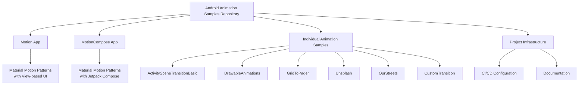
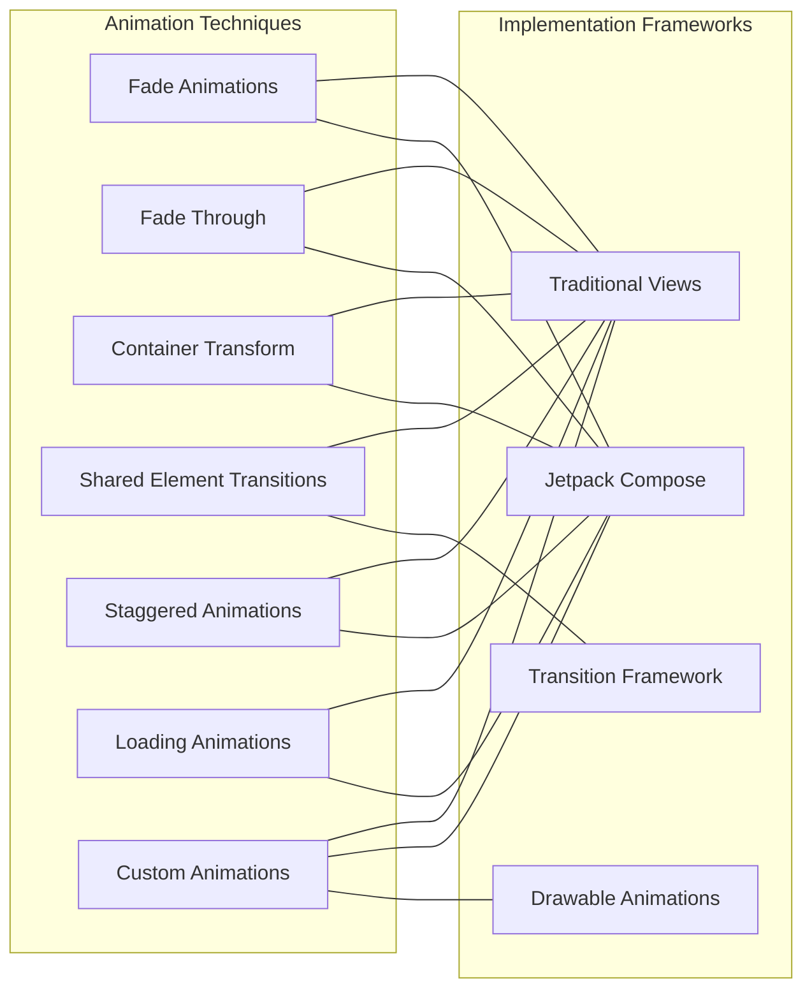
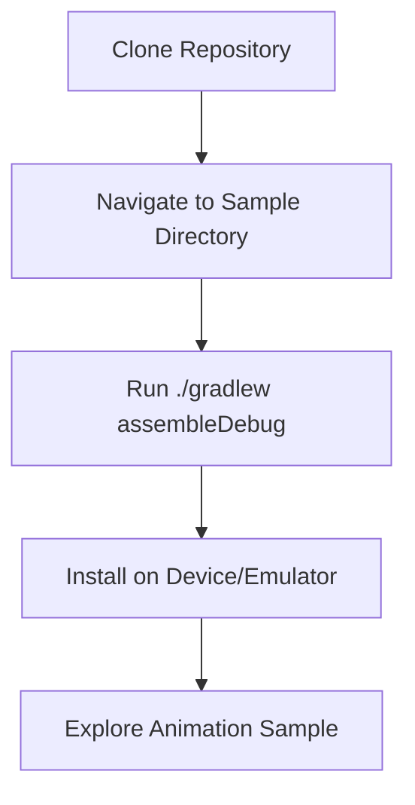

<!-- source: DeepWiki mcp.deepwiki.com · repo android/animation-samples · page 1 Android Animation Samples · fetched 2026-10-23 -->

# Android Animation Samples

Relevant source files

The following files were used as context for generating this wiki page:

- [.github/scripts/gradlew_recursive.sh](.github/scripts/gradlew_recursive.sh)
- [.github/workflows/android.yml](.github/workflows/android.yml)
- [.gitignore](.gitignore)
- [CONTRIBUTING.md](CONTRIBUTING.md)
- [LICENSE](LICENSE)
- [README.md](README.md)

## Purpose and Scope

This document provides a comprehensive overview of the Android Animation Samples repository, a collection of individual Android Studio projects that demonstrate various animation techniques and motion patterns in Android applications. The repository serves as a learning resource for developers seeking to understand and implement animations in their Android apps.

Sources: [README.md:6-10]()

## Repository Structure

The Android Animation Samples repository is organized into several distinct projects, each focusing on specific animation techniques or frameworks. The repository has a hierarchical structure with two main applications and several individual sample projects.

### Repository Organization

Sources: [README.md:6-10](), [.github/workflows/android.yml:15-43]()

The repository consists of three main categories of projects:

1. **Motion App**: A traditional View-based Android application demonstrating Material Design motion patterns. For detailed information, see [Motion App](#2).

2. **MotionCompose App**: A Jetpack Compose implementation of animation patterns, showcasing modern UI animation techniques. For detailed information, see [MotionCompose App](#3).

3. **Individual Animation Samples**: Standalone projects demonstrating specific animation techniques. For detailed information, see [Individual Animation Samples](#4).

## Animation Techniques Overview

The repository demonstrates a wide range of animation techniques across different Android UI frameworks. The following diagram illustrates the primary animation patterns and their implementations in both View-based and Compose-based applications.

Sources: [README.md:6-10]()

## Technology Stack Comparison

The samples in this repository use different technology stacks depending on their focus and when they were created. The following table provides a comparison of the primary technology stacks used across the main applications:

| Component | Motion App | MotionCompose App | Individual Samples |
|-----------|------------|-------------------|-------------------|
| UI Framework | View-based UI | Jetpack Compose | View-based UI |
| Animation APIs | AndroidX Transitions, ObjectAnimator | Compose Animation APIs, AnimatedContent | View Animations, Drawable Animations |
| Layout System | XML layouts, RecyclerView | Composables, LazyColumn | XML layouts, ViewPager |
| Navigation | Fragment Navigation | Compose Navigation | Activity-based, Fragment-based |
| Design System | Material Components | Material3 Components | Material Design |

Sources: [README.md:6-10]()

## Building and Running

The repository uses Gradle as its build system. Each sample project can be built and run independently. The repository includes GitHub Actions CI/CD configuration for automated building and testing.

Sources: [.github/workflows/android.yml:15-43](), [.github/scripts/gradlew_recursive.sh:1-36]()

## License and Contribution

The Android Animation Samples repository is licensed under the Apache License 2.0, permitting use, modification, and distribution with proper attribution.

Contributors are expected to follow the guidelines outlined in the CONTRIBUTING.md file, which includes signing a Contributor License Agreement and submitting changes through GitHub pull requests.

Sources: [LICENSE:1-192](), [CONTRIBUTING.md:1-29]()

## Deprecation Notice

It's important to note that this sample repository has been deprecated and is no longer actively maintained. Developers are encouraged to refer to official Android documentation and more recent samples for current animation best practices.

Sources: [README.md:1-4]()

## Related Resources

For more information about specific animation implementations, refer to:

- [Motion App](#2) - Details about the traditional View-based Motion demonstrations
- [MotionCompose App](#3) - Information about Jetpack Compose animation implementations
- [Individual Animation Samples](#4) - Documentation on standalone animation sample projects
- [Development Guide](#5) - Building and contributing to the samples

---

