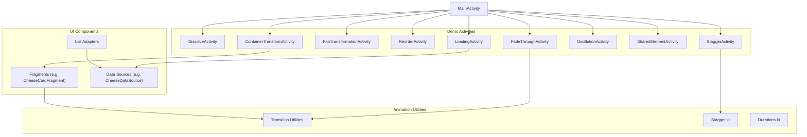
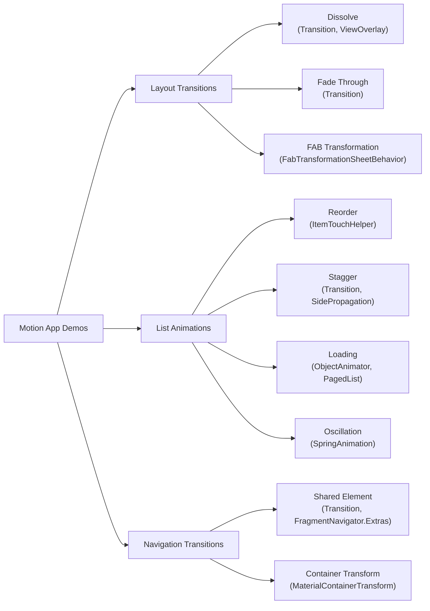
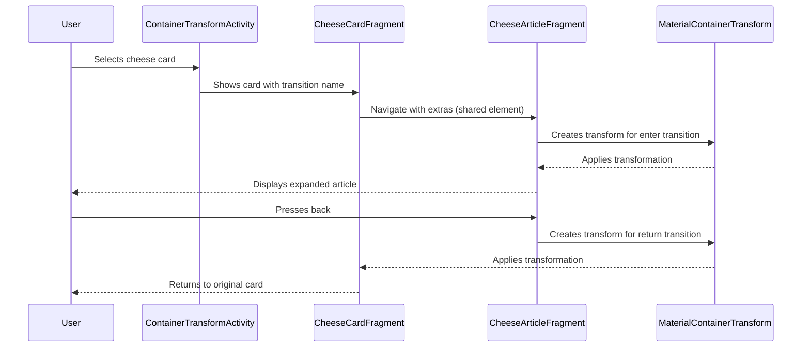

<!-- source: DeepWiki mcp.deepwiki.com · repo android/animation-samples · page 2 Motion App · fetched 2026-10-23 -->

# Motion App

<details>
<summary>Relevant source files</summary>

The following files were used as context for generating this wiki page:

- [Motion/README.md](Motion/README.md)
- [Motion/app/build.gradle](Motion/app/build.gradle)
- [Motion/app/src/main/AndroidManifest.xml](Motion/app/src/main/AndroidManifest.xml)
- [Motion/app/src/main/java/com/example/android/motion/demo/containertransform/CheeseArticleFragment.kt](Motion/app/src/main/java/com/example/android/motion/demo/containertransform/CheeseArticleFragment.kt)
- [Motion/app/src/main/res/values/demos.xml](Motion/app/src/main/res/values/demos.xml)
- [Motion/app/src/main/res/values/dimens.xml](Motion/app/src/main/res/values/dimens.xml)
- [Motion/app/src/main/res/values/strings.xml](Motion/app/src/main/res/values/strings.xml)
- [Motion/app/src/main/res/values/styles.xml](Motion/app/src/main/res/values/styles.xml)
- [Motion/build.gradle](Motion/build.gradle)
- [Motion/gradle/wrapper/gradle-wrapper.properties](Motion/gradle/wrapper/gradle-wrapper.properties)

</details>


The Motion App is a comprehensive demonstration of Material Design motion patterns implemented using traditional Android Views and Transitions. It provides practical examples of how to incorporate animations that enhance user experience through guided attention, spatial relationships, and visual continuity.

This page documents the structure, animation techniques, and implementation details of the Views-based Motion App. For information about Jetpack Compose-based animations, see [MotionCompose App](#3).

## Architecture Overview

The Motion App follows a modular architecture where each animation technique is demonstrated through a dedicated activity. The app provides a central menu to navigate to individual demos, with each demo showcasing a specific Material Design motion pattern.



Sources: [Motion/app/src/main/AndroidManifest.xml:39-203](), [Motion/app/src/main/res/values/demos.xml:1-124]()

## Demo Categories and Implementation

The Motion App demonstrates animation techniques in three main categories from the Material Design guidelines:



Sources: [Motion/app/src/main/res/values/demos.xml:19-122](), [Motion/README.md:1-51](), [Motion/app/src/main/AndroidManifest.xml:39-203]()

### Layout Transitions

These demos showcase transitions between different layouts or UI elements:

| Animation Type | Description | Key APIs |
|----------------|-------------|----------|
| Dissolve | Creates smooth transitions between overlapping elements (e.g., photos inside cards) | Transition, ViewOverlay |
| Fade Through | One element fades out completely before a new one fades in | Transition |
| FAB Transformation | Floating action button (FAB) transforms into a card | FabTransformationSheetBehavior, CircularRevealCardView |

Sources: [Motion/app/src/main/res/values/demos.xml:19-52]()

### List Animations

These demos focus on animating items within lists:

| Animation Type | Description | Key APIs |
|----------------|-------------|----------|
| Reorder | Animations for reordering items in a list with clear visual feedback | ItemTouchHelper, ItemAnimator, ViewPropertyAnimator |
| Stagger | Applying temporal offsets to a group of elements in sequence | Transition, SidePropagation |
| Loading | Animated placeholders indicating that content is loading | ObjectAnimator, PagedList |
| Oscillation | Animation with multiple overshoots, each smaller than the previous | SpringAnimation, EdgeEffect |

Sources: [Motion/app/src/main/res/values/demos.xml:54-98]()

### Navigation Transitions

These demos illustrate animations between different screens or fragments:

| Animation Type | Description | Key APIs |
|----------------|-------------|----------|
| Shared Element | Transitions with a focal element that persists across screens | Transition, FragmentNavigator.Extras |
| Container Transform | Transforming one container into another for a seamless transition | Transition, MaterialContainerTransform, FragmentNavigator.Extras |

Sources: [Motion/app/src/main/res/values/demos.xml:100-122]()

## Implementation Highlights

### Material Container Transform

One of the standout features demonstrated in the Motion App is the MaterialContainerTransform, which provides a smooth morphing animation between UI elements across different screens. This is shown in the Container Transform demo:



The implementation sets up shared element transitions between fragments:

```kotlin
// In CheeseArticleFragment
sharedElementEnterTransition = MaterialContainerTransform(requireContext(), true)
sharedElementReturnTransition = MaterialContainerTransform(requireContext(), false)
```

Sources: [Motion/app/src/main/java/com/example/android/motion/demo/containertransform/CheeseArticleFragment.kt:62-64]()

### Animation Dependencies

The Motion App relies on several key Android libraries to implement its animations:

- AndroidX Transition (1.4.1): Provides the foundation for most transitions
- AndroidX DynamicAnimation (1.1.0-alpha03): Enables physics-based animations
- Material Components (1.11.0): Includes specialized animations like MaterialContainerTransform
- AndroidX Navigation: Handles navigation with transition extras for shared elements

Sources: [Motion/app/build.gradle:57-72]()

## Technical Requirements

The Motion App supports:
- Minimum SDK: 19 (Android 4.4 KitKat)
- Target SDK: 34 (Android 14)
- Uses vector drawables with support library

It incorporates edge-to-edge design with system bars handling, as demonstrated in the Container Transform implementation where insets are properly applied to ensure content is visible under transparent system bars.

Sources: [Motion/app/build.gradle:24-32](), [Motion/app/src/main/java/com/example/android/motion/demo/containertransform/CheeseArticleFragment.kt:91-108]()

## Getting Started with Motion App

To use the Motion App as a reference for implementing animations in your own applications:

1. Study the individual demo activities to understand implementation patterns
2. Look at the transition utilities to see reusable animation components
3. Examine how the app structures animation code to maintain readability and reusability

The app demonstrates best practices for implementing Material Design motion patterns in a production-quality Android application.

Sources: [Motion/README.md:1-8]()

---

