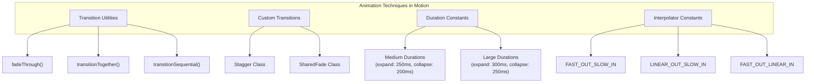
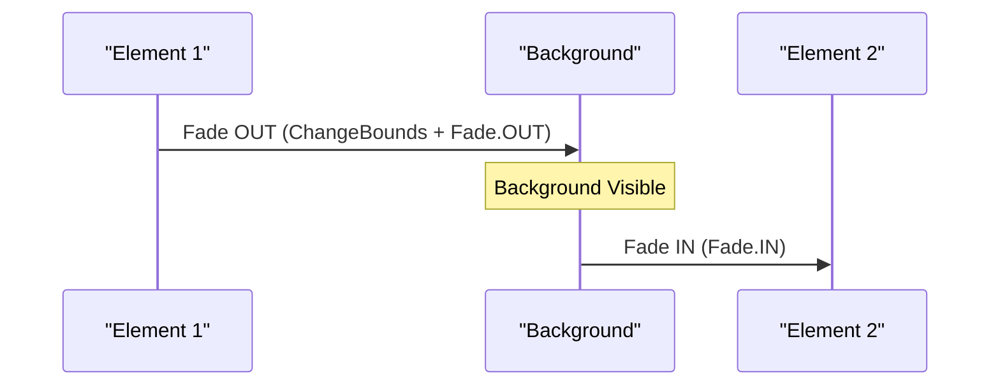
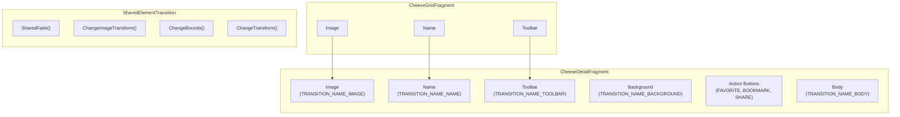
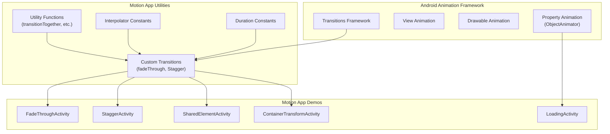

<!-- source: DeepWiki mcp.deepwiki.com · repo android/animation-samples · page 2.1 Animation Techniques in Motion · fetched 2026-10-23 -->

# Animation Techniques in Motion

<details>
<summary>Relevant source files</summary>

The following files were used as context for generating this wiki page:

- [Motion/README.md](Motion/README.md)
- [Motion/app/src/main/java/com/example/android/motion/demo/Durations.kt](Motion/app/src/main/java/com/example/android/motion/demo/Durations.kt)
- [Motion/app/src/main/java/com/example/android/motion/demo/Transitions.kt](Motion/app/src/main/java/com/example/android/motion/demo/Transitions.kt)
- [Motion/app/src/main/java/com/example/android/motion/demo/fadethrough/FadeThroughActivity.kt](Motion/app/src/main/java/com/example/android/motion/demo/fadethrough/FadeThroughActivity.kt)
- [Motion/app/src/main/java/com/example/android/motion/demo/sharedelement/CheeseDetailFragment.kt](Motion/app/src/main/java/com/example/android/motion/demo/sharedelement/CheeseDetailFragment.kt)
- [Motion/app/src/main/java/com/example/android/motion/demo/sharedelement/CheeseGridFragment.kt](Motion/app/src/main/java/com/example/android/motion/demo/sharedelement/CheeseGridFragment.kt)
- [Motion/app/src/main/java/com/example/android/motion/demo/stagger/Stagger.kt](Motion/app/src/main/java/com/example/android/motion/demo/stagger/Stagger.kt)
- [Motion/app/src/main/res/values/demos.xml](Motion/app/src/main/res/values/demos.xml)

</details>


## Purpose and Scope

This document explores the custom transition implementations and animation utilities available in the Motion app. It provides a detailed explanation of how these animations are implemented, their purpose, and how they integrate with Android's animation frameworks. For implementation of specific animations like Loading animations, see [Loading Animations](#2.2) or for Staggered animations, see [Staggered Animations](#2.3).

## Overview of Animation Techniques

The Motion app demonstrates various Material Design motion patterns through custom transition implementations. These techniques are built on top of Android's animation APIs to create smooth, meaningful transitions between UI states.



Sources: [Motion/app/src/main/java/com/example/android/motion/demo/Transitions.kt](), [Motion/app/src/main/java/com/example/android/motion/demo/Durations.kt](), [Motion/app/src/main/java/com/example/android/motion/demo/stagger/Stagger.kt]()

## Core Animation Utilities

### Transition Utility Functions

The Motion app provides several utility functions that make it easier to create and compose transitions:

```mermaid
classDiagram
    class "Transitions.kt" {
        +fadeThrough()
        +transitionTogether()
        +transitionSequential()
        +operator functions
    }
    
    class "TransitionSet" {
        +addTransition()
        +getTransitionAt()
        +transitionCount
    }
    
    class "CustomTransitionFunctions" {
        +operator functions
        +forEach()
        +forEachIndexed()
        +iterator()
    }
    
    "Transitions.kt" --> "TransitionSet" : extends
    "Transitions.kt" --> "CustomTransitionFunctions" : implements
```

Sources: [Motion/app/src/main/java/com/example/android/motion/demo/Transitions.kt]()

#### Key Utility Functions

| Function | Description | Source |
|----------|-------------|--------|
| `fadeThrough()` | Creates a Material Design fade through transition | [Transitions.kt:37-46]() |
| `transitionTogether()` | Creates a TransitionSet with ORDERING_TOGETHER | [Transitions.kt:48-53]() |
| `transitionSequential()` | Creates a SequentialTransitionSet | [Transitions.kt:55-59]() |
| Operator functions | Adds syntactic sugar for TransitionSet manipulation | [Transitions.kt:61-93]() |

Sources: [Motion/app/src/main/java/com/example/android/motion/demo/Transitions.kt]()

### Animation Durations

The Motion app defines standard durations for animations based on Material Design guidelines:

| Constant | Value | Purpose |
|----------|-------|---------|
| `MEDIUM_EXPAND_DURATION` | 250ms | Medium-sized expanding animations |
| `MEDIUM_COLLAPSE_DURATION` | 200ms | Medium-sized collapsing animations |
| `LARGE_EXPAND_DURATION` | 300ms | Large-sized expanding animations |
| `LARGE_COLLAPSE_DURATION` | 250ms | Large-sized collapsing animations |

Sources: [Motion/app/src/main/java/com/example/android/motion/demo/Durations.kt]()

## Custom Transition Implementations

### Fade Through Transition

The `fadeThrough()` function creates a transition that implements the Material Design fade through pattern. In this pattern, one element fades out completely before a new one fades in, allowing the background to show through during the transition.



Implementation:

```kotlin
fun fadeThrough(): Transition {
    return transitionTogether {
        interpolator = FAST_OUT_SLOW_IN
        this += ChangeBounds()
        this += transitionSequential {
            addTransition(Fade(Fade.OUT))
            addTransition(Fade(Fade.IN))
        }
    }
}
```

Usage example from `FadeThroughActivity`:

```kotlin
val fadeThrough = fadeThrough()
TransitionManager.beginDelayedTransition(
    card,
    fadeThrough.setDuration(MEDIUM_EXPAND_DURATION)
)
contact.isVisible = false
cheese.isVisible = true
```

Sources: [Motion/app/src/main/java/com/example/android/motion/demo/Transitions.kt:37-46](), [Motion/app/src/main/java/com/example/android/motion/demo/fadethrough/FadeThroughActivity.kt:58-77]()

### Stagger Transition

The `Stagger` class is a custom transition that extends the `Fade` transition to create a staggered animation effect. It adds a slight slide-up effect to the fade-in animation and uses `SidePropagation` to create a staggered effect.

```mermaid
classDiagram
    class "Fade" {
        +createAnimator()
    }
    
    class "Stagger" {
        +duration
        +interpolator
        +propagation
        +createAnimator()
    }
    
    "Fade" <|-- "Stagger" : extends
```

Key aspects of the `Stagger` implementation:

1. Extends `Fade(IN)` to inherit fade-in behavior
2. Sets a custom duration and interpolator
3. Uses `SidePropagation` with a specific propagation speed to create the stagger effect
4. Overrides `createAnimator()` to combine fade-in with translation animation

Sources: [Motion/app/src/main/java/com/example/android/motion/demo/stagger/Stagger.kt]()

### Shared Element Transitions

The Motion app demonstrates shared element transitions in the `sharedelement` package. These transitions create a seamless connection between different screens by animating common elements between them.



Key components:

1. Setting transition names for shared elements using `ViewCompat.setTransitionName()`
2. Creating a custom shared element transition with multiple components:
   - `SharedFade()`
   - `ChangeImageTransform()`
   - `ChangeBounds()`
   - `ChangeTransform()`
3. Handling postponed transitions to ensure elements are ready for animation

Sources: [Motion/app/src/main/java/com/example/android/motion/demo/sharedelement/CheeseGridFragment.kt](), [Motion/app/src/main/java/com/example/android/motion/demo/sharedelement/CheeseDetailFragment.kt]()

## Animation Design Patterns

The Motion app implements several Material Design motion patterns:

| Pattern | Description | Implementation | Demo |
|---------|-------------|----------------|------|
| Fade Through | Element fades out before new one fades in | `fadeThrough()` | `FadeThroughActivity` |
| Stagger | Temporal offsets applied to group elements | `Stagger` class | `StaggerActivity` |
| Shared Element | Elements persist across screens | Custom transition in `CheeseDetailFragment` | `SharedElementActivity` |
| Container Transform | Container morphs between screens | Custom implementation | `ContainerTransformActivity` |
| Dissolve | Smooth transition for overlapping elements | `Dissolve` implementation | `DissolveActivity` |

Sources: [Motion/app/src/main/res/values/demos.xml](), [Motion/README.md]()

## Implementation Best Practices

Based on the code examined, here are some best practices for implementing animations in Android:

1. **Use utility functions** to simplify the creation of complex transitions
2. **Follow Material Design guidelines** for animation durations and easing curves
3. **Leverage TransitionSet** to combine multiple transitions
4. **Set appropriate interpolators** for natural-feeling animations
5. **Use postponed transitions** when working with images or complex layouts
6. **Set transition names** for shared elements carefully and consistently
7. **Consider performance** by using appropriate durations and transition types

## Animation Integration with Android Framework



Sources: [Motion/app/src/main/res/values/demos.xml](), [Motion/app/src/main/java/com/example/android/motion/demo/Transitions.kt](), [Motion/app/src/main/java/com/example/android/motion/demo/Durations.kt]()

## Conclusion

The Motion app provides a comprehensive set of animation techniques that implement Material Design motion patterns. Through custom transitions and utility functions, it simplifies the process of creating complex, visually appealing animations. The techniques demonstrated in this app can be adapted and applied to other Android applications to create engaging user experiences that follow Material Design principles.

---

