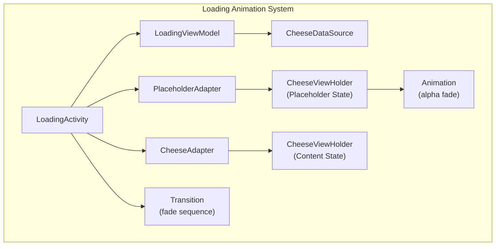
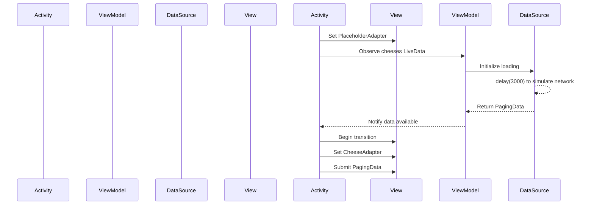
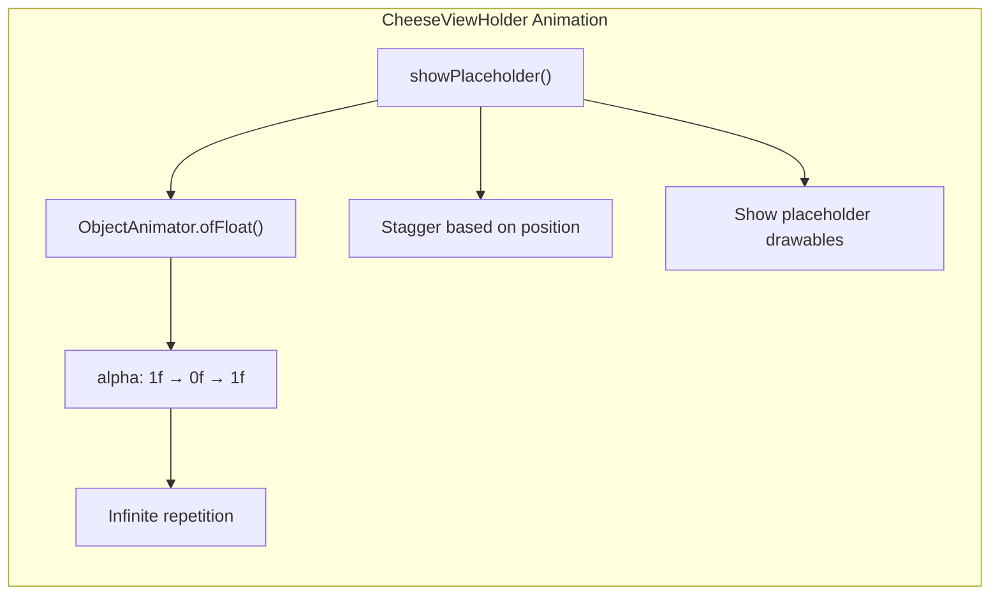
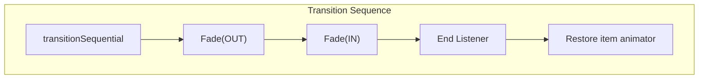
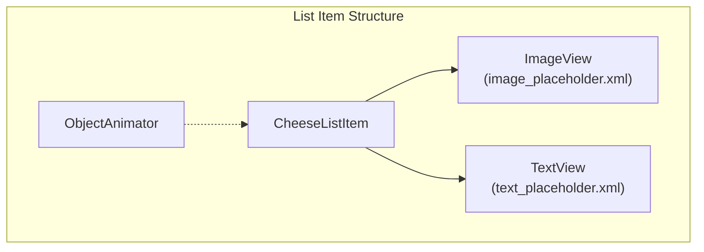

<!-- source: DeepWiki mcp.deepwiki.com · repo android/animation-samples · page 2.2 Loading Animations · fetched 2026-10-23 -->

# Loading Animations

<details>
<summary>Relevant source files</summary>

The following files were used as context for generating this wiki page:

- [Motion/.idea/codeStyles/Project.xml](Motion/.idea/codeStyles/Project.xml)
- [Motion/.idea/codeStyles/codeStyleConfig.xml](Motion/.idea/codeStyles/codeStyleConfig.xml)
- [Motion/app/src/main/java/com/example/android/motion/demo/loading/CheeseAdapter.kt](Motion/app/src/main/java/com/example/android/motion/demo/loading/CheeseAdapter.kt)
- [Motion/app/src/main/java/com/example/android/motion/demo/loading/CheeseDataSource.kt](Motion/app/src/main/java/com/example/android/motion/demo/loading/CheeseDataSource.kt)
- [Motion/app/src/main/java/com/example/android/motion/demo/loading/LoadingActivity.kt](Motion/app/src/main/java/com/example/android/motion/demo/loading/LoadingActivity.kt)
- [Motion/app/src/main/java/com/example/android/motion/demo/loading/LoadingViewModel.kt](Motion/app/src/main/java/com/example/android/motion/demo/loading/LoadingViewModel.kt)
- [Motion/app/src/main/res/drawable/image_placeholder.xml](Motion/app/src/main/res/drawable/image_placeholder.xml)
- [Motion/app/src/main/res/drawable/text_placeholder.xml](Motion/app/src/main/res/drawable/text_placeholder.xml)
- [Motion/app/src/main/res/layout/cheese_list_item.xml](Motion/app/src/main/res/layout/cheese_list_item.xml)
- [Motion/app/src/main/res/layout/loading_activity.xml](Motion/app/src/main/res/layout/loading_activity.xml)
- [Motion/app/src/main/res/menu/loading.xml](Motion/app/src/main/res/menu/loading.xml)

</details>


## Purpose and Scope

This document details the implementation of loading animations with placeholders in the Motion app. It covers the transition between loading state and content state, focusing on how the Android Animation Samples repository demonstrates animated loading placeholders. The implementation showcases best practices for providing visual feedback during data loading operations.

## Overview

The loading animation system demonstrates a common UI pattern where placeholder content is shown with animations while data is being loaded asynchronously. Once the data is ready, the system transitions smoothly from the placeholder state to the content state.



Sources: [Motion/app/src/main/java/com/example/android/motion/demo/loading/LoadingActivity.kt:1-106](), [Motion/app/src/main/java/com/example/android/motion/demo/loading/LoadingViewModel.kt:1-46](), [Motion/app/src/main/java/com/example/android/motion/demo/loading/CheeseAdapter.kt:1-108](), [Motion/app/src/main/java/com/example/android/motion/demo/loading/CheeseDataSource.kt:1-61]()

## Key Components

### Activity and Data Management

The `LoadingActivity` coordinates the display of data and the transition between loading and loaded states. It works with the `LoadingViewModel` which manages data retrieval through the Android Paging library.



Sources: [Motion/app/src/main/java/com/example/android/motion/demo/loading/LoadingActivity.kt:38-88](), [Motion/app/src/main/java/com/example/android/motion/demo/loading/LoadingViewModel.kt:16-46](), [Motion/app/src/main/java/com/example/android/motion/demo/loading/CheeseDataSource.kt:30-55]()

### Adapters and ViewHolders

The loading animation system uses two adapters:

1. `PlaceholderAdapter`: Shows placeholder UI elements with animation during loading
2. `CheeseAdapter`: Displays actual content once data is loaded

Both adapters use the same `CheeseViewHolder` class which handles both states.

| Adapter | Purpose | Implementation |
|---------|---------|----------------|
| PlaceholderAdapter | Shows placeholder UI with animations | Returns placeholder views with infinite count |
| CheeseAdapter | Shows actual content | PagingDataAdapter that displays the loaded cheese data |

Sources: [Motion/app/src/main/java/com/example/android/motion/demo/loading/CheeseAdapter.kt:34-68]()

## Loading Animation Implementation

### Placeholder Animation

The placeholder animation consists of fading UI elements that give users visual feedback that content is loading. The animation is implemented in the `CheeseViewHolder` class:



Key aspects of the animation implementation:

1. An `ObjectAnimator` fades the view's alpha from 1.0 to 0.0 and back to 1.0
2. The animation is set to repeat infinitely
3. The animation timing is staggered based on the item's position in the list
4. Placeholder drawables are used for both the image and the text

Sources: [Motion/app/src/main/java/com/example/android/motion/demo/loading/CheeseAdapter.kt:72-99](), [Motion/app/src/main/res/drawable/image_placeholder.xml:1-22](), [Motion/app/src/main/res/drawable/text_placeholder.xml:1-23]()

### Key Animation Code

The core animation is set up in the `CheeseViewHolder` class:

```kotlin
private val animation = ObjectAnimator.ofFloat(itemView, View.ALPHA, 1f, 0f, 1f).apply {
    repeatCount = ObjectAnimator.INFINITE
    duration = FADE_DURATION
    // Reset the alpha on animation end.
    doOnEnd { itemView.alpha = 1f }
}
```

When showing placeholders, the animation is staggered by adapting its current play time:

```kotlin
animation.currentPlayTime = 
    (SystemClock.elapsedRealtime() - bindingAdapterPosition * 30L) % FADE_DURATION
animation.start()
```

Sources: [Motion/app/src/main/java/com/example/android/motion/demo/loading/CheeseAdapter.kt:82-87](), [Motion/app/src/main/java/com/example/android/motion/demo/loading/CheeseAdapter.kt:92-94]()

## Transitioning Between States

### Fade Transition

When data is loaded, the activity transitions from the placeholder adapter to the content adapter using a sequential fade transition:



The transition is implemented using:

```kotlin
private val fade = transitionSequential {
    duration = LARGE_EXPAND_DURATION
    interpolator = FAST_OUT_SLOW_IN
    this += Fade(Fade.OUT)
    this += Fade(Fade.IN)
    addListener(object : TransitionListenerAdapter() {
        override fun onTransitionEnd(transition: Transition) {
            if (savedItemAnimator != null) {
                list.itemAnimator = savedItemAnimator
            }
        }
    })
}
```

Sources: [Motion/app/src/main/java/com/example/android/motion/demo/loading/LoadingActivity.kt:46-58]()

### Transition Trigger

The transition is triggered when the `cheeses` LiveData emits a new value:

```kotlin
viewModel.cheeses.observe(this) { cheeses ->
    if (list.adapter != cheeseAdapter) {
        list.adapter = cheeseAdapter
        savedItemAnimator = list.itemAnimator
        list.itemAnimator = null
        TransitionManager.beginDelayedTransition(list, fade)
    }
    cheeseAdapter.submitData(lifecycle, cheeses)
}
```

Sources: [Motion/app/src/main/java/com/example/android/motion/demo/loading/LoadingActivity.kt:79-87]()

## Data Loading Simulation

To demonstrate the loading animations effectively, the `CheeseDataSource` deliberately introduces a delay:

```kotlin
// Simulate slow network.
delay(3000)
```

This simulates a slow network request, giving users time to observe the loading animation before the actual content is displayed.

Sources: [Motion/app/src/main/java/com/example/android/motion/demo/loading/CheeseDataSource.kt:42]()

## Refresh Action

The loading animation can be manually triggered through the refresh menu action:

```kotlin
override fun onOptionsItemSelected(item: MenuItem): Boolean {
    return when (item.itemId) {
        R.id.action_refresh -> {
            TransitionManager.beginDelayedTransition(list, fade)
            list.adapter = placeholderAdapter
            viewModel.refresh()
            true
        }
        else -> super.onOptionsItemSelected(item)
    }
}
```

Sources: [Motion/app/src/main/java/com/example/android/motion/demo/loading/LoadingActivity.kt:95-105](), [Motion/app/src/main/res/menu/loading.xml:1-26]()

## Implementation Best Practices

1. **Shared ViewHolder**: Both adapters use the same ViewHolder class, simplifying the implementation
2. **Animated Transitions**: Use `TransitionManager` to smoothly transition between states
3. **Staggered Animations**: Animation timing is staggered to create a more pleasing visual effect
4. **Placeholder Drawables**: Simple shape drawables are used as placeholders for images and text
5. **ViewModel Separation**: Data loading is managed by the ViewModel, keeping the UI logic clean

Sources: [Motion/app/src/main/java/com/example/android/motion/demo/loading/CheeseAdapter.kt:72-107](), [Motion/app/src/main/java/com/example/android/motion/demo/loading/LoadingActivity.kt:46-58](), [Motion/app/src/main/java/com/example/android/motion/demo/loading/LoadingViewModel.kt:28-45]()

## Visual Structure

The loading animation affects both image and text elements in each list item:



Sources: [Motion/app/src/main/res/layout/cheese_list_item.xml:1-49](), [Motion/app/src/main/res/drawable/image_placeholder.xml:1-22](), [Motion/app/src/main/res/drawable/text_placeholder.xml:1-23]()

## Conclusion

The Loading Animations implementation in the Motion app demonstrates an effective way to provide visual feedback during data loading operations. By combining placeholder UI elements with staggered fade animations and smooth transitions, the system creates a polished user experience even when waiting for data to load.

---

