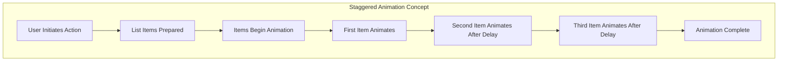
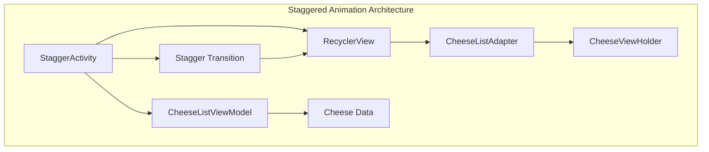
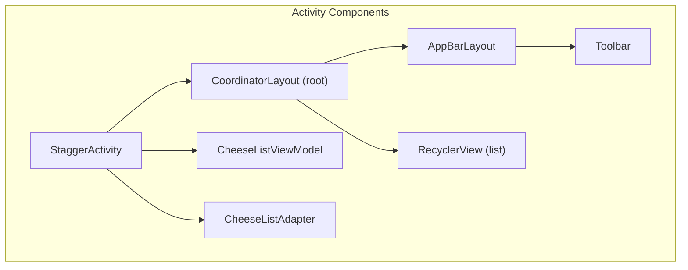
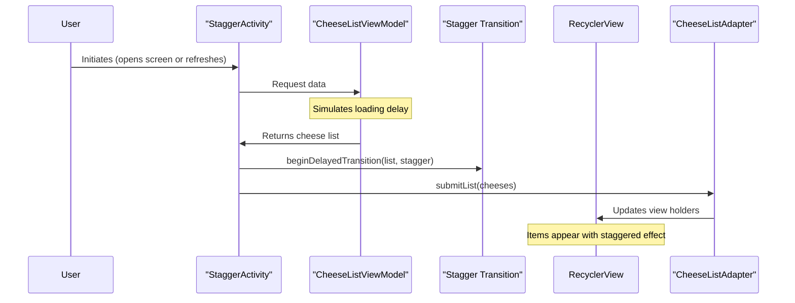
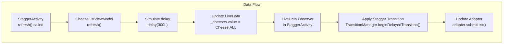
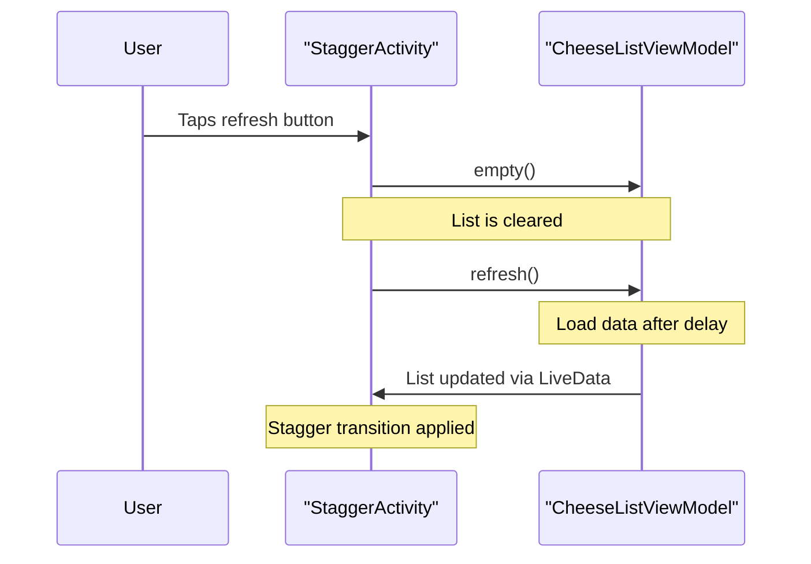

<!-- source: DeepWiki mcp.deepwiki.com · repo android/animation-samples · page 2.3 Staggered Animations · fetched 2026-10-23 -->

# Staggered Animations

<details>
<summary>Relevant source files</summary>

The following files were used as context for generating this wiki page:

- [Motion/app/src/main/java/com/example/android/motion/demo/stagger/CheeseListAdapter.kt](Motion/app/src/main/java/com/example/android/motion/demo/stagger/CheeseListAdapter.kt)
- [Motion/app/src/main/java/com/example/android/motion/demo/stagger/CheeseListViewModel.kt](Motion/app/src/main/java/com/example/android/motion/demo/stagger/CheeseListViewModel.kt)
- [Motion/app/src/main/java/com/example/android/motion/demo/stagger/StaggerActivity.kt](Motion/app/src/main/java/com/example/android/motion/demo/stagger/StaggerActivity.kt)
- [Motion/app/src/main/res/drawable/ic_refresh.xml](Motion/app/src/main/res/drawable/ic_refresh.xml)
- [Motion/app/src/main/res/layout/stagger_activity.xml](Motion/app/src/main/res/layout/stagger_activity.xml)
- [Motion/app/src/main/res/menu/stagger.xml](Motion/app/src/main/res/menu/stagger.xml)

</details>


## Purpose and Scope

This document explains how staggered animations are implemented in the Motion app. Staggered animations apply temporal offsets to a group of elements in sequence, creating a cascade effect that focuses attention briefly on each item. This technique is useful for revealing significant content or highlighting affordances within a group, particularly for list items.

For information about Container Transform animations, see [Container Transform](#2.4).

## What are Staggered Animations?

Staggered animations create visual interest by animating similar elements with slight timing delays between each item. This creates a flowing, sequential appearance that can guide the user's attention through a collection of items.

According to Material Design, stagger creates a cascade effect that focuses attention briefly on each element. It can reveal significant content or highlight affordances within a group.



Sources: [Motion/app/src/main/java/com/example/android/motion/demo/stagger/StaggerActivity.kt:32-38]()

## Implementation Architecture

The staggered animation implementation in the Motion app consists of several key components that work together:



Sources: [Motion/app/src/main/java/com/example/android/motion/demo/stagger/StaggerActivity.kt:43-98]()

### Activity and Layout

The `StaggerActivity` serves as the controller for the staggered animation demo. It sets up the RecyclerView, creates the stagger transition, and observes the data changes from the ViewModel.

The activity layout (`stagger_activity.xml`) consists of a Coordinator Layout with an AppBar and a RecyclerView for the list items.



Sources: 
- [Motion/app/src/main/java/com/example/android/motion/demo/stagger/StaggerActivity.kt:43-98]()
- [Motion/app/src/main/res/layout/stagger_activity.xml:17-53]()

## Stagger Animation Implementation

### Animation Workflow

The staggered animation in the Motion app follows this process:

1. The ViewModel provides the list of items (cheeses) to display
2. The activity applies a stagger transition to the RecyclerView
3. The adapter receives the new list of items
4. Items appear with a staggered effect due to the transition



Sources:
- [Motion/app/src/main/java/com/example/android/motion/demo/stagger/StaggerActivity.kt:70-77]()
- [Motion/app/src/main/java/com/example/android/motion/demo/stagger/CheeseListViewModel.kt:40-46]()

### Key Implementation Details

#### 1. Setting Up the RecyclerView

The `StaggerActivity` configures a RecyclerView with a custom `ItemAnimator` to disable the default RecyclerView's add animations and let the stagger transition handle the animation instead:

```
list.itemAnimator = object : DefaultItemAnimator() {
    override fun animateAdd(holder: RecyclerView.ViewHolder?): Boolean {
        dispatchAddFinished(holder)
        dispatchAddStarting(holder)
        return false
    }
}
```

Sources:
- [Motion/app/src/main/java/com/example/android/motion/demo/stagger/StaggerActivity.kt:62-68]()

#### 2. Creating and Applying the Stagger Transition

The stagger transition is created and applied before updating the list:

```
val stagger = Stagger()
// ...
TransitionManager.beginDelayedTransition(list, stagger)
adapter.submitList(cheeses)
```

This ensures that when the list is updated with new items, the stagger transition is applied to create the staggered appearance effect.

Sources:
- [Motion/app/src/main/java/com/example/android/motion/demo/stagger/StaggerActivity.kt:71-76]()

#### 3. ViewModel for Data Management

The `CheeseListViewModel` manages the data and simulates a loading delay before providing the list of items:



Sources:
- [Motion/app/src/main/java/com/example/android/motion/demo/stagger/CheeseListViewModel.kt:27-47]()
- [Motion/app/src/main/java/com/example/android/motion/demo/stagger/StaggerActivity.kt:73-77]()

#### 4. Refresh Functionality

The `StaggerActivity` provides a refresh action in the options menu that demonstrates the stagger effect again by:
1. Clearing the current list (setting it to empty)
2. Requesting a refresh from the ViewModel



Sources:
- [Motion/app/src/main/java/com/example/android/motion/demo/stagger/StaggerActivity.kt:80-97]()
- [Motion/app/src/main/res/menu/stagger.xml:19-24]()

## Technical Considerations

### RecyclerView Animation Customization

The staggered animation implementation replaces RecyclerView's default item animations with a custom transition. This is achieved by:

1. Creating a custom `ItemAnimator` that disables RecyclerView's built-in add animations
2. Using `TransitionManager.beginDelayedTransition()` to apply the stagger transition before updating the list

This approach allows for more control over how the items appear in the list.

Sources:
- [Motion/app/src/main/java/com/example/android/motion/demo/stagger/StaggerActivity.kt:62-68]()

### Transition Timing

The staggered animation is synchronized with data loading through:

1. A simulated delay in the ViewModel (`delay(300L)`) to mimic real-world data loading
2. Applying the transition right before submitting the new list to the adapter

This ensures that the animation starts when the data is ready to be displayed.

Sources:
- [Motion/app/src/main/java/com/example/android/motion/demo/stagger/CheeseListViewModel.kt:43]()
- [Motion/app/src/main/java/com/example/android/motion/demo/stagger/StaggerActivity.kt:75-76]()

## Example Usage

To implement staggered animations in your own app:

1. Create a custom `Stagger` transition class
2. Configure your RecyclerView to disable default animations
3. Apply the stagger transition using `TransitionManager.beginDelayedTransition()` before updating the adapter's data
4. Submit the new list to the adapter

The staggered animation effect will be applied to the list items as they appear.

Sources:
- [Motion/app/src/main/java/com/example/android/motion/demo/stagger/StaggerActivity.kt:62-76]()

---

