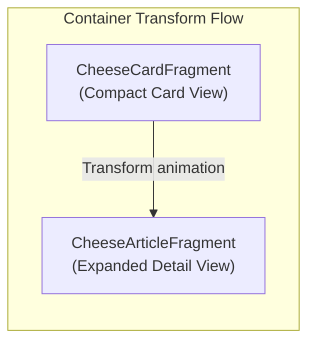
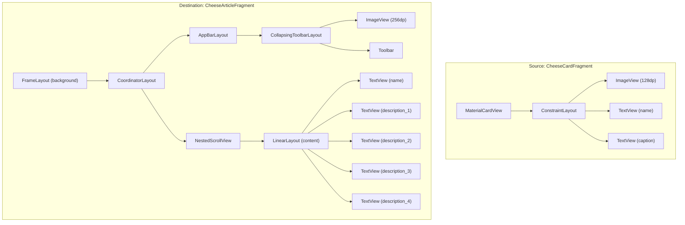
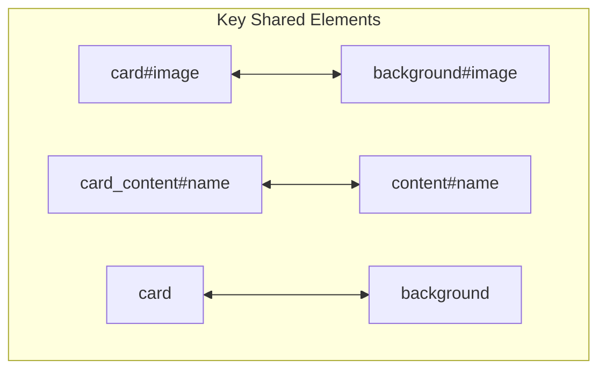
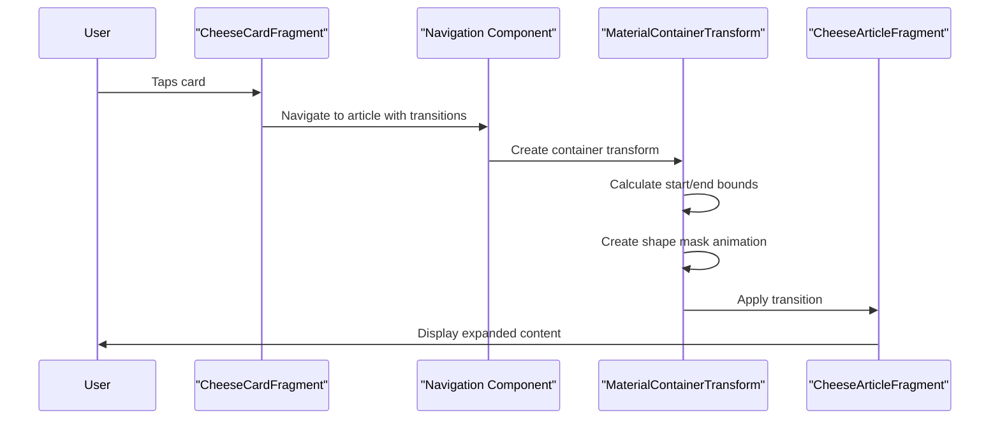

<!-- source: DeepWiki mcp.deepwiki.com · repo android/animation-samples · page 2.4 Container Transform · fetched 2026-10-23 -->

# Container Transform

Relevant source files

The following files were used as context for generating this wiki page:

- [Motion/app/src/main/res/layout/cheese_article_fragment.xml](Motion/app/src/main/res/layout/cheese_article_fragment.xml)
- [Motion/app/src/main/res/layout/cheese_card_fragment.xml](Motion/app/src/main/res/layout/cheese_card_fragment.xml)

Container Transform is a Material Design motion pattern that provides visual continuity when transitioning between UI elements. This page documents how the Motion app implements container transform transitions between a summary card and a detailed article view.

## Purpose and Overview

The Container Transform pattern creates a smooth, connected transition between UI surfaces that contain related content. It helps users understand the relationship between different screens or components by visually transforming one container into another.

In this implementation, a MaterialCardView containing a cheese image and summary expands into a full-screen detailed article view, maintaining visual continuity throughout the transition.

Sources: [Motion/app/src/main/res/layout/cheese_card_fragment.xml:1-104](), [Motion/app/src/main/res/layout/cheese_article_fragment.xml:1-139]()

## UI Components

The Container Transform implementation involves two main UI components:

### Source Container: Card View

The source container is a `MaterialCardView` with a fixed height of 128dp that displays:
- A cheese image (128dp width)
- Cheese name (title)
- Brief description (caption)

This compact card serves as the starting point for the transform animation.

### Destination Container: Article View

The destination is a full-screen view with:
- An expanded header image (256dp height)
- Larger title text
- Multiple paragraphs of detailed description
- Scrollable content
- AppBar with navigation controls

Sources: [Motion/app/src/main/res/layout/cheese_card_fragment.xml:45-100](), [Motion/app/src/main/res/layout/cheese_article_fragment.xml:28-137]()

## Implementation Details

### Shared Elements

The container transform relies on specific elements that are visually shared between both layouts to create the transformation effect:

1. **Image**: Transitions from a 128dp square in the card to a 256dp height header
2. **Name/Title**: Grows and repositions from the card to the article header
3. **Background Surface**: Expands from card dimensions to fill the screen

These shared elements maintain visual continuity during the transition, while other elements (like the extended description) fade in.

Sources: [Motion/app/src/main/res/layout/cheese_card_fragment.xml:46-81](), [Motion/app/src/main/res/layout/cheese_article_fragment.xml:21-91]()

### Layout Structure Comparison

| Card Fragment (Source) | Article Fragment (Destination) |
|------------------------|--------------------------------|
| CoordinatorLayout      | FrameLayout (background)       |
| MaterialCardView       | CoordinatorLayout              |
| ConstraintLayout       | AppBarLayout + NestedScrollView |
| ImageView (128dp)      | ImageView (256dp)              |
| TextView (name)        | TextView (name)                |
| TextView (caption)     | Multiple description TextViews |

Sources: [Motion/app/src/main/res/layout/cheese_card_fragment.xml:17-104](), [Motion/app/src/main/res/layout/cheese_article_fragment.xml:17-139]()

## Material Container Transform Implementation

The Container Transform implementation follows the Material Design motion specification, using the MaterialContainerTransform class from the Material Components library. This creates a seamless morphing animation between the source and destination containers.

### Key Animation Attributes

The container transform animation exhibits several important characteristics:

1. **Shape Transformation**: The card's rounded corners gradually transform to the article view's shape
2. **Elevation Change**: The card elevation increases as it expands to the article view
3. **Content Fade**: Content not present in both views fades in/out during transition
4. **Coordinated Motion**: All elements move and resize together in a cohesive animation

## Navigation Integration

The Container Transform is integrated with the Android Navigation Component, as indicated by the navigation graph reference in the provided XML files. The transition is triggered when navigating from the card fragment to the article fragment.

Sources: [Motion/app/src/main/res/layout/cheese_card_fragment.xml:17-43](), [Motion/app/src/main/res/layout/cheese_article_fragment.xml:28-66]()

## Best Practices

When implementing Container Transform:

1. **Identify shared elements**: Ensure visual continuity by identifying elements that exist in both the source and destination layouts
2. **Maintain aspect ratios**: Keep consistent aspect ratios for images when possible
3. **Use appropriate durations**: Follow Material Design guidelines for animation duration
4. **Handle back navigation**: Implement reverse animations for back navigation
5. **Consider elevation**: Use elevation changes to reinforce the transformation hierarchy

## Related Components

For information about other animation techniques in the Motion app, see:
- [Loading Animations](#2.2) for content loading patterns
- [Staggered Animations](#2.3) for list item animations

---

