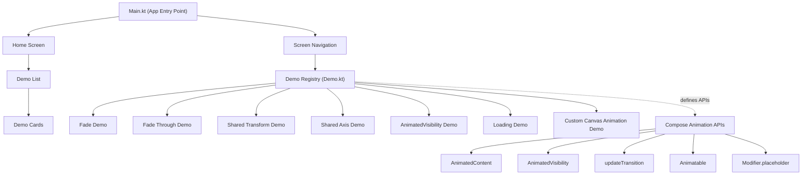
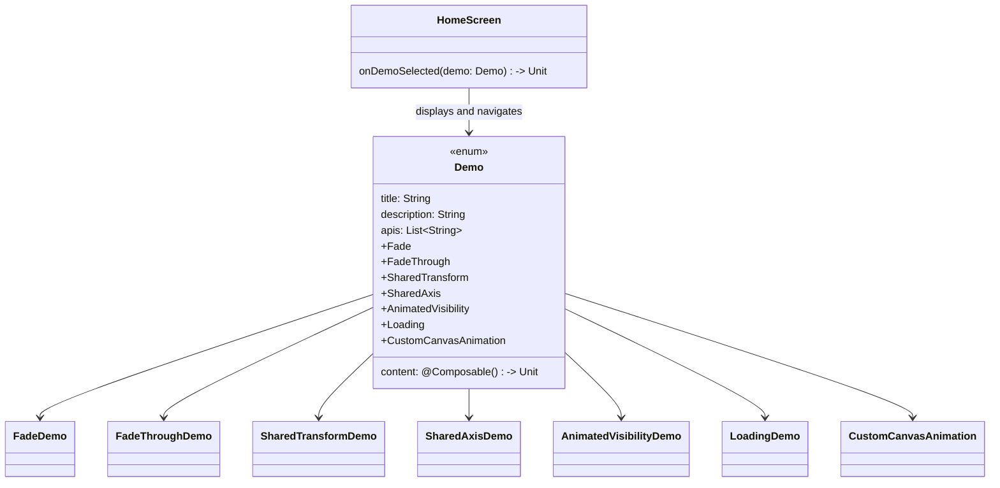
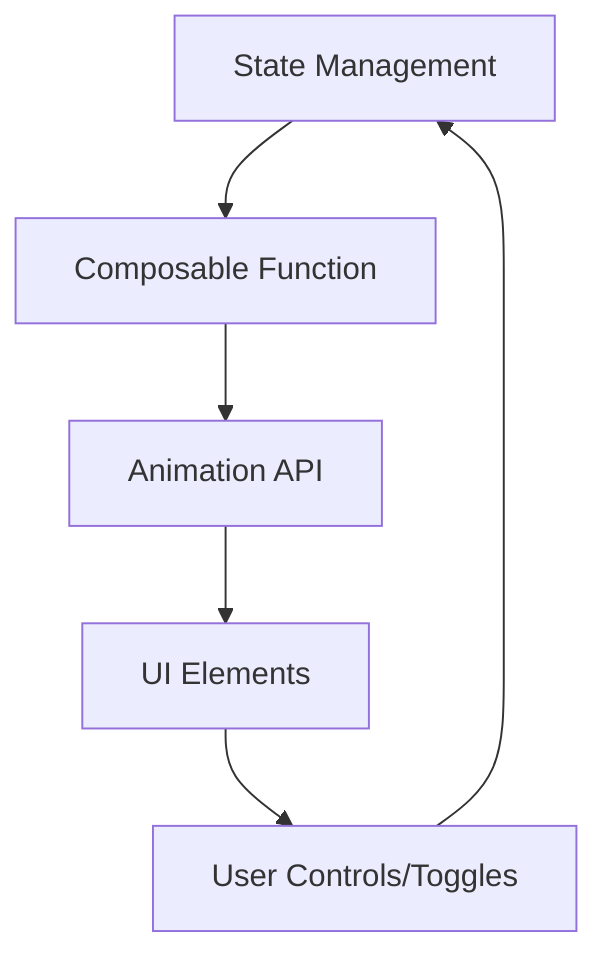

<!-- source: DeepWiki mcp.deepwiki.com · repo android/animation-samples · page 3 MotionCompose App · fetched 2026-10-23 -->

# MotionCompose App

<details>
<summary>Relevant source files</summary>

The following files were used as context for generating this wiki page:

- [MotionCompose/README.md](MotionCompose/README.md)
- [MotionCompose/app/build.gradle](MotionCompose/app/build.gradle)
- [MotionCompose/app/src/main/java/com/example/android/compose/motion/demo/Cheese.kt](MotionCompose/app/src/main/java/com/example/android/compose/motion/demo/Cheese.kt)
- [MotionCompose/app/src/main/java/com/example/android/compose/motion/demo/Demo.kt](MotionCompose/app/src/main/java/com/example/android/compose/motion/demo/Demo.kt)
- [MotionCompose/app/src/main/java/com/example/android/compose/motion/demo/fadethrough/FadeThroughDemo.kt](MotionCompose/app/src/main/java/com/example/android/compose/motion/demo/fadethrough/FadeThroughDemo.kt)
- [MotionCompose/app/src/main/java/com/example/android/compose/motion/demo/loading/CheeseDataSource.kt](MotionCompose/app/src/main/java/com/example/android/compose/motion/demo/loading/CheeseDataSource.kt)
- [MotionCompose/app/src/main/java/com/example/android/compose/motion/demo/loading/LoadingViewModel.kt](MotionCompose/app/src/main/java/com/example/android/compose/motion/demo/loading/LoadingViewModel.kt)
- [MotionCompose/app/src/main/java/com/example/android/compose/motion/demo/visibility/AnimatedVisibilityExample.kt](MotionCompose/app/src/main/java/com/example/android/compose/motion/demo/visibility/AnimatedVisibilityExample.kt)
- [MotionCompose/app/src/main/java/com/example/android/compose/motion/ui/home/Home.kt](MotionCompose/app/src/main/java/com/example/android/compose/motion/ui/home/Home.kt)
- [MotionCompose/build.gradle](MotionCompose/build.gradle)
- [MotionCompose/gradle/wrapper/gradle-wrapper.properties](MotionCompose/gradle/wrapper/gradle-wrapper.properties)

</details>


The MotionCompose App is a collection of demonstrations showcasing Material Design Motion patterns implemented in Jetpack Compose. This document covers the architecture, components, and implementation details of the MotionCompose app. For information about traditional Views-based animation implementations, see the [Motion App](#2) documentation.

## System Architecture

The MotionCompose app follows a simple architecture centered around a demo registry system that organizes various animation demonstrations into a catalog. The app provides a unified interface for browsing, selecting, and viewing different animation techniques.

### High-Level Architecture Diagram



Sources: [MotionCompose/app/src/main/java/com/example/android/compose/motion/demo/Demo.kt:28-117](), [MotionCompose/app/src/main/java/com/example/android/compose/motion/ui/home/Home.kt:48-157]()

## Demo Registry System

The core architectural component of the MotionCompose app is the Demo Registry, implemented as an enum class in Demo.kt. This registry serves as a central catalog of all available animation demonstrations.



Each demo in the registry contains:
- **title**: Display name of the demo (e.g., "Layout > Fade")
- **description**: Text explanation of the animation technique
- **apis**: List of Compose animation APIs used in the implementation
- **content**: Composable function that renders the actual demo

This design enables the app to:
1. Display a uniform list of demos on the home screen
2. Navigate to specific demos when selected
3. Associate each demo with relevant API information
4. Easily extend the app with new animation demonstrations

Sources: [MotionCompose/app/src/main/java/com/example/android/compose/motion/demo/Demo.kt:28-117]()

## Home Screen and Navigation

The home screen displays all registered demos as cards in a scrollable list, with each card showing the demo's title, description, and used APIs.

```markdown
| Component | Purpose |
|-----------|---------|
| `Home.kt` | Main screen implementation showing list of demos |
| `DemoList` | LazyColumn displaying demo cards |
| `DemoCard` | Surface component showing demo metadata |
| `ApiChip` | Visual component showing which APIs are used |
```

When a user selects a demo card, the `onDemoSelected` callback is triggered, which navigates to the selected demo's content screen.

Sources: [MotionCompose/app/src/main/java/com/example/android/compose/motion/ui/home/Home.kt:48-157]()

## Animation Demonstrations

The MotionCompose app includes seven key animation demonstrations, each showcasing different animation techniques and Material Design motion patterns:

### 1. Fade

Demonstrates smooth fade animations for elements that fully overlap. Uses `AnimatedContent` API for implementation.

### 2. Fade Through

Implements the Material Design "fade through" pattern where one element fades out completely before a new one fades in. This demonstration implements the detailed timing specifications from Material Design:
- Exit animation: 3/8 of total duration with `FastOutLinearInEasing`
- Enter animation: 5/8 of total duration with `LinearOutSlowInEasing` 
- Enter animation starts after exit animation completes

Sources: [MotionCompose/app/src/main/java/com/example/android/compose/motion/demo/fadethrough/FadeThroughDemo.kt:90-162]()

### 3. Shared Transform

Shows complex layout transformations where elements transform as a single unit rather than animating independently. Implemented using `updateTransition` and `Transition.AnimatedContent`.

### 4. Shared Axis (Y-axis)

Demonstrates the shared axis pattern for transitions between UI elements with spatial or navigational relationships, specifically using Y-axis animation to reinforce sequential order.

### 5. Animated Visibility

A simple example showing how to animate the appearance and disappearance of a view using `AnimatedVisibility` with custom enter/exit animations.

Sources: [MotionCompose/app/src/main/java/com/example/android/compose/motion/demo/visibility/AnimatedVisibilityExample.kt:44-73]()

### 6. Loading

Shows placeholder UI animations for loading states, demonstrating how to provide visual feedback during content loading. Uses `Modifier.placeholder` and the Accompanist placeholder library.

Sources: [MotionCompose/app/src/main/java/com/example/android/compose/motion/demo/loading/LoadingViewModel.kt:19-26](), [MotionCompose/app/src/main/java/com/example/android/compose/motion/demo/loading/CheeseDataSource.kt:24-61]()

### 7. Custom Canvas Animation

Demonstrates creating custom loading animations using Canvas drawing APIs combined with `Animatable` to show sequential animations.

## Technical Implementation Pattern

Most demos in the MotionCompose app follow a consistent implementation pattern:



The pattern typically includes:

1. **State Management**: Defining state variables using `remember` and `mutableStateOf`
2. **Animation API**: Using appropriate Compose animation APIs
3. **UI Elements**: Composable UI components with animations applied
4. **User Controls**: Buttons or other controls to trigger state changes

For example, the FadeThrough demo:
- Defines an `expanded` state variable
- Uses `AnimatedContent` with a custom `fadeThrough()` transition specification
- Shows different content based on expansion state
- Provides a toggle button to switch between states

Sources: [MotionCompose/app/src/main/java/com/example/android/compose/motion/demo/fadethrough/FadeThroughDemo.kt:70-87]()

## Dependencies and Technology Stack

The MotionCompose app is built using:

```markdown
| Component | Version | Purpose |
|-----------|---------|---------|
| Jetpack Compose UI | 1.2.1 | UI framework |
| Compose Material3 | 1.0.0-alpha15 | Material Design components |
| Accompanist | 0.25.0 | Utilities for Compose |
| Lifecycle Components | 2.5.1 | ViewModel integration |
| Paging Compose | 1.0.0-alpha15 | Paging for loading demo |
```

The app requires a minimum SDK version of 21 (Android 5.0) and is built with Kotlin 1.7.10 using the Compose compiler version 1.3.0.

Sources: [MotionCompose/app/build.gradle:22-87](), [MotionCompose/build.gradle:17-28]()

## Demo Data

The animations use a consistent set of sample data across demos, primarily the "Cheese" data model which provides names and images for demonstration purposes.

```markdown
| Data Component | Purpose |
|----------------|---------|
| `Cheese` | Data class with id, name and image |
| `CheeseImages` | List of drawable resources for cheese images |
| `CheeseNames` | List of cheese names for demo content |
| `CheeseDataSource` | PagingSource implementation for loading demo |
```

The data source includes artificial delay (3000ms) to simulate network loading for the Loading demonstration.

Sources: [MotionCompose/app/src/main/java/com/example/android/compose/motion/demo/Cheese.kt:22-182](), [MotionCompose/app/src/main/java/com/example/android/compose/motion/demo/loading/CheeseDataSource.kt:24-61]()

## Conclusion

The MotionCompose App serves as a comprehensive showcase of implementing Material Design motion patterns using Jetpack Compose's animation APIs. Through its demo registry system and consistent implementation patterns, it demonstrates best practices for creating fluid, purposeful animations in modern Android applications. The app provides practical examples of translating Material Design motion specifications into functional implementations using Compose's declarative UI paradigm.

---

