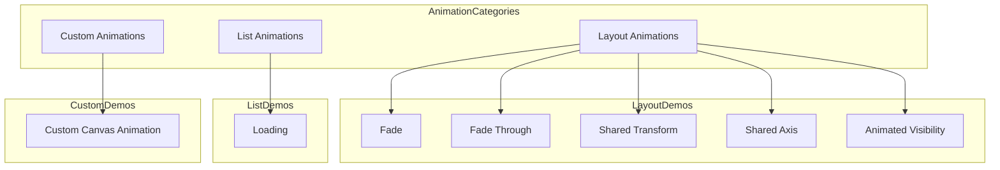
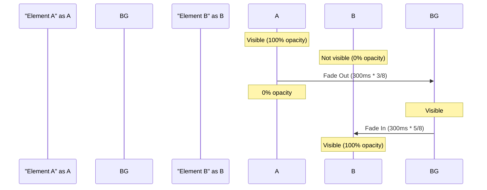
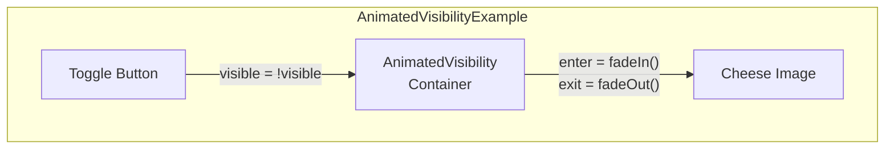
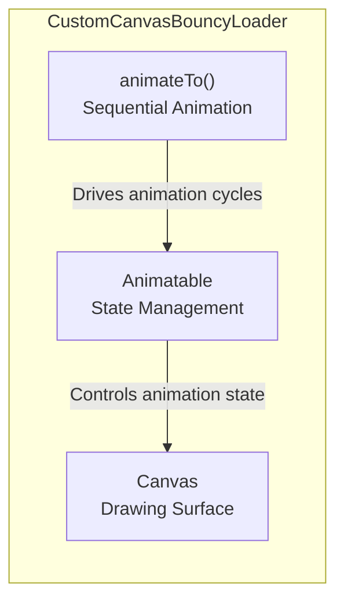
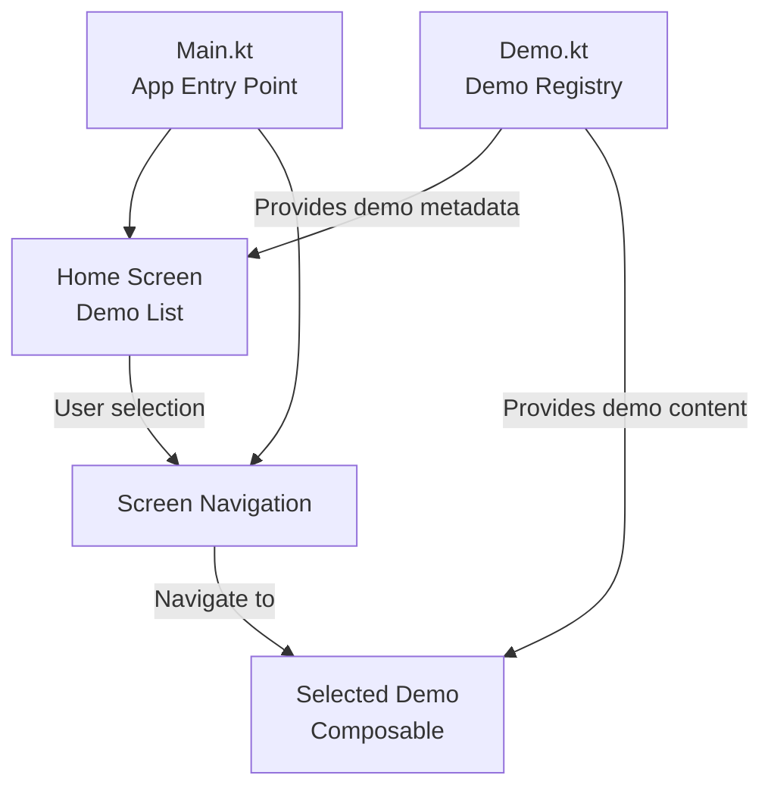
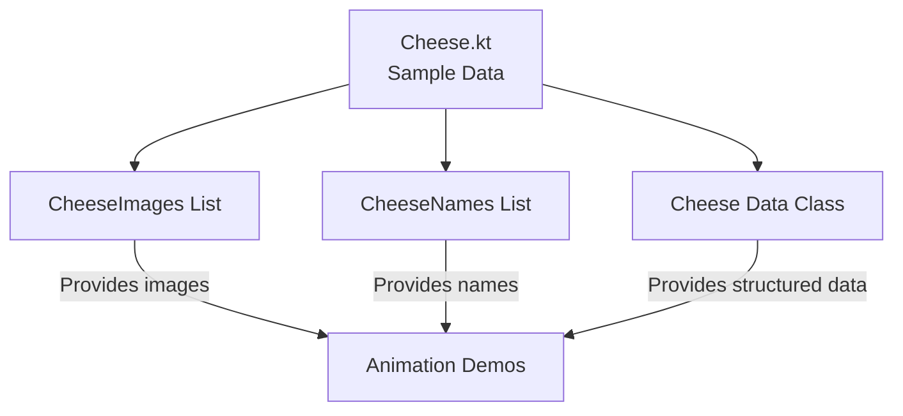

<!-- source: DeepWiki mcp.deepwiki.com · repo android/animation-samples · page 3.1 Compose Animation Demos · fetched 2026-10-23 -->

# Compose Animation Demos

<details>
<summary>Relevant source files</summary>

The following files were used as context for generating this wiki page:

- [MotionCompose/README.md](MotionCompose/README.md)
- [MotionCompose/app/src/main/java/com/example/android/compose/motion/demo/Cheese.kt](MotionCompose/app/src/main/java/com/example/android/compose/motion/demo/Cheese.kt)
- [MotionCompose/app/src/main/java/com/example/android/compose/motion/demo/Demo.kt](MotionCompose/app/src/main/java/com/example/android/compose/motion/demo/Demo.kt)
- [MotionCompose/app/src/main/java/com/example/android/compose/motion/demo/fadethrough/FadeThroughDemo.kt](MotionCompose/app/src/main/java/com/example/android/compose/motion/demo/fadethrough/FadeThroughDemo.kt)
- [MotionCompose/app/src/main/java/com/example/android/compose/motion/demo/loading/CheeseDataSource.kt](MotionCompose/app/src/main/java/com/example/android/compose/motion/demo/loading/CheeseDataSource.kt)
- [MotionCompose/app/src/main/java/com/example/android/compose/motion/demo/loading/LoadingViewModel.kt](MotionCompose/app/src/main/java/com/example/android/compose/motion/demo/loading/LoadingViewModel.kt)
- [MotionCompose/app/src/main/java/com/example/android/compose/motion/demo/visibility/AnimatedVisibilityExample.kt](MotionCompose/app/src/main/java/com/example/android/compose/motion/demo/visibility/AnimatedVisibilityExample.kt)

</details>


This document covers the animation techniques implemented in the Jetpack Compose-based MotionCompose app. It focuses on the demo registry system that organizes various animation examples showcasing Compose's animation capabilities. For information about traditional View-based animations, see [Motion App](#2) instead.

## Demo Registry Overview

The MotionCompose app uses a centralized registry system to organize all animation demos. This system is implemented through an enum class called `Demo` which serves as a catalog of all available animation demonstrations.

### Demo Registry Structure

```mermaid
classDiagram
    class "Demo" {
        +String title
        +String description
        +List~String~ apis
        +@Composable content()
    }
    
    "Demo" --> "FadeDemo" : content reference
    "Demo" --> "FadeThroughDemo" : content reference
    "Demo" --> "SharedTransformDemo" : content reference
    "Demo" --> "SharedAxisDemo" : content reference
    "Demo" --> "AnimatedVisibilityExample" : content reference
    "Demo" --> "LoadingDemo" : content reference
    "Demo" --> "CustomCanvasBouncyLoader" : content reference
    
    note for "Demo" "Enum class serving as\ncentral registry for all\nanimation demonstrations"
```

Sources: [MotionCompose/app/src/main/java/com/example/android/compose/motion/demo/Demo.kt:28-117]()

Each enum entry in the `Demo` class contains:
- `title`: Descriptive name of the animation demo
- `description`: Detailed explanation of the animation technique
- `apis`: List of Jetpack Compose animation APIs used in the implementation
- `content`: A Composable function that renders the actual demo

## Animation Categories

The animation demos are organized into three main categories, each showcasing different animation techniques and patterns:



Sources: [MotionCompose/app/src/main/java/com/example/android/compose/motion/demo/Demo.kt:34-116]()

## Layout Animation Demos

The Layout category contains animations related to transitions between different UI layouts and components.

### Fade Demo

The Fade demo showcases smooth transitions between elements that fully overlap each other. When a new element enters, it fades in over the current element.

**Key API used**: `AnimatedContent`

Sources: [MotionCompose/app/src/main/java/com/example/android/compose/motion/demo/Demo.kt:34-45]()

### Fade Through Demo

The Fade Through demo demonstrates a transition where one element fades out completely before a new one fades in. This technique is useful for transitions between elements that don't perfectly overlap.



**Key implementation details**:
- Uses `AnimatedContent` with custom `ContentTransform`
- Implements fade out for initial content using `tween` with `FastOutLinearInEasing`
- Implements fade in for target content using `tween` with `LinearOutSlowInEasing`
- Carefully times the animation phases (3/8 of duration for exit, 5/8 for enter)

Sources: [MotionCompose/app/src/main/java/com/example/android/compose/motion/demo/Demo.kt:47-59](), [MotionCompose/app/src/main/java/com/example/android/compose/motion/demo/fadethrough/FadeThroughDemo.kt:107-121](), [MotionCompose/app/src/main/java/com/example/android/compose/motion/demo/fadethrough/FadeThroughDemo.kt:129-162]()

### Shared Transform Demo

The Shared Transform demo shows how to create smooth transitions from one layout to the next by transforming elements as a single unit, rather than animating independently.

**Key APIs used**: `updateTransition`, `Transition.AnimatedContent`

Sources: [MotionCompose/app/src/main/java/com/example/android/compose/motion/demo/Demo.kt:61-73]()

### Shared Axis Demo

The Shared Axis demo implements transitions between UI elements that have a spatial or navigational relationship. This demo specifically uses a shared transformation on the Y-axis to reinforce the sequential order of elements.

**Key API used**: `AnimatedContent`

Sources: [MotionCompose/app/src/main/java/com/example/android/compose/motion/demo/Demo.kt:75-86]()

### Animated Visibility Demo

The Animated Visibility demo shows how to animate the appearance and disappearance of UI elements using Compose's `AnimatedVisibility` API.



**Implementation details**:
- Uses `AnimatedVisibility` composable with `fadeIn()` and `fadeOut()` animation specs
- Toggles visibility state using a button
- Demonstration uses a simple image that fades in and out

Sources: [MotionCompose/app/src/main/java/com/example/android/compose/motion/demo/Demo.kt:87-94](), [MotionCompose/app/src/main/java/com/example/android/compose/motion/demo/visibility/AnimatedVisibilityExample.kt:45-73]()

## List Animation Demo

### Loading Demo

The Loading demo shows how to implement loading placeholders for content that is being fetched, providing visual feedback to users during data loading.

**Key APIs used**: `Modifier.placeholder`, `AnimationSpec`

**Implementation details**:
- Uses `CheeseDataSource` to provide sample data with simulated network delay
- Implements placeholder animation while content is loading
- Demonstrates proper loading state management in Compose

Sources: [MotionCompose/app/src/main/java/com/example/android/compose/motion/demo/Demo.kt:95-105](), [MotionCompose/app/src/main/java/com/example/android/compose/motion/demo/loading/LoadingViewModel.kt:23-26](), [MotionCompose/app/src/main/java/com/example/android/compose/motion/demo/loading/CheeseDataSource.kt:24-61]()

## Custom Animation Demo

### Custom Canvas Animation

The Custom Canvas Animation demo showcases a loading animation implemented using Canvas drawing APIs combined with `Animatable` to create a bouncy loading effect.



**Key API used**: `Animatable`

Sources: [MotionCompose/app/src/main/java/com/example/android/compose/motion/demo/Demo.kt:106-116]()

## Animation APIs Usage Across Demos

The following table shows which Compose animation APIs are used in each demo:

| Demo | Key Animation APIs |
|------|-------------------|
| Fade | `AnimatedContent` |
| Fade Through | `AnimatedContent`, custom `ContentTransform` |
| Shared Transform | `updateTransition`, `Transition.AnimatedContent` |
| Shared Axis | `AnimatedContent` |
| Animated Visibility | `AnimatedVisibility`, `fadeIn()`, `fadeOut()` |
| Loading | `Modifier.placeholder`, `AnimationSpec` |
| Custom Canvas Animation | `Animatable`, `animateTo()` |

## Demo Integration Flow

The following diagram illustrates how demos are integrated into the app's navigation system:



Sources: [MotionCompose/app/src/main/java/com/example/android/compose/motion/demo/Demo.kt:28-117](), [MotionCompose/README.md:1-42]()

## Sample Data Integration

The demos use a common sample data source consisting of cheese names and images to provide consistent content across different animation demonstrations.



Sources: [MotionCompose/app/src/main/java/com/example/android/compose/motion/demo/Cheese.kt:22-182]()

The `Cheese` data class provides:
- Sample data consistency across demos
- Realistic content to demonstrate animations
- Helper methods to generate sample data lists

---

