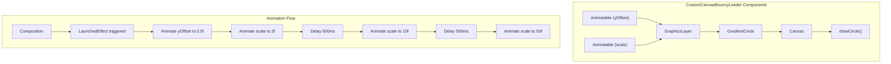
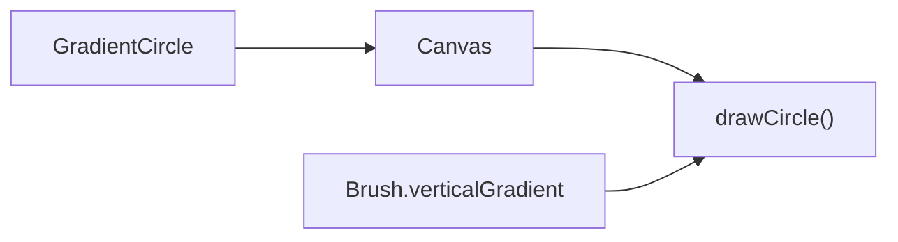
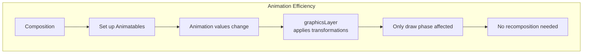
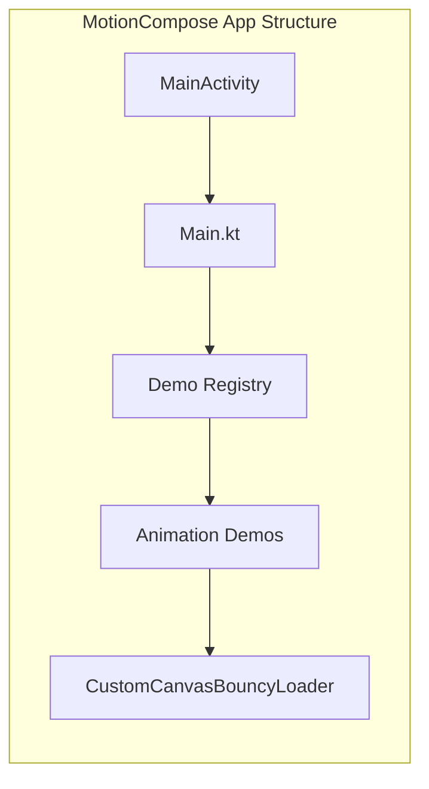

<!-- source: DeepWiki mcp.deepwiki.com · repo android/animation-samples · page 3.2 Custom Canvas Animations · fetched 2026-10-23 -->

# Custom Canvas Animations

<details>
<summary>Relevant source files</summary>

The following files were used as context for generating this wiki page:

- [MotionCompose/.gitignore](MotionCompose/.gitignore)
- [MotionCompose/app/.gitignore](MotionCompose/app/.gitignore)
- [MotionCompose/app/proguard-rules.pro](MotionCompose/app/proguard-rules.pro)
- [MotionCompose/app/src/androidTest/java/com/example/android/compose/motion/MainActivityTest.kt](MotionCompose/app/src/androidTest/java/com/example/android/compose/motion/MainActivityTest.kt)
- [MotionCompose/app/src/main/AndroidManifest.xml](MotionCompose/app/src/main/AndroidManifest.xml)
- [MotionCompose/app/src/main/ic_launcher-web.png](MotionCompose/app/src/main/ic_launcher-web.png)
- [MotionCompose/app/src/main/java/com/example/android/compose/motion/MainActivity.kt](MotionCompose/app/src/main/java/com/example/android/compose/motion/MainActivity.kt)
- [MotionCompose/app/src/main/java/com/example/android/compose/motion/demo/custom/CustomCanvasAnimation.kt](MotionCompose/app/src/main/java/com/example/android/compose/motion/demo/custom/CustomCanvasAnimation.kt)

</details>


This page details the implementation of custom animations using Canvas in Jetpack Compose within the MotionCompose app. The focus is on creating animations that utilize Canvas drawing operations combined with Compose's animation APIs to create fluid, physics-based motion effects that are not achievable with standard widget animations.

For information about other types of animations in Compose, see [Compose Animation Demos](#3.1). For information about shared element transitions, see [Shared Axis and Transform Animations](#3.3).

## Overview

The `MotionCompose` app demonstrates a custom bouncy animation implementation using Canvas in Jetpack Compose. This example showcases how to create rich, custom animations by combining low-level drawing operations with Compose's animation system.

### CustomCanvasBouncyLoader Animation

The `CustomCanvasBouncyLoader` composable creates a colorful circle that drops from the top of the screen and bounces with a spring effect, while simultaneously scaling up in multiple stages. This demonstrates physics-based animations in Compose.



Sources: [MotionCompose/app/src/main/java/com/example/android/compose/motion/demo/custom/CustomCanvasAnimation.kt:41-89]()

## Key Animation Concepts

### Animatable and Animation Specs

The animation uses two `Animatable` instances to track and animate the circle's position and size:

```mermaid
classDiagram
    class "CustomCanvasBouncyLoader" {
        -yOffset: Animatable~Float~
        -scale: Animatable~Float~
        +LaunchedEffect(key)
    }
    
    class "AnimationProperties" {
        +yOffset: Float
        +scale: Float
    }
    
    class "SpringSpec" {
        +dampingRatio: Float
        +stiffness: Float
    }
    
    "CustomCanvasBouncyLoader" --> "AnimationProperties" : animates
    "CustomCanvasBouncyLoader" --> "SpringSpec" : uses
    note for "SpringSpec" "DampingRatioMediumBouncy\nStiffnessLow"
```

Sources: [MotionCompose/app/src/main/java/com/example/android/compose/motion/demo/custom/CustomCanvasAnimation.kt:44-49](), [MotionCompose/app/src/main/java/com/example/android/compose/motion/demo/custom/CustomCanvasAnimation.kt:101-104]()

### Spring Physics

The animation uses spring physics with the following parameters:
- `dampingRatio = Spring.DampingRatioMediumBouncy`: Controls how quickly the spring's oscillations decrease in amplitude
- `stiffness = Spring.StiffnessLow`: Controls the spring's resistance to displacement

These parameters create a visibly bouncy effect that simulates natural motion.

Sources: [MotionCompose/app/src/main/java/com/example/android/compose/motion/demo/custom/CustomCanvasAnimation.kt:101-104]()

### Canvas Drawing

The `GradientCircle` composable uses the Canvas API to draw a circle with a vertical gradient:



Sources: [MotionCompose/app/src/main/java/com/example/android/compose/motion/demo/custom/CustomCanvasAnimation.kt:91-99]()

## Implementation Details

### Animation Sequence

The animation sequence in `CustomCanvasBouncyLoader` uses a `LaunchedEffect` to sequentially animate multiple properties:

1. First, it animates the Y position to move the circle downward
2. Then, it animates the scale to make the circle grow larger
3. After a delay, it continues scaling the circle in stages

This creates a complex animation that combines motion and scaling in a time-sequenced manner.

Sources: [MotionCompose/app/src/main/java/com/example/android/compose/motion/demo/custom/CustomCanvasAnimation.kt:50-61]()

### Efficient Animation with GraphicsLayer

The animation uses `graphicsLayer` to modify the translation and scale properties of the composed content. This is more efficient than recomposing the entire hierarchy on each animation frame because:

1. Graphics layer modifications are applied during the draw phase, avoiding recomposition
2. Multiple properties (scaling and translation) can be animated simultaneously
3. The transformations are handled by the GPU, providing better performance



Sources: [MotionCompose/app/src/main/java/com/example/android/compose/motion/demo/custom/CustomCanvasAnimation.kt:77-86]()

### Size Management

The composable tracks its container size changes using `onSizeChanged` to ensure the animation can scale relative to the available space:

| Component | Purpose |
|-----------|---------|
| `mutableStateOf(IntSize.Zero)` | Stores the current size of the container |
| `onSizeChanged` | Updates the size state when the container resizes |
| `translationY = yOffset.value * size.value.height` | Translates the circle based on the container height |

Sources: [MotionCompose/app/src/main/java/com/example/android/compose/motion/demo/custom/CustomCanvasAnimation.kt:62-72]()

## Customization Options

The `CustomCanvasBouncyLoader` animation can be customized by modifying:

1. The animation timing by adjusting the `delay` parameters
2. The animation physics by changing the spring parameters
3. The visual appearance by modifying the gradient colors in `GradientCircle`
4. The animation sequence by adding or modifying the `animateTo` calls

### Spring Animation Parameters

To customize the bounce effect, you can adjust the spring animation parameters:

| Parameter | Effect | Predefined Constants |
|-----------|--------|---------------------|
| `dampingRatio` | Controls oscillation decay | `DampingRatioHighBouncy`, `DampingRatioMediumBouncy`, `DampingRatioLowBouncy`, `DampingRatioNoBouncy` |
| `stiffness` | Controls spring resistance | `StiffnessVeryLow`, `StiffnessLow`, `StiffnessMedium`, `StiffnessHigh` |

Sources: [MotionCompose/app/src/main/java/com/example/android/compose/motion/demo/custom/CustomCanvasAnimation.kt:101-104]()

## Integration with Demo System

The `CustomCanvasBouncyLoader` is integrated into the MotionCompose app's demo system, allowing it to be showcased alongside other animation techniques.



Sources: [MotionCompose/app/src/main/java/com/example/android/compose/motion/MainActivity.kt:24-32]()

## Key Takeaways

1. Canvas in Compose provides a powerful way to create custom drawing-based animations
2. `Animatable` combined with `LaunchedEffect` enables precise control over animation timing and sequencing
3. Spring physics-based animations create natural, realistic motion effects
4. `graphicsLayer` provides efficient animation without triggering recomposition
5. Custom canvas animations can be integrated with other Compose components to create rich user experiences

---

