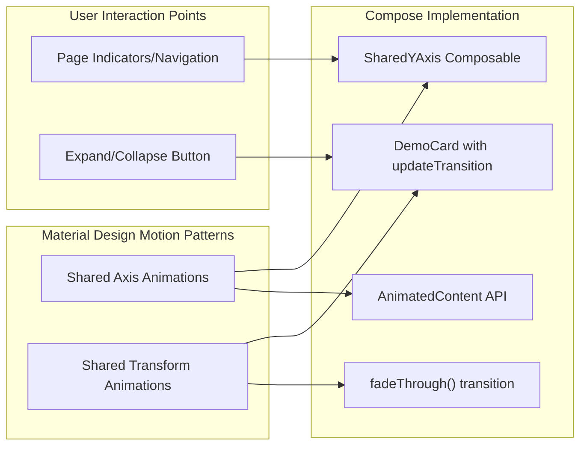
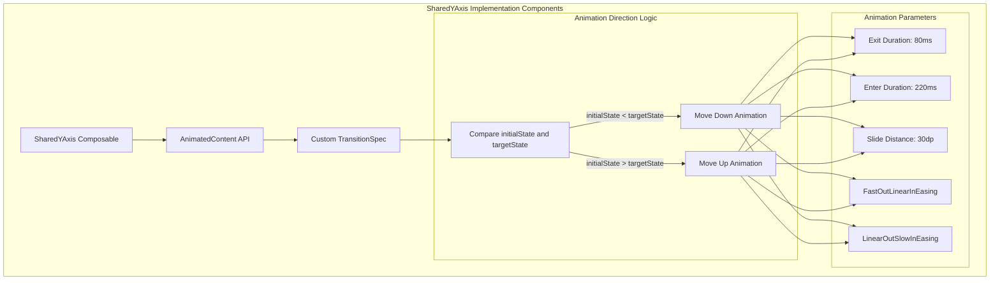
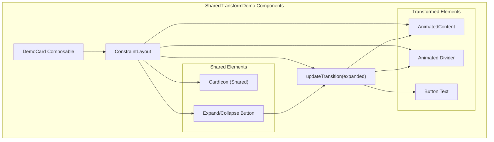
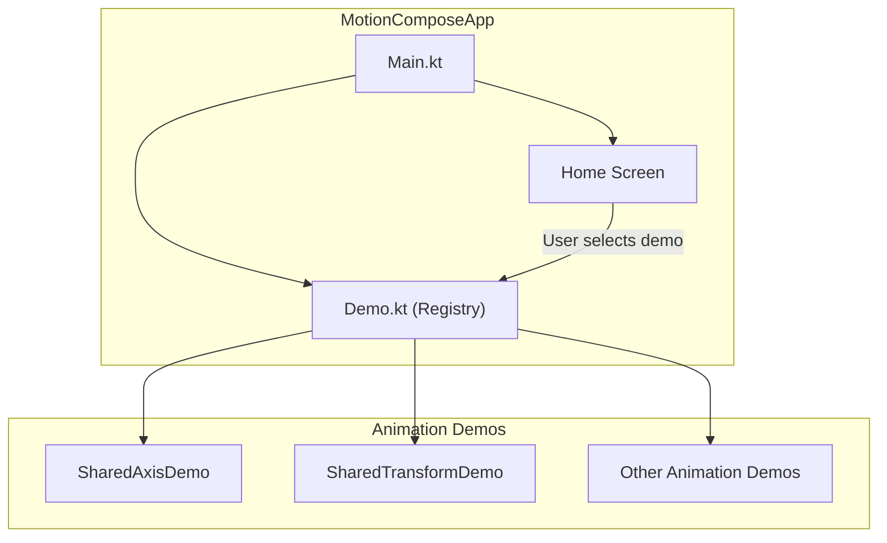

<!-- source: DeepWiki mcp.deepwiki.com · repo android/animation-samples · page 3.3 Shared Axis and Transform Animations · fetched 2026-10-23 -->

# Shared Axis and Transform Animations

Relevant source files

The following files were used as context for generating this wiki page:

- [MotionCompose/app/src/main/java/com/example/android/compose/motion/demo/SimpleScaffold.kt](MotionCompose/app/src/main/java/com/example/android/compose/motion/demo/SimpleScaffold.kt)
- [MotionCompose/app/src/main/java/com/example/android/compose/motion/demo/loading/LoadingDemo.kt](MotionCompose/app/src/main/java/com/example/android/compose/motion/demo/loading/LoadingDemo.kt)
- [MotionCompose/app/src/main/java/com/example/android/compose/motion/demo/sharedaxis/SharedAxisDemo.kt](MotionCompose/app/src/main/java/com/example/android/compose/motion/demo/sharedaxis/SharedAxisDemo.kt)
- [MotionCompose/app/src/main/java/com/example/android/compose/motion/demo/sharedtransform/SharedTransformDemo.kt](MotionCompose/app/src/main/java/com/example/android/compose/motion/demo/sharedtransform/SharedTransformDemo.kt)
- [MotionCompose/app/src/main/java/com/example/android/compose/motion/ui/Main.kt](MotionCompose/app/src/main/java/com/example/android/compose/motion/ui/Main.kt)
- [MotionCompose/app/src/main/java/com/example/android/compose/motion/ui/Theme.kt](MotionCompose/app/src/main/java/com/example/android/compose/motion/ui/Theme.kt)

## Purpose and Scope

This document explains the implementation of shared axis and shared transform animations in the MotionCompose app. These animations are part of Material Design's motion system and are implemented using Jetpack Compose's animation APIs. This page focuses specifically on how these animation patterns are structured and implemented in code.

For information about custom canvas animations in Compose, see [Custom Canvas Animations](#3.2).

Sources: [MotionCompose/app/src/main/java/com/example/android/compose/motion/demo/sharedaxis/SharedAxisDemo.kt:76-95](), [MotionCompose/app/src/main/java/com/example/android/compose/motion/demo/sharedtransform/SharedTransformDemo.kt:64-75]()

## Animation Patterns Overview

### Motion Animation Patterns

Sources: [MotionCompose/app/src/main/java/com/example/android/compose/motion/demo/sharedaxis/SharedAxisDemo.kt:103-160](), [MotionCompose/app/src/main/java/com/example/android/compose/motion/demo/sharedtransform/SharedTransformDemo.kt:77-162]()

## Shared Axis Animation

Shared axis animations are used for navigating between UI elements that have a spatial or sequential relationship. The animation conveys hierarchy and relationship between screens by moving along a shared axis (X, Y, or Z).

### Implementation Details

The MotionCompose app implements the Y-axis shared axis pattern through the `SharedYAxis` composable function:

Sources: [MotionCompose/app/src/main/java/com/example/android/compose/motion/demo/sharedaxis/SharedAxisDemo.kt:103-160]()

The `SharedYAxis` composable function (lines 103-160) implements a vertical shared axis animation with the following characteristics:

1. **Animation Timing**:
   - Exit animation: 80ms using `FastOutLinearInEasing`
   - Enter animation: 220ms using `LinearOutSlowInEasing`
   - Enter animation begins after exit animation completes

2. **Animation Logic**:
   - Compares the previous state with the target state to determine direction
   - Different animations are applied based on whether content is moving up or down

3. **Animation Effects**:
   - Outgoing elements fade out and slide in one direction
   - Incoming elements fade in and slide from the opposite direction

4. **Implementation**: Uses `AnimatedContent` with custom `ContentTransform` that combines fade and slide animations

The demo displays different "pages" of content with a navigation indicator column on the left side. When a user selects a different page indicator, the shared axis animation smoothly transitions between pages.

Sources: [MotionCompose/app/src/main/java/com/example/android/compose/motion/demo/sharedaxis/SharedAxisDemo.kt:76-95](), [MotionCompose/app/src/main/java/com/example/android/compose/motion/demo/sharedaxis/SharedAxisDemo.kt:103-160]()

## Shared Transform Animation

Shared transform animations are used when transitioning between UI elements that share common elements. These animations help maintain context and continuity as the UI transforms between states.

### Implementation Details

Sources: [MotionCompose/app/src/main/java/com/example/android/compose/motion/demo/sharedtransform/SharedTransformDemo.kt:77-162]()

The `SharedTransformDemo` implements a transform animation with:

1. **State Management**:
   - Uses `expanded` boolean state to toggle between expanded and collapsed states
   - Uses `updateTransition` to coordinate animations between states

2. **Layout Structure**:
   - Uses `ConstraintLayout` to position elements
   - Elements are constrained differently in expanded vs. collapsed states

3. **Animation Components**:
   - **Shared Elements**: Some elements like the icon remain the same across states
   - **Transformed Elements**: Content changes between states with animation
   - **Animated Properties**: The divider color animates between transparent and visible

4. **Transitions**:
   - Uses the `fadeThrough()` transition effect for content changes
   - Coordinates multiple animations through the single transition state

Sources: [MotionCompose/app/src/main/java/com/example/android/compose/motion/demo/sharedtransform/SharedTransformDemo.kt:77-162]()

## Animation Implementation Techniques

Both animation patterns use Jetpack Compose's animation APIs, but with different approaches:

### Key Animation APIs and Techniques

| Animation Pattern | Primary APIs | Animation Technique | Key Parameters |
|-------------------|-------------|---------------------|----------------|
| Shared Axis | `AnimatedContent` with custom `ContentTransform` | Combination of fade and slide | Timing, easing functions, slide distance |
| Shared Transform | `updateTransition` with `AnimatedContent` | Multiple coordinated animations | Expanded/collapsed state |

Sources: [MotionCompose/app/src/main/java/com/example/android/compose/motion/demo/sharedaxis/SharedAxisDemo.kt:103-160](), [MotionCompose/app/src/main/java/com/example/android/compose/motion/demo/sharedtransform/SharedTransformDemo.kt:98-110]()

### Animation Timing

A critical aspect of these animations is timing. For shared axis animations:

- Exit animation runs first (80ms)
- Enter animation runs after (220ms)
- Different easing functions provide natural motion

For shared transform animations:
- Animations are coordinated through a single transition object
- The `fadeThrough()` transition handles fade animations

Sources: [MotionCompose/app/src/main/java/com/example/android/compose/motion/demo/sharedaxis/SharedAxisDemo.kt:110-127]()

## Integration with MotionCompose App

These animations are integrated into the MotionCompose app as demo screens:

Sources: [MotionCompose/app/src/main/java/com/example/android/compose/motion/ui/Main.kt:29-48]()

The animation demos are accessible through:

1. The main app navigation system defined in `Main.kt`
2. The demo registry in `Demo.kt` which contains entries for `SharedAxis` and `SharedTransform`
3. Each demo uses the `SimpleScaffold` composable for consistent UI structure

The app's navigation logic switches between demos using Crossfade animation, with each demo being self-contained within its respective file.

Sources: [MotionCompose/app/src/main/java/com/example/android/compose/motion/demo/SimpleScaffold.kt:32-58](), [MotionCompose/app/src/main/java/com/example/android/compose/motion/ui/Main.kt:29-48]()

## Implementation Considerations

When implementing these animations, developers should consider:

1. **Performance**: Animations should run at 60fps without jank
2. **Timing**: Duration and sequencing of animations are critical for natural feel
3. **Direction Logic**: For shared axis, determining the correct movement direction is important
4. **State Management**: For shared transform, properly tracking state transitions is essential
5. **Element Sharing**: Identifying which elements to share between states in transform animations

Both animation patterns follow Material Design motion guidelines while utilizing Compose's declarative animation APIs to create smooth, predictable motion that enhances the user experience.

Sources: [MotionCompose/app/src/main/java/com/example/android/compose/motion/demo/sharedaxis/SharedAxisDemo.kt:97-102](), [MotionCompose/app/src/main/java/com/example/android/compose/motion/demo/sharedtransform/SharedTransformDemo.kt:87-100]()

---

