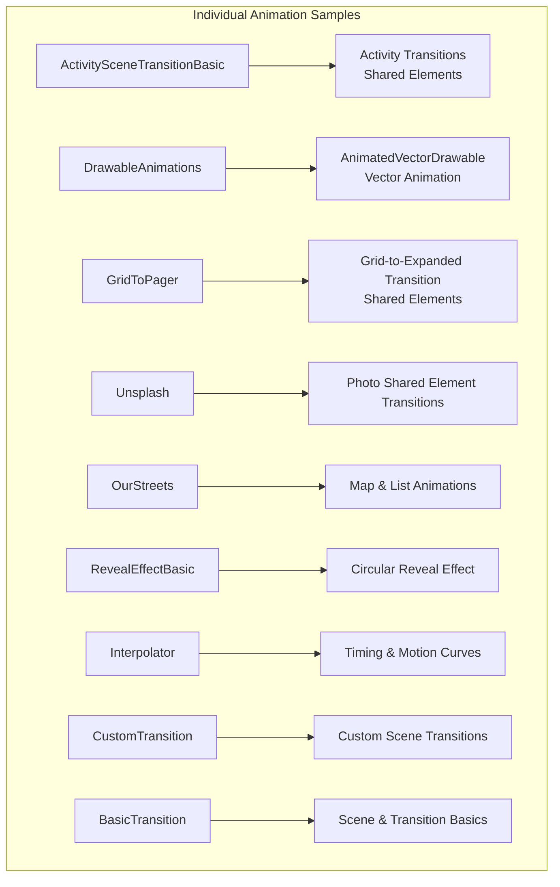
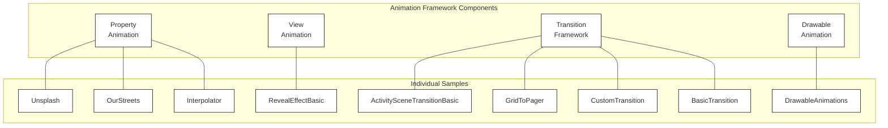
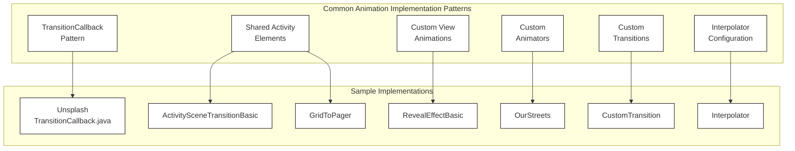

<!-- source: DeepWiki mcp.deepwiki.com · repo android/animation-samples · page 4 Individual Animation Samples · fetched 2026-10-23 -->

# Individual Animation Samples

Relevant source files

The following files were used as context for generating this wiki page:

- [ActivitySceneTransitionBasic/.google/packaging.yaml](ActivitySceneTransitionBasic/.google/packaging.yaml)
- [ActivitySceneTransitionBasic/build.gradle](ActivitySceneTransitionBasic/build.gradle)
- [BasicTransition/.google/packaging.yaml](BasicTransition/.google/packaging.yaml)
- [BasicTransition/build.gradle](BasicTransition/build.gradle)
- [CustomTransition/.google/packaging.yaml](CustomTransition/.google/packaging.yaml)
- [CustomTransition/build.gradle](CustomTransition/build.gradle)
- [DrawableAnimations/build.gradle](DrawableAnimations/build.gradle)
- [GridToPager/.google/packaging.yaml](GridToPager/.google/packaging.yaml)
- [GridToPager/build.gradle](GridToPager/build.gradle)
- [Interpolator/.google/packaging.yaml](Interpolator/.google/packaging.yaml)
- [Interpolator/build.gradle](Interpolator/build.gradle)
- [OurStreets/.google/packaging.yaml](OurStreets/.google/packaging.yaml)
- [OurStreets/build.gradle](OurStreets/build.gradle)
- [RevealEffectBasic/.google/packaging.yaml](RevealEffectBasic/.google/packaging.yaml)
- [RevealEffectBasic/build.gradle](RevealEffectBasic/build.gradle)
- [Unsplash/.google/packaging.yaml](Unsplash/.google/packaging.yaml)
- [Unsplash/app/src/main/java/com/example/android/unsplash/ui/TransitionCallback.java](Unsplash/app/src/main/java/com/example/android/unsplash/ui/TransitionCallback.java)

## Purpose and Scope

This page provides an overview of the standalone animation samples in the Android Animation Samples repository. These individual samples demonstrate specific animation techniques and implementations that are not part of the larger cohesive applications like [Motion App](#2) or [MotionCompose App](#3). Each sample focuses on a particular animation concept, making them ideal reference implementations for developers looking to understand specific animation patterns.

## Overview of Animation Samples

The Android Animation Samples repository includes several standalone sample applications that demonstrate various animation techniques:

Sources:
- [ActivitySceneTransitionBasic/.google/packaging.yaml]()
- [DrawableAnimations/build.gradle]()
- [GridToPager/.google/packaging.yaml]()
- [Unsplash/.google/packaging.yaml]()
- [OurStreets/.google/packaging.yaml]()
- [RevealEffectBasic/.google/packaging.yaml]()
- [Interpolator/.google/packaging.yaml]()
- [CustomTransition/.google/packaging.yaml]()
- [BasicTransition/.google/packaging.yaml]()

## Animation Techniques Demonstrated

The following table summarizes the key animation techniques and APIs demonstrated across the individual samples:

| Sample | Animation Techniques | Primary APIs Used |
|--------|---------------------|-------------------|
| ActivitySceneTransitionBasic | Shared element transitions between activities | `Transition`, `ActivityOptions` |
| DrawableAnimations | Vector drawable animations | `AnimatedVectorDrawableCompat` |
| GridToPager | Grid to pager transitions with shared elements | `RecyclerView`, `ViewPager`, shared element transitions |
| Unsplash | Photo gallery with shared element transitions | `Animator`, `AnimatorListenerAdapter`, `ObjectAnimator` |
| OurStreets | Map animations and transitions | `AnimatorSet`, `ObjectAnimator`, Google Maps APIs |
| RevealEffectBasic | Circular reveal animations | `ViewAnimationUtils`, `Animator` |
| Interpolator | Custom timing functions | `ObjectAnimator`, `Interpolator` |
| CustomTransition | Building custom transition types | `TransitionManager`, `Transition`, `Scene` |
| BasicTransition | Fundamental scene transitions | `TransitionManager`, `Transition`, `Scene` |

Sources:
- [ActivitySceneTransitionBasic/.google/packaging.yaml]()
- [RevealEffectBasic/.google/packaging.yaml]()
- [OurStreets/.google/packaging.yaml]()
- [Interpolator/.google/packaging.yaml]()
- [CustomTransition/.google/packaging.yaml]()
- [BasicTransition/.google/packaging.yaml]()
- [Unsplash/.google/packaging.yaml]()

## Relationship to Animation Framework Components

The following diagram illustrates how the individual samples relate to the core Android animation framework components:

Sources:
- [ActivitySceneTransitionBasic/.google/packaging.yaml]()
- [DrawableAnimations/build.gradle]()
- [Unsplash/.google/packaging.yaml]()
- [Unsplash/app/src/main/java/com/example/android/unsplash/ui/TransitionCallback.java]()
- [RevealEffectBasic/.google/packaging.yaml]()
- [Interpolator/.google/packaging.yaml]()
- [CustomTransition/.google/packaging.yaml]()
- [BasicTransition/.google/packaging.yaml]()

## Implementation Patterns

The individual samples demonstrate several common implementation patterns for animations in Android:

Sources:
- [Unsplash/app/src/main/java/com/example/android/unsplash/ui/TransitionCallback.java]()
- [ActivitySceneTransitionBasic/.google/packaging.yaml]()
- [GridToPager/.google/packaging.yaml]()
- [RevealEffectBasic/.google/packaging.yaml]()
- [OurStreets/.google/packaging.yaml]()
- [CustomTransition/.google/packaging.yaml]()
- [Interpolator/.google/packaging.yaml]()

## Key Sample Highlights

### ActivitySceneTransitionBasic

Demonstrates the basics of activity transitions with shared elements introduced in Android 5.0 (Lollipop). This sample shows how to use `ActivityOptions` to define transitions between activities with shared visual elements.

**Key APIs:** `android.transition.Transition`, `android.app.ActivityOptions`

### DrawableAnimations

Showcases the use of `AnimatedVectorDrawableCompat` to create fluid, animated vector drawables that can be used in a variety of UI elements.

### GridToPager

Demonstrates a smooth transition from a RecyclerView grid to a ViewPager, using shared element transitions to create a seamless user experience.

**Key APIs:** `androidx.recyclerview.widget.RecyclerView`

### Unsplash

A photo viewing application that implements rich transitions between UI states. It includes examples of custom transition callbacks for fine-grained control over transition events.

**Key Classes:**
- `TransitionCallback` - An abstract class that implements the `Transition.TransitionListener` interface, providing empty implementations of all methods to allow subclasses to only override the methods they need.

Sources:
- [Unsplash/app/src/main/java/com/example/android/unsplash/ui/TransitionCallback.java]()

### OurStreets

A map-based application that demonstrates complex animations combining multiple techniques. It shows how to animate map markers, transitions between map and street views, and list animations.

**Key APIs:** 
- Android Animation: `AnimatorSet`, `ObjectAnimator`, `ArgbEvaluator`
- Google Maps: `GoogleMap`, `StreetViewPanorama`, `ClusterManager`

### RevealEffectBasic

Shows how to use the circular reveal effect to create engaging UI transitions. This sample demonstrates the use of `ViewAnimationUtils` to create animations that reveal or hide views with a circular animation.

**Key APIs:** `android.view.ViewAnimationUtils`, `android.animation.Animator`

### Interpolator

Demonstrates various interpolation techniques for controlling the rate of change of an animation over time. This sample shows how different interpolators can dramatically change the feel of an animation.

**Key APIs:** `android.animation.ObjectAnimator`, `android.view.animation.Interpolator`

### CustomTransition

An advanced sample that shows how to create custom transitions by extending the Transition framework. This sample demonstrates how to implement transitions that aren't available in the standard library.

**Key APIs:** `android.transition.TransitionManager`, `android.transition.Transition`, `android.transition.Scene`

### BasicTransition

Demonstrates the fundamentals of using scenes and transitions to create dynamic UI changes. This sample provides a foundation for understanding the Transition framework.

**Key APIs:** `android.transition.TransitionManager`, `android.transition.Transition`, `android.transition.Scene`

Sources:
- [ActivitySceneTransitionBasic/.google/packaging.yaml]()
- [DrawableAnimations/build.gradle]()
- [GridToPager/.google/packaging.yaml]()
- [Unsplash/.google/packaging.yaml]()
- [OurStreets/.google/packaging.yaml]()
- [RevealEffectBasic/.google/packaging.yaml]()
- [Interpolator/.google/packaging.yaml]()
- [CustomTransition/.google/packaging.yaml]()
- [BasicTransition/.google/packaging.yaml]()

## Development Complexity

The samples range in complexity, making them suitable for different experience levels:

| Sample | Complexity Level | Key Learning Points |
|--------|------------------|---------------------|
| BasicTransition | Intermediate | Scene transitions basics |
| ActivitySceneTransitionBasic | Intermediate | Activity transitions, shared elements |
| DrawableAnimations | Intermediate | Vector animations |
| GridToPager | Intermediate | Complex shared element transitions |
| RevealEffectBasic | Intermediate | Circular reveal animations |
| Interpolator | Intermediate | Custom timing functions |
| Unsplash | Intermediate | Photo gallery transitions |
| OurStreets | Intermediate | Map and complex UI animations |
| CustomTransition | Advanced | Creating custom transition types |

Sources:
- [ActivitySceneTransitionBasic/.google/packaging.yaml]()
- [RevealEffectBasic/.google/packaging.yaml]()
- [OurStreets/.google/packaging.yaml]()
- [Interpolator/.google/packaging.yaml]()
- [CustomTransition/.google/packaging.yaml]()
- [BasicTransition/.google/packaging.yaml]()

## Further Reading

For more detailed information about specific animation techniques demonstrated in these samples, see:

- [Drawable Animations](#4.1) - For in-depth coverage of the AnimatedVectorDrawable implementation
- [Unsplash Photo Transitions](#4.2) - For details on shared element transitions in photo galleries
- [Custom Transition Implementation](#4.3) - For advanced custom transition techniques
- [OurStreets Map Animations](#4.4) - For map-specific animation implementations

For broader animation patterns that apply across multiple Android applications, see:
- [Motion App](#2) - For Material Design motion patterns implemented with Views
- [MotionCompose App](#3) - For animation techniques implemented with Jetpack Compose

---

