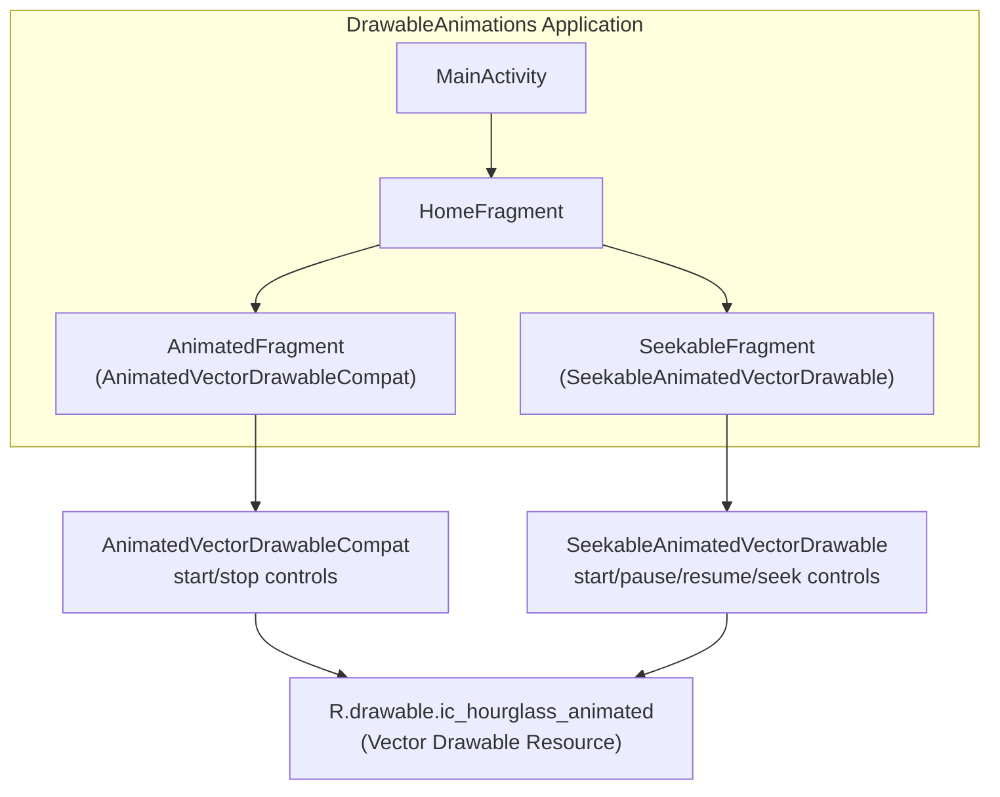
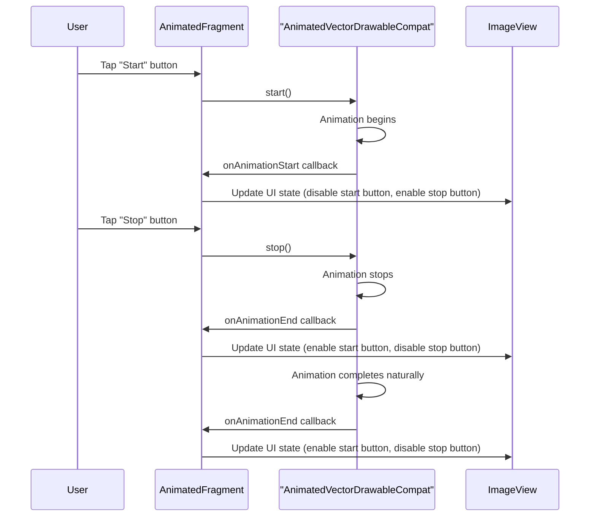
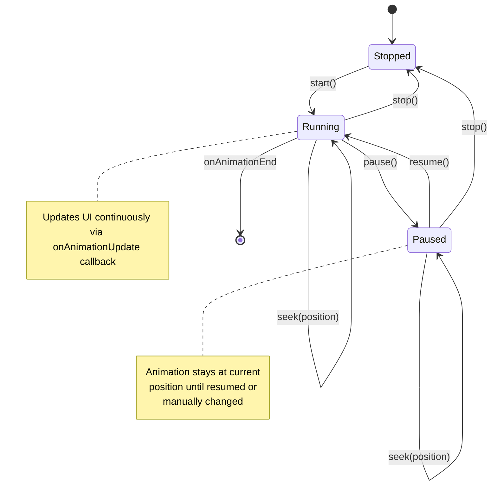
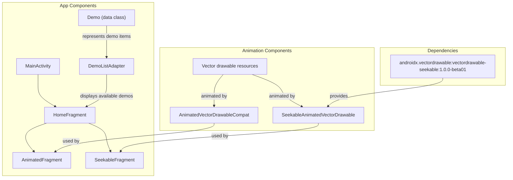

<!-- source: DeepWiki mcp.deepwiki.com · repo android/animation-samples · page 4.1 Drawable Animations · fetched 2026-10-23 -->

# Drawable Animations

<details>
<summary>Relevant source files</summary>

The following files were used as context for generating this wiki page:

- [DrawableAnimations/app/build.gradle](DrawableAnimations/app/build.gradle)
- [DrawableAnimations/app/src/main/AndroidManifest.xml](DrawableAnimations/app/src/main/AndroidManifest.xml)
- [DrawableAnimations/app/src/main/java/com/example/android/drawableanimations/ViewBindingDelegates.kt](DrawableAnimations/app/src/main/java/com/example/android/drawableanimations/ViewBindingDelegates.kt)
- [DrawableAnimations/app/src/main/java/com/example/android/drawableanimations/demo/animated/AnimatedFragment.kt](DrawableAnimations/app/src/main/java/com/example/android/drawableanimations/demo/animated/AnimatedFragment.kt)
- [DrawableAnimations/app/src/main/java/com/example/android/drawableanimations/demo/seekable/SeekableFragment.kt](DrawableAnimations/app/src/main/java/com/example/android/drawableanimations/demo/seekable/SeekableFragment.kt)
- [DrawableAnimations/app/src/main/java/com/example/android/drawableanimations/ui/home/DemoListAdapter.kt](DrawableAnimations/app/src/main/java/com/example/android/drawableanimations/ui/home/DemoListAdapter.kt)
- [DrawableAnimations/app/src/main/java/com/example/android/drawableanimations/ui/home/HomeFragment.kt](DrawableAnimations/app/src/main/java/com/example/android/drawableanimations/ui/home/HomeFragment.kt)
- [DrawableAnimations/gradle/wrapper/gradle-wrapper.properties](DrawableAnimations/gradle/wrapper/gradle-wrapper.properties)

</details>


## Purpose and Scope

This document explains the implementation of animated drawable transitions in Android, specifically focusing on the DrawableAnimations sample application. The sample demonstrates two key approaches to vector drawable animations:

1. Using the backward-compatible `AnimatedVectorDrawableCompat`
2. Using the enhanced `SeekableAnimatedVectorDrawable` that provides additional control functionality

This page covers how these animation systems work, their implementation in code, and the different capabilities they offer for controlling animations.

Sources: [DrawableAnimations/app/src/main/AndroidManifest.xml:1-40]()

## System Overview

The DrawableAnimations sample application showcases vector drawable animation capabilities through a simple demo application with a home screen that lists available demos and individual fragments that demonstrate each animation type.



Sources: [DrawableAnimations/app/src/main/java/com/example/android/drawableanimations/ui/home/HomeFragment.kt:1-56](), [DrawableAnimations/app/src/main/java/com/example/android/drawableanimations/demo/animated/AnimatedFragment.kt:1-61](), [DrawableAnimations/app/src/main/java/com/example/android/drawableanimations/demo/seekable/SeekableFragment.kt:1-101]()

## AnimatedVectorDrawableCompat Implementation

The `AnimatedVectorDrawableCompat` demo shows how to implement basic vector animations with start and stop functionality using backward-compatible APIs.



### Key implementation details:

1. Creating the animated drawable:
   ```kotlin
   val icon = AnimatedVectorDrawableCompat.create(
       requireContext(),
       R.drawable.ic_hourglass_animated
   )!!
   ```

2. Setting up animation callbacks to handle state changes:
   ```kotlin
   icon.registerAnimationCallback(object : Animatable2Compat.AnimationCallback() {
       override fun onAnimationStart(drawable: Drawable?) {
           binding.start.isEnabled = false
           binding.stop.isEnabled = true
       }

       override fun onAnimationEnd(drawable: Drawable?) {
           binding.start.isEnabled = true
           binding.stop.isEnabled = false
       }
   })
   ```

3. Controlling the animation with start/stop:
   ```kotlin
   binding.start.setOnClickListener { icon.start() }
   binding.stop.setOnClickListener { icon.stop() }
   ```

4. Cleaning up resources when the view is destroyed:
   ```kotlin
   override fun onDestroyView() {
       super.onDestroyView()
       (binding.icon.drawable as? AnimatedVectorDrawableCompat)?.clearAnimationCallbacks()
   }
   ```

Sources: [DrawableAnimations/app/src/main/java/com/example/android/drawableanimations/demo/animated/AnimatedFragment.kt:29-60]()

## SeekableAnimatedVectorDrawable Implementation

The `SeekableAnimatedVectorDrawable` implementation extends the standard functionality with more advanced control options, including pause, resume, and precise seeking to specific points in the animation timeline.



### Key implementation details:

1. Creating the seekable animated drawable:
   ```kotlin
   val icon = SeekableAnimatedVectorDrawable.create(
       requireContext(),
       R.drawable.ic_hourglass_animated
   )!!
   ```

2. Enhanced animation callbacks:
   ```kotlin
   icon.registerAnimationCallback(object : SeekableAnimatedVectorDrawable.AnimationCallback() {
       override fun onAnimationStart(drawable: SeekableAnimatedVectorDrawable) {
           binding.start.setText(R.string.pause)
           binding.stop.isEnabled = true
       }

       override fun onAnimationPause(drawable: SeekableAnimatedVectorDrawable) {
           binding.start.setText(R.string.resume)
       }

       override fun onAnimationResume(drawable: SeekableAnimatedVectorDrawable) {
           binding.start.setText(R.string.pause)
       }

       override fun onAnimationEnd(drawable: SeekableAnimatedVectorDrawable) {
           binding.start.setText(R.string.start)
           binding.stop.isEnabled = false
       }

       override fun onAnimationUpdate(drawable: SeekableAnimatedVectorDrawable) {
           binding.seek.progress = (binding.seek.max * (drawable.currentPlayTime.toFloat() /
                   drawable.totalDuration.toFloat())).toInt()
       }
   })
   ```

3. Advanced animation control logic:
   ```kotlin
   binding.start.setOnClickListener {
       when {
           // You can pause and resume SeekableAnimatedVectorDrawable.
           icon.isPaused -> icon.resume()
           icon.isRunning -> icon.pause()
           else -> icon.start()
       }
   }
   ```

4. Seeking to specific animation positions:
   ```kotlin
   binding.seek.setOnSeekBarChangeListener(object : SeekBar.OnSeekBarChangeListener {
       override fun onProgressChanged(seekBar: SeekBar, progress: Int, fromUser: Boolean) {
           if (fromUser) {
               // With SeekableAnimatedVectorDrawable#setCurrentPlayTime, you can set the
               // position of animation to the specific time in its duration.
               icon.currentPlayTime = (icon.totalDuration *
                       (progress.toFloat() / seekBar.max.toFloat())).toLong()
           }
       }
       // [other methods omitted for brevity]
   })
   ```

Sources: [DrawableAnimations/app/src/main/java/com/example/android/drawableanimations/demo/seekable/SeekableFragment.kt:29-100]()

## Architecture and Component Dependencies

The DrawableAnimations sample uses a straightforward architecture with the following components:



The application requires Android 4.0 (API level 14) or higher, as specified in the build.gradle file. The sample also uses the ViewBinding feature for more type-safe view access:

```kotlin
// Excerpt from ViewBindingDelegates.kt
inline fun <reified BindingT : ViewBinding> Fragment.viewBindings(
    crossinline bind: (View) -> BindingT
) = object : Lazy<BindingT> {
    // Implementation details
}
```

Sources: [DrawableAnimations/app/build.gradle:17-72](), [DrawableAnimations/app/src/main/java/com/example/android/drawableanimations/ViewBindingDelegates.kt:17-56]()

## Key Features and Capabilities

The following table highlights the key differences between the two animation implementations demonstrated in this sample:

| Feature | AnimatedVectorDrawableCompat | SeekableAnimatedVectorDrawable |
|---------|------------------------------|--------------------------------|
| Start/Stop | ✓ | ✓ |
| Pause/Resume | ✗ | ✓ |
| Seek to position | ✗ | ✓ |
| Animation callbacks | Basic (start/end) | Enhanced (start/end/pause/resume/update) |
| API compatibility | Backward compatible to API 14 | Requires androidx.vectordrawable:vectordrawable-seekable |
| Progress tracking | ✗ | ✓ (via `currentPlayTime` and `totalDuration`) |

Sources: [DrawableAnimations/app/src/main/java/com/example/android/drawableanimations/demo/animated/AnimatedFragment.kt:29-60](), [DrawableAnimations/app/src/main/java/com/example/android/drawableanimations/demo/seekable/SeekableFragment.kt:29-100]()

## Implementation Considerations

When implementing drawable animations using these components, consider the following:

1. **Resource handling**: Always clear animation callbacks in `onDestroyView()` to prevent memory leaks:
   ```kotlin
   override fun onDestroyView() {
       super.onDestroyView()
       (binding.icon.drawable as? AnimatedVectorDrawableCompat)?.clearAnimationCallbacks()
   }
   ```

2. **Vector drawable compatibility**: Enable vector drawable compatibility in your app's build.gradle:
   ```groovy
   vectorDrawables {
       useSupportLibrary = true
   }
   ```

3. **Animation lifecycle**: Be aware of the different states an animation can be in (running, paused, stopped) and handle UI updates accordingly.

4. **Resource efficiency**: For repeat animations or animations that run for extended periods, consider using `SeekableAnimatedVectorDrawable` for more granular control over the animation lifecycle.

Sources: [DrawableAnimations/app/build.gradle:29-31](), [DrawableAnimations/app/src/main/java/com/example/android/drawableanimations/demo/animated/AnimatedFragment.kt:33-36]()

---

