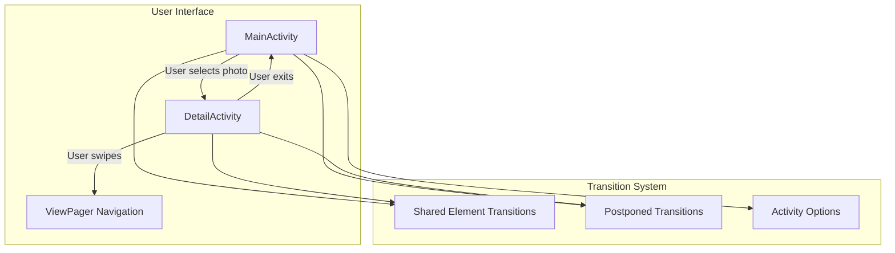
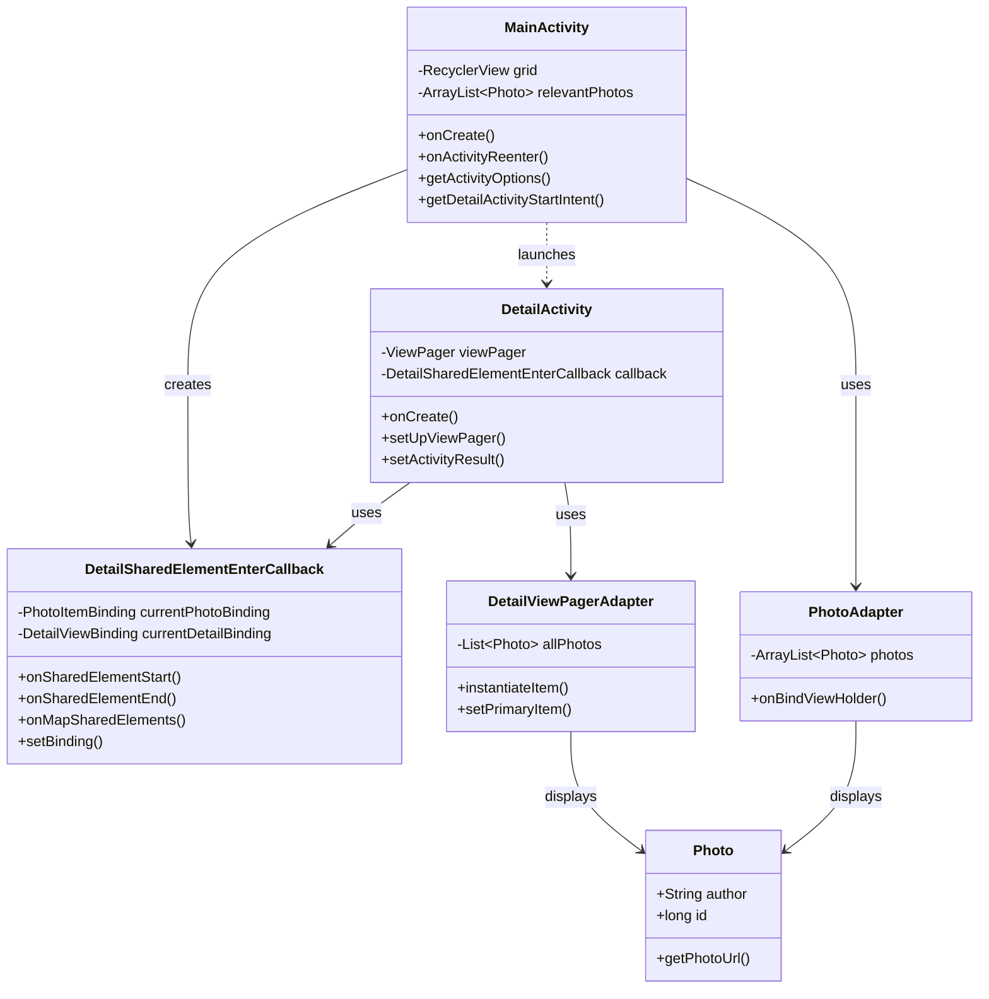
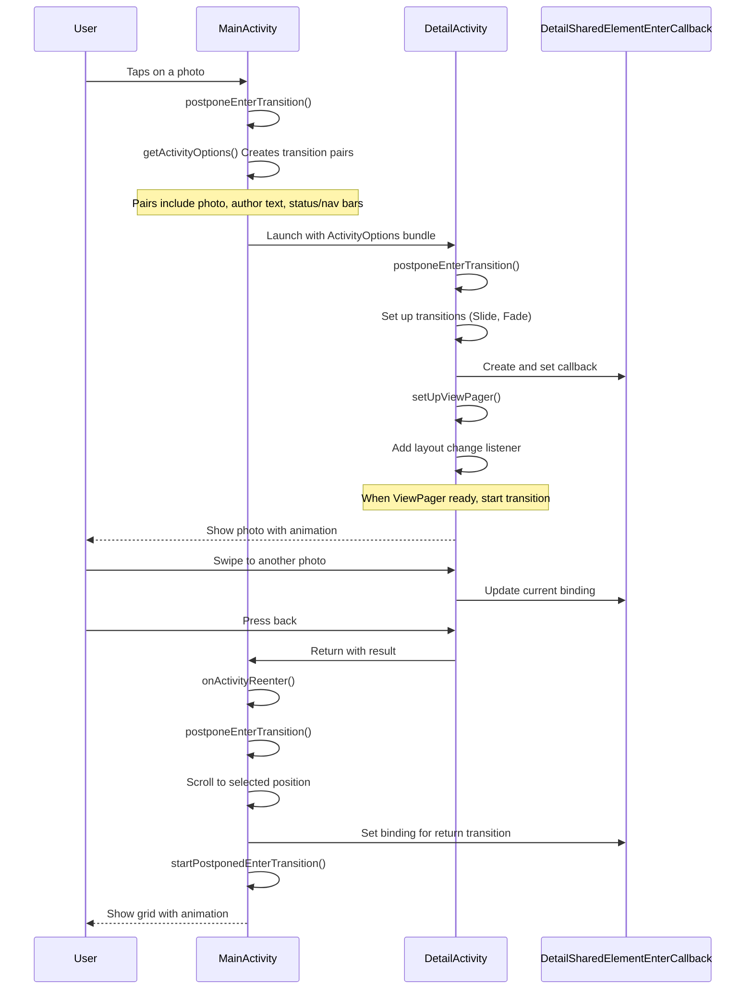
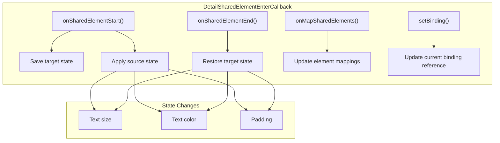
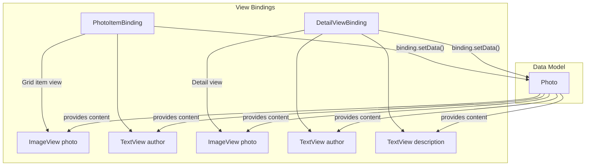

<!-- source: DeepWiki mcp.deepwiki.com · repo android/animation-samples · page 4.2 Unsplash Photo Transitions · fetched 2026-10-23 -->

# Unsplash Photo Transitions

<details>
<summary>Relevant source files</summary>

The following files were used as context for generating this wiki page:

- [Unsplash/app/build.gradle](Unsplash/app/build.gradle)
- [Unsplash/app/src/main/java/com/example/android/unsplash/DetailActivity.java](Unsplash/app/src/main/java/com/example/android/unsplash/DetailActivity.java)
- [Unsplash/app/src/main/java/com/example/android/unsplash/MainActivity.java](Unsplash/app/src/main/java/com/example/android/unsplash/MainActivity.java)
- [Unsplash/app/src/main/java/com/example/android/unsplash/data/model/Photo.java](Unsplash/app/src/main/java/com/example/android/unsplash/data/model/Photo.java)
- [Unsplash/app/src/main/java/com/example/android/unsplash/ui/DetailSharedElementEnterCallback.java](Unsplash/app/src/main/java/com/example/android/unsplash/ui/DetailSharedElementEnterCallback.java)
- [Unsplash/app/src/main/java/com/example/android/unsplash/ui/grid/GridMarginDecoration.java](Unsplash/app/src/main/java/com/example/android/unsplash/ui/grid/GridMarginDecoration.java)
- [Unsplash/app/src/main/java/com/example/android/unsplash/ui/grid/OnItemSelectedListener.java](Unsplash/app/src/main/java/com/example/android/unsplash/ui/grid/OnItemSelectedListener.java)
- [Unsplash/app/src/main/java/com/example/android/unsplash/ui/grid/PhotoAdapter.java](Unsplash/app/src/main/java/com/example/android/unsplash/ui/grid/PhotoAdapter.java)
- [Unsplash/app/src/main/java/com/example/android/unsplash/ui/grid/PhotoViewHolder.java](Unsplash/app/src/main/java/com/example/android/unsplash/ui/grid/PhotoViewHolder.java)
- [Unsplash/app/src/main/java/com/example/android/unsplash/ui/pager/DetailViewPagerAdapter.java](Unsplash/app/src/main/java/com/example/android/unsplash/ui/pager/DetailViewPagerAdapter.java)
- [Unsplash/app/src/main/res/layout/activity_detail.xml](Unsplash/app/src/main/res/layout/activity_detail.xml)
- [Unsplash/build.gradle](Unsplash/build.gradle)
- [Unsplash/gradle/wrapper/gradle-wrapper.properties](Unsplash/gradle/wrapper/gradle-wrapper.properties)

</details>


## Purpose and Scope

This document details the implementation of shared element transitions in the Unsplash photo viewing sample application. It covers how photo transitions are orchestrated between a grid view and a detail view, demonstrating smooth visual continuity as users navigate through the application. The document focuses specifically on the transition mechanics, callbacks, and view management involved in this process.

## Overview

The Unsplash sample demonstrates advanced activity transitions using the Android Activity Transitions framework. It showcases how to implement visually connected transitions between related UI elements across different activities using shared elements.



Sources: [Unsplash/app/src/main/java/com/example/android/unsplash/MainActivity.java](), [Unsplash/app/src/main/java/com/example/android/unsplash/DetailActivity.java]()

## System Architecture

The Unsplash Photo Transitions sample is built on a simple but effective architecture that enables smooth transitions between views:



Sources: [Unsplash/app/src/main/java/com/example/android/unsplash/MainActivity.java](), [Unsplash/app/src/main/java/com/example/android/unsplash/DetailActivity.java](), [Unsplash/app/src/main/java/com/example/android/unsplash/ui/DetailSharedElementEnterCallback.java](), [Unsplash/app/src/main/java/com/example/android/unsplash/ui/pager/DetailViewPagerAdapter.java](), [Unsplash/app/src/main/java/com/example/android/unsplash/ui/grid/PhotoAdapter.java](), [Unsplash/app/src/main/java/com/example/android/unsplash/data/model/Photo.java]()

## Transition Flow

The following diagram illustrates the complete transition flow when a user interacts with a photo in the grid:



Sources: [Unsplash/app/src/main/java/com/example/android/unsplash/MainActivity.java:72-74](), [Unsplash/app/src/main/java/com/example/android/unsplash/MainActivity.java:210-229](), [Unsplash/app/src/main/java/com/example/android/unsplash/DetailActivity.java:56-91](), [Unsplash/app/src/main/java/com/example/android/unsplash/MainActivity.java:140-169]()

## Key Components

### 1. Shared Element Identification

The system uses transition names to identify and connect shared elements between activities:

| Component | Grid View Binding | Detail View Binding |
|-----------|-------------------|---------------------|
| Photo Image | `binding.photo` | `binding.photo` |
| Author Text | `binding.author` | `binding.author` |
| Status Bar | `android.R.id.statusBarBackground` | `android.R.id.statusBarBackground` |
| Navigation Bar | `android.R.id.navigationBarBackground` | `android.R.id.navigationBarBackground` |

Sources: [Unsplash/app/src/main/java/com/example/android/unsplash/MainActivity.java:211-226]()

### 2. DetailSharedElementEnterCallback

This custom implementation of `SharedElementCallback` manages the transition process, handling:

- Appearance of shared elements at transition start and end
- Mapping of shared elements between activities
- Dynamic binding updates for different view states



Sources: [Unsplash/app/src/main/java/com/example/android/unsplash/ui/DetailSharedElementEnterCallback.java:52-84](), [Unsplash/app/src/main/java/com/example/android/unsplash/ui/DetailSharedElementEnterCallback.java:90-95]()

## Implementation Details

### 1. Postponed Transitions

Both activities use postponed transitions to ensure all view layout is completed before the transition begins:

```
// In MainActivity
postponeEnterTransition();

// In DetailActivity
postponeEnterTransition();
```

The transition is started after the ViewPager layout is complete:

```java
viewPager.addOnLayoutChangeListener(new View.OnLayoutChangeListener() {
    @Override
    public void onLayoutChange(View v, int left, int top, int right, int bottom,
                               int oldLeft, int oldTop, int oldRight, int oldBottom) {
        if (viewPager.getChildCount() > 0) {
            viewPager.removeOnLayoutChangeListener(this);
            startPostponedEnterTransition();
        }
    }
});
```

Sources: [Unsplash/app/src/main/java/com/example/android/unsplash/MainActivity.java:74](), [Unsplash/app/src/main/java/com/example/android/unsplash/DetailActivity.java:56](), [Unsplash/app/src/main/java/com/example/android/unsplash/DetailActivity.java:84-93]()

### 2. Activity Transition Setup

The DetailActivity sets up custom enter transitions combining Slide and Fade animations:

```java
TransitionSet transitions = new TransitionSet();
Slide slide = new Slide(Gravity.BOTTOM);
slide.setInterpolator(AnimationUtils.loadInterpolator(this,
        android.R.interpolator.linear_out_slow_in));
slide.setDuration(getResources().getInteger(android.R.integer.config_shortAnimTime));
transitions.addTransition(slide);
transitions.addTransition(new Fade());
getWindow().setEnterTransition(transitions);
```

Sources: [Unsplash/app/src/main/java/com/example/android/unsplash/DetailActivity.java:58-65]()

### 3. Activity Options

The MainActivity creates ActivityOptions for launching the DetailActivity with shared elements:

```java
private ActivityOptions getActivityOptions(PhotoItemBinding binding) {
    Pair authorPair = Pair.create(binding.author, binding.author.getTransitionName());
    Pair photoPair = Pair.create(binding.photo, binding.photo.getTransitionName());
    View decorView = getWindow().getDecorView();
    View statusBackground = decorView.findViewById(android.R.id.statusBarBackground);
    View navBackground = decorView.findViewById(android.R.id.navigationBarBackground);
    Pair statusPair = Pair.create(statusBackground,
            statusBackground.getTransitionName());

    // Create and return ActivityOptions with shared element pairs
    // ...
}
```

Sources: [Unsplash/app/src/main/java/com/example/android/unsplash/MainActivity.java:210-229]()

### 4. ViewPager Integration

The DetailActivity uses a ViewPager to allow swiping between photos while maintaining the shared element connection with the grid:

```java
private void setUpViewPager(ArrayList<Photo> photos) {
    viewPager = (ViewPager) findViewById(R.id.pager);
    viewPager.setAdapter(new DetailViewPagerAdapter(this, photos, sharedElementCallback));
    viewPager.setCurrentItem(initialItem);
    
    // Layout listener to start postponed transition
    // ...
}
```

The `DetailViewPagerAdapter` updates the current binding in the shared element callback when pages change:

```java
@Override
public void setPrimaryItem(@NonNull ViewGroup container, int position, @NonNull Object object) {
    if (object instanceof DetailViewBinding) {
        sharedElementCallback.setBinding((DetailViewBinding) object);
    }
}
```

Sources: [Unsplash/app/src/main/java/com/example/android/unsplash/DetailActivity.java:79-97](), [Unsplash/app/src/main/java/com/example/android/unsplash/ui/pager/DetailViewPagerAdapter.java:81-86]()

## Return Transition Handling

When navigating back to the MainActivity, the system needs to handle the return transition correctly:

```java
@Override
public void onActivityReenter(int resultCode, Intent data) {
    postponeEnterTransition();
    // Start the postponed transition when the recycler view is ready to be drawn.
    grid.getViewTreeObserver().addOnPreDrawListener(new ViewTreeObserver.OnPreDrawListener() {
        @Override
        public boolean onPreDraw() {
            grid.getViewTreeObserver().removeOnPreDrawListener(this);
            startPostponedEnterTransition();
            return true;
        }
    });

    if (data == null) {
        return;
    }

    final int selectedItem = data.getIntExtra(IntentUtil.SELECTED_ITEM_POSITION, 0);
    grid.scrollToPosition(selectedItem);

    PhotoViewHolder holder = (PhotoViewHolder) grid.
            findViewHolderForAdapterPosition(selectedItem);
    if (holder == null) {
        Log.w(TAG, "onActivityReenter: Holder is null, remapping cancelled.");
        return;
    }
    DetailSharedElementEnterCallback callback =
            new DetailSharedElementEnterCallback(getIntent());
    callback.setBinding(holder.getBinding());
    setExitSharedElementCallback(callback);
}
```

Sources: [Unsplash/app/src/main/java/com/example/android/unsplash/MainActivity.java:140-169]()

## Data Binding Usage

The sample uses data binding extensively to connect UI elements with the Photo model:



Sources: [Unsplash/app/src/main/java/com/example/android/unsplash/ui/grid/PhotoAdapter.java:54-63](), [Unsplash/app/src/main/java/com/example/android/unsplash/ui/pager/DetailViewPagerAdapter.java:64-78]()

## Conclusion

The Unsplash Photo Transitions sample demonstrates a sophisticated implementation of shared element transitions between a grid and detail view of photos. The system achieves smooth visual continuity by:

1. Using postponed transitions to ensure views are properly laid out
2. Implementing custom shared element callbacks to handle transition states
3. Integrating with ViewPager for fluid navigation between detail views
4. Using data binding to consistently connect model data with UI elements
5. Handling return transitions to properly animate back to the original grid position

This implementation showcases how developers can create engaging, high-quality transitions that enhance the user experience while maintaining visual continuity between different app screens.

---

