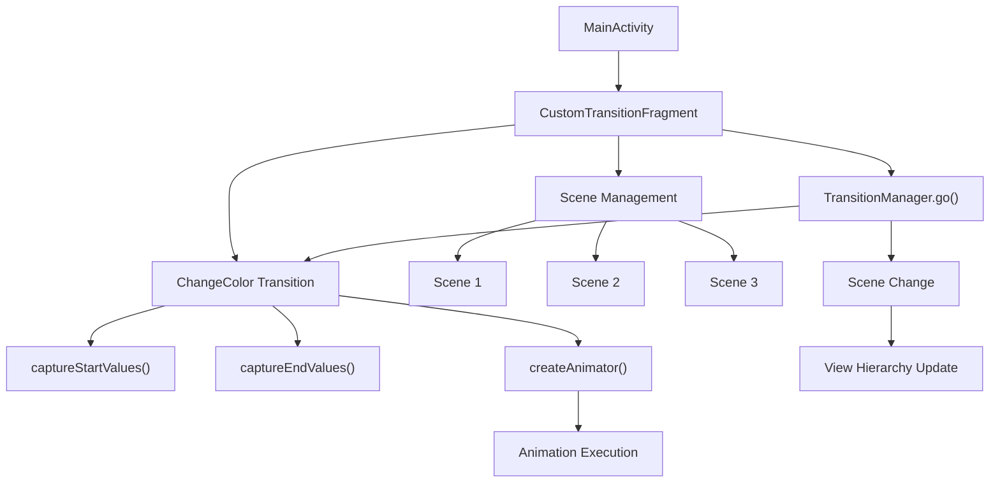
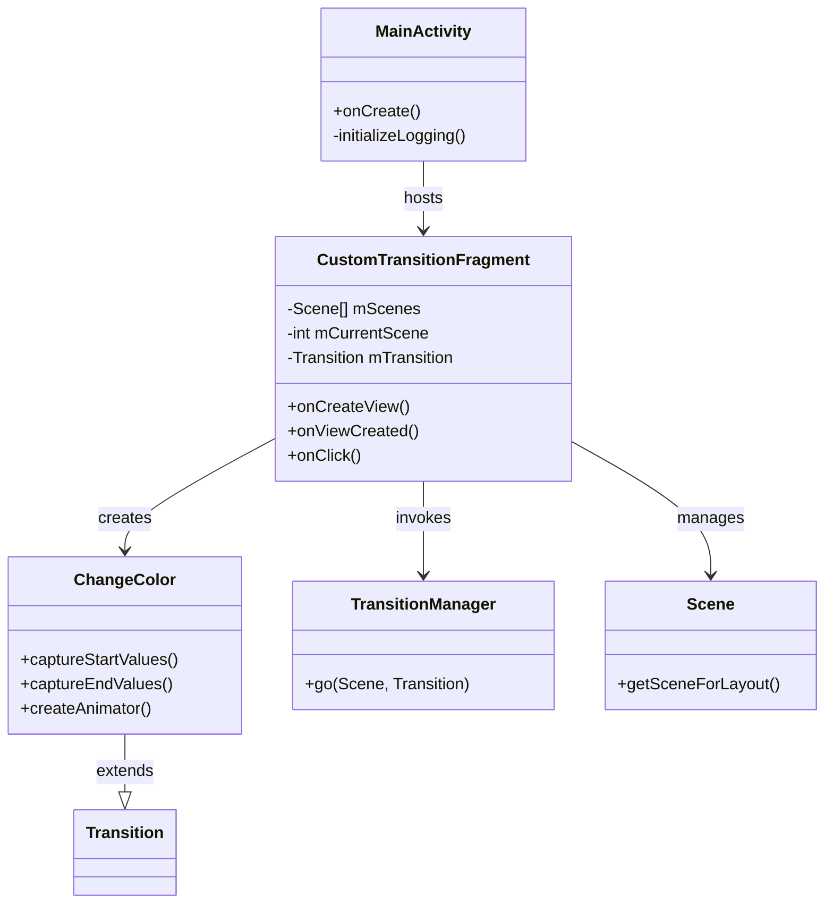
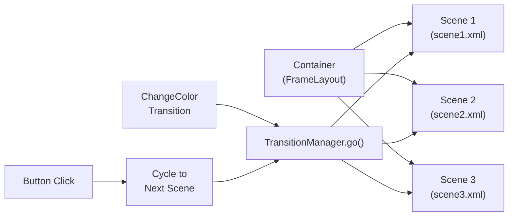
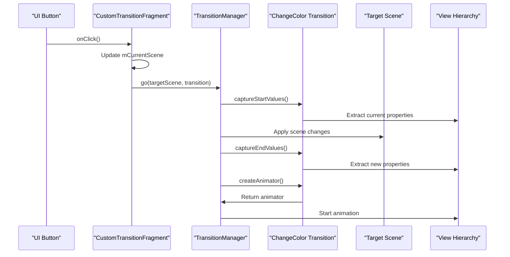
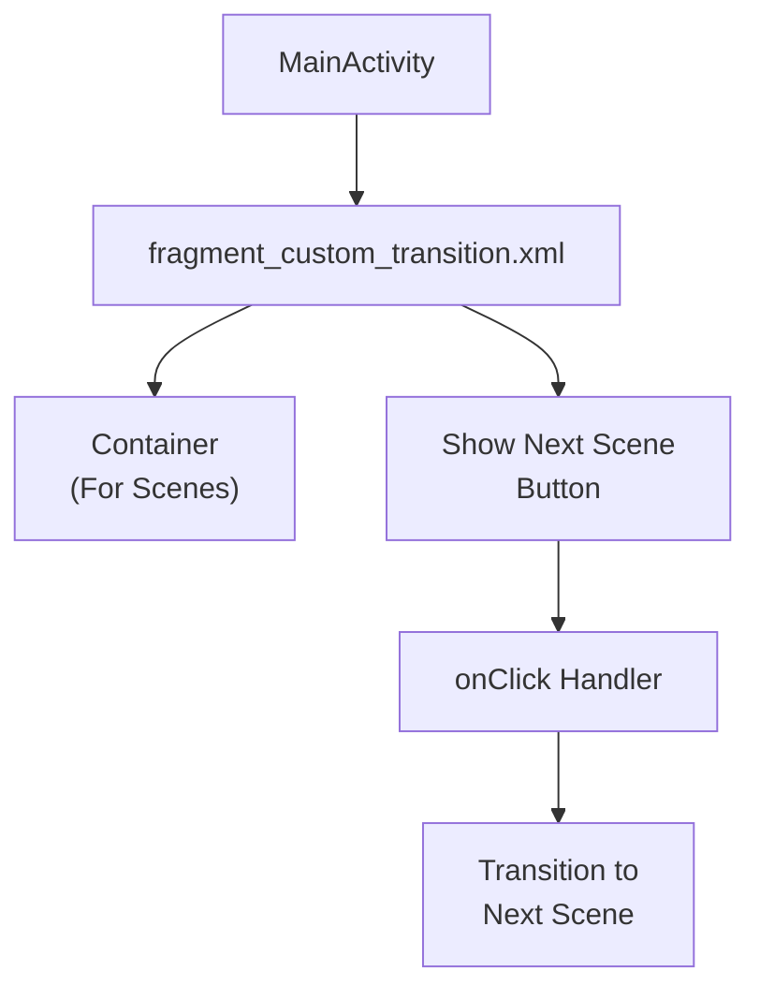

<!-- source: DeepWiki mcp.deepwiki.com · repo android/animation-samples · page 4.3 Custom Transition Implementation · fetched 2026-10-23 -->

# Custom Transition Implementation

<details>
<summary>Relevant source files</summary>

The following files were used as context for generating this wiki page:

- [CustomTransition/Application/src/main/AndroidManifest.xml](CustomTransition/Application/src/main/AndroidManifest.xml)
- [CustomTransition/Application/src/main/java/com/example/android/common/activities/SampleActivityBase.java](CustomTransition/Application/src/main/java/com/example/android/common/activities/SampleActivityBase.java)
- [CustomTransition/Application/src/main/java/com/example/android/common/logger/LogFragment.java](CustomTransition/Application/src/main/java/com/example/android/common/logger/LogFragment.java)
- [CustomTransition/Application/src/main/java/com/example/android/customtransition/CustomTransitionFragment.java](CustomTransition/Application/src/main/java/com/example/android/customtransition/CustomTransitionFragment.java)
- [CustomTransition/Application/src/main/java/com/example/android/customtransition/MainActivity.java](CustomTransition/Application/src/main/java/com/example/android/customtransition/MainActivity.java)
- [CustomTransition/README.md](CustomTransition/README.md)
- [CustomTransition/gradle.properties](CustomTransition/gradle.properties)

</details>


This page explains how to implement custom transitions by extending Android's standard Transition class, as demonstrated in the CustomTransition sample. Custom transitions allow you to create specialized animation effects between scene changes that go beyond the built-in transition types.

For information about other animation techniques like Drawable Animations, see [Drawable Animations](#4.1), or for shared element transitions, see [Unsplash Photo Transitions](#4.2).

## Overview of Custom Transition Framework

Android's Transition framework allows animations to be automatically generated between different UI states (scenes). While Android provides several built-in transitions, you can create custom transitions for specialized effects by extending the `Transition` class.

A custom transition requires three key method implementations:
- `captureStartValues()` - Extracts properties from views in the starting scene
- `captureEndValues()` - Extracts properties from views in the ending scene
- `createAnimator()` - Creates animations between the captured properties

Sources: [CustomTransition/README.md:11-18]()

## Architecture of the Custom Transition Sample

The CustomTransition sample demonstrates how to implement a custom color transition that animates the background color of views when switching between scenes.

### Transition System Architecture



Sources: [CustomTransition/Application/src/main/java/com/example/android/customtransition/CustomTransitionFragment.java:67-75](), [CustomTransition/README.md:11-18]()

### Component Responsibilities



Sources: [CustomTransition/Application/src/main/java/com/example/android/customtransition/MainActivity.java:41-59](), [CustomTransition/Application/src/main/java/com/example/android/customtransition/CustomTransitionFragment.java:34-94]()

## Scene Setup and Management

The CustomTransition sample uses three different scenes (layouts) that the application transitions between. Scenes represent different states of the UI that we animate between using our custom transition.

### Scene Configuration

The fragment loads three scene layouts and creates Scene objects:



Sources: [CustomTransition/Application/src/main/java/com/example/android/customtransition/CustomTransitionFragment.java:67-75]()

The scenes are initialized in the `onViewCreated()` method of the `CustomTransitionFragment`:

```
mScenes = new Scene[] {
    Scene.getSceneForLayout(container, R.layout.scene1, context),
    Scene.getSceneForLayout(container, R.layout.scene2, context),
    Scene.getSceneForLayout(container, R.layout.scene3, context),
};
```

A button in the UI allows cycling through these scenes, with the custom transition animating the changes.

Sources: [CustomTransition/Application/src/main/java/com/example/android/customtransition/CustomTransitionFragment.java:61-75](), [CustomTransition/Application/src/main/java/com/example/android/customtransition/CustomTransitionFragment.java:85-91]()

## Custom Transition Implementation Details

The sample implements a custom `ChangeColor` transition that animates the background color of views between scenes.

### Implementation Requirements

To create a custom transition:

1. Create a subclass of `Transition`
2. Implement these key methods:

| Method | Purpose |
|--------|---------|
| `captureStartValues(TransitionValues values)` | Extracts relevant properties from views in the starting scene |
| `captureEndValues(TransitionValues values)` | Extracts relevant properties from views in the ending scene |
| `createAnimator(ViewGroup sceneRoot, TransitionValues startValues, TransitionValues endValues)` | Creates an animator to animate between start and end states |

In the `captureStartValues` and `captureEndValues` methods, you identify the properties you want to animate (in this case, background colors) and store them in the provided TransitionValues object.

In the `createAnimator` method, you create and return appropriate animator objects (such as ObjectAnimator or ValueAnimator) that will animate the view properties between their start and end values.

Sources: [CustomTransition/README.md:11-18]()

### Transition Initialization and Execution

The custom `ChangeColor` transition is initialized once in the `onViewCreated()` method:

```
mTransition = new ChangeColor();
```

And then applied during scene changes in the `onClick()` method:

```
TransitionManager.go(mScenes[mCurrentScene], mTransition);
```

Sources: [CustomTransition/Application/src/main/java/com/example/android/customtransition/CustomTransitionFragment.java:73](), [CustomTransition/Application/src/main/java/com/example/android/customtransition/CustomTransitionFragment.java:90]()

## Transition Flow Process

The following diagram illustrates the lifecycle of a custom transition when a scene change occurs:



Sources: [CustomTransition/Application/src/main/java/com/example/android/customtransition/CustomTransitionFragment.java:85-91](), [CustomTransition/README.md:11-18]()

## Integration with User Interface

The sample application provides a simple user interface with a button to trigger scene transitions:



The MainActivity loads the CustomTransitionFragment, which sets up the scene container and the button to transition between scenes. When the button is clicked, the fragment cycles to the next scene using the custom ChangeColor transition.

Sources: [CustomTransition/Application/src/main/java/com/example/android/customtransition/MainActivity.java:49-58](), [CustomTransition/Application/src/main/java/com/example/android/customtransition/CustomTransitionFragment.java:54-62](), [CustomTransition/Application/src/main/java/com/example/android/customtransition/CustomTransitionFragment.java:85-91]()

## Best Practices for Custom Transitions

When implementing custom transitions, consider these best practices:

1. **Selective Animations**: Return null from `createAnimator()` for views you don't want to animate
2. **Performance**: Minimize property extraction work in capture methods to keep transitions smooth
3. **Flexibility**: Design transitions to work with various view types when possible
4. **Error Handling**: Check for null values when extracting properties to avoid crashes
5. **Readability**: Create clear, focused transitions that handle specific properties

Sources: [CustomTransition/README.md:16-18]()

## Summary

The CustomTransition sample demonstrates how to create specialized animations between scene changes by extending Android's Transition class. By implementing the three key methods (`captureStartValues()`, `captureEndValues()`, and `createAnimator()`), you can create transitions for any property or combination of properties.

This approach provides more flexibility than the built-in transitions and enables applications to have distinctive, customized animation effects that enhance the user experience.

---

