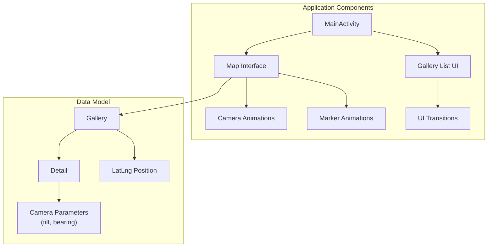
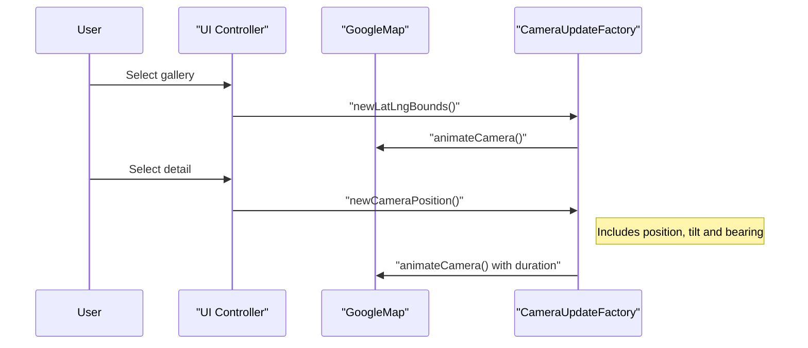
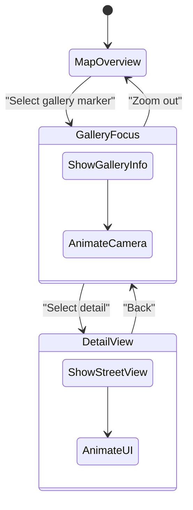
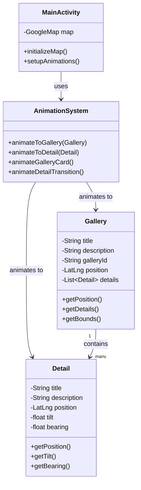
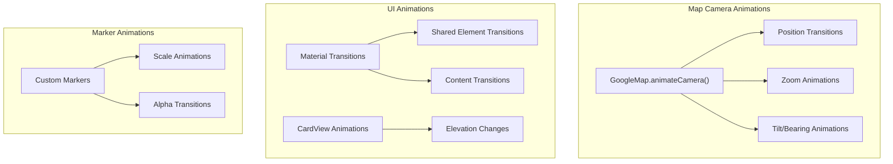

<!-- source: DeepWiki mcp.deepwiki.com · repo android/animation-samples · page 4.4 OurStreets Map Animations · fetched 2026-10-23 -->

# OurStreets Map Animations

<details>
<summary>Relevant source files</summary>

The following files were used as context for generating this wiki page:

- [OurStreets/app/build.gradle](OurStreets/app/build.gradle)
- [OurStreets/app/src/main/AndroidManifest.xml](OurStreets/app/src/main/AndroidManifest.xml)
- [OurStreets/app/src/test/java/com/google/samples/apps/ourstreets/model/DetailTest.java](OurStreets/app/src/test/java/com/google/samples/apps/ourstreets/model/DetailTest.java)
- [OurStreets/app/src/test/java/com/google/samples/apps/ourstreets/model/GalleryTest.java](OurStreets/app/src/test/java/com/google/samples/apps/ourstreets/model/GalleryTest.java)

</details>


## Purpose and Scope

This document details the animation techniques implemented in the OurStreets sample application, focusing on map transitions, camera movements, and UI transformations. OurStreets demonstrates how to create fluid, engaging user experiences in map-based applications using Google Maps Android API and animation techniques.

## Overview

OurStreets is a sample application that showcases a collection of street photography galleries positioned on a map. The app demonstrates smooth transitions between map views and detail screens, animated camera movements, and UI component animations.



Sources: [OurStreets/app/src/main/AndroidManifest.xml:46-55](), [OurStreets/app/src/test/java/com/google/samples/apps/ourstreets/model/GalleryTest.java:37-50](), [OurStreets/app/src/test/java/com/google/samples/apps/ourstreets/model/DetailTest.java:33-49]()

## Data Model

The animation system is built around two primary data models:

### Gallery

The `Gallery` class represents a collection of street photography at a specific location:

```
- title: Name of the gallery
- description: Information about the gallery
- galleryId: Unique identifier
- position: LatLng coordinates on the map
- details: List of Detail objects
```

### Detail

The `Detail` class represents individual street views within a gallery:

```
- title: Title of the street view
- description: Information about the view
- position: LatLng coordinates
- tilt: Camera tilt angle (in degrees)
- bearing: Camera orientation (in degrees)
```

Sources: [OurStreets/app/src/test/java/com/google/samples/apps/ourstreets/model/GalleryTest.java:37-50](), [OurStreets/app/src/test/java/com/google/samples/apps/ourstreets/model/DetailTest.java:33-49]()

## Map Camera Animations

The core of OurStreets' animation system is the map camera animations that transition between different views and locations.

### Camera Movement Animations



When users navigate between galleries and details, the app uses smooth camera animations with customized:

- **Position transitions**: Moving from one location to another
- **Zoom levels**: Zooming in/out between overview and detail views
- **Tilt and bearing**: Adjusting camera angle based on Detail's tilt and bearing values

Sources: [OurStreets/app/src/test/java/com/google/samples/apps/ourstreets/model/DetailTest.java:74-81]()

## UI Component Animations

### Gallery-Detail Transition Flow



The application implements several UI animation patterns:

1. **Card reveal animations**: When displaying gallery information
2. **Shared element transitions**: When moving between gallery list and detail views
3. **Crossfade transitions**: For smooth content switching

Sources: [OurStreets/app/build.gradle:58-61]()

## Animation Architecture



The animation system is structured to separate concerns between:

- Data models (`Gallery` and `Detail`)
- Animation logic (camera movements and UI transitions)
- UI controllers (handling user interactions)

Sources: [OurStreets/app/src/test/java/com/google/samples/apps/ourstreets/model/GalleryTest.java:37-105](), [OurStreets/app/src/test/java/com/google/samples/apps/ourstreets/model/DetailTest.java:33-81]()

## Network Integration

OurStreets loads gallery data from remote endpoints, as configured in the build.gradle file:

```
buildConfigField "String", "GALLERIES_URL", "\"${galleries_url}\""
buildConfigField "String", "DETAIL_URL", "\"${detail_url}\""
```

This data is used to populate the map with gallery markers and their associated details, which drive the animation targets.

Sources: [OurStreets/app/build.gradle:30-31]()

## Required Dependencies

The animations in OurStreets rely on several key dependencies:

| Dependency | Purpose |
|------------|---------|
| Google Maps | Core map functionality and camera animations |
| Maps Utils | Advanced map utilities for custom markers and animations |
| AppCompat  | Compatibility animations across different Android versions |
| CardView   | Card-based UI components with shadow animations |
| RecyclerView | List animations for gallery items |

Sources: [OurStreets/app/build.gradle:57-64]()

## Performance Considerations

When implementing the map animations, several performance optimizations are considered:

1. **Animation durations**: Appropriate timing for different types of transitions
2. **Camera update throttling**: Prevent excessive animations during rapid user interaction
3. **View recycling**: Efficient handling of list animations in gallery displays
4. **Transition caching**: Re-use animation objects where appropriate

Sources: [OurStreets/app/build.gradle:19-47]()

## Key Animation Techniques



Sources: [OurStreets/app/build.gradle:58-64](), [OurStreets/app/src/test/java/com/google/samples/apps/ourstreets/model/DetailTest.java:74-81]()

## Related Documentation

For additional information about other animation samples:
- For general animation techniques overview, see [Android Animation Samples](#1)
- For traditional View-based animations, see [Motion App](#2)
- For Compose-based animations, see [MotionCompose App](#3)
- For shared element transitions similar to those used in OurStreets, see [Unsplash Photo Transitions](#4.2)

---

