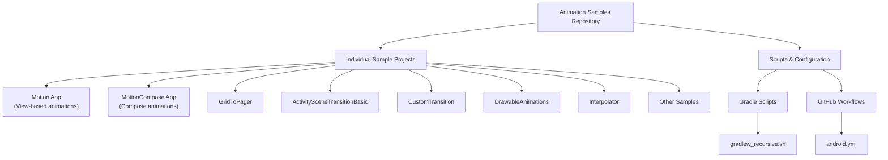
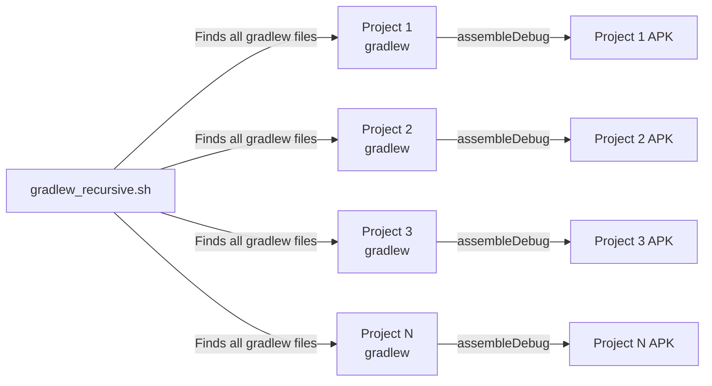
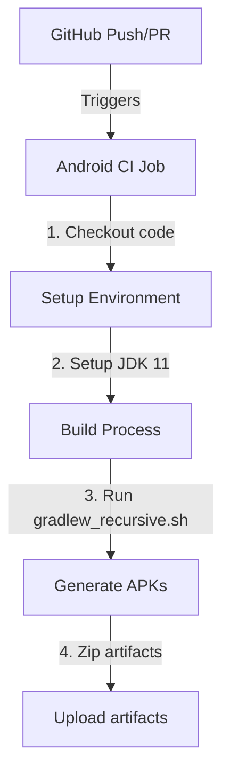
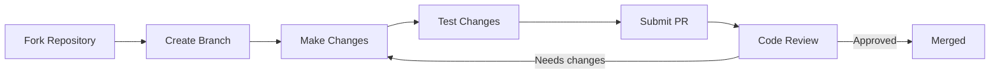

<!-- source: DeepWiki mcp.deepwiki.com · repo android/animation-samples · page 5 Development Guide · fetched 2026-10-23 -->

# Development Guide

<details>
<summary>Relevant source files</summary>

The following files were used as context for generating this wiki page:

- [.github/scripts/gradlew_recursive.sh](.github/scripts/gradlew_recursive.sh)
- [.github/workflows/android.yml](.github/workflows/android.yml)
- [.gitignore](.gitignore)
- [ActivitySceneTransitionBasic/gradle/wrapper/gradle-wrapper.properties](ActivitySceneTransitionBasic/gradle/wrapper/gradle-wrapper.properties)
- [BasicTransition/gradle/wrapper/gradle-wrapper.properties](BasicTransition/gradle/wrapper/gradle-wrapper.properties)
- [CONTRIBUTING.md](CONTRIBUTING.md)
- [CustomTransition/gradle/wrapper/gradle-wrapper.properties](CustomTransition/gradle/wrapper/gradle-wrapper.properties)
- [GridToPager/gradle/wrapper/gradle-wrapper.properties](GridToPager/gradle/wrapper/gradle-wrapper.properties)
- [Interpolator/gradle/wrapper/gradle-wrapper.properties](Interpolator/gradle/wrapper/gradle-wrapper.properties)
- [LICENSE](LICENSE)
- [README.md](README.md)

</details>


This guide provides comprehensive instructions for developers who want to build, run, and contribute to the Android Animation Samples repository. It covers environment setup, building processes, and contribution guidelines for all sample projects in the collection.

## 1. Setting Up the Development Environment

### Prerequisites

To work with the Android Animation Samples, you'll need the following tools installed:

- Android Studio (latest stable version recommended)
- Java Development Kit (JDK) 11 or newer
- Git for version control

### Repository Setup

1. Clone the repository:
   ```bash
   git clone https://github.com/android/animation-samples.git
   cd animation-samples
   ```

2. Open the project in Android Studio:
   - Launch Android Studio
   - Select "Open an Existing Project"
   - Navigate to the cloned repository directory

Sources: [README.md:1-10]()

## 2. Project Structure Overview

The animation samples repository contains several independent Android Studio projects, each demonstrating different animation techniques.



Each sample is a standalone project with its own:
- Gradle configuration
- Source code
- Resources
- Android Manifest

Sources: [README.md:6-10](), [.github/workflows/android.yml:15-22]()

## 3. Building the Samples

### Using Android Studio

1. Open the specific sample project you want to build
2. Let the Gradle sync complete
3. Select Run > Run 'app' from the menu, or click the Run button in the toolbar

### Using Command Line

The repository includes a script that can build all samples recursively:

```bash
# From repository root
.github/scripts/gradlew_recursive.sh assembleDebug
```

This script will:
1. Find all `gradlew` files in the repository
2. Execute the Gradle wrapper for each project with the provided arguments
3. Build debug APKs for all samples



Sources: [.github/scripts/gradlew_recursive.sh:17-36](), [.github/workflows/android.yml:25-43]()

### Gradle Configuration

All samples use standard Gradle configurations with similar wrapper properties. The samples are configured to use Gradle 7.4 or newer:

| Sample Project | Gradle Version |
|----------------|---------------|
| GridToPager | gradle-7.4-all.zip |
| ActivitySceneTransitionBasic | gradle-7.4-all.zip |
| CustomTransition | gradle-7.4-all.zip |
| Interpolator | gradle-7.4-bin.zip |
| BasicTransition | gradle-7.4-all.zip |

Sources: [GridToPager/gradle/wrapper/gradle-wrapper.properties:1-6](), [ActivitySceneTransitionBasic/gradle/wrapper/gradle-wrapper.properties:1-6](), [CustomTransition/gradle/wrapper/gradle-wrapper.properties:1-6](), [Interpolator/gradle/wrapper/gradle-wrapper.properties:1-6](), [BasicTransition/gradle/wrapper/gradle-wrapper.properties:1-6]()

## 4. Continuous Integration

The repository uses GitHub Actions for continuous integration. The CI workflow:

1. Triggers on:
   - Push to the main branch
   - Pull requests targeting the main branch
2. Runs on Ubuntu 18.04
3. Sets up JDK 11
4. Builds all projects with `gradlew_recursive.sh`
5. Zips and uploads build artifacts

This ensures that all samples build correctly when changes are made.



Sources: [.github/workflows/android.yml:15-43]()

## 5. Running the Samples

### On an Emulator or Device

1. Create or select an Android Virtual Device (AVD) with API level supported by the sample
2. Build and run the sample from Android Studio
3. Alternatively, install the generated APK from the command line:
   ```bash
   adb install path/to/sample-app.apk
   ```

### Sample-specific Setup

Some samples may require specific configuration:

- **Motion App**: Demonstrates view-based animations with Material Design motion patterns
- **MotionCompose**: Requires Android Studio version that supports Jetpack Compose
- **ActivitySceneTransitionBasic**: Works on all modern Android versions

## 6. Contributing to the Samples

### Contributor License Agreement

Before contributing, you need to sign the Google Contributor License Agreement (CLA):
1. Visit https://cla.developers.google.com/
2. Sign the agreement using your GitHub account

You generally only need to submit a CLA once, even for contributions to different Google projects.

### Contribution Process

1. Fork the repository
2. Create a branch for your changes
3. Make your changes following the project's coding standards
4. Test your changes on multiple API levels
5. Submit a pull request

### Code Review

All submissions require code review through GitHub pull requests, including submissions from project members.

### Community Guidelines

This project follows Google's Open Source Community Guidelines. Be respectful and constructive in all interactions.



Sources: [CONTRIBUTING.md:1-28]()

## 7. Troubleshooting

### Common Issues

1. **Gradle Sync Failed**: 
   - Ensure you're using a compatible Android Studio version
   - Update the Gradle plugin if needed
   - Check your internet connection for dependency downloads

2. **Build Errors**:
   - Check that you have the correct SDK versions installed
   - Make sure you have the right JDK version (JDK 11 recommended)

3. **Sample Won't Run**:
   - Verify your emulator/device meets the minimum API level
   - Check for any sample-specific requirements

### Getting Help

If you encounter issues not covered in this guide:
1. Check the GitHub Issues section for similar problems
2. Create a new issue with detailed information about your problem
3. Include logs, error messages, and environment details

Sources: [.github/scripts/gradlew_recursive.sh:1-36](), [.gitignore:1-36]()