# Page: Android Animation Samples

# Android Animation Samples

<details>
<summary>Relevant source files</summary>

The following files were used as context for generating this wiki page:

- [.github/scripts/gradlew_recursive.sh](.github/scripts/gradlew_recursive.sh)
- [.github/workflows/android.yml](.github/workflows/android.yml)
- [.gitignore](.gitignore)
- [CONTRIBUTING.md](CONTRIBUTING.md)
- [LICENSE](LICENSE)
- [README.md](README.md)

</details>


## Purpose and Scope

This document provides a comprehensive overview of the Android Animation Samples repository, a collection of individual Android Studio projects that demonstrate various animation techniques and motion patterns in Android applications. The repository serves as a learning resource for developers seeking to understand and implement animations in their Android apps.

Sources: [README.md:6-10]()

## Repository Structure

The Android Animation Samples repository is organized into several distinct projects, each focusing on specific animation techniques or frameworks. The repository has a hierarchical structure with two main applications and several individual sample projects.

### Repository Organization

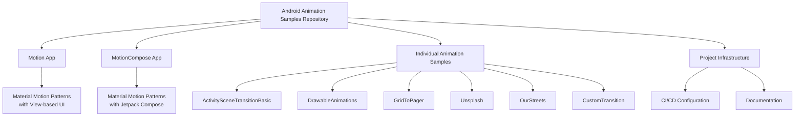

Sources: [README.md:6-10](), [.github/workflows/android.yml:15-43]()

The repository consists of three main categories of projects:

1. **Motion App**: A traditional View-based Android application demonstrating Material Design motion patterns. For detailed information, see [Motion App](#2).

2. **MotionCompose App**: A Jetpack Compose implementation of animation patterns, showcasing modern UI animation techniques. For detailed information, see [MotionCompose App](#3).

3. **Individual Animation Samples**: Standalone projects demonstrating specific animation techniques. For detailed information, see [Individual Animation Samples](#4).

## Animation Techniques Overview

The repository demonstrates a wide range of animation techniques across different Android UI frameworks. The following diagram illustrates the primary animation patterns and their implementations in both View-based and Compose-based applications.

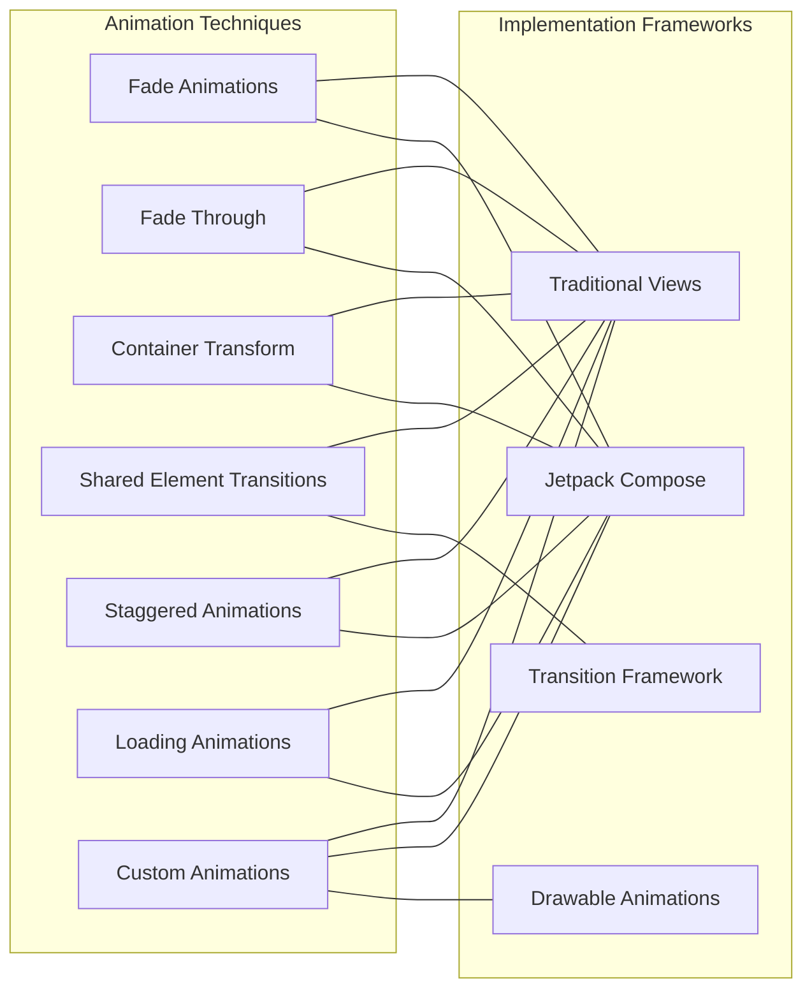

Sources: [README.md:6-10]()

## Technology Stack Comparison

The samples in this repository use different technology stacks depending on their focus and when they were created. The following table provides a comparison of the primary technology stacks used across the main applications:

| Component | Motion App | MotionCompose App | Individual Samples |
|-----------|------------|-------------------|-------------------|
| UI Framework | View-based UI | Jetpack Compose | View-based UI |
| Animation APIs | AndroidX Transitions, ObjectAnimator | Compose Animation APIs, AnimatedContent | View Animations, Drawable Animations |
| Layout System | XML layouts, RecyclerView | Composables, LazyColumn | XML layouts, ViewPager |
| Navigation | Fragment Navigation | Compose Navigation | Activity-based, Fragment-based |
| Design System | Material Components | Material3 Components | Material Design |

Sources: [README.md:6-10]()

## Building and Running

The repository uses Gradle as its build system. Each sample project can be built and run independently. The repository includes GitHub Actions CI/CD configuration for automated building and testing.

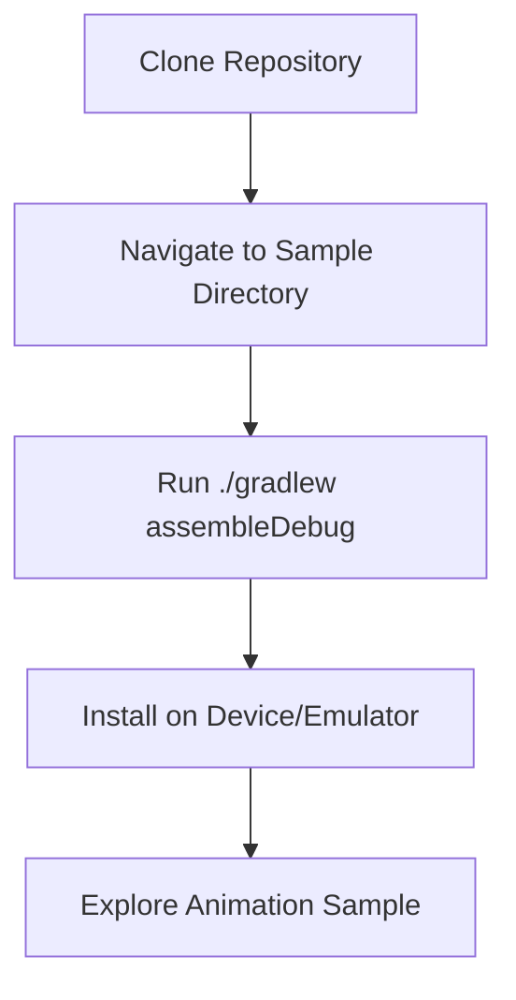

Sources: [.github/workflows/android.yml:15-43](), [.github/scripts/gradlew_recursive.sh:1-36]()

## License and Contribution

The Android Animation Samples repository is licensed under the Apache License 2.0, permitting use, modification, and distribution with proper attribution.

Contributors are expected to follow the guidelines outlined in the CONTRIBUTING.md file, which includes signing a Contributor License Agreement and submitting changes through GitHub pull requests.

Sources: [LICENSE:1-192](), [CONTRIBUTING.md:1-29]()

## Deprecation Notice

It's important to note that this sample repository has been deprecated and is no longer actively maintained. Developers are encouraged to refer to official Android documentation and more recent samples for current animation best practices.

Sources: [README.md:1-4]()

## Related Resources

For more information about specific animation implementations, refer to:

- [Motion App](#2) - Details about the traditional View-based Motion demonstrations
- [MotionCompose App](#3) - Information about Jetpack Compose animation implementations
- [Individual Animation Samples](#4) - Documentation on standalone animation sample projects
- [Development Guide](#5) - Building and contributing to the samples

---

# Page: Motion App

# Motion App

<details>
<summary>Relevant source files</summary>

The following files were used as context for generating this wiki page:

- [Motion/README.md](Motion/README.md)
- [Motion/app/build.gradle](Motion/app/build.gradle)
- [Motion/app/src/main/AndroidManifest.xml](Motion/app/src/main/AndroidManifest.xml)
- [Motion/app/src/main/java/com/example/android/motion/demo/containertransform/CheeseArticleFragment.kt](Motion/app/src/main/java/com/example/android/motion/demo/containertransform/CheeseArticleFragment.kt)
- [Motion/app/src/main/res/values/demos.xml](Motion/app/src/main/res/values/demos.xml)
- [Motion/app/src/main/res/values/dimens.xml](Motion/app/src/main/res/values/dimens.xml)
- [Motion/app/src/main/res/values/strings.xml](Motion/app/src/main/res/values/strings.xml)
- [Motion/app/src/main/res/values/styles.xml](Motion/app/src/main/res/values/styles.xml)
- [Motion/build.gradle](Motion/build.gradle)
- [Motion/gradle/wrapper/gradle-wrapper.properties](Motion/gradle/wrapper/gradle-wrapper.properties)

</details>


The Motion App is a comprehensive demonstration of Material Design motion patterns implemented using traditional Android Views and Transitions. It provides practical examples of how to incorporate animations that enhance user experience through guided attention, spatial relationships, and visual continuity.

This page documents the structure, animation techniques, and implementation details of the Views-based Motion App. For information about Jetpack Compose-based animations, see [MotionCompose App](#3).

## Architecture Overview

The Motion App follows a modular architecture where each animation technique is demonstrated through a dedicated activity. The app provides a central menu to navigate to individual demos, with each demo showcasing a specific Material Design motion pattern.

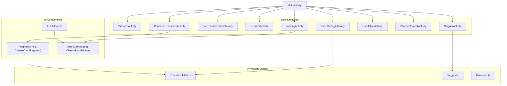

Sources: [Motion/app/src/main/AndroidManifest.xml:39-203](), [Motion/app/src/main/res/values/demos.xml:1-124]()

## Demo Categories and Implementation

The Motion App demonstrates animation techniques in three main categories from the Material Design guidelines:

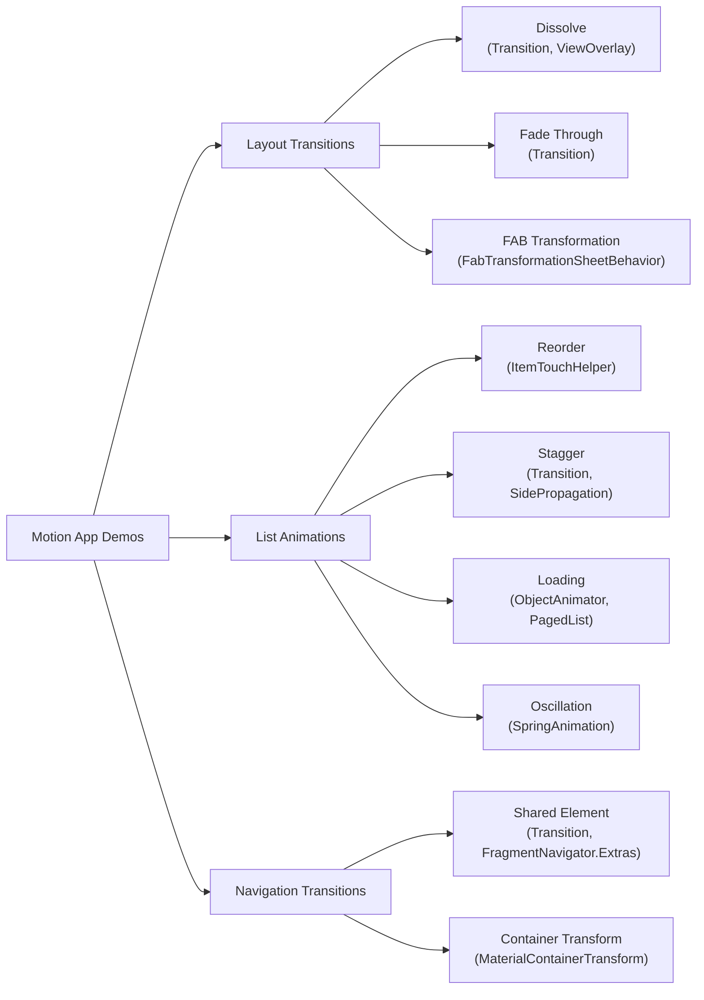

Sources: [Motion/app/src/main/res/values/demos.xml:19-122](), [Motion/README.md:1-51](), [Motion/app/src/main/AndroidManifest.xml:39-203]()

### Layout Transitions

These demos showcase transitions between different layouts or UI elements:

| Animation Type | Description | Key APIs |
|----------------|-------------|----------|
| Dissolve | Creates smooth transitions between overlapping elements (e.g., photos inside cards) | Transition, ViewOverlay |
| Fade Through | One element fades out completely before a new one fades in | Transition |
| FAB Transformation | Floating action button (FAB) transforms into a card | FabTransformationSheetBehavior, CircularRevealCardView |

Sources: [Motion/app/src/main/res/values/demos.xml:19-52]()

### List Animations

These demos focus on animating items within lists:

| Animation Type | Description | Key APIs |
|----------------|-------------|----------|
| Reorder | Animations for reordering items in a list with clear visual feedback | ItemTouchHelper, ItemAnimator, ViewPropertyAnimator |
| Stagger | Applying temporal offsets to a group of elements in sequence | Transition, SidePropagation |
| Loading | Animated placeholders indicating that content is loading | ObjectAnimator, PagedList |
| Oscillation | Animation with multiple overshoots, each smaller than the previous | SpringAnimation, EdgeEffect |

Sources: [Motion/app/src/main/res/values/demos.xml:54-98]()

### Navigation Transitions

These demos illustrate animations between different screens or fragments:

| Animation Type | Description | Key APIs |
|----------------|-------------|----------|
| Shared Element | Transitions with a focal element that persists across screens | Transition, FragmentNavigator.Extras |
| Container Transform | Transforming one container into another for a seamless transition | Transition, MaterialContainerTransform, FragmentNavigator.Extras |

Sources: [Motion/app/src/main/res/values/demos.xml:100-122]()

## Implementation Highlights

### Material Container Transform

One of the standout features demonstrated in the Motion App is the MaterialContainerTransform, which provides a smooth morphing animation between UI elements across different screens. This is shown in the Container Transform demo:

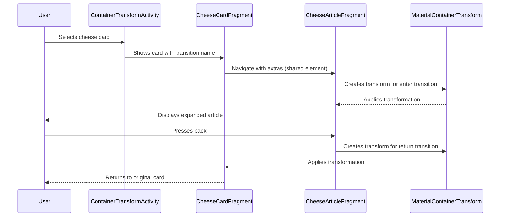

The implementation sets up shared element transitions between fragments:

```kotlin
// In CheeseArticleFragment
sharedElementEnterTransition = MaterialContainerTransform(requireContext(), true)
sharedElementReturnTransition = MaterialContainerTransform(requireContext(), false)
```

Sources: [Motion/app/src/main/java/com/example/android/motion/demo/containertransform/CheeseArticleFragment.kt:62-64]()

### Animation Dependencies

The Motion App relies on several key Android libraries to implement its animations:

- AndroidX Transition (1.4.1): Provides the foundation for most transitions
- AndroidX DynamicAnimation (1.1.0-alpha03): Enables physics-based animations
- Material Components (1.11.0): Includes specialized animations like MaterialContainerTransform
- AndroidX Navigation: Handles navigation with transition extras for shared elements

Sources: [Motion/app/build.gradle:57-72]()

## Technical Requirements

The Motion App supports:
- Minimum SDK: 19 (Android 4.4 KitKat)
- Target SDK: 34 (Android 14)
- Uses vector drawables with support library

It incorporates edge-to-edge design with system bars handling, as demonstrated in the Container Transform implementation where insets are properly applied to ensure content is visible under transparent system bars.

Sources: [Motion/app/build.gradle:24-32](), [Motion/app/src/main/java/com/example/android/motion/demo/containertransform/CheeseArticleFragment.kt:91-108]()

## Getting Started with Motion App

To use the Motion App as a reference for implementing animations in your own applications:

1. Study the individual demo activities to understand implementation patterns
2. Look at the transition utilities to see reusable animation components
3. Examine how the app structures animation code to maintain readability and reusability

The app demonstrates best practices for implementing Material Design motion patterns in a production-quality Android application.

Sources: [Motion/README.md:1-8]()

---

# Page: Animation Techniques in Motion

# Animation Techniques in Motion

<details>
<summary>Relevant source files</summary>

The following files were used as context for generating this wiki page:

- [Motion/README.md](Motion/README.md)
- [Motion/app/src/main/java/com/example/android/motion/demo/Durations.kt](Motion/app/src/main/java/com/example/android/motion/demo/Durations.kt)
- [Motion/app/src/main/java/com/example/android/motion/demo/Transitions.kt](Motion/app/src/main/java/com/example/android/motion/demo/Transitions.kt)
- [Motion/app/src/main/java/com/example/android/motion/demo/fadethrough/FadeThroughActivity.kt](Motion/app/src/main/java/com/example/android/motion/demo/fadethrough/FadeThroughActivity.kt)
- [Motion/app/src/main/java/com/example/android/motion/demo/sharedelement/CheeseDetailFragment.kt](Motion/app/src/main/java/com/example/android/motion/demo/sharedelement/CheeseDetailFragment.kt)
- [Motion/app/src/main/java/com/example/android/motion/demo/sharedelement/CheeseGridFragment.kt](Motion/app/src/main/java/com/example/android/motion/demo/sharedelement/CheeseGridFragment.kt)
- [Motion/app/src/main/java/com/example/android/motion/demo/stagger/Stagger.kt](Motion/app/src/main/java/com/example/android/motion/demo/stagger/Stagger.kt)
- [Motion/app/src/main/res/values/demos.xml](Motion/app/src/main/res/values/demos.xml)

</details>


## Purpose and Scope

This document explores the custom transition implementations and animation utilities available in the Motion app. It provides a detailed explanation of how these animations are implemented, their purpose, and how they integrate with Android's animation frameworks. For implementation of specific animations like Loading animations, see [Loading Animations](#2.2) or for Staggered animations, see [Staggered Animations](#2.3).

## Overview of Animation Techniques

The Motion app demonstrates various Material Design motion patterns through custom transition implementations. These techniques are built on top of Android's animation APIs to create smooth, meaningful transitions between UI states.

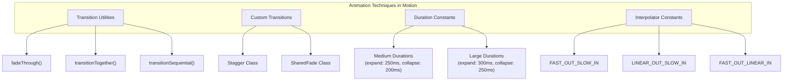

Sources: [Motion/app/src/main/java/com/example/android/motion/demo/Transitions.kt](), [Motion/app/src/main/java/com/example/android/motion/demo/Durations.kt](), [Motion/app/src/main/java/com/example/android/motion/demo/stagger/Stagger.kt]()

## Core Animation Utilities

### Transition Utility Functions

The Motion app provides several utility functions that make it easier to create and compose transitions:

```mermaid
classDiagram
    class "Transitions.kt" {
        +fadeThrough()
        +transitionTogether()
        +transitionSequential()
        +operator functions
    }
    
    class "TransitionSet" {
        +addTransition()
        +getTransitionAt()
        +transitionCount
    }
    
    class "CustomTransitionFunctions" {
        +operator functions
        +forEach()
        +forEachIndexed()
        +iterator()
    }
    
    "Transitions.kt" --> "TransitionSet" : extends
    "Transitions.kt" --> "CustomTransitionFunctions" : implements
```

Sources: [Motion/app/src/main/java/com/example/android/motion/demo/Transitions.kt]()

#### Key Utility Functions

| Function | Description | Source |
|----------|-------------|--------|
| `fadeThrough()` | Creates a Material Design fade through transition | [Transitions.kt:37-46]() |
| `transitionTogether()` | Creates a TransitionSet with ORDERING_TOGETHER | [Transitions.kt:48-53]() |
| `transitionSequential()` | Creates a SequentialTransitionSet | [Transitions.kt:55-59]() |
| Operator functions | Adds syntactic sugar for TransitionSet manipulation | [Transitions.kt:61-93]() |

Sources: [Motion/app/src/main/java/com/example/android/motion/demo/Transitions.kt]()

### Animation Durations

The Motion app defines standard durations for animations based on Material Design guidelines:

| Constant | Value | Purpose |
|----------|-------|---------|
| `MEDIUM_EXPAND_DURATION` | 250ms | Medium-sized expanding animations |
| `MEDIUM_COLLAPSE_DURATION` | 200ms | Medium-sized collapsing animations |
| `LARGE_EXPAND_DURATION` | 300ms | Large-sized expanding animations |
| `LARGE_COLLAPSE_DURATION` | 250ms | Large-sized collapsing animations |

Sources: [Motion/app/src/main/java/com/example/android/motion/demo/Durations.kt]()

## Custom Transition Implementations

### Fade Through Transition

The `fadeThrough()` function creates a transition that implements the Material Design fade through pattern. In this pattern, one element fades out completely before a new one fades in, allowing the background to show through during the transition.

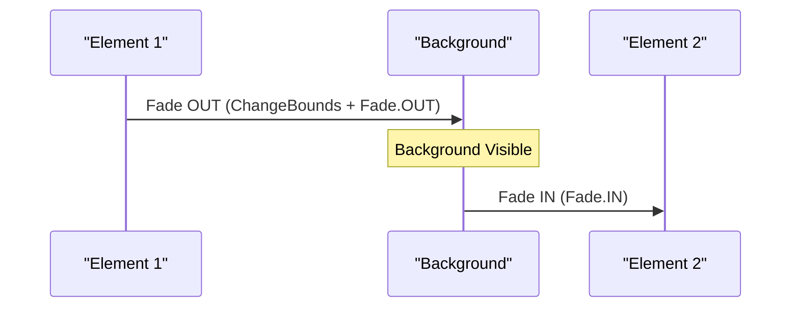

Implementation:

```kotlin
fun fadeThrough(): Transition {
    return transitionTogether {
        interpolator = FAST_OUT_SLOW_IN
        this += ChangeBounds()
        this += transitionSequential {
            addTransition(Fade(Fade.OUT))
            addTransition(Fade(Fade.IN))
        }
    }
}
```

Usage example from `FadeThroughActivity`:

```kotlin
val fadeThrough = fadeThrough()
TransitionManager.beginDelayedTransition(
    card,
    fadeThrough.setDuration(MEDIUM_EXPAND_DURATION)
)
contact.isVisible = false
cheese.isVisible = true
```

Sources: [Motion/app/src/main/java/com/example/android/motion/demo/Transitions.kt:37-46](), [Motion/app/src/main/java/com/example/android/motion/demo/fadethrough/FadeThroughActivity.kt:58-77]()

### Stagger Transition

The `Stagger` class is a custom transition that extends the `Fade` transition to create a staggered animation effect. It adds a slight slide-up effect to the fade-in animation and uses `SidePropagation` to create a staggered effect.

```mermaid
classDiagram
    class "Fade" {
        +createAnimator()
    }
    
    class "Stagger" {
        +duration
        +interpolator
        +propagation
        +createAnimator()
    }
    
    "Fade" <|-- "Stagger" : extends
```

Key aspects of the `Stagger` implementation:

1. Extends `Fade(IN)` to inherit fade-in behavior
2. Sets a custom duration and interpolator
3. Uses `SidePropagation` with a specific propagation speed to create the stagger effect
4. Overrides `createAnimator()` to combine fade-in with translation animation

Sources: [Motion/app/src/main/java/com/example/android/motion/demo/stagger/Stagger.kt]()

### Shared Element Transitions

The Motion app demonstrates shared element transitions in the `sharedelement` package. These transitions create a seamless connection between different screens by animating common elements between them.

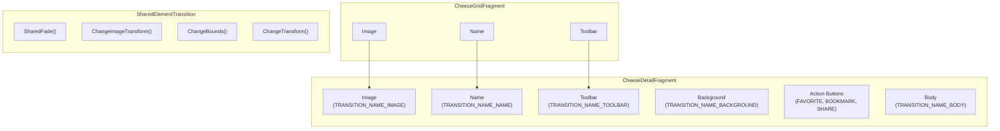

Key components:

1. Setting transition names for shared elements using `ViewCompat.setTransitionName()`
2. Creating a custom shared element transition with multiple components:
   - `SharedFade()`
   - `ChangeImageTransform()`
   - `ChangeBounds()`
   - `ChangeTransform()`
3. Handling postponed transitions to ensure elements are ready for animation

Sources: [Motion/app/src/main/java/com/example/android/motion/demo/sharedelement/CheeseGridFragment.kt](), [Motion/app/src/main/java/com/example/android/motion/demo/sharedelement/CheeseDetailFragment.kt]()

## Animation Design Patterns

The Motion app implements several Material Design motion patterns:

| Pattern | Description | Implementation | Demo |
|---------|-------------|----------------|------|
| Fade Through | Element fades out before new one fades in | `fadeThrough()` | `FadeThroughActivity` |
| Stagger | Temporal offsets applied to group elements | `Stagger` class | `StaggerActivity` |
| Shared Element | Elements persist across screens | Custom transition in `CheeseDetailFragment` | `SharedElementActivity` |
| Container Transform | Container morphs between screens | Custom implementation | `ContainerTransformActivity` |
| Dissolve | Smooth transition for overlapping elements | `Dissolve` implementation | `DissolveActivity` |

Sources: [Motion/app/src/main/res/values/demos.xml](), [Motion/README.md]()

## Implementation Best Practices

Based on the code examined, here are some best practices for implementing animations in Android:

1. **Use utility functions** to simplify the creation of complex transitions
2. **Follow Material Design guidelines** for animation durations and easing curves
3. **Leverage TransitionSet** to combine multiple transitions
4. **Set appropriate interpolators** for natural-feeling animations
5. **Use postponed transitions** when working with images or complex layouts
6. **Set transition names** for shared elements carefully and consistently
7. **Consider performance** by using appropriate durations and transition types

## Animation Integration with Android Framework

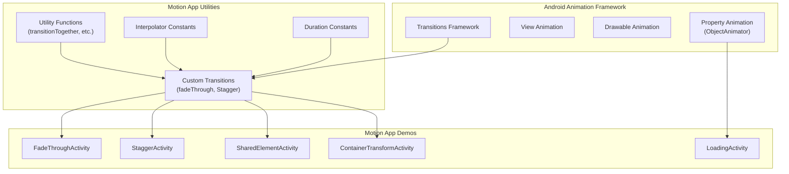

Sources: [Motion/app/src/main/res/values/demos.xml](), [Motion/app/src/main/java/com/example/android/motion/demo/Transitions.kt](), [Motion/app/src/main/java/com/example/android/motion/demo/Durations.kt]()

## Conclusion

The Motion app provides a comprehensive set of animation techniques that implement Material Design motion patterns. Through custom transitions and utility functions, it simplifies the process of creating complex, visually appealing animations. The techniques demonstrated in this app can be adapted and applied to other Android applications to create engaging user experiences that follow Material Design principles.

---

# Page: Loading Animations

# Loading Animations

<details>
<summary>Relevant source files</summary>

The following files were used as context for generating this wiki page:

- [Motion/.idea/codeStyles/Project.xml](Motion/.idea/codeStyles/Project.xml)
- [Motion/.idea/codeStyles/codeStyleConfig.xml](Motion/.idea/codeStyles/codeStyleConfig.xml)
- [Motion/app/src/main/java/com/example/android/motion/demo/loading/CheeseAdapter.kt](Motion/app/src/main/java/com/example/android/motion/demo/loading/CheeseAdapter.kt)
- [Motion/app/src/main/java/com/example/android/motion/demo/loading/CheeseDataSource.kt](Motion/app/src/main/java/com/example/android/motion/demo/loading/CheeseDataSource.kt)
- [Motion/app/src/main/java/com/example/android/motion/demo/loading/LoadingActivity.kt](Motion/app/src/main/java/com/example/android/motion/demo/loading/LoadingActivity.kt)
- [Motion/app/src/main/java/com/example/android/motion/demo/loading/LoadingViewModel.kt](Motion/app/src/main/java/com/example/android/motion/demo/loading/LoadingViewModel.kt)
- [Motion/app/src/main/res/drawable/image_placeholder.xml](Motion/app/src/main/res/drawable/image_placeholder.xml)
- [Motion/app/src/main/res/drawable/text_placeholder.xml](Motion/app/src/main/res/drawable/text_placeholder.xml)
- [Motion/app/src/main/res/layout/cheese_list_item.xml](Motion/app/src/main/res/layout/cheese_list_item.xml)
- [Motion/app/src/main/res/layout/loading_activity.xml](Motion/app/src/main/res/layout/loading_activity.xml)
- [Motion/app/src/main/res/menu/loading.xml](Motion/app/src/main/res/menu/loading.xml)

</details>


## Purpose and Scope

This document details the implementation of loading animations with placeholders in the Motion app. It covers the transition between loading state and content state, focusing on how the Android Animation Samples repository demonstrates animated loading placeholders. The implementation showcases best practices for providing visual feedback during data loading operations.

## Overview

The loading animation system demonstrates a common UI pattern where placeholder content is shown with animations while data is being loaded asynchronously. Once the data is ready, the system transitions smoothly from the placeholder state to the content state.

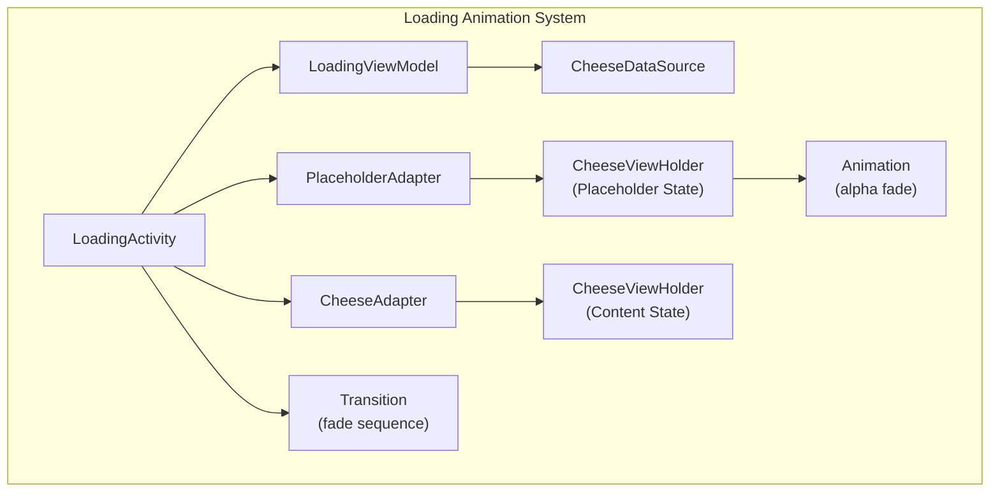

Sources: [Motion/app/src/main/java/com/example/android/motion/demo/loading/LoadingActivity.kt:1-106](), [Motion/app/src/main/java/com/example/android/motion/demo/loading/LoadingViewModel.kt:1-46](), [Motion/app/src/main/java/com/example/android/motion/demo/loading/CheeseAdapter.kt:1-108](), [Motion/app/src/main/java/com/example/android/motion/demo/loading/CheeseDataSource.kt:1-61]()

## Key Components

### Activity and Data Management

The `LoadingActivity` coordinates the display of data and the transition between loading and loaded states. It works with the `LoadingViewModel` which manages data retrieval through the Android Paging library.

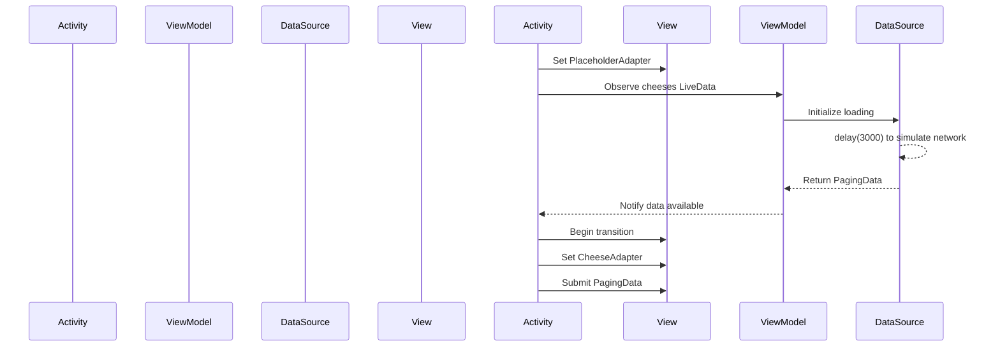

Sources: [Motion/app/src/main/java/com/example/android/motion/demo/loading/LoadingActivity.kt:38-88](), [Motion/app/src/main/java/com/example/android/motion/demo/loading/LoadingViewModel.kt:16-46](), [Motion/app/src/main/java/com/example/android/motion/demo/loading/CheeseDataSource.kt:30-55]()

### Adapters and ViewHolders

The loading animation system uses two adapters:

1. `PlaceholderAdapter`: Shows placeholder UI elements with animation during loading
2. `CheeseAdapter`: Displays actual content once data is loaded

Both adapters use the same `CheeseViewHolder` class which handles both states.

| Adapter | Purpose | Implementation |
|---------|---------|----------------|
| PlaceholderAdapter | Shows placeholder UI with animations | Returns placeholder views with infinite count |
| CheeseAdapter | Shows actual content | PagingDataAdapter that displays the loaded cheese data |

Sources: [Motion/app/src/main/java/com/example/android/motion/demo/loading/CheeseAdapter.kt:34-68]()

## Loading Animation Implementation

### Placeholder Animation

The placeholder animation consists of fading UI elements that give users visual feedback that content is loading. The animation is implemented in the `CheeseViewHolder` class:

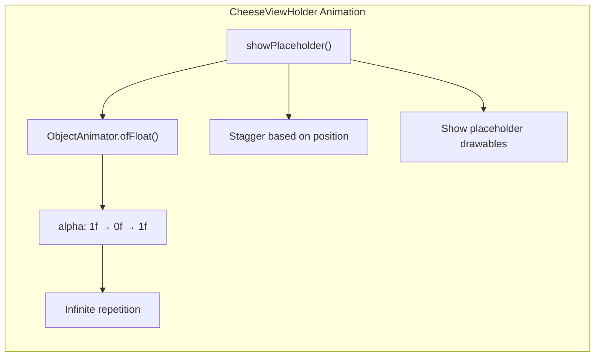

Key aspects of the animation implementation:

1. An `ObjectAnimator` fades the view's alpha from 1.0 to 0.0 and back to 1.0
2. The animation is set to repeat infinitely
3. The animation timing is staggered based on the item's position in the list
4. Placeholder drawables are used for both the image and the text

Sources: [Motion/app/src/main/java/com/example/android/motion/demo/loading/CheeseAdapter.kt:72-99](), [Motion/app/src/main/res/drawable/image_placeholder.xml:1-22](), [Motion/app/src/main/res/drawable/text_placeholder.xml:1-23]()

### Key Animation Code

The core animation is set up in the `CheeseViewHolder` class:

```kotlin
private val animation = ObjectAnimator.ofFloat(itemView, View.ALPHA, 1f, 0f, 1f).apply {
    repeatCount = ObjectAnimator.INFINITE
    duration = FADE_DURATION
    // Reset the alpha on animation end.
    doOnEnd { itemView.alpha = 1f }
}
```

When showing placeholders, the animation is staggered by adapting its current play time:

```kotlin
animation.currentPlayTime = 
    (SystemClock.elapsedRealtime() - bindingAdapterPosition * 30L) % FADE_DURATION
animation.start()
```

Sources: [Motion/app/src/main/java/com/example/android/motion/demo/loading/CheeseAdapter.kt:82-87](), [Motion/app/src/main/java/com/example/android/motion/demo/loading/CheeseAdapter.kt:92-94]()

## Transitioning Between States

### Fade Transition

When data is loaded, the activity transitions from the placeholder adapter to the content adapter using a sequential fade transition:

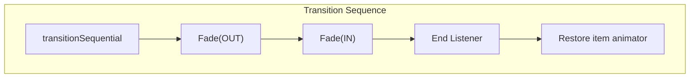

The transition is implemented using:

```kotlin
private val fade = transitionSequential {
    duration = LARGE_EXPAND_DURATION
    interpolator = FAST_OUT_SLOW_IN
    this += Fade(Fade.OUT)
    this += Fade(Fade.IN)
    addListener(object : TransitionListenerAdapter() {
        override fun onTransitionEnd(transition: Transition) {
            if (savedItemAnimator != null) {
                list.itemAnimator = savedItemAnimator
            }
        }
    })
}
```

Sources: [Motion/app/src/main/java/com/example/android/motion/demo/loading/LoadingActivity.kt:46-58]()

### Transition Trigger

The transition is triggered when the `cheeses` LiveData emits a new value:

```kotlin
viewModel.cheeses.observe(this) { cheeses ->
    if (list.adapter != cheeseAdapter) {
        list.adapter = cheeseAdapter
        savedItemAnimator = list.itemAnimator
        list.itemAnimator = null
        TransitionManager.beginDelayedTransition(list, fade)
    }
    cheeseAdapter.submitData(lifecycle, cheeses)
}
```

Sources: [Motion/app/src/main/java/com/example/android/motion/demo/loading/LoadingActivity.kt:79-87]()

## Data Loading Simulation

To demonstrate the loading animations effectively, the `CheeseDataSource` deliberately introduces a delay:

```kotlin
// Simulate slow network.
delay(3000)
```

This simulates a slow network request, giving users time to observe the loading animation before the actual content is displayed.

Sources: [Motion/app/src/main/java/com/example/android/motion/demo/loading/CheeseDataSource.kt:42]()

## Refresh Action

The loading animation can be manually triggered through the refresh menu action:

```kotlin
override fun onOptionsItemSelected(item: MenuItem): Boolean {
    return when (item.itemId) {
        R.id.action_refresh -> {
            TransitionManager.beginDelayedTransition(list, fade)
            list.adapter = placeholderAdapter
            viewModel.refresh()
            true
        }
        else -> super.onOptionsItemSelected(item)
    }
}
```

Sources: [Motion/app/src/main/java/com/example/android/motion/demo/loading/LoadingActivity.kt:95-105](), [Motion/app/src/main/res/menu/loading.xml:1-26]()

## Implementation Best Practices

1. **Shared ViewHolder**: Both adapters use the same ViewHolder class, simplifying the implementation
2. **Animated Transitions**: Use `TransitionManager` to smoothly transition between states
3. **Staggered Animations**: Animation timing is staggered to create a more pleasing visual effect
4. **Placeholder Drawables**: Simple shape drawables are used as placeholders for images and text
5. **ViewModel Separation**: Data loading is managed by the ViewModel, keeping the UI logic clean

Sources: [Motion/app/src/main/java/com/example/android/motion/demo/loading/CheeseAdapter.kt:72-107](), [Motion/app/src/main/java/com/example/android/motion/demo/loading/LoadingActivity.kt:46-58](), [Motion/app/src/main/java/com/example/android/motion/demo/loading/LoadingViewModel.kt:28-45]()

## Visual Structure

The loading animation affects both image and text elements in each list item:

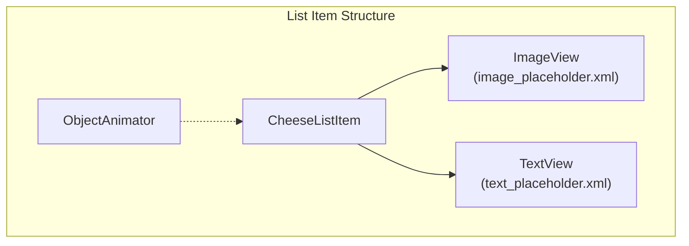

Sources: [Motion/app/src/main/res/layout/cheese_list_item.xml:1-49](), [Motion/app/src/main/res/drawable/image_placeholder.xml:1-22](), [Motion/app/src/main/res/drawable/text_placeholder.xml:1-23]()

## Conclusion

The Loading Animations implementation in the Motion app demonstrates an effective way to provide visual feedback during data loading operations. By combining placeholder UI elements with staggered fade animations and smooth transitions, the system creates a polished user experience even when waiting for data to load.

---

# Page: Staggered Animations

# Staggered Animations

<details>
<summary>Relevant source files</summary>

The following files were used as context for generating this wiki page:

- [Motion/app/src/main/java/com/example/android/motion/demo/stagger/CheeseListAdapter.kt](Motion/app/src/main/java/com/example/android/motion/demo/stagger/CheeseListAdapter.kt)
- [Motion/app/src/main/java/com/example/android/motion/demo/stagger/CheeseListViewModel.kt](Motion/app/src/main/java/com/example/android/motion/demo/stagger/CheeseListViewModel.kt)
- [Motion/app/src/main/java/com/example/android/motion/demo/stagger/StaggerActivity.kt](Motion/app/src/main/java/com/example/android/motion/demo/stagger/StaggerActivity.kt)
- [Motion/app/src/main/res/drawable/ic_refresh.xml](Motion/app/src/main/res/drawable/ic_refresh.xml)
- [Motion/app/src/main/res/layout/stagger_activity.xml](Motion/app/src/main/res/layout/stagger_activity.xml)
- [Motion/app/src/main/res/menu/stagger.xml](Motion/app/src/main/res/menu/stagger.xml)

</details>


## Purpose and Scope

This document explains how staggered animations are implemented in the Motion app. Staggered animations apply temporal offsets to a group of elements in sequence, creating a cascade effect that focuses attention briefly on each item. This technique is useful for revealing significant content or highlighting affordances within a group, particularly for list items.

For information about Container Transform animations, see [Container Transform](#2.4).

## What are Staggered Animations?

Staggered animations create visual interest by animating similar elements with slight timing delays between each item. This creates a flowing, sequential appearance that can guide the user's attention through a collection of items.

According to Material Design, stagger creates a cascade effect that focuses attention briefly on each element. It can reveal significant content or highlight affordances within a group.

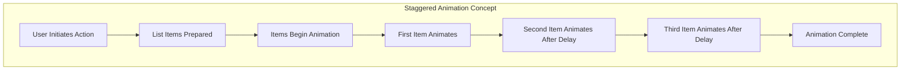

Sources: [Motion/app/src/main/java/com/example/android/motion/demo/stagger/StaggerActivity.kt:32-38]()

## Implementation Architecture

The staggered animation implementation in the Motion app consists of several key components that work together:

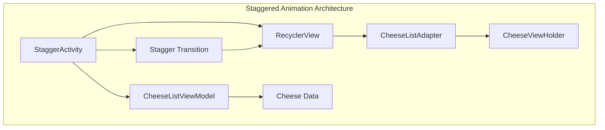

Sources: [Motion/app/src/main/java/com/example/android/motion/demo/stagger/StaggerActivity.kt:43-98]()

### Activity and Layout

The `StaggerActivity` serves as the controller for the staggered animation demo. It sets up the RecyclerView, creates the stagger transition, and observes the data changes from the ViewModel.

The activity layout (`stagger_activity.xml`) consists of a Coordinator Layout with an AppBar and a RecyclerView for the list items.

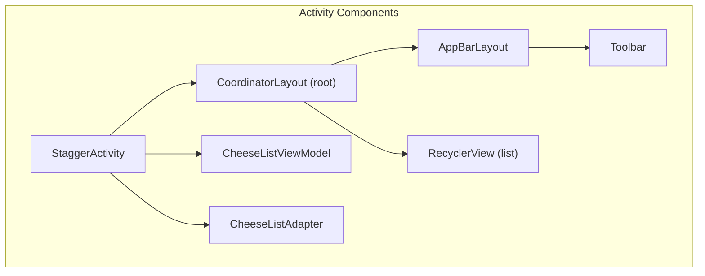

Sources: 
- [Motion/app/src/main/java/com/example/android/motion/demo/stagger/StaggerActivity.kt:43-98]()
- [Motion/app/src/main/res/layout/stagger_activity.xml:17-53]()

## Stagger Animation Implementation

### Animation Workflow

The staggered animation in the Motion app follows this process:

1. The ViewModel provides the list of items (cheeses) to display
2. The activity applies a stagger transition to the RecyclerView
3. The adapter receives the new list of items
4. Items appear with a staggered effect due to the transition

```mermaid
sequenceDiagram
    participant User
    participant Activity as "StaggerActivity"
    participant ViewModel as "CheeseListViewModel"
    participant Transition as "Stagger Transition"
    participant RecyclerView
    participant Adapter as "CheeseListAdapter"
    
    User->>Activity: Initiates (opens screen or refreshes)
    Activity->>ViewModel: Request data
    Note over ViewModel: Simulates loading delay
    ViewModel->>Activity: Returns cheese list
    Activity->>Transition: beginDelayedTransition(list, stagger)
    Activity->>Adapter: submitList(cheeses)
    Adapter->>RecyclerView: Updates view holders
    Note over RecyclerView: Items appear with staggered effect
```

Sources:
- [Motion/app/src/main/java/com/example/android/motion/demo/stagger/StaggerActivity.kt:70-77]()
- [Motion/app/src/main/java/com/example/android/motion/demo/stagger/CheeseListViewModel.kt:40-46]()

### Key Implementation Details

#### 1. Setting Up the RecyclerView

The `StaggerActivity` configures a RecyclerView with a custom `ItemAnimator` to disable the default RecyclerView's add animations and let the stagger transition handle the animation instead:

```
list.itemAnimator = object : DefaultItemAnimator() {
    override fun animateAdd(holder: RecyclerView.ViewHolder?): Boolean {
        dispatchAddFinished(holder)
        dispatchAddStarting(holder)
        return false
    }
}
```

Sources:
- [Motion/app/src/main/java/com/example/android/motion/demo/stagger/StaggerActivity.kt:62-68]()

#### 2. Creating and Applying the Stagger Transition

The stagger transition is created and applied before updating the list:

```
val stagger = Stagger()
// ...
TransitionManager.beginDelayedTransition(list, stagger)
adapter.submitList(cheeses)
```

This ensures that when the list is updated with new items, the stagger transition is applied to create the staggered appearance effect.

Sources:
- [Motion/app/src/main/java/com/example/android/motion/demo/stagger/StaggerActivity.kt:71-76]()

#### 3. ViewModel for Data Management

The `CheeseListViewModel` manages the data and simulates a loading delay before providing the list of items:

```mermaid
graph TD
    subgraph "Data Flow"
        A["StaggerActivity<br>refresh() called"] --> B["CheeseListViewModel<br>refresh()"]
        B --> C["Simulate delay<br>delay(300L)"]
        C --> D["Update LiveData<br>_cheeses.value = Cheese.ALL"]
        D --> E["LiveData Observer<br>in StaggerActivity"]
        E --> F["Apply Stagger Transition<br>TransitionManager.beginDelayedTransition()"]
        F --> G["Update Adapter<br>adapter.submitList()"]
    end
```

Sources:
- [Motion/app/src/main/java/com/example/android/motion/demo/stagger/CheeseListViewModel.kt:27-47]()
- [Motion/app/src/main/java/com/example/android/motion/demo/stagger/StaggerActivity.kt:73-77]()

#### 4. Refresh Functionality

The `StaggerActivity` provides a refresh action in the options menu that demonstrates the stagger effect again by:
1. Clearing the current list (setting it to empty)
2. Requesting a refresh from the ViewModel

```mermaid
sequenceDiagram
    participant User
    participant Activity as "StaggerActivity"
    participant ViewModel as "CheeseListViewModel"
    
    User->>Activity: Taps refresh button
    Activity->>ViewModel: empty()
    Note over Activity,ViewModel: List is cleared
    Activity->>ViewModel: refresh()
    Note over ViewModel: Load data after delay
    ViewModel->>Activity: List updated via LiveData
    Note over Activity: Stagger transition applied
```

Sources:
- [Motion/app/src/main/java/com/example/android/motion/demo/stagger/StaggerActivity.kt:80-97]()
- [Motion/app/src/main/res/menu/stagger.xml:19-24]()

## Technical Considerations

### RecyclerView Animation Customization

The staggered animation implementation replaces RecyclerView's default item animations with a custom transition. This is achieved by:

1. Creating a custom `ItemAnimator` that disables RecyclerView's built-in add animations
2. Using `TransitionManager.beginDelayedTransition()` to apply the stagger transition before updating the list

This approach allows for more control over how the items appear in the list.

Sources:
- [Motion/app/src/main/java/com/example/android/motion/demo/stagger/StaggerActivity.kt:62-68]()

### Transition Timing

The staggered animation is synchronized with data loading through:

1. A simulated delay in the ViewModel (`delay(300L)`) to mimic real-world data loading
2. Applying the transition right before submitting the new list to the adapter

This ensures that the animation starts when the data is ready to be displayed.

Sources:
- [Motion/app/src/main/java/com/example/android/motion/demo/stagger/CheeseListViewModel.kt:43]()
- [Motion/app/src/main/java/com/example/android/motion/demo/stagger/StaggerActivity.kt:75-76]()

## Example Usage

To implement staggered animations in your own app:

1. Create a custom `Stagger` transition class
2. Configure your RecyclerView to disable default animations
3. Apply the stagger transition using `TransitionManager.beginDelayedTransition()` before updating the adapter's data
4. Submit the new list to the adapter

The staggered animation effect will be applied to the list items as they appear.

Sources:
- [Motion/app/src/main/java/com/example/android/motion/demo/stagger/StaggerActivity.kt:62-76]()

---

# Page: Container Transform

# Container Transform

<details>
<summary>Relevant source files</summary>

The following files were used as context for generating this wiki page:

- [Motion/app/src/main/res/layout/cheese_article_fragment.xml](Motion/app/src/main/res/layout/cheese_article_fragment.xml)
- [Motion/app/src/main/res/layout/cheese_card_fragment.xml](Motion/app/src/main/res/layout/cheese_card_fragment.xml)

</details>


Container Transform is a Material Design motion pattern that provides visual continuity when transitioning between UI elements. This page documents how the Motion app implements container transform transitions between a summary card and a detailed article view.

## Purpose and Overview

The Container Transform pattern creates a smooth, connected transition between UI surfaces that contain related content. It helps users understand the relationship between different screens or components by visually transforming one container into another.

In this implementation, a MaterialCardView containing a cheese image and summary expands into a full-screen detailed article view, maintaining visual continuity throughout the transition.

```mermaid
graph LR
    subgraph "Container Transform Flow"
        A["CheeseCardFragment
        (Compact Card View)"] -->|"Transform animation"| B["CheeseArticleFragment
        (Expanded Detail View)"]
    end
```

Sources: [Motion/app/src/main/res/layout/cheese_card_fragment.xml:1-104](), [Motion/app/src/main/res/layout/cheese_article_fragment.xml:1-139]()

## UI Components

The Container Transform implementation involves two main UI components:

### Source Container: Card View

The source container is a `MaterialCardView` with a fixed height of 128dp that displays:
- A cheese image (128dp width)
- Cheese name (title)
- Brief description (caption)

This compact card serves as the starting point for the transform animation.

### Destination Container: Article View

The destination is a full-screen view with:
- An expanded header image (256dp height)
- Larger title text
- Multiple paragraphs of detailed description
- Scrollable content
- AppBar with navigation controls

```mermaid
graph TD
    subgraph "Source: CheeseCardFragment"
        Card["MaterialCardView"] --> CardContent["ConstraintLayout"]
        CardContent --> Image["ImageView (128dp)"]
        CardContent --> Name["TextView (name)"]
        CardContent --> Caption["TextView (caption)"]
    end

    subgraph "Destination: CheeseArticleFragment"
        Background["FrameLayout (background)"] --> Coordinator["CoordinatorLayout"]
        Coordinator --> AppBar["AppBarLayout"]
        Coordinator --> Scroll["NestedScrollView"]
        
        AppBar --> CollapsingToolbar["CollapsingToolbarLayout"]
        CollapsingToolbar --> HeaderImage["ImageView (256dp)"]
        CollapsingToolbar --> Toolbar["Toolbar"]
        
        Scroll --> Content["LinearLayout (content)"]
        Content --> TitleText["TextView (name)"]
        Content --> Desc1["TextView (description_1)"]
        Content --> Desc2["TextView (description_2)"]
        Content --> Desc3["TextView (description_3)"]
        Content --> Desc4["TextView (description_4)"]
    end
```

Sources: [Motion/app/src/main/res/layout/cheese_card_fragment.xml:45-100](), [Motion/app/src/main/res/layout/cheese_article_fragment.xml:28-137]()

## Implementation Details

### Shared Elements

The container transform relies on specific elements that are visually shared between both layouts to create the transformation effect:

1. **Image**: Transitions from a 128dp square in the card to a 256dp height header
2. **Name/Title**: Grows and repositions from the card to the article header
3. **Background Surface**: Expands from card dimensions to fill the screen

These shared elements maintain visual continuity during the transition, while other elements (like the extended description) fade in.

```mermaid
flowchart TD
    subgraph "Key Shared Elements"
        direction LR
        A1["card#image"] <--> B1["background#image"]
        A2["card_content#name"] <--> B2["content#name"]
        A3["card"] <--> B3["background"]
    end
```

Sources: [Motion/app/src/main/res/layout/cheese_card_fragment.xml:46-81](), [Motion/app/src/main/res/layout/cheese_article_fragment.xml:21-91]()

### Layout Structure Comparison

| Card Fragment (Source) | Article Fragment (Destination) |
|------------------------|--------------------------------|
| CoordinatorLayout      | FrameLayout (background)       |
| MaterialCardView       | CoordinatorLayout              |
| ConstraintLayout       | AppBarLayout + NestedScrollView |
| ImageView (128dp)      | ImageView (256dp)              |
| TextView (name)        | TextView (name)                |
| TextView (caption)     | Multiple description TextViews |

Sources: [Motion/app/src/main/res/layout/cheese_card_fragment.xml:17-104](), [Motion/app/src/main/res/layout/cheese_article_fragment.xml:17-139]()

## Material Container Transform Implementation

The Container Transform implementation follows the Material Design motion specification, using the MaterialContainerTransform class from the Material Components library. This creates a seamless morphing animation between the source and destination containers.

```mermaid
sequenceDiagram
    participant User
    participant CardFragment as "CheeseCardFragment"
    participant Navigation as "Navigation Component"
    participant Transform as "MaterialContainerTransform"
    participant ArticleFragment as "CheeseArticleFragment"
    
    User->>CardFragment: Taps card
    CardFragment->>Navigation: Navigate to article with transitions
    Navigation->>Transform: Create container transform
    Transform->>Transform: Calculate start/end bounds
    Transform->>Transform: Create shape mask animation
    Transform->>ArticleFragment: Apply transition
    ArticleFragment->>User: Display expanded content
```

### Key Animation Attributes

The container transform animation exhibits several important characteristics:

1. **Shape Transformation**: The card's rounded corners gradually transform to the article view's shape
2. **Elevation Change**: The card elevation increases as it expands to the article view
3. **Content Fade**: Content not present in both views fades in/out during transition
4. **Coordinated Motion**: All elements move and resize together in a cohesive animation

## Navigation Integration

The Container Transform is integrated with the Android Navigation Component, as indicated by the navigation graph reference in the provided XML files. The transition is triggered when navigating from the card fragment to the article fragment.

Sources: [Motion/app/src/main/res/layout/cheese_card_fragment.xml:17-43](), [Motion/app/src/main/res/layout/cheese_article_fragment.xml:28-66]()

## Best Practices

When implementing Container Transform:

1. **Identify shared elements**: Ensure visual continuity by identifying elements that exist in both the source and destination layouts
2. **Maintain aspect ratios**: Keep consistent aspect ratios for images when possible
3. **Use appropriate durations**: Follow Material Design guidelines for animation duration
4. **Handle back navigation**: Implement reverse animations for back navigation
5. **Consider elevation**: Use elevation changes to reinforce the transformation hierarchy

## Related Components

For information about other animation techniques in the Motion app, see:
- [Loading Animations](#2.2) for content loading patterns
- [Staggered Animations](#2.3) for list item animations

---

# Page: MotionCompose App

# MotionCompose App

<details>
<summary>Relevant source files</summary>

The following files were used as context for generating this wiki page:

- [MotionCompose/README.md](MotionCompose/README.md)
- [MotionCompose/app/build.gradle](MotionCompose/app/build.gradle)
- [MotionCompose/app/src/main/java/com/example/android/compose/motion/demo/Cheese.kt](MotionCompose/app/src/main/java/com/example/android/compose/motion/demo/Cheese.kt)
- [MotionCompose/app/src/main/java/com/example/android/compose/motion/demo/Demo.kt](MotionCompose/app/src/main/java/com/example/android/compose/motion/demo/Demo.kt)
- [MotionCompose/app/src/main/java/com/example/android/compose/motion/demo/fadethrough/FadeThroughDemo.kt](MotionCompose/app/src/main/java/com/example/android/compose/motion/demo/fadethrough/FadeThroughDemo.kt)
- [MotionCompose/app/src/main/java/com/example/android/compose/motion/demo/loading/CheeseDataSource.kt](MotionCompose/app/src/main/java/com/example/android/compose/motion/demo/loading/CheeseDataSource.kt)
- [MotionCompose/app/src/main/java/com/example/android/compose/motion/demo/loading/LoadingViewModel.kt](MotionCompose/app/src/main/java/com/example/android/compose/motion/demo/loading/LoadingViewModel.kt)
- [MotionCompose/app/src/main/java/com/example/android/compose/motion/demo/visibility/AnimatedVisibilityExample.kt](MotionCompose/app/src/main/java/com/example/android/compose/motion/demo/visibility/AnimatedVisibilityExample.kt)
- [MotionCompose/app/src/main/java/com/example/android/compose/motion/ui/home/Home.kt](MotionCompose/app/src/main/java/com/example/android/compose/motion/ui/home/Home.kt)
- [MotionCompose/build.gradle](MotionCompose/build.gradle)
- [MotionCompose/gradle/wrapper/gradle-wrapper.properties](MotionCompose/gradle/wrapper/gradle-wrapper.properties)

</details>


The MotionCompose App is a collection of demonstrations showcasing Material Design Motion patterns implemented in Jetpack Compose. This document covers the architecture, components, and implementation details of the MotionCompose app. For information about traditional Views-based animation implementations, see the [Motion App](#2) documentation.

## System Architecture

The MotionCompose app follows a simple architecture centered around a demo registry system that organizes various animation demonstrations into a catalog. The app provides a unified interface for browsing, selecting, and viewing different animation techniques.

### High-Level Architecture Diagram

```mermaid
graph TD
    Main["Main.kt (App Entry Point)"] --> HomeScreen["Home Screen"]
    Main --> Navigation["Screen Navigation"]
    
    HomeScreen --> DemoList["Demo List"]
    DemoList --> DemoCards["Demo Cards"]
    
    Navigation --> DemoRegistry["Demo Registry (Demo.kt)"]
    
    DemoRegistry --> FadeDemo["Fade Demo"]
    DemoRegistry --> FadeThroughDemo["Fade Through Demo"]
    DemoRegistry --> SharedTransformDemo["Shared Transform Demo"]
    DemoRegistry --> SharedAxisDemo["Shared Axis Demo"] 
    DemoRegistry --> AnimVisibilityDemo["AnimatedVisibility Demo"]
    DemoRegistry --> LoadingDemo["Loading Demo"]
    DemoRegistry --> CustomCanvasDemo["Custom Canvas Animation Demo"]
    
    DemoRegistry -.defines APIs.-> ComposeAPIs["Compose Animation APIs"]
    ComposeAPIs --> AC["AnimatedContent"]
    ComposeAPIs --> AV["AnimatedVisibility"]
    ComposeAPIs --> UT["updateTransition"]
    ComposeAPIs --> A["Animatable"]
    ComposeAPIs --> P["Modifier.placeholder"]
```

Sources: [MotionCompose/app/src/main/java/com/example/android/compose/motion/demo/Demo.kt:28-117](), [MotionCompose/app/src/main/java/com/example/android/compose/motion/ui/home/Home.kt:48-157]()

## Demo Registry System

The core architectural component of the MotionCompose app is the Demo Registry, implemented as an enum class in Demo.kt. This registry serves as a central catalog of all available animation demonstrations.

```mermaid
classDiagram
    class Demo {
        <<enum>>
        title: String
        description: String
        apis: List~String~
        content: @Composable () -> Unit
        +Fade
        +FadeThrough
        +SharedTransform
        +SharedAxis
        +AnimatedVisibility
        +Loading
        +CustomCanvasAnimation
    }
    
    Demo --> FadeDemo
    Demo --> FadeThroughDemo
    Demo --> SharedTransformDemo
    Demo --> SharedAxisDemo
    Demo --> AnimatedVisibilityDemo
    Demo --> LoadingDemo
    Demo --> CustomCanvasAnimation
    
    class HomeScreen {
        onDemoSelected(demo: Demo) -> Unit
    }
    
    HomeScreen --> Demo : displays and navigates
```

Each demo in the registry contains:
- **title**: Display name of the demo (e.g., "Layout > Fade")
- **description**: Text explanation of the animation technique
- **apis**: List of Compose animation APIs used in the implementation
- **content**: Composable function that renders the actual demo

This design enables the app to:
1. Display a uniform list of demos on the home screen
2. Navigate to specific demos when selected
3. Associate each demo with relevant API information
4. Easily extend the app with new animation demonstrations

Sources: [MotionCompose/app/src/main/java/com/example/android/compose/motion/demo/Demo.kt:28-117]()

## Home Screen and Navigation

The home screen displays all registered demos as cards in a scrollable list, with each card showing the demo's title, description, and used APIs.

```markdown
| Component | Purpose |
|-----------|---------|
| `Home.kt` | Main screen implementation showing list of demos |
| `DemoList` | LazyColumn displaying demo cards |
| `DemoCard` | Surface component showing demo metadata |
| `ApiChip` | Visual component showing which APIs are used |
```

When a user selects a demo card, the `onDemoSelected` callback is triggered, which navigates to the selected demo's content screen.

Sources: [MotionCompose/app/src/main/java/com/example/android/compose/motion/ui/home/Home.kt:48-157]()

## Animation Demonstrations

The MotionCompose app includes seven key animation demonstrations, each showcasing different animation techniques and Material Design motion patterns:

### 1. Fade

Demonstrates smooth fade animations for elements that fully overlap. Uses `AnimatedContent` API for implementation.

### 2. Fade Through

Implements the Material Design "fade through" pattern where one element fades out completely before a new one fades in. This demonstration implements the detailed timing specifications from Material Design:
- Exit animation: 3/8 of total duration with `FastOutLinearInEasing`
- Enter animation: 5/8 of total duration with `LinearOutSlowInEasing` 
- Enter animation starts after exit animation completes

Sources: [MotionCompose/app/src/main/java/com/example/android/compose/motion/demo/fadethrough/FadeThroughDemo.kt:90-162]()

### 3. Shared Transform

Shows complex layout transformations where elements transform as a single unit rather than animating independently. Implemented using `updateTransition` and `Transition.AnimatedContent`.

### 4. Shared Axis (Y-axis)

Demonstrates the shared axis pattern for transitions between UI elements with spatial or navigational relationships, specifically using Y-axis animation to reinforce sequential order.

### 5. Animated Visibility

A simple example showing how to animate the appearance and disappearance of a view using `AnimatedVisibility` with custom enter/exit animations.

Sources: [MotionCompose/app/src/main/java/com/example/android/compose/motion/demo/visibility/AnimatedVisibilityExample.kt:44-73]()

### 6. Loading

Shows placeholder UI animations for loading states, demonstrating how to provide visual feedback during content loading. Uses `Modifier.placeholder` and the Accompanist placeholder library.

Sources: [MotionCompose/app/src/main/java/com/example/android/compose/motion/demo/loading/LoadingViewModel.kt:19-26](), [MotionCompose/app/src/main/java/com/example/android/compose/motion/demo/loading/CheeseDataSource.kt:24-61]()

### 7. Custom Canvas Animation

Demonstrates creating custom loading animations using Canvas drawing APIs combined with `Animatable` to show sequential animations.

## Technical Implementation Pattern

Most demos in the MotionCompose app follow a consistent implementation pattern:

```mermaid
graph TD
    State["State Management"] --> ComposableFunction["Composable Function"]
    ComposableFunction --> AnimationAPI["Animation API"]
    AnimationAPI --> UIElements["UI Elements"]
    UIElements --> UserControls["User Controls/Toggles"]
    UserControls --> State
```

The pattern typically includes:

1. **State Management**: Defining state variables using `remember` and `mutableStateOf`
2. **Animation API**: Using appropriate Compose animation APIs
3. **UI Elements**: Composable UI components with animations applied
4. **User Controls**: Buttons or other controls to trigger state changes

For example, the FadeThrough demo:
- Defines an `expanded` state variable
- Uses `AnimatedContent` with a custom `fadeThrough()` transition specification
- Shows different content based on expansion state
- Provides a toggle button to switch between states

Sources: [MotionCompose/app/src/main/java/com/example/android/compose/motion/demo/fadethrough/FadeThroughDemo.kt:70-87]()

## Dependencies and Technology Stack

The MotionCompose app is built using:

```markdown
| Component | Version | Purpose |
|-----------|---------|---------|
| Jetpack Compose UI | 1.2.1 | UI framework |
| Compose Material3 | 1.0.0-alpha15 | Material Design components |
| Accompanist | 0.25.0 | Utilities for Compose |
| Lifecycle Components | 2.5.1 | ViewModel integration |
| Paging Compose | 1.0.0-alpha15 | Paging for loading demo |
```

The app requires a minimum SDK version of 21 (Android 5.0) and is built with Kotlin 1.7.10 using the Compose compiler version 1.3.0.

Sources: [MotionCompose/app/build.gradle:22-87](), [MotionCompose/build.gradle:17-28]()

## Demo Data

The animations use a consistent set of sample data across demos, primarily the "Cheese" data model which provides names and images for demonstration purposes.

```markdown
| Data Component | Purpose |
|----------------|---------|
| `Cheese` | Data class with id, name and image |
| `CheeseImages` | List of drawable resources for cheese images |
| `CheeseNames` | List of cheese names for demo content |
| `CheeseDataSource` | PagingSource implementation for loading demo |
```

The data source includes artificial delay (3000ms) to simulate network loading for the Loading demonstration.

Sources: [MotionCompose/app/src/main/java/com/example/android/compose/motion/demo/Cheese.kt:22-182](), [MotionCompose/app/src/main/java/com/example/android/compose/motion/demo/loading/CheeseDataSource.kt:24-61]()

## Conclusion

The MotionCompose App serves as a comprehensive showcase of implementing Material Design motion patterns using Jetpack Compose's animation APIs. Through its demo registry system and consistent implementation patterns, it demonstrates best practices for creating fluid, purposeful animations in modern Android applications. The app provides practical examples of translating Material Design motion specifications into functional implementations using Compose's declarative UI paradigm.

---

# Page: Compose Animation Demos

# Compose Animation Demos

<details>
<summary>Relevant source files</summary>

The following files were used as context for generating this wiki page:

- [MotionCompose/README.md](MotionCompose/README.md)
- [MotionCompose/app/src/main/java/com/example/android/compose/motion/demo/Cheese.kt](MotionCompose/app/src/main/java/com/example/android/compose/motion/demo/Cheese.kt)
- [MotionCompose/app/src/main/java/com/example/android/compose/motion/demo/Demo.kt](MotionCompose/app/src/main/java/com/example/android/compose/motion/demo/Demo.kt)
- [MotionCompose/app/src/main/java/com/example/android/compose/motion/demo/fadethrough/FadeThroughDemo.kt](MotionCompose/app/src/main/java/com/example/android/compose/motion/demo/fadethrough/FadeThroughDemo.kt)
- [MotionCompose/app/src/main/java/com/example/android/compose/motion/demo/loading/CheeseDataSource.kt](MotionCompose/app/src/main/java/com/example/android/compose/motion/demo/loading/CheeseDataSource.kt)
- [MotionCompose/app/src/main/java/com/example/android/compose/motion/demo/loading/LoadingViewModel.kt](MotionCompose/app/src/main/java/com/example/android/compose/motion/demo/loading/LoadingViewModel.kt)
- [MotionCompose/app/src/main/java/com/example/android/compose/motion/demo/visibility/AnimatedVisibilityExample.kt](MotionCompose/app/src/main/java/com/example/android/compose/motion/demo/visibility/AnimatedVisibilityExample.kt)

</details>


This document covers the animation techniques implemented in the Jetpack Compose-based MotionCompose app. It focuses on the demo registry system that organizes various animation examples showcasing Compose's animation capabilities. For information about traditional View-based animations, see [Motion App](#2) instead.

## Demo Registry Overview

The MotionCompose app uses a centralized registry system to organize all animation demos. This system is implemented through an enum class called `Demo` which serves as a catalog of all available animation demonstrations.

### Demo Registry Structure

```mermaid
classDiagram
    class "Demo" {
        +String title
        +String description
        +List~String~ apis
        +@Composable content()
    }
    
    "Demo" --> "FadeDemo" : content reference
    "Demo" --> "FadeThroughDemo" : content reference
    "Demo" --> "SharedTransformDemo" : content reference
    "Demo" --> "SharedAxisDemo" : content reference
    "Demo" --> "AnimatedVisibilityExample" : content reference
    "Demo" --> "LoadingDemo" : content reference
    "Demo" --> "CustomCanvasBouncyLoader" : content reference
    
    note for "Demo" "Enum class serving as\ncentral registry for all\nanimation demonstrations"
```

Sources: [MotionCompose/app/src/main/java/com/example/android/compose/motion/demo/Demo.kt:28-117]()

Each enum entry in the `Demo` class contains:
- `title`: Descriptive name of the animation demo
- `description`: Detailed explanation of the animation technique
- `apis`: List of Jetpack Compose animation APIs used in the implementation
- `content`: A Composable function that renders the actual demo

## Animation Categories

The animation demos are organized into three main categories, each showcasing different animation techniques and patterns:

```mermaid
graph TD
    subgraph "AnimationCategories"
        Layout["Layout Animations"]
        List["List Animations"]
        Custom["Custom Animations"]
    end
    
    subgraph "LayoutDemos"
        Fade["Fade"]
        FadeThrough["Fade Through"]
        SharedTransform["Shared Transform"]
        SharedAxis["Shared Axis"]
        AnimatedVisibility["Animated Visibility"]
    end
    
    subgraph "ListDemos"
        Loading["Loading"]
    end
    
    subgraph "CustomDemos"
        CustomCanvas["Custom Canvas Animation"]
    end
    
    Layout --> Fade
    Layout --> FadeThrough
    Layout --> SharedTransform
    Layout --> SharedAxis
    Layout --> AnimatedVisibility
    
    List --> Loading
    
    Custom --> CustomCanvas
```

Sources: [MotionCompose/app/src/main/java/com/example/android/compose/motion/demo/Demo.kt:34-116]()

## Layout Animation Demos

The Layout category contains animations related to transitions between different UI layouts and components.

### Fade Demo

The Fade demo showcases smooth transitions between elements that fully overlap each other. When a new element enters, it fades in over the current element.

**Key API used**: `AnimatedContent`

Sources: [MotionCompose/app/src/main/java/com/example/android/compose/motion/demo/Demo.kt:34-45]()

### Fade Through Demo

The Fade Through demo demonstrates a transition where one element fades out completely before a new one fades in. This technique is useful for transitions between elements that don't perfectly overlap.

```mermaid
sequenceDiagram
    participant "Element A" as A
    participant "Background" as BG
    participant "Element B" as B
    
    Note over A: Visible (100% opacity)
    Note over B: Not visible (0% opacity)
    
    A->>BG: Fade Out (300ms * 3/8)
    Note over A: 0% opacity
    Note over BG: Visible
    
    BG->>B: Fade In (300ms * 5/8)
    Note over B: Visible (100% opacity)
```

**Key implementation details**:
- Uses `AnimatedContent` with custom `ContentTransform`
- Implements fade out for initial content using `tween` with `FastOutLinearInEasing`
- Implements fade in for target content using `tween` with `LinearOutSlowInEasing`
- Carefully times the animation phases (3/8 of duration for exit, 5/8 for enter)

Sources: [MotionCompose/app/src/main/java/com/example/android/compose/motion/demo/Demo.kt:47-59](), [MotionCompose/app/src/main/java/com/example/android/compose/motion/demo/fadethrough/FadeThroughDemo.kt:107-121](), [MotionCompose/app/src/main/java/com/example/android/compose/motion/demo/fadethrough/FadeThroughDemo.kt:129-162]()

### Shared Transform Demo

The Shared Transform demo shows how to create smooth transitions from one layout to the next by transforming elements as a single unit, rather than animating independently.

**Key APIs used**: `updateTransition`, `Transition.AnimatedContent`

Sources: [MotionCompose/app/src/main/java/com/example/android/compose/motion/demo/Demo.kt:61-73]()

### Shared Axis Demo

The Shared Axis demo implements transitions between UI elements that have a spatial or navigational relationship. This demo specifically uses a shared transformation on the Y-axis to reinforce the sequential order of elements.

**Key API used**: `AnimatedContent`

Sources: [MotionCompose/app/src/main/java/com/example/android/compose/motion/demo/Demo.kt:75-86]()

### Animated Visibility Demo

The Animated Visibility demo shows how to animate the appearance and disappearance of UI elements using Compose's `AnimatedVisibility` API.

```mermaid
graph TD
    subgraph "AnimatedVisibilityExample"
        Toggle["Toggle Button"]
        AV["AnimatedVisibility\nContainer"]
        Image["Cheese Image"]
    end
    
    Toggle -->|"visible = !visible"| AV
    AV -->|"enter = fadeIn()\nexit = fadeOut()"| Image
```

**Implementation details**:
- Uses `AnimatedVisibility` composable with `fadeIn()` and `fadeOut()` animation specs
- Toggles visibility state using a button
- Demonstration uses a simple image that fades in and out

Sources: [MotionCompose/app/src/main/java/com/example/android/compose/motion/demo/Demo.kt:87-94](), [MotionCompose/app/src/main/java/com/example/android/compose/motion/demo/visibility/AnimatedVisibilityExample.kt:45-73]()

## List Animation Demo

### Loading Demo

The Loading demo shows how to implement loading placeholders for content that is being fetched, providing visual feedback to users during data loading.

**Key APIs used**: `Modifier.placeholder`, `AnimationSpec`

**Implementation details**:
- Uses `CheeseDataSource` to provide sample data with simulated network delay
- Implements placeholder animation while content is loading
- Demonstrates proper loading state management in Compose

Sources: [MotionCompose/app/src/main/java/com/example/android/compose/motion/demo/Demo.kt:95-105](), [MotionCompose/app/src/main/java/com/example/android/compose/motion/demo/loading/LoadingViewModel.kt:23-26](), [MotionCompose/app/src/main/java/com/example/android/compose/motion/demo/loading/CheeseDataSource.kt:24-61]()

## Custom Animation Demo

### Custom Canvas Animation

The Custom Canvas Animation demo showcases a loading animation implemented using Canvas drawing APIs combined with `Animatable` to create a bouncy loading effect.

```mermaid
graph LR
    subgraph "CustomCanvasBouncyLoader"
        Animatable["Animatable\nState Management"]
        Canvas["Canvas\nDrawing Surface"]
        Animation["animateTo()\nSequential Animation"]
    end
    
    Animatable -->|"Controls animation state"| Canvas
    Animation -->|"Drives animation cycles"| Animatable
```

**Key API used**: `Animatable`

Sources: [MotionCompose/app/src/main/java/com/example/android/compose/motion/demo/Demo.kt:106-116]()

## Animation APIs Usage Across Demos

The following table shows which Compose animation APIs are used in each demo:

| Demo | Key Animation APIs |
|------|-------------------|
| Fade | `AnimatedContent` |
| Fade Through | `AnimatedContent`, custom `ContentTransform` |
| Shared Transform | `updateTransition`, `Transition.AnimatedContent` |
| Shared Axis | `AnimatedContent` |
| Animated Visibility | `AnimatedVisibility`, `fadeIn()`, `fadeOut()` |
| Loading | `Modifier.placeholder`, `AnimationSpec` |
| Custom Canvas Animation | `Animatable`, `animateTo()` |

## Demo Integration Flow

The following diagram illustrates how demos are integrated into the app's navigation system:

```mermaid
graph TD
    Main["Main.kt\nApp Entry Point"]
    HomeScreen["Home Screen\nDemo List"]
    Registry["Demo.kt\nDemo Registry"]
    Navigation["Screen Navigation"]
    Demo["Selected Demo\nComposable"]
    
    Main --> HomeScreen
    Main --> Navigation
    HomeScreen -->|"User selection"| Navigation
    Registry -->|"Provides demo metadata"| HomeScreen
    Registry -->|"Provides demo content"| Demo
    Navigation -->|"Navigate to"| Demo
```

Sources: [MotionCompose/app/src/main/java/com/example/android/compose/motion/demo/Demo.kt:28-117](), [MotionCompose/README.md:1-42]()

## Sample Data Integration

The demos use a common sample data source consisting of cheese names and images to provide consistent content across different animation demonstrations.

```mermaid
graph TD
    CheeseData["Cheese.kt\nSample Data"]
    CheeseImages["CheeseImages List"]
    CheeseNames["CheeseNames List"]
    CheeseClass["Cheese Data Class"]
    
    CheeseData --> CheeseImages
    CheeseData --> CheeseNames
    CheeseData --> CheeseClass
    
    CheeseImages -->|"Provides images"| Demos["Animation Demos"]
    CheeseNames -->|"Provides names"| Demos
    CheeseClass -->|"Provides structured data"| Demos
```

Sources: [MotionCompose/app/src/main/java/com/example/android/compose/motion/demo/Cheese.kt:22-182]()

The `Cheese` data class provides:
- Sample data consistency across demos
- Realistic content to demonstrate animations
- Helper methods to generate sample data lists

---

# Page: Custom Canvas Animations

# Custom Canvas Animations

<details>
<summary>Relevant source files</summary>

The following files were used as context for generating this wiki page:

- [MotionCompose/.gitignore](MotionCompose/.gitignore)
- [MotionCompose/app/.gitignore](MotionCompose/app/.gitignore)
- [MotionCompose/app/proguard-rules.pro](MotionCompose/app/proguard-rules.pro)
- [MotionCompose/app/src/androidTest/java/com/example/android/compose/motion/MainActivityTest.kt](MotionCompose/app/src/androidTest/java/com/example/android/compose/motion/MainActivityTest.kt)
- [MotionCompose/app/src/main/AndroidManifest.xml](MotionCompose/app/src/main/AndroidManifest.xml)
- [MotionCompose/app/src/main/ic_launcher-web.png](MotionCompose/app/src/main/ic_launcher-web.png)
- [MotionCompose/app/src/main/java/com/example/android/compose/motion/MainActivity.kt](MotionCompose/app/src/main/java/com/example/android/compose/motion/MainActivity.kt)
- [MotionCompose/app/src/main/java/com/example/android/compose/motion/demo/custom/CustomCanvasAnimation.kt](MotionCompose/app/src/main/java/com/example/android/compose/motion/demo/custom/CustomCanvasAnimation.kt)

</details>


This page details the implementation of custom animations using Canvas in Jetpack Compose within the MotionCompose app. The focus is on creating animations that utilize Canvas drawing operations combined with Compose's animation APIs to create fluid, physics-based motion effects that are not achievable with standard widget animations.

For information about other types of animations in Compose, see [Compose Animation Demos](#3.1). For information about shared element transitions, see [Shared Axis and Transform Animations](#3.3).

## Overview

The `MotionCompose` app demonstrates a custom bouncy animation implementation using Canvas in Jetpack Compose. This example showcases how to create rich, custom animations by combining low-level drawing operations with Compose's animation system.

### CustomCanvasBouncyLoader Animation

The `CustomCanvasBouncyLoader` composable creates a colorful circle that drops from the top of the screen and bounces with a spring effect, while simultaneously scaling up in multiple stages. This demonstrates physics-based animations in Compose.

```mermaid
flowchart TB
    subgraph "CustomCanvasBouncyLoader Components"
        A["Animatable (yOffset)"] --> C["GraphicsLayer"]
        B["Animatable (scale)"] --> C
        C --> D["GradientCircle"]
        D --> E["Canvas"]
        E --> F["drawCircle()"]
    end
    
    subgraph "Animation Flow"
        AA["Composition"] --> BB["LaunchedEffect triggered"]
        BB --> CC["Animate yOffset to 0.5f"]
        CC --> DD["Animate scale to 3f"]
        DD --> EE["Delay 500ms"]
        EE --> FF["Animate scale to 10f"]
        FF --> GG["Delay 500ms"]
        GG --> HH["Animate scale to 50f"]
    end
```

Sources: [MotionCompose/app/src/main/java/com/example/android/compose/motion/demo/custom/CustomCanvasAnimation.kt:41-89]()

## Key Animation Concepts

### Animatable and Animation Specs

The animation uses two `Animatable` instances to track and animate the circle's position and size:

```mermaid
classDiagram
    class "CustomCanvasBouncyLoader" {
        -yOffset: Animatable~Float~
        -scale: Animatable~Float~
        +LaunchedEffect(key)
    }
    
    class "AnimationProperties" {
        +yOffset: Float
        +scale: Float
    }
    
    class "SpringSpec" {
        +dampingRatio: Float
        +stiffness: Float
    }
    
    "CustomCanvasBouncyLoader" --> "AnimationProperties" : animates
    "CustomCanvasBouncyLoader" --> "SpringSpec" : uses
    note for "SpringSpec" "DampingRatioMediumBouncy\nStiffnessLow"
```

Sources: [MotionCompose/app/src/main/java/com/example/android/compose/motion/demo/custom/CustomCanvasAnimation.kt:44-49](), [MotionCompose/app/src/main/java/com/example/android/compose/motion/demo/custom/CustomCanvasAnimation.kt:101-104]()

### Spring Physics

The animation uses spring physics with the following parameters:
- `dampingRatio = Spring.DampingRatioMediumBouncy`: Controls how quickly the spring's oscillations decrease in amplitude
- `stiffness = Spring.StiffnessLow`: Controls the spring's resistance to displacement

These parameters create a visibly bouncy effect that simulates natural motion.

Sources: [MotionCompose/app/src/main/java/com/example/android/compose/motion/demo/custom/CustomCanvasAnimation.kt:101-104]()

### Canvas Drawing

The `GradientCircle` composable uses the Canvas API to draw a circle with a vertical gradient:

```mermaid
flowchart LR
    A["GradientCircle"] --> B["Canvas"]
    B --> C["drawCircle()"]
    D["Brush.verticalGradient"] --> C
```

Sources: [MotionCompose/app/src/main/java/com/example/android/compose/motion/demo/custom/CustomCanvasAnimation.kt:91-99]()

## Implementation Details

### Animation Sequence

The animation sequence in `CustomCanvasBouncyLoader` uses a `LaunchedEffect` to sequentially animate multiple properties:

1. First, it animates the Y position to move the circle downward
2. Then, it animates the scale to make the circle grow larger
3. After a delay, it continues scaling the circle in stages

This creates a complex animation that combines motion and scaling in a time-sequenced manner.

Sources: [MotionCompose/app/src/main/java/com/example/android/compose/motion/demo/custom/CustomCanvasAnimation.kt:50-61]()

### Efficient Animation with GraphicsLayer

The animation uses `graphicsLayer` to modify the translation and scale properties of the composed content. This is more efficient than recomposing the entire hierarchy on each animation frame because:

1. Graphics layer modifications are applied during the draw phase, avoiding recomposition
2. Multiple properties (scaling and translation) can be animated simultaneously
3. The transformations are handled by the GPU, providing better performance

```mermaid
flowchart TB
    subgraph "Animation Efficiency"
        A["Composition"] --> B["Set up Animatables"]
        B --> C["Animation values change"]
        C --> D["graphicsLayer\napplies transformations"]
        D --> E["Only draw phase affected"]
        E --> F["No recomposition needed"]
    end
```

Sources: [MotionCompose/app/src/main/java/com/example/android/compose/motion/demo/custom/CustomCanvasAnimation.kt:77-86]()

### Size Management

The composable tracks its container size changes using `onSizeChanged` to ensure the animation can scale relative to the available space:

| Component | Purpose |
|-----------|---------|
| `mutableStateOf(IntSize.Zero)` | Stores the current size of the container |
| `onSizeChanged` | Updates the size state when the container resizes |
| `translationY = yOffset.value * size.value.height` | Translates the circle based on the container height |

Sources: [MotionCompose/app/src/main/java/com/example/android/compose/motion/demo/custom/CustomCanvasAnimation.kt:62-72]()

## Customization Options

The `CustomCanvasBouncyLoader` animation can be customized by modifying:

1. The animation timing by adjusting the `delay` parameters
2. The animation physics by changing the spring parameters
3. The visual appearance by modifying the gradient colors in `GradientCircle`
4. The animation sequence by adding or modifying the `animateTo` calls

### Spring Animation Parameters

To customize the bounce effect, you can adjust the spring animation parameters:

| Parameter | Effect | Predefined Constants |
|-----------|--------|---------------------|
| `dampingRatio` | Controls oscillation decay | `DampingRatioHighBouncy`, `DampingRatioMediumBouncy`, `DampingRatioLowBouncy`, `DampingRatioNoBouncy` |
| `stiffness` | Controls spring resistance | `StiffnessVeryLow`, `StiffnessLow`, `StiffnessMedium`, `StiffnessHigh` |

Sources: [MotionCompose/app/src/main/java/com/example/android/compose/motion/demo/custom/CustomCanvasAnimation.kt:101-104]()

## Integration with Demo System

The `CustomCanvasBouncyLoader` is integrated into the MotionCompose app's demo system, allowing it to be showcased alongside other animation techniques.

```mermaid
flowchart LR
    subgraph "MotionCompose App Structure"
        A["MainActivity"] --> B["Main.kt"]
        B --> C["Demo Registry"]
        C --> D["Animation Demos"]
        D --> E["CustomCanvasBouncyLoader"]
    end
```

Sources: [MotionCompose/app/src/main/java/com/example/android/compose/motion/MainActivity.kt:24-32]()

## Key Takeaways

1. Canvas in Compose provides a powerful way to create custom drawing-based animations
2. `Animatable` combined with `LaunchedEffect` enables precise control over animation timing and sequencing
3. Spring physics-based animations create natural, realistic motion effects
4. `graphicsLayer` provides efficient animation without triggering recomposition
5. Custom canvas animations can be integrated with other Compose components to create rich user experiences

---

# Page: Shared Axis and Transform Animations

# Shared Axis and Transform Animations

<details>
<summary>Relevant source files</summary>

The following files were used as context for generating this wiki page:

- [MotionCompose/app/src/main/java/com/example/android/compose/motion/demo/SimpleScaffold.kt](MotionCompose/app/src/main/java/com/example/android/compose/motion/demo/SimpleScaffold.kt)
- [MotionCompose/app/src/main/java/com/example/android/compose/motion/demo/loading/LoadingDemo.kt](MotionCompose/app/src/main/java/com/example/android/compose/motion/demo/loading/LoadingDemo.kt)
- [MotionCompose/app/src/main/java/com/example/android/compose/motion/demo/sharedaxis/SharedAxisDemo.kt](MotionCompose/app/src/main/java/com/example/android/compose/motion/demo/sharedaxis/SharedAxisDemo.kt)
- [MotionCompose/app/src/main/java/com/example/android/compose/motion/demo/sharedtransform/SharedTransformDemo.kt](MotionCompose/app/src/main/java/com/example/android/compose/motion/demo/sharedtransform/SharedTransformDemo.kt)
- [MotionCompose/app/src/main/java/com/example/android/compose/motion/ui/Main.kt](MotionCompose/app/src/main/java/com/example/android/compose/motion/ui/Main.kt)
- [MotionCompose/app/src/main/java/com/example/android/compose/motion/ui/Theme.kt](MotionCompose/app/src/main/java/com/example/android/compose/motion/ui/Theme.kt)

</details>


## Purpose and Scope

This document explains the implementation of shared axis and shared transform animations in the MotionCompose app. These animations are part of Material Design's motion system and are implemented using Jetpack Compose's animation APIs. This page focuses specifically on how these animation patterns are structured and implemented in code.

For information about custom canvas animations in Compose, see [Custom Canvas Animations](#3.2).

Sources: [MotionCompose/app/src/main/java/com/example/android/compose/motion/demo/sharedaxis/SharedAxisDemo.kt:76-95](), [MotionCompose/app/src/main/java/com/example/android/compose/motion/demo/sharedtransform/SharedTransformDemo.kt:64-75]()

## Animation Patterns Overview

### Motion Animation Patterns

```mermaid
graph LR
    subgraph "Material Design Motion Patterns"
        SharedAxis["Shared Axis Animations"]
        SharedTransform["Shared Transform Animations"]
    end
    
    subgraph "Compose Implementation"
        SharedYAxis["SharedYAxis Composable"]
        DemoCard["DemoCard with updateTransition"]
        AnimatedContent["AnimatedContent API"]
        FadeThrough["fadeThrough() transition"]
    end
    
    SharedAxis --> SharedYAxis
    SharedAxis --> AnimatedContent
    SharedTransform --> DemoCard
    SharedTransform --> FadeThrough
    
    subgraph "User Interaction Points"
        PageIndicator["Page Indicators/Navigation"]
        ExpandCollapseButton["Expand/Collapse Button"]
    end
    
    PageIndicator --> SharedYAxis
    ExpandCollapseButton --> DemoCard
```

Sources: [MotionCompose/app/src/main/java/com/example/android/compose/motion/demo/sharedaxis/SharedAxisDemo.kt:103-160](), [MotionCompose/app/src/main/java/com/example/android/compose/motion/demo/sharedtransform/SharedTransformDemo.kt:77-162]()

## Shared Axis Animation

Shared axis animations are used for navigating between UI elements that have a spatial or sequential relationship. The animation conveys hierarchy and relationship between screens by moving along a shared axis (X, Y, or Z).

### Implementation Details

The MotionCompose app implements the Y-axis shared axis pattern through the `SharedYAxis` composable function:

```mermaid
flowchart TD
    subgraph "SharedYAxis Implementation Components"
        SharedYAxis["SharedYAxis<T> Composable"]
        AnimatedContent["AnimatedContent API"]
        TransitionSpec["Custom TransitionSpec"]
        
        subgraph "Animation Direction Logic"
            CompareStates["Compare initialState and targetState"]
            MoveDown["Move Down Animation"]
            MoveUp["Move Up Animation"]
        end
        
        subgraph "Animation Parameters"
            ExitDuration["Exit Duration: 80ms"]
            EnterDuration["Enter Duration: 220ms"]
            SlideDistance["Slide Distance: 30dp"]
            ExitEasing["FastOutLinearInEasing"]
            EnterEasing["LinearOutSlowInEasing"]
        end
    end
    
    SharedYAxis --> AnimatedContent
    AnimatedContent --> TransitionSpec
    TransitionSpec --> CompareStates
    CompareStates -->|"initialState < targetState"| MoveDown
    CompareStates -->|"initialState > targetState"| MoveUp
    
    MoveDown & MoveUp --> ExitDuration & EnterDuration & SlideDistance & ExitEasing & EnterEasing
```

Sources: [MotionCompose/app/src/main/java/com/example/android/compose/motion/demo/sharedaxis/SharedAxisDemo.kt:103-160]()

The `SharedYAxis` composable function (lines 103-160) implements a vertical shared axis animation with the following characteristics:

1. **Animation Timing**:
   - Exit animation: 80ms using `FastOutLinearInEasing`
   - Enter animation: 220ms using `LinearOutSlowInEasing`
   - Enter animation begins after exit animation completes

2. **Animation Logic**:
   - Compares the previous state with the target state to determine direction
   - Different animations are applied based on whether content is moving up or down

3. **Animation Effects**:
   - Outgoing elements fade out and slide in one direction
   - Incoming elements fade in and slide from the opposite direction

4. **Implementation**: Uses `AnimatedContent` with custom `ContentTransform` that combines fade and slide animations

The demo displays different "pages" of content with a navigation indicator column on the left side. When a user selects a different page indicator, the shared axis animation smoothly transitions between pages.

Sources: [MotionCompose/app/src/main/java/com/example/android/compose/motion/demo/sharedaxis/SharedAxisDemo.kt:76-95](), [MotionCompose/app/src/main/java/com/example/android/compose/motion/demo/sharedaxis/SharedAxisDemo.kt:103-160]()

## Shared Transform Animation

Shared transform animations are used when transitioning between UI elements that share common elements. These animations help maintain context and continuity as the UI transforms between states.

### Implementation Details

```mermaid
flowchart TD
    subgraph "SharedTransformDemo Components"
        DemoCard["DemoCard Composable"]
        ConstraintLayout["ConstraintLayout"]
        Transition["updateTransition(expanded)"]
        
        subgraph "Shared Elements"
            Icon["CardIcon (Shared)"]
            Button["Expand/Collapse Button"]
        end
        
        subgraph "Transformed Elements"
            Content["AnimatedContent"]
            Divider["Animated Divider"]
            ButtonText["Button Text"]
        end
    end
    
    DemoCard --> ConstraintLayout
    ConstraintLayout --> Transition & Icon & Button & Content & Divider
    Transition --> Content
    Transition --> Divider
    Button --> Transition
    Transition --> ButtonText
```

Sources: [MotionCompose/app/src/main/java/com/example/android/compose/motion/demo/sharedtransform/SharedTransformDemo.kt:77-162]()

The `SharedTransformDemo` implements a transform animation with:

1. **State Management**:
   - Uses `expanded` boolean state to toggle between expanded and collapsed states
   - Uses `updateTransition` to coordinate animations between states

2. **Layout Structure**:
   - Uses `ConstraintLayout` to position elements
   - Elements are constrained differently in expanded vs. collapsed states

3. **Animation Components**:
   - **Shared Elements**: Some elements like the icon remain the same across states
   - **Transformed Elements**: Content changes between states with animation
   - **Animated Properties**: The divider color animates between transparent and visible

4. **Transitions**:
   - Uses the `fadeThrough()` transition effect for content changes
   - Coordinates multiple animations through the single transition state

Sources: [MotionCompose/app/src/main/java/com/example/android/compose/motion/demo/sharedtransform/SharedTransformDemo.kt:77-162]()

## Animation Implementation Techniques

Both animation patterns use Jetpack Compose's animation APIs, but with different approaches:

### Key Animation APIs and Techniques

| Animation Pattern | Primary APIs | Animation Technique | Key Parameters |
|-------------------|-------------|---------------------|----------------|
| Shared Axis | `AnimatedContent` with custom `ContentTransform` | Combination of fade and slide | Timing, easing functions, slide distance |
| Shared Transform | `updateTransition` with `AnimatedContent` | Multiple coordinated animations | Expanded/collapsed state |

Sources: [MotionCompose/app/src/main/java/com/example/android/compose/motion/demo/sharedaxis/SharedAxisDemo.kt:103-160](), [MotionCompose/app/src/main/java/com/example/android/compose/motion/demo/sharedtransform/SharedTransformDemo.kt:98-110]()

### Animation Timing

A critical aspect of these animations is timing. For shared axis animations:

- Exit animation runs first (80ms)
- Enter animation runs after (220ms)
- Different easing functions provide natural motion

For shared transform animations:
- Animations are coordinated through a single transition object
- The `fadeThrough()` transition handles fade animations

Sources: [MotionCompose/app/src/main/java/com/example/android/compose/motion/demo/sharedaxis/SharedAxisDemo.kt:110-127]()

## Integration with MotionCompose App

These animations are integrated into the MotionCompose app as demo screens:

```mermaid
flowchart TD
    subgraph "MotionComposeApp"
        Main["Main.kt"]
        Demo["Demo.kt (Registry)"]
        Home["Home Screen"]
    end
    
    subgraph "Animation Demos"
        SharedAxisDemo["SharedAxisDemo"]
        SharedTransformDemo["SharedTransformDemo"]
        OtherDemos["Other Animation Demos"]
    end
    
    Main --> Demo
    Demo --> SharedAxisDemo & SharedTransformDemo & OtherDemos
    Main --> Home
    Home -->|"User selects demo"| Demo
```

Sources: [MotionCompose/app/src/main/java/com/example/android/compose/motion/ui/Main.kt:29-48]()

The animation demos are accessible through:

1. The main app navigation system defined in `Main.kt`
2. The demo registry in `Demo.kt` which contains entries for `SharedAxis` and `SharedTransform`
3. Each demo uses the `SimpleScaffold` composable for consistent UI structure

The app's navigation logic switches between demos using Crossfade animation, with each demo being self-contained within its respective file.

Sources: [MotionCompose/app/src/main/java/com/example/android/compose/motion/demo/SimpleScaffold.kt:32-58](), [MotionCompose/app/src/main/java/com/example/android/compose/motion/ui/Main.kt:29-48]()

## Implementation Considerations

When implementing these animations, developers should consider:

1. **Performance**: Animations should run at 60fps without jank
2. **Timing**: Duration and sequencing of animations are critical for natural feel
3. **Direction Logic**: For shared axis, determining the correct movement direction is important
4. **State Management**: For shared transform, properly tracking state transitions is essential
5. **Element Sharing**: Identifying which elements to share between states in transform animations

Both animation patterns follow Material Design motion guidelines while utilizing Compose's declarative animation APIs to create smooth, predictable motion that enhances the user experience.

Sources: [MotionCompose/app/src/main/java/com/example/android/compose/motion/demo/sharedaxis/SharedAxisDemo.kt:97-102](), [MotionCompose/app/src/main/java/com/example/android/compose/motion/demo/sharedtransform/SharedTransformDemo.kt:87-100]()

---

# Page: Individual Animation Samples

# Individual Animation Samples

<details>
<summary>Relevant source files</summary>

The following files were used as context for generating this wiki page:

- [ActivitySceneTransitionBasic/.google/packaging.yaml](ActivitySceneTransitionBasic/.google/packaging.yaml)
- [ActivitySceneTransitionBasic/build.gradle](ActivitySceneTransitionBasic/build.gradle)
- [BasicTransition/.google/packaging.yaml](BasicTransition/.google/packaging.yaml)
- [BasicTransition/build.gradle](BasicTransition/build.gradle)
- [CustomTransition/.google/packaging.yaml](CustomTransition/.google/packaging.yaml)
- [CustomTransition/build.gradle](CustomTransition/build.gradle)
- [DrawableAnimations/build.gradle](DrawableAnimations/build.gradle)
- [GridToPager/.google/packaging.yaml](GridToPager/.google/packaging.yaml)
- [GridToPager/build.gradle](GridToPager/build.gradle)
- [Interpolator/.google/packaging.yaml](Interpolator/.google/packaging.yaml)
- [Interpolator/build.gradle](Interpolator/build.gradle)
- [OurStreets/.google/packaging.yaml](OurStreets/.google/packaging.yaml)
- [OurStreets/build.gradle](OurStreets/build.gradle)
- [RevealEffectBasic/.google/packaging.yaml](RevealEffectBasic/.google/packaging.yaml)
- [RevealEffectBasic/build.gradle](RevealEffectBasic/build.gradle)
- [Unsplash/.google/packaging.yaml](Unsplash/.google/packaging.yaml)
- [Unsplash/app/src/main/java/com/example/android/unsplash/ui/TransitionCallback.java](Unsplash/app/src/main/java/com/example/android/unsplash/ui/TransitionCallback.java)

</details>


## Purpose and Scope

This page provides an overview of the standalone animation samples in the Android Animation Samples repository. These individual samples demonstrate specific animation techniques and implementations that are not part of the larger cohesive applications like [Motion App](#2) or [MotionCompose App](#3). Each sample focuses on a particular animation concept, making them ideal reference implementations for developers looking to understand specific animation patterns.

## Overview of Animation Samples

The Android Animation Samples repository includes several standalone sample applications that demonstrate various animation techniques:

```mermaid
graph TD
    subgraph "Individual Animation Samples"
        AS["ActivitySceneTransitionBasic"] --> AT["Activity Transitions<br>Shared Elements"]
        DA["DrawableAnimations"] --> AVD["AnimatedVectorDrawable<br>Vector Animation"]
        GTP["GridToPager"] --> GET["Grid-to-Expanded Transition<br>Shared Elements"]
        UN["Unsplash"] --> SET["Photo Shared Element Transitions"]
        OS["OurStreets"] --> MAP["Map & List Animations"]
        REB["RevealEffectBasic"] --> RE["Circular Reveal Effect"]
        IN["Interpolator"] --> TI["Timing & Motion Curves"]
        CT["CustomTransition"] --> CTI["Custom Scene Transitions"]
        BT["BasicTransition"] --> BTI["Scene & Transition Basics"]
    end
```

Sources:
- [ActivitySceneTransitionBasic/.google/packaging.yaml]()
- [DrawableAnimations/build.gradle]()
- [GridToPager/.google/packaging.yaml]()
- [Unsplash/.google/packaging.yaml]()
- [OurStreets/.google/packaging.yaml]()
- [RevealEffectBasic/.google/packaging.yaml]()
- [Interpolator/.google/packaging.yaml]()
- [CustomTransition/.google/packaging.yaml]()
- [BasicTransition/.google/packaging.yaml]()

## Animation Techniques Demonstrated

The following table summarizes the key animation techniques and APIs demonstrated across the individual samples:

| Sample | Animation Techniques | Primary APIs Used |
|--------|---------------------|-------------------|
| ActivitySceneTransitionBasic | Shared element transitions between activities | `Transition`, `ActivityOptions` |
| DrawableAnimations | Vector drawable animations | `AnimatedVectorDrawableCompat` |
| GridToPager | Grid to pager transitions with shared elements | `RecyclerView`, `ViewPager`, shared element transitions |
| Unsplash | Photo gallery with shared element transitions | `Animator`, `AnimatorListenerAdapter`, `ObjectAnimator` |
| OurStreets | Map animations and transitions | `AnimatorSet`, `ObjectAnimator`, Google Maps APIs |
| RevealEffectBasic | Circular reveal animations | `ViewAnimationUtils`, `Animator` |
| Interpolator | Custom timing functions | `ObjectAnimator`, `Interpolator` |
| CustomTransition | Building custom transition types | `TransitionManager`, `Transition`, `Scene` |
| BasicTransition | Fundamental scene transitions | `TransitionManager`, `Transition`, `Scene` |

Sources:
- [ActivitySceneTransitionBasic/.google/packaging.yaml]()
- [RevealEffectBasic/.google/packaging.yaml]()
- [OurStreets/.google/packaging.yaml]()
- [Interpolator/.google/packaging.yaml]()
- [CustomTransition/.google/packaging.yaml]()
- [BasicTransition/.google/packaging.yaml]()
- [Unsplash/.google/packaging.yaml]()

## Relationship to Animation Framework Components

The following diagram illustrates how the individual samples relate to the core Android animation framework components:

```mermaid
graph TD
    subgraph "Animation Framework Components"
        PE["Property<br>Animation"]
        VE["View<br>Animation"]
        TE["Transition<br>Framework"]
        DA["Drawable<br>Animation"]
    end
    
    subgraph "Individual Samples"
        AS["ActivitySceneTransitionBasic"]
        DR["DrawableAnimations"]
        GP["GridToPager"]
        UN["Unsplash"]
        OS["OurStreets"]
        RB["RevealEffectBasic"]
        IN["Interpolator"]
        CT["CustomTransition"]
        BT["BasicTransition"]
    end
    
    PE --- UN
    PE --- OS
    PE --- IN
    
    VE --- RB
    
    TE --- AS
    TE --- GP
    TE --- CT
    TE --- BT
    
    DA --- DR
    
    style PE fill:white,stroke:black
    style VE fill:white,stroke:black
    style TE fill:white,stroke:black
    style DA fill:white,stroke:black
    style AS fill:white,stroke:black
    style DR fill:white,stroke:black
    style GP fill:white,stroke:black
    style UN fill:white,stroke:black
    style OS fill:white,stroke:black
    style RB fill:white,stroke:black
    style IN fill:white,stroke:black
    style CT fill:white,stroke:black
    style BT fill:white,stroke:black
```

Sources:
- [ActivitySceneTransitionBasic/.google/packaging.yaml]()
- [DrawableAnimations/build.gradle]()
- [Unsplash/.google/packaging.yaml]()
- [Unsplash/app/src/main/java/com/example/android/unsplash/ui/TransitionCallback.java]()
- [RevealEffectBasic/.google/packaging.yaml]()
- [Interpolator/.google/packaging.yaml]()
- [CustomTransition/.google/packaging.yaml]()
- [BasicTransition/.google/packaging.yaml]()

## Implementation Patterns

The individual samples demonstrate several common implementation patterns for animations in Android:

```mermaid
graph TD
    subgraph "Common Animation Implementation Patterns"
        TC["TransitionCallback<br>Pattern"]
        SA["Shared Activity<br>Elements"]
        CV["Custom View<br>Animations"]
        CA["Custom<br>Animators"]
        CT["Custom<br>Transitions"]
        IP["Interpolator<br>Configuration"]
    end
    
    subgraph "Sample Implementations"
        TC --> UN["Unsplash<br>TransitionCallback.java"]
        SA --> AS["ActivitySceneTransitionBasic"]
        SA --> GP["GridToPager"]
        CV --> RB["RevealEffectBasic"]
        CA --> OS["OurStreets"]
        CT --> CT1["CustomTransition"]
        IP --> IN["Interpolator"]
    end
    
    style TC fill:white,stroke:black
    style SA fill:white,stroke:black
    style CV fill:white,stroke:black
    style CA fill:white,stroke:black
    style CT fill:white,stroke:black
    style IP fill:white,stroke:black
    style UN fill:white,stroke:black
    style AS fill:white,stroke:black
    style GP fill:white,stroke:black
    style RB fill:white,stroke:black
    style OS fill:white,stroke:black
    style CT1 fill:white,stroke:black
    style IN fill:white,stroke:black
```

Sources:
- [Unsplash/app/src/main/java/com/example/android/unsplash/ui/TransitionCallback.java]()
- [ActivitySceneTransitionBasic/.google/packaging.yaml]()
- [GridToPager/.google/packaging.yaml]()
- [RevealEffectBasic/.google/packaging.yaml]()
- [OurStreets/.google/packaging.yaml]()
- [CustomTransition/.google/packaging.yaml]()
- [Interpolator/.google/packaging.yaml]()

## Key Sample Highlights

### ActivitySceneTransitionBasic

Demonstrates the basics of activity transitions with shared elements introduced in Android 5.0 (Lollipop). This sample shows how to use `ActivityOptions` to define transitions between activities with shared visual elements.

**Key APIs:** `android.transition.Transition`, `android.app.ActivityOptions`

### DrawableAnimations

Showcases the use of `AnimatedVectorDrawableCompat` to create fluid, animated vector drawables that can be used in a variety of UI elements.

### GridToPager

Demonstrates a smooth transition from a RecyclerView grid to a ViewPager, using shared element transitions to create a seamless user experience.

**Key APIs:** `androidx.recyclerview.widget.RecyclerView`

### Unsplash

A photo viewing application that implements rich transitions between UI states. It includes examples of custom transition callbacks for fine-grained control over transition events.

**Key Classes:**
- `TransitionCallback` - An abstract class that implements the `Transition.TransitionListener` interface, providing empty implementations of all methods to allow subclasses to only override the methods they need.

Sources:
- [Unsplash/app/src/main/java/com/example/android/unsplash/ui/TransitionCallback.java]()

### OurStreets

A map-based application that demonstrates complex animations combining multiple techniques. It shows how to animate map markers, transitions between map and street views, and list animations.

**Key APIs:** 
- Android Animation: `AnimatorSet`, `ObjectAnimator`, `ArgbEvaluator`
- Google Maps: `GoogleMap`, `StreetViewPanorama`, `ClusterManager`

### RevealEffectBasic

Shows how to use the circular reveal effect to create engaging UI transitions. This sample demonstrates the use of `ViewAnimationUtils` to create animations that reveal or hide views with a circular animation.

**Key APIs:** `android.view.ViewAnimationUtils`, `android.animation.Animator`

### Interpolator

Demonstrates various interpolation techniques for controlling the rate of change of an animation over time. This sample shows how different interpolators can dramatically change the feel of an animation.

**Key APIs:** `android.animation.ObjectAnimator`, `android.view.animation.Interpolator`

### CustomTransition

An advanced sample that shows how to create custom transitions by extending the Transition framework. This sample demonstrates how to implement transitions that aren't available in the standard library.

**Key APIs:** `android.transition.TransitionManager`, `android.transition.Transition`, `android.transition.Scene`

### BasicTransition

Demonstrates the fundamentals of using scenes and transitions to create dynamic UI changes. This sample provides a foundation for understanding the Transition framework.

**Key APIs:** `android.transition.TransitionManager`, `android.transition.Transition`, `android.transition.Scene`

Sources:
- [ActivitySceneTransitionBasic/.google/packaging.yaml]()
- [DrawableAnimations/build.gradle]()
- [GridToPager/.google/packaging.yaml]()
- [Unsplash/.google/packaging.yaml]()
- [OurStreets/.google/packaging.yaml]()
- [RevealEffectBasic/.google/packaging.yaml]()
- [Interpolator/.google/packaging.yaml]()
- [CustomTransition/.google/packaging.yaml]()
- [BasicTransition/.google/packaging.yaml]()

## Development Complexity

The samples range in complexity, making them suitable for different experience levels:

| Sample | Complexity Level | Key Learning Points |
|--------|------------------|---------------------|
| BasicTransition | Intermediate | Scene transitions basics |
| ActivitySceneTransitionBasic | Intermediate | Activity transitions, shared elements |
| DrawableAnimations | Intermediate | Vector animations |
| GridToPager | Intermediate | Complex shared element transitions |
| RevealEffectBasic | Intermediate | Circular reveal animations |
| Interpolator | Intermediate | Custom timing functions |
| Unsplash | Intermediate | Photo gallery transitions |
| OurStreets | Intermediate | Map and complex UI animations |
| CustomTransition | Advanced | Creating custom transition types |

Sources:
- [ActivitySceneTransitionBasic/.google/packaging.yaml]()
- [RevealEffectBasic/.google/packaging.yaml]()
- [OurStreets/.google/packaging.yaml]()
- [Interpolator/.google/packaging.yaml]()
- [CustomTransition/.google/packaging.yaml]()
- [BasicTransition/.google/packaging.yaml]()

## Further Reading

For more detailed information about specific animation techniques demonstrated in these samples, see:

- [Drawable Animations](#4.1) - For in-depth coverage of the AnimatedVectorDrawable implementation
- [Unsplash Photo Transitions](#4.2) - For details on shared element transitions in photo galleries
- [Custom Transition Implementation](#4.3) - For advanced custom transition techniques
- [OurStreets Map Animations](#4.4) - For map-specific animation implementations

For broader animation patterns that apply across multiple Android applications, see:
- [Motion App](#2) - For Material Design motion patterns implemented with Views
- [MotionCompose App](#3) - For animation techniques implemented with Jetpack Compose

---

# Page: Drawable Animations

# Drawable Animations

<details>
<summary>Relevant source files</summary>

The following files were used as context for generating this wiki page:

- [DrawableAnimations/app/build.gradle](DrawableAnimations/app/build.gradle)
- [DrawableAnimations/app/src/main/AndroidManifest.xml](DrawableAnimations/app/src/main/AndroidManifest.xml)
- [DrawableAnimations/app/src/main/java/com/example/android/drawableanimations/ViewBindingDelegates.kt](DrawableAnimations/app/src/main/java/com/example/android/drawableanimations/ViewBindingDelegates.kt)
- [DrawableAnimations/app/src/main/java/com/example/android/drawableanimations/demo/animated/AnimatedFragment.kt](DrawableAnimations/app/src/main/java/com/example/android/drawableanimations/demo/animated/AnimatedFragment.kt)
- [DrawableAnimations/app/src/main/java/com/example/android/drawableanimations/demo/seekable/SeekableFragment.kt](DrawableAnimations/app/src/main/java/com/example/android/drawableanimations/demo/seekable/SeekableFragment.kt)
- [DrawableAnimations/app/src/main/java/com/example/android/drawableanimations/ui/home/DemoListAdapter.kt](DrawableAnimations/app/src/main/java/com/example/android/drawableanimations/ui/home/DemoListAdapter.kt)
- [DrawableAnimations/app/src/main/java/com/example/android/drawableanimations/ui/home/HomeFragment.kt](DrawableAnimations/app/src/main/java/com/example/android/drawableanimations/ui/home/HomeFragment.kt)
- [DrawableAnimations/gradle/wrapper/gradle-wrapper.properties](DrawableAnimations/gradle/wrapper/gradle-wrapper.properties)

</details>


## Purpose and Scope

This document explains the implementation of animated drawable transitions in Android, specifically focusing on the DrawableAnimations sample application. The sample demonstrates two key approaches to vector drawable animations:

1. Using the backward-compatible `AnimatedVectorDrawableCompat`
2. Using the enhanced `SeekableAnimatedVectorDrawable` that provides additional control functionality

This page covers how these animation systems work, their implementation in code, and the different capabilities they offer for controlling animations.

Sources: [DrawableAnimations/app/src/main/AndroidManifest.xml:1-40]()

## System Overview

The DrawableAnimations sample application showcases vector drawable animation capabilities through a simple demo application with a home screen that lists available demos and individual fragments that demonstrate each animation type.

```mermaid
graph TD
    subgraph "DrawableAnimations Application"
        A["MainActivity"] --> B["HomeFragment"]
        B --> C1["AnimatedFragment<br>(AnimatedVectorDrawableCompat)"]
        B --> C2["SeekableFragment<br>(SeekableAnimatedVectorDrawable)"]
    end
    
    C1 --> D1["AnimatedVectorDrawableCompat<br>start/stop controls"]
    C2 --> D2["SeekableAnimatedVectorDrawable<br>start/pause/resume/seek controls"]
    
    D1 --> E["R.drawable.ic_hourglass_animated<br>(Vector Drawable Resource)"]
    D2 --> E
```

Sources: [DrawableAnimations/app/src/main/java/com/example/android/drawableanimations/ui/home/HomeFragment.kt:1-56](), [DrawableAnimations/app/src/main/java/com/example/android/drawableanimations/demo/animated/AnimatedFragment.kt:1-61](), [DrawableAnimations/app/src/main/java/com/example/android/drawableanimations/demo/seekable/SeekableFragment.kt:1-101]()

## AnimatedVectorDrawableCompat Implementation

The `AnimatedVectorDrawableCompat` demo shows how to implement basic vector animations with start and stop functionality using backward-compatible APIs.

```mermaid
sequenceDiagram
    participant User
    participant AnimatedFragment
    participant AVDC as "AnimatedVectorDrawableCompat"
    participant ImageView
    
    User->>AnimatedFragment: Tap "Start" button
    AnimatedFragment->>AVDC: start()
    AVDC->>AVDC: Animation begins
    AVDC->>AnimatedFragment: onAnimationStart callback
    AnimatedFragment->>ImageView: Update UI state (disable start button, enable stop button)
    
    User->>AnimatedFragment: Tap "Stop" button
    AnimatedFragment->>AVDC: stop()
    AVDC->>AVDC: Animation stops
    AVDC->>AnimatedFragment: onAnimationEnd callback
    AnimatedFragment->>ImageView: Update UI state (enable start button, disable stop button)
    
    AVDC->>AVDC: Animation completes naturally
    AVDC->>AnimatedFragment: onAnimationEnd callback
    AnimatedFragment->>ImageView: Update UI state (enable start button, disable stop button)
```

### Key implementation details:

1. Creating the animated drawable:
   ```kotlin
   val icon = AnimatedVectorDrawableCompat.create(
       requireContext(),
       R.drawable.ic_hourglass_animated
   )!!
   ```

2. Setting up animation callbacks to handle state changes:
   ```kotlin
   icon.registerAnimationCallback(object : Animatable2Compat.AnimationCallback() {
       override fun onAnimationStart(drawable: Drawable?) {
           binding.start.isEnabled = false
           binding.stop.isEnabled = true
       }

       override fun onAnimationEnd(drawable: Drawable?) {
           binding.start.isEnabled = true
           binding.stop.isEnabled = false
       }
   })
   ```

3. Controlling the animation with start/stop:
   ```kotlin
   binding.start.setOnClickListener { icon.start() }
   binding.stop.setOnClickListener { icon.stop() }
   ```

4. Cleaning up resources when the view is destroyed:
   ```kotlin
   override fun onDestroyView() {
       super.onDestroyView()
       (binding.icon.drawable as? AnimatedVectorDrawableCompat)?.clearAnimationCallbacks()
   }
   ```

Sources: [DrawableAnimations/app/src/main/java/com/example/android/drawableanimations/demo/animated/AnimatedFragment.kt:29-60]()

## SeekableAnimatedVectorDrawable Implementation

The `SeekableAnimatedVectorDrawable` implementation extends the standard functionality with more advanced control options, including pause, resume, and precise seeking to specific points in the animation timeline.

```mermaid
stateDiagram-v2
    [*] --> Stopped
    Stopped --> Running: start()
    Running --> Paused: pause()
    Running --> Stopped: stop()
    Running --> Running: seek(position)
    Paused --> Running: resume()
    Paused --> Stopped: stop()
    Paused --> Paused: seek(position)
    Running --> [*]: onAnimationEnd
    
    note right of Running
        Updates UI continuously via 
        onAnimationUpdate callback
    end note
    
    note right of Paused
        Animation stays at current
        position until resumed or
        manually changed
    end note
```

### Key implementation details:

1. Creating the seekable animated drawable:
   ```kotlin
   val icon = SeekableAnimatedVectorDrawable.create(
       requireContext(),
       R.drawable.ic_hourglass_animated
   )!!
   ```

2. Enhanced animation callbacks:
   ```kotlin
   icon.registerAnimationCallback(object : SeekableAnimatedVectorDrawable.AnimationCallback() {
       override fun onAnimationStart(drawable: SeekableAnimatedVectorDrawable) {
           binding.start.setText(R.string.pause)
           binding.stop.isEnabled = true
       }

       override fun onAnimationPause(drawable: SeekableAnimatedVectorDrawable) {
           binding.start.setText(R.string.resume)
       }

       override fun onAnimationResume(drawable: SeekableAnimatedVectorDrawable) {
           binding.start.setText(R.string.pause)
       }

       override fun onAnimationEnd(drawable: SeekableAnimatedVectorDrawable) {
           binding.start.setText(R.string.start)
           binding.stop.isEnabled = false
       }

       override fun onAnimationUpdate(drawable: SeekableAnimatedVectorDrawable) {
           binding.seek.progress = (binding.seek.max * (drawable.currentPlayTime.toFloat() /
                   drawable.totalDuration.toFloat())).toInt()
       }
   })
   ```

3. Advanced animation control logic:
   ```kotlin
   binding.start.setOnClickListener {
       when {
           // You can pause and resume SeekableAnimatedVectorDrawable.
           icon.isPaused -> icon.resume()
           icon.isRunning -> icon.pause()
           else -> icon.start()
       }
   }
   ```

4. Seeking to specific animation positions:
   ```kotlin
   binding.seek.setOnSeekBarChangeListener(object : SeekBar.OnSeekBarChangeListener {
       override fun onProgressChanged(seekBar: SeekBar, progress: Int, fromUser: Boolean) {
           if (fromUser) {
               // With SeekableAnimatedVectorDrawable#setCurrentPlayTime, you can set the
               // position of animation to the specific time in its duration.
               icon.currentPlayTime = (icon.totalDuration *
                       (progress.toFloat() / seekBar.max.toFloat())).toLong()
           }
       }
       // [other methods omitted for brevity]
   })
   ```

Sources: [DrawableAnimations/app/src/main/java/com/example/android/drawableanimations/demo/seekable/SeekableFragment.kt:29-100]()

## Architecture and Component Dependencies

The DrawableAnimations sample uses a straightforward architecture with the following components:

```mermaid
graph TD
    subgraph "Dependencies"
        A["androidx.vectordrawable:vectordrawable-seekable:1.0.0-beta01"]
    end
    
    subgraph "App Components"
        B["MainActivity"] --> C["HomeFragment"]
        C --> D1["AnimatedFragment"]
        C --> D2["SeekableFragment"]
        E["DemoListAdapter"] -- "displays available demos" --> C
        F["Demo (data class)"] -- "represents demo items" --> E
    end
    
    subgraph "Animation Components"
        G1["AnimatedVectorDrawableCompat"] -- "used by" --> D1
        G2["SeekableAnimatedVectorDrawable"] -- "used by" --> D2
        H["Vector drawable resources"] -- "animated by" --> G1
        H -- "animated by" --> G2
    end
    
    A -- "provides" --> G2
```

The application requires Android 4.0 (API level 14) or higher, as specified in the build.gradle file. The sample also uses the ViewBinding feature for more type-safe view access:

```kotlin
// Excerpt from ViewBindingDelegates.kt
inline fun <reified BindingT : ViewBinding> Fragment.viewBindings(
    crossinline bind: (View) -> BindingT
) = object : Lazy<BindingT> {
    // Implementation details
}
```

Sources: [DrawableAnimations/app/build.gradle:17-72](), [DrawableAnimations/app/src/main/java/com/example/android/drawableanimations/ViewBindingDelegates.kt:17-56]()

## Key Features and Capabilities

The following table highlights the key differences between the two animation implementations demonstrated in this sample:

| Feature | AnimatedVectorDrawableCompat | SeekableAnimatedVectorDrawable |
|---------|------------------------------|--------------------------------|
| Start/Stop | ✓ | ✓ |
| Pause/Resume | ✗ | ✓ |
| Seek to position | ✗ | ✓ |
| Animation callbacks | Basic (start/end) | Enhanced (start/end/pause/resume/update) |
| API compatibility | Backward compatible to API 14 | Requires androidx.vectordrawable:vectordrawable-seekable |
| Progress tracking | ✗ | ✓ (via `currentPlayTime` and `totalDuration`) |

Sources: [DrawableAnimations/app/src/main/java/com/example/android/drawableanimations/demo/animated/AnimatedFragment.kt:29-60](), [DrawableAnimations/app/src/main/java/com/example/android/drawableanimations/demo/seekable/SeekableFragment.kt:29-100]()

## Implementation Considerations

When implementing drawable animations using these components, consider the following:

1. **Resource handling**: Always clear animation callbacks in `onDestroyView()` to prevent memory leaks:
   ```kotlin
   override fun onDestroyView() {
       super.onDestroyView()
       (binding.icon.drawable as? AnimatedVectorDrawableCompat)?.clearAnimationCallbacks()
   }
   ```

2. **Vector drawable compatibility**: Enable vector drawable compatibility in your app's build.gradle:
   ```groovy
   vectorDrawables {
       useSupportLibrary = true
   }
   ```

3. **Animation lifecycle**: Be aware of the different states an animation can be in (running, paused, stopped) and handle UI updates accordingly.

4. **Resource efficiency**: For repeat animations or animations that run for extended periods, consider using `SeekableAnimatedVectorDrawable` for more granular control over the animation lifecycle.

Sources: [DrawableAnimations/app/build.gradle:29-31](), [DrawableAnimations/app/src/main/java/com/example/android/drawableanimations/demo/animated/AnimatedFragment.kt:33-36]()

---

# Page: Unsplash Photo Transitions

# Unsplash Photo Transitions

<details>
<summary>Relevant source files</summary>

The following files were used as context for generating this wiki page:

- [Unsplash/app/build.gradle](Unsplash/app/build.gradle)
- [Unsplash/app/src/main/java/com/example/android/unsplash/DetailActivity.java](Unsplash/app/src/main/java/com/example/android/unsplash/DetailActivity.java)
- [Unsplash/app/src/main/java/com/example/android/unsplash/MainActivity.java](Unsplash/app/src/main/java/com/example/android/unsplash/MainActivity.java)
- [Unsplash/app/src/main/java/com/example/android/unsplash/data/model/Photo.java](Unsplash/app/src/main/java/com/example/android/unsplash/data/model/Photo.java)
- [Unsplash/app/src/main/java/com/example/android/unsplash/ui/DetailSharedElementEnterCallback.java](Unsplash/app/src/main/java/com/example/android/unsplash/ui/DetailSharedElementEnterCallback.java)
- [Unsplash/app/src/main/java/com/example/android/unsplash/ui/grid/GridMarginDecoration.java](Unsplash/app/src/main/java/com/example/android/unsplash/ui/grid/GridMarginDecoration.java)
- [Unsplash/app/src/main/java/com/example/android/unsplash/ui/grid/OnItemSelectedListener.java](Unsplash/app/src/main/java/com/example/android/unsplash/ui/grid/OnItemSelectedListener.java)
- [Unsplash/app/src/main/java/com/example/android/unsplash/ui/grid/PhotoAdapter.java](Unsplash/app/src/main/java/com/example/android/unsplash/ui/grid/PhotoAdapter.java)
- [Unsplash/app/src/main/java/com/example/android/unsplash/ui/grid/PhotoViewHolder.java](Unsplash/app/src/main/java/com/example/android/unsplash/ui/grid/PhotoViewHolder.java)
- [Unsplash/app/src/main/java/com/example/android/unsplash/ui/pager/DetailViewPagerAdapter.java](Unsplash/app/src/main/java/com/example/android/unsplash/ui/pager/DetailViewPagerAdapter.java)
- [Unsplash/app/src/main/res/layout/activity_detail.xml](Unsplash/app/src/main/res/layout/activity_detail.xml)
- [Unsplash/build.gradle](Unsplash/build.gradle)
- [Unsplash/gradle/wrapper/gradle-wrapper.properties](Unsplash/gradle/wrapper/gradle-wrapper.properties)

</details>


## Purpose and Scope

This document details the implementation of shared element transitions in the Unsplash photo viewing sample application. It covers how photo transitions are orchestrated between a grid view and a detail view, demonstrating smooth visual continuity as users navigate through the application. The document focuses specifically on the transition mechanics, callbacks, and view management involved in this process.

## Overview

The Unsplash sample demonstrates advanced activity transitions using the Android Activity Transitions framework. It showcases how to implement visually connected transitions between related UI elements across different activities using shared elements.

```mermaid
graph TD
    subgraph "User Interface"
        A["MainActivity"] --> |"User selects photo"| B["DetailActivity"]
        B --> |"User swipes"| C["ViewPager Navigation"]
        B --> |"User exits"| A
    end

    subgraph "Transition System"
        D["Shared Element Transitions"]
        E["Postponed Transitions"]
        F["Activity Options"]
    end

    A --> D
    A --> E
    A --> F
    B --> D
    B --> E
```

Sources: [Unsplash/app/src/main/java/com/example/android/unsplash/MainActivity.java](), [Unsplash/app/src/main/java/com/example/android/unsplash/DetailActivity.java]()

## System Architecture

The Unsplash Photo Transitions sample is built on a simple but effective architecture that enables smooth transitions between views:

```mermaid
classDiagram
    class MainActivity {
        -RecyclerView grid
        -ArrayList~Photo~ relevantPhotos
        +onCreate()
        +onActivityReenter()
        +getActivityOptions()
        +getDetailActivityStartIntent()
    }

    class DetailActivity {
        -ViewPager viewPager
        -DetailSharedElementEnterCallback callback
        +onCreate()
        +setUpViewPager()
        +setActivityResult()
    }

    class DetailSharedElementEnterCallback {
        -PhotoItemBinding currentPhotoBinding
        -DetailViewBinding currentDetailBinding
        +onSharedElementStart()
        +onSharedElementEnd()
        +onMapSharedElements()
        +setBinding()
    }

    class DetailViewPagerAdapter {
        -List~Photo~ allPhotos
        +instantiateItem()
        +setPrimaryItem()
    }

    class PhotoAdapter {
        -ArrayList~Photo~ photos
        +onBindViewHolder()
    }

    class Photo {
        +String author
        +long id
        +getPhotoUrl()
    }

    MainActivity --> PhotoAdapter : uses
    MainActivity --> DetailSharedElementEnterCallback : creates
    MainActivity ..> DetailActivity : launches
    DetailActivity --> DetailViewPagerAdapter : uses
    DetailActivity --> DetailSharedElementEnterCallback : uses
    DetailViewPagerAdapter --> Photo : displays
    PhotoAdapter --> Photo : displays
```

Sources: [Unsplash/app/src/main/java/com/example/android/unsplash/MainActivity.java](), [Unsplash/app/src/main/java/com/example/android/unsplash/DetailActivity.java](), [Unsplash/app/src/main/java/com/example/android/unsplash/ui/DetailSharedElementEnterCallback.java](), [Unsplash/app/src/main/java/com/example/android/unsplash/ui/pager/DetailViewPagerAdapter.java](), [Unsplash/app/src/main/java/com/example/android/unsplash/ui/grid/PhotoAdapter.java](), [Unsplash/app/src/main/java/com/example/android/unsplash/data/model/Photo.java]()

## Transition Flow

The following diagram illustrates the complete transition flow when a user interacts with a photo in the grid:

```mermaid
sequenceDiagram
    participant U as User
    participant M as MainActivity
    participant D as DetailActivity
    participant C as DetailSharedElementEnterCallback
    
    U->>M: Taps on a photo
    M->>M: postponeEnterTransition()
    M->>M: getActivityOptions() Creates transition pairs
    Note over M: Pairs include photo, author text, status/nav bars
    M->>D: Launch with ActivityOptions bundle
    D->>D: postponeEnterTransition()
    D->>D: Set up transitions (Slide, Fade)
    D->>C: Create and set callback
    D->>D: setUpViewPager()
    D->>D: Add layout change listener
    Note over D: When ViewPager ready, start transition
    D-->>U: Show photo with animation
    
    U->>D: Swipe to another photo
    D->>C: Update current binding
    
    U->>D: Press back
    D->>M: Return with result
    M->>M: onActivityReenter()
    M->>M: postponeEnterTransition()
    M->>M: Scroll to selected position
    M->>C: Set binding for return transition
    M->>M: startPostponedEnterTransition()
    M-->>U: Show grid with animation
```

Sources: [Unsplash/app/src/main/java/com/example/android/unsplash/MainActivity.java:72-74](), [Unsplash/app/src/main/java/com/example/android/unsplash/MainActivity.java:210-229](), [Unsplash/app/src/main/java/com/example/android/unsplash/DetailActivity.java:56-91](), [Unsplash/app/src/main/java/com/example/android/unsplash/MainActivity.java:140-169]()

## Key Components

### 1. Shared Element Identification

The system uses transition names to identify and connect shared elements between activities:

| Component | Grid View Binding | Detail View Binding |
|-----------|-------------------|---------------------|
| Photo Image | `binding.photo` | `binding.photo` |
| Author Text | `binding.author` | `binding.author` |
| Status Bar | `android.R.id.statusBarBackground` | `android.R.id.statusBarBackground` |
| Navigation Bar | `android.R.id.navigationBarBackground` | `android.R.id.navigationBarBackground` |

Sources: [Unsplash/app/src/main/java/com/example/android/unsplash/MainActivity.java:211-226]()

### 2. DetailSharedElementEnterCallback

This custom implementation of `SharedElementCallback` manages the transition process, handling:

- Appearance of shared elements at transition start and end
- Mapping of shared elements between activities
- Dynamic binding updates for different view states

```mermaid
flowchart TB
    subgraph "DetailSharedElementEnterCallback"
        A["onSharedElementStart()"] --> B["Save target state"]
        A --> C["Apply source state"]
        D["onSharedElementEnd()"] --> E["Restore target state"]
        F["onMapSharedElements()"] --> G["Update element mappings"]
        H["setBinding()"] --> I["Update current binding reference"]
    end
    
    subgraph "State Changes"
        J["Text size"]
        K["Text color"]
        L["Padding"]
    end
    
    C --> J
    C --> K
    C --> L
    E --> J
    E --> K
    E --> L
```

Sources: [Unsplash/app/src/main/java/com/example/android/unsplash/ui/DetailSharedElementEnterCallback.java:52-84](), [Unsplash/app/src/main/java/com/example/android/unsplash/ui/DetailSharedElementEnterCallback.java:90-95]()

## Implementation Details

### 1. Postponed Transitions

Both activities use postponed transitions to ensure all view layout is completed before the transition begins:

```
// In MainActivity
postponeEnterTransition();

// In DetailActivity
postponeEnterTransition();
```

The transition is started after the ViewPager layout is complete:

```java
viewPager.addOnLayoutChangeListener(new View.OnLayoutChangeListener() {
    @Override
    public void onLayoutChange(View v, int left, int top, int right, int bottom,
                               int oldLeft, int oldTop, int oldRight, int oldBottom) {
        if (viewPager.getChildCount() > 0) {
            viewPager.removeOnLayoutChangeListener(this);
            startPostponedEnterTransition();
        }
    }
});
```

Sources: [Unsplash/app/src/main/java/com/example/android/unsplash/MainActivity.java:74](), [Unsplash/app/src/main/java/com/example/android/unsplash/DetailActivity.java:56](), [Unsplash/app/src/main/java/com/example/android/unsplash/DetailActivity.java:84-93]()

### 2. Activity Transition Setup

The DetailActivity sets up custom enter transitions combining Slide and Fade animations:

```java
TransitionSet transitions = new TransitionSet();
Slide slide = new Slide(Gravity.BOTTOM);
slide.setInterpolator(AnimationUtils.loadInterpolator(this,
        android.R.interpolator.linear_out_slow_in));
slide.setDuration(getResources().getInteger(android.R.integer.config_shortAnimTime));
transitions.addTransition(slide);
transitions.addTransition(new Fade());
getWindow().setEnterTransition(transitions);
```

Sources: [Unsplash/app/src/main/java/com/example/android/unsplash/DetailActivity.java:58-65]()

### 3. Activity Options

The MainActivity creates ActivityOptions for launching the DetailActivity with shared elements:

```java
private ActivityOptions getActivityOptions(PhotoItemBinding binding) {
    Pair authorPair = Pair.create(binding.author, binding.author.getTransitionName());
    Pair photoPair = Pair.create(binding.photo, binding.photo.getTransitionName());
    View decorView = getWindow().getDecorView();
    View statusBackground = decorView.findViewById(android.R.id.statusBarBackground);
    View navBackground = decorView.findViewById(android.R.id.navigationBarBackground);
    Pair statusPair = Pair.create(statusBackground,
            statusBackground.getTransitionName());

    // Create and return ActivityOptions with shared element pairs
    // ...
}
```

Sources: [Unsplash/app/src/main/java/com/example/android/unsplash/MainActivity.java:210-229]()

### 4. ViewPager Integration

The DetailActivity uses a ViewPager to allow swiping between photos while maintaining the shared element connection with the grid:

```java
private void setUpViewPager(ArrayList<Photo> photos) {
    viewPager = (ViewPager) findViewById(R.id.pager);
    viewPager.setAdapter(new DetailViewPagerAdapter(this, photos, sharedElementCallback));
    viewPager.setCurrentItem(initialItem);
    
    // Layout listener to start postponed transition
    // ...
}
```

The `DetailViewPagerAdapter` updates the current binding in the shared element callback when pages change:

```java
@Override
public void setPrimaryItem(@NonNull ViewGroup container, int position, @NonNull Object object) {
    if (object instanceof DetailViewBinding) {
        sharedElementCallback.setBinding((DetailViewBinding) object);
    }
}
```

Sources: [Unsplash/app/src/main/java/com/example/android/unsplash/DetailActivity.java:79-97](), [Unsplash/app/src/main/java/com/example/android/unsplash/ui/pager/DetailViewPagerAdapter.java:81-86]()

## Return Transition Handling

When navigating back to the MainActivity, the system needs to handle the return transition correctly:

```java
@Override
public void onActivityReenter(int resultCode, Intent data) {
    postponeEnterTransition();
    // Start the postponed transition when the recycler view is ready to be drawn.
    grid.getViewTreeObserver().addOnPreDrawListener(new ViewTreeObserver.OnPreDrawListener() {
        @Override
        public boolean onPreDraw() {
            grid.getViewTreeObserver().removeOnPreDrawListener(this);
            startPostponedEnterTransition();
            return true;
        }
    });

    if (data == null) {
        return;
    }

    final int selectedItem = data.getIntExtra(IntentUtil.SELECTED_ITEM_POSITION, 0);
    grid.scrollToPosition(selectedItem);

    PhotoViewHolder holder = (PhotoViewHolder) grid.
            findViewHolderForAdapterPosition(selectedItem);
    if (holder == null) {
        Log.w(TAG, "onActivityReenter: Holder is null, remapping cancelled.");
        return;
    }
    DetailSharedElementEnterCallback callback =
            new DetailSharedElementEnterCallback(getIntent());
    callback.setBinding(holder.getBinding());
    setExitSharedElementCallback(callback);
}
```

Sources: [Unsplash/app/src/main/java/com/example/android/unsplash/MainActivity.java:140-169]()

## Data Binding Usage

The sample uses data binding extensively to connect UI elements with the Photo model:

```mermaid
flowchart TD
    subgraph "View Bindings"
        A["PhotoItemBinding"] -->|"Grid item view"| B["ImageView photo"]
        A --> C["TextView author"]
        D["DetailViewBinding"] -->|"Detail view"| E["ImageView photo"]
        D --> F["TextView author"]
        D --> G["TextView description"]
    end
    
    subgraph "Data Model"
        H["Photo"]
    end
    
    A -->|"binding.setData()"| H
    D -->|"binding.setData()"| H
    H -->|"provides content"| B
    H -->|"provides content"| C
    H -->|"provides content"| E
    H -->|"provides content"| F
    H -->|"provides content"| G
```

Sources: [Unsplash/app/src/main/java/com/example/android/unsplash/ui/grid/PhotoAdapter.java:54-63](), [Unsplash/app/src/main/java/com/example/android/unsplash/ui/pager/DetailViewPagerAdapter.java:64-78]()

## Conclusion

The Unsplash Photo Transitions sample demonstrates a sophisticated implementation of shared element transitions between a grid and detail view of photos. The system achieves smooth visual continuity by:

1. Using postponed transitions to ensure views are properly laid out
2. Implementing custom shared element callbacks to handle transition states
3. Integrating with ViewPager for fluid navigation between detail views
4. Using data binding to consistently connect model data with UI elements
5. Handling return transitions to properly animate back to the original grid position

This implementation showcases how developers can create engaging, high-quality transitions that enhance the user experience while maintaining visual continuity between different app screens.

---

# Page: Custom Transition Implementation

# Custom Transition Implementation

<details>
<summary>Relevant source files</summary>

The following files were used as context for generating this wiki page:

- [CustomTransition/Application/src/main/AndroidManifest.xml](CustomTransition/Application/src/main/AndroidManifest.xml)
- [CustomTransition/Application/src/main/java/com/example/android/common/activities/SampleActivityBase.java](CustomTransition/Application/src/main/java/com/example/android/common/activities/SampleActivityBase.java)
- [CustomTransition/Application/src/main/java/com/example/android/common/logger/LogFragment.java](CustomTransition/Application/src/main/java/com/example/android/common/logger/LogFragment.java)
- [CustomTransition/Application/src/main/java/com/example/android/customtransition/CustomTransitionFragment.java](CustomTransition/Application/src/main/java/com/example/android/customtransition/CustomTransitionFragment.java)
- [CustomTransition/Application/src/main/java/com/example/android/customtransition/MainActivity.java](CustomTransition/Application/src/main/java/com/example/android/customtransition/MainActivity.java)
- [CustomTransition/README.md](CustomTransition/README.md)
- [CustomTransition/gradle.properties](CustomTransition/gradle.properties)

</details>


This page explains how to implement custom transitions by extending Android's standard Transition class, as demonstrated in the CustomTransition sample. Custom transitions allow you to create specialized animation effects between scene changes that go beyond the built-in transition types.

For information about other animation techniques like Drawable Animations, see [Drawable Animations](#4.1), or for shared element transitions, see [Unsplash Photo Transitions](#4.2).

## Overview of Custom Transition Framework

Android's Transition framework allows animations to be automatically generated between different UI states (scenes). While Android provides several built-in transitions, you can create custom transitions for specialized effects by extending the `Transition` class.

A custom transition requires three key method implementations:
- `captureStartValues()` - Extracts properties from views in the starting scene
- `captureEndValues()` - Extracts properties from views in the ending scene
- `createAnimator()` - Creates animations between the captured properties

Sources: [CustomTransition/README.md:11-18]()

## Architecture of the Custom Transition Sample

The CustomTransition sample demonstrates how to implement a custom color transition that animates the background color of views when switching between scenes.

### Transition System Architecture

```mermaid
graph TD
    A["MainActivity"] --> B["CustomTransitionFragment"]
    B --> C["ChangeColor Transition"]
    B --> D["Scene Management"]
    
    D --> E["Scene 1"]
    D --> F["Scene 2"]
    D --> G["Scene 3"]
    
    B --> H["TransitionManager.go()"]
    H --> I["Scene Change"]
    H --> C
    
    C --> J["captureStartValues()"]
    C --> K["captureEndValues()"]
    C --> L["createAnimator()"]
    
    I --> M["View Hierarchy Update"]
    L --> N["Animation Execution"]
```

Sources: [CustomTransition/Application/src/main/java/com/example/android/customtransition/CustomTransitionFragment.java:67-75](), [CustomTransition/README.md:11-18]()

### Component Responsibilities

```mermaid
classDiagram
    class MainActivity {
        +onCreate()
        -initializeLogging()
    }
    
    class CustomTransitionFragment {
        -Scene[] mScenes
        -int mCurrentScene
        -Transition mTransition
        +onCreateView()
        +onViewCreated()
        +onClick()
    }
    
    class ChangeColor {
        +captureStartValues()
        +captureEndValues()
        +createAnimator()
    }
    
    class TransitionManager {
        +go(Scene, Transition)
    }
    
    class Scene {
        +getSceneForLayout()
    }
    
    MainActivity --> CustomTransitionFragment : hosts
    CustomTransitionFragment --> ChangeColor : creates
    CustomTransitionFragment --> Scene : manages
    CustomTransitionFragment --> TransitionManager : invokes
    ChangeColor --|> Transition : extends
```

Sources: [CustomTransition/Application/src/main/java/com/example/android/customtransition/MainActivity.java:41-59](), [CustomTransition/Application/src/main/java/com/example/android/customtransition/CustomTransitionFragment.java:34-94]()

## Scene Setup and Management

The CustomTransition sample uses three different scenes (layouts) that the application transitions between. Scenes represent different states of the UI that we animate between using our custom transition.

### Scene Configuration

The fragment loads three scene layouts and creates Scene objects:

```mermaid
graph LR
    A["Container\n(FrameLayout)"] --> B["Scene 1\n(scene1.xml)"]
    A --> C["Scene 2\n(scene2.xml)"]
    A --> D["Scene 3\n(scene3.xml)"]
    
    E["ChangeColor\nTransition"] --> F["TransitionManager.go()"]
    
    F --> B
    F --> C
    F --> D
    
    G["Button Click"] --> H["Cycle to\nNext Scene"]
    H --> F
```

Sources: [CustomTransition/Application/src/main/java/com/example/android/customtransition/CustomTransitionFragment.java:67-75]()

The scenes are initialized in the `onViewCreated()` method of the `CustomTransitionFragment`:

```
mScenes = new Scene[] {
    Scene.getSceneForLayout(container, R.layout.scene1, context),
    Scene.getSceneForLayout(container, R.layout.scene2, context),
    Scene.getSceneForLayout(container, R.layout.scene3, context),
};
```

A button in the UI allows cycling through these scenes, with the custom transition animating the changes.

Sources: [CustomTransition/Application/src/main/java/com/example/android/customtransition/CustomTransitionFragment.java:61-75](), [CustomTransition/Application/src/main/java/com/example/android/customtransition/CustomTransitionFragment.java:85-91]()

## Custom Transition Implementation Details

The sample implements a custom `ChangeColor` transition that animates the background color of views between scenes.

### Implementation Requirements

To create a custom transition:

1. Create a subclass of `Transition`
2. Implement these key methods:

| Method | Purpose |
|--------|---------|
| `captureStartValues(TransitionValues values)` | Extracts relevant properties from views in the starting scene |
| `captureEndValues(TransitionValues values)` | Extracts relevant properties from views in the ending scene |
| `createAnimator(ViewGroup sceneRoot, TransitionValues startValues, TransitionValues endValues)` | Creates an animator to animate between start and end states |

In the `captureStartValues` and `captureEndValues` methods, you identify the properties you want to animate (in this case, background colors) and store them in the provided TransitionValues object.

In the `createAnimator` method, you create and return appropriate animator objects (such as ObjectAnimator or ValueAnimator) that will animate the view properties between their start and end values.

Sources: [CustomTransition/README.md:11-18]()

### Transition Initialization and Execution

The custom `ChangeColor` transition is initialized once in the `onViewCreated()` method:

```
mTransition = new ChangeColor();
```

And then applied during scene changes in the `onClick()` method:

```
TransitionManager.go(mScenes[mCurrentScene], mTransition);
```

Sources: [CustomTransition/Application/src/main/java/com/example/android/customtransition/CustomTransitionFragment.java:73](), [CustomTransition/Application/src/main/java/com/example/android/customtransition/CustomTransitionFragment.java:90]()

## Transition Flow Process

The following diagram illustrates the lifecycle of a custom transition when a scene change occurs:

```mermaid
sequenceDiagram
    participant Button as "UI Button"
    participant Fragment as "CustomTransitionFragment"
    participant TManager as "TransitionManager"
    participant CT as "ChangeColor Transition"
    participant Scene as "Target Scene"
    participant Views as "View Hierarchy"
    
    Button->>Fragment: onClick()
    Fragment->>Fragment: Update mCurrentScene
    Fragment->>TManager: go(targetScene, transition)
    TManager->>CT: captureStartValues()
    CT->>Views: Extract current properties
    TManager->>Scene: Apply scene changes
    TManager->>CT: captureEndValues()
    CT->>Views: Extract new properties
    TManager->>CT: createAnimator()
    CT->>TManager: Return animator
    TManager->>Views: Start animation
```

Sources: [CustomTransition/Application/src/main/java/com/example/android/customtransition/CustomTransitionFragment.java:85-91](), [CustomTransition/README.md:11-18]()

## Integration with User Interface

The sample application provides a simple user interface with a button to trigger scene transitions:

```mermaid
graph TD
    A["MainActivity"] --> B["fragment_custom_transition.xml"]
    B --> C["Container\n(For Scenes)"]
    B --> D["Show Next Scene\nButton"]
    D --> E["onClick Handler"]
    E --> F["Transition to\nNext Scene"]
```

The MainActivity loads the CustomTransitionFragment, which sets up the scene container and the button to transition between scenes. When the button is clicked, the fragment cycles to the next scene using the custom ChangeColor transition.

Sources: [CustomTransition/Application/src/main/java/com/example/android/customtransition/MainActivity.java:49-58](), [CustomTransition/Application/src/main/java/com/example/android/customtransition/CustomTransitionFragment.java:54-62](), [CustomTransition/Application/src/main/java/com/example/android/customtransition/CustomTransitionFragment.java:85-91]()

## Best Practices for Custom Transitions

When implementing custom transitions, consider these best practices:

1. **Selective Animations**: Return null from `createAnimator()` for views you don't want to animate
2. **Performance**: Minimize property extraction work in capture methods to keep transitions smooth
3. **Flexibility**: Design transitions to work with various view types when possible
4. **Error Handling**: Check for null values when extracting properties to avoid crashes
5. **Readability**: Create clear, focused transitions that handle specific properties

Sources: [CustomTransition/README.md:16-18]()

## Summary

The CustomTransition sample demonstrates how to create specialized animations between scene changes by extending Android's Transition class. By implementing the three key methods (`captureStartValues()`, `captureEndValues()`, and `createAnimator()`), you can create transitions for any property or combination of properties.

This approach provides more flexibility than the built-in transitions and enables applications to have distinctive, customized animation effects that enhance the user experience.

---

# Page: OurStreets Map Animations

# OurStreets Map Animations

<details>
<summary>Relevant source files</summary>

The following files were used as context for generating this wiki page:

- [OurStreets/app/build.gradle](OurStreets/app/build.gradle)
- [OurStreets/app/src/main/AndroidManifest.xml](OurStreets/app/src/main/AndroidManifest.xml)
- [OurStreets/app/src/test/java/com/google/samples/apps/ourstreets/model/DetailTest.java](OurStreets/app/src/test/java/com/google/samples/apps/ourstreets/model/DetailTest.java)
- [OurStreets/app/src/test/java/com/google/samples/apps/ourstreets/model/GalleryTest.java](OurStreets/app/src/test/java/com/google/samples/apps/ourstreets/model/GalleryTest.java)

</details>


## Purpose and Scope

This document details the animation techniques implemented in the OurStreets sample application, focusing on map transitions, camera movements, and UI transformations. OurStreets demonstrates how to create fluid, engaging user experiences in map-based applications using Google Maps Android API and animation techniques.

## Overview

OurStreets is a sample application that showcases a collection of street photography galleries positioned on a map. The app demonstrates smooth transitions between map views and detail screens, animated camera movements, and UI component animations.

```mermaid
graph TD
    subgraph "Application Components"
        A["MainActivity"] --> B["Map Interface"]
        A --> C["Gallery List UI"]
        B --> D["Camera Animations"]
        B --> E["Marker Animations"]
        C --> F["UI Transitions"]
    end
    subgraph "Data Model"
        G["Gallery"] --> H["Detail"]
        G --> I["LatLng Position"]
        H --> J["Camera Parameters<br>(tilt, bearing)"]
    end
    B --> G
```

Sources: [OurStreets/app/src/main/AndroidManifest.xml:46-55](), [OurStreets/app/src/test/java/com/google/samples/apps/ourstreets/model/GalleryTest.java:37-50](), [OurStreets/app/src/test/java/com/google/samples/apps/ourstreets/model/DetailTest.java:33-49]()

## Data Model

The animation system is built around two primary data models:

### Gallery

The `Gallery` class represents a collection of street photography at a specific location:

```
- title: Name of the gallery
- description: Information about the gallery
- galleryId: Unique identifier
- position: LatLng coordinates on the map
- details: List of Detail objects
```

### Detail

The `Detail` class represents individual street views within a gallery:

```
- title: Title of the street view
- description: Information about the view
- position: LatLng coordinates
- tilt: Camera tilt angle (in degrees)
- bearing: Camera orientation (in degrees)
```

Sources: [OurStreets/app/src/test/java/com/google/samples/apps/ourstreets/model/GalleryTest.java:37-50](), [OurStreets/app/src/test/java/com/google/samples/apps/ourstreets/model/DetailTest.java:33-49]()

## Map Camera Animations

The core of OurStreets' animation system is the map camera animations that transition between different views and locations.

### Camera Movement Animations

```mermaid
sequenceDiagram
    participant User
    participant UI as "UI Controller"
    participant Map as "GoogleMap"
    participant Camera as "CameraUpdateFactory"
    
    User->>UI: Select gallery
    UI->>Camera: "newLatLngBounds()"
    Camera->>Map: "animateCamera()"
    
    User->>UI: Select detail
    UI->>Camera: "newCameraPosition()"
    Note right of Camera: Includes position, tilt and bearing
    Camera->>Map: "animateCamera() with duration"
```

When users navigate between galleries and details, the app uses smooth camera animations with customized:

- **Position transitions**: Moving from one location to another
- **Zoom levels**: Zooming in/out between overview and detail views
- **Tilt and bearing**: Adjusting camera angle based on Detail's tilt and bearing values

Sources: [OurStreets/app/src/test/java/com/google/samples/apps/ourstreets/model/DetailTest.java:74-81]()

## UI Component Animations

### Gallery-Detail Transition Flow

```mermaid
stateDiagram-v2
    [*] --> MapOverview
    MapOverview --> GalleryFocus: "Select gallery marker"
    GalleryFocus --> DetailView: "Select detail"
    DetailView --> GalleryFocus: "Back"
    GalleryFocus --> MapOverview: "Zoom out"
    
    state GalleryFocus {
        ShowGalleryInfo --> AnimateCamera
    }
    
    state DetailView {
        ShowStreetView --> AnimateUI
    }
```

The application implements several UI animation patterns:

1. **Card reveal animations**: When displaying gallery information
2. **Shared element transitions**: When moving between gallery list and detail views
3. **Crossfade transitions**: For smooth content switching

Sources: [OurStreets/app/build.gradle:58-61]()

## Animation Architecture

```mermaid
classDiagram
    class MainActivity {
        -GoogleMap map
        +initializeMap()
        +setupAnimations()
    }
    
    class Gallery {
        -String title
        -String description
        -String galleryId
        -LatLng position
        -List~Detail~ details
        +getPosition()
        +getDetails()
        +getBounds()
    }
    
    class Detail {
        -String title
        -String description
        -LatLng position
        -float tilt
        -float bearing
        +getPosition()
        +getTilt()
        +getBearing()
    }
    
    class AnimationSystem {
        +animateToGallery(Gallery)
        +animateToDetail(Detail)
        +animateGalleryCard()
        +animateDetailTransition()
    }
    
    MainActivity --> AnimationSystem: uses
    AnimationSystem --> Gallery: animates to
    AnimationSystem --> Detail: animates to
    Gallery "1" --> "many" Detail: contains
```

The animation system is structured to separate concerns between:

- Data models (`Gallery` and `Detail`)
- Animation logic (camera movements and UI transitions)
- UI controllers (handling user interactions)

Sources: [OurStreets/app/src/test/java/com/google/samples/apps/ourstreets/model/GalleryTest.java:37-105](), [OurStreets/app/src/test/java/com/google/samples/apps/ourstreets/model/DetailTest.java:33-81]()

## Network Integration

OurStreets loads gallery data from remote endpoints, as configured in the build.gradle file:

```
buildConfigField "String", "GALLERIES_URL", "\"${galleries_url}\""
buildConfigField "String", "DETAIL_URL", "\"${detail_url}\""
```

This data is used to populate the map with gallery markers and their associated details, which drive the animation targets.

Sources: [OurStreets/app/build.gradle:30-31]()

## Required Dependencies

The animations in OurStreets rely on several key dependencies:

| Dependency | Purpose |
|------------|---------|
| Google Maps | Core map functionality and camera animations |
| Maps Utils | Advanced map utilities for custom markers and animations |
| AppCompat  | Compatibility animations across different Android versions |
| CardView   | Card-based UI components with shadow animations |
| RecyclerView | List animations for gallery items |

Sources: [OurStreets/app/build.gradle:57-64]()

## Performance Considerations

When implementing the map animations, several performance optimizations are considered:

1. **Animation durations**: Appropriate timing for different types of transitions
2. **Camera update throttling**: Prevent excessive animations during rapid user interaction
3. **View recycling**: Efficient handling of list animations in gallery displays
4. **Transition caching**: Re-use animation objects where appropriate

Sources: [OurStreets/app/build.gradle:19-47]()

## Key Animation Techniques

```mermaid
graph TD
    subgraph "Map Camera Animations"
        A1["GoogleMap.animateCamera()"] --> A2["Position Transitions"]
        A1 --> A3["Zoom Animations"]
        A1 --> A4["Tilt/Bearing Animations"]
    end
    
    subgraph "UI Animations"
        B1["Material Transitions"] --> B2["Shared Element Transitions"]
        B1 --> B3["Content Transitions"]
        B4["CardView Animations"] --> B5["Elevation Changes"]
    end
    
    subgraph "Marker Animations"
        C1["Custom Markers"] --> C2["Scale Animations"]
        C1 --> C3["Alpha Transitions"]
    end
```

Sources: [OurStreets/app/build.gradle:58-64](), [OurStreets/app/src/test/java/com/google/samples/apps/ourstreets/model/DetailTest.java:74-81]()

## Related Documentation

For additional information about other animation samples:
- For general animation techniques overview, see [Android Animation Samples](#1)
- For traditional View-based animations, see [Motion App](#2)
- For Compose-based animations, see [MotionCompose App](#3)
- For shared element transitions similar to those used in OurStreets, see [Unsplash Photo Transitions](#4.2)

---

# Page: Development Guide

# Development Guide

<details>
<summary>Relevant source files</summary>

The following files were used as context for generating this wiki page:

- [.github/scripts/gradlew_recursive.sh](.github/scripts/gradlew_recursive.sh)
- [.github/workflows/android.yml](.github/workflows/android.yml)
- [.gitignore](.gitignore)
- [ActivitySceneTransitionBasic/gradle/wrapper/gradle-wrapper.properties](ActivitySceneTransitionBasic/gradle/wrapper/gradle-wrapper.properties)
- [BasicTransition/gradle/wrapper/gradle-wrapper.properties](BasicTransition/gradle/wrapper/gradle-wrapper.properties)
- [CONTRIBUTING.md](CONTRIBUTING.md)
- [CustomTransition/gradle/wrapper/gradle-wrapper.properties](CustomTransition/gradle/wrapper/gradle-wrapper.properties)
- [GridToPager/gradle/wrapper/gradle-wrapper.properties](GridToPager/gradle/wrapper/gradle-wrapper.properties)
- [Interpolator/gradle/wrapper/gradle-wrapper.properties](Interpolator/gradle/wrapper/gradle-wrapper.properties)
- [LICENSE](LICENSE)
- [README.md](README.md)

</details>


This guide provides comprehensive instructions for developers who want to build, run, and contribute to the Android Animation Samples repository. It covers environment setup, building processes, and contribution guidelines for all sample projects in the collection.

## 1. Setting Up the Development Environment

### Prerequisites

To work with the Android Animation Samples, you'll need the following tools installed:

- Android Studio (latest stable version recommended)
- Java Development Kit (JDK) 11 or newer
- Git for version control

### Repository Setup

1. Clone the repository:
   ```bash
   git clone https://github.com/android/animation-samples.git
   cd animation-samples
   ```

2. Open the project in Android Studio:
   - Launch Android Studio
   - Select "Open an Existing Project"
   - Navigate to the cloned repository directory

Sources: [README.md:1-10]()

## 2. Project Structure Overview

The animation samples repository contains several independent Android Studio projects, each demonstrating different animation techniques.

```mermaid
graph TD
    Root["Animation Samples Repository"] --> Individual["Individual Sample Projects"]
    Root --> Scripts["Scripts & Configuration"]
    
    Individual --> Motion["Motion App<br>(View-based animations)"]
    Individual --> MotionCompose["MotionCompose App<br>(Compose animations)"]
    Individual --> GridToPager["GridToPager"]
    Individual --> ActivityTransition["ActivitySceneTransitionBasic"]
    Individual --> CustomTransition["CustomTransition"]
    Individual --> DrawableAnimations["DrawableAnimations"]
    Individual --> Interpolator["Interpolator"]
    Individual --> Others["Other Samples"]
    
    Scripts --> GradleScripts["Gradle Scripts"]
    Scripts --> GithubWorkflows["GitHub Workflows"]
    
    GradleScripts --> GradlewRecursive["gradlew_recursive.sh"]
    GithubWorkflows --> AndroidCI["android.yml"]
```

Each sample is a standalone project with its own:
- Gradle configuration
- Source code
- Resources
- Android Manifest

Sources: [README.md:6-10](), [.github/workflows/android.yml:15-22]()

## 3. Building the Samples

### Using Android Studio

1. Open the specific sample project you want to build
2. Let the Gradle sync complete
3. Select Run > Run 'app' from the menu, or click the Run button in the toolbar

### Using Command Line

The repository includes a script that can build all samples recursively:

```bash
# From repository root
.github/scripts/gradlew_recursive.sh assembleDebug
```

This script will:
1. Find all `gradlew` files in the repository
2. Execute the Gradle wrapper for each project with the provided arguments
3. Build debug APKs for all samples

```mermaid
flowchart LR
    A["gradlew_recursive.sh"] -->|"Finds all gradlew files"| B["Project 1<br>gradlew"]
    A -->|"Finds all gradlew files"| C["Project 2<br>gradlew"]
    A -->|"Finds all gradlew files"| D["Project 3<br>gradlew"]
    A -->|"Finds all gradlew files"| E["Project N<br>gradlew"]
    
    B -->|"assembleDebug"| F["Project 1 APK"]
    C -->|"assembleDebug"| G["Project 2 APK"]
    D -->|"assembleDebug"| H["Project 3 APK"]
    E -->|"assembleDebug"| I["Project N APK"]
```

Sources: [.github/scripts/gradlew_recursive.sh:17-36](), [.github/workflows/android.yml:25-43]()

### Gradle Configuration

All samples use standard Gradle configurations with similar wrapper properties. The samples are configured to use Gradle 7.4 or newer:

| Sample Project | Gradle Version |
|----------------|---------------|
| GridToPager | gradle-7.4-all.zip |
| ActivitySceneTransitionBasic | gradle-7.4-all.zip |
| CustomTransition | gradle-7.4-all.zip |
| Interpolator | gradle-7.4-bin.zip |
| BasicTransition | gradle-7.4-all.zip |

Sources: [GridToPager/gradle/wrapper/gradle-wrapper.properties:1-6](), [ActivitySceneTransitionBasic/gradle/wrapper/gradle-wrapper.properties:1-6](), [CustomTransition/gradle/wrapper/gradle-wrapper.properties:1-6](), [Interpolator/gradle/wrapper/gradle-wrapper.properties:1-6](), [BasicTransition/gradle/wrapper/gradle-wrapper.properties:1-6]()

## 4. Continuous Integration

The repository uses GitHub Actions for continuous integration. The CI workflow:

1. Triggers on:
   - Push to the main branch
   - Pull requests targeting the main branch
2. Runs on Ubuntu 18.04
3. Sets up JDK 11
4. Builds all projects with `gradlew_recursive.sh`
5. Zips and uploads build artifacts

This ensures that all samples build correctly when changes are made.

```mermaid
flowchart TD
    A["GitHub Push/PR"] -->|"Triggers"| B["Android CI Job"]
    B -->|"1. Checkout code"| C["Setup Environment"]
    C -->|"2. Setup JDK 11"| D["Build Process"]
    D -->|"3. Run gradlew_recursive.sh"| E["Generate APKs"]
    E -->|"4. Zip artifacts"| F["Upload artifacts"]
```

Sources: [.github/workflows/android.yml:15-43]()

## 5. Running the Samples

### On an Emulator or Device

1. Create or select an Android Virtual Device (AVD) with API level supported by the sample
2. Build and run the sample from Android Studio
3. Alternatively, install the generated APK from the command line:
   ```bash
   adb install path/to/sample-app.apk
   ```

### Sample-specific Setup

Some samples may require specific configuration:

- **Motion App**: Demonstrates view-based animations with Material Design motion patterns
- **MotionCompose**: Requires Android Studio version that supports Jetpack Compose
- **ActivitySceneTransitionBasic**: Works on all modern Android versions

## 6. Contributing to the Samples

### Contributor License Agreement

Before contributing, you need to sign the Google Contributor License Agreement (CLA):
1. Visit https://cla.developers.google.com/
2. Sign the agreement using your GitHub account

You generally only need to submit a CLA once, even for contributions to different Google projects.

### Contribution Process

1. Fork the repository
2. Create a branch for your changes
3. Make your changes following the project's coding standards
4. Test your changes on multiple API levels
5. Submit a pull request

### Code Review

All submissions require code review through GitHub pull requests, including submissions from project members.

### Community Guidelines

This project follows Google's Open Source Community Guidelines. Be respectful and constructive in all interactions.

```mermaid
flowchart LR
    A["Fork Repository"] --> B["Create Branch"]
    B --> C["Make Changes"]
    C --> D["Test Changes"]
    D --> E["Submit PR"]
    E --> F["Code Review"]
    F -->|"Approved"| G["Merged"]
    F -->|"Needs changes"| C
```

Sources: [CONTRIBUTING.md:1-28]()

## 7. Troubleshooting

### Common Issues

1. **Gradle Sync Failed**: 
   - Ensure you're using a compatible Android Studio version
   - Update the Gradle plugin if needed
   - Check your internet connection for dependency downloads

2. **Build Errors**:
   - Check that you have the correct SDK versions installed
   - Make sure you have the right JDK version (JDK 11 recommended)

3. **Sample Won't Run**:
   - Verify your emulator/device meets the minimum API level
   - Check for any sample-specific requirements

### Getting Help

If you encounter issues not covered in this guide:
1. Check the GitHub Issues section for similar problems
2. Create a new issue with detailed information about your problem
3. Include logs, error messages, and environment details

Sources: [.github/scripts/gradlew_recursive.sh:1-36](), [.gitignore:1-36]()