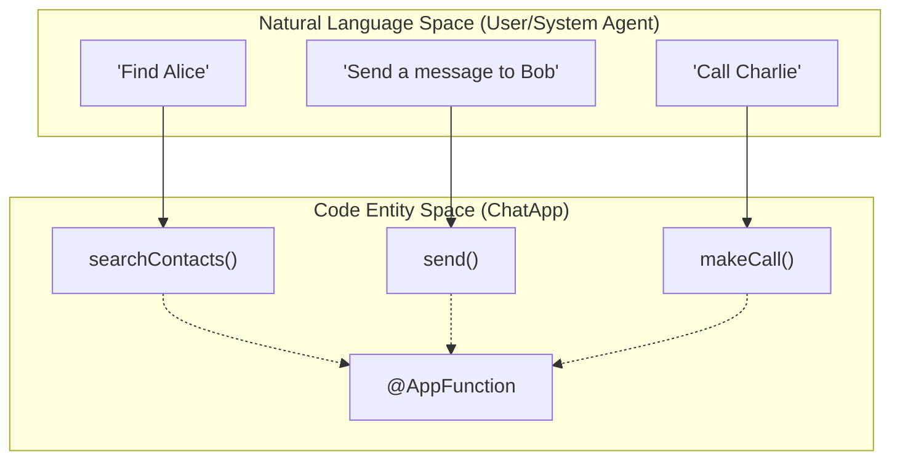
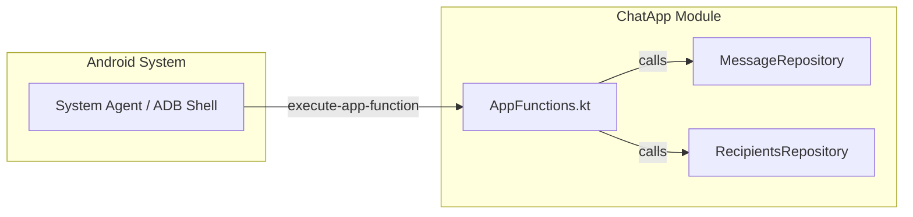

<!-- source: DeepWiki mcp.deepwiki.com · repo android/appfunctions · page 1 Overview · fetched 2026-10-23 -->

# Overview

Relevant source files

The following files were used as context for generating this wiki page:

- [ChatApp/README.md](ChatApp/README.md)
- [LICENSE](LICENSE)
- [README.md](README.md)

The **AppFunctions Samples** repository provides a reference implementation for developers to integrate their Android applications with system-level intelligence services using the **AppFunctions API**. By exposing application logic as discrete, discoverable functions, apps can empower system agents to perform actions on behalf of the user within the app's own context.

The primary demonstration in this repository is the **ChatApp**, a fully functional communication client built with modern Android technologies including **Jetpack Compose** for the UI, **Hilt** for dependency injection, and the **AppFunctions** library for system integration.

## Purpose and Core Capabilities

The repository serves as a blueprint for:
1.  **Defining Functions**: How to use the `@AppFunction` annotation to mark methods as executable by the system [ChatApp/README.md:21-27]().
2.  **Data Modeling**: Utilizing `@AppFunctionSerializable` to pass complex data structures between the system and the application [ChatApp/README.md:29-38]().
3.  **System Interaction**: Registering functions so they can be discovered and triggered via system commands or AI agents [ChatApp/README.md:41-52]().

### Conceptual Mapping: Natural Language to Code

The following diagram illustrates how high-level user intents are mapped to specific code entities within the ChatApp.

**Intent-to-Code Mapping**

Sources: [ChatApp/README.md:21-27]()

## Key Technologies

The sample leverages the following stack to demonstrate a production-ready implementation:

| Technology | Role in Sample |
| :--- | :--- |
| **AppFunctions API** | The bridge between the app logic and the Android System [README.md:3-4](). |
| **Jetpack Compose** | Declarative UI framework used for all screens (Chat, Contacts, Settings) [README.md:10-11](). |
| **Hilt** | Dependency injection for managing repositories and ViewModels [README.md:10-11](). |
| **Kotlin Coroutines** | Asynchronous execution for message sending and search operations. |

### System Integration Architecture

This diagram shows how the `AppFunctions` class acts as the entry point for the Android system to interact with the application's internal data layer.

**System-App Bridge**

Sources: [ChatApp/README.md:41-52](), [ChatApp/README.md:21-25]()

## Wiki Navigation

To understand the full implementation, the wiki is organized into the following detailed sections:

### 1.1 [Getting Started](#1.1)
Covers the prerequisites for running the sample, including **Android SDK 36** and **Android 16 (API 36)** requirements. It provides the steps for cloning, building, and verifying the installation using `adb` commands.
For details, see [Getting Started](#1.1).

### 1.2 [Repository Structure](#1.2)
Explains the organization of the codebase, from the root-level configuration and governance files to the specific internal structure of the `ChatApp` module.
For details, see [Repository Structure](#1.2).

### 2.0 [AppFunctions Integration](#2)
A deep dive into how the API is implemented, including function definitions, serialization of custom data types, and the runtime configuration that allows the system to see the app's capabilities.
For details, see [AppFunctions Integration](#2).

### 3.0 [Application Architecture](#3)
Describes the MVVM (Model-View-ViewModel) pattern used in the app, the Hilt dependency graph, and how navigation is handled between different app states (e.g., moving from a "makeCall" function call to the UI Call Screen).
For details, see [Application Architecture](#3).

### 4.0 [UI Layer](#4)
Details the Compose-based UI, including the theme system and the specific components used to build the chat and contact management interfaces.
For details, see [UI Layer](#4).

### 5.0 [Testing](#5)
Outlines the strategy for both unit testing the logic within `AppFunctions.kt` and instrumentation testing to ensure the system-level integration works as expected.
For details, see [Testing](#5).

### 6.0 [Build System and CI](#6)
Technical details on the Gradle configuration, versioning via version catalogs, and the automated workflows used for code quality.
For details, see [Build System and CI](#6).

### 7.0 [Contributing and Community](#7)
Guidelines for developers looking to contribute to the repository, covering the Google CLA, code style enforcement via Spotless, and issue reporting.
For details, see [Contributing and Community](#7).

### 8.0 [Glossary](#8)
Definitions of terms and abbreviations used throughout the codebase and documentation.
For details, see [Glossary](#8).

---

