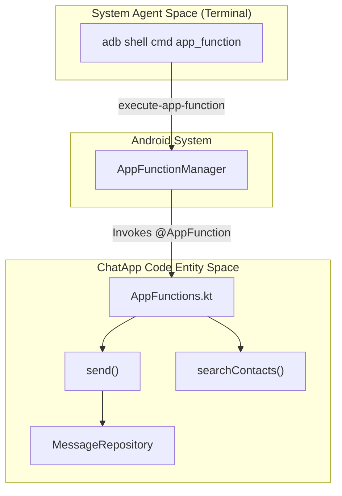
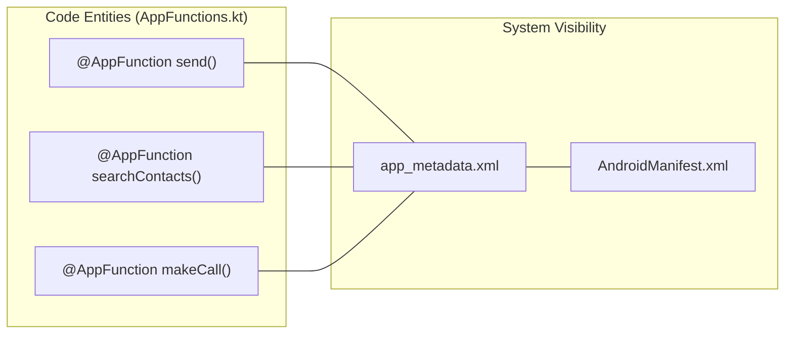

<!-- source: DeepWiki mcp.deepwiki.com · repo android/appfunctions · page 1.1 Getting Started · fetched 2026-10-23 -->

# Getting Started

<details>
<summary>Relevant source files</summary>

The following files were used as context for generating this wiki page:

- [ChatApp/README.md](ChatApp/README.md)
- [ChatApp/gradle/wrapper/gradle-wrapper.properties](ChatApp/gradle/wrapper/gradle-wrapper.properties)
- [ChatApp/gradlew](ChatApp/gradlew)
- [ChatApp/gradlew.bat](ChatApp/gradlew.bat)
- [README.md](README.md)

</details>


This guide provides step-by-step instructions for setting up the **AppFunctions Samples** repository, with a focus on building and running the **ChatApp** sample. The ChatApp serves as a reference implementation for integrating the Android AppFunctions API, allowing system agents to interact with application features like messaging and contact searching [ChatApp/README.md:1-13]().

## Prerequisites

Before proceeding, ensure your development environment meets the following requirements:

*   **Android Studio**: Latest stable version [README.md:20]().
*   **Android SDK**: Version 36 or higher [README.md:21]().
*   **Device/Emulator**: A physical device or Android Virtual Device (AVD) running **Android 16 (API 36)** or higher [README.md:22]().
*   **Gradle**: The project uses Gradle 9.4.1 as specified in the wrapper [ChatApp/gradle/wrapper/gradle-wrapper.properties:20]().

## Setup and Installation

### 1. Clone the Repository
Clone the source code from GitHub to your local machine:

```bash
git clone https://github.com/android/appfunctions.git
```
[README.md:24-26]()

### 2. Open the Project
1.  Launch Android Studio.
2.  Select **Open**.
3.  Navigate to the `ChatApp` subdirectory within the cloned repository and click **OK** [README.md:28-29]().
    *   *Note: Do not open the root repository directory; open the specific sample folder to ensure the Android project structure is recognized correctly.*

### 3. Gradle Sync and Build
Wait for Android Studio to finish the initial Gradle sync. Once complete, build the project by navigating to **Build > Make Project** [README.md:30]().

### 4. Run the Application
Select your API 36+ device in the run configuration dropdown and click **Run > Run 'app'** [README.md:31]().

---

## First-Run Verification

Once the app is running on your device, you can verify that the AppFunctions are correctly registered and executable by the system. The sample provides three primary functions: `searchContacts`, `send`, and `makeCall` [ChatApp/README.md:21-25]().

### Verification via ADB
You can simulate a system agent calling your app's functions using the `adb shell cmd app_function` tool. This bypasses the UI and executes the logic defined in the `AppFunctions` class directly [ChatApp/README.md:39-43]().

#### Testing the `send` Function
The following command triggers the message sending logic. It simulates the system providing a recipient name, an ID (`endpointValue`), and the message text.

```bash
adb shell "cmd app_function execute-app-function \
  --package com.example.chatapp \
  --function 'com.example.chatapp.appfunctions.AppFunctions#send' \
  --parameters '{\"name\": \"Alice\", \"endpointValue\": \"1\", \"messageBody\": \"Hello Alice!\"}'"
```
[ChatApp/README.md:46-50]()

#### Testing the `searchContacts` Function
To verify the search capability and the `filterType` constraint:

```bash
adb shell "cmd app_function execute-app-function \
  --package com.example.chatapp \
  --function 'com.example.chatapp.appfunctions.AppFunctions#searchContacts' \
  --parameters '{\"query\": \"Alice\", \"filterType\": \"INDIVIDUAL\"}'"
```
[ChatApp/README.md:57-61]()

---

## Data Flow and Execution Architecture

The diagram below illustrates the flow of a command from the terminal (System Agent space) into the ChatApp's internal logic (Code Entity space).

**System-to-App Execution Flow**

**Sources:** [ChatApp/README.md:41-52](), [ChatApp/README.md:21-27]()

---

## Integration Mapping

The following table maps the conceptual AppFunctions defined in the documentation to their specific implementation signatures in the codebase.

| Function Name | Code Entity | Parameters | Return Type |
| :--- | :--- | :--- | :--- |
| **Search** | `searchContacts` | `query: String`, `filterType: String` | `List<ContactSearchResult>` |
| **Send** | `send` | `name`, `endpointValue`, `messageBody`, `imageUri?` | `Result` |
| **Call** | `makeCall` | `contactName?`, `endpointValue?` | `Void` |

**Sources:** [ChatApp/README.md:23-25]()

**Code-to-System Mapping**

**Sources:** [ChatApp/README.md:27](), [README.md:13-14]()

---

