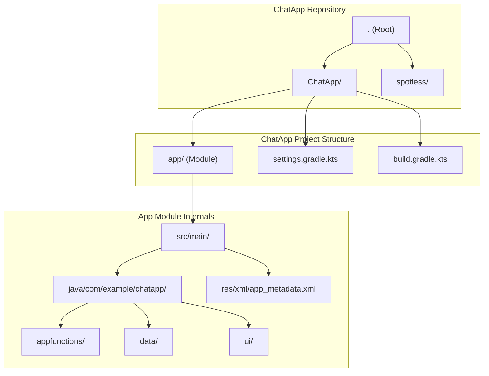
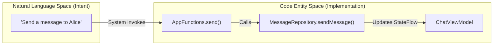

<!-- source: DeepWiki mcp.deepwiki.com · repo android/appfunctions · page 1.2 Repository Structure · fetched 2026-10-23 -->

# Repository Structure

Relevant source files

The following files were used as context for generating this wiki page:

- [.gitignore](.gitignore)
- [ChatApp/build.gradle.kts](ChatApp/build.gradle.kts)
- [ChatApp/gradle.properties](ChatApp/gradle.properties)
- [ChatApp/settings.gradle.kts](ChatApp/settings.gradle.kts)

This page describes the physical and logical layout of the `appfunctions` repository. The project is structured as a standalone Android application project contained within a sub-directory of the root repository, utilizing modern Android build tools and governance configurations.

## Root Directory

The root of the repository contains governance files, CI/CD configurations, and the primary sample application.

| Path | Purpose |
| :--- | :--- |
| `.github/` | Contains GitHub-specific configurations, including issue templates and CI workflow definitions. |
| `ChatApp/` | The main project directory containing the Android sample application. |
| `spotless/` | Contains code formatting rules and the license header template (`copyright.kt`) used by the Spotless plugin. |
| `.gitignore` | Defines files and directories ignored by Git, such as `.gradle/`, `.idea/`, and build artifacts [ .gitignore:1-8 ](). |
| `CONTRIBUTING.md` | Guidelines for external contributors, including CLA requirements. |
| `LICENSE` | The Apache 2.0 license governing the project. |

### Governance and Formatting
The repository enforces strict coding standards using the Spotless Gradle plugin. The configuration is defined in the root build script [ ChatApp/build.gradle.kts:27-32 ]() and applied to all subprojects [ ChatApp/build.gradle.kts:34-40 ](). It targets all Kotlin (`.kt`) and Kotlin Script (`.kts`) files, ensuring they adhere to `ktlint` rules and include the standard Apache license header [ ChatApp/build.gradle.kts:42-55 ]().

**Sources:**
- [ .gitignore:1-8 ]()
- [ ChatApp/build.gradle.kts:27-55 ]()

---

## ChatApp Project Layout

The `ChatApp` directory is organized as a standard multi-module-ready Android project, currently consisting of a single `:app` module.

### Build Configuration Files
*   **`settings.gradle.kts`**: Configures the project name as "ChatApp" and includes the `:app` module [ ChatApp/settings.gradle.kts:37-38 ](). It also defines the repository strategy, enforcing `FAIL_ON_PROJECT_REPOS` to ensure all dependencies are resolved through the central `dependencyResolutionManagement` block [ ChatApp/settings.gradle.kts:29-35 ]().
*   **`build.gradle.kts` (Project Level)**: Acts as the central point for plugin management. it declares versions for the Android Application, Kotlin, Compose, Hilt, and KSP plugins without applying them to the root [ ChatApp/build.gradle.kts:19-28 ]().
*   **`gradle.properties`**: Sets JVM arguments for the Gradle daemon (`-Xmx2048m`), enables AndroidX, and enforces the "official" Kotlin code style [ ChatApp/gradle.properties:16-26 ]().

### The `:app` Module
The core logic resides in the `app/` directory (referred to as the `:app` module in Gradle).

**Sources:**
- [ ChatApp/settings.gradle.kts:1-39 ]()
- [ ChatApp/build.gradle.kts:1-56 ]()
- [ ChatApp/gradle.properties:1-30 ]()

---

## Code Organization (Natural Language to Code Entity Space)

The repository bridges the gap between system-level AppFunction requests and application-specific logic through a tiered directory structure.

### AppFunctions Integration Space
This space handles the interaction between the Android System and the application. Logic is primarily contained within the `appfunctions/` package.

| System Concept | Code Entity / Directory | Role |
| :--- | :--- | :--- |
| **Function Definition** | `AppFunctions.kt` | Contains methods annotated with `@AppFunction`. |
| **Serialization** | `AppFunctions.kt` (Inner Classes) | Data classes annotated with `@AppFunctionSerializable`. |
| **System Registration** | `res/xml/app_metadata.xml` | XML resource declaring available functions to the system. |
| **Runtime Control** | `AppFunctionsViewModel.kt` | Interacts with `AppFunctionManager` to toggle function availability. |

### Application Logic Space
This space follows the MVVM (Model-View-ViewModel) pattern to manage chat data and UI state.

**Sources:**
- [ ChatApp/settings.gradle.kts:37-38 ]()
- [ ChatApp/build.gradle.kts:19-28 ]()

---

## Key Directories Summary

| Directory | Description |
| :--- | :--- |
| `ChatApp/app/src/main/java/.../appfunctions/` | Contains the `AppFunctions` class, which serves as the entry point for the Android AppFunctions API. |
| `ChatApp/app/src/main/java/.../data/` | Contains the Data Layer, including `MessageRepository` for chat history and `RecipientsRepository` for contact management. |
| `ChatApp/app/src/main/java/.../ui/` | Contains the UI Layer, organized into `screens/`, `components/`, and `theme/`. |
| `ChatApp/app/src/test/` | Contains local unit tests for AppFunctions and ViewModels. |
| `ChatApp/app/src/androidTest/` | Contains instrumentation tests that run on-device to verify `AppFunctionManager` integration. |

**Sources:**
- [ ChatApp/settings.gradle.kts:38 ]()
- [ ChatApp/build.gradle.kts:44-45 ]()

---

