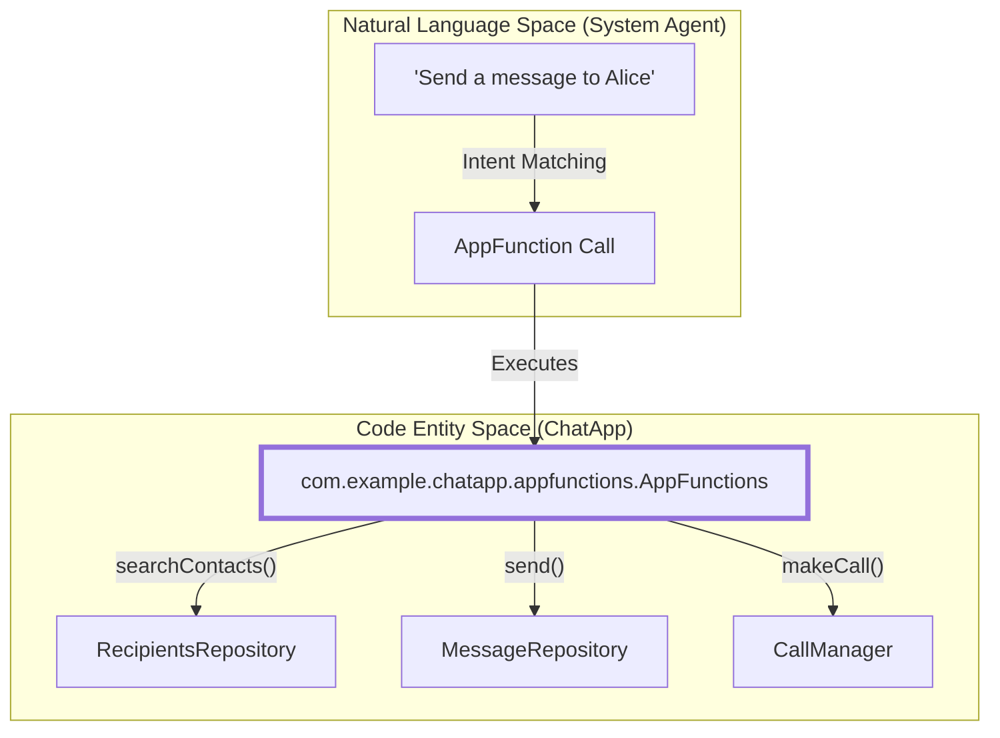
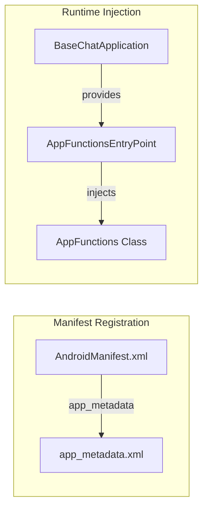

<!-- source: DeepWiki mcp.deepwiki.com · repo android/appfunctions · page 2 AppFunctions Integration · fetched 2026-10-23 -->

# AppFunctions Integration

Relevant source files

The following files were used as context for generating this wiki page:

- [ChatApp/app/src/main/AndroidManifest.xml](ChatApp/app/src/main/AndroidManifest.xml)
- [ChatApp/app/src/main/kotlin/com/example/chatapp/appfunctions/AppFunctions.kt](ChatApp/app/src/main/kotlin/com/example/chatapp/appfunctions/AppFunctions.kt)
- [ChatApp/app/src/main/res/xml/app_metadata.xml](ChatApp/app/src/main/res/xml/app_metadata.xml)

This page provides a high-level overview of how the Android AppFunctions API is integrated into the ChatApp. The integration allows the Android system and its agents to discover and execute specific capabilities within the app, such as searching for contacts, sending messages, and initiating calls.

The integration consists of function definitions, serializable data models, system registration, and a runtime management UI.

## Integration Architecture

The following diagram illustrates how the AppFunctions framework bridges the gap between natural language requests from the system and the concrete code entities within ChatApp.

**System to Code Mapping**

Sources: [ChatApp/app/src/main/kotlin/com/example/chatapp/appfunctions/AppFunctions.kt:36-42]()

## AppFunction Definitions

The core logic for system-exposed features resides in the `AppFunctions` class. This class uses the `@AppFunction` annotation to mark specific methods as entry points for the system.

- **`searchContacts`**: Used to resolve names into unique identifiers. It supports filtering by `INDIVIDUAL` or `GROUP` using the `@AppFunctionStringValueConstraint`.
- **`send`**: Handles the transmission of text and optional image attachments via `Uri`.
- **`makeCall`**: Initiates a voice call by returning a `PendingIntent` that navigates the user to the call screen.

For details, see [AppFunction Definitions](#2.1).

Sources: [ChatApp/app/src/main/kotlin/com/example/chatapp/appfunctions/AppFunctions.kt:51-175]()

## AppFunctionSerializable Data Models

Data exchanged between the app and the system must be serializable by the AppFunctions compiler. The ChatApp defines several `@AppFunctionSerializable` classes within the `AppFunctions.kt` file to structure these exchanges.

| Model | Purpose |
| :--- | :--- |
| `ContactSearchResult` | Returns found entities with their `endpointValue` and `displayName`. |
| `Result` | Provides a status message and ID after a successful message send. |
| `Recipient` | Represents an individual contact for serialization. |
| `ChatGroup` | Represents a group chat entity for serialization. |

For details, see [AppFunctionSerializable Data Models](#2.2).

Sources: [ChatApp/app/src/main/kotlin/com/example/chatapp/appfunctions/AppFunctions.kt:182-226]()

## AppFunction Configuration and Registration

For the Android system to "see" these functions, the app must register them through specific metadata and provider interfaces.

1.  **Metadata**: The `AndroidManifest.xml` points to an `app_metadata.xml` resource which provides a high-level description of the app's capabilities to the system agent.
2.  **Provider**: The `BaseChatApplication` implements `AppFunctionConfiguration.Provider`, allowing the system to instantiate the `AppFunctions` class via Hilt dependency injection.

**Registration Flow**

For details, see [AppFunctionConfiguration and Registration](#2.3).

Sources: [ChatApp/app/src/main/AndroidManifest.xml:52-54](), [ChatApp/app/src/main/res/xml/app_metadata.xml:17-26]()

## AppFunctions Settings Screen

ChatApp provides a user-facing UI to manage these integrations. Using the `AppFunctionManager` API, the app allows users to view which functions are registered and toggle their enabled state at runtime.

- **`AppFunctionsViewModel`**: Interacts with `AppFunctionManager` to observe the list of `AppFunctionInfo` and handle toggle logic.
- **`AppFunctionsScreen`**: A Compose-based UI that displays the functions and their current status.

For details, see [AppFunctions Settings Screen](#2.4).

Sources: [ChatApp/app/src/main/kotlin/com/example/chatapp/ui/AppFunctionsViewModel.kt:38-50](), [ChatApp/app/src/main/kotlin/com/example/chatapp/ui/AppFunctionsScreen.kt:40-60]()

---

