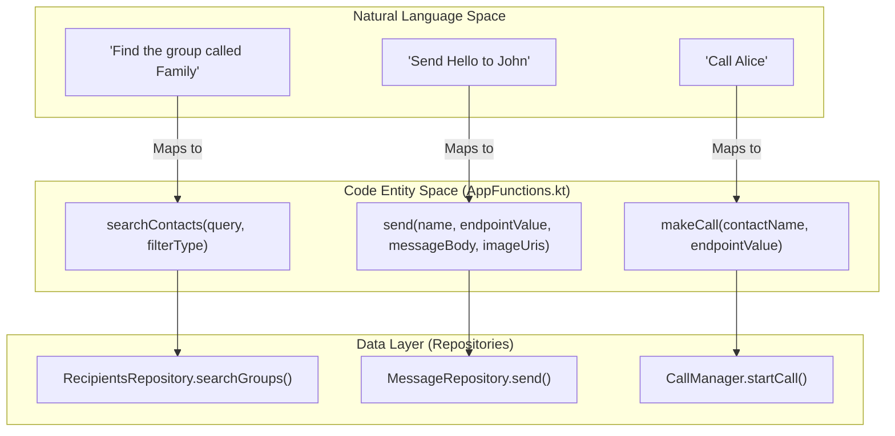
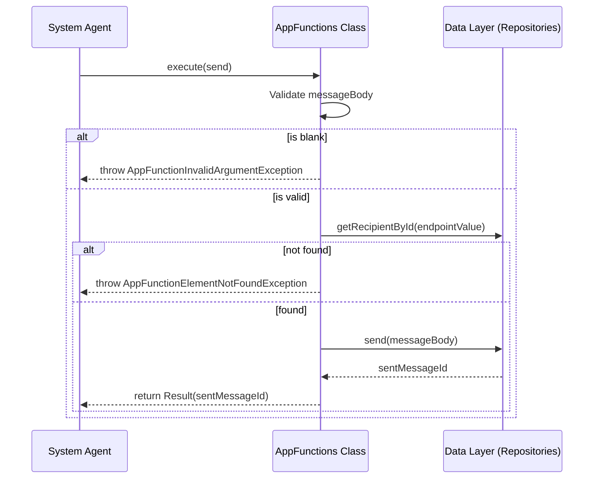

<!-- source: DeepWiki mcp.deepwiki.com · repo android/appfunctions · page 2.1 AppFunction Definitions · fetched 2026-10-23 -->

# AppFunction Definitions

Relevant source files

The following files were used as context for generating this wiki page:

- [ChatApp/app/src/main/kotlin/com/example/chatapp/appfunctions/AppFunctions.kt](ChatApp/app/src/main/kotlin/com/example/chatapp/appfunctions/AppFunctions.kt)

The `AppFunctions` class serves as the primary entry point for the Android system to interact with the ChatApp's core capabilities. It defines the contract between the application and the system agent using the `@AppFunction` annotation. This page details the implementation of these functions, their data flow, and the constraints applied to their parameters.

## Overview of the AppFunctions Class

The `AppFunctions` class is a Hilt-injectable component [ChatApp/app/src/main/kotlin/com/example/chatapp/appfunctions/AppFunctions.kt:36-38]() that leverages the application's data layer—specifically `MessageRepository`, `RecipientsRepository`, and `CallManager` [ChatApp/app/src/main/kotlin/com/example/chatapp/appfunctions/AppFunctions.kt:39-41]()—to execute user requests.

Each method intended for system exposure is annotated with `@AppFunction(isDescribedByKDoc = true)`, which instructs the AppFunctions compiler to use the method's KDoc as the metadata description for the system agent [ChatApp/app/src/main/kotlin/com/example/chatapp/appfunctions/AppFunctions.kt:51]().

### Data Flow: System to Code Entity

The following diagram illustrates how a natural language request is mapped to the specific code entities within the `AppFunctions` class.

**Natural Language to AppFunction Mapping**

Sources: [ChatApp/app/src/main/kotlin/com/example/chatapp/appfunctions/AppFunctions.kt:52-57](), [ChatApp/app/src/main/kotlin/com/example/chatapp/appfunctions/AppFunctions.kt:106-112](), [ChatApp/app/src/main/kotlin/com/example/chatapp/appfunctions/AppFunctions.kt:147-151]()

---

## Annotated Methods

### 1. searchContacts
Used to find individuals or groups by name. It supports partial matches and provides a filtered list based on the entity type.

*   **Parameters**:
    *   `query`: A search string for the name. If blank, the implementation is designed to return recent entities [ChatApp/app/src/main/kotlin/com/example/chatapp/appfunctions/AppFunctions.kt:54]().
    *   `filterType`: A constrained string that limits results to either "INDIVIDUAL" or "GROUP" [ChatApp/app/src/main/kotlin/com/example/chatapp/appfunctions/AppFunctions.kt:55-56]().
*   **Return Type**: `List<ContactSearchResult>` [ChatApp/app/src/main/kotlin/com/example/chatapp/appfunctions/AppFunctions.kt:57]().
*   **Implementation Logic**:
    *   If `filterType` is "INDIVIDUAL", it calls `recipientsRepository.searchRecipients` [ChatApp/app/src/main/kotlin/com/example/chatapp/appfunctions/AppFunctions.kt:60-61]().
    *   If `filterType` is "GROUP", it calls `recipientsRepository.searchGroups` [ChatApp/app/src/main/kotlin/com/example/chatapp/appfunctions/AppFunctions.kt:69-70]().
    *   The results are mapped to `ContactSearchResult` objects containing `endpointValue`, `endpointType`, and `displayName` [ChatApp/app/src/main/kotlin/com/example/chatapp/appfunctions/AppFunctions.kt:62-66]().

### 2. send
Dispatches a text message, optionally including image attachments.

*   **Parameters**:
    *   `endpointValue`: The unique ID of the recipient [ChatApp/app/src/main/kotlin/com/example/chatapp/appfunctions/AppFunctions.kt:109]().
    *   `messageBody`: The text content. This cannot be empty [ChatApp/app/src/main/kotlin/com/example/chatapp/appfunctions/AppFunctions.kt:110]().
    *   `imageUris`: An optional list of `android.net.Uri` for attachments [ChatApp/app/src/main/kotlin/com/example/chatapp/appfunctions/AppFunctions.kt:111]().
*   **Return Type**: `Result` (containing the `sentMessageId` and a confirmation string) [ChatApp/app/src/main/kotlin/com/example/chatapp/appfunctions/AppFunctions.kt:112]().
*   **Implementation Logic**:
    *   Validates that `messageBody` is not blank [ChatApp/app/src/main/kotlin/com/example/chatapp/appfunctions/AppFunctions.kt:113-115]().
    *   Resolves the `displayName` by checking both individual and group repositories [ChatApp/app/src/main/kotlin/com/example/chatapp/appfunctions/AppFunctions.kt:116-121]().
    *   Calls `messageRepository.send` to persist the message [ChatApp/app/src/main/kotlin/com/example/chatapp/appfunctions/AppFunctions.kt:125-129]().

### 3. makeCall
Initiates a voice call to a specific recipient.

*   **Parameters**:
    *   `contactName`: Optional name of the contact [ChatApp/app/src/main/kotlin/com/example/chatapp/appfunctions/AppFunctions.kt:149]().
    *   `endpointValue`: Optional unique ID [ChatApp/app/src/main/kotlin/com/example/chatapp/appfunctions/AppFunctions.kt:150]().
*   **Return Type**: `PendingIntent` [ChatApp/app/src/main/kotlin/com/example/chatapp/appfunctions/AppFunctions.kt:151]().
*   **Implementation Logic**:
    *   Requires at least one identifier (`contactName` or `endpointValue`) [ChatApp/app/src/main/kotlin/com/example/chatapp/appfunctions/AppFunctions.kt:152-156]().
    *   Resolves the recipient via `recipientsRepository` [ChatApp/app/src/main/kotlin/com/example/chatapp/appfunctions/AppFunctions.kt:158-171]().
    *   Constructs a `PendingIntent` that points to a specific navigation route (`app://com.example.chatapp/call/{id}`) [ChatApp/app/src/main/kotlin/com/example/chatapp/appfunctions/AppFunctions.kt:176-184]().

Sources: [ChatApp/app/src/main/kotlin/com/example/chatapp/appfunctions/AppFunctions.kt:52-185]()

---

## String Value Constraints

The `@AppFunctionStringValueConstraint` annotation is used to enforce a strict schema for string parameters at the system level. In the `searchContacts` method, it restricts the `filterType` to a specific set of allowed values [ChatApp/app/src/main/kotlin/com/example/chatapp/appfunctions/AppFunctions.kt:55-56]().

| Parameter | Allowed Values | Purpose |
| :--- | :--- | :--- |
| `filterType` | `"INDIVIDUAL"`, `"GROUP"` | Ensures the system agent only provides valid entity types supported by the repository search logic. |

Sources: [ChatApp/app/src/main/kotlin/com/example/chatapp/appfunctions/AppFunctions.kt:55-56]()

---

## Error Handling

The `AppFunctions` implementation uses specific subtypes of `AppFunctionException` to communicate failures back to the system. This allows the system agent to provide meaningful feedback or ask for clarification.

| Exception Type | Triggering Condition |
| :--- | :--- |
| `AppFunctionInvalidArgumentException` | Thrown when `messageBody` is blank [ChatApp/app/src/main/kotlin/com/example/chatapp/appfunctions/AppFunctions.kt:114](), when both call identifiers are null [ChatApp/app/src/main/kotlin/com/example/chatapp/appfunctions/AppFunctions.kt:153](), or when search results are empty [ChatApp/app/src/main/kotlin/com/example/chatapp/appfunctions/AppFunctions.kt:89](). |
| `AppFunctionElementNotFoundException` | Thrown when an `endpointValue` or `contactName` does not match any known recipient in the database [ChatApp/app/src/main/kotlin/com/example/chatapp/appfunctions/AppFunctions.kt:119](), [ChatApp/app/src/main/kotlin/com/example/chatapp/appfunctions/AppFunctions.kt:162](). |
| `AppFunctionAppUnknownException` | Thrown when an unexpected error occurs during repository operations, such as a database write failure [ChatApp/app/src/main/kotlin/com/example/chatapp/appfunctions/AppFunctions.kt:131](). |

### Execution Flow and Exception Handling

Sources: [ChatApp/app/src/main/kotlin/com/example/chatapp/appfunctions/AppFunctions.kt:113-137]()

---

