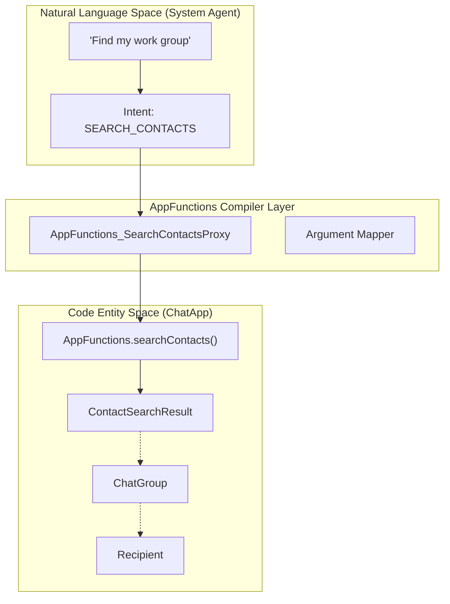
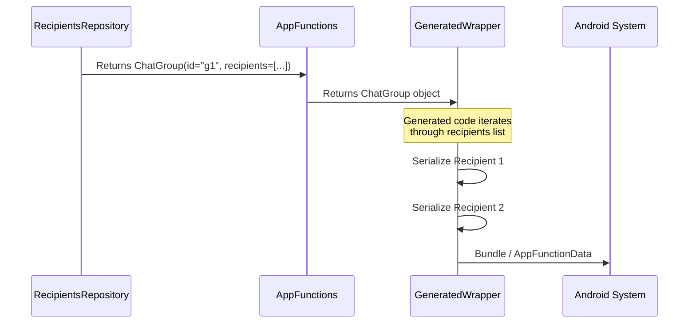

<!-- source: DeepWiki mcp.deepwiki.com · repo android/appfunctions · page 2.2 AppFunctionSerializable Data Models · fetched 2026-10-23 -->

# AppFunctionSerializable Data Models

Relevant source files

The following files were used as context for generating this wiki page:

- [ChatApp/app/src/main/kotlin/com/example/chatapp/appfunctions/AppFunctions.kt](ChatApp/app/src/main/kotlin/com/example/chatapp/appfunctions/AppFunctions.kt)
- [ChatApp/app/src/main/kotlin/com/example/chatapp/data/RecipientsRepository.kt](ChatApp/app/src/main/kotlin/com/example/chatapp/data/RecipientsRepository.kt)

The AppFunctions framework uses the `@AppFunctionSerializable` annotation to define data structures that can be passed between the system agent (Natural Language Space) and the application's code (Code Entity Space). These models are automatically handled by the AppFunctions compiler to manage serialization and deserialization, ensuring type safety and structural integrity during cross-process communication.

## Overview of @AppFunctionSerializable

In the ChatApp, several data classes are marked with `@AppFunctionSerializable` [ChatApp/app/src/main/kotlin/com/example/chatapp/appfunctions/AppFunctions.kt:25-25](). This annotation signals the AppFunctions compiler to generate the necessary mapping logic to convert these Kotlin objects into a format that the Android System can understand and vice versa.

These models serve three primary purposes:
1.  **Search Results**: Providing structured data back to the system after a search query.
2.  **Action Confirmation**: Returning status information after an operation like sending a message.
3.  **Entity Representation**: Modeling complex entities like recipients and chat groups that exist within the app's data layer.

### Data Flow: System to App

The following diagram illustrates how natural language requests are mapped to these serializable models and how they flow through the system.

**Natural Language to Code Entity Mapping**

**Sources:** [ChatApp/app/src/main/kotlin/com/example/chatapp/appfunctions/AppFunctions.kt:52-57](), [ChatApp/app/src/main/kotlin/com/example/chatapp/data/RecipientsRepository.kt:18-20]()

---

## Core Data Models

The ChatApp defines four key serializable models within the `AppFunctions` class scope.

### 1. ContactSearchResult
Used by `searchContacts` to return a unified list of potential message targets. It abstracts the difference between an individual and a group.

| Field | Type | Description |
| :--- | :--- | :--- |
| `endpointValue` | `String` | The unique ID of the contact or group. |
| `endpointType` | `String` | Either "INDIVIDUAL" or "GROUP". |
| `displayName` | `String` | The name to be shown to the user or used by the agent. |

**Sources:** [ChatApp/app/src/main/kotlin/com/example/chatapp/appfunctions/AppFunctions.kt:173-177]()

### 2. Result
A generic wrapper used to provide feedback to the system agent after an action is performed, such as `send`.

| Field | Type | Description |
| :--- | :--- | :--- |
| `id` | `String?` | The unique ID of the created entity (e.g., message ID). |
| `message` | `String?` | A human-readable confirmation message. |

**Sources:** [ChatApp/app/src/main/kotlin/com/example/chatapp/appfunctions/AppFunctions.kt:183-186]()

### 3. Recipient
Represents an individual contact within the application.

| Field | Type | Description |
| :--- | :--- | :--- |
| `id` | `String` | Unique identifier for the recipient. |
| `name` | `String` | Full name of the contact. |
| `email` | `String` | Email address associated with the contact. |

**Sources:** [ChatApp/app/src/main/kotlin/com/example/chatapp/appfunctions/AppFunctions.kt:192-196]()

### 4. ChatGroup
Represents a collection of recipients. This demonstrates the support for nested `@AppFunctionSerializable` objects, as it contains a list of `Recipient` objects.

| Field | Type | Description |
| :--- | :--- | :--- |
| `id` | `String` | Unique identifier for the group. |
| `name` | `String` | Name of the group. |
| `recipients` | `List<Recipient>` | List of members in the group. |

**Sources:** [ChatApp/app/src/main/kotlin/com/example/chatapp/appfunctions/AppFunctions.kt:202-206]()

---

## Implementation and Serialization

The serialization process is handled by the AppFunctions KSP (Kotlin Symbol Processing) plugin. When a class is annotated with `@AppFunctionSerializable`, the compiler ensures that all fields are of supported types (primitives, Strings, Uris, or other serializable classes).

### Internal Serialization Flow
The following diagram shows how a `ChatGroup` object is processed when returned by an AppFunction.

**Object Serialization Flow**

**Sources:** [ChatApp/app/src/main/kotlin/com/example/chatapp/data/RecipientsRepository.kt:46-56](), [ChatApp/app/src/main/kotlin/com/example/chatapp/appfunctions/AppFunctions.kt:52-57]()

### Usage in Repository
The `RecipientsRepository` utilizes these models as the primary data format for contact management, allowing the `AppFunctions` class to return them directly without additional mapping in most cases.

*   **Static Data**: The repository initializes a static list of `Recipient` and `ChatGroup` objects [ChatApp/app/src/main/kotlin/com/example/chatapp/data/RecipientsRepository.kt:34-56]().
*   **Search Logic**: The `searchAny` function maps internal repository results into `ContactSearchResult` objects specifically for the AppFunctions interface [ChatApp/app/src/main/kotlin/com/example/chatapp/data/RecipientsRepository.kt:134-158]().

**Sources:** [ChatApp/app/src/main/kotlin/com/example/chatapp/data/RecipientsRepository.kt:31-165]()

---

