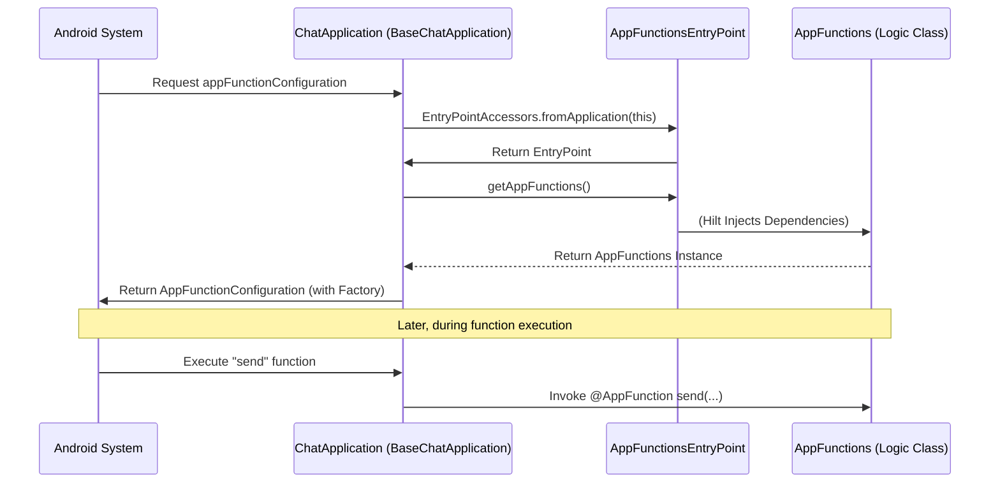

<!-- source: DeepWiki mcp.deepwiki.com · repo android/appfunctions · page 2.3 AppFunctionConfiguration and Registration · fetched 2026-10-23 -->

# AppFunctionConfiguration and Registration

<details>
<summary>Relevant source files</summary>

The following files were used as context for generating this wiki page:

- [ChatApp/app/src/main/AndroidManifest.xml](ChatApp/app/src/main/AndroidManifest.xml)
- [ChatApp/app/src/main/kotlin/com/example/chatapp/ChatApplication.kt](ChatApp/app/src/main/kotlin/com/example/chatapp/ChatApplication.kt)
- [ChatApp/app/src/main/res/xml/app_metadata.xml](ChatApp/app/src/main/res/xml/app_metadata.xml)

</details>


This page details the mechanisms used by the ChatApp to register its functions with the Android system. Registration involves both static declarations in XML for system discovery and runtime configuration to link the system's execution requests to the application's dependency-injected code.

## Static Registration and Metadata

For the Android system to discover that an application provides AppFunctions, the app must declare specific metadata in its manifest and provide a resource file describing its capabilities.

### Manifest Declarations
The `AndroidManifest.xml` uses the `appfn` namespace to provide high-level descriptions of the app's function capabilities. These strings are used by the system to understand the general purpose of the app's functions.

The app also registers a specific property, `android.app.appfunctions.app_metadata`, which points to an XML resource containing detailed metadata [ChatApp/app/src/main/AndroidManifest.xml:52-54]().

### App Metadata Resource
The `app_metadata.xml` file provides the "Operational Patterns" and "Constraints" for the AI or system agent interacting with the app [ChatApp/app/src/main/res/xml/app_metadata.xml:18-25](). This metadata informs the system how to sequence function calls (e.g., calling `searchContacts` before `send`) and what constraints apply to parameters [ChatApp/app/src/main/res/xml/app_metadata.xml:20-25]().

### Metadata Association Diagram
The following diagram illustrates how the system attributes in the Manifest link to the specific metadata definitions.

**Metadata to System Mapping**
```mermaid
graph TD
    subgraph "AndroidManifest.xml"
        ["AndroidManifest.xml"] --> ["appfn:description"]
        ["AndroidManifest.xml"] --> ["appfn:displayDescription"]
        ["AndroidManifest.xml"] --> ["android.app.appfunctions.app_metadata"]
    end

    subgraph "app_metadata.xml"
        ["android.app.appfunctions.app_metadata"] -- "points to" --> ["AppFunctionAppMetadata"]
        ["AppFunctionAppMetadata"] --> D["appfn:description (Operational Patterns)"]
        ["AppFunctionAppMetadata"] --> E["appfn:displayDescription"]
    end

    subgraph "Code Entities"
        D -- "Describes" --> F["searchContacts"]
        D -- "Describes" --> G["send"]
        D -- "Describes" --> H["makeCall"]
    end
```
**Sources:** [ChatApp/app/src/main/AndroidManifest.xml:17-31](), [ChatApp/app/src/main/AndroidManifest.xml:52-54](), [ChatApp/app/src/main/res/xml/app_metadata.xml:17-26]()

---

## Runtime Configuration with Hilt

When the system triggers an AppFunction, the app must provide an instance of the class containing the `@AppFunction` methods. The ChatApp uses Hilt to manage these dependencies and provide them to the AppFunctions framework.

### AppFunctionConfiguration.Provider
The `BaseChatApplication` class implements the `AppFunctionConfiguration.Provider` interface [ChatApp/app/src/main/kotlin/com/example/chatapp/ChatApplication.kt:27](). This interface requires the implementation of the `appFunctionConfiguration` property, which the system accesses to learn how to instantiate the function classes [ChatApp/app/src/main/kotlin/com/example/chatapp/ChatApplication.kt:28-36]().

### Hilt Entry Point
Because the AppFunctions framework may operate outside the standard lifecycle of a `HiltViewModel` or `Activity`, a Hilt `@EntryPoint` is used to bridge the `SingletonComponent` to the AppFunctions configuration [ChatApp/app/src/main/kotlin/com/example/chatapp/ChatApplication.kt:41-45]().

1.  **AppFunctionsEntryPoint**: Defines a method `getAppFunctions()` to retrieve the Hilt-managed `AppFunctions` instance [ChatApp/app/src/main/kotlin/com/example/chatapp/ChatApplication.kt:43-45]().
2.  **Configuration Building**: In `BaseChatApplication`, `EntryPointAccessors.fromApplication` is used to access the entry point [ChatApp/app/src/main/kotlin/com/example/chatapp/ChatApplication.kt:30]().
3.  **Enclosing Class Factory**: The `AppFunctionConfiguration.Builder` uses `addEnclosingClassFactory` to register a lambda that returns the `AppFunctions` instance whenever the system needs to execute a function defined in that class [ChatApp/app/src/main/kotlin/com/example/chatapp/ChatApplication.kt:33-35]().

### Registration Data Flow
This diagram shows how a system request for an AppFunction is routed through the Application class to the Hilt-injected logic.

**Registration and Execution Flow**

**Sources:** [ChatApp/app/src/main/kotlin/com/example/chatapp/ChatApplication.kt:27-37](), [ChatApp/app/src/main/kotlin/com/example/chatapp/ChatApplication.kt:41-45]()

---

## Summary of Registration Components

| Component | Role | Location |
| :--- | :--- | :--- |
| `AndroidManifest.xml` | Declares the metadata resource and app-level descriptions. | [ChatApp/app/src/main/AndroidManifest.xml]() |
| `app_metadata.xml` | Provides semantic guidance (patterns/constraints) to the system agent. | [ChatApp/app/src/main/res/xml/app_metadata.xml]() |
| `AppFunctionConfiguration.Provider` | Interface implemented by `Application` to provide the runtime config. | [ChatApp/app/src/main/kotlin/com/example/chatapp/ChatApplication.kt:27]() |
| `AppFunctionsEntryPoint` | Hilt interface allowing the Application to pull the `AppFunctions` instance. | [ChatApp/app/src/main/kotlin/com/example/chatapp/ChatApplication.kt:41-45]() |
| `addEnclosingClassFactory` | Links the `AppFunctions` class type to the instance provided by Hilt. | [ChatApp/app/src/main/kotlin/com/example/chatapp/ChatApplication.kt:34]() |

**Sources:** [ChatApp/app/src/main/AndroidManifest.xml:52-54](), [ChatApp/app/src/main/kotlin/com/example/chatapp/ChatApplication.kt:27-45](), [ChatApp/app/src/main/res/xml/app_metadata.xml:17-26]()

---

