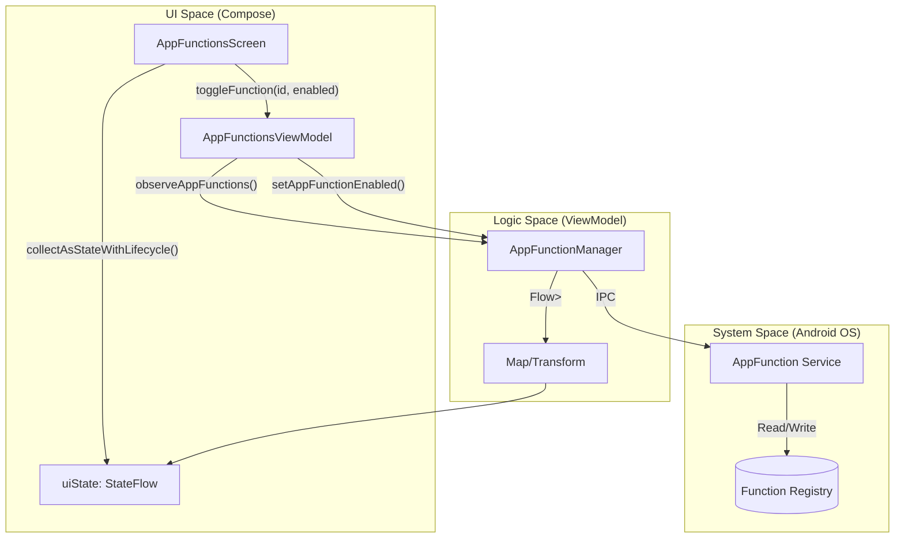
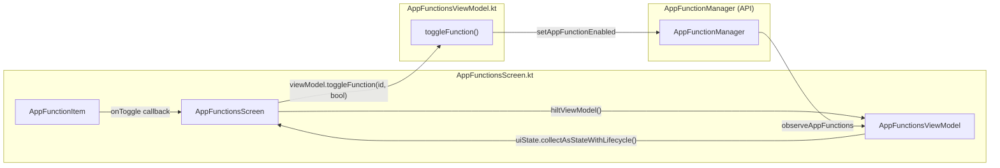

<!-- source: DeepWiki mcp.deepwiki.com · repo android/appfunctions · page 2.4 AppFunctions Settings Screen · fetched 2026-10-23 -->

# AppFunctions Settings Screen

Relevant source files

The following files were used as context for generating this wiki page:

- [ChatApp/app/src/main/kotlin/com/example/chatapp/AppFunctionsViewModel.kt](ChatApp/app/src/main/kotlin/com/example/chatapp/AppFunctionsViewModel.kt)
- [ChatApp/app/src/main/kotlin/com/example/chatapp/uicomponents/AppFunctionsScreen.kt](ChatApp/app/src/main/kotlin/com/example/chatapp/uicomponents/AppFunctionsScreen.kt)

The **AppFunctions Settings Screen** provides a runtime interface for users to inspect and control the availability of registered AppFunctions within the ChatApp. It utilizes the `AppFunctionManager` to dynamically observe the state of functions defined in the application and allows toggling their enabled/disabled status.

## Overview and Purpose

This screen serves as a bridge between the system's function registry and the user's preferences. It allows the application to:
1.  **Discover** all functions registered under the app's package name.
2.  **Display** metadata such as function IDs and descriptions.
3.  **Manage** runtime availability, enabling or disabling specific functions via the `AppFunctionManager`.

### Data Flow Architecture

The following diagram illustrates how the `AppFunctionsViewModel` coordinates between the UI and the Android System's `AppFunctionManager`.

**AppFunctions State and Control Flow**

Sources: [ChatApp/app/src/main/kotlin/com/example/chatapp/AppFunctionsViewModel.kt:55-114](), [ChatApp/app/src/main/kotlin/com/example/chatapp/uicomponents/AppFunctionsScreen.kt:48-58]()

---

## Data Models

The settings screen relies on two primary data structures to represent the state of functions.

### AppFunctionInfo
A simple data class representing the state of a single function.
*   `id`: The unique identifier (e.g., `com.example.chatapp#send`). [ChatApp/app/src/main/kotlin/com/example/chatapp/AppFunctionsViewModel.kt:40-40]()
*   `isEnabled`: Boolean flag indicating if the function can currently be invoked by the system. [ChatApp/app/src/main/kotlin/com/example/chatapp/AppFunctionsViewModel.kt:41-41]()
*   `description`: An optional human-readable string describing the function's purpose. [ChatApp/app/src/main/kotlin/com/example/chatapp/AppFunctionsViewModel.kt:42-42]()

### AppFunctionsUiState
The state container emitted by the ViewModel to the Composable screen. It contains a `List<AppFunctionInfo>` which is sorted by function ID for consistent display. [ChatApp/app/src/main/kotlin/com/example/chatapp/AppFunctionsViewModel.kt:50-52](), [ChatApp/app/src/main/kotlin/com/example/chatapp/AppFunctionsViewModel.kt:84-84]()

Sources: [ChatApp/app/src/main/kotlin/com/example/chatapp/AppFunctionsViewModel.kt:39-52]()

---

## AppFunctionsViewModel Implementation

The `AppFunctionsViewModel` is a `@HiltViewModel` that manages an instance of `AppFunctionManager`. [ChatApp/app/src/main/kotlin/com/example/chatapp/AppFunctionsViewModel.kt:60-66]()

### Observing Functions
The ViewModel initializes the `uiState` by calling `appFunctionManager.observeAppFunctions`. It uses an `AppFunctionSearchSpec` restricted to the application's own package name. [ChatApp/app/src/main/kotlin/com/example/chatapp/AppFunctionsViewModel.kt:68-70]()

The transformation logic performs the following:
1.  Filters the returned `packageMetadataList` for the current package. [ChatApp/app/src/main/kotlin/com/example/chatapp/AppFunctionsViewModel.kt:73-75]()
2.  Maps the system's internal function representation to `AppFunctionInfo` objects. [ChatApp/app/src/main/kotlin/com/example/chatapp/AppFunctionsViewModel.kt:78-83]()
3.  Sorts the list alphabetically by ID. [ChatApp/app/src/main/kotlin/com/example/chatapp/AppFunctionsViewModel.kt:84-84]()
4.  Converts the result into a `StateFlow` using `stateIn`, maintaining the subscription for 5 seconds after the UI is no longer visible. [ChatApp/app/src/main/kotlin/com/example/chatapp/AppFunctionsViewModel.kt:87-91]()

### Toggling Function State
When a user interacts with a toggle switch, the `toggleFunction` method is invoked. It maps the boolean `enabled` parameter to `AppFunctionManager` constants:
*   `true` -> `APP_FUNCTION_STATE_ENABLED` [ChatApp/app/src/main/kotlin/com/example/chatapp/AppFunctionsViewModel.kt:107-107]()
*   `false` -> `APP_FUNCTION_STATE_DISABLED` [ChatApp/app/src/main/kotlin/com/example/chatapp/AppFunctionsViewModel.kt:109-109]()

The update is performed asynchronously within the `viewModelScope` via `appFunctionManager.setAppFunctionEnabled(id, newState)`. [ChatApp/app/src/main/kotlin/com/example/chatapp/AppFunctionsViewModel.kt:104-111]()

Sources: [ChatApp/app/src/main/kotlin/com/example/chatapp/AppFunctionsViewModel.kt:60-114]()

---

## UI Components

The UI is built using Jetpack Compose and Material3 components.

### AppFunctionsScreen
The main entry point for the settings UI. It uses a `Scaffold` with a `TopAppBar` and handles two primary states:
1.  **Empty State**: Displays a message if no functions are found or supported. [ChatApp/app/src/main/kotlin/com/example/chatapp/uicomponents/AppFunctionsScreen.kt:80-92]()
2.  **List State**: Uses a `LazyColumn` to render the "Declared AppFunctions" header and a list of `AppFunctionItem` composables. [ChatApp/app/src/main/kotlin/com/example/chatapp/uicomponents/AppFunctionsScreen.kt:94-115]()

### AppFunctionItem
A row component representing a single function.
*   **Name Parsing**: It extracts a "short name" from the function ID by stripping the package and namespace prefixes (e.g., `com.example.chatapp#send` becomes `send`). [ChatApp/app/src/main/kotlin/com/example/chatapp/uicomponents/AppFunctionsScreen.kt:142-146]()
*   **Interaction**: Contains a `Switch` that reflects the current `isEnabled` state and triggers `onToggle` when clicked. [ChatApp/app/src/main/kotlin/com/example/chatapp/uicomponents/AppFunctionsScreen.kt:153-156]()

**Code Entity Mapping: UI to ViewModel**

Sources: [ChatApp/app/src/main/kotlin/com/example/chatapp/uicomponents/AppFunctionsScreen.kt:55-59](), [ChatApp/app/src/main/kotlin/com/example/chatapp/uicomponents/AppFunctionsScreen.kt:108-113](), [ChatApp/app/src/main/kotlin/com/example/chatapp/AppFunctionsViewModel.kt:68-71]()

### Component Summary

| Component | Role | Key Code Reference |
| :--- | :--- | :--- |
| `AppFunctionsScreen` | Root Composable for the settings screen. | [AppFunctionsScreen.kt:55]() |
| `AppFunctionItem` | Individual list row with toggle. | [AppFunctionsScreen.kt:129]() |
| `AppFunctionsViewModel` | Business logic and StateFlow provider. | [AppFunctionsViewModel.kt:61]() |
| `AppFunctionsUiState` | Immutable snapshot of function list. | [AppFunctionsViewModel.kt:50]() |

Sources: [ChatApp/app/src/main/kotlin/com/example/chatapp/uicomponents/AppFunctionsScreen.kt:1-158](), [ChatApp/app/src/main/kotlin/com/example/chatapp/AppFunctionsViewModel.kt:1-114]()

---

