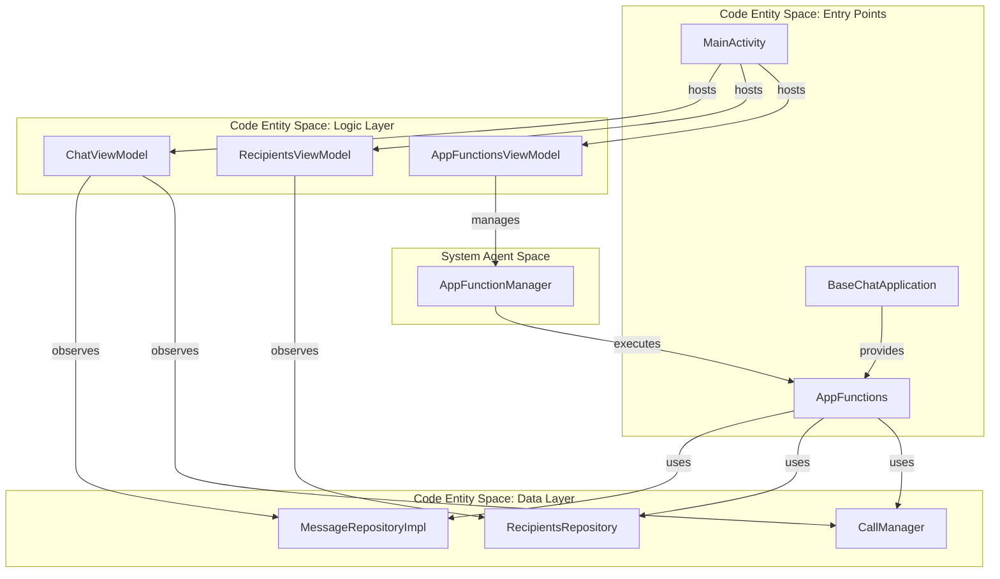
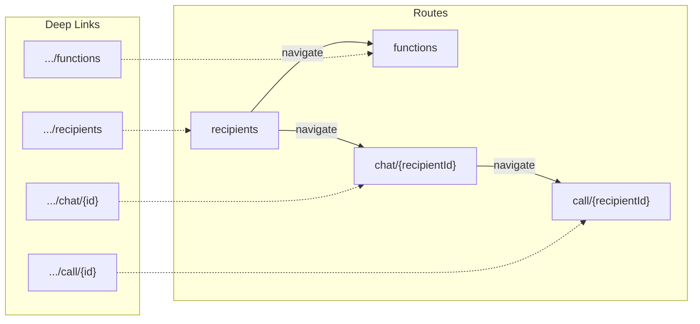

<!-- source: DeepWiki mcp.deepwiki.com · repo android/appfunctions · page 3 Application Architecture · fetched 2026-10-23 -->

# Application Architecture

Relevant source files

The following files were used as context for generating this wiki page:

- [ChatApp/app/src/main/kotlin/com/example/chatapp/ChatApplication.kt](ChatApp/app/src/main/kotlin/com/example/chatapp/ChatApplication.kt)
- [ChatApp/app/src/main/kotlin/com/example/chatapp/MainActivity.kt](ChatApp/app/src/main/kotlin/com/example/chatapp/MainActivity.kt)

The ChatApp sample follows a modern Android architecture based on the **MVVM (Model-View-ViewModel)** pattern, leveraging **Jetpack Compose** for the UI and **Hilt** for dependency injection. This architecture ensures a clear separation of concerns, making the codebase testable and maintainable while integrating seamlessly with the Android AppFunctions API.

### High-Level Architecture Overview

The application is structured into three primary layers:
1.  **UI Layer**: Built with Jetpack Compose, consisting of Screens and ViewModels that manage UI state.
2.  **Domain/Data Layer**: Contains repositories and managers that handle business logic, data persistence (in-memory for this sample), and external interactions like bot simulations.
3.  **AppFunctions Integration**: A specialized entry point that allows the Android system to execute app logic directly via the `AppFunctionManager`.

### System Component Diagram

The following diagram illustrates how the core components interact, bridging the "Natural Language Space" (where the system agent operates) to the "Code Entity Space."

#### Component Interaction and Data Flow

**Sources:** [ChatApp/app/src/main/kotlin/com/example/chatapp/ChatApplication.kt:27-37](), [ChatApp/app/src/main/kotlin/com/example/chatapp/MainActivity.kt:38-102]()

---

### Dependency Injection with Hilt

ChatApp uses Hilt to manage the lifecycle of its dependencies. A critical aspect of this setup is the integration with AppFunctions, which requires a factory to instantiate the `AppFunctions` class when the system calls it.

*   **`BaseChatApplication`**: Implements `AppFunctionConfiguration.Provider` to supply the configuration needed for the system to discover and execute the app's functions [ChatApp/app/src/main/kotlin/com/example/chatapp/ChatApplication.kt:27-37]().
*   **`AppFunctionsEntryPoint`**: An `@EntryPoint` interface that allows the application to retrieve the Hilt-managed `AppFunctions` instance even outside of standard Activity/ViewModel injection [ChatApp/app/src/main/kotlin/com/example/chatapp/ChatApplication.kt:41-45]().

### Navigation Graph

The application's navigation is managed by a `NavHost` in `MainActivity`. It defines four primary destinations and supports deep linking for system-level integration.

| Route | Composable | Deep Link Pattern |
| :--- | :--- | :--- |
| `recipients` | `RecipientsScreen` | `app://com.example.chatapp/recipients` |
| `functions` | `AppFunctionsScreen` | `app://com.example.chatapp/functions` |
| `chat/{recipientId}` | `ChatScreen` | `app://com.example.chatapp/chat/{recipientId}` |
| `call/{recipientId}` | `CallScreen` | `app://com.example.chatapp/call/{recipientId}` |

**Sources:** [ChatApp/app/src/main/kotlin/com/example/chatapp/MainActivity.kt:56-98]()

#### Navigation and Deep Link Structure

**Sources:** [ChatApp/app/src/main/kotlin/com/example/chatapp/MainActivity.kt:56-98]()

---

### Child Pages

For a deeper dive into specific layers of the architecture, refer to the following pages:

*   **[Data Layer](#3.1)**: Details on `MessageRepository`, `RecipientsRepository`, and `CallManager`, including Hilt singleton scoping.
*   **[ViewModels](#3.2)**: Exploration of `ChatViewModel`, `RecipientsViewModel`, and `AppFunctionsViewModel`, focusing on `StateFlow` and `SavedStateHandle`.
*   **[Navigation and Entry Point](#3.3)**: Detailed breakdown of `MainActivity`, the Compose `NavHost`, and how intent extras drive navigation from AppFunctions.

---

