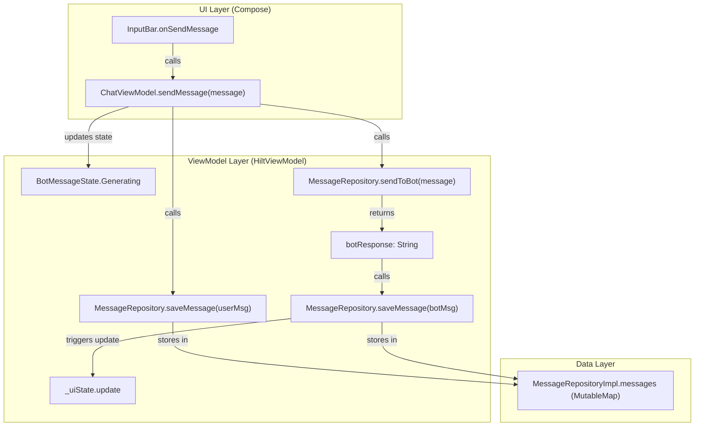
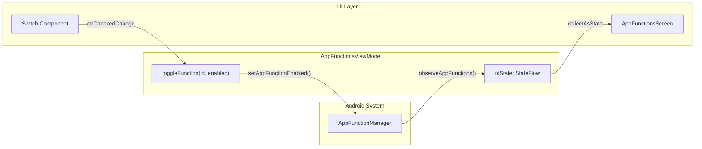

<!-- source: DeepWiki mcp.deepwiki.com · repo android/appfunctions · page 3.2 ViewModels · fetched 2026-10-23 -->

# ViewModels

Relevant source files

The following files were used as context for generating this wiki page:

- [ChatApp/app/src/main/kotlin/com/example/chatapp/AppFunctionsViewModel.kt](ChatApp/app/src/main/kotlin/com/example/chatapp/AppFunctionsViewModel.kt)
- [ChatApp/app/src/main/kotlin/com/example/chatapp/ChatViewModel.kt](ChatApp/app/src/main/kotlin/com/example/chatapp/ChatViewModel.kt)
- [ChatApp/app/src/main/kotlin/com/example/chatapp/RecipientsViewModel.kt](ChatApp/app/src/main/kotlin/com/example/chatapp/RecipientsViewModel.kt)

This page documents the `ViewModel` layer of the ChatApp. The application utilizes three primary `@HiltViewModel` classes to manage UI state, handle user interactions, and interface with the underlying data repositories and the Android `AppFunctionManager`.

## Overview of ViewModels

The architecture follows the MVVM pattern, where ViewModels expose `StateFlow` objects to the Compose UI layer. Dependency injection is handled by Hilt, and `SavedStateHandle` is utilized for retrieving navigation parameters.

| ViewModel | Responsibility | Data Sources |
| :--- | :--- | :--- |
| `ChatViewModel` | Manages active chat sessions, message sending, bot simulation, and call lifecycle. | `MessageRepository`, `CallManager`, `RecipientsRepository` |
| `RecipientsViewModel` | Provides lists of contacts and groups, and tracks the last message for the main list. | `RecipientsRepository`, `MessageRepository` |
| `AppFunctionsViewModel` | Manages the visibility and enabled/disabled state of registered AppFunctions. | `AppFunctionManager` |

---

## ChatViewModel

`ChatViewModel` [ChatApp/app/src/main/kotlin/com/example/chatapp/ChatViewModel.kt:69-76]() is the central hub for the messaging experience. It handles the state for individual chat threads, including communication with the "Assistant" bot.

### UI State and Bot Lifecycle
The UI state is encapsulated in `ChatbotUiState` [ChatApp/app/src/main/kotlin/com/example/chatapp/ChatViewModel.kt:61-66](), which includes a list of `DisplayMessage` and a `BotMessageState`. The `BotMessageState` sealed interface tracks the asynchronous nature of bot responses:
*   `WaitingForMessage`: Idle state [ChatApp/app/src/main/kotlin/com/example/chatapp/ChatViewModel.kt:43-43]().
*   `Generating`: Bot is processing a response [ChatApp/app/src/main/kotlin/com/example/chatapp/ChatViewModel.kt:48-48]().
*   `Error`: Communication failure [ChatApp/app/src/main/kotlin/com/example/chatapp/ChatViewModel.kt:55-55]().

### Message Data Flow
When `sendMessage` [ChatApp/app/src/main/kotlin/com/example/chatapp/ChatViewModel.kt:124-169]() is called:
1.  The UI state is set to `Generating`.
2.  The user's message (and optional image URIs) is saved to the `MessageRepository` [ChatApp/app/src/main/kotlin/com/example/chatapp/ChatViewModel.kt:139-139]().
3.  `messageRepository.sendToBot(message)` is invoked to simulate a response [ChatApp/app/src/main/kotlin/com/example/chatapp/ChatViewModel.kt:141-141]().
4.  The bot's response is saved back to the repository [ChatApp/app/src/main/kotlin/com/example/chatapp/ChatViewModel.kt:155-155](), triggering an update to the `messages` Flow [ChatApp/app/src/main/kotlin/com/example/chatapp/ChatViewModel.kt:97-101]().

### Call Management
The ViewModel bridges the UI to the `CallManager` to start [ChatApp/app/src/main/kotlin/com/example/chatapp/ChatViewModel.kt:104-106]() and end calls [ChatApp/app/src/main/kotlin/com/example/chatapp/ChatViewModel.kt:108-122](). When a call ends, it automatically generates a "📞 Call ended" log message in the chat history [ChatApp/app/src/main/kotlin/com/example/chatapp/ChatViewModel.kt:113-121]().

**Sources:**
*   [ChatApp/app/src/main/kotlin/com/example/chatapp/ChatViewModel.kt]()

---

## RecipientsViewModel

`RecipientsViewModel` [ChatApp/app/src/main/kotlin/com/example/chatapp/RecipientsViewModel.kt:30-35]() provides the data required for the main recipient list screen. It fetches static data from the `RecipientsRepository` and combines it with dynamic message data.

### Key Functions
*   **Recipients/Groups List**: Exposes lists of `Recipient` and `ChatGroup` objects [ChatApp/app/src/main/kotlin/com/example/chatapp/RecipientsViewModel.kt:36-37]().
*   **Last Message Flow**: `getLastMessage(recipientId)` [ChatApp/app/src/main/kotlin/com/example/chatapp/RecipientsViewModel.kt:39-43]() returns a `Flow<DisplayMessage?>`. This allows the UI to reactively display the most recent snippet of conversation for each contact in the list.

**Sources:**
*   [ChatApp/app/src/main/kotlin/com/example/chatapp/RecipientsViewModel.kt]()

---

## AppFunctionsViewModel

`AppFunctionsViewModel` [ChatApp/app/src/main/kotlin/com/example/chatapp/AppFunctionsViewModel.kt:61-65]() manages the integration with the Android `AppFunctionManager`. It allows users to view and toggle the availability of the app's defined functions (e.g., `send`, `searchContacts`) at runtime.

### AppFunction Observation
The `uiState` [ChatApp/app/src/main/kotlin/com/example/chatapp/AppFunctionsViewModel.kt:68-91]() is derived by observing `appFunctionManager.observeAppFunctions`.
1.  It searches for functions within the app's own package [ChatApp/app/src/main/kotlin/com/example/chatapp/AppFunctionsViewModel.kt:70-70]().
2.  It maps the system's metadata into `AppFunctionInfo` [ChatApp/app/src/main/kotlin/com/example/chatapp/AppFunctionsViewModel.kt:77-84](), which includes the function ID, its enabled status, and description.
3.  The result is exposed as a `StateFlow<AppFunctionsUiState>`.

### Toggling Functions
The `toggleFunction(id, enabled)` [ChatApp/app/src/main/kotlin/com/example/chatapp/AppFunctionsViewModel.kt:100-113]() method updates the system state of an AppFunction. It converts the boolean `enabled` parameter into `APP_FUNCTION_STATE_ENABLED` or `APP_FUNCTION_STATE_DISABLED` and persists the change via `appFunctionManager.setAppFunctionEnabled` [ChatApp/app/src/main/kotlin/com/example/chatapp/AppFunctionsViewModel.kt:111-111]().

**Sources:**
*   [ChatApp/app/src/main/kotlin/com/example/chatapp/AppFunctionsViewModel.kt]()

---

## Architecture Diagrams

### Chat Data Flow: Natural Language to Code Entity
This diagram illustrates how a user message moves from the UI through the ViewModel to the Repository and triggers a bot response.

**Chat Data Flow**

**Sources:**
*   [ChatApp/app/src/main/kotlin/com/example/chatapp/ChatViewModel.kt:124-169]()
*   [ChatApp/app/src/main/kotlin/com/example/chatapp/ChatViewModel.kt:97-102]()

### AppFunction Management Flow
This diagram shows the relationship between the system's `AppFunctionManager` and the application's settings UI.

**AppFunction State Management**

**Sources:**
*   [ChatApp/app/src/main/kotlin/com/example/chatapp/AppFunctionsViewModel.kt:68-91]()
*   [ChatApp/app/src/main/kotlin/com/example/chatapp/AppFunctionsViewModel.kt:100-113]()

### SavedStateHandle Usage
The `ChatViewModel` uses `SavedStateHandle` to retrieve the `recipientId` passed during navigation, ensuring state persistence across process death.

| Variable | Source | Default Value | Usage |
| :--- | :--- | :--- | :--- |
| `recipientId` | `savedStateHandle.get<String>("recipientId")` | `"bot"` | Used to filter messages and identify the chat partner. |

**Sources:**
*   [ChatApp/app/src/main/kotlin/com/example/chatapp/ChatViewModel.kt:77-77]()
*   [ChatApp/app/src/main/kotlin/com/example/chatapp/ChatViewModel.kt:98-98]()

---

