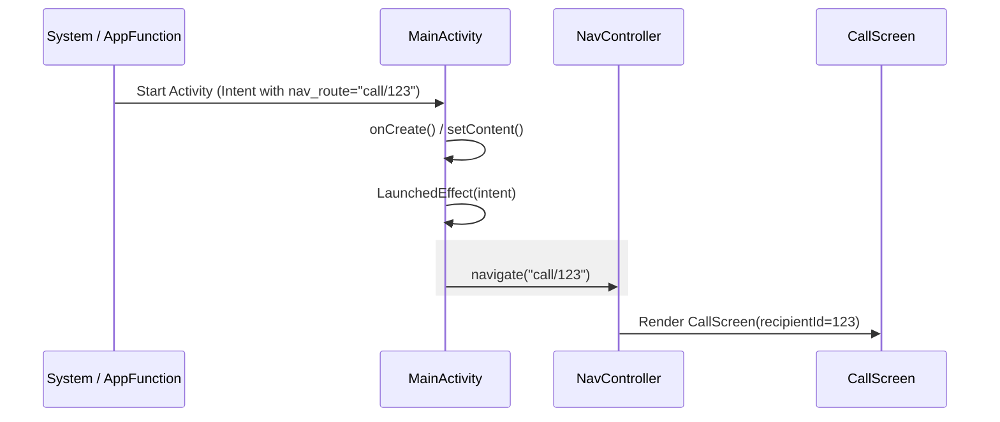

<!-- source: DeepWiki mcp.deepwiki.com · repo android/appfunctions · page 3.3 Navigation and Entry Point · fetched 2026-10-23 -->

# Navigation and Entry Point

<details>
<summary>Relevant source files</summary>

The following files were used as context for generating this wiki page:

- [ChatApp/app/src/main/AndroidManifest.xml](ChatApp/app/src/main/AndroidManifest.xml)
- [ChatApp/app/src/main/kotlin/com/example/chatapp/MainActivity.kt](ChatApp/app/src/main/kotlin/com/example/chatapp/MainActivity.kt)

</details>


This page describes the navigation architecture and entry points of the ChatApp sample. The application utilizes Jetpack Compose Navigation to manage transitions between screens and supports deep linking and intent-based navigation, particularly for integrating with system-level AppFunctions.

## Navigation Architecture

The `MainActivity` serves as the single entry point for the application UI, hosting a `NavHost` that defines the navigation graph [ChatApp/app/src/main/kotlin/com/example/chatapp/MainActivity.kt:39-40](). The navigation graph is composed of four primary routes, each supporting deep link patterns for external invocation.

### Navigation Routes and Destinations

The `NavHost` uses `recipients` as the `startDestination` [ChatApp/app/src/main/kotlin/com/example/chatapp/MainActivity.kt:56]().

| Route | Composable Destination | Arguments | Deep Link Pattern |
| :--- | :--- | :--- | :--- |
| `recipients` | `RecipientsScreen` | None | `app://com.example.chatapp/recipients` |
| `functions` | `AppFunctionsScreen` | None | `app://com.example.chatapp/functions` |
| `chat/{recipientId}` | `ChatScreen` | `recipientId` (String) | `app://com.example.chatapp/chat/{recipientId}` |
| `call/{recipientId}` | `CallScreen` | `recipientId` (String) | `app://com.example.chatapp/call/{recipientId}` |

### Data Flow: Navigation Graph
The following diagram illustrates the relationship between navigation routes and their corresponding UI components.

**Navigation Graph Mapping**
```mermaid
graph TD
    subgraph "Compose NavHost"
        [MainActivity] -- "startDestination" --> R["route: recipients"]
        R -- "navController.navigate" --> F["route: functions"]
        R -- "navController.navigate" --> C["route: chat/{recipientId}"]
        C -- "navController.navigate" --> CL["route: call/{recipientId}"]
    end

    subgraph "UI Entities"
        R -.-> RS["RecipientsScreen"]
        F -.-> AS["AppFunctionsScreen"]
        C -.-> CS["ChatScreen"]
        CL -.-> LS["CallScreen"]
    end

    subgraph "Deep Links"
        DL1["app://com.example.chatapp/recipients"] --> R
        DL2["app://com.example.chatapp/functions"] --> F
        DL3["app://com.example.chatapp/chat/{recipientId}"] --> C
        DL4["app://com.example.chatapp/call/{recipientId}"] --> CL
    end
```
Sources: [ChatApp/app/src/main/kotlin/com/example/chatapp/MainActivity.kt:56-98]()

## Intent-Based Entry Points

Beyond standard Compose navigation, `MainActivity` handles external intents to facilitate direct navigation to specific screens, particularly when triggered by AppFunctions.

### Intent Extra: `nav_route`
The `MainActivity` uses a `LaunchedEffect` to observe the `intent` that started the activity [ChatApp/app/src/main/kotlin/com/example/chatapp/MainActivity.kt:47](). If the intent contains a String extra named `"nav_route"`, the `navController` immediately navigates to that route [ChatApp/app/src/main/kotlin/com/example/chatapp/MainActivity.kt:48-53]().

This mechanism is specifically utilized by the `makeCall` AppFunction. When a call is initiated via the system agent, the app provides a `PendingIntent` containing the `nav_route` (e.g., `call/contact_id_123`), allowing the system to bring the user directly to the `CallScreen`.

### Manifest Configuration
To support deep links and external intents, the `MainActivity` is configured in `AndroidManifest.xml` with an `<intent-filter>` for the `VIEW` action [ChatApp/app/src/main/xml/AndroidManifest.xml:41-42]().

*   **Scheme**: `app` [ChatApp/app/src/main/xml/AndroidManifest.xml:48]()
*   **Host**: `com.example.chatapp` [ChatApp/app/src/main/xml/AndroidManifest.xml:49]()

**Intent Processing Logic**

Sources: [ChatApp/app/src/main/kotlin/com/example/chatapp/MainActivity.kt:47-54](), [ChatApp/app/src/main/xml/AndroidManifest.xml:32-51]()

## Deep Link Implementation

Deep links are integrated directly into the `NavHost` using `navDeepLink` builders [ChatApp/app/src/main/kotlin/com/example/chatapp/MainActivity.kt:59](). This allows the Android system to map URI patterns to specific routes in the Compose navigation graph.

*   **Static Routes**: Routes like `recipients` and `functions` use fixed URI patterns [ChatApp/app/src/main/kotlin/com/example/chatapp/MainActivity.kt:59,72]().
*   **Dynamic Routes**: Routes like `chat/{recipientId}` and `call/{recipientId}` use placeholders in the `uriPattern` [ChatApp/app/src/main/kotlin/com/example/chatapp/MainActivity.kt:81,92](). The `navController` automatically extracts these parameters and provides them to the destination composable via the `backStackEntry` [ChatApp/app/src/main/kotlin/com/example/chatapp/MainActivity.kt:82-83]().

Sources: [ChatApp/app/src/main/kotlin/com/example/chatapp/MainActivity.kt:56-98](), [ChatApp/app/src/main/xml/AndroidManifest.xml:41-50]()

---

