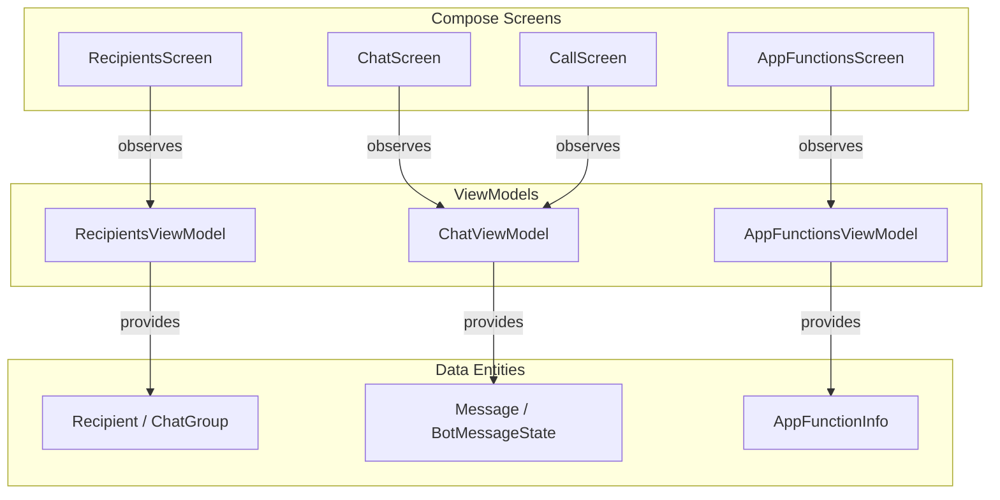
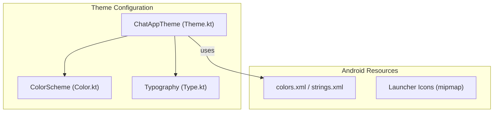

<!-- source: DeepWiki mcp.deepwiki.com · repo android/appfunctions · page 4 UI Layer · fetched 2026-10-23 -->

# UI Layer

Relevant source files

The following files were used as context for generating this wiki page:

- [ChatApp/app/src/main/kotlin/com/example/chatapp/uicomponents/AppFunctionsScreen.kt](ChatApp/app/src/main/kotlin/com/example/chatapp/uicomponents/AppFunctionsScreen.kt)
- [ChatApp/app/src/main/kotlin/com/example/chatapp/uicomponents/CallScreen.kt](ChatApp/app/src/main/kotlin/com/example/chatapp/uicomponents/CallScreen.kt)
- [ChatApp/app/src/main/kotlin/com/example/chatapp/uicomponents/ChatScreen.kt](ChatApp/app/src/main/kotlin/com/example/chatapp/uicomponents/ChatScreen.kt)
- [ChatApp/app/src/main/kotlin/com/example/chatapp/uicomponents/RecipientsScreen.kt](ChatApp/app/src/main/kotlin/com/example/chatapp/uicomponents/RecipientsScreen.kt)

The UI layer of the ChatApp sample is built entirely using **Jetpack Compose**. It follows a reactive programming model where the UI observes state emitted by ViewModels and propagates user events back to them. The layer is organized into functional screens, shared components (like the photo-picker integrated input bar), and a centralized Material3 theming system.

### Component Overview

The UI is structured around four primary screens, each corresponding to a major feature area. These components leverage Material3 components such as `Scaffold`, `TopAppBar`, and `LazyColumn` to provide a modern Android experience.

#### Relationship between UI Components and ViewModels

The following diagram illustrates how the Compose screens map to their respective Hilt-injected ViewModels and the primary data entities they handle.

**UI to Code Entity Mapping**

**Sources:** [ChatApp/app/src/main/kotlin/com/example/chatapp/uicomponents/RecipientsScreen.kt:65-69](), [ChatApp/app/src/main/kotlin/com/example/chatapp/uicomponents/ChatScreen.kt:76-80](), [ChatApp/app/src/main/kotlin/com/example/chatapp/uicomponents/AppFunctionsScreen.kt:55-58](), [ChatApp/app/src/main/kotlin/com/example/chatapp/uicomponents/CallScreen.kt:54-57]()

---

### Screens and Shared Widgets

The application consists of specialized screens for contact management, messaging, active calling, and system settings. A significant shared component is the `InputBar`, which handles text input and media selection via the Android Photo Picker.

*   **`RecipientsScreen`**: Displays a searchable list of `Recipient` and `ChatGroup` entities using `RecipientListItem` and `GroupListItem` [ChatApp/app/src/main/kotlin/com/example/chatapp/uicomponents/RecipientsScreen.kt:65-115]().
*   **`ChatScreen`**: Manages the message thread. It utilizes `MessageList` and `MessageBubble` to render conversations and supports displaying image attachments via the Coil library [ChatApp/app/src/main/kotlin/com/example/chatapp/uicomponents/ChatScreen.kt:141-149]().
*   **`CallScreen`**: A full-screen UI for active calls, featuring a profile icon and an end-call button [ChatApp/app/src/main/kotlin/com/example/chatapp/uicomponents/CallScreen.kt:54-132]().
*   **`AppFunctionsScreen`**: Provides a management interface to toggle the enabled state of individual AppFunctions using `AppFunctionItem` [ChatApp/app/src/main/kotlin/com/example/chatapp/uicomponents/AppFunctionsScreen.kt:129-158]().

For detailed implementation of these components, see **[Screens and UI Components](#4.1)**.

---

### Theme and Resources

The visual identity of the app is defined by the `ChatAppTheme`, which configures the Material3 color schemes, typography, and shapes.

**Theme Hierarchy**

**Sources:** [ChatApp/app/src/main/kotlin/com/example/chatapp/uicomponents/ChatScreen.kt:92-95](), [ChatApp/app/src/main/kotlin/com/example/chatapp/uicomponents/AppFunctionsScreen.kt:73-76]()

*   **Dynamic Theming**: The app uses Material3 `colorScheme` to adapt to system light/dark modes.
*   **Resources**: Strings and basic colors are externalized in XML for localization and maintainability.
*   **App Iconography**: Includes standard launcher icons across all density buckets (hdpi, xhdpi, etc.).

For details on the theming system and resource organization, see **[Theme and Resources](#4.2)**.

---

### Child Pages
- **[Screens and UI Components](#4.1)** — Detailed documentation of `RecipientsScreen`, `ChatScreen`, `CallScreen`, `AppFunctionsScreen`, and the `InputBar`.
- **[Theme and Resources](#4.2)** — Deep dive into `ChatAppTheme`, Material3 configuration, and XML resource management.

---

