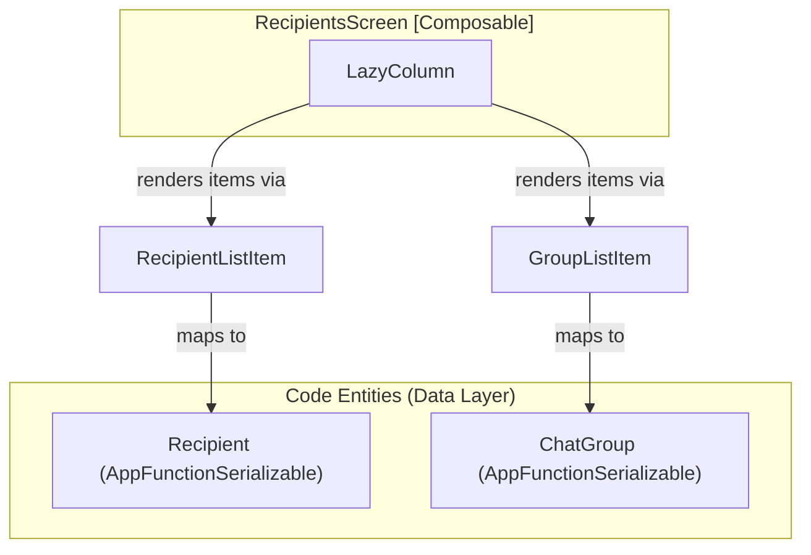
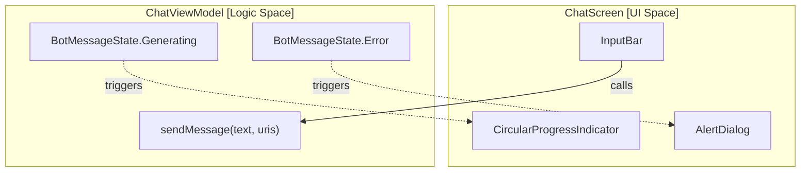

<!-- source: DeepWiki mcp.deepwiki.com · repo android/appfunctions · page 4.1 Screens and UI Components · fetched 2026-10-23 -->

# Screens and UI Components

Relevant source files

The following files were used as context for generating this wiki page:

- [ChatApp/app/src/main/kotlin/com/example/chatapp/InputBar.kt](ChatApp/app/src/main/kotlin/com/example/chatapp/InputBar.kt)
- [ChatApp/app/src/main/kotlin/com/example/chatapp/uicomponents/CallScreen.kt](ChatApp/app/src/main/kotlin/com/example/chatapp/uicomponents/CallScreen.kt)
- [ChatApp/app/src/main/kotlin/com/example/chatapp/uicomponents/ChatScreen.kt](ChatApp/app/src/main/kotlin/com/example/chatapp/uicomponents/ChatScreen.kt)
- [ChatApp/app/src/main/kotlin/com/example/chatapp/uicomponents/DisplayMessage.kt](ChatApp/app/src/main/kotlin/com/example/chatapp/uicomponents/DisplayMessage.kt)
- [ChatApp/app/src/main/kotlin/com/example/chatapp/uicomponents/RecipientsScreen.kt](ChatApp/app/src/main/kotlin/com/example/chatapp/uicomponents/RecipientsScreen.kt)

This page documents the UI layer of the ChatApp sample, focusing on the Jetpack Compose implementations of the primary screens and shared components. The architecture follows a reactive pattern where Composables observe state from Hilt-injected ViewModels and propagate user events back through callbacks.

## Shared Components

### InputBar
The `InputBar` is a specialized internal Composable used in the `ChatScreen` to handle message composition and media selection [ChatApp/app/src/main/kotlin/com/example/chatapp/InputBar.kt:62-70]().

**Key Features:**
*   **Photo Picker Integration:** Uses `rememberLauncherForActivityResult` with `PickMultipleVisualMedia` to allow users to select images from the device gallery [ChatApp/app/src/main/kotlin/com/example/chatapp/InputBar.kt:71-75]().
*   **Media Preview:** Selected images are displayed in a `LazyRow` above the text field using Coil's `AsyncImage` [ChatApp/app/src/main/kotlin/com/example/chatapp/InputBar.kt:82-99]().
*   **Dynamic State:** The "Send" button's enabled state is controlled by the parent screen, typically based on whether a bot response is currently generating [ChatApp/app/src/main/kotlin/com/example/chatapp/InputBar.kt:66-66]().

**Data Flow: InputBar to ViewModel**
| Action | Implementation |
| :--- | :--- |
| **Select Image** | `photoPickerLauncher.launch()` is called via the "Add" icon [ChatApp/app/src/main/kotlin/com/example/chatapp/InputBar.kt:107-118](). |
| **Type Text** | `onInputChanged` callback updates the parent's message state [ChatApp/app/src/main/kotlin/com/example/chatapp/InputBar.kt:121-123](). |
| **Send Message** | `onSendClick` passes the list of `Uri` objects and the current text, then clears the local `selectedImages` state [ChatApp/app/src/main/kotlin/com/example/chatapp/InputBar.kt:148-152](). |

**Sources:** [ChatApp/app/src/main/kotlin/com/example/chatapp/InputBar.kt:16-164]()

---

## RecipientsScreen

The `RecipientsScreen` serves as the landing page of the application, displaying a list of available chat threads (individual contacts and groups) [ChatApp/app/src/main/kotlin/com/example/chatapp/uicomponents/RecipientsScreen.kt:65-69]().

### UI Entities Mapping
The following diagram maps UI components to the underlying data models defined in the AppFunctions logic.

**UI to Code Entity Mapping: Recipients**

**Sources:** [ChatApp/app/src/main/kotlin/com/example/chatapp/uicomponents/RecipientsScreen.kt:92-114](), [ChatApp/app/src/main/kotlin/com/example/chatapp/uicomponents/RecipientsScreen.kt:53-54]()

### Implementation Details
*   **List Rendering:** Uses a `LazyColumn` to render `groups` followed by individual `recipients` [ChatApp/app/src/main/kotlin/com/example/chatapp/uicomponents/RecipientsScreen.kt:92-95]().
*   **Dynamic Preview:** Each list item observes the last message for its specific ID using `collectAsStateWithLifecycle` to show a snippet of the conversation [ChatApp/app/src/main/kotlin/com/example/chatapp/uicomponents/RecipientsScreen.kt:97-101]().
*   **Navigation:** Clicking an item triggers `onRecipientClick(id)`, which navigates the user to the specific chat thread [ChatApp/app/src/main/kotlin/com/example/chatapp/uicomponents/RecipientsScreen.kt:102-112]().

**Sources:** [ChatApp/app/src/main/kotlin/com/example/chatapp/uicomponents/RecipientsScreen.kt:16-116]()

---

## ChatScreen

The `ChatScreen` manages the conversation interface, including message history, bot status indicators, and the input interface [ChatApp/app/src/main/kotlin/com/example/chatapp/uicomponents/ChatScreen.kt:76-80]().

### Message Components
*   **MessageList:** A `LazyColumn` that iterates through `DisplayMessage` objects [ChatApp/app/src/main/kotlin/com/example/chatapp/uicomponents/ChatScreen.kt:141-148]().
*   **DisplayMessage Data Class:** Holds content, timestamp, sender info, and a list of image `Uri` attachments [ChatApp/app/src/main/kotlin/com/example/chatapp/uicomponents/DisplayMessage.kt:23-48]().
*   **State Handling:**
    *   **BotMessageState.Generating:** Displays a `CircularProgressIndicator` while the simulated bot is "typing" [ChatApp/app/src/main/kotlin/com/example/chatapp/uicomponents/ChatScreen.kt:151-157]().
    *   **BotMessageState.Error:** Displays an `AlertDialog` if a message fails to send [ChatApp/app/src/main/kotlin/com/example/chatapp/uicomponents/ChatScreen.kt:159-170]().

**UI to Code Entity Mapping: Chat State**

**Sources:** [ChatApp/app/src/main/kotlin/com/example/chatapp/uicomponents/ChatScreen.kt:150-171](), [ChatApp/app/src/main/kotlin/com/example/chatapp/uicomponents/ChatScreen.kt:124-127]()

---

## CallScreen

The `CallScreen` provides a full-screen interface for active voice/video calls. It is often reached via the `makeCall` AppFunction [ChatApp/app/src/main/kotlin/com/example/chatapp/uicomponents/CallScreen.kt:54-57]().

### Call Lifecycle
1.  **Entry:** On composition, `LaunchedEffect(Unit)` calls `viewModel.startCall()` to initialize the call state [ChatApp/app/src/main/kotlin/com/example/chatapp/uicomponents/CallScreen.kt:60-62]().
2.  **Display:** Observes `activeCall` state to display the name of the recipient [ChatApp/app/src/main/kotlin/com/example/chatapp/uicomponents/CallScreen.kt:58-58](). If no data is available, it defaults to "Unknown" [ChatApp/app/src/main/kotlin/com/example/chatapp/uicomponents/CallScreen.kt:99-99]().
3.  **Termination:** The "End Call" button calls `viewModel.endCall()` and executes the `onEndCall` navigation callback [ChatApp/app/src/main/kotlin/com/example/chatapp/uicomponents/CallScreen.kt:115-119]().

**Sources:** [ChatApp/app/src/main/kotlin/com/example/chatapp/uicomponents/CallScreen.kt:16-132]()

---

## AppFunctionsScreen

This screen allows users to manage the visibility and availability of the app's registered AppFunctions [ChatApp/app/src/main/kotlin/com/example/chatapp/uicomponents/AppFunctionsScreen.kt (referenced in purpose)]().

*   **Function List:** Iterates through `AppFunctionInfo` objects provided by the `AppFunctionsViewModel`.
*   **Toggle Logic:** Provides a switch for each function (e.g., `searchContacts`, `send`, `makeCall`). When toggled, it communicates with the `AppFunctionManager` to enable or disable the function at the system level.

**Sources:** [Section 4.1 Purpose Statement]()

---

