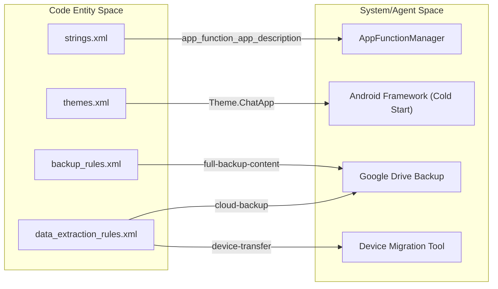

<!-- source: DeepWiki mcp.deepwiki.com · repo android/appfunctions · page 4.2 Theme and Resources · fetched 2026-10-23 -->

# Theme and Resources

<details>
<summary>Relevant source files</summary>

The following files were used as context for generating this wiki page:

- [ChatApp/app/src/main/kotlin/com/example/chatapp/ui/theme/Color.kt](ChatApp/app/src/main/kotlin/com/example/chatapp/ui/theme/Color.kt)
- [ChatApp/app/src/main/kotlin/com/example/chatapp/ui/theme/Theme.kt](ChatApp/app/src/main/kotlin/com/example/chatapp/ui/theme/Theme.kt)
- [ChatApp/app/src/main/kotlin/com/example/chatapp/ui/theme/Type.kt](ChatApp/app/src/main/kotlin/com/example/chatapp/ui/theme/Type.kt)
- [ChatApp/app/src/main/res/values/colors.xml](ChatApp/app/src/main/res/values/colors.xml)
- [ChatApp/app/src/main/res/values/strings.xml](ChatApp/app/src/main/res/values/strings.xml)
- [ChatApp/app/src/main/res/values/themes.xml](ChatApp/app/src/main/res/values/themes.xml)
- [ChatApp/app/src/main/res/xml/backup_rules.xml](ChatApp/app/src/main/res/xml/backup_rules.xml)
- [ChatApp/app/src/main/res/xml/data_extraction_rules.xml](ChatApp/app/src/main/res/xml/data_extraction_rules.xml)

</details>


This page details the visual configuration and resource management of the ChatApp. The application utilizes a **Material 3** design system implemented via Jetpack Compose for its UI components, while maintaining standard Android XML resources for legacy compatibility, string localization, and system-level configurations like backup rules.

## Material 3 Theme System

The ChatApp's visual identity is defined through a Material 3 implementation centered around the `ChatAppTheme` composable. This system manages colors, typography, and supports modern Android features like Dynamic Color.

### Color Palettes
The application defines specific hex values in `Color.kt` which are then organized into `lightColorScheme` and `darkColorScheme` within `Theme.kt`.

| Palette Type | Primary | Secondary | Tertiary |
|:---|:---|:---|:---|
| **Dark** | `Purple80` (0xFFD0BCFF) | `PurpleGrey80` (0xFFCCC2DC) | `Pink80` (0xFFEFB8C8) |
| **Light** | `Purple40` (0xFF6650a4) | `PurpleGrey40` (0xFF625b71) | `Pink40` (0xFF7D5260) |

**Sources:**
* [ChatApp/app/src/main/kotlin/com/example/chatapp/ui/theme/Color.kt:20-25]()
* [ChatApp/app/src/main/kotlin/com/example/chatapp/ui/theme/Theme.kt:28-40]()

### Typography
The typography system is unified in `Type.kt`. It currently overrides the `bodyLarge` style to use the default font family with a size of 16sp and a line height of 24sp.

**Sources:**
* [ChatApp/app/src/main/kotlin/com/example/chatapp/ui/theme/Type.kt:24-34]()

### Theme Implementation and Dynamic Color
The `ChatAppTheme` function serves as the root wrapper for the Compose UI. It includes logic to support **Dynamic Color** (Material You) on devices running Android 12 (API 31) or higher.

**Theme Logic Flow:**
1. Check if `dynamicColor` is enabled and the SDK version is >= `Build.VERSION_CODES.S`.
2. If true, use `dynamicDarkColorScheme` or `dynamicLightColorScheme` based on the system theme.
3. If false or unsupported, fallback to the hardcoded `DarkColorScheme` or `LightColorScheme`.
4. Apply the resulting `colorScheme` and `Typography` to the `MaterialTheme` provider.

#### Diagram: Theme Resolution Logic
```mermaid
graph TD
    subgraph "Natural Language Space"
        A["User System Settings"]
        B["Material 3 Specs"]
    end

    subgraph "Code Entity Space"
        C["ChatAppTheme"]
        D["isSystemInDarkTheme()"]
        E["dynamicDarkColorScheme"]
        F["dynamicLightColorScheme"]
        G["DarkColorScheme"]
        H["LightColorScheme"]
        I["MaterialTheme"]
    end

    A --> D
    D --> C
    C -->| "SDK >= 31 & dynamicColor=true" | E
    C -->| "SDK >= 31 & dynamicColor=true" | F
    C -->| "Dark Mode" | G
    C -->| "Light Mode" | H
    E --> I
    F --> I
    G --> I
    H --> I
```

**Sources:**
* [ChatApp/app/src/main/kotlin/com/example/chatapp/ui/theme/Theme.kt:43-65]()

## XML Resources

While the UI is built with Compose, several aspects of the application rely on traditional XML resource files for system integration and static content.

### Strings and Localization
The `strings.xml` file contains all user-facing text. Notably, it includes descriptions used by the AppFunctions system to describe the app's capabilities to the Android system agent.

* **App Name:** `app_name` ("ChatApp") [ChatApp/app/src/main/res/values/strings.xml:18]()
* **AppFunction Description:** `app_function_app_description` provides context for the system agent (e.g., "Use this when a user says they want to KakaoTalk with someone.") [ChatApp/app/src/main/res/values/strings.xml:25-26]()

### Legacy Theme and Colors
* **colors.xml**: Defines a set of legacy colors (e.g., `purple_500`, `teal_200`) used primarily for non-Compose elements or system-level views. [ChatApp/app/src/main/res/values/colors.xml:18-24]()
* **themes.xml**: Defines `Theme.ChatApp`, which inherits from `Theme.Material.Light.NoActionBar`. This ensures the Activity has a valid theme during the cold start before Compose takes over. [ChatApp/app/src/main/res/values/themes.xml:19]()

**Sources:**
* [ChatApp/app/src/main/res/values/strings.xml:17-28]()
* [ChatApp/app/src/main/res/values/colors.xml:17-25]()
* [ChatApp/app/src/main/res/values/themes.xml:17-20]()

## Data Management and Backup Rules

The application defines rules for how Android should handle app data during backups and device transfers.

### Backup Rules
Defined in `backup_rules.xml`, these rules govern the **Auto Backup** feature. The current implementation uses a default `<full-backup-content>` tag, which can be customized to include or exclude specific shared preferences or files.

### Data Extraction Rules
Defined in `data_extraction_rules.xml`, these rules specify what data can be extracted from the device via cloud backups or device-to-device transfers (introduced in Android 12).

#### Diagram: Resource to System Mapping


**Sources:**
* [ChatApp/app/src/main/res/xml/backup_rules.xml:24-29]()
* [ChatApp/app/src/main/res/xml/data_extraction_rules.xml:22-35]()

---

