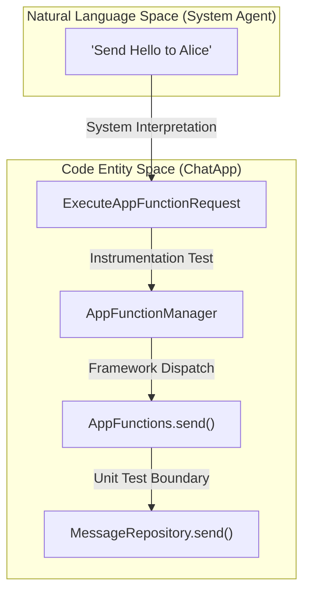
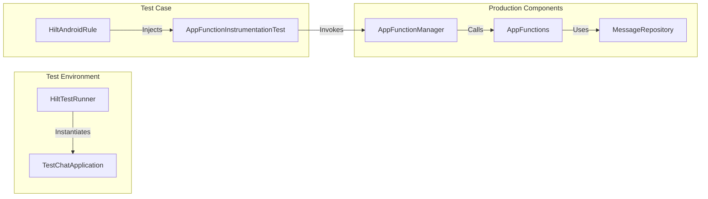

<!-- source: DeepWiki mcp.deepwiki.com · repo android/appfunctions · page 5 Testing · fetched 2026-10-23 -->

# Testing

Relevant source files

The following files were used as context for generating this wiki page:

- [ChatApp/app/src/androidTest/kotlin/com/example/chatapp/AppFunctionsViewModelTest.kt](ChatApp/app/src/androidTest/kotlin/com/example/chatapp/AppFunctionsViewModelTest.kt)
- [ChatApp/app/src/androidTest/kotlin/com/example/chatapp/appfunctions/AppFunctionInstrumentationTest.kt](ChatApp/app/src/androidTest/kotlin/com/example/chatapp/appfunctions/AppFunctionInstrumentationTest.kt)
- [ChatApp/app/src/androidTest/kotlin/com/example/chatapp/appfunctions/AppFunctionsTest.kt](ChatApp/app/src/androidTest/kotlin/com/example/chatapp/appfunctions/AppFunctionsTest.kt)

The ChatApp sample employs a multi-layered testing strategy to ensure the reliability of its AppFunctions integration, business logic, and UI state management. Testing is divided between local unit tests for core function logic and instrumentation tests that exercise the full Android `AppFunctionManager` stack and Hilt-injected components.

## Testing Strategy Overview

The testing architecture bridges the gap between the high-level Natural Language Space (how a user or agent invokes functions) and the Code Entity Space (how the app processes those requests).

### Natural Language to Code Entity Mapping

The following diagram illustrates how testing validates the transition from a system-level function execution request to the internal repository calls.

**Function Execution Flow Validation**

**Sources:**
- [ChatApp/app/src/androidTest/kotlin/com/example/chatapp/appfunctions/AppFunctionInstrumentationTest.kt:77-103]()
- [ChatApp/app/src/androidTest/kotlin/com/example/chatapp/appfunctions/AppFunctionsTest.kt:134-144]()

## Unit Testing AppFunctions

Local unit tests focus on the `AppFunctions` class, which contains the `@AppFunction` annotated methods. These tests use a `MockMessageRepository` to isolate the business logic of the functions from the actual data layer.

*   **Logic Verification**: Validates search logic (partial matches, group vs. individual filtering), message validation (empty body checks), and error mapping.
*   **Error Handling**: Ensures that internal exceptions are correctly mapped to `AppFunctionException` subtypes like `AppFunctionInvalidArgumentException` or `AppFunctionElementNotFoundException`.
*   **Concurrency**: Utilizes `runBlocking` and `runTest` to handle the suspendable nature of repository calls.

For details, see [AppFunctions Unit Tests](#5.1).

**Sources:**
- [ChatApp/app/src/androidTest/kotlin/com/example/chatapp/appfunctions/AppFunctionsTest.kt:47-80]()
- [ChatApp/app/src/androidTest/kotlin/com/example/chatapp/appfunctions/AppFunctionsTest.kt:90-213]()

## Instrumentation and Hilt Infrastructure

Instrumentation tests run on an Android device or emulator to verify the integration with the system service `AppFunctionManager`. This layer ensures that the metadata generated by the AppFunctions compiler is correctly registered and that the system can successfully invoke the app's code.

### Hilt Test Environment
The project uses a specialized Hilt configuration for testing to allow dependency injection within the `androidTest` source set. This includes:
*   **HiltTestRunner**: A custom runner to initialize the `TestChatApplication`.
*   **HiltAndroidRule**: Manages the injection lifecycle for each test case.

### Component Interaction Mapping
This diagram shows how the test infrastructure interacts with the Hilt-managed application components.

**Hilt Test Infrastructure**

For details, see [Instrumentation Tests and Hilt Test Infrastructure](#5.2).

**Sources:**
- [ChatApp/app/src/androidTest/kotlin/com/example/chatapp/appfunctions/AppFunctionInstrumentationTest.kt:45-63]()
- [ChatApp/app/src/androidTest/kotlin/com/example/chatapp/AppFunctionsViewModelTest.kt:28-37]()

## UI and ViewModel Testing

Testing also extends to the presentation layer, specifically the `AppFunctionsViewModel`. These tests verify that the `uiState` correctly reflects the availability and enabled status of AppFunctions as reported by the system.

*   **ViewModel Lifecycle**: Tests initial state population and ensures that toggling function availability via `AppFunctionManager` does not cause crashes.
*   **Flow Collection**: Validates that `StateFlow` updates are emitted correctly for the UI to consume.

**Sources:**
- [ChatApp/app/src/androidTest/kotlin/com/example/chatapp/AppFunctionsViewModelTest.kt:39-59]()

---

