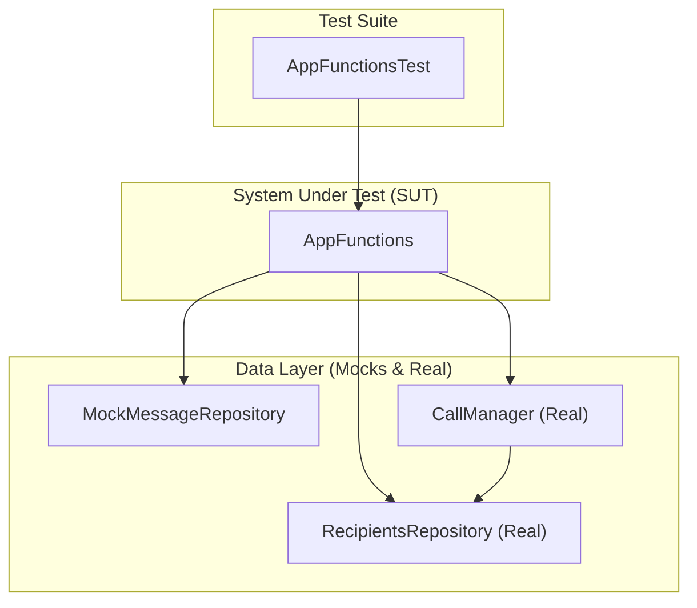
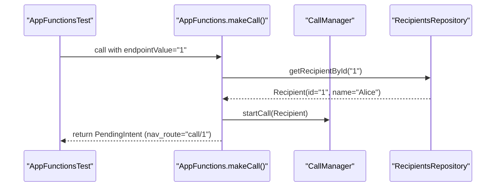

<!-- source: DeepWiki mcp.deepwiki.com · repo android/appfunctions · page 5.1 AppFunctions Unit Tests · fetched 2026-10-23 -->

# AppFunctions Unit Tests

Relevant source files

The following files were used as context for generating this wiki page:

- [ChatApp/app/src/androidTest/kotlin/com/example/chatapp/appfunctions/AppFunctionsTest.kt](ChatApp/app/src/androidTest/kotlin/com/example/chatapp/appfunctions/AppFunctionsTest.kt)

The `AppFunctionsTest` class provides comprehensive unit testing for the `@AppFunction` annotated methods defined in the `AppFunctions` class. These tests ensure that the logic for searching contacts, sending messages, and initiating calls behaves correctly under various conditions, including success paths and error scenarios.

## Testing Infrastructure

The unit tests utilize a mix of real and mock components to isolate the logic of the `AppFunctions` class.

### MockMessageRepository Pattern
To avoid dependencies on the actual message storage and network simulation, a `MockMessageRepository` is implemented within the test file. This mock allows for:
*   **State Tracking**: It maintains an in-memory `MutableStateFlow` of messages [ChatApp/app/src/androidTest/kotlin/com/example/chatapp/appfunctions/AppFunctionsTest.kt:49-53]().
*   **Failure Simulation**: A `shouldFail` flag can be toggled to trigger a `RuntimeException`, simulating repository-level failures [ChatApp/app/src/androidTest/kotlin/com/example/chatapp/appfunctions/AppFunctionsTest.kt:48-75]().

### Coroutine Handling
The tests use specific coroutine builders depending on the requirement:
*   **`runBlocking`**: Used for functions that are simple suspending calls where timing control isn't strictly necessary [ChatApp/app/src/androidTest/kotlin/com/example/chatapp/appfunctions/AppFunctionsTest.kt:92-94]().
*   **`runTest`**: Used for more complex asynchronous flows to provide improved control over virtual time and ensuring all child jobs complete [ChatApp/app/src/androidTest/kotlin/com/example/chatapp/appfunctions/AppFunctionsTest.kt:135-145]().

### Test Setup Diagram: Code Entity Space
This diagram illustrates how the test class instantiates the system under test (SUT) using mock and real data layer entities.

**AppFunctions Test Dependency Graph**

**Sources:** [ChatApp/app/src/androidTest/kotlin/com/example/chatapp/appfunctions/AppFunctionsTest.kt:82-88]()

---

## Test Cases: searchContacts

The `searchContacts` tests verify the filtering logic for retrieving individuals and groups from the `RecipientsRepository`.

| Test Case | Scenario | Expected Outcome |
| :--- | :--- | :--- |
| `searchContacts_returnsEmptyList` | Query for "nonexistent" | Throws `AppFunctionInvalidArgumentException` [ChatApp/app/src/androidTest/kotlin/com/example/chatapp/appfunctions/AppFunctionsTest.kt:90-95]() |
| `searchContacts_returnsMatches` | Query "Alice" with `INDIVIDUAL` filter | Returns 1 contact: "Alice Smith" [ChatApp/app/src/androidTest/kotlin/com/example/chatapp/appfunctions/AppFunctionsTest.kt:97-104]() |
| `searchContacts_groups_returnsMatches` | Query "Work" with `GROUP` filter | Returns 1 contact: "Work Friends" [ChatApp/app/src/androidTest/kotlin/com/example/chatapp/appfunctions/AppFunctionsTest.kt:106-113]() |
| `searchContacts_emptyQuery_returnsRecent` | Empty query string | Returns list of 3 recent contacts [ChatApp/app/src/androidTest/kotlin/com/example/chatapp/appfunctions/AppFunctionsTest.kt:116-121]() |
| `searchContacts_anyType_returnsMatches` | Query "Alice" with `ANY` filter | Returns matches regardless of type [ChatApp/app/src/androidTest/kotlin/com/example/chatapp/appfunctions/AppFunctionsTest.kt:123-131]() |

**Sources:** [ChatApp/app/src/androidTest/kotlin/com/example/chatapp/appfunctions/AppFunctionsTest.kt:90-131]()

---

## Test Cases: send

The `send` tests evaluate the message dispatching logic, including attachment handling and error propagation.

### Success Scenarios
*   **Basic Send**: Verifies that a standard text message returns a `Result` object with the correct message ID and status string [ChatApp/app/src/androidTest/kotlin/com/example/chatapp/appfunctions/AppFunctionsTest.kt:134-145]().
*   **Image URIs**: Ensures that passing a list of `Uri` objects (e.g., `content://media/1`) is handled correctly by the function [ChatApp/app/src/androidTest/kotlin/com/example/chatapp/appfunctions/AppFunctionsTest.kt:148-166]().
*   **Group Send**: Validates that messages can be addressed to group IDs (e.g., "g1") [ChatApp/app/src/androidTest/kotlin/com/example/chatapp/appfunctions/AppFunctionsTest.kt:169-180]().

### Failure Scenarios
*   **Empty Content**: Sending a message with an empty string throws `AppFunctionInvalidArgumentException` [ChatApp/app/src/androidTest/kotlin/com/example/chatapp/appfunctions/AppFunctionsTest.kt:182-187]().
*   **Invalid Recipient**: Providing a recipient ID that does not exist in the repository throws `AppFunctionElementNotFoundException` [ChatApp/app/src/androidTest/kotlin/com/example/chatapp/appfunctions/AppFunctionsTest.kt:189-194]().
*   **Repository Failure**: When `MockMessageRepository.shouldFail` is true, the function wraps the internal error into an `AppFunctionAppUnknownException` [ChatApp/app/src/androidTest/kotlin/com/example/chatapp/appfunctions/AppFunctionsTest.kt:196-202]().

**Sources:** [ChatApp/app/src/androidTest/kotlin/com/example/chatapp/appfunctions/AppFunctionsTest.kt:134-202]()

---

## Test Cases: makeCall

The `makeCall` tests focus on the generation of `PendingIntent` objects for navigating to the call screen.

*   **By ID**: Verifies that providing an `endpointValue` (recipient ID) returns a valid `PendingIntent` [ChatApp/app/src/androidTest/kotlin/com/example/chatapp/appfunctions/AppFunctionsTest.kt:205-210]().
*   **By Name**: Verifies that providing an `endpointValue` (contact name) also results in a successful intent generation [ChatApp/app/src/androidTest/kotlin/com/example/chatapp/appfunctions/AppFunctionsTest.kt:213-215]().

### Logic Flow: Natural Language to Code Entity Space
This diagram maps the high-level test intent to the specific code components invoked during the `makeCall` execution.

**makeCall Execution Flow**

**Sources:** [ChatApp/app/src/androidTest/kotlin/com/example/chatapp/appfunctions/AppFunctionsTest.kt:205-215]()

---

